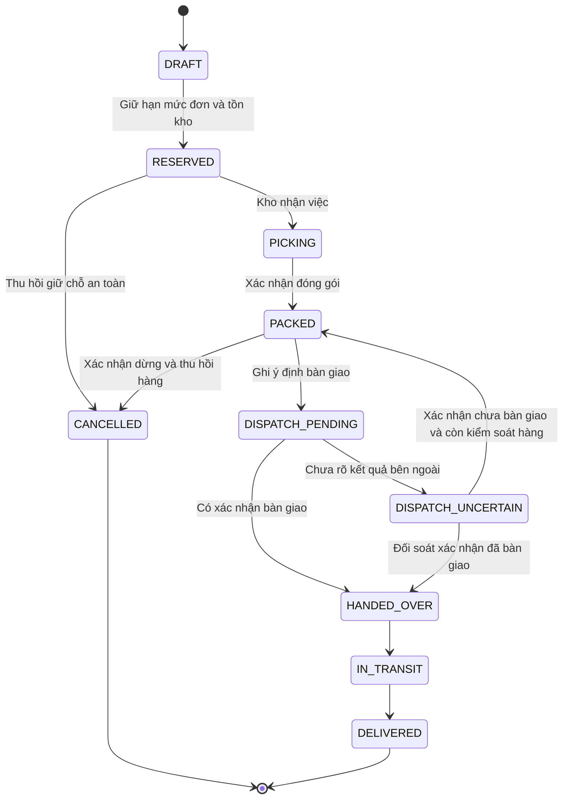

# Partial fulfillment: bảo vệ quy tắc giao hàng từng phần

Trong chương **Fulfillment Rules**, partial fulfillment là việc thực hiện một đơn hàng qua nhiều lần giao, nhiều kiện hoặc nhiều kho. Ví dụ, khách mua năm sản phẩm nhưng kho A chỉ sẵn ba sản phẩm; hệ thống giao ba trước và giữ hai sản phẩm cho đợt sau.

Sự linh hoạt này tạo ra những đường lạm dụng logic: gửi hai yêu cầu cùng lúc để giao vượt số lượng, hủy phần đã xuất kho để nhận lại tiền, dùng callback trùng để cộng số lượng hai lần, hoặc ghép dòng hàng của đơn khác vào một shipment. Bài học tập trung vào business invariants, state machine, quyền theo đối tượng, transaction, idempotency và kiểm thử những tình huống đó.

## 1. Mục tiêu và phạm vi

Sau bài học, bạn có thể:

- Biểu diễn chính xác phần chưa giao, phần đang thực hiện, phần đã bàn giao và phần đã hủy của từng dòng đơn.
- Đặt điều kiện để các yêu cầu giao từng phần không tranh chấp cùng một lượng hàng.
- Phân biệt quyền của khách hàng, nhân viên kho, dịch vụ điều phối và bên vận chuyển.
- Xử lý giao, hủy, trả hàng và hoàn tiền theo những sổ theo dõi riêng nhưng liên kết được với nhau.
- Thiết kế idempotency và đối soát cho các tác dụng phụ không thể rollback bằng transaction cơ sở dữ liệu.

Phạm vi ví dụ là đơn bán hàng có số lượng nguyên theo từng dòng, một tenant có thể có nhiều kho và đơn có thể giao nhiều lần. Đổi sản phẩm, hàng cân đo theo số thập phân, giao sản phẩm số và bộ sản phẩm có cấu trúc cần quy tắc bổ sung. Không áp dụng máy móc phép đếm trong bài cho những mô hình đó.

Các trạng thái và chính sách được chọn trong bài là một thiết kế minh họa, không phải quy tắc bắt buộc cho mọi hệ thống bán hàng.

## 2. Tách các khái niệm dễ bị nhập làm một

| Khái niệm | Câu hỏi được trả lời | Điều không được suy diễn |
| --- | --- | --- |
| Order line | Khách đã đặt mặt hàng nào, bao nhiêu và theo điều kiện nào? | Một dòng đơn không đồng nghĩa một lần giao |
| Fulfillment allocation | Bao nhiêu đơn vị của dòng đơn đã được dành cho một lần thực hiện? | Giữ hạn mức thực hiện chưa chứng minh đã giao hàng |
| Inventory reservation | Kho đã giữ lượng tồn nào để thực hiện? | Có tồn kho không đồng nghĩa còn được phép giao trên đơn |
| Shipment | Kiện hoặc chuyến giao chứa những phần hàng nào? | Một shipment thành công không làm cả đơn thành công |
| Carrier handover | Kho đã bàn giao cho bên vận chuyển chưa? | Tạo nhãn vận chuyển chưa phải bàn giao |
| Delivery | Người nhận đã nhận hàng theo bằng chứng được chấp nhận chưa? | Bàn giao cho đơn vị vận chuyển chưa phải giao tới người nhận |
| Return | Hàng nào đã được trả và xử lý theo quy trình trả hàng? | Hàng trả về không tự mở lại hạn mức giao của đơn gốc |
| Refund | Giá trị tiền nào được hoàn trên giao dịch nào? | Số lượng hủy không tự chứng minh tiền đã hoàn |

Đặc biệt, trạng thái `PARTIALLY_FULFILLED` của cả đơn chỉ là bản tóm tắt. Quyết định có được tạo lần giao tiếp theo hay hủy một phần phải dựa trên dữ liệu từng dòng và các lần thực hiện liên quan.

## 3. Mô hình đe dọa của giao hàng từng phần

Người có thể gây ra yêu cầu sai không chỉ là người dùng bên ngoài. Một tài khoản nhân viên có quyền kho A, tác vụ nền cũ hoặc tích hợp gửi lặp cũng có thể làm vi phạm quy tắc nếu ứng dụng tin dữ liệu đầu vào quá mức.

| Tình huống | Lỗi thiết kế | Hậu quả |
| --- | --- | --- |
| Gửi hai yêu cầu mỗi yêu cầu giao ba trên đơn còn bốn | Đọc số dư rồi ghi ở các transaction tách rời | Giao sáu dù chỉ còn bốn |
| Lặp cùng một dòng đơn hai lần trong payload | Chỉ kiểm tra từng phần tử độc lập | Tổng lượng vượt giới hạn dù từng phần tử có vẻ hợp lệ |
| Trộn `orderLineId` của đơn khác | Kiểm tra quyền ở order nhưng tải line bằng ID riêng | Lấy hàng từ dòng không thuộc quyền |
| Chọn kho ngoài phạm vi được quản lý | Chỉ kiểm tra vai trò chung `WAREHOUSE_STAFF` | Điều chuyển hoặc xuất hàng trái quyền |
| Gửi `shippedQty`, giá hoặc trạng thái từ client | Ánh xạ trực tiếp DTO vào entity | Tự tạo bằng chứng giao hàng hoặc thay giá trị đơn |
| Hủy đồng thời lúc kho bàn giao hàng | Không có điểm quyết định chung giữa hủy và giao | Vừa xuất hàng vừa mở quyền hoàn tiền |
| Callback cùng sự kiện đến nhiều lần | Cộng lượng mỗi khi nhận HTTP request | Ghi nhận giao hoặc hoàn thành nhiều lần |
| Callback đến sai thứ tự | So sánh trạng thái bằng thứ tự số đơn giản | Lùi trạng thái hoặc bỏ qua bước bắt buộc |
| Tách đơn thành nhiều chuyến để tính lại ưu đãi | Áp lại công thức cấp đơn cho từng shipment | Tăng chiết khấu hoặc hưởng lại trợ giá |
| Timeout khi tạo chuyến bên ngoài rồi tạo chuyến mới | Coi không có phản hồi là không có tác dụng | Hai chuyến vật lý cho cùng lượng hàng |

Mã shipment khó đoán và xác thực webhook đều cần thiết theo thiết kế tương ứng, nhưng không thay thế kiểm tra quan hệ order–line–allocation–warehouse và điều kiện chuyển trạng thái.

## 4. Đặt bất biến số lượng theo từng dòng đơn

### 4.1. Các đại lượng không chồng lấn

Với một dòng đơn, đặt:

- `O` — số lượng được chấp nhận đặt mua của dòng đơn.
- `C` — số lượng đã hủy trước khi bàn giao, theo quyết định hủy hợp lệ.
- `F` — số lượng đang cam kết cho các lần thực hiện nhưng chưa được ghi nhận đã bàn giao.
- `H` — số lượng lũy kế đã được ghi nhận bàn giao hợp lệ cho bên vận chuyển.
- `U` — số lượng chưa được cam kết thực hiện và chưa hủy.

`F` gồm hàng đang giữ chỗ, lấy hàng, đóng gói, chờ gửi lệnh giao và cả phần chưa rõ kết quả bàn giao. Một lượng hàng không được đồng thời nằm trong hai allocation đang hoạt động. Khi đã chuyển sang `H`, chính lượng đó không còn được tính trong `F`.

Bất biến cốt lõi:

```text
O >= 0
C >= 0, F >= 0, H >= 0, U >= 0
O = C + F + H + U
U = O - C - F - H
```

Các đại lượng trên là các nhóm trong sổ theo dõi nghiệp vụ của hệ thống. Với bàn giao chưa xác định, thực tế vật lý có thể đã xảy ra nhưng hệ thống chưa có bằng chứng đủ tin cậy; phần đó tiếp tục chiếm `F` cho tới khi đối soát, thay vì trở thành lượng tự do để giao lại.

Ví dụ:

| Đại lượng | Giá trị | Ý nghĩa |
| --- | --- | --- |
| `O` | 10 | Khách đặt mười sản phẩm |
| `C` | 2 | Hai sản phẩm đã được hủy hợp lệ |
| `F` | 3 | Ba sản phẩm đang được thực hiện |
| `H` | 4 | Bốn sản phẩm đã được ghi nhận bàn giao |
| `U` | 1 | Chỉ một sản phẩm còn được phép tạo allocation mới |

Không dùng công thức `O - H` để quyết định có thể giao thêm bao nhiêu. Công thức đó bỏ qua lượng đã hủy và lượng đã được cam kết ở lần giao khác.

### 4.2. Mỗi thao tác chuyển lượng giữa những nhóm xác định

| Thao tác | Tiền điều kiện | Thay đổi số lượng |
| --- | --- | --- |
| Cam kết thực hiện `q` | `q > 0` và `q <= U` | `U -= q`, `F += q` |
| Hủy lượng chưa được cam kết | `q > 0` và `q <= U` | `U -= q`, `C += q` |
| Bỏ allocation để lập kế hoạch lại | Dừng thực hiện đã được xác nhận an toàn | `F -= q`, `U += q` |
| Hủy lượng đang cam kết | Đã dừng và thu hồi quyền kiểm soát hàng an toàn | `F -= q`, `C += q` |
| Xác nhận bàn giao | Đúng allocation, `q` chưa từng được xác nhận bàn giao | `F -= q`, `H += q` |
| Giao tới người nhận | Có bằng chứng hợp lệ, không vượt lượng đã bàn giao | Cập nhật sổ delivery; không tăng `H` lần nữa |
| Nhận hàng trả về | Đúng đối tượng trả hàng và lượng được phép | Cập nhật sổ return; không tự giảm `H` |

Nếu lượng đã bàn giao được trả về, `H` vẫn phản ánh lịch sử bàn giao. Việc nhập lại tồn là thay đổi ở sổ tồn kho. Nếu muốn giao thay thế, phải có nghiệp vụ replacement với hạn mức, căn cứ và liên kết riêng; không xóa lịch sử giao để biến hàng trả thành quyền giao mới.

Sổ delivery có thể theo dõi `D`, với `0 <= D <= H`. Trong ví dụ chỉ xét trả hàng sau khi đã giao tới người nhận, lượng đã chấp nhận trả `R` thỏa `0 <= R <= D`. Hàng bị từ chối tại cửa hoặc hoàn về trước khi giao thành công cần nhánh nghiệp vụ riêng; không ép các trường hợp đó vào cùng định nghĩa `R`.

### 4.3. Bất biến ngoài số lượng

- Đơn, dòng đơn, allocation và shipment phải thuộc cùng tenant và quan hệ dữ liệu hợp lệ.
- SKU, biến thể và đơn vị tính thực hiện phải khớp với dòng đơn; thay thế sản phẩm phải qua quy tắc riêng.
- Tổng lượng của các allocation còn chiếm hạn mức phải khớp `F`; tổng bàn giao hợp lệ phải khớp `H`.
- Lượng giữ tồn tại từng kho phải nhất quán với nhu cầu giữ tồn của allocation theo mô hình tồn kho đã chọn; không trừ tồn hai lần khi chuyển bước.
- Giao hàng từng phần không tự thay đổi giá chốt, ưu đãi cấp đơn, chủ thể thanh toán hoặc địa chỉ giao đã được phê duyệt.
- Chỉ chuyển trạng thái bằng lệnh có chủ thể, điều kiện và bằng chứng phù hợp.

Với số lượng nguyên, dùng kiểu số đủ miền giá trị và kiểm tra tràn số khi cộng payload. Không cho số âm, số thập phân hoặc giá trị ngoài giới hạn lọt qua bước chuẩn hóa rồi biến thành cách tăng số dư.

## 5. Thiết kế trạng thái cho từng lần thực hiện

Một state machine minh họa:



`DRAFT` ở đây chỉ là bản kế hoạch chưa chiếm hạn mức. Từ `RESERVED` đến các trạng thái chờ xác nhận bàn giao, lượng vẫn chiếm `F`. Khi chuyển sang `HANDED_OVER`, lượng đó được chuyển một lần từ `F` sang `H`.

Sơ đồ giản lược một số trạng thái lỗi, giao thất bại và yêu cầu hủy. Với hàng đang `PICKING`, một yêu cầu hủy có thể cần chờ kho xác nhận dừng trước khi trở thành `CANCELLED`. Không được giải phóng hạn mức chỉ vì khách vừa nhấn nút hủy.

`DISPATCH_UNCERTAIN` rất quan trọng: timeout hoặc lỗi mạng có thể xảy ra sau khi đối tác đã nhận lệnh. Một phản hồi không rõ không phải bằng chứng để chuyển về `RESERVED`, giải phóng lượng hoặc lập chuyến khác.

### 5.1. Trạng thái của cả đơn là kết quả tổng hợp

Có thể hiển thị các trạng thái như:

- Chưa bắt đầu thực hiện: chưa có lượng bàn giao và chưa có allocation hoạt động.
- Đang thực hiện: có allocation hoạt động nhưng chưa có lượng bàn giao.
- Đã thực hiện một phần: có lượng đã bàn giao nhưng vẫn còn lượng chưa xử lý hoặc đang thực hiện.
- Đã xử lý hết lượng đặt: mọi đơn vị đã được hủy hoặc ghi nhận bàn giao, không còn `F` và `U`.

“Đã xử lý hết lượng đặt” không có nghĩa toàn bộ hàng đã được khách nhận hoặc nghĩa vụ tài chính đã kết thúc. Đơn hủy toàn bộ cũng không nên hiển thị là giao thành công. Cần giữ các trạng thái fulfillment, delivery, payment và refund riêng thay vì ép chúng vào một cờ `completed`.

## 6. Quyền theo đối tượng và nguồn dữ liệu có thẩm quyền

Một ma trận quyền mẫu:

| Chủ thể | Quyền có thể được cấp | Điều vẫn phải kiểm tra |
| --- | --- | --- |
| Khách sở hữu đơn | Xem phần giao của đơn, yêu cầu hủy phần còn được phép | Ownership hiện tại, trạng thái và phạm vi lượng được hủy |
| Nhân viên kho | Nhận việc, lấy hàng, đóng gói trong kho được giao | Tenant, warehouse, assignment, loại lệnh và hạn mức |
| Dịch vụ điều phối | Tạo allocation theo chính sách | Nguồn lệnh được tin cậy, lượng còn lại, tồn và điều kiện thanh toán |
| Tích hợp vận chuyển | Báo sự kiện trong shipment đã ánh xạ | Danh tính tích hợp, mã chuyến, ý nghĩa sự kiện và trạng thái hiện tại |
| Nhân viên hỗ trợ | Yêu cầu ngoại lệ theo chính sách | Quyền cụ thể, lý do, phạm vi ngoại lệ và phê duyệt nếu cần |

Vai trò là một phần của quyết định. `WAREHOUSE_STAFF` không tự cấp quyền thao tác mọi kho; `CUSTOMER` không tự cấp quyền thao tác mọi đơn.

Máy chủ phải tải và đối chiếu các quan hệ sau:

```text
tenant của actor được xác minh
    -> order trong tenant đó
        -> order line thực sự thuộc order
            -> allocation thuộc line và kho được phép
                -> shipment chứa đúng allocation
```

`tenantId`, `warehouseId`, `orderLineId` và `shipmentId` trong request đều có thể bị sửa. Không tải line chỉ bằng ID rồi tin rằng nó thuộc order xuất hiện trên URL. Những quan hệ này nên được hỗ trợ bằng khóa ngoại hoặc ràng buộc tương đương ở mô hình dữ liệu.

Client có thể yêu cầu số lượng, nhưng không được tự cung cấp kết luận `fulfilled=true`, `handedOverQty`, giá trị được hoàn hoặc số dư còn lại. Các giá trị đó được suy ra từ dữ liệu có thẩm quyền và lệnh nghiệp vụ hợp lệ.

## 7. Mô hình dữ liệu tối thiểu

```text
order_lines
  tenant_id, order_id, id
  sku_id, variant_id, unit
  ordered_qty
  cancelled_qty
  fulfillment_committed_qty
  handed_over_qty
  terms_version
  version

fulfillment_allocations
  tenant_id, id, order_id, order_line_id
  warehouse_id
  quantity
  handed_over_qty
  released_qty
  state
  terms_version
  version

shipments
  tenant_id, id, warehouse_id
  dispatch_operation_id
  state
  carrier_reference
  version

shipment_lines
  tenant_id, shipment_id, allocation_id
  quantity

inventory_reservations
  tenant_id, warehouse_id, sku_id, allocation_id
  quantity, state

fulfillment_events
  event_id, tenant_id, allocation_id
  event_type, quantity, actor_id, occurred_at, recorded_at

command_idempotency
  tenant_id, actor_id, command_type, idempotency_key
  request_fingerprint, result_reference

outbox_events
  event_id, aggregate_id, event_type, payload, published_at

integration_inbox
  tenant_id, provider_id, external_event_id
  received_at, processing_result
```

Mô hình này minh họa quan hệ và điểm kiểm soát, không phải schema hoàn chỉnh. Nếu một allocation có thể được bàn giao hoặc giải phóng từng phần, cần kiểm soát `handed_over_qty + released_qty <= quantity`; nếu không hỗ trợ, phải chia thành các phần có định danh rõ ràng trước khi thực hiện.

Chọn nguồn sự thật rõ ràng cho số lượng. Có thể dùng sổ sự kiện làm nguồn và bộ đếm làm dữ liệu dẫn xuất, hoặc cập nhật bộ đếm cùng sự kiện trong transaction. Không để các endpoint tự chọn nguồn nào thuận tiện rồi đưa ra kết luận khác nhau.

Ràng buộc dữ liệu hữu ích gồm:

- Các lượng không âm; tổng hủy, cam kết và bàn giao không vượt lượng đặt.
- Quan hệ cùng tenant giữa order, line, allocation và shipment.
- Khóa duy nhất cho một thao tác bàn giao và cho phạm vi idempotency.
- Không gắn cùng một phần allocation vào nhiều shipment đang có hiệu lực trái với mô hình đã chọn.
- Kiểu trạng thái hợp lệ và trường bằng chứng bắt buộc cho các trạng thái cuối.

Ràng buộc tổng trên nhiều bản ghi thường cần transaction, khóa hoặc cách điều phối tương đương; một `CHECK` trên từng allocation riêng lẻ không tự bảo vệ tổng của cả dòng đơn.

## 8. Tạo allocation trong transaction

### 8.1. Vì sao kiểm tra rồi ghi có thể sai?

Giả sử dòng đơn còn `U = 4`:

```text
T1 đọc U = 4, muốn cam kết 3
T2 đọc U = 4, muốn cam kết 3
T1 thấy 3 <= 4, tạo allocation A
T2 thấy 3 <= 4, tạo allocation B
Tổng cam kết mới = 6, vượt lượng còn lại
```

Thêm kiểm tra ở giao diện hoặc thêm một lần đọc không giải quyết được điểm tranh chấp. Quyết định cho phép và thao tác chiếm hạn mức phải được tuần tự hóa.

### 8.2. Chuẩn hóa toàn bộ lệnh trước khi giữ lượng

Một payload như sau có thể vượt kiểm tra theo từng phần tử:

```json
{
  "lines": [
    {"orderLineId": "line-A", "quantity": 4},
    {"orderLineId": "line-A", "quantity": 4}
  ]
}
```

Nếu line A chỉ còn năm, mỗi phần tử riêng đều có vẻ hợp lệ nhưng tổng tám là không hợp lệ. Chọn một hợp đồng rõ ràng: từ chối dòng bị lặp, hoặc gộp theo dòng và đơn vị tính bằng phép cộng có kiểm tra tràn số rồi mới xét hạn mức. Dấu vân tay idempotency cũng phải dựa trên lệnh đã chuẩn hóa đó.

### 8.3. Luồng xử lý minh họa bằng Java

Đây là mã giả mô tả quyết định nghiệp vụ, không phải triển khai Java hoàn chỉnh. Ví dụ giả định hạn mức đơn và giữ tồn được quản lý trong cùng cơ sở dữ liệu giao dịch.

```java
AllocationReceipt allocate(Principal principal, AllocateCommand command) {
    Actor actor = authenticatedActor(principal);
    NormalizedCommand cmd = normalizeAndValidate(command);

    return transaction.run(() -> {
        Replay replay = idempotency.claimOrReplay(
            actor.tenantId(), actor.id(), "ALLOCATE_FULFILLMENT",
            cmd.idempotencyKey(), fingerprint(cmd)
        );
        if (replay.isCompleted()) {
            return replay.minimalReceipt();
        }

        Order order = orders.lock(actor.tenantId(), cmd.orderId());
        requireCanAllocate(actor, order);
        requireOrderAllowsFulfillment(order);
        requirePaymentPolicySatisfied(order);

        // Mọi luồng liên quan dùng cùng thứ tự lấy khóa.
        List<OrderLine> lines = orderLines.lockSorted(
            actor.tenantId(), order.id(), cmd.lineIds()
        );
        requireExactLineMembership(lines, cmd);
        requireWarehouseScope(actor, cmd.warehouseId());
        requireUnchangedTerms(lines, cmd.expectedTermsVersions());

        inventory.lockRequestedStockSorted(cmd.warehouseId(), lines);

        for (RequestedLine requested : cmd.lines()) {
            OrderLine line = findMatchingLine(lines, requested.lineId());
            long q = requested.quantity();
            requirePositiveAndWithinLimit(q, line.uncommittedQuantity());
            inventory.requireReservable(cmd.warehouseId(), line.sku(), q);
        }

        for (RequestedLine requested : cmd.lines()) {
            OrderLine line = findMatchingLine(lines, requested.lineId());
            Allocation allocation = allocations.createReserved(line, requested);
            line.commitForFulfillment(requested.quantity());
            inventory.reserve(allocation);
            audit.append(allocationCreated(actor, allocation));
            outbox.append(allocationReadyForWarehouse(allocation));
        }

        AllocationReceipt receipt = receiptOfCreatedAllocations();
        idempotency.complete(receipt);
        return receipt;
    });
}
```

Các thuộc tính quan trọng của luồng này:

1. Tất cả dòng yêu cầu phải thực sự thuộc đơn đã được phân quyền; thiếu hoặc thừa dòng là lỗi, không được lặng lẽ bỏ qua.
2. Nếu một dòng không đủ lượng hoặc kho không đủ tồn, ví dụ chọn rollback toàn bộ lệnh. Nếu sản phẩm cho phép nhận một phần yêu cầu, hợp đồng phải trả rõ lượng được nhận cho từng dòng và bảo vệ bất biến cho phần đã nhận.
3. Giữ hạn mức đơn, tạo allocation, giữ tồn, audit và outbox cùng commit hoặc cùng rollback.
4. Khi đợi khóa rồi nhận được quyền xử lý, phải kiểm tra dữ liệu hiện tại. Không dùng số dư hoặc quyền đọc từ trước transaction để ghi.
5. Chỉ phát lệnh cho kho sau khi trạng thái đã commit; không để kho thực hiện một allocation sẽ bị rollback.

Nếu dùng hệ thống tồn kho bên ngoài, không được giả định hai bên có chung transaction. Có thể chiếm trước hạn mức đơn ở trạng thái chờ giữ tồn, phát yêu cầu qua outbox, rồi xác nhận hoặc bù trừ. Trong thời gian kết quả giữ tồn chưa rõ, lượng vẫn phải chiếm hạn mức để ngăn tạo allocation trùng. Việc giải phóng chỉ diễn ra khi biết chắc quy trình có thể hủy an toàn.

### 8.4. Cập nhật có điều kiện là một lựa chọn khác

Ý tưởng chiếm hạn mức của một dòng:

```sql
UPDATE order_lines
SET fulfillment_committed_qty = fulfillment_committed_qty + :quantity,
    version = version + 1
WHERE tenant_id = :tenant_id
  AND order_id = :order_id
  AND id = :order_line_id
  AND version = :expected_version
  AND :quantity > 0
  AND ordered_qty - cancelled_qty
      - fulfillment_committed_qty - handed_over_qty >= :quantity;
```

Phải kiểm tra số dòng cập nhật bằng một. Không cập nhật được có thể do dữ liệu đổi hoặc không còn hạn mức; không được coi là thành công rồi tiếp tục gửi lệnh kho.

SQL trên chỉ là một phần của transaction. Nó không tự kiểm tra quyền actor, trạng thái đơn, thanh toán, kho, tồn, quan hệ shipment hoặc idempotency. Với nhiều dòng, phải bảo đảm toàn bộ phần đã cập nhật được rollback khi một dòng không đạt điều kiện, trừ khi hợp đồng nghiệp vụ cho phép kết quả từng phần rõ ràng.

Tất cả luồng hủy, đổi lượng và bàn giao phải tham gia cùng giao thức khóa hoặc cập nhật có điều kiện. Một luồng an toàn không cứu được luồng khác vẫn ghi đè số lượng trực tiếp.

## 9. Bàn giao và hủy phải tranh chấp trên cùng quyền thực hiện

### 9.1. Xác nhận bàn giao một lần

Lệnh xác nhận bàn giao phải xác định đúng shipment, allocation và lượng chưa từng được bàn giao. Trong transaction:

1. Xác thực chủ thể hoặc tích hợp có quyền xác nhận bước này.
2. Khóa dữ liệu theo thứ tự thống nhất và kiểm tra trạng thái hiện tại.
3. Kiểm tra lượng xác nhận không vượt phần allocation còn được bàn giao.
4. Chuyển lượng từ `F` sang `H`, cập nhật trạng thái và ghi định danh thao tác bàn giao.
5. Cập nhật giữ tồn hoặc xuất tồn theo mô hình tồn kho, bảo đảm không tiêu thụ cùng lượng tồn hai lần.
6. Ghi audit và outbox; commit.

Tạo nhãn, in phiếu hoặc quét mã kiện là bằng chứng cho các bước tương ứng, không tự động là bằng chứng đối tác đã nhận hàng. Nếu cần xác nhận bởi nhiều bên, state machine phải thể hiện các bước đó.

### 9.2. Hủy phần chưa được cam kết và phần đã vào kho là hai lệnh khác nhau

Nếu còn `U = 2`, hệ thống có thể cho hủy tối đa hai đơn vị chưa cam kết theo chính sách. Nhưng hủy ba đơn vị đang nằm ở `F` cần dừng các allocation cụ thể, không chỉ cộng ba vào `C`.

Với allocation đã lấy hàng hoặc đã đóng gói, luồng hủy phải bảo đảm người hoặc hệ thống có thẩm quyền xác nhận dừng và thu hồi hàng. Thời gian chờ xác nhận không được trả lượng đó về `U` để một tác vụ khác giao lại.

Ví dụ cuộc đua:

```text
Lệnh A: xác nhận bàn giao allocation X, q = 3
Lệnh B: hủy allocation X, q = 3

Nếu A thắng:
  q chuyển F -> H; B không được hủy như hàng chưa giao.
Nếu B thắng và đã dừng hàng an toàn:
  q chuyển F -> C; A không được bàn giao allocation đã hủy.
```

Đây là điểm quyết định trong hệ thống, nhưng còn cần giao thức vận hành ở kho. Nếu kho đã có thể giao hàng ngoài hệ thống trước khi đọc quyết định hủy, khóa cơ sở dữ liệu không thể lấy lại hàng vật lý. Quy trình quét, xác nhận bàn giao và quyền phát lệnh phải làm cho quyết định số lượng có hiệu lực trong thực tế.

### 9.3. Hủy hết phần còn lại

“Hủy phần còn lại” phải được tính từ trạng thái hiện tại dưới cơ chế đồng bộ. Không dùng số lượng client nhìn thấy cách đó vài phút. Nếu một phần đang chờ đối soát bàn giao, phản hồi cần phân biệt phần đã hủy được, phần phải chờ và phần đã chuyển sang luồng trả hàng.

Một đơn có thể kết thúc với `O = C + H` và `F = U = 0`. Đó là kết quả hợp lệ của việc giao một phần và hủy phần còn lại; không sửa `O` thành `H` để làm mất dấu lượng đã hủy.

## 10. API theo lệnh và idempotency

Một API tạo allocation có thể nhận yêu cầu sau:

```http
POST /orders/{orderId}/fulfillment-allocations
Idempotency-Key: allocate-example
Content-Type: application/json

{
  "warehouseId": "warehouse-A",
  "lines": [
    {"orderLineId": "line-1", "quantity": 2, "expectedTermsVersion": 3}
  ]
}
```

Các bước tiếp theo dùng lệnh riêng như nhận việc, đóng gói, yêu cầu hủy hoặc xác nhận bàn giao. Tránh một endpoint chung cho phép client tự PATCH mọi trạng thái và bộ đếm.

Một phạm vi idempotency minh họa:

```text
(tenant_id, actor_id, command_type, idempotency_key)
```

Dấu vân tay của lệnh phải bao gồm order, warehouse, các dòng đã chuẩn hóa, lượng và những điều kiện khác có ý nghĩa. Không chỉ dùng `orderId`, vì một đơn có thể có nhiều lần giao hợp lệ khác nhau.

| Trường hợp | Kết quả cần có |
| --- | --- |
| Cùng khóa, cùng chủ thể, cùng nội dung đã commit | Trả biên nhận của lệnh cũ |
| Cùng khóa nhưng đổi số lượng hoặc kho | Từ chối vì nội dung lệnh khác |
| Hai request cùng khóa đến đồng thời | Unique constraint hoặc cơ chế giữ chỗ tương đương ngăn cùng thực thi |
| Dùng khóa mới nhưng cố giao lại phần đã bàn giao | Bất biến lượng và trạng thái vẫn chặn |
| Lỗi trước commit | Không có allocation, giữ tồn hoặc kết quả thành công nửa vời |
| Commit xong nhưng mất phản hồi | Gửi lại không tạo allocation mới |

Idempotency không tự cho phép actor xem toàn bộ dữ liệu kết quả lịch sử. Biên nhận nên tối thiểu; các API lấy dữ liệu mới tiếp tục kiểm tra quyền hiện tại. Thời gian lưu khóa cũng không thể là ranh giới duy nhất chống giao lặp: trạng thái bền vững và hạn mức phải bảo vệ sau khi khóa đã hết thời gian lưu.

### 10.1. Lệnh ra ngoài cần định danh thao tác ổn định

Khi gọi đối tác tạo chuyến, dùng một `dispatch_operation_id` ổn định cho đúng lần bàn giao dự kiến. Gửi lại cùng thao tác cần giữ nguyên định danh mà đối tác hỗ trợ, thay vì sinh ID mới mỗi lần retry.

Outbox giúp không mất ý định gửi sau commit, nhưng không bảo đảm tác dụng ngoài xảy ra đúng một lần. Nếu đối tác hỗ trợ khóa chống trùng, dùng khóa đó; nếu không, cần khả năng truy vấn, đối soát hoặc can thiệp vận hành. Không tự động tạo chuyến mới khi chưa xác định chuyến cũ có tồn tại hay không.

## 11. Callback trùng, sai thứ tự và không rõ kết quả

Một luồng nhận callback nên tách ba câu hỏi:

1. Thông điệp có đến từ tích hợp được tin cậy không?
2. Thông điệp có ánh xạ đúng tenant, shipment và thao tác vận chuyển không?
3. Sự kiện này có hợp lệ đối với trạng thái và số lượng hiện tại không?

Xác thực chữ ký hoặc kênh gọi chỉ trả lời câu hỏi đầu tiên. Một callback thật vẫn có thể bị lặp, đến trễ hoặc chứa mã chuyến đã được ánh xạ sai trong hệ thống.

Dùng inbox với định danh như `(tenant_id, provider_id, external_event_id)` để nhận diện cùng một sự kiện đã được xử lý. Việc đánh dấu inbox và cập nhật nghiệp vụ cần nhất quán; không đánh dấu thành công trước rồi mất cập nhật số lượng khi tiến trình dừng.

Chống trùng theo ID sự kiện chưa đủ nếu đối tác phát hai event ID khác nhau cho cùng một thay đổi. State machine và định danh thao tác bàn giao phải ngăn lần thứ hai tăng `H`. Trạng thái cuối không được quay về đang xử lý chỉ vì một sự kiện cũ đến sau.

Nếu sự kiện `DELIVERED` đến trước bằng chứng bàn giao mà mô hình yêu cầu, có thể lưu chờ xử lý hoặc kích hoạt đối soát. Không tự cộng toàn bộ số lượng ở từng trạng thái để “đuổi kịp” chuỗi. Chỉ cho phép suy ra bước còn thiếu khi hợp đồng tích hợp và bằng chứng nghiệp vụ quy định rõ điều đó.

Một tác vụ đối soát cần phát hiện:

- Allocation chiếm lượng nhưng không có công việc kho hoặc sự kiện tương ứng.
- Chuyến đã tạo bên ngoài nhưng hệ thống còn chờ xác nhận.
- Số lượng cộng từ allocation không khớp bộ đếm dòng đơn.
- Hàng vật lý đã bàn giao nhưng giao dịch ghi nhận bị thiếu.
- Yêu cầu hủy đang chờ trong khi bên vận chuyển đã nhận hàng.

Đối soát phải tạo điều chỉnh có căn cứ và truy vết. Không tự giảm `H`, đặt lại bộ đếm hoặc giải phóng lượng chỉ để làm các bảng khớp nhau.

## 12. Giá, thanh toán và hoàn tiền khi giao nhiều lần

### 12.1. Không tính lại giá chốt cho từng shipment

Giả sử dòng đơn có ba sản phẩm, mỗi sản phẩm 100.000 đồng, tổng giảm giá của dòng là 30.000 đồng. Giá trị hàng sau giảm là 270.000 đồng, tương đương 90.000 đồng mỗi sản phẩm trong ví dụ chia hết này. Phí giao hàng cấp đơn là 30.000 đồng, theo chính sách thu một lần ở đợt giao đầu.

| Đợt | Lượng | Giá trị hàng được phân bổ | Phí giao được phân bổ | Tổng |
| --- | --- | --- | --- | --- |
| Đợt một | 2 | 180.000 | 30.000 | 210.000 |
| Đợt hai | 1 | 90.000 | 0 | 90.000 |
| Cộng | 3 | 270.000 | 30.000 | 300.000 |

Không áp lại giảm giá 30.000 đồng hoặc thu lại toàn bộ phí giao mỗi khi tạo shipment. Phân bổ giá trị cần được lưu và đối soát sao cho tổng bằng giá trị đã chốt của đơn theo chính sách.

Nếu phép chia không hết, dùng đơn vị tiền nhỏ nhất và quy tắc phân bổ phần dư xác định trước; không dùng số thực nhị phân để cộng tiền. Các lần giao sau phải sử dụng kết quả phân bổ bền vững, tránh mỗi service tự làm tròn một cách.

### 12.2. Điều kiện thanh toán cũng là một bất biến chia sẻ

Chính sách có thể là trả trước toàn bộ, thu theo từng đợt hoặc thu khi nhận hàng. Mỗi mô hình có điều kiện khác nhau; không nên mặc định mọi đơn đều phải đã thu đủ toàn bộ trước khi tạo allocation.

Nếu hệ thống cho xuất hàng theo giá trị đã thu, hai shipment đồng thời không được cùng dùng một khoản tiền khả dụng làm bằng chứng. Cần theo dõi giá trị đã dành cho các lần giao đang chờ cùng với giá trị đã thực hiện, hoặc dùng quyết định cấp phép tương đương được bảo vệ nhất quán.

Thu tiền thành công ở nhà cung cấp, cấp quyền xuất hàng trong hệ thống và giao hàng vật lý là các bước riêng. Timeout thu tiền không được tự động coi là chưa thu để thu lại bằng một thao tác mới.

### 12.3. Hủy, trả hàng và hoàn tiền có sổ hạn mức riêng

Số lượng có thể hủy không đồng nghĩa số tiền có thể hoàn. Quyết định hoàn cần xét giá trị hàng được phân bổ, giá trị đã thu, chính sách phí, các khoản hoàn đã thành công và khoản hoàn đang xử lý.

Một nguyên tắc bảo vệ cho cùng phạm vi tiền đủ điều kiện là:

```text
refund_completed + refund_in_progress + refund_requested_now
    <= refundable_captured_amount
```

`refundable_captured_amount` phải được tính từ giao dịch và điều kiện nghiệp vụ hợp lệ, không lấy từ client hoặc từ giá hiện tại của sản phẩm. Các yêu cầu hoàn đồng thời cần tranh chấp trên cùng hạn mức tiền. Nếu khoản hoàn thất bại chắc chắn, hạn mức đang giữ được giải phóng theo quy trình; timeout chưa rõ kết quả vẫn cần đối soát.

Đích hoàn tiền không được thay tùy ý chỉ vì đơn đã giao một phần. Quyền yêu cầu hoàn, quyền duyệt và đích hoàn là các quyết định riêng cần được kiểm soát.

## 13. Những thay đổi liên quan có thể làm kế hoạch cũ mất hiệu lực

Trong khoảng thời gian giữa giữ chỗ và bàn giao, người dùng hoặc tác vụ khác có thể đổi địa chỉ, hủy một dòng, sửa lựa chọn giao, khóa tài khoản hoặc áp dụng trạng thái giữ đơn.

Chọn chính sách cụ thể cho từng loại thay đổi:

- Khóa thay đổi khi đã cam kết thực hiện, hoặc yêu cầu dừng và lập kế hoạch lại.
- Tăng `terms_version` khi điều kiện quan trọng thay đổi và buộc allocation kiểm tra phiên bản trước bước không thể đảo ngược.
- Lưu phiên bản địa chỉ đã được phê duyệt cho shipment; không để một tác vụ cũ tự giao theo địa chỉ đã bị thay thế mà không có quyết định rõ ràng.
- Kiểm tra trạng thái giữ đơn và quyền thực hiện ở thời điểm phát hành bước nhạy cảm, không chỉ lúc tạo allocation.

Một tác vụ nền có payload đúng ở hôm qua chưa chắc còn được thực hiện hôm nay. Khi chạy lại, cần tải dữ liệu có thẩm quyền, kiểm tra phiên bản và trạng thái hiện tại. Nếu điều kiện không còn khớp, dừng hoặc đưa vào quy trình xử lý ngoại lệ thay vì ghi đè về trạng thái cũ.

## 14. Audit và giám sát phục vụ điều tra

Một sự kiện nghiệp vụ có thể ghi:

```json
{
  "eventType": "FULFILLMENT_HANDOVER_RECORDED",
  "eventId": "event-example",
  "tenantId": "tenant-T",
  "orderId": "order-example",
  "orderLineId": "line-1",
  "allocationId": "allocation-1",
  "shipmentId": "shipment-1",
  "warehouseId": "warehouse-A",
  "quantity": 2,
  "actorId": "warehouse-service",
  "dispatchOperationId": "dispatch-1",
  "sourceEvidenceReference": "evidence-example",
  "correlationId": "correlation-example"
}
```

Bổ sung thời điểm sự kiện được khai báo, thời điểm được hệ thống ghi nhận, phiên bản dữ liệu và căn cứ ngoại lệ nếu có. Phân biệt thời gian của đối tác với thời gian nhận để điều tra callback đến trễ.

Không ghi token tích hợp, cookie hoặc toàn bộ dữ liệu cá nhân không cần thiết vào audit. Bằng chứng cần được bảo vệ và chỉ tham chiếu trong sự kiện nếu nội dung của nó nhạy cảm.

Các tín hiệu nên theo dõi gồm số lần bị từ chối do vượt lượng, yêu cầu khác tenant, lặp khóa với nội dung khác, giao nhiều đợt bất thường, trạng thái bàn giao không rõ kéo dài và sai lệch giữa kho với sổ đơn. Một cảnh báo giúp phát hiện bất thường; việc khóa hay phê duyệt ngoại lệ vẫn cần chính sách rõ ràng.

## 15. Kiểm thử tình huống tấn công logic

Kiểm thử phải xác nhận dữ liệu bền vững ở order line, allocation, tồn kho và sự kiện. Chỉ kiểm tra HTTP 200 hay 409 không chứng minh bất biến được giữ.

| Nhóm | Tình huống | Kết quả cần chứng minh |
| --- | --- | --- |
| Luồng chuẩn | Đặt năm, giao hai rồi giao ba | Tổng `H` bằng năm; không còn `F`, `U`; không ghi trùng |
| Hủy phần còn lại | Đặt năm, bàn giao hai, hủy ba chưa cam kết | `H = 2`, `C = 3`; không giả thành giao đủ năm |
| Vượt lượng | Còn ba nhưng yêu cầu bốn | Không tạo allocation hoặc giữ tồn nửa vời |
| Dòng lặp | Cùng line xuất hiện hai lần, tổng vượt lượng | Lệnh bị từ chối sau chuẩn hóa hoặc theo quy tắc cấm trùng |
| Giá trị bất thường | Lượng âm, bằng không, thập phân hoặc gây tràn | Bị chặn trước khi chiếm hạn mức |
| Sai quan hệ | Line thuộc đơn khác dù actor có quyền với order trên URL | Không cam kết lượng, không làm lộ dữ liệu ngoài phạm vi |
| Sai kho | Nhân viên kho A yêu cầu thao tác ở kho B | Không có tác dụng trái phạm vi |
| Sửa dữ liệu bảo mật | Gửi giá, `handedOverQty` hoặc trạng thái vào API tạo allocation | Không thay được dữ liệu có thẩm quyền |
| Hai lần cam kết | Còn bốn, hai transaction cùng yêu cầu ba | Nhiều nhất một yêu cầu được cam kết đầy đủ |
| Hai dòng dùng cùng tồn | Hai đơn tranh chấp số tồn hữu hạn của cùng SKU | Không giữ hoặc xuất vượt tồn theo mô hình đã chọn |
| Nhiều dòng | Một dòng hợp lệ, một dòng thiếu tồn | Kết quả tuân theo hợp đồng; không để allocation mồ côi |
| Giao và hủy | Hai transaction xử lý cùng một allocation | Lượng chỉ rời `F` một lần theo nhánh thắng hợp lệ |
| Hủy khi lấy hàng | Khách yêu cầu hủy lúc kho đang thao tác | Không giải phóng trước khi dừng và thu hồi hàng an toàn |
| Timeout đối tác | Đã tạo chuyến nhưng mất phản hồi | Không tạo chuyến mới hoặc giải phóng lượng trước đối soát |
| Gửi lại cùng khóa | Client mất phản hồi sau commit rồi retry | Cùng biên nhận; không tạo allocation, giữ tồn hoặc outbox mới |
| Đổi nội dung cùng khóa | Giữ khóa nhưng đổi lượng hoặc kho | Bị từ chối do dấu vân tay không khớp |
| Khóa mới | Gửi lại bàn giao với khóa mới | State machine và định danh thao tác chặn cộng `H` lần nữa |
| Callback trùng | Cùng event ID đến nhiều lần | Chỉ một tác dụng nghiệp vụ |
| Callback khác ID | Hai event ID cùng báo một lần bàn giao | Không tăng lượng hai lần |
| Sai thứ tự | `DELIVERED` đến trước bước bắt buộc | Được lưu chờ hoặc đối soát theo hợp đồng, không tự vượt bước |
| Lỗi transaction | Lỗi sau tăng `F` nhưng trước tạo giữ tồn | Toàn bộ rollback theo mô hình cùng transaction |
| Trả hàng | Đã bàn giao năm, nhận trả hai | `H` không tự giảm; không tạo quyền giao lại hai |
| Hoàn tiền đồng thời | Hai yêu cầu cùng dùng một hạn mức tiền | Không vượt giá trị có thể hoàn, kể cả khoản đang xử lý |
| Tách nhiều đợt | Đơn bị chia thành nhiều shipment | Tổng giá, ưu đãi và phí phân bổ vẫn đúng chính sách |
| Tác vụ cũ | Địa chỉ, phiên bản hoặc trạng thái giữ đơn đã đổi | Bước nhạy cảm không thực hiện bằng dữ liệu cũ trái phép |

Với kiểm thử đồng thời, dùng điểm đồng bộ có kiểm soát để hai transaction gặp nhau ở vị trí tranh chấp. Không chỉ gửi hai request rồi trông chờ hệ điều hành tạo đúng cuộc đua.

Có thể kiểm tra thuộc tính trên nhiều chuỗi lệnh hợp lệ và không hợp lệ: sau mỗi bước đã commit, `C + F + H <= O`, mọi lượng không âm, mỗi lần bàn giao chỉ được tính một lần và sổ allocation khớp bộ đếm. Khi có hệ thống ngoài, kiểm tra thêm trạng thái chưa rõ kết quả và quá trình đối soát; không giả lập mọi timeout thành thất bại chắc chắn.

## 16. Bài thực hành

Một service đang có logic sau:

```java
void fulfill(String orderId, String lineId, int quantity) {
    requireWarehouseRole();
    OrderLine line = lines.find(lineId);
    if (quantity <= line.orderedQty() - line.shippedQty()) {
        carrier.createShipment(orderId, line.sku(), quantity);
        line.setShippedQty(line.shippedQty() + quantity);
        lines.save(line);
    }
}
```

Hãy phân tích:

1. Quyền đang được kiểm tra trên đối tượng và kho nào? `lineId` có chắc thuộc `orderId` không?
2. Công thức còn lại bỏ sót những nhóm lượng nào? Giá trị âm hoặc dòng lặp có thể tác động ra sao?
3. Hai request cùng đọc dữ liệu cũ có thể tạo bao nhiêu chuyến?
4. `createShipment` thành công nhưng `save` lỗi sẽ để lại trạng thái gì? Retry sẽ làm gì?
5. Tạo chuyến có đủ căn cứ để tăng lượng đã bàn giao không?
6. Hủy, hoàn tiền và callback cần phối hợp với điểm quyết định nào?

Một phương án sửa cần nêu được các bất biến lượng, allocation có định danh, quyền theo quan hệ dữ liệu, ranh giới transaction, định danh thao tác ngoài, idempotency, outbox hoặc cơ chế phát lệnh tương ứng và trạng thái đối soát. Sau đó dùng tình huống còn bốn nhưng hai yêu cầu cùng đòi ba để chứng minh hệ thống không tạo tổng cam kết sáu.

## 17. Những điểm cần nhớ

- Quyết định lượng có thể thực hiện phải tính cả phần đã hủy, phần đang cam kết và phần đã bàn giao theo từng dòng đơn.
- Giữ tồn và giữ hạn mức đơn là hai kiểm soát khác nhau; cả hai đều phải nhất quán khi có yêu cầu đồng thời.
- Tạo nhãn, bàn giao cho vận chuyển, giao tới người nhận, trả hàng và hoàn tiền là các sự kiện có ý nghĩa khác nhau.
- Hủy chỉ giải phóng lượng khi quy trình thực hiện đã được dừng an toàn; kết quả bên ngoài chưa rõ phải được giữ để đối soát.
- Idempotency bảo vệ retry, còn state machine và hạn mức bền vững bảo vệ cả những yêu cầu dùng khóa mới hoặc callback khác ID.
- Giá, ưu đãi, phí và tiền hoàn cần sổ phân bổ và hạn mức riêng để việc chia đợt không tạo thêm quyền lợi trái quy tắc.
