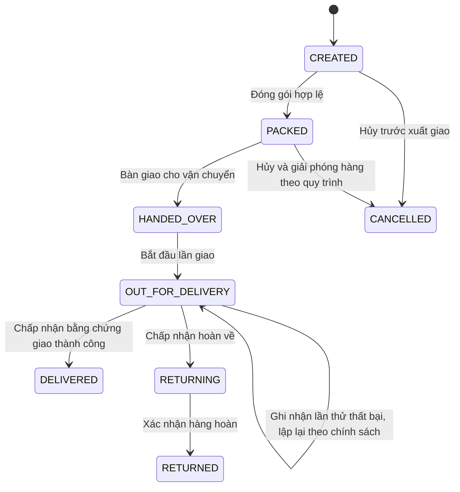

# Delivery confirmation: xác nhận giao hàng theo quyền, bằng chứng và quy tắc nghiệp vụ

## 1. Xác nhận giao hàng là một quyết định nghiệp vụ

**Delivery confirmation** là việc hệ thống chấp nhận rằng một nghĩa vụ giao hàng cụ thể đã được thực hiện theo chính sách của dịch vụ. Đây không chỉ là cập nhật một trường `delivered = true` hoặc nhận một chuỗi `status: DELIVERED` từ request.

Trong chương Fulfillment Rules, xác nhận giao hàng thường kéo theo nhiều hiệu ứng: kết thúc một lần giao, cập nhật tiến độ đơn, thông báo cho khách, bắt đầu một mốc thời gian xử lý hậu mãi hoặc cho phép đánh giá việc giao hàng. Một số hệ thống còn dùng nó làm điều kiện xét thưởng hoặc giải ngân. Nếu xác nhận sai, kẻ tấn công có thể hưởng quyền lợi khi chưa giao hàng, làm mất cơ hội khiếu nại hoặc che giấu hàng thất lạc.

Ví dụ, một shipper đang được phân công shipment A lấy mã của shipment B để xác nhận A. Hoặc người mua sửa `shipmentId` trong request để đánh dấu đơn của người khác đã nhận. Cả hai request có thể đi qua lớp đăng nhập bình thường; lỗi nằm ở việc kiểm tra quyền theo đối tượng và ràng buộc bằng chứng với đúng lần giao.

Mục tiêu của bài học là thiết kế xác nhận giao hàng dựa trên business invariants, state machine, transaction và idempotency, đồng thời kiểm thử các tình huống lạm dụng logic. Bằng chứng số chỉ tạo mức tin cậy theo mô hình đã chọn; nó không bảo đảm tuyệt đối mọi sự kiện vật lý ngoài đời đều đúng.

## 2. Phân biệt đơn hàng, shipment, lần giao và nghĩa vụ giao

| Khái niệm | Vai trò | Vì sao cần phân biệt? |
|---|---|---|
| Order | Giao dịch mua hàng tổng thể | Một order có thể được giao qua nhiều kiện, nhiều kho hoặc nhiều đợt |
| Shipment | Phần hàng được tổ chức vận chuyển cùng nhau | Shipment này đã giao không có nghĩa mọi shipment của order đều đã giao |
| Delivery attempt | Một lần thử giao một shipment | Giao thất bại rồi giao lại phải tạo lần thử mới hoặc revision phù hợp |
| Fulfillment allocation | Phần số lượng của từng dòng hàng được gán cho việc giao | Tránh tính một món hàng được giao nhiều lần khi có kiện thay thế hoặc giao lại |
| Proof of delivery | Bằng chứng được dùng để đánh giá lần giao | Phải gắn với shipment, attempt và chính sách tương ứng |
| Order delivery progress | Kết quả tổng hợp mức độ đáp ứng nghĩa vụ giao | Cần tính từ các allocation được chấp nhận, không từ cờ đơn lẻ trên order |

Một lần giao thất bại là một kết quả hợp lệ cần lưu, nhưng không phải giao thành công. Tương tự, “đơn vị vận chuyển báo đã giao”, “khách xác nhận đã nhận” và “hệ thống chấp nhận hoàn tất giao hàng” có thể là ba sự kiện khác nhau.

Chính sách phải xác định rõ bằng chứng nào đủ để chấp nhận trong từng phương thức giao. Không đặt tên mọi sự kiện đầu vào là `DELIVERY_CONFIRMED` nếu hệ thống chưa hoàn thành kiểm tra nghiệp vụ.

## 3. Mô hình đe dọa: ai có thể xác nhận sai và được lợi gì?

| Chủ thể hoặc nguồn | Hành vi có thể xảy ra | Điểm cần bảo vệ |
|---|---|---|
| Người mua | Sửa shipmentId, xác nhận hộ đơn khác, phát lại request cũ | Quyền theo đối tượng và phạm vi tenant |
| Shipper hoặc nhân viên | Dùng mã của kiện khác, xác nhận kiện không được phân công, bỏ bước giao thực tế | Phân công còn hiệu lực và bằng chứng gắn đúng lần giao |
| Tài khoản quản trị bị lạm dụng | Cập nhật trực tiếp state để đạt chỉ tiêu hoặc giải ngân | Thao tác đặc quyền có điều kiện, lý do và phê duyệt phù hợp |
| Client không đáng tin | Gửi `otpVerified: true`, vị trí giả, thời gian giả hoặc proofId của người khác | Server xác minh bằng chứng và tự xây quyết định |
| Webhook giả hoặc bị phát lại | Giả trạng thái của nhà vận chuyển hoặc gửi lặp nhiều lần | Xác thực nguồn, mapping đối tượng và chống lặp |
| Hai tác vụ chạy đồng thời | Một bên hoàn hàng, bên kia xác nhận đã giao | Transaction, khóa hoặc cập nhật version có điều kiện |
| Tích hợp vận chuyển | Gửi chậm, đảo thứ tự, đính chính hoặc báo sai | Phân biệt dữ kiện nguồn với trạng thái được hệ thống chấp nhận |

Không coi tài khoản nội bộ hoặc webhook có chữ ký là lý do bỏ toàn bộ kiểm tra nghiệp vụ. Danh tính nguồn chỉ là một phần của quyết định: vẫn phải xét đúng kiện, đúng attempt, đúng trạng thái và đúng điều kiện giao.

## 4. Các business invariants của delivery confirmation

### 4.1. Đúng đối tượng và đúng quyền

- Shipment thuộc tenant mà người gọi hoặc tài khoản tích hợp được phép thao tác.
- Khách chỉ xác nhận shipment thuộc order mà họ có quyền nhận hoặc đại diện theo chính sách.
- Shipper chỉ xác nhận shipment được phân công cho họ hoặc nhóm được phép, trong phạm vi phân công còn hiệu lực.
- Webhook chỉ tác động đến shipment được ánh xạ từ tài khoản nhà vận chuyển đã xác thực; không lấy tenant tùy ý từ payload để mở rộng quyền.
- Quyền thao tác đặc biệt như xác nhận thủ công phải được kiểm tra riêng, không suy ra từ quyền xem đơn.

### 4.2. Đúng hàng và đúng lần giao

- Shipment đã có căn cứ xuất/bàn giao hàng theo quy trình; không xác nhận một kiện mới tạo nhưng chưa được phép vận chuyển.
- Confirmation gắn với `shipmentId`, `attemptId` và revision có hiệu lực.
- Bằng chứng không được dùng lại cho kiện khác, lần giao khác hoặc địa chỉ đã thay đổi mà không đánh giá lại.
- Số lượng được xác nhận phải nằm trong allocation hợp lệ đã xuất giao, không do client tự tăng.
- Nếu có giao một phần, hệ thống phải biểu diễn phần đã nhận và phần còn lại; không gắn nhãn toàn bộ shipment đã giao khi mới nhận một phần.

### 4.3. Đúng hiệu ứng và đúng thời điểm

- Mỗi nghĩa vụ giao chỉ được ghi nhận hoàn tất một lần theo mô hình allocation đã chọn.
- Retry hoặc message lặp không tạo thêm điểm thưởng, giải ngân, thông báo nghiệp vụ hay lần cộng số lượng giao.
- Shipment đang hoàn, đã hoàn hoặc đã hủy không được chuyển sang đã giao bằng đường xác nhận thông thường.
- Trạng thái shipment, confirmation được chấp nhận, việc sử dụng challenge và ý định phát sự kiện phải nhất quán trong ranh giới transaction phù hợp.
- Thời gian ghi nhận lấy từ server; thời gian nguồn báo được lưu riêng và không tự quyết định thứ tự trạng thái.

Xác nhận đã giao không đồng nghĩa đã thu đủ tiền hoặc đã quyết toán. Với COD, nhận hàng, thu tiền tại cửa và tiền được nhà vận chuyển chuyển về là các dữ kiện khác nhau. Không chuyển trạng thái thanh toán sang `PAID` chỉ vì shipment thành `DELIVERED`.

## 5. Chọn chính sách bằng chứng thay vì chỉ kiểm tra một cờ

Không có một loại bằng chứng duy nhất phù hợp mọi phương thức giao. Hệ thống nên ánh xạ phương thức giao, mức rủi ro và hợp đồng tích hợp tới một chính sách rõ ràng.

| Bằng chứng | Có thể hỗ trợ kết luận gì? | Giới hạn cần hiểu |
|---|---|---|
| Khách xác nhận trong phiên đã đăng nhập | Tài khoản có quyền đã thừa nhận nhận shipment cụ thể | Tài khoản có thể bị chiếm; không tự chứng minh mọi chi tiết vật lý |
| OTP hoặc mã nhận hàng | Người xác nhận có mã được cấp cho lần giao cụ thể | Mã có thể bị lộ, chuyển tiếp hoặc lấy trước khi giao |
| Webhook nhà vận chuyển được xác thực | Nguồn tích hợp được tin cậy đã báo một kết quả | Không tự chứng minh kết quả vật lý đúng hoặc mapping shipment đúng |
| Chữ ký hoặc ảnh giao nhận | Thêm chứng cứ theo quy trình đã thiết kế | Có thể bị tái sử dụng, lấy nhầm hoặc giả; cần quyền truy cập và kiểm tra liên kết |
| Vị trí, thời gian, thông tin thiết bị | Tín hiệu hỗ trợ phát hiện bất thường | Dữ liệu có thể sai hoặc bị giả; không thay thế quyền và xác minh cốt lõi |
| Quyết định kiểm tra thủ công | Xử lý ngoại lệ có căn cứ và người chịu trách nhiệm | Cần quyền riêng, lý do và phê duyệt phù hợp với mức rủi ro |

Ví dụ, giao tại điểm nhận có thể yêu cầu mã nhận hàng còn hiệu lực. Giao qua nhà vận chuyển có cơ chế proof được ủy quyền có thể chấp nhận sự kiện của họ sau khi xác thực và đối chiếu. Giao hàng giá trị cao có thể cần thêm một bước kiểm tra.

Những lựa chọn này phải được định nghĩa ở phía server. Request không được tự chọn chính sách yếu hơn bằng cách gửi `proofType: NONE` hoặc `manualOverride: true`.

Nếu nhà vận chuyển báo `otpVerified: true`, chỉ chấp nhận thông tin đó khi chính sách đã tin cậy và ủy quyền đúng việc kiểm tra mã cho tích hợp ấy. Một trường cùng tên do client khác gửi không có giá trị tương đương.

## 6. State machine: xác nhận ở đúng giai đoạn



Sơ đồ minh họa luồng giao toàn bộ một shipment. Khi giao một phần, cần thêm trạng thái hoặc kết quả allocation phù hợp. Trạng thái order tổng thể không nhất thiết dùng cùng bộ trạng thái với shipment.

Một attempt thất bại phải được đóng với kết quả tương ứng; nếu tạo attempt mới thì challenge của attempt cũ không còn được dùng. Vòng lặp trên sơ đồ không có nghĩa mọi lần thử dùng chung một attemptId hoặc chung một OTP.

Nếu thông báo `DELIVERED` đến trước thông báo `OUT_FOR_DELIVERY`, không được tùy tiện ghi lùi các trạng thái hoặc bỏ qua điều kiện xuất giao. Có thể giữ sự kiện chờ đối soát, hoặc áp dụng đường xử lý sự kiện cuối được thiết kế riêng khi đã có đầy đủ căn cứ theo hợp đồng nguồn. Việc thiếu một message trung gian và việc thực sự bỏ qua một bước nghiệp vụ là hai trường hợp cần phân biệt.

Sau khi đã chấp nhận giao hàng, khách có thể mở tranh chấp hoặc trả hàng. Ghi nhận quy trình đó riêng, giữ lịch sử xác nhận gốc và căn cứ điều chỉnh. Không chỉ đổi `DELIVERED` về `OUT_FOR_DELIVERY` để làm như việc xác nhận chưa từng xảy ra.

## 7. Thiết kế OTP hoặc mã nhận hàng an toàn

OTP là một cơ chế phổ biến nhưng dễ bị dùng sai nếu chỉ so sánh hai chuỗi rồi cập nhật trạng thái.

### 7.1. Challenge phải gắn với đúng ngữ cảnh

Một challenge nên có những dữ liệu phù hợp như:

```text
challengeId
tenantId, shipmentId, attemptId
deliveryRevision hoặc addressRevision liên quan
purpose = CONFIRM_DELIVERY
recipientReference hoặc kênh nhận đã được chọn hợp lệ
issuedAt, expiresAt
maxAttempts, failedAttempts
verifier hoặc dữ liệu xác minh được bảo vệ
consumedAt, revokedAt
```

Không cho người thao tác đổi số điện thoại nhận mã sang số của họ ngay trong request xác nhận. Thay đổi người nhận hoặc địa chỉ phải đi qua nghiệp vụ có quyền, cập nhật revision và xem xét vô hiệu hóa challenge cũ.

Mã phải được tạo bằng nguồn ngẫu nhiên mật mã phù hợp. Không suy ra từ orderId, số điện thoại, timestamp hoặc số tăng dần. Không trả mã cho shipper qua cùng API mà shipper dùng để xác nhận nếu mục tiêu của mã là chứng minh người nhận đã cung cấp nó.

### 7.2. Hạn dùng, giới hạn thử và gửi lại

Server kiểm tra hạn dùng bằng quy ước rõ ràng, chẳng hạn chỉ chấp nhận khi `now < expiresAt`. Thời gian trên thiết bị của người gọi không quyết định mã còn hiệu lực.

Cần giới hạn số lần đoán sai và tốc độ gửi theo các phạm vi thích hợp: challenge, shipment/attempt, tài khoản hoặc kênh nhận. Không để gửi lại mã làm reset vô hạn ngân sách đoán sai cho cùng lần giao. Cấp mã mới cần có chính sách giới hạn và thu hồi mã trước đó theo thiết kế.

Mã ngắn có không gian giá trị nhỏ. Lưu hash thông thường của OTP không đủ chống dò offline nếu database bị lộ. Có thể dùng cơ chế xác minh được bảo vệ bằng khóa, với khóa quản lý tách khỏi dữ liệu và ngữ cảnh ràng buộc rõ ràng; đồng thời vẫn cần hạn dùng và giới hạn thử online. Không ghi mã nguyên văn vào log, tracing, payload sự kiện hoặc thông báo lỗi.

### 7.3. Dùng một lần phải được thực thi nguyên tử

Hai request đồng thời có thể cùng đọc “mã chưa dùng” rồi cùng cho qua nếu việc đọc và đánh dấu tách rời. Cần khóa bản ghi challenge hoặc dùng thao tác có điều kiện, phối hợp với việc chốt shipment trong cùng transaction local nếu chúng cùng database.

```text
Kiểm tra phạm vi và trạng thái shipment
  → khóa hoặc bảo vệ version của shipment/attempt
  → kiểm tra challenge còn đúng ngữ cảnh, còn hạn, chưa thu hồi/chưa dùng
  → xác minh mã trong giới hạn thử
  → đánh dấu challenge đã dùng
  → chuyển shipment hoặc allocation sang kết quả được chấp nhận
  → ghi confirmation và outbox
  → commit cùng nhau
```

Nếu chuyển shipment thất bại thì việc dùng challenge cũng phải rollback theo thiết kế này. Không tiêu thụ mã rồi để shipment kẹt ở trạng thái cũ chỉ vì bước ghi tiếp theo thất bại.

Đường mã sai có yêu cầu khác: bộ đếm thử sai cần được lưu. Nếu tăng `failedAttempts` rồi ném exception làm rollback toàn transaction, kẻ tấn công có thể đoán mã mà bộ đếm không tăng. Cần thiết kế đường từ chối có commit bộ đếm, hoặc cơ chế giới hạn độc lập có bảo đảm phù hợp; không tạo confirmation thành công trong đường đó.

Nếu challenge thuộc dịch vụ riêng, việc dùng mã và đổi shipment không tự trở thành nguyên tử nhờ transaction của order. Cần giao thức giữ/chốt việc xác minh, idempotency, thời hạn và xử lý bù phù hợp với ranh giới dịch vụ.

## 8. Xác nhận từ webhook hoặc bằng chứng tải lên

### 8.1. Webhook phải qua cả xác thực kỹ thuật lẫn kiểm tra nghiệp vụ

Một luồng tiếp nhận có thể gồm:

1. Xác thực chữ ký hoặc cơ chế nguồn theo hợp đồng nhà cung cấp, trên đúng dữ liệu và tài khoản tích hợp. Không tự nghĩ ra cách chuẩn hóa payload khác với hợp đồng xác thực.
2. Áp dụng biện pháp chống phát lại ở lớp tích hợp theo cơ chế hỗ trợ; nhận diện sự kiện và giao dịch nguồn.
3. Ánh xạ external shipment reference từ tài khoản nguồn đã xác thực tới tenant/shipment nội bộ.
4. Chuẩn hóa trạng thái nguồn thành dữ kiện nội bộ, giữ định danh nguồn và thời gian nhận.
5. Kiểm tra attempt, revision, trạng thái, số lượng và chính sách bằng chứng trước khi chấp nhận confirmation.
6. Lưu kết quả xử lý để phân biệt đã nhận, đang chờ đối soát, bị từ chối và đã áp dụng.

Không lấy `tenantId` hoặc `orderId` bất kỳ trong payload để tìm rồi cập nhật trực tiếp. Một tài khoản nhà vận chuyển có thể xử lý nhiều khách hàng; mapping phải dựa trên cấu hình và tham chiếu đã thiết lập khi tạo shipment.

Webhook hợp lệ nhưng đến muộn vẫn có thể không áp dụng được cho attempt hiện tại. Giữ dấu vết và đưa vào luồng đối soát thay vì âm thầm gán nó cho lần giao mới nhất.

### 8.2. Bằng chứng ảnh hoặc chữ ký phải có quyền và liên kết

Nếu request gửi `proofId`, server kiểm tra bằng chứng thuộc đúng tenant, shipment, attempt và người hoặc nguồn được phép tạo. Một object tồn tại trong kho lưu không chứng minh người gọi có quyền dùng nó cho mọi kiện.

Không chấp nhận một URL bất kỳ là bằng chứng đã được xác minh. Tách bước nhận tệp, kiểm tra nội dung theo chính sách, ràng buộc metadata và bước quyết định giao hàng. Nếu đánh giá bằng chứng bất đồng bộ, trạng thái phải phản ánh đang chờ thay vì ghi `DELIVERED` trước rồi hy vọng bước đánh giá sẽ qua.

Ảnh, chữ ký và dữ liệu vị trí có thể chứa thông tin cá nhân. Chỉ lưu phần cần thiết, kiểm soát quyền xem và thời hạn giữ; không đưa URL công khai hoặc nội dung nhạy cảm vào mọi message và log. Hash của một tệp giúp đối chiếu nội dung đã lưu, nhưng không tự chứng minh ảnh được chụp đúng nơi hoặc đúng thời điểm.

## 9. Transaction và idempotency cho một confirmation

### 9.1. Dữ liệu tối thiểu cần liên kết

| Nhóm dữ liệu | Trường minh họa | Vai trò |
|---|---|---|
| Shipment | `tenantId`, `shipmentId`, `orderId`, `state`, `version` | Phạm vi, trạng thái và chống cập nhật cạnh tranh |
| Attempt | `attemptId`, `shipmentId`, `revision`, `assignedAgentId`, `state` | Xác định lần giao đang có hiệu lực |
| Allocation | Dòng hàng, số lượng, nghĩa vụ được đáp ứng, quan hệ kiện thay thế | Ngăn cộng trùng số lượng và hoàn tất order quá sớm |
| Confirmation | `confirmationId`, attempt, proof reference, chính sách, actor, thời gian chấp nhận | Lưu quyết định và căn cứ |
| Command idempotency | Phạm vi chủ thể/thao tác, khóa, fingerprint, kết quả | Trả lại kết quả của cùng một ý định |
| Source receipt | Nguồn đã xác thực, event/reference, trạng thái xử lý | Đối chiếu webhook và chống lặp theo hợp đồng nguồn |
| Outbox | Event ID, loại sự kiện, liên kết confirmation | Phát tác động sau commit |

Với mô hình một lần giao thành công toàn bộ shipment, có thể dùng ràng buộc duy nhất cho confirmation được chấp nhận trên shipment, bên cạnh định danh confirmation. Nếu mô hình hỗ trợ nhiều lần nhận từng phần, khóa và bất biến phải dựa trên phần allocation hoặc lần nhận tương ứng; không áp dụng ràng buộc một confirmation cho mọi mô hình.

Unique theo idempotency key không ngăn hai khóa khác nhau cùng xác nhận một nghĩa vụ. Cần thêm version, điều kiện state và ràng buộc nghiệp vụ ở confirmation/allocation.

### 9.2. Ví dụ Java ở tầng application

Đây là mã mô tả các cổng nghiệp vụ, không phải lớp có thể biên dịch độc lập. Ví dụ giả định giao toàn bộ một shipment; order, shipment, challenge, confirmation, command và outbox cùng database. Bằng chứng cần gọi mạng hoặc đánh giá tệp phải được chuẩn bị theo giao thức riêng trước khi vào đoạn transaction local này.

```java
DeliveryResult confirmDelivery(DeliveryCommand command, Caller caller) {
    return transactions.required(() -> {
        var reference = shipments.requireScopedReference(
                caller.tenantId(), command.shipmentId());
        authorization.requireDeliveryConfirmation(caller, reference);

        var claim = commands.claimOrRead(
                caller,
                "CONFIRM_DELIVERY",
                command.idempotencyKey(),
                fingerprints.forDelivery(command));

        if (claim.isCompleted()) {
            authorization.requireReadConfirmation(caller, claim);
            return claim.savedResult();
        }

        var order = orders.lock(reference.orderId(), caller.tenantId());
        var shipment = shipments.lock(
                caller.tenantId(), command.shipmentId());
        var attempt = attempts.requireCurrent(shipment, command.attemptId());

        rules.requireEligible(shipment, attempt, command.expectedVersion());
        authorization.requireCurrentAssignment(caller, shipment, attempt);

        var verification = proofs.verifyWithLocalLocks(
                shipment, attempt, command.proof(), clock.instant());

        if (!verification.accepted()) {
            challenges.persistFailureIfApplicable(verification);
            var denied = DeliveryResult.denied(verification.publicReason());
            commands.completeRejected(claim, denied);
            return denied;
        }

        challenges.consumeIfRequired(verification);
        var confirmation = confirmations.fromVerifiedEvidence(
                shipment, attempt, verification, caller, clock.instant());

        shipments.markDeliveredIfVersionMatches(shipment, confirmation);
        attempts.completeSuccessfully(attempt, confirmation);
        confirmations.append(confirmation);
        orders.recomputeDeliveryProgressUnderLock(order);
        history.appendDeliveryAccepted(confirmation);
        outbox.appendDeliveryAccepted(confirmation);

        var result = DeliveryResult.accepted(confirmation);
        commands.completeAccepted(claim, result);
        return result;
    });
}
```

Các điều kiện để ví dụ có ý nghĩa:

- Những phương thức khóa phải có cùng thứ tự với các đường hủy, hoàn hàng và xác nhận shipment khác để tránh thiết kế khóa mâu thuẫn.
- Quyền phân công và trạng thái hiện hành được kiểm tra lại trong vùng được bảo vệ; dữ liệu tham chiếu trước khóa không đủ quyết định.
- `markDeliveredIfVersionMatches` phải kiểm tra số dòng cập nhật đúng một và phát lỗi gây rollback nếu version/state không còn khớp. Không bỏ qua kết quả cập nhật.
- `consumeIfRequired` phải thất bại nếu challenge không còn được dùng; không cho một confirmation vẫn commit sau khi consume thất bại.
- Đường bằng chứng bị từ chối trả kết quả bình thường để lưu bộ đếm cần thiết trong transaction này. Việc chuyển kết quả đó thành response lỗi ở lớp HTTP không được làm rollback bộ đếm đã chủ đích lưu.
- `claimOrRead` dùng unique và xử lý cạnh tranh tại adapter. Cùng khóa nhưng fingerprint khác phải bị từ chối; khóa đang xử lý có hợp đồng chờ/retry rõ ràng.
- Fingerprint không được lưu OTP nguyên văn. Nếu cần phân biệt giá trị bí mật trong ý định, dùng biểu diễn bảo vệ thích hợp, tránh lưu một hash dễ dò của mã ngắn.
- Payload nghiệp vụ được tạo từ kết quả xác minh server, không bind các trường `accepted`, `verified` hoặc `actorId` từ request.

Đối với webhook, caller trong luồng tương đương là danh tính dịch vụ đã xác thực, không phải khách hoặc shipper. Chính sách quyền và bằng chứng phải chọn theo nguồn chuẩn, thay vì giả lập người dùng để bỏ qua kiểm tra.

### 9.3. Hiệu ứng bên ngoài diễn ra sau commit

Không gửi thông báo, cộng thưởng hoặc gọi giải ngân rồi mới cố ghi confirmation. Nếu transaction thất bại, các hiệu ứng ngoài database có thể đã xảy ra nhưng shipment chưa được xác nhận.

Outbox cho phép ghi ý định phát sự kiện cùng confirmation. Worker có thể gửi lặp, nên consumer vẫn cần chống lặp và chuyển trạng thái có điều kiện. Giải ngân hoặc thưởng còn phải kiểm tra chính sách riêng; sự kiện giao hàng là đầu vào, không phải quyền bỏ qua thời gian chờ, kiểm tra gian lận hoặc quy trình tranh chấp.

## 10. Giao từng phần, nhiều kiện và kiện thay thế

Giả sử order có ba sản phẩm cùng loại, được chia thành:

```text
Order line L1: cần giao 3 đơn vị
Shipment S1: allocation A1 = 2 đơn vị
Shipment S2: allocation A2 = 1 đơn vị
```

Khi S1 được chấp nhận đã giao, order mới có tiến độ 2/3, không được đánh dấu giao đủ. Nếu S2 chuyển hoàn, order có phần chưa được đáp ứng hoặc ngoại lệ cần xử lý theo chính sách.

Một cách mô tả mức phủ nghĩa vụ giao là:

```text
requiredQty[line]
    = số lượng cần giao theo revision nghĩa vụ đang có hiệu lực

creditedDeliveredQty[line]
    = số lượng đã được chấp nhận, gắn với các phần nghĩa vụ không trùng nhau

hasDeliveryCoverage
    = với mọi line: creditedDeliveredQty[line] == requiredQty[line]
```

Đây là quy tắc về đáp ứng nghĩa vụ, không phải công thức kế toán hoàn hàng. Hủy hợp lệ một phần trước khi xuất giao có thể thay đổi nghĩa vụ theo revision; trả hàng sau khi nhận là một nghiệp vụ khác và không xóa sự kiện đã giao trong quá khứ.

Nếu S2 thất lạc rồi tạo S3 để giao thay, phải liên kết S3 với nghĩa vụ mà S2 chưa đáp ứng. Khi một thông báo giao thành công của S2 đến muộn, không được cộng thêm vào order như một đơn vị mới độc lập. Cần quy tắc xử lý kiện gốc/kiện thay thế, hàng thực tế giao dư và đối soát.

Hai shipment cùng được xác nhận đồng thời có thể làm cập nhật tổng tiến độ bị mất nếu mỗi request tự đọc và ghi lại một con số. Có thể khóa order khi tổng hợp như ví dụ, dùng cập nhật nguyên tử với ràng buộc allocation, hoặc tạo bản chiếu idempotent có cơ chế hội tụ. Nếu tổng hợp bất đồng bộ, các hiệu ứng yêu cầu giao đủ phải dựa vào kết quả có thẩm quyền và không được chạy sớm chỉ vì một shipment gửi sự kiện.

## 11. Các tình huống cạnh tranh và ngoại lệ cần quyết định rõ

### 11.1. Xác nhận giao hàng cạnh tranh với chuyển hoàn

Cả hai thao tác phải tranh cùng shipment version hoặc cùng khóa thích hợp. Một thao tác được chấp nhận, thao tác còn lại đọc lại trạng thái và đi theo quy trình đối soát nếu bằng chứng ngoài đời mâu thuẫn.

Không để một đường ghi `RETURNING` và một đường ghi `DELIVERED` mà đường nào cập nhật sau thì thắng. Mất dấu vết một trong hai báo cáo sẽ che giấu thông tin cần xử lý.

### 11.2. Hủy trước bàn giao cạnh tranh với xác nhận đã giao

Hủy shipment trước xuất giao cần phối hợp với xuất kho/bàn giao. Sau khi shipment đã vào vận chuyển, yêu cầu của khách có thể trở thành yêu cầu chặn giao hoặc hoàn về, không còn là hủy đơn giản.

Luồng xác nhận phải kiểm tra căn cứ và trạng thái hiện hành, không dựa trên dữ liệu mà client tải từ trước. Nếu dữ liệu cho thấy đã hủy nhưng carrier vẫn báo thực tế đã giao, giữ sự kiện nguồn và xử lý ngoại lệ; không âm thầm đổi trạng thái để che đi xung đột.

### 11.3. Đổi người nhận hoặc địa chỉ sau khi cấp mã

Thay đổi có thể làm bằng chứng cũ không còn đúng ngữ cảnh. Cần tăng revision thích hợp, cập nhật giao nhận theo quy trình và vô hiệu hóa challenge/proof chưa được dùng khi chính sách yêu cầu. Không chỉ sửa địa chỉ trên order rồi giữ nguyên mọi attempt và mã cũ.

### 11.4. Không có OTP hoặc khách không đồng ý đã nhận

Không dùng một mã mặc định hoặc tài khoản quản trị để bỏ qua kiểm tra. Tạo đường xử lý ngoại lệ có quyền, bằng chứng bổ sung, lý do và phê duyệt phù hợp. Khi chưa đủ căn cứ, giữ trạng thái chờ xác minh hoặc tranh chấp thay vì tự khẳng định đã giao.

Nếu đã xác nhận nhưng phát sinh khiếu nại, lưu cả confirmation và vụ việc. Tranh chấp không tự chứng minh lần xác nhận trước là giả; ngược lại, một OTP đúng cũng không đủ để bác mọi khiếu nại. Kết luận cần dựa trên chính sách và tổng hợp bằng chứng.

## 12. Audit: ghi lại quyết định, không chỉ ghi request

Một confirmation được chấp nhận nên cho phép lần theo:

- Tenant, order, shipment, attempt, allocation và revision liên quan.
- Actor thực hiện và căn cứ quyền, bao gồm phân công hoặc quyết định thủ công nếu có.
- Loại bằng chứng, tham chiếu tới bằng chứng đã được kiểm tra và version chính sách áp dụng.
- Sự kiện nguồn, command/idempotency và confirmation ID.
- Thời gian nguồn báo, thời gian hệ thống nhận và thời gian chấp nhận; không trộn ba ý nghĩa vào một cột tùy tiện.
- Trạng thái/version trước và sau, cùng những hiệu ứng được phát từ outbox.

Không ghi OTP, token xác thực hoặc toàn bộ nội dung nhạy cảm vào audit. Với proof bên ngoài, lưu định danh và thông tin kiểm tra cần thiết theo chính sách, thay vì sao chép tràn lan dữ liệu.

Những tín hiệu cần theo dõi gồm xác nhận sai phân công, nhiều lần nhập mã sai, gửi lại mã bất thường, dùng proof chéo attempt, webhook không ánh xạ được, xung đột version, giao thiếu nhưng order bị đánh dấu đủ và confirmation thủ công tăng đột biến.

Nhật ký hành vi bị từ chối phải được phân biệt với lịch sử giao hàng thành công. Một request gửi đến không có nghĩa kiện hàng đã được giao hoặc confirmation đã commit.

## 13. Kiểm thử tình huống tấn công logic

| Nhóm | Thiết lập và hành động | Kết quả cần chứng minh |
|---|---|---|
| Luồng chuẩn | Shipment đang giao, attempt đúng và bằng chứng hợp lệ | Có đúng confirmation được chấp nhận, state/version và allocation cập nhật nhất quán |
| Quyền theo đối tượng | Khách đổi shipmentId sang đơn người khác hoặc tenant khác | Không xác nhận và không đọc được proof/kết quả riêng tư |
| Quyền phân công | Shipper xác nhận kiện không thuộc phân công hiện hành | Từ chối dù tài khoản đã đăng nhập và biết shipmentId |
| Giả kết quả xác minh | Gửi `otpVerified: true`, `delivered: true` hoặc actorId quản trị | Server không dùng các trường đó làm bằng chứng hay danh tính chuẩn |
| Bỏ bước vận chuyển | Xác nhận shipment mới tạo hoặc đã hủy | Không chuyển sang DELIVERED và không phát hiệu ứng thành công |
| Mã sai ngữ cảnh | Dùng mã đúng của shipment/attempt/revision khác | Từ chối, không tiêu thụ quyền của đối tượng khác |
| Hạn mã | Thử trước hạn, đúng thời điểm hết hạn và sau hạn | Tuân theo quy ước clock server, không theo thời gian client |
| Đoán mã | Gửi nhiều mã sai, kể cả request song song | Giới hạn thử có hiệu lực và bộ đếm không bị rollback ngoài ý muốn |
| Gửi lại mã | Cấp lại nhiều lần rồi thử mã cũ | Tuân theo chính sách thu hồi và ngân sách thử của lần giao |
| Dùng mã đồng thời | Hai request cùng nhập mã đúng chưa dùng | Chỉ một hiệu ứng nghiệp vụ; request còn lại nhận kết quả retry hoặc xung đột phù hợp |
| Thay đổi người nhận | Đổi địa chỉ hoặc người nhận sau khi cấp challenge | Proof cũ được đánh giá theo revision, không tự áp cho ngữ cảnh mới |
| Webhook giả | Sửa body, nguồn hoặc reference để tác động shipment khác | Xác thực và mapping ngăn áp dụng, không tin tenant tự khai |
| Webhook lặp/đảo thứ tự | Gửi lại event cũ hoặc gửi DELIVERED trước sự kiện cần thiết | Không tạo hiệu ứng lặp, không bỏ qua bất biến; có trạng thái chờ/đối soát khi cần |
| Tái dùng proof | Dùng proofId hợp lệ của kiện khác hoặc attempt cũ | Không chấp nhận chỉ vì object tồn tại |
| Giao từng phần | Chỉ xác nhận S1 gồm 2/3 số lượng ví dụ | Order chưa được coi là giao đủ |
| Kiện thay thế | S3 giao thay rồi nhận DELIVERED muộn của S2 | Không cộng trùng một nghĩa vụ; sự kiện muộn được lưu và đối soát |
| Cạnh tranh chuyển hoàn | Đồng bộ hai request RETURNING và DELIVERED cùng version | Một quyết định thắng; quyết định thua không ghi thành công giả |
| Lỗi giữa transaction | Gây lỗi khi ghi confirmation/history/outbox sau bước consume mã | Không để mã đã dùng hoặc state mới tồn tại riêng lẻ ngoài thiết kế |
| Mất response | Commit xong rồi retry cùng idempotency key | Trả kết quả đã lưu, không xác nhận hoặc cộng thưởng thêm lần nữa |
| Hai khóa khác nhau | Gửi hai command hợp lệ với hai khóa cho cùng nghĩa vụ | Bất biến shipment/allocation vẫn ngăn hiệu ứng giao hàng trùng |
| COD | Giao hàng thành công nhưng chưa có bằng chứng thu/quyết toán tương ứng | Không tự đánh dấu tiền đã thu hoặc đã về tài khoản |
| Ngoại lệ thủ công | Người không đủ quyền gửi manualOverride hoặc bỏ lý do | Không đi vòng chính sách; thao tác được duyệt có audit rõ |
| Consumer lặp | Giao lại message sau khi đã áp dụng thông báo hoặc quyền lợi | Không tạo thêm tác động nghiệp vụ do cùng confirmation |

Kiểm thử phải kiểm tra dữ liệu và hiệu ứng bên ngoài, không chỉ HTTP status. Đặc biệt, response từ chối không chứng minh bộ đếm OTP đã được lưu, cũng không chứng minh chưa có thông báo hoặc quyền lợi bị tạo trước đó.

Với race condition, cần điểm đồng bộ để hai request thật sự gặp nhau ở vùng kiểm tra/cập nhật. Với hạn dùng, dùng clock điều khiển được. Với failure injection, đặt lỗi ở đúng ranh giới tiêu thụ challenge, cập nhật shipment và ghi outbox để kiểm tra tính nguyên tử đã thiết kế.

## 14. Cách đọc một kết quả xác nhận đáng tin cậy

Khi xem xét một confirmation, hãy kiểm tra được chuỗi giải thích: chủ thể nào có quyền với shipment này, lần giao và revision nào đang có hiệu lực, bằng chứng nào được xác minh theo chính sách nào, nghĩa vụ nào được đáp ứng và transaction nào đã chốt kết quả.

Sau đó đối chiếu phần tổng hợp: order đã giao đủ hay mới giao một phần, có kiện thay thế hoặc sự kiện muộn chưa đối soát không, và những hiệu ứng tài chính/hậu mãi đã đi qua điều kiện riêng hay chưa. Mỗi bước cần dữ liệu có thẩm quyền và bất biến cụ thể để một tín hiệu “đã giao” không trở thành lối tắt vượt qua quy tắc nghiệp vụ.
