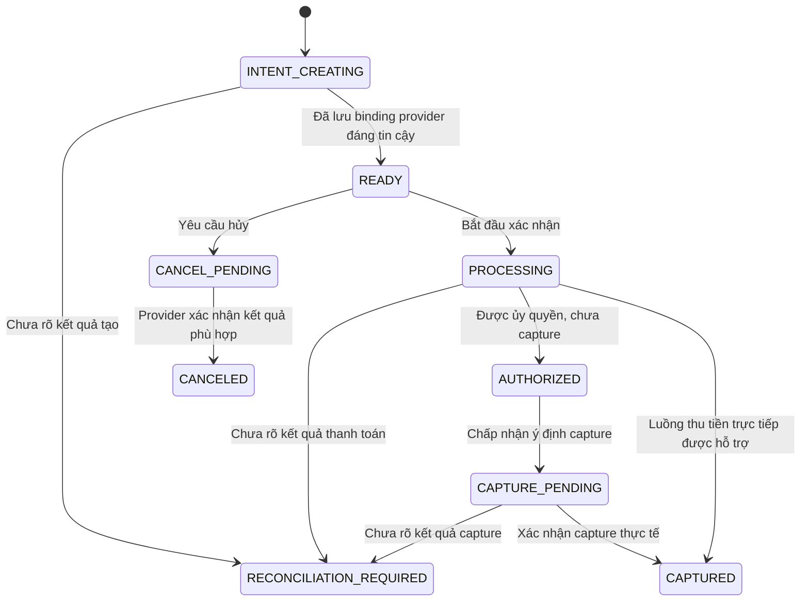

# Quyền sở hữu payment intent (Payment intent ownership)

Trong chương **Payment Rules**, quyền sở hữu payment intent là ràng buộc xác định một ý định thanh toán được tạo cho nghĩa vụ nào, thuộc tenant nào, nhận tiền vào tài khoản nào và những chủ thể nào được phép thao tác với nó. Nếu ràng buộc này không được bảo vệ, một người dùng có thể gắn giao dịch của người khác vào đơn của mình, dùng khoản thanh toán giá trị thấp để mở khóa đơn giá trị cao hoặc phát lại cùng kết quả thanh toán cho nhiều đơn.

Bài học sử dụng một hệ thống bán hàng giả định. Thuật ngữ **payment intent** ở đây chỉ đối tượng biểu diễn ý định và vòng đời thanh toán; không giả định API hay trạng thái của một nhà cung cấp cụ thể. Khi hiện thực, cần ánh xạ mô hình vào đúng hợp đồng tích hợp. Trọng tâm là business invariants, state machine, quyền theo đối tượng, transaction, idempotency và kiểm thử lạm dụng logic trong ứng dụng.

## 1. Mục tiêu học tập

Sau bài học, bạn có thể:

- Phân biệt người mua, người trả tiền, chủ đơn, tenant và tài khoản nhận tiền.
- Thiết kế binding giữa order, nghĩa vụ thanh toán, payment attempt và đối tượng ở provider.
- Kiểm tra quyền ở các thao tác tạo, đọc, lấy thông tin phía client, xác nhận, capture, hủy và hoàn tiền.
- Ngăn tái sử dụng payment intent hoặc kết quả thanh toán ngoài phạm vi đã được chấp nhận.
- Xử lý retry, webhook, timeout và thanh toán đến muộn mà không ghi nhận tiền hoặc fulfillment trùng.
- Xây dựng kiểm thử chứng minh rằng khoản tiền đúng được ghi cho đúng nghĩa vụ của đúng đơn.

## 2. Một payment intent có nhiều quan hệ sở hữu

### 2.1. Không có một trường customerId giải quyết mọi quyền

Xét các chủ thể và đối tượng sau:

| Thành phần | Câu hỏi nó giải quyết | Ví dụ trong hệ thống giả định |
|---|---|---|
| Actor | Ai đang gọi ứng dụng? | Khách hàng đã đăng nhập, người được mời trả tiền, nhân viên |
| Tenant | Dữ liệu thuộc phạm vi tổ chức nào? | Cửa hàng hoặc tổ chức đang phục vụ request |
| Order owner | Ai có quyền với đơn? | Khách tạo đơn hoặc tổ chức mua hàng |
| Payer | Ai được phép cung cấp hoặc sử dụng phương tiện thanh toán? | Chủ phương tiện hoặc người có quyền sử dụng hợp lệ |
| Payment obligation | Khoản phải thu cụ thể nào đang được thanh toán? | Thanh toán cho phiên bản giá đã chốt của một đơn |
| Merchant account | Khoản tiền phải được nhận ở đâu? | Tài khoản provider do backend chọn theo tenant và cấu hình kinh doanh |
| Provider object | Đối tượng bên ngoài nào thực hiện ý định này? | Payment intent, authorization hoặc giao dịch tương ứng |

Trong một đơn cá nhân thông thường, chủ đơn và người trả tiền có thể là cùng người. Hệ thống có gửi quà, mua hộ hoặc tài khoản doanh nghiệp có thể cho phép họ khác nhau. Chính sách phải định nghĩa rõ sự khác biệt đó, thay vì luôn so sánh một `customerId` hoặc luôn bỏ qua kiểm tra payer.

Một ID khách hàng ở provider cũng không tự trở thành danh tính trong ứng dụng. Cần ánh xạ do server quản lý, trong đúng phạm vi provider và tài khoản nhận tiền.

### 2.2. Binding cần được tạo và giữ ở server

Một cấu trúc khái niệm có thể là:

```text
Tenant
  -> Order
      -> PaymentObligation
          -> PaymentAttempt
              -> ProviderPaymentIntent
```

Ví dụ:

```text
tenantId                  tenant_1
orderId                   ord_3001
paymentObligationId       obligation_81
pricingSnapshotVersion    6
amountDue                 480000
currency                  VND
paymentAttemptId          attempt_501
provider                  PROVIDER_A
providerEnvironment       LIVE
merchantAccountId         merchant_12
providerIntentId          intent_ext_910
```

Binding này do backend tạo từ dữ liệu đáng tin cậy. Client có thể gửi ý định “thanh toán đơn này”, nhưng không tự quyết rằng `intent_ext_910` thuộc `ord_3001`.

### 2.3. Quyền sở hữu không phải quyền sửa mọi trường

Khách hàng có quyền thanh toán đơn của mình không đồng nghĩa với quyền sửa số tiền, currency, tài khoản nhận tiền, version giá hoặc trạng thái `PAID`.

Tương tự, nhân viên có quyền xem payment attempt không tự có quyền capture, hoàn tiền hoặc chuyển payment sang đơn khác. Mỗi hành động cần quyền tương ứng và điều kiện nghiệp vụ riêng.

## 3. Những chuỗi lạm dụng cần chặn

### 3.1. Gắn intent của người khác vào đơn của mình

API không an toàn có thể nhận:

```http
POST /orders/ord_attacker/mark-paid
Content-Type: application/json

{
  "providerIntentId": "intent_of_another_customer"
}
```

Sau đó backend chỉ hỏi provider xem intent có thành công hay chưa. Nếu thấy thành công thì đánh dấu đơn hiện tại đã trả tiền.

Việc hỏi provider không sửa được lỗi nếu ứng dụng chưa kiểm tra intent đó vốn được tạo cho nghĩa vụ nào. Một giao dịch thật, có tiền thật, vẫn có thể bị gán sai đối tượng.

### 3.2. Dùng payment nhỏ cho đơn lớn

Kẻ lạm dụng trả `48.000 VND` cho đơn A rồi gửi ID giao dịch vào đơn B trị giá `480.000 VND`. Nếu backend chỉ kiểm tra `status = succeeded`, đơn B có thể được mở khóa dù chưa nhận đủ tiền.

Ngay cả khi hai đơn có cùng giá, vẫn phải kiểm tra binding. Bằng nhau về số tiền không có nghĩa cùng một nghĩa vụ thanh toán.

### 3.3. Phát lại một thành công cho nhiều đơn

Nếu mọi đơn đều được phép nhận cùng một provider transaction, kẻ lạm dụng có thể lặp lại ID đã thanh toán. Dedup theo HTTP request hoặc webhook event không đủ: những request khác nhau vẫn có thể nói về cùng khoản tiền.

### 3.4. Thanh toán đúng số tiền nhưng sai tài khoản nhận

Trong hệ thống nhiều tenant hoặc nhiều merchant account, một intent thành công tại tài khoản A không chứng minh tài khoản B đã thu tiền. Trộn môi trường thử nghiệm với môi trường thật cũng có thể tạo kết quả “thành công” không có ý nghĩa cho đơn đang xử lý.

Vì vậy, điều kiện không chỉ là `amount` và `currency`. Phải có provider, môi trường, merchant account, binding và ngữ nghĩa trạng thái tương ứng.

### 3.5. Giữ intent cũ sau khi đơn thay đổi

Khách nhận được dữ liệu phía client để thanh toán phiên bản giá 6, rồi đổi giỏ hàng, số lượng hoặc phí giao. Nếu phiên bản giá 7 vẫn chấp nhận khoản thanh toán của phiên bản 6 như đủ tiền, hệ thống đã làm mất liên hệ giữa giá được duyệt và tiền thực thu.

Không thể giải quyết bằng cách chỉ ẩn nút thanh toán cũ. Một client đã giữ thông tin có thể tiếp tục gửi yêu cầu trực tiếp trong giới hạn mà provider cho phép.

## 4. Viết business invariants trước khi thiết kế API

| Invariant | Điều cần bảo vệ |
|---|---|
| Mọi hành động payment đều ở đúng tenant và đối tượng được phép | Không truy cập hoặc thay đổi bằng việc đoán ID |
| Một provider intent chỉ gắn với phạm vi nghĩa vụ đã định nghĩa | Không chuyển một intent đã sử dụng sang đơn khác |
| Số tiền, currency và tài khoản nhận do server xác định | Không tin dữ liệu tài chính do client khai |
| Kết quả thanh toán được ghi cho đúng pricing snapshot hoặc quy trình điều chỉnh | Không trả giá cũ để nhận hàng theo giá mới |
| Một giao dịch capture thực tế chỉ được ghi nhận một lần | Không cộng tiền nhiều lần từ event hoặc request lặp |
| Chỉ bằng chứng thu tiền phù hợp mới đáp ứng nghĩa vụ | Không dùng redirect, client flag hoặc authorization như capture |
| Các attempt đang có thể thu tiền được điều phối theo cùng ngân sách | Không mở attempt mới tùy tiện khi attempt cũ chưa rõ kết quả |
| Fulfillment chỉ được mở khóa theo quy tắc thanh toán đã chốt | Không phát hàng hai lần hoặc phát khi chưa đủ điều kiện |
| Quyết định có thể truy vết và đối soát | Có mapping, ledger, audit và định danh tác động |

Các invariant phải đúng trên endpoint công khai, endpoint quản trị, worker, webhook và công cụ vận hành. Một luồng an toàn không bù được một endpoint khác cho sửa trực tiếp `order.paid = true`.

### 4.1. Ràng buộc dữ liệu bổ sung cho authorization

Một số ràng buộc điển hình:

```text
UNIQUE(provider, environment, merchantAccountId, providerIntentId)

UNIQUE(provider, environment, merchantAccountId, providerCaptureId)

UNIQUE(tenantId, actorId, operation, idempotencyKey)
```

Khóa định danh bên ngoài cần được thiết kế theo hợp đồng thực tế; nếu ID chỉ duy nhất trong một phạm vi, phải lưu đủ phạm vi đó. Một hệ thống có nhiều loại đối tượng dùng chung bảng có thể cần thêm loại đối tượng vào khóa.

Ràng buộc duy nhất của intent ngăn nhiều binding cho cùng đối tượng bên ngoài. Ràng buộc capture ngăn ghi một khoản thu hai lần. Ràng buộc idempotency giải quyết request lặp. Ba việc này không thay thế nhau.

## 5. Authorization theo từng hành động

### 5.1. Kiểm tra quyền với đối tượng nội bộ trước

Request nên bắt đầu bằng định danh nghiệp vụ của ứng dụng:

```http
POST /orders/ord_3001/payment-attempts
Authorization: Bearer <access-token>
Idempotency-Key: create-attempt-example-1
Content-Type: application/json

{
  "expectedOrderVersion": 14,
  "paymentMethodType": "SUPPORTED_METHOD"
}
```

Backend thực hiện:

```text
authenticate(actor)
load order trong actor.tenantId
authorize(actor, PAY_ORDER, order)
evaluate payment policy và trạng thái order
derive nghĩa vụ, amount, currency, merchant account
```

Không dùng `customerId` hoặc `tenantId` trong request để thay actor hiện tại. Truy vấn đã giới hạn tenant vẫn cần kiểm tra quyền đối với order trong tenant đó.

### 5.2. Ma trận quyền minh họa

| Hành động | Chủ thể có thể được cho phép | Điều kiện bổ sung |
|---|---|---|
| Tạo attempt | Chủ đơn hoặc người được cấp quyền trả tiền | Đơn và nghĩa vụ còn cho phép thanh toán |
| Xem trạng thái attempt | Người có quyền xem payment của đơn | Không phát tán dữ liệu nhạy cảm hoặc thông tin payer ngoài nhu cầu |
| Lấy thông tin xác nhận phía client | Payer được cấp quyền cho attempt hiện hành | Đúng scope, chưa bị thu hồi, đúng trạng thái |
| Xác nhận thanh toán | Payer hoặc luồng server được ủy quyền | Không đổi binding, amount hay merchant |
| Capture | Tiến trình server hoặc nhân viên có quyền riêng | Đúng authorization, số tiền và policy fulfillment |
| Hủy intent | Chủ thể được phép theo chính sách | Kiểm tra trạng thái và kết quả provider thực tế |
| Hoàn tiền | Dịch vụ hoặc nhân viên được phân quyền | Ledger hoàn tiền và ngân sách hợp lệ |

Một endpoint nhận `paymentAttemptId` vẫn phải đi từ attempt tới obligation/order và kiểm tra quyền hiện tại. Không chỉ kiểm tra rằng attempt tồn tại.

### 5.3. Phương tiện thanh toán cũng có quyền riêng

Nếu dùng phương tiện đã lưu, một `paymentMethodRef` chỉ là định danh. Server phải chứng minh actor có quyền sử dụng phương tiện đó trong đúng phạm vi vault, provider customer và merchant account mà tích hợp yêu cầu.

Quyền thanh toán order không tự cho phép dùng mọi phương tiện của khách hàng khác. Ngược lại, quyền sử dụng một phương tiện không tự cho phép sửa hoặc xem mọi order.

Không lưu hoặc đưa dữ liệu thẻ đầy đủ vào ví dụ request, log hoặc audit để thay thế mapping an toàn.

## 6. Guest checkout và thanh toán được ủy quyền

### 6.1. Cho phép người khác trả tiền bằng quyền rõ ràng

Nếu sản phẩm cho người khác trả hộ, hãy mô hình hóa một quyền hẹp như `PayOrderGrant`:

```text
grantId
tenantId
orderId
paymentObligationId
allowedActions
expiresAt
revokedAt
```

Quyền này có thể cho xem thông tin tối thiểu để đồng ý thanh toán, nhưng không mặc nhiên cho xem địa chỉ đầy đủ, lịch sử mua hàng hoặc đổi người nhận.

Khi nghĩa vụ hoặc điều kiện quan trọng thay đổi, grant cần được kiểm tra lại hoặc thay thế theo policy. Không dùng một đường link cũ như giấy phép thanh toán mọi phiên bản tương lai của đơn.

### 6.2. Guest token là một dạng quyền có phạm vi

Với khách chưa đăng nhập, có thể dùng token khó đoán, được quản lý an toàn, có thời hạn và scope cụ thể. Backend ánh xạ token vào đúng tenant, order và hành động, thay vì tin `guestCustomerId` client tự khai.

Token bị lộ có thể làm lộ quyền mà nó mang. Không đặt nó vào log hoặc chia sẻ cùng URL có thể bị thu thập ngoài nhu cầu. Việc thu hồi và luân chuyển phải theo mô hình phiên của ứng dụng.

Không tự gán một order cho tài khoản vừa đăng nhập chỉ vì email người dùng nhập trùng email trên order. Việc liên kết cần cơ chế chứng minh quyền phù hợp.

### 6.3. Thông tin phía client không phải quyền sở hữu đơn

Một số tích hợp cung cấp token hoặc secret để client thực hiện một tập thao tác với provider intent. Hãy coi đó là dữ liệu nhạy cảm có khả năng cấp quyền trong phạm vi tích hợp.

Biết secret không làm người gọi trở thành chủ order trong ứng dụng. Ngược lại, biết `providerIntentId` cũng không có nghĩa được lấy secret. Endpoint cấp dữ liệu phía client cần kiểm tra quyền với attempt, trạng thái hiện hành và binding trước mỗi lần trả dữ liệu.

Không nhúng secret vào event nội bộ hoặc audit. Chỉ trả nó tới đúng luồng client được phép khi tích hợp cần và không trả lại toàn bộ đối tượng provider như một shortcut.

## 7. Tính amount và currency từ dữ liệu server

Một pricing snapshot giả định:

```text
Tổng tiền hàng:            500.000 VND
Giảm giá đã chấp nhận:      50.000 VND
Phí giao đã chấp nhận:      30.000 VND
Nghĩa vụ thanh toán:       480.000 VND
```

Backend tạo intent cho `480000 VND` theo biểu diễn tiền đã được tích hợp quy định. Client không gửi `amount = 1`, `currency` khác hoặc `merchantAccountId` khác để ảnh hưởng số tiền thực tế.

Các nguyên tắc:

- Dùng số nguyên theo đơn vị tiền được quy định hoặc kiểu thập phân phù hợp; không dùng số thực nhị phân để tính tiền.
- Xác định currency và quy tắc làm tròn trong pricing snapshot.
- Không giả định mọi currency có cùng số chữ số thập phân hoặc cùng biểu diễn ở mọi API.
- Không lấy tổng từ giao diện hoặc giá catalog hiện tại thay cho giá đã chốt của order.
- Ràng buộc phương thức thanh toán, ưu đãi và phí phụ thuộc phương thức vào đúng phiên bản.
- Từ chối giá trị không hợp lệ, vượt giới hạn hoặc biểu diễn gây tràn trước khi gửi provider.

Với đơn có giá trị bằng không theo chính sách, dùng quy trình hoàn tất nghĩa vụ không thu tiền được định nghĩa riêng. Không tạo một “payment thành công” giả để trộn với capture có tiền thật.

### 7.1. Khi đơn thay đổi, không đổi chủ hoặc đổi nghĩa vụ âm thầm

Ví dụ đơn chuyển từ `480000 VND` sang `580000 VND`. Có thể chọn một trong các thiết kế đã định nghĩa rõ:

- Chưa có tác động tài chính: vô hiệu luồng cũ, xác nhận provider không còn khả năng thu theo intent cũ rồi tạo intent mới cho nghĩa vụ mới.
- Đã có khoản thu: giữ ledger và binding cũ; tạo nghĩa vụ điều chỉnh riêng cho phần chênh lệch hoặc xử lý hoàn theo chính sách.
- Đang có tác động chưa rõ kết quả: tạm giữ thay đổi hoặc attempt mới để đối soát trước.

Không sửa `orderId`, merchant hoặc pricing version của một intent đã sử dụng để làm như nó vốn được tạo cho dữ liệu mới. Lịch sử tiền cần giữ nguyên nghĩa gốc.

Nếu provider cho phép cập nhật một số trường ở một số trạng thái, quyền kỹ thuật đó vẫn phải được bao bởi policy của ứng dụng. Không suy ra mọi trạng thái đều được cập nhật an toàn.

## 8. Tách nghĩa vụ, attempt và trạng thái thu tiền

### 8.1. Một order có thể có nhiều attempt nhưng không phải nhiều lần thu tùy ý

Khách có thể thử lại sau từ chối, đổi phương thức hoặc quay lại phiên thanh toán. Vì vậy, thường cần quan hệ một nghĩa vụ có nhiều attempt theo thời gian.

Tuy nhiên, attempt cũ còn đang có thể thu tiền phải được tính vào điều phối. Chọn “attempt hiện hành” trong database không tự làm secret cũ hết hiệu lực ở provider.

Một chính sách an toàn cho ví dụ là không mở attempt thay thế khi attempt trước đang xử lý hoặc chưa rõ kết quả, trừ khi có giao thức phối hợp chứng minh được giới hạn thu tiền. Trước khi cho thay thế, cần xác nhận trạng thái cũ không còn có thể tạo khoản thu theo hợp đồng provider.

### 8.2. State machine minh họa



Sơ đồ chỉ thể hiện một số luồng chính. `RECONCILIATION_REQUIRED` cần được giải quyết bằng bằng chứng để đi tới trạng thái thực tế tương ứng; không phải thất bại chắc chắn và không phải giấy phép tạo giao dịch mới.

Các tên trạng thái là nội bộ. Tích hợp thực tế có thể có luồng xác thực bổ sung, chuyển hướng hoặc thời gian xử lý dài. Mọi ánh xạ phải giữ được các khác biệt sau:

- **Đã tạo intent** chưa phải đã có tiền.
- **Client xác nhận thành công** chưa tự trở thành bằng chứng server được phép ghi tiền.
- **AUTHORIZED** thường biểu diễn một trạng thái khác với **CAPTURED**; chỉ dùng nó theo ngữ nghĩa mà tích hợp đã quy định.
- **CAPTURED** là bằng chứng khoản thu phù hợp, không phải bảo đảm không bao giờ có hoàn tiền hoặc tranh chấp sau này.

Nếu sản phẩm cho phép fulfillment dựa trên authorization hoặc một phương thức trả sau, điều kiện mở khóa đó phải là chính sách riêng. Không gắn nhãn “đã thu tiền” cho một điều kiện kinh doanh khác.

### 8.3. Ngân sách và khoản thu thực tế

Với một nghĩa vụ trong ví dụ thanh toán đầy đủ, đặt:

```text
D = số tiền phải thu của nghĩa vụ
P = số tiền capture đã được phân bổ hợp lệ cho nghĩa vụ
R = ngân sách đang giữ cho các thao tác có thể tiếp tục thu, kể cả UNKNOWN

P + R <= D
```

Đây là invariant khi **chấp nhận ý định thu tiền** trong ledger của ứng dụng. Các luồng cùng thu cho nghĩa vụ phải dùng chung ngân sách và giao thức cập nhật nguyên tử.

Không được che giấu sự thật bên ngoài để làm công thức luôn đẹp. Nếu vì sự cố tích hợp hoặc đường thực thi ngoài kiểm soát mà provider đã thu vượt, vẫn ghi nhận toàn bộ giao dịch thực tế, phân loại khoản dư và đưa vào đối soát hoặc quy trình hoàn phù hợp. Không bỏ giao dịch thứ hai chỉ vì order đã là `PAID`.

## 9. Transaction và idempotency khi tạo attempt

### 9.1. Ghi ý định bền vững trước cuộc gọi provider

Một luồng tạo intent có thể gồm:

1. Xác thực, giới hạn schema và kiểm tra quyền với order.
2. Trong transaction, khóa nghĩa vụ, kiểm tra version và eligibility.
3. Claim idempotency key, tạo local attempt và một thao tác tạo provider intent có định danh ổn định.
4. Ghi outbox cùng audit, rồi commit.
5. Worker gọi provider sau commit, dùng amount, currency và merchant từ local attempt.
6. Lưu binding provider đã xác minh vào attempt, rồi cho client lấy dữ liệu cần thiết qua endpoint có quyền.

Không giữ transaction database trong suốt cuộc gọi mạng dài. Rollback database không thu hồi được một intent mà provider đã tạo.

### 9.2. Scope của idempotency

Ví dụ:

```text
scope = (tenantId, actorId, CREATE_PAYMENT_ATTEMPT, idempotencyKey)

fingerprint = hash(
  orderId,
  expectedOrderVersion,
  paymentMethodType,
  các trường được phép khác làm thay đổi ý nghĩa request
)
```

Không đưa access token hoặc thông tin thẻ vào fingerprint. Mọi chuẩn hóa payload cần có quy tắc nhất quán.

| Tình huống | Hành vi |
|---|---|
| Cùng key, cùng fingerprint | Kiểm tra quyền hiện tại rồi trả kết quả cũ hoặc trạng thái đang xử lý |
| Cùng key, khác order/phương thức/version | Trả xung đột, không tái diễn giải ý định |
| Request đồng thời cùng key | Unique constraint và transaction giữ một kết quả |
| Key khác nhưng đã có attempt chưa kết thúc | Áp dụng quy tắc attempt hiện hành, không tự mở thêm khả năng thu |
| Mất phản hồi sau commit | Trả lại local attempt đã tạo |

Không chỉ lưu key trong bộ nhớ của một instance. Các binding và quyết định chống trùng phải tồn tại qua restart.

### 9.3. Idempotency bên provider là lớp riêng

Thao tác tạo intent hoặc capture cần một định danh nghiệp vụ ổn định, chẳng hạn `providerCreateOperationId` hoặc `captureOperationId`. Retry cùng thao tác giữ nguyên định danh và payload.

Nếu provider hỗ trợ idempotency, dùng lại key theo hợp đồng tích hợp. Nếu timeout sau khi provider có thể đã thực hiện, không sinh key mới rồi gửi lại như một ý định khác.

Nếu không có khả năng chống trùng hoặc tra cứu đủ tin cậy, cần giữ trạng thái chờ và quy trình đối soát. Việc HTTP request lần trước thất bại không chứng minh tác động tài chính chưa xảy ra.

Khi key HTTP hết thời gian lưu, ràng buộc nghiệp vụ và ledger vẫn phải ngăn sử dụng lại tiền hoặc capture cùng nghĩa vụ ngoài giới hạn.

## 10. Mã giả tạo payment attempt

Đoạn mã sau diễn tả thứ tự xử lý, không phải mã Java có thể biên dịch trực tiếp. Nó giả định giá đã được chốt ở server và các writer liên quan cùng tham gia giao thức khóa/version của order và nghĩa vụ.

```java
CreateAttemptReply createPaymentAttempt(
        AuthenticatedActor actor,
        OrderId orderId,
        CreateAttemptCommand command,
        String idempotencyKey) {

    validateAllowedFieldsAndLimits(command, idempotencyKey);

    return transactions.execute(() -> {
        Order order = orders.lockByTenantAndId(actor.tenantId(), orderId)
                .orElseThrow(this::notFound);
        authorization.requireCanPay(actor, order);

        RequestScope scope = scopeFor(actor, "CREATE_PAYMENT_ATTEMPT", idempotencyKey);
        Fingerprint fingerprint = fingerprintOf(orderId, command);
        StoredRequest previous = idempotency.find(scope);
        if (previous != null) {
            requireSameFingerprint(previous, fingerprint);
            return previous.originalReplyOrProcessingReply();
        }
        idempotency.claimWithUniqueConstraint(scope, fingerprint);

        PaymentObligation obligation = obligations.lockCurrentForOrder(order);
        PaymentAttempt unresolved = attempts.findAttemptThatMayStillCollect(obligation);
        if (unresolved != null) {
            CreateAttemptReply reply = replyForExistingAttempt(unresolved);
            idempotency.complete(scope, reply);
            return reply;
        }

        order.requireVersion(command.expectedOrderVersion());
        paymentPolicy.requireMayStartPayment(actor, order, obligation, command);

        Money amount = obligation.remainingAmountAllowedToCollect();
        amount.requireStrictlyPositive();
        MerchantRoute route = merchantRouting.resolveFromTrustedContext(order);

        PaymentAttempt attempt = attempts.createImmutableBinding(
                order, obligation, amount, route, command.paymentMethodType());
        collectionBudget.reserveForAttempt(obligation, attempt, amount);

        outbox.appendCreateProviderIntent(attempt);
        audit.recordAttemptCreated(actor, order, attempt);

        CreateAttemptReply reply = acceptedForCreation(attempt.id());
        idempotency.complete(scope, reply);
        return reply;
    });
}
```

Các điểm cần chú ý:

- Amount và merchant route không lấy từ body request.
- Nhánh trả attempt đang xử lý không thay đổi phương thức hoặc payload của attempt đó. Nếu request mới yêu cầu phương thức khác, phản hồi phải thể hiện đang bị chặn hoặc xung đột theo hợp đồng, không giả vờ đã thực hiện thay đổi.
- Quyền được kiểm tra trước khi replay. Deadline hoặc trạng thái nghiệp vụ của một ý định mới không được áp đặt lại để biến replay đã commit thành một khoản thu mới.
- `claimWithUniqueConstraint` cần xử lý tranh chấp đúng với database. Nếu transaction đã lỗi và buộc rollback, phải đọc kết quả trong transaction mới.
- Attempt, ngân sách, idempotency, audit và outbox cùng commit hoặc rollback.
- Không trả secret trong phản hồi đã lưu cho idempotency nếu không cần. Endpoint cấp thông tin phía client có authorization hiện tại riêng.
- Nếu số tiền còn phải thu bằng không, luồng phải nhận diện nghĩa vụ đã được đáp ứng hoặc đơn không cần thu; không tạo attempt dương giả.

Worker sau đó cần kiểm tra object provider vừa nhận thực sự ở đúng tài khoản, môi trường, amount và currency trước khi lưu binding. Nếu provider tạo xong nhưng local chưa lưu vì tiến trình chết, việc khôi phục phải dùng định danh thao tác ổn định hoặc tra cứu đáng tin cậy, không tạo object mới vô điều kiện.

## 11. Chỉ bằng chứng server đáng tin cậy mới ghi nhận thanh toán

### 11.1. Redirect và thông báo client không phải bằng chứng thu tiền

Không triển khai:

```java
// Ví dụ lỗi: người dùng có thể tự gọi URL này.
if (request.queryParam("payment_status").equals("success")) {
    orders.markPaid(request.queryParam("orderId"));
}
```

Trang quay về sau thanh toán có thể phục vụ hiển thị hoặc yêu cầu server kiểm tra trạng thái. Nó không được tự đặt trạng thái tài chính từ query string.

Tương tự, `paymentSucceeded: true` từ JavaScript không chứng minh server đã nhận tiền. Kết quả phía client cần được đối chiếu bằng webhook đã xác thực hoặc bằng truy vấn server-to-server theo hợp đồng tích hợp.

### 11.2. Webhook có chữ ký vẫn cần kiểm tra binding

Chữ ký hợp lệ giúp xác nhận thông điệp theo cơ chế của provider. Nó không tự chứng minh mọi order mà payload nhắc tới đều được phép nhận tiền đó.

Luồng xử lý cần kiểm tra:

1. Xác thực webhook bằng cơ chế tích hợp, với đúng khóa và phạm vi môi trường/tài khoản.
2. Giữ đúng dữ liệu cần cho bước xác thực, chẳng hạn raw body nếu cơ chế chữ ký yêu cầu; không tự thay bằng JSON đã serialize lại.
3. Tra mapping nội bộ bằng định danh provider có đầy đủ phạm vi.
4. Đối chiếu amount, currency, merchant và quan hệ với obligation.
5. Phân biệt authorization, capture, hoàn tiền và các sự kiện không tạo khoản thu.
6. Ghi giao dịch thực tế bằng định danh tài chính duy nhất.
7. Đánh giá lại nghĩa vụ và trạng thái đơn bằng transition hợp lệ.

Không tìm thấy binding thì ghi nhận sự kiện chưa ánh xạ để đối soát. Không tự tạo binding dựa trên `metadata.orderId` hoặc `customerId` có trong payload.

### 11.3. Metadata chỉ là dữ liệu hỗ trợ liên kết

Backend có thể ghi `localAttemptId` vào metadata để tìm kiếm hoặc khôi phục sau sự cố. Giá trị đó không phải quyền sở hữu độc lập.

Ngay cả khi metadata ban đầu do server tạo, cần đối chiếu với định danh thao tác đã lưu, tài khoản provider, amount, currency và những thuộc tính bất biến khác. Không cho một webhook tùy ý chọn tenant hoặc order chỉ bằng metadata.

Với object chưa ánh xạ do sự cố giữa provider success và local commit, chỉ một luồng khôi phục có kiểm tra đầy đủ mới được gắn nó vào local attempt.

## 12. Inbox, ledger và transaction xử lý kết quả

### 12.1. Dedup event và dedup khoản thu là hai việc

Một provider có thể gửi lại cùng event. Một giao dịch capture cũng có thể được mô tả bởi nhiều event khác nhau. Vì vậy:

```text
Inbox dedup:
  (provider, environment, accountScope, providerEventId)

Financial dedup:
  (provider, environment, merchantAccountId, providerCaptureId)
```

`providerCaptureId` ở đây đại diện định danh khoản thu thực tế theo tích hợp. Nếu provider không cung cấp trường tên đó, cần xác định tham chiếu tài chính ổn định tương đương; không suy ra chỉ từ event ID hoặc `orderId`.

Nếu một intent hỗ trợ nhiều capture, unique theo intent ID cho toàn bộ ledger có thể làm mất các khoản thu hợp lệ tiếp theo. Ngược lại, nếu mỗi event được coi như một khoản thu mới, hệ thống có thể cộng trùng.

### 12.2. Không đánh dấu processed trước khi ghi tiền

Một luồng inbox bền vững có thể:

1. Sau xác thực, lưu event ở trạng thái `RECEIVED` với unique constraint.
2. Worker chuẩn bị bằng chứng cần thiết; nếu phải gọi provider thì thực hiện ngoài transaction dài.
3. Trong transaction xử lý, khóa inbox record, attempt và obligation theo thứ tự nhất quán.
4. Xác minh lại binding và bằng chứng còn phù hợp.
5. Ghi ledger, chuyển ngân sách từ đang giữ sang đã thu tương ứng và cập nhật trạng thái.
6. Nếu nghĩa vụ được đáp ứng theo policy, ghi chuyển trạng thái order và outbox fulfillment duy nhất theo phạm vi nghiệp vụ.
7. Ghi audit và đánh dấu event đã xử lý trong cùng transaction.

Nếu tiến trình chết trước commit, worker có thể xử lý lại. Nếu chết sau commit nhưng trước phản hồi, dedup và ledger bảo vệ khi event được gửi lại.

Một lỗi nguy hiểm là ghi `processed = true`, commit, rồi mới cập nhật ledger. Tiến trình chết giữa hai bước khiến event không được xử lý lại nhưng tiền chưa được ghi.

### 12.3. Mã giả áp dụng capture

```java
void applyVerifiedCapture(VerifiedProviderEvidence evidence) {
    transactions.execute(() -> {
        InboxEvent inbox = inboxRepository.lock(evidence.eventScope());
        if (inbox.isProcessed()) return;

        PaymentAttempt attempt = attempts.lockByProviderBinding(
                evidence.provider(), evidence.environment(),
                evidence.merchantAccountId(), evidence.intentId());
        PaymentObligation obligation = obligations.lock(attempt.obligationId());

        bindingPolicy.requireMatches(attempt, obligation, evidence);
        evidence.requireActualCapture();

        boolean inserted = ledger.recordCaptureIfAbsent(
                evidence.financialTransactionKey(),
                attempt.id(), evidence.amount(), evidence.currency());

        if (inserted) {
            collectionBudget.applyConfirmedCapture(obligation, attempt, evidence);
            paymentState.applyAuthoritativeCapture(attempt, evidence);
            fulfillmentPolicy.evaluateAndRecordReleaseIfAllowed(obligation);
        }

        audit.recordEvidenceProcessed(attempt, evidence, inserted);
        inbox.markProcessed();
    });
}
```

Mã giả không thay thế luồng xử lý object chưa ánh xạ, khoản tiền sai số hoặc khoản thu đến khi đơn đã hủy. Những trường hợp đó cần được ghi nhận và điều tra bằng trạng thái riêng; không ép chúng qua `requireMatches` rồi mất dấu giao dịch thực tế.

`recordCaptureIfAbsent` phải nguyên tử bằng cơ chế database, không phải `SELECT` kiểm tra rồi `INSERT` ngoài bảo vệ. Khi unique conflict làm transaction lỗi, phải tuân theo giao thức rollback/retry của database.

Outbox fulfillment và trạng thái đáp ứng nghĩa vụ cần có ràng buộc theo nghiệp vụ. Dedup một inbox event không đủ nếu hai event khác nhau cùng khiến code phát lệnh giao.

## 13. Callback đến muộn, sai thứ tự và đơn đã thay đổi

### 13.1. Không dùng quy tắc sự kiện đến sau luôn thắng

Một event cũ báo đang xử lý có thể tới sau event xác nhận capture. Không được ghi lùi attempt từ `CAPTURED` về `PROCESSING` chỉ vì event cũ được nhận sau.

Các giao dịch bất biến, như capture đã xác nhận, được giữ trong ledger. Hoàn tiền hoặc tranh chấp là sự kiện nghiệp vụ khác, không xóa lịch sử khoản thu.

Nếu payload mâu thuẫn hoặc chưa đủ ngữ nghĩa, tra cứu và đối soát theo tích hợp. Không tự suy ra thứ tự tài chính từ thời điểm HTTP request tới ứng dụng.

### 13.2. Thanh toán tới sau khi đơn hủy

Đơn đã hủy không có nghĩa provider không thể báo capture đến muộn từ một thao tác đã gửi trước đó. Khi khoản thu là thật:

- Ghi nhận khoản tiền vào đúng attempt và ledger.
- Không tự mở lại đơn hoặc phát hàng chỉ vì nhận tiền.
- Tạo nghĩa vụ hoàn hoặc chuyển xử lý theo policy phù hợp, với định danh chống trùng.
- Đối soát trạng thái provider và luồng hủy đang thực hiện.

Không bỏ qua mọi callback cho order đã đóng; cách đó có thể làm tiền thực thu không được phản ánh.

### 13.3. Attempt cũ vẫn có thể có kết quả thực tế

Một attempt không còn là lựa chọn hiện hành vẫn phải được theo dõi. Nếu có khoản thu bất ngờ, ghi nhận vào binding gốc và phân loại đúng; không chuyển khoản thu sang attempt mới hoặc order khác cho tiện.

Việc cho mở attempt mới khi cũ còn có thể thu phải là quyết định có giao thức kiểm soát rõ ràng. Chỉ tăng một `attemptVersion` local không làm request cũ ở provider biến mất.

## 14. Capture và fulfillment cũng cần quyền và hàng rào riêng

Authorization thành công không có nghĩa mọi tiến trình đều được capture bất kỳ số tiền nào. Lệnh capture cần:

- Đúng local attempt và provider binding.
- Đúng trạng thái authorization và điều kiện tích hợp.
- Số tiền trong phần được phép, có tính đến capture đang thực hiện và đã hoàn tất.
- Quyền nghiệp vụ của caller hoặc service identity.
- Điều kiện order chưa bị hủy hoặc tạm giữ theo policy liên quan.
- Định danh thao tác ổn định để retry và đối soát.

Capture và hủy đơn cần phối hợp trên cùng obligation hoặc aggregate liên quan. Nếu capture thắng trước hàng rào hủy, luồng hủy phải biết nghĩa vụ tiền phát sinh. Nếu hủy thắng, không được khởi tạo capture mới từ dữ liệu cũ.

Sau khi ghi nhận tiền, fulfillment cũng cần kiểm tra trạng thái order và chính sách riêng. `payment_received` không phải mệnh lệnh bỏ qua mọi bước duyệt hàng, kho, đích giao hoặc điều kiện chống gian lận.

Nếu cơ chế mở khóa fulfillment là bất đồng bộ, event phải chỉ tới đúng order/obligation và phiên bản cần thiết. Consumer cần chống trùng để nhiều event thanh toán không tạo nhiều lệnh giao cho cùng phạm vi.

## 15. Những đường tắt cần loại bỏ

| Đường tắt | Vì sao nguy hiểm | Thay thế |
|---|---|---|
| Nhận `providerIntentId` rồi gắn vào order bất kỳ | Tạo điều kiện nhận vơ tiền của đối tượng khác | Tra binding do server tạo trước |
| Chỉ so sánh amount | Hai đơn cùng tiền vẫn là hai nghĩa vụ | So sánh toàn bộ binding và quyền |
| Đánh dấu paid từ redirect | Người dùng có thể tự gửi request | Bằng chứng server đã xác thực và đối chiếu |
| Dùng `metadata.orderId` làm authority | Metadata không thay thế mapping và phạm vi provider | Mapping nội bộ bất biến, khôi phục có kiểm tra |
| Cho client chọn merchant account | Có thể chuyển hướng nơi nhận tiền | Routing từ cấu hình server đáng tin cậy |
| Tạo attempt mới sau mọi timeout | Attempt cũ có thể đã hoặc sẽ thu tiền | Giữ định danh, ngân sách và đối soát |
| Đặt processed trước khi cập nhật tiền | Có thể mất kết quả giữa các commit | Inbox, ledger, trạng thái và outbox cùng transaction phù hợp |
| Chỉ chống trùng theo event ID | Một capture có thể có nhiều event | Dedup theo giao dịch tài chính thực tế |
| Sửa foreign key khi tiền gán nhầm | Làm mất lịch sử và có thể ghi nhận hai lần | Quy trình điều chỉnh có ledger, quyền và audit |

Nếu thực sự có nghiệp vụ phân bổ một khoản thanh toán cho nhiều nghĩa vụ, cần mô hình allocation riêng với tổng phân bổ không vượt khoản thu và quyền rõ ràng. Không mở rộng ngầm bằng cách bỏ unique binding của ví dụ một intent cho một phạm vi nghĩa vụ.

## 16. Kiểm thử tấn công logic

### 16.1. Ma trận tình huống

| Tình huống | Cách thử | Kết quả cần chứng minh |
|---|---|---|
| Attempt của người khác | Đổi `paymentAttemptId` khi xem hoặc lấy secret | Không đọc được thông tin hoặc thao tác ngoài quyền |
| Order của người khác | Tạo attempt với `orderId` khác chủ | Không tạo đối tượng provider hoặc nghĩa vụ mới |
| Chéo tenant | Ghép order, attempt hoặc obligation của tenant khác | Không truy cập và không tạo binding chéo |
| Giả mạo danh tính | Gửi `customerId`, `tenantId`, `isAdmin` trong body | Không thay actor hoặc phạm vi authorization |
| Phương tiện ngoài quyền | Dùng payment method đã lưu của người khác | Không sử dụng chỉ vì biết ID |
| Nhận vơ intent | Gắn intent thành công của order A vào B | Không ghi paid cho B, kể cả khi cùng amount |
| Thanh toán thiếu | Dùng giao dịch nhỏ cho nghĩa vụ lớn | Không coi nghĩa vụ đã được đáp ứng |
| Currency sai | Cùng số nhưng khác currency | Không cộng như cùng tiền tệ |
| Sai merchant | Intent thành công ở tài khoản nhận khác | Không ghi nhận là khoản thu của nghĩa vụ hiện tại |
| Trộn môi trường | Dùng object thử nghiệm cho đơn thật | Không mở khóa đơn môi trường thật |
| Sửa giá | Gửi amount, currency hoặc fee tự chọn | Provider được gọi bằng giá trị server đã chốt |
| Phiên bản giá cũ | Đổi giỏ hoặc phí sau khi tạo intent | Khoản thu cũ không tự đáp ứng nghĩa vụ mới |
| Redirect giả | Tự gọi URL `success` | Không cập nhật trạng thái tài chính từ query |
| Metadata giả hoặc sai | Event chứa orderId khác mapping | Không gắn tiền theo metadata tùy ý |
| Webhook chưa xác thực | Gửi payload có status thành công | Không tạo ledger hoặc fulfillment |
| Event lặp | Gửi lại cùng event nhiều lần | Một kết quả xử lý nghiệp vụ |
| Event khác, cùng capture | Hai event ID mô tả cùng khoản thu | Ledger chỉ có một khoản capture tương ứng |
| Capture từng phần | Nhiều capture hợp lệ của cùng intent | Không bỏ capture sau; không đánh dấu đủ tiền quá sớm |
| Cùng key, khác request | Đổi order hoặc phương thức | Xung đột idempotency, không tạo ý định khác |
| Khác key, cùng nghĩa vụ | Tạo đồng thời nhiều attempt | Không mở nhiều khả năng thu ngoài policy/ngân sách |
| Provider timeout | Provider đã làm nhưng local chưa biết | Giữ attempt chưa rõ, không tạo tác động mới bằng key mới |
| Tiến trình chết | Dừng sau provider success, trước lưu binding | Khôi phục đúng object thay vì tạo mới vô điều kiện |
| Callback sai thứ tự | Processing tới sau captured | Không ghi lùi trạng thái hoặc xóa khoản thu |
| Capture sau hủy | Gửi bằng chứng thu tiền đến muộn | Ghi nhận tiền, không tự phát hàng; xử lý nghĩa vụ tiếp theo |
| Thu hồi quyền | Retry key cũ sau khi mất quyền order | Không phát lại dữ liệu ngoài quyền hiện tại |
| Grant hết hạn | Dùng link trả hộ đã hết hiệu lực | Không lấy secret hoặc thực hiện hành động mới |
| Phát event fulfillment lặp | Nhiều thông báo cùng đáp ứng nghĩa vụ | Không phát hàng nhiều lần |

### 16.2. Kiểm thử concurrency có lịch chạy được kiểm soát

Không chỉ dùng `sleep` để hy vọng tạo race. Dùng barrier/latch và provider giả lập với các điểm dừng rõ ràng.

Ví dụ hai request tạo attempt:

```text
1. Request A khóa nghĩa vụ, chuẩn bị tạo attempt.
2. Request B tới cùng điểm và phải chờ theo giao thức.
3. A ghi attempt + ngân sách + outbox rồi commit.
4. B đọc lại thấy attempt chưa kết thúc.
5. B trả attempt hiện có hoặc xung đột theo hợp đồng, không tạo intent mới.
```

Ví dụ worker xử lý event và retry:

```text
1. Provider xác nhận capture C1.
2. Hai event E1 và E2 đều mô tả C1, được xử lý đồng thời.
3. Các transaction tranh chấp trên binding/obligation và khóa unique của C1.
4. Chỉ một lần ghi khoản capture C1 và thay đổi ngân sách tương ứng.
5. Nghĩa vụ được đáp ứng tối đa một lần cho mục đích phát lệnh fulfillment.
```

Đảo thêm lịch hủy đơn với capture và lịch thay đổi giá với tạo intent. Mỗi lịch phải chỉ ra bên nào giữ khóa hoặc thắng cập nhật có điều kiện, và bên thua đọc lại trạng thái nào.

### 16.3. Assertion dựa trên invariant

Ngoài HTTP status, cần kiểm tra:

- Quan hệ tenant/order/obligation/attempt/provider object không bị thay đổi sai.
- Amount, currency, merchant và pricing snapshot được dùng thật khi gọi provider.
- Tổng ngân sách đang giữ và khoản thu được phân bổ theo policy.
- Số giao dịch tài chính thực tế, không chỉ số lần gọi SDK.
- Ledger có đúng một bản ghi cho mỗi capture thực tế, kể cả khi có nhiều event.
- Không có đơn khác được mở khóa từ cùng khoản thu.
- Outbox fulfillment không tạo tác động giao trùng.
- Sự kiện chưa ánh xạ và khoản tiền bất thường vẫn được lưu để đối soát.
- Phản hồi, event và log không chứa secret hoặc dữ liệu payer ngoài quyền.

Một retry an toàn có thể gọi provider nhiều lần với cùng operation ID nhưng chỉ tạo một tác động. Đếm số HTTP call không đủ để kết luận có thu tiền trùng hay không.

## 17. Audit và đối soát quyền sở hữu

Audit nên giúp trả lời: ai khởi tạo, cho đơn nào, giá nào được chấp nhận, tiền về tài khoản nào, object provider nào thực hiện và bằng chứng nào làm thay đổi trạng thái.

Các trường hữu ích:

```text
tenantId, orderId, paymentObligationId, paymentAttemptId
actorId, actorType, delegatedGrantId
pricingSnapshotVersion, amount, currency
provider, environment, merchantAccountId
providerIntentId, providerCaptureId
operationId, providerEventId, correlationId
action, decision, reasonCode, decisionTime
```

Không ghi access token, secret phía client, khóa provider hoặc dữ liệu thẻ đầy đủ. Quyền xem audit và quyền xem thông tin thanh toán nhạy cảm cần được phân định theo nhu cầu công việc.

Theo dõi:

- Thử truy cập nhiều attempt không thuộc actor hoặc tenant.
- Nhiều lần dùng key cũ với payload khác.
- Intent hoặc event chưa ánh xạ tồn lâu.
- Khoản capture sai amount/currency/merchant so với binding.
- Nhiều attempt chưa rõ kết quả cho cùng nghĩa vụ.
- Khoản thu sau hủy, khoản dư và chênh lệch giữa ledger với dữ liệu provider.

Quy trình vận hành cần lệnh có quyền và audit để khôi phục mapping hoặc xử lý sai lệch. Không cho nhân viên chỉ nhập một intent ID vào order rồi bấm “đã trả tiền” mà thiếu kiểm tra binding và giao dịch thực tế.

## 18. Bài tập vận dụng

### Bài tập 1: Thiết kế binding

Một ứng dụng có hai tenant, mỗi tenant dùng một merchant account và có cả môi trường thử nghiệm lẫn môi trường thật. Mỗi order có thể có nhiều lần thử thanh toán nhưng chỉ một nghĩa vụ toàn bộ đang mở.

Hãy xác định:

1. Những trường bất biến của local payment attempt.
2. Khóa duy nhất cho intent, capture và idempotency request.
3. Quyền cần kiểm tra trước khi trả thông tin phía client.
4. Điều kiện cho phép tạo attempt thay thế.

Gợi ý: object thành công ở tài khoản khác hoặc môi trường khác không đáp ứng nghĩa vụ hiện tại.

### Bài tập 2: Chặn nhận vơ tiền

Order A và B cùng giá `480.000 VND`. A đã được thanh toán; người sở hữu B biết ID intent của A và gửi vào API của B.

Hãy mô tả vì sao so sánh amount là chưa đủ, server phải tra mapping nào và unique constraint nào giúp ngăn tái sử dụng khoản thu. Nêu cách phản hồi mà không lộ thông tin payment của A.

Gợi ý: payment là thật nhưng quyền phân bổ của người gọi là sai.

### Bài tập 3: Tiền đến sau hủy

Một capture đã được gửi tới provider. Khách yêu cầu hủy đơn; sau đó provider báo đã thu tiền nhưng worker nhận callback hai lần với hai event ID khác nhau.

Hãy mô tả:

- Cách ghi nhận một khoản capture duy nhất.
- Vì sao không tự mở lại đơn để phát hàng.
- Cách tạo nghĩa vụ hoàn theo policy mà không tạo hai refund.
- Dữ liệu cần có để đối soát khi local và provider tạm thời khác trạng thái.

Gợi ý: dedup event, dedup capture và dedup nghĩa vụ hoàn là ba phạm vi riêng.

## 19. Checklist triển khai

- [ ] Actor, tenant, order owner, payer và merchant account có quan hệ được mô hình hóa rõ.
- [ ] Mọi thao tác với attempt kiểm tra quyền theo đối tượng và hành động hiện tại.
- [ ] Guest/delegated payment có grant hoặc token giới hạn scope, thời hạn và cơ chế thu hồi.
- [ ] Amount, currency, pricing snapshot và merchant route xuất phát từ server.
- [ ] Binding tới provider object được lưu nội bộ, không được gắn lại tùy ý từ ID client gửi.
- [ ] Provider, môi trường và phạm vi tài khoản được đưa vào định danh khi cần.
- [ ] Authorization, capture và điều kiện mở khóa fulfillment được phân biệt.
- [ ] Attempt cũ còn có thể thu hoặc chưa rõ kết quả được tính trong điều phối ngân sách.
- [ ] Retry API và retry provider dùng đúng định danh ổn định ở từng lớp.
- [ ] Webhook được xác thực, đối chiếu binding và dedup cả event lẫn giao dịch tài chính.
- [ ] Ledger, chuyển trạng thái, audit và outbox có ranh giới transaction phù hợp.
- [ ] Khoản thu đến muộn, sai lệch và chưa ánh xạ vẫn được lưu để đối soát.
- [ ] Kiểm thử có nhận vơ intent, chéo tenant, sai merchant, giá cũ, race, timeout và event lặp.
- [ ] Secret, token và dữ liệu nhạy cảm không bị phát tán qua response, event hoặc log.

Payment intent ownership được bảo vệ khi mỗi ý định và khoản thu giữ nguyên mối liên hệ với đúng nghĩa vụ, đúng người được phép và đúng nơi nhận tiền. Mọi chuyển trạng thái phải dựa trên bằng chứng phù hợp với binding đó; một ID hợp lệ hoặc một trạng thái thành công riêng lẻ không đủ để cho phép ứng dụng ghi nhận thanh toán.
