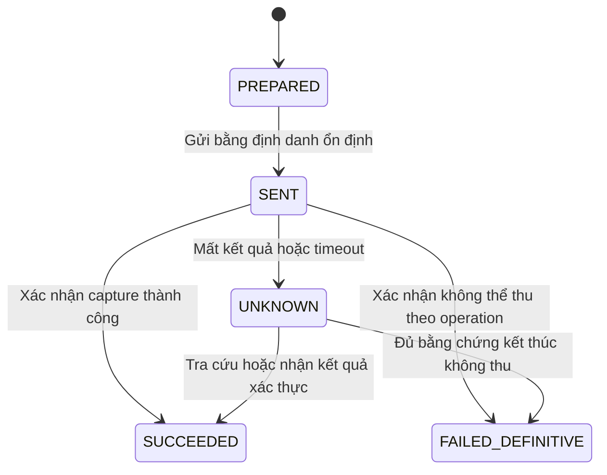

# Payment amount integrity — Bảo toàn tính toàn vẹn số tiền thanh toán

Một yêu cầu thanh toán thành công về mặt kỹ thuật chưa chứng minh đơn hàng đã được trả đúng tiền. Backend có thể nhận đúng chữ ký webhook nhưng đối chiếu nhầm đơn, cộng lặp một giao dịch, dùng sai đơn vị tiền hoặc đánh dấu đã thanh toán cho phiên bản đơn mới bằng số tiền của phiên bản cũ.

Trong chương **Payment Rules**, tính toàn vẹn số tiền là yêu cầu giữ cho khoản phải thu, khoản được phép thu, khoản đã thực sự thu và khoản hoàn lại luôn có quan hệ đúng theo nghiệp vụ. Đây là vấn đề bảo mật logic: người dùng có thể sửa payload, đổi thứ tự API, gửi đồng thời nhiều yêu cầu hoặc phát lại thông báo để tìm một đường đi làm hệ thống chấp nhận sai số tiền.

## 1. Mục tiêu, phạm vi và giả định

Sau bài học, bạn cần có khả năng:

- Chỉ ra nguồn có thẩm quyền của số tiền và tiền tệ cần thanh toán.
- Ràng buộc payment attempt với đúng đơn hàng, revision, tài khoản nhận tiền và khoản phải thu.
- Phân biệt authorization, capture, settlement và refund khi quyết định trạng thái nghiệp vụ.
- Ngăn thu thiếu, thu vượt hoặc thu trùng do retry, thao tác đồng thời và callback lặp.
- Thiết kế kiểm tra bằng bất biến và dữ liệu đã commit, thay vì chỉ dựa vào mã phản hồi của cổng thanh toán.

Ví dụ chính là đơn hàng trả trước, có một revision thương mại đã chốt, một tiền tệ thanh toán và một khoản tiền cần thu bên ngoài. Hệ thống có thể cho phép nhiều lần capture nhưng tổng phải tuân theo khoản phải thu. Mô hình đặt cọc, trả góp, tip, tăng authorization hoặc đa tiền tệ cần quy tắc mở rộng rõ ràng; không tự suy ra từ ví dụ này.

Bài tập trung vào tính đúng của số tiền trong luồng ứng dụng. Cơ chế xác minh chữ ký, tên trạng thái và đơn vị tham số cụ thể phụ thuộc tích hợp với nhà cung cấp; adapter phải chuyển chúng thành ngữ nghĩa nội bộ đã được xác định.

## 2. Tấn công sửa số tiền và những biến thể khó thấy hơn

Giả sử đơn hàng có tổng phải trả là 1.200.000 VND nhưng frontend gửi:

```http
POST /orders/ord_701/payments
Content-Type: application/json

{
  "amountMinor": 1200,
  "currency": "VND",
  "orderRevision": 8,
  "paymentStatus": "PAID"
}
```

Nếu backend dùng trực tiếp số tiền này để tạo giao dịch rồi chỉ kiểm tra giao dịch đã thành công, người mua có thể trả 1.200 VND cho đơn 1.200.000 VND.

Hợp đồng tạo thanh toán có thể chỉ nhận các trường thể hiện ý định và điều kiện của client:

```json
{
  "paymentMethodReference": "method_ref_29",
  "expectedOrderRevision": 8
}
```

Máy chủ xác thực quyền với đơn, xác định snapshot khoản phải thu và tạo payment attempt theo snapshot đó. Nếu API vẫn nhận số tiền để kiểm tra giao diện có đồng bộ hay không, giá trị này chỉ là điều kiện đối chiếu; nó không được trở thành nguồn quyết định khoản cần thu.

Những biến thể khác cũng cần được xét:

| Cách lạm dụng | Sai lệch có thể xảy ra |
| --- | --- |
| Đổi tiền tệ nhưng giữ nguyên con số | Khoản thu có giá trị kinh tế khác khoản phải thu |
| Đổi đơn sau khi đã tạo payment attempt | Trả cho đơn rẻ nhưng mở fulfillment của đơn đắt |
| Phát lại webhook | Cộng một khoản thu nhiều lần |
| Dùng giao dịch của tài khoản nhận tiền khác | Đánh dấu đã trả dù tiền không về đúng bên |
| Gửi hai lệnh capture song song | Tổng tiền thu vượt mức dù mỗi lệnh riêng lẻ hợp lệ |
| Dùng kết quả authorization như capture | Giao hàng dù chưa thu tiền theo chính sách trả trước |
| Timeout rồi tạo giao dịch mới | Giao dịch cũ vẫn có thể thành công, dẫn tới thu trùng |
| Gửi số âm, số cực lớn hoặc số thập phân không hợp lệ | Bỏ qua giới hạn, tràn số hoặc sai đơn vị |
| Dùng callback cũ cho revision mới | Số tiền đã trả không tương ứng hàng sẽ được giao |

## 3. Định nghĩa rõ từng loại số tiền

### 3.1. Khoản phải thu của revision

Một mô hình đơn giản có thể xác định:

```text
committedPayableMinor =
    tổng giá trị hàng sau giảm giá
  + thuế phải trả
  + phí vận chuyển phải trả
  + các phí được phép thu
```

Thứ tự giảm giá, tính thuế và cách làm tròn phải theo chính sách thương mại của hệ thống. Với giá đã bao gồm thuế, không cộng thuế thêm lần nữa.

Sau khi chốt, số tiền này thuộc một revision cụ thể. Nếu thay đổi nội dung có ảnh hưởng khoản phải thu, cần revision hoặc quy trình sửa đổi có kiểm soát; không thay con số bên dưới một payment attempt đang xử lý.

### 3.2. Authorization không phải capture

| Khái niệm | Ý nghĩa trong mô hình ứng dụng |
| --- | --- |
| Expected amount | Khoản hệ thống xác định cần thanh toán cho một phạm vi đã chốt |
| Authorized amount | Khoản nhà cung cấp xác nhận được phép thu theo điều kiện authorization |
| Captured amount | Khoản nhà cung cấp xác nhận đã thực hiện bước thu tiền theo ngữ nghĩa tích hợp |
| Settled amount | Khoản được quyết toán theo chu kỳ và quy trình của nhà cung cấp |
| Refunded amount | Khoản hoàn lại đã được nhà cung cấp xác nhận |
| Net payout | Khoản chuyển về tài khoản sau phí, hoàn tiền hoặc điều chỉnh liên quan |

Authorization có thể hết hạn, bị hủy hoặc chỉ được capture một phần. Trong mô hình trả trước yêu cầu capture, trạng thái “đã được authorization” không đủ để đánh dấu đã trả.

Ngược lại, một hệ thống có thể cho phép chuẩn bị hàng sau authorization theo chính sách riêng. Khi đó phải đặt tên trạng thái và quyền fulfillment đúng với chính sách đó, không làm cho “được chuẩn bị hàng” đồng nghĩa với “đã thu đủ tiền”.

Phí cổng thanh toán và net payout không phải số tiền khách đã trả cho đơn. Ví dụ khách thanh toán 1.200.000 VND, bên bán nhận 1.176.000 VND sau phí không có nghĩa khách còn nợ 24.000 VND.

### 3.3. Số tiền sự kiện có thể là lũy kế hoặc phát sinh

Một webhook có thể chứa tổng đã capture đến hiện tại, hoặc chỉ giá trị của một capture cụ thể. Hai loại dữ liệu này không được cộng theo cùng cách.

Ví dụ nhà cung cấp gửi hai snapshot có tổng capture lần lượt là 400.000 và 1.200.000 VND. Cộng chúng thành 1.600.000 VND sẽ sai. Adapter phải phân biệt bản cập nhật trạng thái lũy kế với một nghiệp vụ tài chính độc lập.

## 4. Các bất biến về số tiền

### 4.1. Đúng đơn, revision, tiền tệ và tài khoản

Mọi khoản thanh toán được dùng để công nhận nghĩa vụ đã hoàn tất phải gắn với:

```text
tenant
orderId
orderRevision hoặc payment snapshot
currency
provider
providerAccount hoặc merchantAccount
providerPaymentReference
```

Định danh giao dịch cần được phân giải trong đúng không gian tài khoản của nhà cung cấp. Không mặc định một chuỗi ID có thể dùng thay thế cho kiểm tra tài khoản nhận tiền hoặc tenant.

Payment reference phải được liên kết từ luồng tạo attempt phía máy chủ hoặc từ quy trình nhập giao dịch được kiểm soát. Không chỉ tin `orderId` trong metadata do client có thể sửa.

### 4.2. Thu tiền không vượt quyền được cấp

Với một authorization cố định, không có tăng hạn mức:

```text
0 <= cumulativeCapturedForAuthorization <= authorizedAmount
```

Với một revision và các thao tác capture do hệ thống quản lý:

```text
confirmedCapturedMinor + reservedCaptureMinor
<= expectedExternalMinor
```

`reservedCaptureMinor` là ngân sách đang được giữ cho các lệnh thu tiền chưa có kết quả chắc chắn. Nó không phải tiền đã thu và không được dùng để đánh dấu đã trả.

Bất biến thứ hai phải tính trên tất cả attempt liên quan đến cùng nghĩa vụ, không chỉ từng attempt. Nếu mỗi attempt đều được phép thu toàn bộ 1.200.000 VND thì hai attempt có thể cùng thu 2.400.000 VND.

### 4.3. Hoàn tiền không tạo lại quyền thu tiền một cách tự động

Trong mô hình hoàn tiền đơn giản:

```text
0 <= confirmedRefundedMinor <= confirmedCapturedMinor

confirmedRefundedMinor + reservedRefundMinor
<= refundableCapturedMinor
```

Khả năng hoàn thực tế còn có thể phụ thuộc tranh chấp, hạn xử lý và quy tắc của phương thức thanh toán. Mô hình cần xác định chính xác `refundableCapturedMinor`.

Không dùng công thức “còn phải thu = giá trị đơn - capture + refund” một cách máy móc. Hoàn tiền sau trả hàng không tự tạo nghĩa vụ thu lại của khách. Trạng thái đã trả trong lịch sử, trạng thái hoàn tiền và khoản phải thu mới là các khái niệm riêng.

### 4.4. Điều kiện công nhận đã trả đủ

Trong ví dụ chỉ dùng tiền thanh toán bên ngoài:

```text
confirmedCapturedMinor == expectedExternalMinor
và tiền tệ, tài khoản nhận tiền, revision đều khớp
và không có sai lệch đang chặn công nhận theo chính sách
```

Không làm tròn một khoản thiếu thành đủ bằng “sai số cho phép” chưa được nghiệp vụ xác định. Không cho khách tự gửi một cờ bỏ qua phần chênh lệch.

Nếu bất ngờ phát hiện capture vượt mức, phải ghi nhận trung thực giao dịch đã xảy ra và đưa sai lệch vào xử lý. Không xóa bớt số tiền thực nhận khỏi dữ liệu chỉ để ép bất biến trở lại đúng; cũng không tự động coi mọi khoản thừa là doanh thu hợp lệ.

## 5. Đơn vị tiền, kiểu số và quy tắc làm tròn

### 5.1. Cùng con số chưa chắc cùng giá trị

Số `1200` có thể biểu diễn 1.200 đơn vị tiền hoặc 12 đơn vị tiền nếu tham số được quy định theo phần trăm đơn vị. Quy ước đơn vị phải rõ ở từng ranh giới.

Trong nội bộ, một cách thiết kế là lưu số nguyên theo đơn vị nhỏ nhất đã cấu hình cùng mã tiền tệ. Adapter chuyển sang quy ước tham số cụ thể của nhà cung cấp.

Không tự mặc định mọi tiền tệ đều nhân 100. Cũng không mặc định metadata tiền tệ của thư viện chuẩn luôn đủ mô tả quy ước đặc thù của một API thanh toán. Cần cấu hình ánh xạ và kiểm tra theo hợp đồng tích hợp đang dùng.

### 5.2. Tránh sai số và tràn số

- Không dùng `float` hoặc `double` làm nguồn có thẩm quyền cho tiền.
- Nếu dùng số nguyên, kiểm tra tràn ở cả phép nhân và cộng tổng.
- Nếu tính tỷ lệ bằng số thập phân, xác định độ chính xác, chế độ làm tròn và thời điểm chuyển về đơn vị tiền.
- Giới hạn số tiền theo nghiệp vụ và khả năng tích hợp, ngoài giới hạn của kiểu dữ liệu.
- Không cắt phần lẻ, bỏ ký tự hoặc ép kiểu mất dữ liệu để làm request “hợp lệ”.
- Chỉ phân tích số ở định dạng máy đã quy định; chuỗi hiển thị theo locale không nên đi thẳng vào phép tính thanh toán.

Giảm giá theo tỷ lệ có thể tạo phần lẻ khi phân bổ xuống dòng hàng. Hệ thống cần một quy tắc phân bổ phần dư sao cho tổng dòng bằng số tiền đơn đã chốt, và phép hoàn tiền sau này có thể giải thích được.

### 5.3. Số tiền bằng 0 là một luồng nghiệp vụ riêng

Một đơn hợp lệ có thể có khoản phải thu bằng 0 sau ưu đãi hoặc sau khi được thanh toán bằng nguồn tiền nội bộ hợp lệ. Khi đó, hệ thống có thể dùng quy trình xác nhận không cần thu bên ngoài.

Không gọi cổng thanh toán với giá trị 0 rồi coi mọi phản hồi thuận lợi là bằng chứng đơn đã được trả. Không chuyển giá trị âm về 0 bằng `max(amount, 0)` để che lỗi tính toán. Khoản phải thu âm cần bị từ chối hoặc xử lý trong mô hình tín dụng/điều chỉnh được thiết kế riêng.

### 5.4. Đa tiền tệ cần một thỏa thuận rõ ràng

Nếu hiển thị tiền tệ khác với tiền tệ thu thực tế, phải biết giá nào chỉ để tham khảo và giá nào được cam kết. Một báo giá chuyển đổi cần ràng buộc nguồn, đích, thời hạn, cách làm tròn và phạm vi sử dụng.

Không so sánh hai số nguyên của hai tiền tệ như thể chúng tương đương. Không dùng tỷ giá hiện tại để sửa lại số tiền của giao dịch lịch sử đã được chấp nhận.

## 6. Chốt snapshot và khóa phạm vi thanh toán

Một payment snapshot có thể gồm:

```text
PaymentSnapshot
  id, tenant_id, order_id, order_revision
  committed_payable_minor, expected_external_minor, currency
  pricing_revision, tax_revision
  internal_tender_allocations
  created_at, status
```

Payment attempt tham chiếu snapshot này thay vì tự đọc lại đơn hàng đang thay đổi:

```text
PaymentAttempt
  id, snapshot_id, provider, provider_account_id
  provider_payment_reference
  intended_amount_minor, currency
  state, version
```

Một luồng chốt đơn có thể:

1. Khóa hoặc kiểm tra phiên bản đơn.
2. Xác thực trạng thái được thanh toán và quyền của người gọi.
3. Tính lại giá, ưu đãi, thuế và phí theo chính sách.
4. Tạo snapshot và chuyển sang trạng thái không cho sửa nội dung liên quan.
5. Tạo attempt cùng lệnh gửi đi hoặc bản ghi outbox.
6. Commit trước khi gọi nhà cung cấp.

Không phải mọi request đều phải giữ nguyên cùng một thiết kế trạng thái, nhưng phải có ranh giới rõ giữa dữ liệu còn được sửa và phạm vi đã dùng để thu tiền.

### 6.1. Đơn thay đổi khi thanh toán đang chạy

Nếu nghiệp vụ cho phép sửa trong lúc attempt cũ đang tồn tại, cần đóng revision cũ hoặc tách quy trình điều chỉnh. Không được chỉ đổi tổng trên cùng một snapshot.

Khi callback cũ đến, nó vẫn thuộc snapshot cũ. Hệ thống không dùng kết quả đó để tự đánh dấu revision mới đã trả. Tùy mô hình có thể cần đối soát, hủy, hoàn hoặc phân bổ khoản tiền theo một quy trình có thẩm quyền; việc phân bổ đó không do payload callback tự quyết định.

## 7. Mô hình transaction cho ngân sách capture

### 7.1. Đặt chỗ cho một lệnh thu tiền

Giả sử khoản phải thu là 1.200.000 VND, đã capture 800.000 VND. Hai request cùng muốn capture thêm 400.000 VND.

Nếu cả hai đều đọc “còn 400.000” rồi gọi cổng thanh toán, tổng cuối có thể thành 1.600.000 VND. Transaction chỉ bảo vệ lúc ghi kết quả sau cuộc gọi là quá muộn.

Cần giữ ngân sách trước khi gửi lệnh ra ngoài:

```text
Transaction chuẩn bị:
  khóa nghĩa vụ thanh toán/snapshot
  kiểm tra quyền, trạng thái, version và idempotency
  kiểm tra captured + reserved + requested <= expected
  kiểm tra phần authorization còn được phép sử dụng
  tạo CaptureOperation có định danh ổn định
  tăng reservedCapture
  ghi outbox hoặc ý định gọi nhà cung cấp
Commit

Bước gửi:
  dùng provider idempotency key cố định cho CaptureOperation

Transaction xác nhận:
  xác minh kết quả thuộc đúng operation
  chuyển phần giữ chỗ thành capture đã xác nhận đúng một lần
  cập nhật trạng thái nghĩa vụ và sự kiện liên quan
Commit
```

Giữ chỗ không có nghĩa nhà cung cấp đã thu tiền. Khi xác nhận thành công, giảm reservation tương ứng và tăng captured trong cùng transaction, không để một khoản được đếm ở cả hai nhóm hoặc không nằm ở nhóm nào.

### 7.2. Ví dụ cập nhật có điều kiện

Giả định bảng nghĩa vụ đã có ràng buộc số tiền không âm và các tham số đã được giới hạn để tránh tràn số:

```sql
UPDATE payment_obligations
SET reserved_capture_minor = reserved_capture_minor + :amount_minor,
    version = version + 1
WHERE id = :obligation_id
  AND tenant_id = :tenant_id
  AND currency = :currency
  AND state = 'COLLECTING'
  AND version = :expected_version
  AND :amount_minor > 0
  AND confirmed_captured_minor <= expected_external_minor
  AND reserved_capture_minor
      <= expected_external_minor - confirmed_captured_minor
  AND :amount_minor
      <= expected_external_minor
         - confirmed_captured_minor
         - reserved_capture_minor;
```

Phải kiểm tra đúng một hàng được cập nhật. Tạo operation và kết quả lệnh trong cùng transaction; nếu bước sau lỗi thì reservation cũng rollback.

Truy vấn này minh họa ngân sách theo nghĩa vụ, chưa kiểm tra ngân sách authorization của một attempt. Nếu nhiều operation dùng chung authorization, phần đó cũng cần khóa hoặc cập nhật có điều kiện trên tài nguyên chung tương ứng.

### 7.3. Không giữ transaction mở trong khi gọi mạng

Nhà cung cấp có thể chậm, timeout hoặc xử lý bất đồng bộ. Không dựa vào việc giữ khóa cơ sở dữ liệu trong suốt cuộc gọi mạng để làm cho hệ thống ngoài trở thành một phần transaction local.

Thay vào đó, lưu ý định và trạng thái trước, gọi bằng định danh ổn định, rồi xác nhận trong transaction riêng. Các đường ghi khác phải tôn trọng reservation và trạng thái chưa chắc chắn đó.

## 8. Ví dụ Java: kiểm tra số tiền capture ở miền nghiệp vụ

Đoạn mã sau chỉ kiểm tra miền số tiền của một yêu cầu capture. Các giá trị phải được lấy từ snapshot và operation nội bộ, dưới cơ chế kiểm soát đồng thời của ứng dụng.

```java
import java.util.Objects;

public final class CaptureAmountRules {
    public static void requireCaptureFits(
            String expectedCurrency,
            long expectedExternalMinor,
            long confirmedCapturedMinor,
            long reservedCaptureMinor,
            String captureCurrency,
            long requestedMinor,
            long availableOnAuthorizationMinor) {

        Objects.requireNonNull(expectedCurrency);
        Objects.requireNonNull(captureCurrency);

        if (!expectedCurrency.equals(captureCurrency)) {
            throw new IllegalArgumentException("Currency mismatch");
        }
        if (expectedExternalMinor < 0
                || confirmedCapturedMinor < 0
                || reservedCaptureMinor < 0
                || availableOnAuthorizationMinor < 0) {
            throw new IllegalStateException("Invalid payment state");
        }
        if (requestedMinor <= 0) {
            throw new IllegalArgumentException("Capture must be positive");
        }

        long alreadyCommitted = Math.addExact(
                confirmedCapturedMinor, reservedCaptureMinor);

        if (alreadyCommitted > expectedExternalMinor) {
            throw new IllegalStateException("Payment budget inconsistent");
        }

        long afterReservation = Math.addExact(
                alreadyCommitted, requestedMinor);

        if (afterReservation > expectedExternalMinor) {
            throw new IllegalArgumentException("Capture exceeds amount due");
        }
        if (requestedMinor > availableOnAuthorizationMinor) {
            throw new IllegalArgumentException("Authorization insufficient");
        }
    }

    private CaptureAmountRules() {}
}
```

`availableOnAuthorizationMinor` phải phản ánh cả capture đã xác nhận và reservation chưa giải quyết trên cùng authorization; không truyền nguyên số tiền authorization ban đầu mỗi lần gọi.

Hàm chưa kiểm tra quyền truy cập, merchant account, revision, thời hạn authorization, idempotency hoặc giới hạn của nhà cung cấp. Việc hàm trả về thành công không tự giữ được ngân sách: service vẫn phải thực hiện ghi có điều kiện hoặc khóa cùng dữ liệu trong transaction.

`Math.addExact` phát hiện tràn `long`; giới hạn nghiệp vụ và giới hạn của tích hợp thường thấp hơn miền của `long` và cần kiểm tra riêng. Lỗi số học hoặc lỗi miền cần được xử lý có kiểm soát, rollback khi cần và không bị che bằng việc cắt bớt số tiền.

## 9. Idempotency ở lệnh nội bộ và lệnh nhà cung cấp

### 9.1. Hai lớp chống lặp có mục đích khác nhau

| Lớp | Mục đích |
| --- | --- |
| Khóa idempotency của API nội bộ | Nhận diện client đang gửi lại cùng ý định |
| Định danh CaptureOperation | Biểu diễn một nghiệp vụ thu tiền nội bộ ổn định |
| Khóa idempotency phía nhà cung cấp | Giúp nhà cung cấp nhận diện lần gửi lại cùng operation theo hợp đồng tích hợp |
| Ràng buộc giao dịch tài chính đã ghi nhận | Ngăn cùng kết quả bị hạch toán lặp |

Không tạo provider idempotency key mới mỗi lần retry cùng CaptureOperation. Cũng không tái sử dụng một key cho hai số tiền hoặc hai giao dịch có ý nghĩa khác nhau.

Khóa API nên được ràng buộc với tenant, actor hoặc phạm vi được phép, loại lệnh, đối tượng và fingerprint nội dung. Cùng khóa nhưng khác số tiền, tiền tệ, attempt hoặc revision phải bị phát hiện.

### 9.2. Timeout là không biết kết quả, không phải thất bại chắc chắn

Nếu đã gửi lệnh capture rồi timeout, có thể nhà cung cấp đã thu tiền. Chuyển ngay operation về thất bại, giải phóng reservation và tạo operation mới có thể làm thu trùng.

Operation cần trạng thái như `UNKNOWN` hoặc `PENDING_RECONCILIATION`. Giữ phần ngân sách chưa xác định cho đến khi có bằng chứng đủ chắc chắn để ghi nhận thành công hoặc giải phóng theo hợp đồng tích hợp.

Một state machine giản lược cho operation:



“Thất bại chắc chắn” phải có nghĩa phù hợp với nhà cung cấp. Một thông báo lỗi mạng hoặc việc chưa thấy webhook chưa đủ chứng minh operation không thể thành công về sau.

Khóa chống lặp có thể có thời hạn và phạm vi riêng. Khi quá thời hạn hoặc không rõ hiệu lực của key, cần tra cứu và đối soát operation cũ trước khi quyết định một thao tác mới. Không hứa “exactly once” chỉ vì đã có một header idempotency.

## 10. Xác minh và xử lý webhook đúng số tiền

Chữ ký hợp lệ bảo vệ nguồn và tính toàn vẹn thông điệp theo cơ chế tích hợp; nó không tự chứng minh giao dịch đã trả đúng cho đơn cần xử lý.

Một pipeline khái niệm:

1. Xác minh thông báo bằng cơ chế tích hợp, trên đúng dữ liệu thô nếu cơ chế chữ ký yêu cầu.
2. Xác định provider account hợp lệ bằng cấu hình được kiểm soát.
3. Nhận diện event và lưu inbox bền vững hoặc xử lý transaction trước khi xác nhận đã nhận theo hợp đồng.
4. Tra cứu attempt/operation từ liên kết đã biết, không tự tin dữ liệu client nhúng vào metadata.
5. Khi cần, tra cứu trạng thái có thẩm quyền từ nhà cung cấp.
6. Đối chiếu đối tượng, tài khoản, tiền tệ, số tiền và ngữ nghĩa authorization/capture/refund.
7. Khóa dữ liệu liên quan, chống hạch toán lặp, ghi nhận kết quả và cập nhật nghĩa vụ.
8. Ghi outbox cho hành động tiếp theo rồi commit.

### 10.1. Chống lặp event khác với chống lặp giao dịch

Inbox có thể dùng khóa duy nhất gồm provider, account và event ID để chặn cùng event được gửi lại.

Tuy nhiên, một giao dịch capture có thể xuất hiện trong nhiều event khác nhau. Chống lặp chỉ theo event ID vẫn có thể cộng cùng khoản thu hai lần. Cần định danh nghiệp vụ tài chính của capture/refund trong đúng phạm vi tài khoản, hoặc cơ chế cập nhật trạng thái lũy kế không cộng lặp.

Ví dụ:

```text
Event E1: capture C9 thành công, 1.200.000 VND
Event E2: payment cập nhật, vẫn tham chiếu capture C9
```

Hệ thống phải ghi nhận C9 một lần, không coi E1 và E2 là hai khoản tiền độc lập.

### 10.2. Thứ tự sự kiện không phải thứ tự trạng thái

Webhook cũ có thể đến sau webhook mới. Không để sự kiện “đang xử lý” ghi đè một kết quả capture đã được xác nhận chỉ vì nó đến sau.

Cần state machine hợp lệ, dữ liệu tài chính có định danh và quy trình tra cứu khi có mâu thuẫn. Refund và dispute là nghiệp vụ mới, không phải lý do viết lại capture lịch sử thành “chưa từng thu”.

### 10.3. Số tiền sai cần được giữ lại để điều tra

Nếu thông báo xác thực cho biết đã thu số tiền khác snapshot, không tự đánh dấu đơn đã trả chỉ vì sự kiện có tên “success”. Lưu sự kiện, ghi nhận thực tế tài chính theo mô hình phù hợp, đặt trạng thái sai lệch và chặn bước phụ thuộc nếu chính sách yêu cầu.

Không bỏ qua hoàn toàn giao dịch đã xảy ra chỉ vì ứng dụng không dự kiến nó. Chênh lệch có thể đến từ thao tác ngoài hệ thống, cấu hình sai hoặc lỗ hổng; cần đối soát và xử lý có dấu vết.

## 11. Thanh toán một phần và nhiều nguồn tiền

### 11.1. Phân biệt giảm giá với nguồn thanh toán

Coupon làm giảm giá trị phải trả theo chính sách. Số dư ví hoặc thẻ quà tặng thường là nguồn tiền dùng để đáp ứng nghĩa vụ, với mô hình sổ sách tương ứng. Không trừ cùng một giá trị ở cả giảm giá và thanh toán.

Nếu đã có nguồn tiền nội bộ được ghi nhận hợp lệ:

```text
expectedExternalMinor =
    committedPayableMinor - committedInternalTenderMinor
```

Cần kiểm tra kết quả không âm và không dùng một khoản nội bộ đang giữ chỗ như thể đã hoàn tất. Nếu workflow chỉ mới reserve ví hoặc gift card, snapshot có thể dự kiến phân bổ nguồn tiền, nhưng điều kiện “đã trả đủ” còn phải chờ nguồn nội bộ đó được commit thành công.

### 11.2. Nhiều capture vẫn là một nghĩa vụ chung

Với khoản phải thu bên ngoài 1.200.000 VND:

```text
Capture C1 thành công: 400.000
Capture C2 thành công: 800.000
Tổng được công nhận: 1.200.000
```

Một capture 400.000 VND không làm đơn được trả đủ. Capture C2 cần phần ngân sách còn lại, đồng thời không được lặp C1 dưới một event khác.

Nếu nhiều người cùng thanh toán một đơn hoặc có nhiều phương thức, dùng nghĩa vụ và phân bổ chung để tránh mỗi luồng đều nghĩ mình được thu toàn bộ. Không chỉ cộng kết quả ở cuối rồi mới phát hiện vượt.

### 11.3. Đặt cọc và thu phần còn lại

Đặt cọc 20% không phải một khoản thu thiếu nếu đó là chính sách đã chốt. Cần mô hình các mốc nghĩa vụ riêng: khoản đến hạn, khoản chưa đến hạn và điều kiện fulfillment của từng mốc.

Không để client tự chọn một tỷ lệ nhỏ rồi dùng trạng thái “payment success” để mở toàn bộ quyền giao hàng. Tỷ lệ, thời hạn và mức quyền được mở phải do quy tắc nghiệp vụ quyết định.

## 12. Refund, hủy và tranh chấp

Một lệnh refund phải đối chiếu khoản capture gốc, tiền tệ, số dư còn được hoàn và quyền của actor. Nếu hai refund cùng chạy, phải giữ ngân sách hoàn để tổng không vượt mức được phép.

Ví dụ đã capture 1.200.000 VND, đã hoàn 800.000 VND. Hai yêu cầu cùng hoàn thêm 400.000 VND không được cùng được cấp ngân sách.

Lệnh hoàn cũng cần operation ổn định, idempotency và trạng thái không chắc chắn khi timeout. Không giảm doanh thu hoặc tăng số tiền đã hoàn hai lần khi nhận callback lặp.

Sau khi hoàn một phần do trả hàng, cần cập nhật quy trình trả hàng và trạng thái refund tương ứng. Không tự đặt đơn thành chưa thanh toán rồi thu lại khoản vừa hoàn.

Chargeback hoặc dispute có quy tắc và dòng tiền riêng, không phải lúc nào cũng tương đương một refund do ứng dụng khởi tạo. Chúng cần được ghi nhận riêng và đưa vào chính sách rủi ro, đối soát hoặc khóa fulfillment phù hợp.

## 13. Phân quyền và các đường ghi ít được chú ý

Không chỉ API của người mua mới có thể làm sai số tiền. Các đường ghi gồm:

- API thu tiền theo đơn hoặc theo authorization.
- Trang quản trị điều chỉnh và capture thủ công.
- Job retry, đối soát và xử lý timeout.
- Webhook, file nhập giao dịch hoặc tích hợp kế toán.
- Công cụ hỗ trợ khách hàng và các tác vụ sửa sai.

Mỗi đường cần đúng quyền theo đối tượng và loại thao tác. Quyền xem đơn không mặc nhiên cho phép thu thêm tiền hoặc hoàn tiền. Tenant và merchant account phải được xác lập từ phạm vi được phép, không từ trường tùy ý trong payload.

Nếu cần ngoại lệ thu chênh lệch, thay giá sau duyệt hoặc hoàn vượt giới hạn thông thường, thiết kế lệnh riêng với thẩm quyền, lý do và quy trình phê duyệt tương ứng. Không thêm cờ `skipAmountCheck` cho client phổ thông.

Thao tác trực tiếp trên bảng để đặt `paid = true` phá vỡ liên kết giữa trạng thái thương mại và bằng chứng tài chính. Quy trình sửa sai cần ghi được vì sao thay đổi, ai cho phép và nghĩa vụ hoặc giao dịch nào được công nhận.

## 14. Kiểm thử các tình huống tấn công logic

Kiểm thử cần quan sát snapshot, operation, khoản giữ chỗ, giao dịch đã ghi nhận và quyền fulfillment sau khi các transaction hoàn tất.

| Tình huống | Kết quả và bất biến cần kiểm tra |
| --- | --- |
| Client đổi amount nhỏ hơn tổng đơn | Số tiền tạo attempt vẫn theo snapshot hoặc request bị từ chối |
| Client đổi currency nhưng giữ con số | Không dùng khoản tiền khác tiền tệ để thanh toán nghĩa vụ |
| Gửi số âm, 0 trái chính sách, số lẻ sai đơn vị hoặc quá lớn | Không ép kiểu mất dữ liệu, không tràn số, không tạo quyền giao hàng |
| Tạo attempt cho đơn của người khác | Quyền theo đối tượng được thực thi |
| Dùng giao dịch của tenant hoặc merchant account khác | Không gán nhầm khoản thu |
| Đổi revision sau khi tạo attempt rồi nhận callback cũ | Chỉ revision tương ứng được ghi nhận theo luồng hợp lệ |
| Authorization thành công nhưng chưa capture | Không đánh dấu đã thu theo mô hình yêu cầu capture |
| Hai capture tranh phần ngân sách cuối | Chỉ mức hợp lệ được giữ chỗ và gửi đi |
| Hai attempt khác nhau cùng thanh toán toàn bộ đơn | Nghĩa vụ chung ngăn cấp hai ngân sách trọn vẹn |
| Response mất sau khi capture thành công | Retry cùng operation không tạo khoản thu mới |
| Timeout khi chưa biết kết quả | Reservation không bị giải phóng thiếu căn cứ |
| Cùng idempotency key nhưng đổi amount hoặc currency | Xung đột, không thực thi nội dung mới |
| Cùng event gửi nhiều lần | Không hạch toán lặp |
| Hai event ID khác nhau cùng tham chiếu một capture | Capture chỉ được ghi nhận một lần |
| Hai event mang tổng capture lũy kế | Không cộng các snapshot như hai giao dịch phát sinh |
| Callback cũ đến sau trạng thái mới | Không lùi trạng thái hoặc mất thông tin tài chính đã xác nhận |
| Phí cổng thanh toán làm net payout thấp hơn capture | Không coi khách còn nợ phần phí bị trừ |
| Hai refund tranh phần còn được hoàn | Tổng hoàn và giữ chỗ không vượt quyền được hoàn |
| Lỗi sau khi giữ ngân sách nhưng trước khi tạo operation | Transaction local rollback toàn bộ |
| Capture ngoài dự kiến được xác nhận có thật | Ghi nhận sai lệch và đối soát, không che giấu thực tế |

Để kiểm thử cạnh tranh, đồng bộ hai luồng tại điểm cùng chuẩn bị giữ ngân sách. Sau khi kết thúc, kiểm tra tổng captured, reserved, số operation, định danh nhà cung cấp và outbox; không chỉ kiểm tra một request trả lỗi.

Có thể kiểm tra thêm chuỗi thao tác:

```text
chốt snapshot
→ tạo capture
→ timeout
→ retry cùng operation
→ webhook thành công
→ phát lại webhook bằng event khác
→ refund một phần
→ nhận webhook capture cũ
```

Trạng thái cuối phải thể hiện đúng một khoản capture, khoản refund tương ứng và nghĩa vụ theo chính sách, không cộng lặp hoặc tự mở khoản nợ mới.

## 15. Đối soát và bằng chứng kiểm toán

Bản ghi hữu ích cho một thao tác liên quan số tiền gồm:

- Tenant, order, revision, snapshot, attempt và operation.
- Provider, account và định danh tài chính trong phạm vi phù hợp.
- Số tiền, tiền tệ, đơn vị biểu diễn và loại nghiệp vụ.
- Actor hoặc nguồn sự kiện, quyền thao tác và lý do điều chỉnh.
- Version, trạng thái trước–sau và phần ngân sách được chuyển.
- Correlation ID, kết quả idempotency và nguồn bằng chứng xác nhận.

Không ghi token xác thực, thông tin thẻ hoặc payload nhạy cảm không cần thiết. Nhật ký thay đổi phải phản ánh transaction đã commit; một log “capture thành công” trước khi transaction rollback có thể gây hiểu nhầm khi điều tra.

Đối soát cần phân biệt số tiền khách trả, khoản đã hoàn, khoản tranh chấp, phí và tiền được quyết toán. Không dùng duy nhất số dư tài khoản ngân hàng để suy ngược từng đơn đã trả đủ.

Cảnh báo có thể tập trung vào tiền tệ không khớp, capture không có operation tương ứng, reservation ở trạng thái chưa rõ quá lâu, cùng provider reference xuất hiện ở nhiều đơn hoặc nghĩa vụ được đánh dấu hoàn tất khi bằng chứng chưa đủ.

## 16. Tự kiểm tra thiết kế

Trước khi coi luồng thanh toán là an toàn về số tiền, cần trả lời rõ:

1. Khoản cần thu được tính ở đâu và gắn với revision nào?
2. Tiền tệ và đơn vị được bảo toàn qua frontend, backend, adapter và nhà cung cấp như thế nào?
3. Một callback chứng minh authorization, capture hay một loại trạng thái khác?
4. Những giao dịch nào được phép cộng vào cùng nghĩa vụ và nhận diện trùng bằng khóa nào?
5. Hai yêu cầu cùng thu phần còn lại được phân xử trước khi gửi lệnh ra ngoài bằng cách nào?
6. Khi timeout, bằng chứng nào cho phép giải phóng reservation hoặc tạo operation mới?
7. Nếu một đơn có ví, gift card hoặc thanh toán một phần, có khoản nào bị tính hai lần không?
8. Hoàn tiền và tranh chấp có bị nhầm thành nghĩa vụ phải thu lại không?
9. Những đường quản trị, retry và đối soát có giữ cùng bất biến với API chính không?

Tính toàn vẹn số tiền cần được giữ từ thời điểm chốt khoản phải thu đến lúc công nhận giao dịch và xử lý điều chỉnh. Khi số tiền có nguồn có thẩm quyền, mỗi thao tác có phạm vi ổn định và mọi kết quả được đối chiếu đúng ngữ nghĩa, việc sửa request, gửi lại lệnh hoặc thay thứ tự callback sẽ không làm hệ thống công nhận một nghĩa vụ đã hoàn tất bằng sai khoản tiền.
