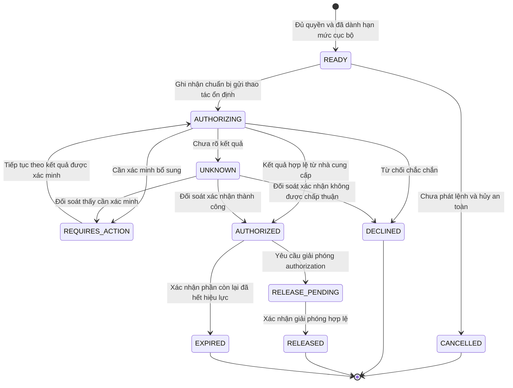

# Payment method authorization: kiểm soát quyền dùng phương thức thanh toán

Trong chương **Payment Rules**, một phương thức thanh toán đã được lưu không có nghĩa mọi người dùng đều được phép sử dụng nó, cũng không có nghĩa mọi khoản thu đều đã được chủ phương thức đồng ý. Nếu API chỉ nhận `paymentMethodId` rồi gọi nhà cung cấp thanh toán, người dùng có thể thay ID để dùng phương thức của tài khoản khác, tăng số tiền ngoài phạm vi đồng ý hoặc gửi đồng thời nhiều yêu cầu để vượt hạn mức.

Bài học tập trung vào bảo vệ logic nghiệp vụ: bất biến, phân quyền theo đối tượng, phạm vi đồng ý, state machine, transaction, idempotency và kiểm thử tình huống lạm dụng. Các ví dụ sử dụng một giao thức thanh toán giả định, không phụ thuộc API cụ thể của nhà cung cấp.

## 1. Mục tiêu và bối cảnh

Sau bài học, bạn có thể:

- Phân biệt quyền sử dụng phương thức với xác thực người dùng và authorization giữ tiền ở nhà cung cấp.
- Ràng buộc người thao tác, phương thức, bên nhận tiền, đơn hàng, số tiền và tiền tệ thành một quyết định nghiệp vụ.
- Thiết kế grant hoặc mandate có phạm vi rõ ràng cho phương thức được lưu, được chia sẻ hoặc dùng định kỳ.
- Ngăn yêu cầu đồng thời tạo nhiều khoản giữ tiền hoặc dùng lại cùng hạn mức thanh toán.
- Xử lý bước xác minh bổ sung, callback, retry và kết quả chưa rõ mà không mở đường bỏ qua phê duyệt.

Giả sử An đã liên kết một phương thức thanh toán trong cửa hàng thuộc tenant T. An muốn dùng phương thức đó để thanh toán đơn O có tổng giá trị 500.000 đồng. Bình có tài khoản hợp lệ trong cùng cửa hàng, nhưng điều này không tự cho Bình quyền dùng phương thức của An. Nếu đây là phương thức của doanh nghiệp được chia sẻ, quyền của Bình phải đến từ một cơ chế ủy quyền được xác định rõ.

Đơn hàng có chủ sở hữu, phương thức thanh toán có chủ thể được phép sử dụng, còn người chịu tiền có thể là một chủ thể khác. Sản phẩm phải định nghĩa quan hệ giữa các bên; không nên suy ra rằng chủ đơn luôn sở hữu phương thức hoặc người trả tiền luôn có quyền xem toàn bộ đơn.

## 2. Phân biệt các lớp thường bị gọi chung là authorization

| Lớp kiểm soát | Câu hỏi cần trả lời | Không đủ để chứng minh điều gì? |
| --- | --- | --- |
| Xác thực người thao tác | Ai đang gửi yêu cầu? | Đăng nhập không chứng minh có quyền dùng mọi phương thức |
| Phân quyền đối tượng | Người này có được dùng đúng phương thức này cho đúng đơn không? | Có quyền xem đơn chưa chắc có quyền sử dụng phương thức của người khác |
| Đồng ý hoặc ủy quyền thanh toán | Chủ thể có đồng ý với mục đích, phạm vi và điều kiện sử dụng không? | Đã liên kết phương thức không có nghĩa đồng ý mọi lần thu |
| Xác minh bổ sung | Bước xác minh do chính sách hoặc nhà cung cấp yêu cầu đã hoàn tất chưa? | Redirect về ứng dụng không tự chứng minh bước đó thành công |
| Authorization tại nhà cung cấp | Nhà cung cấp đã chấp thuận giữ hoặc dành hạn mức cho khoản tiền cụ thể chưa? | Chưa đồng nghĩa tiền đã được capture hoặc giao dịch không thể bị điều chỉnh về sau |
| Capture | Khoản được phép đã được thu theo giao thức thanh toán chưa? | Không tự cấp quyền hoàn tiền sang một đích khác |

Trong bài, **quyền sử dụng phương thức** là quyết định của ứng dụng, còn **authorization tại nhà cung cấp** là một kết quả riêng của giao thức thanh toán. Có thể đủ quyền sử dụng nhưng bị nhà cung cấp từ chối; ngược lại, một nhà cung cấp có thể nhận được lệnh hợp lệ về kỹ thuật trong khi ứng dụng đã cho phép sai người sử dụng.

Một số phương thức không tách riêng giữ tiền và thu tiền. Khi đó cần điều chỉnh state machine theo giao thức thực tế, nhưng vẫn giữ kiểm soát ai được dùng, dùng cho khoản nào và chống thực hiện lặp.

## 3. Mô hình đe dọa của phương thức thanh toán

Kẻ tấn công có thể đã đăng nhập, có đơn hợp lệ và biết một ID phương thức từ log, URL hoặc lỗi lộ dữ liệu. Một tác vụ nền hoặc tài khoản hỗ trợ bị cấp quyền quá rộng cũng có thể tạo khoản thu trái quy tắc.

| Cách lạm dụng | Lỗi logic | Hậu quả |
| --- | --- | --- |
| Thay `paymentMethodId` bằng ID của An | Chỉ xác minh phương thức tồn tại | Dùng phương thức của người khác |
| Gửi token nhà cung cấp trực tiếp | Xem token như bằng chứng quyền sử dụng | Vượt ánh xạ và chính sách của ứng dụng |
| Dùng phương thức khác tenant hoặc merchant account | Không kiểm tra phạm vi thanh toán | Thu trên sai bên nhận tiền hoặc sai ranh giới dữ liệu |
| Sửa `amount` hoặc `currency` trong request | Tin giá trị do client tính | Thu sai giá trị, đổi ý nghĩa hạn mức |
| Đổi phương thức sau khi đã xác nhận | Không ràng buộc bước xác nhận với ý định thanh toán | Dùng xác nhận của đối tượng này cho đối tượng khác |
| Tái sử dụng đồng ý cho đơn khác | Consent chỉ là một cờ `true` | Mở rộng mục đích thu ngoài phạm vi |
| Gọi API off-session dù chỉ đồng ý lần hiện tại | Trộn quyền lưu phương thức với quyền thu về sau | Khoản thu không có căn cứ nghiệp vụ |
| Hai request cùng nhìn thấy hạn mức còn đủ | Kiểm tra ngoài transaction | Vượt ngân sách chia sẻ hoặc giữ tiền nhiều lần |
| Timeout rồi thử lại bằng thao tác mới | Coi không có phản hồi là thất bại chắc chắn | Hai authorization hoặc hai khoản thu |
| Giả `success=true` ở trang quay về | Tin dữ liệu trình duyệt làm bằng chứng | Đánh dấu đơn đã có tiền dù chưa có kết quả hợp lệ |
| Callback thật nhưng ghép sai order | Chỉ xác thực nguồn thông điệp | Ghi nhận khoản tiền cho sai đơn hoặc tenant |
| Thu hồi quyền nhưng worker cũ vẫn chạy | Chỉ kiểm tra quyền lúc xếp hàng | Phát lệnh thanh toán từ quyết định đã hết hiệu lực |

Ẩn ID phương thức, giới hạn tần suất và yêu cầu đăng nhập có thể giảm khả năng khai thác, nhưng không thay thế quan hệ cấp quyền và các điều kiện nghiệp vụ.

## 4. Xác định các bất biến trước khi xây API

### 4.1. Bất biến về người dùng và đối tượng

1. Actor phải có quyền khởi tạo thanh toán cho đúng đơn hoặc payment intent đang xử lý.
2. Actor phải có quyền dùng đúng phương thức thông qua sở hữu trực tiếp hoặc grant được chấp nhận. Cùng tenant không tự tạo quyền này.
3. Phương thức phải hoạt động và ánh xạ tới đúng customer cùng tài khoản merchant ở nhà cung cấp theo mô hình tích hợp.
4. Mỗi lần sử dụng phải có căn cứ đồng ý hoặc ủy quyền phù hợp với mục đích hiện tại; nếu cần xác minh bổ sung thì chưa được coi đã hoàn tất trước khi có bằng chứng tin cậy.
5. Quyền quản trị hoặc hỗ trợ không mặc nhiên là quyền thu tiền bằng phương thức của khách. Ngoại lệ phải có quyền chuyên biệt, lý do và dấu vết.

### 4.2. Bất biến về nội dung thanh toán

1. Số tiền, tiền tệ và bên nhận tiền được xác định từ dữ liệu phía máy chủ cùng chính sách có hiệu lực.
2. Ý định thanh toán gắn với một phiên bản điều kiện đơn hàng; thay đổi quan trọng phải được xét lại trước khi phát lệnh.
3. Căn cứ đồng ý gắn với đúng phương thức, mục đích, bên nhận tiền và giới hạn đã xác định. Không chuyển sang phương thức khác rồi giữ nguyên kết luận đã xác nhận.
4. Tổng lượng giá trị đang được dành và đã thu không vượt mức được phép của đơn theo chính sách mẫu.
5. Các hạn mức của grant hoặc tài khoản chia sẻ tính cả thao tác đang xử lý, không chỉ khoản đã thành công.

### 4.3. Bất biến về vòng đời và tác dụng phụ

1. Một thao tác thanh toán có định danh ổn định xuyên suốt retry, worker và đối soát.
2. Một kết quả không rõ không được coi là từ chối chắc chắn để tự mở đường thanh toán lần nữa.
3. Callback chỉ được cập nhật đối tượng đã ánh xạ, với trạng thái và giá trị phù hợp.
4. Browser redirect không trực tiếp biến trạng thái thành `AUTHORIZED`, `CAPTURED` hoặc `PAID`.
5. Việc ghi quyết định cục bộ, dành hạn mức và ghi ý định phát lệnh phải nhất quán; không giả định transaction cơ sở dữ liệu bao phủ cả nhà cung cấp.
6. Mọi ngoại lệ, thu hồi và kết quả cuối đều có thể truy vết mà không ghi bí mật thanh toán vào log.

Các bất biến này cần được kiểm tra ở tầng nghiệp vụ dùng chung. Nếu chỉ có controller kiểm tra ownership, tác vụ nền hoặc công cụ hỗ trợ vẫn có thể gọi đường khác để bỏ qua.

## 5. Phương thức đã lưu không phải là một grant không giới hạn

### 5.1. Tokenization giải quyết một vấn đề khác

Một token của nhà cung cấp đại diện cho phương thức trong một phạm vi kỹ thuật nhất định. Token không tự biểu diễn rằng actor hiện tại được quyền dùng phương thức cho đơn, số tiền và mục đích đang yêu cầu.

Ứng dụng nên dùng ID nội bộ, tải ánh xạ ở phía máy chủ và kiểm tra quan hệ trước khi dùng tham chiếu nhà cung cấp. Không nhận một `providerPaymentMethodRef` tùy ý từ client rồi dùng tài khoản merchant của hệ thống để thực hiện lệnh.

Luồng liên kết phương thức cũng phải được bảo vệ. Phương thức cần được gắn vào đúng tài khoản hoặc customer đã xác minh, dựa trên kết quả từ tích hợp có thẩm quyền. Không chỉ lưu `owner_id` từ request, hoặc cho người dùng nhận làm của mình một token thuộc customer khác.

### 5.2. Grant hoặc mandate nên biểu diễn phạm vi nào?

Trong bài, **grant** là bản ghi ứng dụng dùng để mô tả quyền sử dụng. Một mandate do hệ thống thanh toán quản lý có thể là một phần bằng chứng liên quan; hai khái niệm không nhất thiết là cùng một đối tượng.

| Thuộc tính | Ý nghĩa |
| --- | --- |
| Chủ thể cấp quyền | Ai có thẩm quyền đồng ý cho phương thức được sử dụng? |
| Chủ thể được dùng | Một người, nhóm, tổ chức hoặc dịch vụ cụ thể |
| Phương thức | ID nội bộ và liên kết nhà cung cấp tương ứng |
| Phạm vi bên nhận tiền | Tenant, merchant hoặc nhóm bên nhận được cho phép |
| Mục đích | Một đơn, một hợp đồng hoặc loại khoản thu được xác định |
| Chế độ sử dụng | Có người dùng trong phiên hiện tại, định kỳ hoặc tác vụ ngoài phiên theo chính sách |
| Giới hạn | Số tiền mỗi lần, tiền tệ, số lần hoặc ngân sách theo kỳ |
| Hiệu lực | Thời điểm bắt đầu, hết hạn, trạng thái thu hồi |
| Phiên bản | Epoch hoặc version để phát hiện quyền đã thay đổi |
| Bằng chứng | Tham chiếu điều kiện đã trình bày, thời điểm xác nhận và bằng chứng được chấp nhận |

Không biểu diễn mọi thứ bằng `canCharge = true`. Quyền thanh toán cho đơn O không tự cho phép đơn P; quyền dùng trong phiên hiện tại không tự trở thành quyền thu định kỳ; quyền xem nhãn phương thức không tự trở thành quyền phát lệnh thanh toán.

Một bước kiểm tra tài khoản hoặc authorization thử với giá trị nhỏ, nếu giao thức có hỗ trợ, cũng không tự thay thế căn cứ đồng ý cho một khoản thu có giá trị khác.

### 5.3. Phương thức doanh nghiệp hoặc chia sẻ

Ví dụ doanh nghiệp cấp cho Bình quyền dùng phương thức chung tối đa 1.000.000 đồng trong kỳ. Bình đã dùng 600.000 đồng và đang có thao tác giữ 300.000 đồng. Yêu cầu mới 200.000 đồng phải bị chặn nếu chính sách tính cả lượng đang giữ:

```text
600.000 đã dùng + 300.000 đang dành + 200.000 yêu cầu mới
    > 1.000.000 giới hạn
```

Hai request không được cùng đọc 100.000 đồng còn lại rồi mỗi request chiếm 100.000 đồng. Ngân sách grant phải được khóa hoặc cập nhật có điều kiện, với quy tắc rõ ràng về thời điểm dành, tiêu thụ và hoàn trả hạn mức.

## 6. Ràng buộc ý định thanh toán với điều kiện phía máy chủ

Một ý định thanh toán nên đóng băng những thuộc tính có ý nghĩa cho quyết định:

```text
payment_intent_id
  tenant_id
  order_id
  order_terms_version
  payer_subject_id
  merchant_account_id
  amount_minor
  currency
  payment_method_id
  usage_grant_id
  grant_epoch
  usage_mode
  policy_version
```

`amount_minor` là số nguyên theo đơn vị nhỏ nhất mà hệ thống và tích hợp đã thống nhất. Lưu cả mã tiền tệ và không so sánh hai số tiền khác tiền tệ như thể chúng có cùng ý nghĩa. Nếu sản phẩm có chuyển đổi tiền tệ, cần một quyết định tỷ giá và thời điểm riêng được ràng buộc với ý định; không tự thêm chuyển đổi ở giữa luồng.

Máy chủ tính số tiền từ điều kiện đơn đã được chấp nhận: hàng hóa, chiết khấu, phí và các khoản đã được ghi nhận. Số tiền hiển thị ở trình duyệt có thể được gửi như giá trị kỳ vọng để phát hiện thay đổi, nhưng không là nguồn có thẩm quyền để quyết định thu.

Nếu tổng tiền hoặc điều kiện quan trọng đổi sau khi người dùng xác nhận, hệ thống cần tạo ý định mới hoặc yêu cầu xác nhận lại theo chính sách. Không cập nhật âm thầm `amount_minor` của một ý định đang chờ rồi dùng kết quả xác minh cũ.

Kết quả authorization tại nhà cung cấp phải được đối chiếu với ý định đã lưu: tham chiếu giao dịch, merchant account, số tiền, tiền tệ và trạng thái. Một khoản thành công ở đơn khác không được dùng làm bằng chứng cho đơn hiện tại.

## 7. State machine: không rút gọn mọi thứ thành success hoặc failed

State machine minh họa cho một lần yêu cầu authorization tách riêng với capture:



Sơ đồ không mô tả hết vòng đời của mọi nhà cung cấp. `READY` là quyết định cục bộ, chưa phải đã giữ tiền bên ngoài. `AUTHORIZED` cũng chưa phải capture. Capture nên có thao tác và trạng thái riêng, liên kết tới authorization cho phép nó.

`UNKNOWN` có thể xuất hiện khi mạng ngắt sau khi nhà cung cấp đã xử lý. Chờ xác minh bổ sung quá lâu cũng cần quy trình đối soát hoặc hủy; không chỉ dựa vào thời gian chờ trên giao diện để giải phóng mọi hạn mức.

Khi một thao tác đã kết thúc, một lần thử mới cần căn cứ mới từ trạng thái hiện tại và định danh mới theo chính sách. Không sửa bản ghi `DECLINED` thành `READY` rồi xóa mất lịch sử lần trước.

## 8. Mô hình dữ liệu phục vụ kiểm soát nghiệp vụ

```text
payment_methods
  id, tenant_id
  owner_subject_id
  provider_id, provider_customer_ref
  provider_method_ref, merchant_scope
  state, verification_state, version

payment_usage_grants
  id, tenant_id, payment_method_id
  granted_by, grantee_subject_id
  purpose_scope, merchant_scope, usage_mode
  currency, per_use_limit_minor
  budget_limit_minor, budget_reserved_minor, budget_consumed_minor
  valid_from, expires_at, state, grant_epoch
  evidence_reference

payment_intents
  id, tenant_id, order_id, order_terms_version
  merchant_account_id, payer_subject_id
  amount_minor, currency, payment_method_id, usage_grant_id
  grant_epoch, usage_mode, state, version

payment_operations
  id, tenant_id, payment_intent_id
  operation_type
  provider_id, provider_account_id
  provider_operation_ref, provider_idempotency_key
  amount_minor, currency, state
  evidence_reference, version

payment_budget_reservations
  id, tenant_id, order_id, payment_operation_id
  amount_minor, currency, state

command_idempotency
  tenant_id, actor_id, command_type, idempotency_key
  request_fingerprint, result_reference

outbox_events
  event_id, aggregate_id, event_type, payload, published_at

provider_inbox
  provider_id, provider_account_id, external_event_id
  received_at, processing_result
```

Đây là mô hình minh họa. Cần bổ sung khóa, ràng buộc cùng tenant và tính duy nhất phù hợp với hệ thống. Tham chiếu của nhà cung cấp phải được lấy từ ánh xạ phía máy chủ, không được đổi tùy ý qua API cập nhật thông tin người dùng.

Tách trạng thái phương thức với trạng thái grant. Một phương thức còn hoạt động có thể có grant đã bị thu hồi; một grant chưa hết hạn vẫn không cho phép dùng phương thức đã bị vô hiệu hóa.

Bằng chứng thanh toán và quyền truy cập dữ liệu nhạy cảm phải được bảo vệ riêng. Lưu phương thức dưới dạng token không làm cho việc ghi mọi dữ liệu phản hồi vào log trở nên an toàn.

## 9. Dành hạn mức để tránh nhiều yêu cầu cùng thắng

### 9.1. Hạn mức của đơn và hạn mức của grant là hai lớp

Trong chính sách mẫu, đơn được phép thu tổng cộng `D` theo phiên bản điều kiện đã chấp nhận. Gọi:

- `C` là tổng capture đã được xác nhận cho nghĩa vụ thu ban đầu.
- `B` là giá trị đang được dành nội bộ cho các thao tác chưa kết thúc việc thu: authorization đang chờ, kết quả chưa rõ, authorization còn có thể capture hoặc capture đang xử lý.

Bất biến minh họa:

```text
0 <= C
0 <= B
C + B <= D
```

Một phần giá trị chỉ được tính một lần trong `B` dù nó chuyển từ chờ authorization sang authorization thành công rồi sang capture đang xử lý. Khi capture được xác nhận, phần tương ứng chuyển từ `B` sang `C`; không cộng capture đang xử lý chồng lên chính authorization đã dành cho nó.

Ví dụ đơn 500.000 đồng đang có thao tác 500.000 đồng ở `UNKNOWN`: `B` vẫn là 500.000 đồng. Request khác không được tạo authorization mới 500.000 đồng chỉ vì chưa nhìn thấy `C` thành công.

Khi grant có ngân sách riêng, cũng phải dành ngân sách grant trong cùng quyết định nhất quán hoặc giao thức điều phối rõ ràng. Khóa được số dư đơn nhưng không khóa ngân sách chia sẻ vẫn có thể cho nhiều đơn cùng vượt giới hạn của phương thức doanh nghiệp.

### 9.2. Không mở lại quyền thu vì có hoàn tiền

`C` trong mô hình trên là giá trị capture của nghĩa vụ thu ban đầu, không phải số thu trừ số hoàn. Nếu đã thu 500.000 đồng rồi hoàn 100.000 đồng, ứng dụng không tự coi đơn còn được phép thu lại 100.000 đồng.

Khoản thu bổ sung sau điều chỉnh, đổi hàng hoặc nghĩa vụ mới cần một căn cứ nghiệp vụ được xác định và đồng ý phù hợp. Refund, tranh chấp và điều chỉnh có sổ riêng; không tự đặt lại hạn mức của payment intent cũ.

### 9.3. Capture cũng phải giữ phần hạn mức riêng của authorization

Với authorization có giá trị `A`, gọi `C_a` là đã capture, `P_a` là capture đang xử lý và `V_a` là phần đã xác nhận không còn dùng được do giải phóng hoặc hết hiệu lực. Cần bảo vệ:

```text
C_a + P_a + V_a <= A
```

Đồng thời kiểm tra authorization vẫn cho phép thao tác theo trạng thái và chính sách hiện tại. Hai request capture không được cùng dùng một phần còn lại. Nếu capture đang không rõ kết quả, không đồng thời giải phóng hoặc cấp lại phần đó như thể chưa dùng.

Các công thức chỉ diễn tả chính sách mẫu cho khoản tiền có giá trị xác định. Sản phẩm có tăng authorization, nhiều loại tiền, tiền boa hoặc giao thức thu đặc biệt cần mô hình riêng, không bỏ điều kiện một cách tùy tiện.

## 10. Transaction cục bộ và lệnh ra nhà cung cấp

### 10.1. Sai lầm: kiểm tra ở ngoài rồi gọi ngay

```java
// Ví dụ không an toàn về nghiệp vụ.
void pay(String orderId, String paymentMethodId, long clientAmount) {
    requireLoggedIn();
    PaymentMethod method = methods.find(paymentMethodId);
    provider.authorize(method.providerRef(), clientAmount);
    orders.markPaid(orderId);
}
```

Đoạn này thiếu quyền trên phương thức và đơn, nguồn số tiền có thẩm quyền, căn cứ đồng ý, ràng buộc merchant, hạn mức đồng thời, idempotency và trạng thái chưa rõ. Nó còn nhầm authorization với paid.

### 10.2. Ghi quyết định cục bộ trước khi phát lệnh

Mã Java sau là mã giả minh họa. Các hàm kiểm tra, transaction và repository phải được hiện thực theo hạ tầng của hệ thống.

```java
AuthorizationReceipt requestAuthorization(
        Principal principal, AuthorizePaymentCommand command) {
    Actor actor = authenticatedActor(principal);
    NormalizedCommand cmd = normalizeAndValidate(command);

    return transaction.run(() -> {
        Replay replay = idempotency.claimOrReplay(
            actor.tenantId(), actor.id(), "AUTHORIZE_PAYMENT_METHOD",
            cmd.idempotencyKey(), fingerprintOfNormalizedCommand(cmd)
        );
        if (replay.isCompleted()) {
            return replay.minimalReceipt();
        }

        // Tất cả lệnh xung đột tuân theo một thứ tự lấy khóa đã thống nhất.
        Order order = orders.lock(actor.tenantId(), cmd.orderId());
        PaymentMethod method = methods.lock(
            actor.tenantId(), cmd.paymentMethodId()
        );
        UsageGrant grant = grants.lockApplicable(
            actor.tenantId(), method.id(), cmd.grantId(), actor
        );

        requireCanInitiatePayment(actor, order);
        requireCanUseMethod(actor, method, grant);
        requireMethodActiveAndCorrectlyBound(method);
        requireGrantEffectiveNow(grant, databaseDecisionTime());
        requireOrderTermsMatch(order, cmd.expectedOrderTermsVersion());

        PaymentTerms terms = derivePaymentTermsOnServer(order);
        requireGrantCovers(grant, terms, cmd.usageMode());
        requireMerchantScope(method, grant, terms.merchantAccount());
        requireOrderBudgetAvailable(order, terms.amount());
        requireGrantBudgetAvailable(grant, terms.amount());

        PaymentIntent intent = intents.createImmutableTerms(
            order, method, grant, terms, cmd.usageMode()
        );
        PaymentOperation operation = operations.createReadyAuthorization(intent);
        budgets.reserveForOrderAndGrant(operation, order, grant);
        audit.append(authorizationRequested(actor, intent, operation));
        outbox.append(authorizeAtProvider(operation.id()));

        AuthorizationReceipt receipt = receiptOf(operation);
        idempotency.complete(receipt);
        return receipt;
    });
}
```

Đoạn mã giả giả định các dữ liệu cần dành hạn mức ở cùng miền transaction. Nếu quyền, ngân sách hoặc đơn thuộc hệ thống khác, cần giao thức điều phối phù hợp; không coi các lần gọi service độc lập là một transaction nguyên tử.

`READY` được trả về là đã tiếp nhận yêu cầu và dành hạn mức, chưa phải authorization bên ngoài thành công. API cần phản ánh sự khác biệt này để giao diện và hệ thống fulfillment không hiểu nhầm.

### 10.3. Worker xử lý ý định đã commit

Một worker có thể thực hiện theo các bước:

1. Tải operation cùng ý định đã lưu; kiểm tra nó chưa kết thúc hoặc đã được xử lý bởi một lần khác.
2. Trong transaction, kiểm tra lại điều kiện nhạy cảm trước khi phát lệnh: phương thức, grant, phiên bản đơn, trạng thái giữ đơn và các giới hạn có liên quan.
3. Nếu chưa từng phát lệnh mà điều kiện không còn hợp lệ, hủy an toàn và trả hạn mức theo chính sách. Nếu đã có thể phát lệnh, chuyển sang đối soát thay vì giả định không có tác dụng.
4. Ghi trạng thái chuẩn bị gửi với định danh provider idempotency ổn định, rồi commit.
5. Gọi nhà cung cấp bằng ánh xạ, merchant account, số tiền và tiền tệ đã lưu.
6. Trong transaction tiếp theo, ghi kết quả có bằng chứng; giữ hạn mức nếu chưa rõ, hoặc chuyển và giải phóng đúng phần khi có kết quả chắc chắn.

Nếu tiến trình dừng sau bước 4 hoặc sau khi đối tác xử lý nhưng trước bước 6, retry phải dùng cùng định danh thao tác hoặc truy vấn kết quả. Không tạo thao tác mới chỉ vì worker không nhớ đã nhận phản hồi hay chưa.

Outbox giúp giữ ý định phát lệnh cùng transaction cục bộ. Nó không khiến lời gọi bên ngoài có thể rollback và không tự bảo đảm nhà cung cấp chỉ thực hiện một lần.

## 11. Idempotency cần giữ đúng cả lệnh và ý định

Một phạm vi khóa minh họa là:

```text
(tenant_id, actor_id, command_type, idempotency_key)
```

Dấu vân tay lệnh chuẩn hóa gồm order, phiên bản điều kiện kỳ vọng, phương thức, grant và chế độ sử dụng. Các giá trị phía máy chủ đã quyết định ở lần đầu như số tiền, currency và merchant được lưu bền vững trong intent tương ứng.

Phân biệt dấu vân tay của request với nội dung intent đã giải quyết. Khi replay cùng request đã hoàn tất bước tiếp nhận, không tính lại giá hiện tại rồi âm thầm sửa lệnh cũ. Trả biên nhận tối thiểu cho đúng lệnh; một yêu cầu có điều kiện hoặc nội dung mới cần đi qua quyết định mới.

| Trường hợp | Hành vi mong muốn |
| --- | --- |
| Cùng khóa, cùng actor, cùng lệnh đã tiếp nhận | Trả cùng operation hoặc biên nhận |
| Cùng khóa nhưng đổi phương thức hoặc grant | Từ chối do nội dung khác |
| Hai request cùng khóa đến đồng thời | Một quyết định cục bộ nhờ ràng buộc duy nhất hoặc giữ chỗ tương đương |
| Dùng khóa mới khi operation cũ còn `UNKNOWN` | Hạn mức đơn và trạng thái chặn tạo khoản giữ trùng |
| Worker gửi lại cùng operation | Dùng cùng khóa nhà cung cấp theo giao thức được hỗ trợ |
| Actor khác dùng cùng chuỗi khóa | Không nhận kết quả riêng tư của actor ban đầu |
| Bản ghi khóa hết thời gian lưu | Hạn mức và trạng thái bền vững vẫn ngăn xử lý trái quy tắc |

Khóa phía ứng dụng và khóa nhà cung cấp là hai lớp khác nhau. Khóa nhà cung cấp nên được tạo từ định danh operation và phạm vi tích hợp có kiểm soát, không chỉ chuyển nguyên một chuỗi client cung cấp sang mọi merchant account.

Thời gian lưu, phạm vi và hành vi retry của nhà cung cấp phải được tích hợp theo hợp đồng thực tế. Khi không thể dựa chắc vào khả năng chống trùng, cần đối soát hoặc xử lý ngoại lệ; không khẳng định mọi API thanh toán đều có cùng cơ chế.

## 12. Xác minh bổ sung và callback không được trở thành đường tắt

### 12.1. Ràng buộc bước xác minh với đúng ý định

Nếu nhà cung cấp yêu cầu một hành động bổ sung, ứng dụng cần liên kết luồng đó với đúng payment intent, operation, phiên hoặc chủ thể được phép và thời hạn. Sau khi người dùng quay lại, máy chủ kiểm tra kết quả qua kênh tin cậy.

Không dùng các giá trị sau làm bằng chứng thành công:

```text
?success=true
localStorage.paymentConfirmed = true
requestBody.challengeCompleted = true
một URL quay về hợp lệ nhưng không có kết quả từ nhà cung cấp
```

Một kết quả xác minh của intent A không được gắn vào intent B. Thay đổi phương thức, tiền tệ, bên nhận hoặc điều kiện số tiền cần được kiểm tra theo đúng phạm vi mà bằng chứng hỗ trợ.

Nếu xác thực dựa trên cookie, các endpoint tạo hoặc tiếp tục lệnh thay đổi trạng thái cũng cần bảo vệ request giả mạo theo thiết kế ứng dụng. Biện pháp đó bổ sung cho phân quyền và phạm vi đồng ý, không thay thế chúng.

### 12.2. Xác thực nguồn callback chưa đủ

Luồng nhận callback cần:

1. Xác minh nguồn và tính toàn vẹn thông điệp theo hợp đồng tích hợp.
2. Xác định đúng provider account và tenant từ ánh xạ được tin cậy.
3. Ánh xạ provider operation tới operation nội bộ đã tồn tại.
4. Đối chiếu loại thao tác, số tiền, tiền tệ và trạng thái.
5. Ghi inbox và cập nhật nghiệp vụ nhất quán trong transaction.
6. Chỉ tạo tác dụng phụ như cho phép fulfillment sau khi có trạng thái được chính sách công nhận.

Khóa duy nhất của inbox có thể dùng `(provider_id, provider_account_id, external_event_id)`. Nó chống lặp cùng event ID, nhưng không ngăn hai event ID khác nhau cùng mô tả một authorization. State machine và định danh operation tiếp tục bảo vệ việc dành hoặc chuyển hạn mức đúng một lần.

Không so sánh trạng thái theo thứ tự số rồi nhận bất kỳ trạng thái lớn hơn. Callback có thể đến trễ, và trạng thái của authorization, capture, release là các đối tượng liên quan nhưng khác nhau.

## 13. Thu hồi, gỡ phương thức và tác vụ đang bay

Thu hồi grant, gỡ phương thức khỏi giao diện và giải phóng authorization ở nhà cung cấp là các hành động khác nhau.

Một chính sách mẫu có thể quy định:

- Thu hồi chặn mọi lệnh mới dựa trên grant đó.
- Operation chưa được phát hành ra ngoài phải kiểm tra phiên bản grant hiện tại trước khi chuyển sang đang gửi.
- Operation có thể đã được phát hành phải được đối soát; nếu không còn được phép tiếp tục, yêu cầu giải phóng hoặc xử lý bù trừ theo chính sách.
- Capture là một quyết định riêng: không tự cho phép chỉ vì đã từng authorization, cũng không tự hủy lịch sử nghĩa vụ chỉ vì người dùng đã ẩn phương thức.

`grant_epoch` giúp phát hiện tác vụ được tạo từ quyền cũ, nhưng chỉ hữu ích khi được đối chiếu ở các điểm sử dụng. Xóa cache sau thu hồi vẫn có thể để lại khoảng thời gian kết luận cũ được dùng; thao tác nhạy cảm cần nguồn quyền có thẩm quyền hoặc cơ chế nhất quán đáp ứng yêu cầu.

Cần xác định điểm tuần tự hóa giữa thu hồi và phát lệnh. Ví dụ transaction đánh dấu operation đang gửi sau khi khóa grant là điểm đã phát hành về mặt cục bộ. Thu hồi đến sau điểm đó không thể đảm bảo nhà cung cấp chưa xử lý, kể cả cuộc gọi mạng chưa trả về. Không hứa rằng một thao tác thu hồi cục bộ sẽ lập tức đảo ngược mọi hiệu ứng bên ngoài.

Gỡ phương thức không nên xóa các liên kết cần cho audit, đối soát hoặc xử lý giao dịch đang tồn tại. Có thể ngừng cho sử dụng mới và hạn chế dữ liệu hiển thị trong khi vẫn giữ tham chiếu cần thiết theo chính sách lưu trữ của hệ thống.

## 14. Quyền đọc dữ liệu và quyền thu tiền phải tách riêng

Người có quyền thanh toán cho đơn không nhất thiết được xem lịch sử thanh toán của chủ phương thức. Người có quyền xem nhãn đã che bớt của phương thức cũng không nhất thiết được sử dụng nó.

| Tác vụ | Quyền cần quyết định riêng |
| --- | --- |
| Xem nhãn phương thức | Chỉ phần dữ liệu được phép hiển thị |
| Dùng phương thức trong phiên | Grant, purpose, hạn mức và điều kiện hiện tại |
| Thu định kỳ hoặc ngoài phiên | Phạm vi ủy quyền và lịch hoặc căn cứ tương ứng |
| Gỡ phương thức | Chủ thể có thẩm quyền quản lý, không chỉ người đã từng sử dụng |
| Capture | Quyền trên operation và authorization cụ thể |
| Hoàn tiền | Quyền, hạn mức và đích hoàn được phép |
| Xem bằng chứng nội bộ | Phạm vi hỗ trợ hoặc điều tra phù hợp |

Không trả provider token, bí mật dùng cho bước xác minh, thông tin phương thức đầy đủ hoặc toàn bộ payload nhạy cảm chỉ vì actor được xem đơn. Nếu giao thức cần đưa một capability tạm thời cho client, phải giới hạn đúng mục đích, thời hạn và đối tượng theo cơ chế của tích hợp.

Các lỗi từ API cũng cần hạn chế khả năng dò tìm. Với người không có quyền, tránh phân biệt công khai quá chi tiết giữa phương thức không tồn tại và phương thức thuộc người khác. Nội bộ vẫn có thể ghi mã lý do để vận hành.

## 15. Audit và đối soát có thể dựng lại quyết định

Một sự kiện tiếp nhận yêu cầu có thể ghi:

```json
{
  "eventType": "PAYMENT_METHOD_AUTHORIZATION_REQUESTED",
  "eventId": "event-example",
  "tenantId": "tenant-T",
  "orderId": "order-O",
  "paymentIntentId": "intent-example",
  "paymentOperationId": "operation-example",
  "actorId": "user-An",
  "paymentMethodId": "method-internal-example",
  "usageGrantId": "grant-example",
  "grantEpoch": 4,
  "amountMinor": 500000,
  "currency": "VND",
  "merchantAccountId": "merchant-internal-example",
  "usageMode": "CUSTOMER_PRESENT",
  "policyVersion": "payment-policy-v2",
  "correlationId": "correlation-example"
}
```

Bổ sung thời điểm quyết định, tham chiếu bằng chứng và phiên bản điều kiện đơn. Không đưa token phương thức, cookie, bí mật xác minh hoặc dữ liệu xác thực của tích hợp vào audit. Các sự kiện phản ánh kết quả phải ghi nguồn bằng chứng và phân biệt thời gian bên ngoài với thời gian được hệ thống tiếp nhận.

Đối soát cần tìm các operation `UNKNOWN`, các khoản đã được chấp thuận ở nhà cung cấp nhưng chưa ghi cục bộ, hạn mức không khớp trạng thái, callback không ánh xạ được và authorization cần giải phóng sau thu hồi.

Không chữa sai lệch bằng cách đặt mọi operation lâu ngày thành `DECLINED` rồi mở hạn mức. Cần căn cứ để biết khoản tiền đã được giữ, thu hoặc giải phóng chưa. Nếu chưa xác định được, giữ trạng thái có thể điều tra và chuyển ngoại lệ theo chính sách.

## 16. Kiểm thử tình huống lạm dụng

Bài kiểm thử cần kiểm tra trạng thái bền vững, hạn mức và số lệnh thực tế được phát, không chỉ mã HTTP. Với cuộc đua, dùng đồng bộ có kiểm soát để các transaction gặp nhau ở điểm quyết định.

| Nhóm | Tình huống | Điều cần chứng minh |
| --- | --- | --- |
| Luồng hợp lệ | An dùng phương thức và grant đúng cho đơn O | Intent gắn đúng điều kiện; một operation, một lần dành hạn mức |
| Sai chủ thể | Bình thay ID bằng phương thức riêng của An | Không phát lệnh nhà cung cấp, không lộ dữ liệu phương thức |
| Được chia sẻ | Bình có grant hợp lệ với phương thức doanh nghiệp | Chỉ dùng được đúng phạm vi, không cần giả làm chủ phương thức |
| Khác tenant | Phương thức hoặc grant thuộc tenant khác | Không truy cập hoặc sử dụng ngoài phạm vi |
| Sai merchant | Tham chiếu phương thức gắn tài khoản merchant khác | Bị chặn trước khi gửi lệnh |
| Liên kết giả | Gửi token của customer khác để nhận làm phương thức của mình | Không tạo quan hệ sở hữu hoặc quyền sử dụng sai |
| Sửa số tiền | Client giảm, tăng hoặc gửi lượng âm | Giá trị có thẩm quyền không bị thay; dữ liệu không hợp lệ bị từ chối |
| Đổi tiền tệ | Dùng hạn mức ở tiền tệ khác | Không so sánh số thuần hoặc chuyển đổi ngầm |
| Đổi điều kiện | Giá hoặc phí đổi sau bước xác nhận | Không dùng intent cũ với số tiền mới trái phạm vi |
| Đổi phương thức | Xác minh phương thức A rồi thay sang B | Bằng chứng không được dùng chéo |
| Sai mục đích | Grant chỉ cho đơn O nhưng dùng cho đơn P | Bị từ chối dù cùng actor và phương thức |
| Sai chế độ | Grant cho phiên hiện tại bị dùng cho tác vụ định kỳ | Không phát lệnh ngoài phạm vi |
| Grant hết hạn | Request đợi khóa đến sau hạn | Quyết định dựa trên thời điểm được định nghĩa sau khi lấy khóa |
| Thu hồi | Worker cũ xử lý sau khi grant đổi epoch | Operation chưa phát hành bị chặn; operation đang bay được đối soát |
| Hai đơn cùng dùng ngân sách | Tổng hai yêu cầu vượt phần ngân sách còn lại | Không cùng được dành vượt hạn mức grant |
| Hai phương thức cho một đơn | Hai request cùng thanh toán toàn bộ đơn | Hạn mức đơn ngăn giữ hai lần toàn bộ số tiền |
| Timeout sau xử lý | Nhà cung cấp đã chấp thuận nhưng mất phản hồi | Giữ trạng thái chưa rõ và cùng định danh; không tạo authorization mới tùy ý |
| Idempotency | Gửi lại cùng khóa và nội dung | Cùng biên nhận, không dành thêm hạn mức hoặc thêm ý định phát lệnh |
| Đổi nội dung cùng khóa | Thay grant, phương thức hoặc phiên bản đơn | Từ chối do dấu vân tay không khớp |
| Callback trùng | Cùng event ID đến hai lần | Một thay đổi nghiệp vụ |
| Callback khác ID | Hai event ID cùng báo một operation thành công | Không dành hoặc chuyển hạn mức hai lần |
| Callback sai ánh xạ | Sự kiện thật nhưng sai tiền tệ, merchant hoặc amount | Không ghi nhận thành công cho intent không khớp |
| Redirect giả | Tự gọi URL quay về với `success=true` | Không đánh dấu authorization hoặc paid |
| Capture đồng thời | Hai request dùng cùng phần còn lại | Không vượt hạn mức authorization, kể cả capture đang xử lý |
| Refund | Thu xong rồi hoàn một phần | Không tự mở quyền thu lại trên intent cũ |
| Lỗi transaction | Lỗi sau tạo intent nhưng trước ghi outbox | Intent, hạn mức và kết quả tiếp nhận cùng rollback |
| Gỡ phương thức | Gỡ khi còn operation chưa rõ kết quả | Chặn dùng mới nhưng vẫn đối soát được giao dịch cũ |
| Dữ liệu nhạy cảm | Actor chỉ có quyền xem đơn hoặc biên nhận | Không nhận token hoặc dữ liệu ngoài phạm vi |

Có thể kiểm tra thuộc tính sau mỗi chuỗi lệnh: các hạn mức không âm, không vượt giới hạn đã định, mỗi operation chỉ tác động một lần và mọi kết quả thành công có ánh xạ cùng bằng chứng đúng đối tượng. Giả lập cả từ chối chắc chắn lẫn timeout chưa rõ; không biến mọi lỗi mạng thành cùng một nhánh thất bại.

## 17. Bài thực hành

Cho endpoint sau:

```http
POST /orders/{orderId}/pay
Content-Type: application/json

{
  "paymentMethodId": "method-A",
  "amount": 500000,
  "currency": "VND",
  "consent": true
}
```

Service chỉ kiểm tra đăng nhập, gọi nhà cung cấp và đánh dấu `paid = true` nếu không có ngoại lệ. Hãy phân tích:

1. Cần kiểm tra quan hệ nào giữa actor, order, phương thức, customer ở nhà cung cấp và merchant?
2. `consent: true` thiếu những thông tin gì để chứng minh phạm vi đồng ý?
3. Số tiền nào được tin cậy và làm thế nào phát hiện điều kiện đơn đã thay đổi?
4. Hai request đồng thời hoặc một timeout có thể tạo bao nhiêu thao tác bên ngoài?
5. Khi nào phải chuyển sang `REQUIRES_ACTION` hoặc `UNKNOWN` thay vì `paid`?
6. Thu hồi grant giữa lúc xếp hàng và phát lệnh được xử lý ở điểm nào?

Một phương án sửa cần nêu được quyền theo đối tượng, grant có phạm vi, intent gắn điều kiện bất biến, hạn mức được dành nhất quán, định danh operation, idempotency, xử lý callback và đối soát. Sau đó chứng minh bằng tình huống hai phương thức cùng cố thanh toán toàn bộ một đơn rằng hệ thống không phát hành hai yêu cầu vượt hạn mức.

## 18. Những điểm cần nhớ

- Biết ID hoặc token phương thức không đồng nghĩa có quyền sử dụng; đã lưu phương thức cũng không phải đồng ý mọi khoản thu.
- Quyền dùng phải gắn người thao tác, phương thức, mục đích, bên nhận tiền, số tiền, tiền tệ và điều kiện hiện tại.
- Authorization của ứng dụng, authorization tại nhà cung cấp và capture là các quyết định khác nhau.
- Transaction bảo vệ quyết định và hạn mức cục bộ; thao tác bên ngoài cần định danh ổn định, chống trùng và đối soát.
- Kết quả chưa rõ vẫn chiếm hạn mức phù hợp cho đến khi có căn cứ xử lý; retry không được tự mở khoản thanh toán mới.
- Callback, redirect và tác vụ nền đều phải đi qua state machine cùng các bất biến, thay vì trở thành đường tắt bỏ qua phê duyệt.
