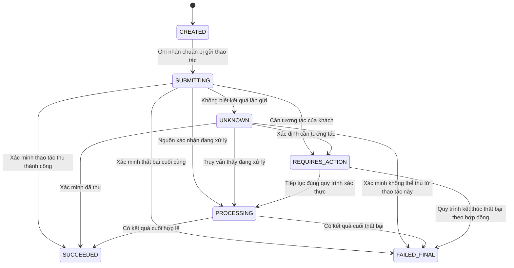

# Payment retry behavior: thử lại thanh toán mà không tạo thêm lần thu tiền

## 1. Retry thanh toán là vấn đề về ý nghĩa nghiệp vụ

Trong chương Payment Rules, **payment retry behavior** là tập quy tắc xác định khi nào hệ thống được thử lại, thử lại thao tác nào, giữ nguyên những định danh nào và xử lý ra sao khi chưa biết kết quả của lần trước.

Một lần gọi API thất bại ở tầng mạng không chứng minh việc thu tiền đã thất bại. Nhà cung cấp có thể đã xử lý giao dịch nhưng response bị mất. Nếu server hoặc người dùng tạo một giao dịch mới ngay sau timeout, khách có thể bị thu hai lần cho cùng một nghĩa vụ thanh toán.

Ví dụ:

```text
T0: server gửi yêu cầu thu 500.000 VND cho đơn O1
T1: nhà cung cấp thu thành công, tạo giao dịch C1
T2: kết nối bị ngắt trước khi server nhận response
T3: client gửi lại vì màn hình chưa có kết quả
```

Tại T3, kết luận đúng là “chưa xác định được kết quả lần gửi trước”, không phải “chưa thu tiền”. Hành vi an toàn cần giữ liên kết với thao tác cũ, truy vấn hoặc chờ nguồn xác nhận đáng tin cậy, và chỉ gửi lại khi hợp đồng idempotency cho phép.

Mục tiêu bài học là bảo vệ bất biến không thu tiền lặp bằng quyền theo đối tượng, state machine, transaction, idempotency và đối soát. Chỉ thêm vòng lặp `try/catch` hoặc cấu hình retry trong HTTP client không đủ bảo vệ logic nghiệp vụ.

## 2. Phân biệt ý định thanh toán, attempt và lần gửi mạng

| Khái niệm | Đại diện cho | Quan hệ khi retry |
|---|---|---|
| Payment intent nội bộ | Nghĩa vụ thanh toán một số tiền, tiền tệ và phiên bản đơn cụ thể | Giữ ổn định khi xử lý cùng nghĩa vụ |
| Payment attempt | Một lần thực hiện thanh toán với phương thức và ngữ cảnh đã chọn | Có thể có nhiều lần gửi mạng cho cùng attempt |
| Provider operation | Một thao tác có hiệu ứng như authorize, capture hoặc refund | Mỗi thao tác cần định danh và khóa idempotency phù hợp |
| Transport try | Một lần gửi HTTP hoặc gọi SDK | Gửi lại không mặc nhiên tạo ý định nghiệp vụ mới |
| Provider transaction | Giao dịch thực tế tại nhà cung cấp | Là căn cứ đối chiếu dòng tiền, khác với ID request |
| Client idempotency key | Nhận diện một ý định gửi lại từ client tới backend | Không tự thay thế khóa idempotency gửi tới nhà cung cấp |

Không nhất thiết dùng đúng những tên bảng hoặc tên đối tượng này. Điều quan trọng là mô hình không gộp mọi thứ vào một cột `retryCount` hoặc tạo payment mới sau mỗi lỗi HTTP.

Trong ví dụ chính của bài, một intent được thu toàn bộ số tiền bằng một thao tác charge/capture theo hợp đồng nhà cung cấp. Nếu hệ thống tách authorize và capture, hoặc có nhiều lần capture, trả góp, đặt cọc, thanh toán nhiều phương tiện, phải mô hình hóa nghĩa vụ và từng thao tác riêng. Authorization thành công không tự đồng nghĩa tiền đã được capture hoặc đơn đã đủ điều kiện `PAID`.

## 3. Các business invariants phải được giữ

### 3.1. Retry giữ nguyên thao tác đã chấp nhận

- Cùng thao tác thu tiền phải giữ nguyên intent, attempt, số tiền, tiền tệ và định danh nghiệp vụ tương ứng.
- Khóa idempotency tại nhà cung cấp ổn định qua các lần gửi lại của cùng thao tác.
- Thay số tiền, phương thức, tài khoản merchant hoặc loại thao tác không còn là một retry thuần túy.
- Số tiền lấy từ dữ liệu đã được server chấp nhận, chẳng hạn snapshot giá bất biến; không lấy lại từ payload tùy ý của client hoặc giá catalog hiện tại.

### 3.2. Kết quả chưa rõ không được biến thành thất bại chắc chắn

- Timeout, mất kết nối hoặc worker dừng không tự tạo ra trạng thái thất bại nghiệp vụ cuối cùng.
- Hết ngân sách retry chỉ có nghĩa ngừng tự động thử, không chứng minh khách chưa bị thu tiền.
- Yêu cầu hủy đã gửi không chứng minh nhà cung cấp đã hủy thành công và không thể tiếp tục thu.
- Một kết quả truy vấn “không thấy” chỉ đủ kết luận khi hợp đồng nguồn cho phép; dữ liệu có thể cập nhật chậm hoặc request trước còn đang trên đường xử lý.

### 3.3. Một nghĩa vụ không có hai đường thu độc lập đang chạy ngoài kiểm soát

Với mô hình thanh toán một lần toàn bộ đơn, chỉ cho phép một attempt có khả năng thu tiền hoạt động cho cùng intent tại một thời điểm. Một attempt chưa rõ kết quả vẫn có khả năng đã hoặc sẽ thu tiền, nên không được bỏ qua chỉ vì nó quá thời gian chờ của giao diện.

Retry cùng client key không tạo attempt mới. Hai client key khác nhau cũng không được vượt qua bất biến của intent. Việc đổi sang phương thức hoặc nhà cung cấp khác phải chờ kết quả an toàn của lần cũ, hoặc đi qua một quy trình ngoại lệ được thiết kế rõ ràng cho rủi ro thu trùng.

### 3.4. Ghi nhận tiền và tác động nghiệp vụ không bị lặp

Một giao dịch capture đã được xác minh không được cộng vào sổ ghi nhận hai lần chỉ vì webhook và response đồng bộ cùng xuất hiện. Việc đánh dấu đơn đã trả đủ, phát sự kiện hoặc tạo quyền lợi phải dựa trên bản ghi tiền hợp lệ và có cơ chế chống lặp riêng.

Hoàn tiền hoặc đảo giao dịch sau đó là các thao tác có định danh và vòng đời riêng. Không sửa lịch sử capture thành “chưa từng thành công” để che đi việc đã thu rồi hoàn.

## 4. Phân loại kết quả trước khi quyết định retry

Không chỉ nhìn HTTP status rồi áp một quy tắc chung cho mọi nhà cung cấp. Cần đọc kết quả theo hợp đồng của thao tác và phân biệt lỗi vận chuyển với trạng thái nghiệp vụ.

| Quan sát | Có thể kết luận gì? | Hành vi phù hợp |
|---|---|---|
| Response thành công cho thao tác cần thu | Có bằng chứng theo nguồn, nhưng vẫn phải đối chiếu đúng giao dịch và số tiền | Áp dụng kết quả idempotent, không gọi thu lại |
| Nhà cung cấp báo đang xử lý | Request đã được nhận, kết quả cuối chưa có | Chờ webhook hoặc truy vấn; không tạo charge mới |
| Cần xác thực hoặc tương tác khách hàng | Chưa hoàn tất quy trình cần người dùng tham gia | Trả `REQUIRES_ACTION` theo mô hình; tiếp tục đúng thao tác khi được phép |
| Từ chối cuối cùng đã được xác định | Thao tác đó thất bại theo hợp đồng và không còn có thể thu | Có thể cho người dùng bắt đầu attempt mới sau kiểm tra điều kiện |
| Timeout sau khi gửi, mất response hoặc kết nối đứt | Có thể đã xử lý, có thể chưa | Đánh dấu chưa rõ, giữ định danh cũ, đối soát hoặc gửi lại an toàn theo hợp đồng |
| Lỗi 5xx | Có thể lỗi trước hoặc sau khi đã tạo hiệu ứng | Không mặc định chưa thu; dùng chính sách idempotency và truy vấn |
| Rate limit hoặc yêu cầu đợi | Không được gửi dồn; ý nghĩa xử lý request phụ thuộc hợp đồng nguồn | Tôn trọng thời gian chờ và ngân sách; không đổi khóa để vượt giới hạn |
| Sai tham số hoặc cấu hình | Gửi nguyên request thường không tự hết lỗi | Dừng retry máy móc, sửa căn nguyên; xác định kết quả lần trước trước khi đổi thao tác |
| Lỗi xác thực tích hợp | Cần xử lý quyền hoặc thông tin xác thực của server | Không lặp vô hạn và không tự tạo nghĩa vụ thanh toán mới |

Một mã từ chối cần người dùng xác thực thêm không nên bị coi là lỗi mạng để SDK tự gọi lại liên tục. Tương tự, sự cố cấu hình merchant không được xử lý bằng cách âm thầm chuyển tiền sang một merchant khác.

Backend nên chuẩn hóa kết quả về những nhóm nội bộ đủ rõ, đồng thời giữ mã và tham chiếu nguồn để điều tra. Không để client tự quyết định `retryable = true` rồi buộc server thực hiện lại.

## 5. State machine cho attempt và công việc retry



Đây là state machine minh họa cho một thao tác thu trong phạm vi đã nêu. Tên trạng thái tại nhà cung cấp có thể khác; adapter phải ánh xạ theo ngữ nghĩa thực tế.

`UNKNOWN` biểu thị không xác định được kết quả của lần gửi. Nếu đã biết chắc nhà cung cấp đang xử lý, một lần truy vấn sau bị timeout không làm mất sự thật đó: có thể giữ `PROCESSING` và ghi riêng lần kiểm tra thất bại.

Nên tách trạng thái attempt khỏi trạng thái công việc nền:

```text
Attempt outcome: UNKNOWN hoặc PROCESSING
Retry work:      SCHEDULED / RUNNING / BUDGET_EXHAUSTED / NEEDS_RECONCILIATION
```

Như vậy, hết ngân sách tự động không buộc hệ thống đổi attempt sang `FAILED_FINAL`. Một phản hồi thành công đến muộn vẫn được xử lý đúng căn cứ.

Sơ đồ cũng không có nghĩa được bỏ mọi sự kiện mâu thuẫn với trạng thái cuối. Nếu có bằng chứng đáng tin cho thấy tiền thực sự đã thu sau một kết luận thất bại trước đó, phải lưu giao dịch và đưa vào đối soát. Không được bỏ mất dòng tiền chỉ vì một nhánh code cho rằng state đã terminal.

## 6. Thiết kế khóa idempotency và dữ liệu bất biến của thao tác

### 6.1. Khóa ở hai ranh giới khác nhau

| Ranh giới | Khóa và phạm vi | Mục tiêu |
|---|---|---|
| Client → backend | Tenant, chủ thể, thao tác, client key và fingerprint | Không tạo ý định/attempt mới vì request gửi lại |
| Backend → nhà cung cấp | Provider account, môi trường, operation và provider key | Nhà cung cấp nhận ra cùng thao tác dù có nhiều lần gửi |
| Message → consumer | Event ID và định danh hiệu ứng nghiệp vụ | Không áp dụng lại kết quả hoặc quyền lợi |

Một provider key có thể được sinh từ định danh attempt và loại thao tác, chẳng hạn một biểu diễn ổn định của `attemptId + CHARGE + operationRevision`. Dạng chuỗi cụ thể phải tuân theo giới hạn và hợp đồng của nhà cung cấp. Không đưa thông tin cá nhân hoặc bí mật thanh toán vào khóa.

Không sinh UUID mới bên trong mỗi lần thực hiện hàm retry. Khóa cần được ghi bền trước lần gửi mạng đầu tiên. Worker khởi động lại hoặc chuyển máy vẫn phải tìm lại được cùng khóa.

Authorize, capture và refund là các thao tác khác nhau, không dùng chung khóa một cách tùy tiện. Ngược lại, retry cùng capture không được tạo capture operation mới chỉ để có một khóa khác.

### 6.2. Fingerprint phải biểu diễn ý định đã được chấp nhận

Các đầu vào thường cần ràng buộc gồm:

- Tenant, order/payment intent và revision nghĩa vụ thanh toán.
- Snapshot giá, số tiền và tiền tệ.
- Phương thức thanh toán hoặc tham chiếu được phép sử dụng.
- Loại thao tác và routing/account nhà cung cấp đã chọn.

Không đưa các trường thay đổi thuần túy theo lần gửi, như tracing ID hoặc thời điểm tạo chữ ký HTTP, vào fingerprint nghiệp vụ nếu chúng không thay đổi ý định. Cũng không lưu payload nhạy cảm nguyên văn chỉ để phục vụ so sánh.

Cùng client key với fingerprint khác phải bị từ chối xung đột. Cùng provider key với payload khác có thể bị nhà cung cấp từ chối hoặc có hành vi theo hợp đồng riêng; hệ thống không nên đi tới tình huống đó bằng cách sửa attempt đã gửi.

### 6.3. Thời hạn bảo đảm idempotency có ảnh hưởng trực tiếp

Không mặc định provider key được ghi nhớ mãi mãi. Khi hết thời gian bảo đảm, gửi lại cùng chuỗi khóa có thể không còn được xem là cùng thao tác. Cần lưu mốc gửi và giới hạn bảo đảm theo hợp đồng, rồi quyết định retry trong khoảng an toàn.

Một attempt cũ chưa rõ kết quả sau thời hạn đó cần đối soát bằng reference/giao dịch nguồn hoặc quy trình xử lý ngoại lệ. Không dùng việc “khóa vẫn giống nhau” làm lý do duy nhất để gửi lại. Bản ghi idempotency nội bộ cũng cần thời hạn và ràng buộc nghiệp vụ đủ để retry muộn không tạo thu tiền trùng sau khi dữ liệu khóa đã bị dọn.

## 7. Mô hình dữ liệu bảo vệ quyết định retry

| Nhóm | Trường minh họa | Ý nghĩa bảo mật nghiệp vụ |
|---|---|---|
| Payment intent | `intentId`, tenant, owner, order, snapshot/revision, amount, currency, state, version | Cố định nghĩa vụ và kiểm soát ai được thanh toán |
| Payment attempt | `attemptId`, intent, phương thức tham chiếu, provider/account, state, version | Không nhầm lần gửi mạng với lần thanh toán mới |
| Provider operation | `operationId`, type, provider key, fingerprint, immutable request reference | Khôi phục đúng thao tác sau crash hoặc retry |
| Dispatch/retry | số lần gửi, lần gửi đầu, `nextRetryAt`, deadline, lease, lý do dừng | Kiểm soát tải và không đánh mất lịch sử công việc |
| Source observation | nguồn đã xác thực, event/reference, trạng thái, thời điểm nhận, kết quả đối chiếu | Hợp nhất response, webhook và truy vấn |
| Monetary record | Provider account, transaction/capture ID, loại hiệu ứng, số tiền, tiền tệ | Ngăn cộng tiền hai lần và phát hiện tiền thu dư |
| Command record | Phạm vi client key, fingerprint, handle kết quả | Trả lại cùng thao tác cho request lặp |
| Outbox/inbox | Event ID và trạng thái phát/áp dụng | Phối hợp các hiệu ứng sau commit |

Không lưu PAN, mã bảo mật thẻ, token truy cập hoặc dữ liệu bí mật vào log retry. Với phương thức thanh toán, dùng tham chiếu được bảo vệ và quyền truy cập thích hợp; một reference tồn tại không chứng minh người gọi có quyền dùng nó.

Các ràng buộc lưu trữ hữu ích có thể gồm unique theo phạm vi client key, unique provider key trong phạm vi tài khoản/môi trường/thao tác thích hợp, và unique cho định danh hiệu ứng tiền từ nhà cung cấp. Quy tắc chỉ một attempt có khả năng thu còn hoạt động cần được thực thi bằng khóa, cập nhật có điều kiện hoặc ràng buộc phù hợp với database và mô hình trạng thái.

Unique theo khóa request không thay thế bất biến intent. Hai request dùng hai client key khác nhau vẫn có thể cố tạo hai attempt nếu service chỉ kiểm tra idempotency mà không bảo vệ intent.

## 8. Ví dụ Java: tạo hoặc tiếp tục cùng một thanh toán

Đoạn sau là mã mô tả tầng application và các cổng lưu trữ, không phải lớp có thể biên dịch độc lập. Ví dụ dùng transaction local cho intent, attempt, command và outbox; không gọi mạng tới nhà cung cấp trong transaction này.

```java
PaymentView startOrResume(PayCommand command, AuthenticatedActor actor) {
    return transactions.required(() -> {
        var intent = intents.lockAuthorizedIntent(
                actor.tenantId(), actor.userId(), command.intentId());
        authorization.requirePay(actor, intent);

        var claim = commands.claimOrRead(
                actor,
                "PAY_INTENT",
                command.idempotencyKey(),
                fingerprints.forPay(command));

        if (claim.isCompleted()) {
            return views.currentStatusOfAuthorizedPayment(
                    claim.paymentHandle(), actor);
        }

        if (intent.isPaid()) {
            var view = views.forPaidIntent(intent);
            commands.complete(claim, view.paymentHandle());
            return view;
        }

        rules.requireCurrentPayableRevision(intent, command);
        authorization.requirePaymentMethod(actor, command.methodReference());

        var blockingAttempt = attempts.findChargeableOrUnresolved(intent.id());
        if (blockingAttempt != null) {
            rules.requireSameOperationOrBlockMethodChange(
                    blockingAttempt, command);
            var view = views.forExistingAttempt(blockingAttempt);
            commands.complete(claim, view.paymentHandle());
            return view;
        }

        rules.requireNewAttemptAllowed(intent);
        var attempt = attempts.createFromTrustedIntent(
                intent, command.methodReference(), routing.forIntent(intent));
        var operation = operations.createChargeWithStableKey(attempt);

        attempts.insert(attempt);
        operations.insert(operation);
        intents.attachActiveAttempt(intent, attempt);
        outbox.appendChargeRequested(operation);

        var view = views.forCreatedAttempt(attempt);
        commands.complete(claim, view.paymentHandle());
        return view;
    });
}
```

Những điều kiện quan trọng:

- Khóa intent hoặc cơ chế tương đương phải được mọi đường tạo attempt tuân theo, kể cả job nền và đường đổi phương thức.
- `claimOrRead` cần unique và xử lý cạnh tranh thật tại adapter; cùng khóa nhưng fingerprint khác bị từ chối.
- Retry đã hoàn tất phải về cùng payment handle sau kiểm tra quyền. View hiện tại được đọc từ trạng thái server để không giữ mãi một response “đang xử lý” cũ.
- `findChargeableOrUnresolved` phải bao gồm cả attempt chưa rõ kết quả, không chỉ các attempt đang có worker chạy.
- `requireSameOperationOrBlockMethodChange` không được âm thầm dùng phương thức mới cho operation cũ. Nếu ý định khác bị chặn, response cần nói rõ đang có thanh toán cần xử lý.
- Amount, currency, provider routing và khóa của operation được cố định từ dữ liệu đã chấp nhận, không sửa tại chỗ khi retry.
- Lỗi ghi attempt, operation, outbox hoặc command result phải rollback toàn bộ thay đổi local.

Với authorize/capture tách rời, cần service và operation riêng cho từng giai đoạn cùng các điều kiện phụ thuộc. Không dùng lại đoạn minh họa như một lệnh charge mới sau mỗi lần xác thực khách hàng.

## 9. Worker gửi lại như thế nào khi có thể dừng ở mọi điểm?

Một worker an toàn phải giả định rằng tiến trình có thể dừng trước khi gửi, sau khi gửi hoặc sau khi nhà cung cấp đã xử lý nhưng trước khi lưu kết quả.

```text
1. Claim công việc bằng lease/cơ chế cạnh tranh phù hợp.
2. Đọc operation bất biến và trạng thái mới nhất.
3. Nếu đã có kết quả cuối hợp lệ, không gửi thu lại.
4. Kiểm tra deadline, ngân sách và bảo đảm idempotency còn phù hợp.
5. Ghi bền thông tin chuẩn bị dispatch theo thiết kế.
6. Gửi bằng cùng provider key và cùng nội dung nghiệp vụ.
7. Đưa response hoặc quan sát lỗi vào luồng xử lý kết quả chung.
8. Nếu chưa rõ kết quả, lên lịch truy vấn/đối soát hoặc retry an toàn.
```

Ghi “chuẩn bị gửi” trước mạng không chứng minh request đã ra ngoài. Ghi “đã gửi” sau mạng cũng có khoảng crash trước khi ghi. Vì không thể làm một transaction database thông thường bao trùm hiệu ứng bên nhà cung cấp, cần idempotency hoặc cơ chế tương đương tại ranh giới đó, cùng đối soát.

Lease giúp giảm worker chạy trùng nhưng không bảo đảm worker cũ đã ngừng thực hiện request khi lease hết hạn. Khi worker mới tiếp quản, nó vẫn dùng cùng operation và provider key. Fencing/version giúp kiểm soát cập nhật local; nó không tự thu hồi request đã nằm trong mạng bên ngoài.

Kết quả về muộn không được ghi đè một thành công đã xác minh bằng trạng thái timeout cũ. Các lần ghi trạng thái cần điều kiện version hoặc phép hợp nhất kết quả đúng ngữ nghĩa. Nếu nhận bằng chứng tiền thực tế từ một worker cũ, vẫn đưa qua luồng ghi nhận nguồn để không mất dấu giao dịch chỉ vì lease không còn thuộc worker đó.

Nếu nhà cung cấp không hỗ trợ idempotency hoặc tham chiếu duy nhất có bảo đảm tương đương, local lock và outbox không đủ chứng minh gửi lại sẽ không thu thêm. Khi kết quả chưa rõ, phải hạn chế tự động gửi lại và dùng khả năng truy vấn/đối soát được hợp đồng hỗ trợ. Không được quảng bá “thu đúng một lần” chỉ dựa trên việc có một worker tại một thời điểm.

## 10. Backoff, jitter và ngân sách retry

Retry quá nhanh có thể khuếch đại sự cố: nhiều client và worker cùng gọi lại khi nhà cung cấp đang quá tải. Cần ngân sách theo operation, deadline tổng và khoảng đợi tăng dần có jitter.

Một công thức minh họa:

```text
retryIndex = 0 cho lần retry đầu tiên
cap        = min(maxDelay, baseDelay × 2^retryIndex)
jitter     = random trong khoảng [0, cap]
delay      = max(jitter, thời gian chờ tối thiểu hợp lệ do nguồn yêu cầu)
```

Ví dụ học tập có thể đặt baseDelay là 500 ms và maxDelay là 30 giây. Đây chỉ là các số để hiểu công thức; chính sách thật phụ thuộc giới hạn nhà cung cấp, loại thao tác và thời gian có thể chờ của nghiệp vụ.

Cần quy định rõ:

- Giới hạn tính theo tổng số lần gửi hay chỉ số lần gửi lại.
- Deadline tổng của thao tác tự động và thời điểm chuyển sang đối soát.
- Ngân sách dùng chung cho SDK retry, HTTP client, worker và cơ chế retry của queue.
- Thời gian chờ từ nguồn, nếu được hỗ trợ, phải được diễn giải đúng và không bị bỏ qua chỉ vì maxDelay local nhỏ hơn.
- Nếu lần gửi tiếp theo vượt deadline hoặc khoảng bảo đảm idempotency, dừng việc gửi tự động thay vì ép delay xuống để vẫn gửi.
- Những kết quả cần tương tác khách hàng không được biến thành vòng retry không có người dùng.

Nếu SDK tự thử ba lần và worker cũng thử lại nhiều vòng, số request thực tế có thể lớn hơn nhiều so với con số được cấu hình ở một lớp. Retry count phải quan sát được ở cấp operation, không chỉ trong một lần chạy tiến trình.

Hết ngân sách nên dẫn tới trạng thái công việc như `NEEDS_RECONCILIATION`, giữ nguyên sự không chắc chắn của attempt. Giao diện không nên đổi thành “chắc chắn chưa thanh toán” chỉ vì backend ngừng tự thử.

## 11. Hợp nhất response, webhook và truy vấn mà không cộng tiền lặp

Response đồng bộ, webhook và kết quả truy vấn có thể cùng báo về một giao dịch. Chúng nên đi qua một luồng đối chiếu kết quả có chung bất biến, thay vì mỗi nhánh tự cập nhật order theo cách riêng.

Trước khi ghi nhận thành công, cần xác minh:

1. Nguồn hoặc kênh truy vấn đúng theo hợp đồng tích hợp và đúng provider account/môi trường.
2. Giao dịch liên kết đúng intent, attempt và operation nội bộ đã tạo.
3. Loại hiệu ứng là thao tác mong đợi; authorization không bị ghi nhận như capture.
4. Số tiền và tiền tệ khớp nghĩa vụ hoặc phần nghĩa vụ được phép xử lý.
5. Định danh giao dịch và hiệu ứng chưa được ghi nhận trước đó.

Trong phạm vi dữ liệu cùng database, luồng áp dụng có thể thực hiện:

```text
Lưu/deduplicate quan sát nguồn
  → khóa hoặc bảo vệ version intent/attempt
  → đối chiếu giao dịch và bất biến tiền
  → ghi monetary record với unique theo hiệu ứng nguồn
  → cập nhật kết quả attempt và mức đáp ứng nghĩa vụ
  → cập nhật trạng thái order nếu đủ điều kiện
  → ghi history và outbox tương ứng
  → commit
```

ID webhook không phải luôn là ID hiệu ứng tiền. Hai webhook khác ID có thể cùng nói về một capture. Ngược lại, hai capture khác nhau cho cùng intent là hai dòng tiền thực tế, không được bỏ một dòng chỉ vì order đã `PAID`.

Nếu đã thu dư do lỗi hoặc do một luồng ngoại lệ, phải lưu cả giao dịch, ngăn tạo thêm quyền lợi không đúng và đưa vào quy trình đối soát/hoàn tiền theo chính sách. Không bỏ qua giao dịch thứ hai như một duplicate giả, cũng không tự gửi refund nhiều lần khi nhận lại cùng webhook.

Webhook đến trước response là tình huống bình thường. Sau khi webhook đã chốt thành công, response hoặc lỗi mạng đến sau không được hạ trạng thái về thất bại. Sự kiện nguồn mâu thuẫn cần được lưu và phân giải theo căn cứ, không chỉ theo thứ tự message đến.

## 12. Đổi phương thức, hủy và retry thủ công

### 12.1. Khi nào được tạo attempt mới?

Có thể cho tạo attempt mới khi nghĩa vụ vẫn còn phải trả và attempt trước đã được xác định không còn có thể thu theo hợp đồng, hoặc đã bị hủy an toàn với bằng chứng phù hợp. Cần kiểm tra lại quyền, revision, amount và điều kiện phương thức mới.

Một attempt thất bại cuối cùng có thể được giữ nguyên lịch sử và attempt mới có định danh/khóa mới. Điều đó khác với đổi khóa của một request đang timeout để thử vận may.

Nếu kết quả cũ còn chưa rõ mà nghiệp vụ buộc phải chấp nhận phương thức khác, cần một quy trình ngoại lệ cụ thể: ai có quyền quyết định, theo dõi hai nguồn tiền thế nào, phát hiện thu dư ra sao và xử lý tiền đến muộn thế nào. Một nút “thử lại” thông thường không nên tự kích hoạt ngoại lệ này.

### 12.2. Hủy local không hủy được request đang bay

Người dùng đóng cửa sổ, frontend abort request hoặc backend đánh dấu hết hạn không chứng minh thao tác bên nhà cung cấp đã dừng. Nếu cần hủy, ghi nhận ý định và theo dõi kết quả hủy theo quy trình nguồn.

Không mở attempt mới chỉ vì đã gửi lệnh hủy. Lệnh thu và lệnh hủy có thể cạnh tranh; kết quả thực tế phải được đối chiếu. Nếu tiền đã thu cho đơn không còn được tiếp tục, chuyển sang nghiệp vụ xử lý tiền/đơn thích hợp, không làm như tiền chưa từng được thu.

### 12.3. Công cụ quản trị cũng phải giữ bất biến

Retry thủ công phải chọn operation hiện hữu, hiển thị số tiền/phương thức/trạng thái chưa rõ và dùng lại khóa khi đó là cùng thao tác. Không cung cấp thao tác đổi `UNKNOWN` thành `FAILED_FINAL` tùy ý để mở đường thu mới.

Các thao tác ngoại lệ cần quyền riêng, lý do, căn cứ kiểm tra và audit phù hợp. Sửa trực tiếp status trong database rồi chạy lại job có thể phá cả lớp idempotency lẫn khả năng đối soát.

## 13. Hành vi giao diện và API khi chưa có kết quả cuối

Frontend nên gửi một client key ổn định cho cùng ý định, giữ payment handle được server trả và đọc trạng thái từ backend. Refresh trang hoặc mở lại ứng dụng không nên mặc định tạo charge mới.

API có thể trả một trạng thái đang xử lý cùng định danh để theo dõi, thay vì giữ request mở tới lúc hết timeout. Cần phân biệt rõ các kết quả cho người dùng:

| Trạng thái có thẩm quyền | Thông tin có thể hiển thị |
|---|---|
| Đang xử lý hoặc chưa rõ kết quả | Hệ thống đang kiểm tra; tiếp tục theo dõi giao dịch hiện tại |
| Cần tương tác | Thực hiện bước xác thực hoặc hành động được cung cấp cho attempt đó |
| Thành công | Đã ghi nhận thanh toán cho nghĩa vụ tương ứng |
| Thất bại cuối cùng | Có thể bắt đầu lần thanh toán mới nếu server xác nhận còn được phép |
| Cần đối soát | Chưa thể kết luận tự động; hiển thị mã tham chiếu và quy trình hỗ trợ |

Không coi redirect về trang thành công hoặc một biến local của trình duyệt là bằng chứng đã trả tiền. Không tin `paid=true`, `amount` hoặc transaction ID do client tự khai nếu chưa đối chiếu với nguồn chuẩn.

Khóa nút thanh toán giúp giảm thao tác lặp trên giao diện, nhưng backend vẫn phải chống request trực tiếp, nhiều tab, ứng dụng khác và job chạy đồng thời. Mất client key cũng không được làm mất bất biến của intent.

## 14. Kiểm thử theo kịch bản lỗi và tấn công logic

| Tình huống | Thiết lập và hành động | Kết quả cần chứng minh |
|---|---|---|
| Thu thành công nhưng mất response | Nhà cung cấp tạo C1 rồi mô phỏng timeout, client gửi lại | Vẫn cùng attempt/operation/key; chỉ một hiệu ứng thu được chấp nhận |
| Crash trước gửi | Worker ghi chuẩn bị dispatch rồi dừng trước mạng | Worker mới khôi phục đúng operation và không tạo ý định mới |
| Crash sau xử lý nguồn | Nhà cung cấp xử lý xong, worker dừng trước khi lưu | Retry hoặc truy vấn tìm lại kết quả bằng cùng định danh, không thu độc lập lần nữa |
| Cùng client key | Gửi đồng thời nhiều request cùng fingerprint | Cùng payment handle; không tạo nhiều attempt |
| Cùng key, khác ý định | Đổi amount, method hoặc revision nhưng giữ key | Từ chối xung đột; không sửa operation đã gửi |
| Khác client key | Hai tab gửi hai khóa cho cùng intent | Khóa/version/bất biến intent ngăn hai attempt chargeable không kiểm soát |
| Webhook đến trước | Gửi webhook thành công rồi mới trả response | Một monetary record, một kết quả nghiệp vụ, không hạ trạng thái khi response đến |
| Webhook lặp | Gửi cùng event nhiều lần và nhiều event cho cùng capture | Deduplicate ở cả sự kiện và hiệu ứng tiền thích hợp |
| Lỗi đến muộn | Ghi thành công trước rồi nhận timeout từ worker cũ | Không chuyển thành FAILED hoặc UNKNOWN do quan sát cũ |
| Lease hết hạn | Worker cũ vẫn gửi khi worker mới tiếp quản | Cùng operation/provider key; cập nhật local được bảo vệ; không mất giao dịch về muộn |
| Hết ngân sách | Làm các lần truy vấn/gửi an toàn không có kết quả cuối | Dừng tự động, giữ chưa rõ và chuyển đối soát; không báo chắc chắn chưa thu |
| Hết bảo đảm key | Mô phỏng attempt chưa rõ sau hạn idempotency nguồn | Không tự gửi lại chỉ vì chuỗi key không đổi; có đường đối soát |
| Query chưa thấy | Nguồn chưa trả giao dịch do độ trễ | Không coi “not found” tạm thời là bằng chứng đủ để mở thu mới |
| Rate limit | Nguồn yêu cầu chờ và nhiều job cùng retry | Không gửi sớm hơn yêu cầu, không tạo bão retry hoặc đổi key để vượt hạn mức |
| Cần xác thực | Nguồn trả yêu cầu tương tác người dùng | Không tự lặp charge; tiếp tục đúng quy trình và cùng liên kết thao tác |
| Sai quyền | Gửi intent hoặc method reference của người/tenant khác | Không tạo, retry hoặc đọc được thanh toán ngoài phạm vi |
| Sửa giá | Client gửi tổng tiền thấp hơn hoặc catalog đổi giữa các lần thử | Operation giữ nghĩa vụ đã chấp nhận; payload client không quyết định tiền thu |
| Đổi phương thức khi chưa rõ | Attempt cũ timeout, người dùng chọn method mới | Bị chặn hoặc đi đúng quy trình ngoại lệ đã định nghĩa |
| Hủy cạnh tranh | Gửi hủy trong khi request thu còn đang xử lý | Kết quả nguồn được đối chiếu; không mặc định hủy đã ngăn thu |
| Thu dư thực tế | Hai capture khác ID cùng trả về cho intent | Lưu cả dòng tiền, phát hiện thu dư và xử lý ngoại lệ, không bỏ mất giao dịch |
| Lỗi transaction local | Gây lỗi khi ghi monetary record/order/outbox | Không có trạng thái PAID hoặc hiệu ứng thành công bị lệch với bản ghi tiền |
| SDK và worker cùng retry | Bật retry ở nhiều lớp và gây lỗi liên tục | Ngân sách cấp operation kiểm soát tổng request thực tế |

Với kịch bản mất response, stub nhà cung cấp cần thực sự ghi nhận một giao dịch rồi mới gây timeout; chỉ ném exception trước mọi xử lý không kiểm tra được nguy cơ thu hai lần. Với race condition, dùng điểm đồng bộ để các request hoặc worker đi vào vùng cạnh tranh cùng lúc.

Kiểm thử cần quan sát cả định danh provider operation, số lần tạo hiệu ứng tại nguồn giả lập, bản ghi tiền nội bộ, trạng thái intent/order và outbox. Đếm request HTTP không đồng nghĩa đếm số lần thu: nhiều request có thể hợp lệ cho một operation idempotent, còn một request cũng có thể về timeout sau khi đã thu.

## 15. Audit và đối soát một lần retry đáng ngờ

Audit nên liên kết được tenant/order, intent, attempt, operation, provider account, provider key hoặc tham chiếu được phép lưu, client command, source transaction và các quan sát kết quả. Ghi thời điểm gửi, thời điểm nhận, lý do retry/dừng, ngân sách còn lại và quyết định tạo attempt mới.

Theo dõi tỷ lệ UNKNOWN, số attempt chờ đối soát, tuổi của trạng thái chưa rõ, xung đột fingerprint, số lần provider key bị dùng sai payload, lượng thu dư và số operation vượt ngân sách. Những chỉ số này giúp phát hiện lỗi nghiệp vụ mà tỷ lệ HTTP thành công không thể hiện hết.

Khi điều tra một ca nghi thu trùng, bắt đầu từ nghĩa vụ thanh toán rồi lần theo mọi attempt và giao dịch nguồn, thay vì chỉ xem request cuối. Xác định lần nào là gửi lại cùng operation, lần nào đã vô tình tạo thao tác mới, tiền nào thực sự đã được thu và hiệu ứng nào đã được áp dụng. Mọi điều chỉnh tiếp theo phải giữ dấu vết để lịch sử thanh toán vẫn giải thích được sau sự cố.
