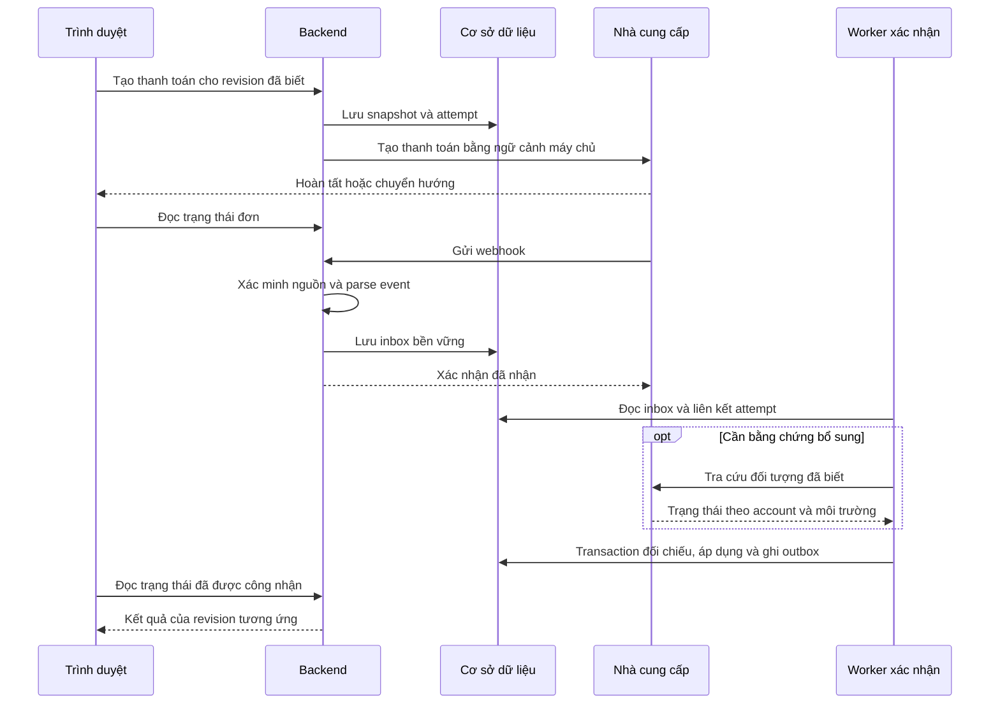

# Payment confirmation trust — Tin cậy xác nhận thanh toán đúng cách

Một trang trình duyệt hiển thị “thanh toán thành công” không phải bằng chứng rằng đơn hàng đã được trả tiền. Ngay cả một webhook có chữ ký hợp lệ cũng chưa đủ để kết luận: giao dịch có thể thuộc tài khoản nhận tiền khác, môi trường thử nghiệm, một revision cũ hoặc mới chỉ được authorization.

Trong chương **Payment Rules**, tin cậy xác nhận thanh toán là quá trình biến một thông báo bên ngoài thành một quyết định nghiệp vụ có căn cứ. Backend cần xác minh nguồn, hiểu đúng ý nghĩa trạng thái, ràng buộc bằng chứng với đối tượng nội bộ và cập nhật dữ liệu theo bất biến. Nếu bỏ qua một mắt xích, người tấn công có thể mở quyền giao hàng bằng một xác nhận không chứng minh nghĩa vụ thanh toán tương ứng.

## 1. Mục tiêu và phạm vi

Sau bài học, bạn cần có khả năng:

- Phân biệt tuyên bố từ client, thông báo nhà cung cấp và bằng chứng đủ để công nhận thanh toán.
- Xác định những thuộc tính phải khớp giữa bằng chứng bên ngoài và payment attempt nội bộ.
- Thiết kế luồng webhook, tra cứu server-to-server và đối soát cùng giữ một chính sách xác nhận.
- Ngăn phát lại, xử lý lặp, đảo thứ tự sự kiện và áp kết quả cũ lên đơn mới.
- Kiểm thử các cách lạm dụng niềm tin trong callback thay vì chỉ kiểm tra chữ ký đúng hay sai.

Ví dụ chính dùng đơn hàng trả trước trong môi trường production, có một snapshot khoản phải thu và một payment attempt thanh toán toàn bộ snapshot. “Đã trả” trong ví dụ yêu cầu bằng chứng capture phù hợp với hợp đồng tích hợp; authorization hoặc hoàn tất bước xác thực khách hàng chưa đủ.

Nếu hệ thống cho phép giao hàng sau authorization, nhận tiền khi giao, đặt cọc hoặc nhiều khoản thanh toán, phải định nghĩa trạng thái và điều kiện riêng. Không lấy một trạng thái “success” chung để thay cho tất cả mô hình.

## 2. Từ tuyên bố đến bằng chứng và quyết định

### 2.1. Ba tầng cần tách biệt

1. **Tuyên bố**: một bên nói giao dịch đã thành công.
2. **Bằng chứng được chấp nhận**: hệ thống xác minh được nguồn, đối tượng và ý nghĩa của thông tin theo cơ chế tích hợp.
3. **Quyết định nghiệp vụ**: bằng chứng đáp ứng điều kiện để cập nhật đúng nghĩa vụ, đúng revision và mở hành động tiếp theo.

Một browser callback có thể là tuyên bố hữu ích cho trải nghiệm người dùng. Một webhook đã xác minh có thể là bằng chứng có giá trị. Việc đánh dấu đơn đã trả vẫn cần quyết định nghiệp vụ dựa trên nội dung và trạng thái nội bộ.

Không biến một cờ `verified = true` do request gửi vào thành tầng bằng chứng.

### 2.2. Ví dụ endpoint bị khai thác

```http
POST /orders/ord_701/payment-confirmation
Content-Type: application/json

{
  "paymentId": "pay_any",
  "status": "SUCCESS",
  "amountMinor": 1200000,
  "currency": "VND"
}
```

Nếu backend kiểm tra người dùng sở hữu đơn rồi lưu `paid = true`, chính người mua có thể tự xác nhận một giao dịch chưa xảy ra. Quyền thao tác với đơn không bao gồm quyền tự tạo ra sự thật về khoản tiền đã thu.

Một endpoint do client gọi có thể yêu cầu backend **kiểm tra lại** attempt đã biết. Nó không được để client quyết định kết quả:

```http
POST /orders/ord_701/payment-attempts/attempt_29/refresh
Content-Type: application/json

{}
```

Backend kiểm tra quyền với đơn và attempt, sau đó dùng thông tin đã lưu để tra cứu qua kênh server-to-server. Không lấy một payment ID tùy ý của client rồi gán kết quả cho đơn đang mở.

## 3. Đánh giá các nguồn xác nhận

| Nguồn | Có thể cho biết điều gì? | Điều kiện và giới hạn |
| --- | --- | --- |
| Query string trên return URL | Trình duyệt được chuyển về với một số tham số | Người dùng có thể tự mở URL; không dùng trực tiếp để công nhận đã trả |
| Callback JavaScript hoặc mobile SDK | Kết quả mà ứng dụng phía client quan sát được | Cần backend xác minh theo hợp đồng; callback không tự cấp quyền cập nhật sổ thanh toán |
| Webhook đã xác minh | Nhà cung cấp phát một sự kiện cụ thể | Phải kiểm tra account, môi trường, đối tượng, ngữ nghĩa trạng thái và chống lặp |
| Tra cứu API server-to-server | Trạng thái của đối tượng tại nhà cung cấp | Dùng endpoint, thông tin xác thực và payment reference đã được hệ thống kiểm soát |
| File hoặc bản ghi đối soát | Thông tin tài chính từ một nguồn đã nhập | Cần xác thực nguồn và ánh xạ từng giao dịch; không suy ra chỉ từ tổng tiền cuối ngày |
| Ảnh chụp chuyển khoản hoặc thông báo do khách tải lên | Khách cung cấp một tài liệu để đề nghị kiểm tra | Không phải xác nhận có thẩm quyền rằng tài khoản bên bán đã nhận đúng tiền |

TLS trên một endpoint webhook bảo vệ kết nối theo cách cấu hình, nhưng một endpoint HTTPS công khai không tự chứng minh người gửi request là nhà cung cấp. Danh sách IP có thể là lớp bổ sung theo tích hợp; không thay thế cơ chế xác minh nguồn phù hợp.

Một đường dẫn thanh toán hoặc mã QR được ký có thể chứng minh chỉ dẫn thanh toán do hệ thống phát hành. Nó không tự chứng minh người mua đã thực hiện chỉ dẫn đó.

## 4. Những bất biến phải đúng trước khi công nhận

### 4.1. Bằng chứng thuộc đúng giao dịch đã dự kiến

Bằng chứng dùng để xác nhận cần ràng buộc với ít nhất các chiều sau, theo mô hình tích hợp:

```text
provider
providerAccount hoặc merchantAccount
environment
providerPaymentReference
paymentAttempt nội bộ
order và payment snapshot/revision liên quan
amount, currency và loại nghiệp vụ đã được xác nhận
```

Tenant và revision có thể không xuất hiện trong dữ liệu nhà cung cấp. Khi đó chúng được xác định từ liên kết nội bộ đã tạo ở phía máy chủ giữa attempt và đối tượng thanh toán bên ngoài.

Không mặc định metadata chứa `tenantId` hay `orderId` là bằng chứng độc lập. Nhà cung cấp có thể ký một sự kiện chứa chính metadata mà ứng dụng trước đó cho client tự nhập. Chữ ký chứng minh thông điệp đến từ nhà cung cấp theo cơ chế tích hợp, không làm cho mọi dữ kiện gốc trở nên đúng về nghiệp vụ.

### 4.2. Bằng chứng có đúng ý nghĩa cần thiết

Trong ví dụ trả trước:

```text
capture đã được xác nhận
AND số tiền đã capture đáp ứng snapshot
AND tiền tệ khớp
AND tài khoản nhận tiền và môi trường khớp
AND payment reference thuộc attempt dự kiến
```

Một sự kiện “authentication completed”, “checkout completed”, “request accepted” hoặc “authorized” không tự tương đương với capture. Adapter phải diễn giải tên và cấu trúc trạng thái theo hợp đồng cụ thể, không chỉ tìm chuỗi “success”.

Capture cũng không có nghĩa khoản tiền không thể có refund hoặc tranh chấp về sau. “Đã trả” là trạng thái có ngữ nghĩa trong vòng đời nghiệp vụ, không phải lời bảo đảm rằng mọi rủi ro tài chính đã kết thúc.

### 4.3. Quyết định chỉ áp lên phạm vi thích hợp

- Bằng chứng cho attempt A không thanh toán thay attempt B chỉ vì cùng một người mua.
- Kết quả của snapshot revision 8 không tự thanh toán cho revision 9.
- Bằng chứng thử nghiệm không được cập nhật đơn production.
- Kết quả dưới merchant account A không được dùng cho nghĩa vụ yêu cầu tiền về account B.
- Một giao dịch tài chính không được công nhận nhiều lần vì nhận nhiều thông báo.

Nếu phát hiện tiền đã thu nhưng không thể gán đúng vào nghĩa vụ hiện tại, phải giữ bằng chứng và đưa vào đối soát. Không tự gán vào một đơn “gần giống” theo email hoặc số tiền.

## 5. Tạo chuỗi liên kết tin cậy từ lúc khởi tạo

Một luồng xác nhận vững bắt đầu trước webhook:

1. Backend xác định order, snapshot và quyền thanh toán.
2. Backend tạo attempt cùng định danh thao tác ổn định.
3. Request ra nhà cung cấp dùng account và môi trường từ cấu hình được kiểm soát.
4. Hệ thống lưu liên kết tới đối tượng bên ngoài trong phạm vi provider/account/environment.
5. Mọi webhook hoặc tra cứu sau đó đi qua liên kết này.
6. Quyết định công nhận được gắn lại với snapshot gốc.

Mô hình dữ liệu khái niệm:

```text
PaymentAttempt
  id, tenant_id, order_id, snapshot_id, order_revision
  provider, provider_account_id, environment
  provider_payment_reference, merchant_reference
  expected_amount_minor, currency
  state, version

PaymentEvidence
  id, source_type, source_reference
  provider, provider_account_id, environment
  provider_payment_reference, financial_operation_reference
  normalized_state, amount_minor, currency
  observed_at, provider_event_time
  verification_context

WebhookInbox
  provider, provider_account_id, environment, event_id
  payload_reference_or_digest, processing_state, received_at

OutboxEvent
  event_id, aggregate_id, aggregate_version, event_type, payload
```

Dữ liệu bằng chứng và lịch sử giúp giải thích vì sao một trạng thái được công nhận, thay vì chỉ có một cột boolean không biết xuất phát từ đâu.

Nếu việc tạo đối tượng tại nhà cung cấp timeout, đối tượng có thể đã được tạo. Cần tra cứu hoặc retry bằng định danh ổn định theo hợp đồng tích hợp, rồi hoàn thiện liên kết. Không nhận payment ID do client tự khai làm lối tắt để “sửa” attempt chưa biết kết quả.

Liên kết provider payment reference không được tùy ý thay bằng một request cập nhật thông thường. Nếu cần sửa sai, dùng quy trình có thẩm quyền và dấu vết.

## 6. Xác minh webhook mà không tạo đường vòng

### 6.1. Giữ đúng dữ liệu được cơ chế xác minh yêu cầu

Nếu cơ chế chữ ký ký trên raw body, phải xác minh trên đúng chuỗi byte theo hợp đồng. Parse rồi serialize lại JSON có thể đổi khoảng trắng, thứ tự trường hoặc cách biểu diễn và làm chữ ký không còn khớp.

Những quyết định về encoding, header, thuật toán, timestamp và key phải nằm trong adapter của tích hợp. Không tự phát minh một thuật toán xác minh chung áp cho mọi nhà cung cấp.

Luồng khái niệm:

```text
raw body + headers + endpoint context được cấu hình
    → adapter xác minh nguồn và nội dung
    → event đã parse theo lược đồ hỗ trợ
    → inbox bền vững
    → đối chiếu attempt và nghĩa vụ
    → quyết định nghiệp vụ
```

Payload không xác minh được không được thay đổi trạng thái thanh toán. Không thêm nhánh “nếu chữ ký lỗi thì vẫn tin status để tránh mất đơn”.

### 6.2. Cấu hình xác minh cũng là ranh giới tin cậy

Secret hoặc khóa dùng để xác minh phải lấy từ cấu hình được phép. Nếu thông báo có key ID, nó chỉ được dùng để chọn trong tập khóa được tin cậy phù hợp; không tự tải khóa từ một URL tùy ý trong payload.

Cần tách account, endpoint và môi trường theo mô hình tích hợp. Xác minh được bằng secret sandbox không đủ cho production. Khi xoay khóa, thời gian chấp nhận khóa cũ và cách chọn khóa phải rõ ràng, không tắt kiểm tra như một bước chuyển tiếp mặc định.

Không tin header `X-Signature-Verified: true` từ Internet. Nếu một gateway nội bộ thực hiện xác minh thay ứng dụng, cần bảo vệ đường truyền nội bộ, loại bỏ header giả từ ngoài và ngăn đường truy cập bỏ qua gateway.

### 6.3. Timestamp và chống phát lại

Cần phân biệt:

- Thời điểm nghiệp vụ xảy ra.
- Thời điểm nhà cung cấp tạo event.
- Thời điểm ký hoặc gửi một lần delivery.
- Thời điểm backend nhận request.

Một giao dịch cũ được gửi lại hợp lệ không nhất thiết có timestamp giao dịch mới. Ngược lại, chữ ký còn nằm trong khoảng được chấp nhận không có nghĩa event chưa từng được xử lý.

Kiểm tra timestamp phải theo cơ chế của nhà cung cấp; không tự áp một khoảng ngắn lên `created_at` rồi loại mọi webhook bị trễ. Replay vẫn cần bị chặn bằng định danh event và giao dịch nghiệp vụ.

Nếu một delivery không còn đáp ứng điều kiện xác minh, không dùng nó để cập nhật trực tiếp. Việc tra cứu độc lập một attempt đã biết có thể là đường khôi phục theo chính sách, với nguồn và kết quả được xác minh riêng.

### 6.4. Chỉ ghi nhận event để xử lý sau khi xác minh

Nếu ghi event ID vào kho chống lặp trước khi xác minh, kẻ tấn công có thể gửi ID giả để làm event thật bị coi là đã xử lý. Có thể lưu log tiếp nhận không đáng tin cậy, nhưng không để nó chiếm định danh thành công trong pipeline nghiệp vụ.

Payload cần được giới hạn kích thước và parse nhất quán. Không để thành phần xác minh hiểu một giá trị còn thành phần nghiệp vụ hiểu một giá trị khác do cấu trúc mơ hồ hoặc cách xử lý trường lặp không nhất quán.

## 7. Khi nào cần tra cứu server-to-server?

Webhook đủ giàu dữ liệu và đã được xác minh có thể là bằng chứng theo hợp đồng của nhà cung cấp. Không phải mọi tích hợp đều bắt buộc gọi API thêm cho mọi event.

Tra cứu hữu ích khi event chỉ là thông báo có thay đổi, thiếu số tiền hoặc trạng thái cần thiết, cần phân biệt dữ liệu lũy kế với phát sinh, hoặc phát hiện mâu thuẫn.

Request tra cứu phải dùng:

- Base URL và endpoint từ cấu hình được tin cậy.
- Thông tin xác thực của đúng provider account.
- Reference đã liên kết với attempt nội bộ.
- Môi trường đúng với nghĩa vụ đang xử lý.

Không gọi một `verificationUrl` tùy ý do client hoặc payload gửi vào. Điều đó vừa làm sai nguồn xác nhận vừa có thể biến backend thành công cụ gọi tài nguyên ngoài phạm vi.

Kết quả tra cứu có thể chưa phản ánh trạng thái mới ngay tức thì tùy tích hợp. Khi webhook và query mâu thuẫn, cần chính sách dựa trên ngữ nghĩa và mức thẩm quyền của từng nguồn; không chọn nguồn nào có chữ “success” trước để cho qua.

Nếu đang chưa đủ bằng chứng, giữ trạng thái chờ hoặc đối soát. Việc cổng thanh toán tạm không truy cập được không phải lý do chuyển đơn sang đã trả.

## 8. Inbox, transaction và xác nhận đã nhận webhook

### 8.1. “Đã nhận” khác “đã áp dụng”

Nhà cung cấp có thể gửi lại event khi không nhận được phản hồi phù hợp. Backend có hai cách tổ chức phổ biến:

- Xử lý xong transaction cần thiết rồi xác nhận đã nhận.
- Lưu event đã xác minh vào inbox bền vững, xác nhận đã nhận, rồi xử lý bất đồng bộ.

Với cách thứ hai, phản hồi nhận thành công chỉ có nghĩa hệ thống đã nhận trách nhiệm xử lý. Inbox cần retry, trạng thái xử lý và khả năng phát hiện event bị kẹt. Không trả thành công rồi chỉ giữ event trong bộ nhớ có thể mất khi tiến trình dừng.

Các trạng thái inbox có thể là:

```text
RECEIVED
PROCESSING
APPLIED
IGNORED_DUPLICATE
QUARANTINED
FAILED_RETRYABLE
```

Tên cụ thể tùy thiết kế. Điều cốt yếu là “đã nhận event ID” không được đồng nghĩa với “đã cập nhật nghĩa vụ thành công”.

### 8.2. Phạm vi chống lặp

Khóa inbox có thể gồm:

```text
(provider, provider_account_id, environment, event_id)
```

Đây là chống lặp ở mức delivery/event. Một capture có thể xuất hiện trong nhiều event ID khác nhau, nên còn cần chống ghi nhận lặp ở mức nghiệp vụ tài chính:

```text
(provider, provider_account_id, environment,
 financial_operation_reference, operation_kind)
```

Phạm vi định danh thực tế phải phù hợp với nhà cung cấp. Không coi một ID là duy nhất toàn cầu nếu hợp đồng chỉ bảo đảm trong một account.

Một event trả về tổng capture lũy kế không được hạch toán như một capture mới. Adapter và mô hình lưu cần phân biệt cập nhật snapshot với ghi nhận phát sinh.

### 8.3. Cập nhật trong cùng transaction

Luồng worker xử lý inbox có thể:

```text
1. Nhận quyền xử lý event theo cơ chế cạnh tranh của inbox.
2. Phân giải attempt từ liên kết nội bộ.
3. Lấy bằng chứng bổ sung nếu cần, ngoài transaction khóa dài.
4. Bắt đầu transaction.
5. Khóa attempt và nghĩa vụ liên quan theo thứ tự thống nhất.
6. Đọc lại trạng thái và kiểm tra bằng chứng với snapshot.
7. Ghi nhận nghiệp vụ tài chính chưa từng được áp dụng.
8. Cập nhật nghĩa vụ và trạng thái revision theo chính sách.
9. Ghi outbox cho sự kiện nghiệp vụ tiếp theo.
10. Đánh dấu inbox đã áp dụng hoặc kết quả xử lý tương ứng.
11. Commit.
```

Nếu worker chết trước commit, retry phải có thể thực hiện lại mà không tạo tác động lặp. Không đánh dấu APPLIED trước rồi mới cập nhật đơn ở transaction khác.

Nếu thông báo hợp lệ nhưng chưa tìm được attempt, có thể đưa vào vùng chờ hoặc đối soát có kiểm soát. Không chọn một đơn bất kỳ dựa trên số tiền trùng, rồi gắn giao dịch để tránh tồn đọng.

### 8.4. Callback song song vẫn cần kiểm soát đồng thời

Webhook và job đối soát có thể cùng xác nhận một giao dịch. Một lần kiểm tra “chưa ghi nhận” bằng câu SELECT thông thường chưa đủ; hai transaction có thể cùng thấy chưa có.

Cần ràng buộc duy nhất cho nghiệp vụ đã áp dụng, khóa hoặc kiểm soát phiên bản và transaction cho những cập nhật liên quan. Một transaction thua cạnh tranh phải đọc kết quả đã tồn tại hoặc rollback phù hợp, không tiếp tục phát tác dụng phụ.

Nếu cùng lúc người dùng sửa hoặc hủy đơn, việc xác nhận phải xét lại revision và trạng thái dưới cơ chế bảo vệ chung. Không quyết định dựa trên bản đọc trước khi tra cứu mạng rồi ghi không điều kiện sau đó.

## 9. State machine cho bằng chứng và đơn hàng

Trạng thái của payment attempt, bằng chứng tài chính và đơn hàng có liên hệ nhưng không phải một cột dùng chung.

Ví dụ:

| Sự kiện hoặc kết quả quan sát | Quyết định phù hợp trong mô hình trả trước |
| --- | --- |
| Client quay về return URL với “success” | Hiển thị đang kiểm tra; đọc trạng thái từ backend |
| Nhà cung cấp chấp nhận yêu cầu xử lý | Attempt đang chờ, chưa công nhận thu tiền |
| Xác thực khách hàng hoàn tất | Ghi nhận bước xác thực theo tích hợp, chưa coi là capture |
| Authorization được xác nhận | Ghi nhận quyền thu; chưa đáp ứng điều kiện capture của ví dụ |
| Capture đúng attempt, account, tiền tệ và số tiền | Có thể công nhận nghĩa vụ tương ứng sau kiểm tra và transaction |
| Capture của revision cũ đến sau khi đơn đã đổi | Ghi nhận tiền theo đối tượng gốc; xử lý chênh lệch theo quy trình |
| Refund hoặc dispute | Mở nghiệp vụ tương ứng, giữ lại lịch sử capture |
| Kết quả chưa đủ hoặc mâu thuẫn | Chờ xác minh hoặc đối soát, không mở quyền giao hàng chỉ vì timeout |

Một sơ đồ luồng tổng quát:



Sơ đồ được giản lược; luồng tạo đối tượng bên ngoài vẫn cần xử lý timeout và hoàn thiện liên kết như đã nêu. Trình duyệt có thể nhận kết quả sớm hoặc muộn hơn webhook. Cả hai thứ tự đều không được làm thay đổi mức bằng chứng cần thiết.

### 9.1. Không làm mất lịch sử bằng cách lùi trạng thái

Một event “processing” cũ đến sau capture không được biến dữ liệu thành “chưa thanh toán”. Ngược lại, refund mới không bị bỏ qua chỉ vì hệ thống cho rằng trạng thái success là trạng thái cuối của mọi thứ.

Cần phân biệt tiến trình của attempt và những nghiệp vụ sau thanh toán. Một capture đã xảy ra vẫn tồn tại trong lịch sử kể cả khi tiền được hoàn.

### 9.2. Xác nhận muộn sau hủy

Nếu đơn bị hủy khi payment attempt còn chưa rõ kết quả, tiền vẫn có thể được thu sau đó. Không vứt bỏ bằng chứng vì trạng thái đơn đã CANCELLED. Cũng không tự mở lại fulfillment chỉ để làm cho trạng thái khớp khoản thu.

Ghi nhận capture cho attempt gốc, giữ đơn theo chính sách và mở quy trình đối soát hoặc hoàn tiền nếu cần. Việc hủy nội bộ không tự bảo đảm nhà cung cấp đã chấm dứt mọi khả năng thu tiền.

## 10. Ví dụ Java: kiểm tra bằng chứng trước quyết định “đã trả”

Ví dụ dưới minh họa điều kiện công nhận một payment attempt thu toàn bộ snapshot. Nó không thực hiện xác minh chữ ký hay gọi API. `ProviderSnapshot` phải được tạo bởi adapter server-side từ dữ liệu đã được xác minh; không được dùng làm DTO nhận trực tiếp JSON của client.

```java
import java.util.Objects;

public final class ConfirmationRules {
    public enum Environment {
        TEST, LIVE
    }

    public enum NormalizedState {
        PENDING, AUTHORIZED, CAPTURED, FAILED
    }

    public record ExpectedPayment(
            String provider,
            String providerAccountId,
            Environment environment,
            String providerPaymentReference,
            String currency,
            long requiredMinor) {}

    public record ProviderSnapshot(
            String provider,
            String providerAccountId,
            Environment environment,
            String providerPaymentReference,
            String currency,
            long capturedMinor,
            NormalizedState state) {}

    public static void requireCaptureEvidence(
            ExpectedPayment expected,
            ProviderSnapshot observed) {

        Objects.requireNonNull(expected);
        Objects.requireNonNull(observed);

        requireSame(expected.provider(), observed.provider(), "provider");
        requireSame(
                expected.providerAccountId(),
                observed.providerAccountId(),
                "account");
        requireSame(
                expected.providerPaymentReference(),
                observed.providerPaymentReference(),
                "payment reference");
        requireSame(expected.currency(), observed.currency(), "currency");

        if (expected.environment() == null
                || expected.environment() != observed.environment()) {
            throw new IllegalStateException("Environment mismatch");
        }
        if (expected.requiredMinor() <= 0) {
            throw new IllegalStateException("Not an external charge");
        }
        if (observed.state() != NormalizedState.CAPTURED) {
            throw new IllegalStateException("Capture not confirmed");
        }
        if (observed.capturedMinor() != expected.requiredMinor()) {
            throw new IllegalStateException("Captured amount mismatch");
        }
    }

    private static void requireSame(
            String expected, String actual, String field) {
        if (expected == null || !expected.equals(actual)) {
            throw new IllegalStateException("Unexpected " + field);
        }
    }

    private ConfirmationRules() {}
}
```

Những điểm cần hiểu đúng:

- Record hoặc tên lớp không tạo ra sự tin cậy. Ranh giới adapter, đường gọi và quyền tạo dữ liệu mới quyết định dữ liệu có được xác minh hay không.
- `expected` phải đến từ attempt/snapshot nội bộ đã liên kết, không từ body client.
- Môi trường của đơn production phải được cố định là LIVE ở luồng tạo và cấu hình. Code chỉ đối chiếu hai giá trị; nếu cả hai bị gán sai TEST từ đầu thì cần ngăn tại ranh giới cấu hình và dữ liệu.
- `capturedMinor` phải có ngữ nghĩa rõ: tổng capture hợp lệ của attempt trong ví dụ, không phải số tiền authorization hay payout.
- Revision không xuất hiện trong bằng chứng vì được xác định từ liên kết nội bộ của attempt; service phải xác định nghĩa vụ và xử lý trạng thái revision đó đúng cách.
- Hệ thống cho phép nhiều attempt hoặc nguồn tiền cần tổng hợp nghĩa vụ chung có chống trùng, thay vì đòi mỗi attempt đều bằng toàn bộ giá trị đơn.

Hàm trả về thành công chưa đồng nghĩa được gọi `order.setPaid(true)` ở một transaction tùy ý. Việc áp dụng cần kiểm tra lại trạng thái, bảo vệ cạnh tranh và ghi bằng chứng cùng các thay đổi liên quan.

## 11. Browser return, mobile callback và trải nghiệm chờ xác nhận

Return URL cần giúp người dùng quay về ứng dụng và biết trạng thái đang được kiểm tra. Nó không nên là endpoint công khai nhận `status=paid` rồi cập nhật dữ liệu.

Một luồng giao diện có thể:

1. Nhận callback từ SDK hoặc trở về từ trang thanh toán.
2. Gửi yêu cầu làm mới cho attempt thuộc quyền của người dùng, nếu cần.
3. Đọc trạng thái do backend công nhận.
4. Hiển thị “đang xác nhận” khi bằng chứng chưa đủ.
5. Chuyển sang kết quả cuối khi backend đã commit quyết định.

Nếu backend cung cấp polling hoặc kênh đẩy trạng thái, mỗi request vẫn phải kiểm tra quyền theo đối tượng. Biết attempt ID không đủ để đọc chi tiết thanh toán của người khác.

Không nhúng secret xác minh webhook hoặc khóa API nhà cung cấp vào frontend để “xác nhận nhanh hơn”. Nếu một giao thức có bước ký dành cho client, chỉ dùng đúng loại dữ liệu và khóa được thiết kế cho client; nó không thay thế quyết định của backend.

Một URL có mã tương quan hoặc nonce có thể bảo vệ ngữ cảnh điều hướng. Mã đó không tự chứng minh tiền đã thu. Cần giữ riêng mục đích chống giả ngữ cảnh với mục đích xác nhận tài chính.

## 12. Các đường xác nhận thay thế phải giữ cùng chính sách

### 12.1. Job đối soát không được dễ tính hơn webhook

Job tra cứu trạng thái đang chờ có thể cứu những webhook thất lạc. Tuy nhiên, job phải kiểm tra cùng các liên kết account, môi trường, reference, trạng thái, tiền tệ, số tiền và revision.

Không có nhánh “đã quá lâu thì tự coi là trả thành công”. Timeout là thông tin vận hành, không phải bằng chứng tài chính.

Webhook và job đối soát có thể cùng chạy. Cả hai cần đi qua cơ chế áp dụng idempotent để không ghi sổ hoặc phát sự kiện hai lần.

### 12.2. Xác nhận thủ công là nguồn bằng chứng khác

Với chuyển khoản hoặc tình huống ngoại lệ, hệ thống có thể có quy trình xác nhận thủ công. Actor phải có quyền riêng, dựa trên nguồn đối soát phù hợp và lưu lý do cùng bằng chứng.

Không để nhân viên chỉ tải ảnh khách gửi lên rồi gắn nhãn “provider verified”. Bằng chứng thủ công và bằng chứng tích hợp cần được phân biệt để kiểm toán được mức tin cậy.

Nếu nghiệp vụ yêu cầu phân tách người kiểm tra và người phê duyệt, phải bảo vệ quy trình đó bằng quyền và state machine, không chỉ bằng hướng dẫn trên giao diện.

### 12.3. Không dùng quyền quản trị để bỏ qua mọi ràng buộc

Trang quản trị, script vận hành và API hỗ trợ khách hàng đều có thể tạo lỗ hổng nếu cho đổi `paid` mà không có nghĩa vụ và bằng chứng tương ứng.

Ngoại lệ cần lệnh nghiệp vụ riêng, phạm vi quyền, lý do và dấu vết. Nếu chỉ điều chỉnh trạng thái vận hành trong khi chưa công nhận tiền đã thu, cần đặt tên khác để không mở nhầm quyền fulfillment.

## 13. Kiểm thử tình huống tấn công logic

Kiểm thử xác nhận cần quan sát dữ liệu đã commit, bản ghi bằng chứng, inbox, nghiệp vụ tài chính và tác dụng phụ sau cùng.

| Tình huống | Bất biến cần kiểm tra |
| --- | --- |
| Mở return URL trực tiếp với `status=success` | Đơn không được tự công nhận đã trả |
| Client gọi endpoint refresh với attempt của người khác | Quyền theo đối tượng được thực thi |
| Chèn `verified=true`, `paid=true` hoặc header xác minh giả | Dữ liệu không trở thành bằng chứng có thẩm quyền |
| Webhook không có hoặc sai bằng chứng xác minh | Không cập nhật nghĩa vụ, không chiếm trạng thái “đã xử lý” của event thật |
| Payload bị sửa sau khi ký | Xác minh thất bại theo hợp đồng, không có tác động nghiệp vụ |
| Chữ ký sandbox hợp lệ gửi vào luồng production | Không thanh toán cho đơn LIVE |
| Giao dịch đúng số tiền nhưng khác merchant account | Không được gán cho nghĩa vụ cần account khác |
| Giao dịch thành công của đơn khác cùng khách | Không được dùng để thanh toán đơn hiện tại |
| Metadata được ký chứa order ID do client đã sửa | Ánh xạ vẫn theo liên kết server-side có thẩm quyền |
| Event chỉ chứng minh authorization hoặc xác thực khách hàng | Không mở trạng thái yêu cầu capture |
| Capture đúng nguồn nhưng khác tiền tệ hoặc số tiền | Ghi nhận sai lệch, không công nhận nghĩa vụ đã đủ |
| Cùng event được phát lại nhiều lần | Không áp dụng lặp hoặc phát tác dụng phụ mới |
| Nhiều event ID cùng nói về một capture | Giao dịch tài chính chỉ được công nhận một lần |
| Event lũy kế xuất hiện nhiều lần | Không cộng tổng snapshot như tiền phát sinh |
| Webhook và job đối soát cùng áp dụng | Chỉ một kết quả nghiệp vụ có hiệu lực |
| Worker chết sau khi nhận inbox nhưng trước commit | Event có thể retry, không bị mất hoặc được đánh dấu đã áp dụng giả |
| Event cũ đến sau trạng thái mới | Không lùi trạng thái hoặc xóa lịch sử |
| Capture đến sau khi đơn bị hủy | Ghi nhận tiền và xử lý theo quy trình, không tự mở giao hàng |
| Callback của revision cũ đến khi đơn đã đổi | Không công nhận revision mới bằng bằng chứng cũ |
| Payload đề nghị một URL tra cứu tùy ý | Backend không dùng URL ngoài cấu hình làm nguồn xác nhận |
| Mất kết nối khi tra cứu nhà cung cấp | Giữ trạng thái chưa chắc chắn, không tự chuyển sang đã trả |
| Delivery trễ hợp lệ theo hợp đồng tích hợp | Được xử lý hoặc khôi phục có kiểm soát, không mất chỉ vì timestamp nghiệp vụ cũ |

Để kiểm thử cạnh tranh, dùng điểm đồng bộ để hai luồng cùng chuẩn bị áp dụng bằng chứng. Sau khi hoàn tất, kiểm tra số bản ghi nghiệp vụ duy nhất, version, trạng thái nghĩa vụ và số ý định tác dụng phụ được tạo.

Một chuỗi kiểm thử hữu ích:

```text
tạo attempt
→ client báo thành công giả
→ webhook authorization hợp lệ
→ backend vẫn chờ capture
→ webhook capture hợp lệ
→ job đối soát nhìn thấy cùng capture
→ event capture được phát lại
→ event processing cũ đến muộn
```

Kết quả cần có đúng một lần công nhận khoản capture theo nghĩa vụ, không có quyết định đã trả từ callback client và không lùi trạng thái do event cũ.

Kiểm thử cũng cần đi qua trang quản trị, tác vụ nền và luồng ngoại lệ. Một endpoint webhook an toàn không đủ nếu một endpoint khác chấp nhận cùng payload rồi cập nhật trực tiếp.

## 14. Kiểm toán và xử lý bằng chứng mâu thuẫn

Dấu vết nên giúp trả lời:

- Bằng chứng đến từ nguồn nào, được xác minh bằng ngữ cảnh account và môi trường nào?
- Attempt, snapshot, revision và operation tài chính liên quan là gì?
- Trạng thái, số tiền và tiền tệ đã được diễn giải như thế nào?
- Quy tắc nào cho phép hoặc chặn công nhận?
- Event bị lặp, bị cách ly, còn chờ hay đã được áp dụng?
- Ai thực hiện xác nhận hoặc sửa sai thủ công và dựa trên tài liệu nào?

Không ghi secret, token truy cập hoặc dữ liệu thanh toán nhạy cảm vào log. Nếu cần giữ payload để điều tra, có chính sách truy cập, bảo vệ và thời hạn phù hợp; không mặc định mọi nội dung webhook đều an toàn để ghi nguyên văn.

Có thể cảnh báo khi xuất hiện event xác thực nhưng không có attempt, mismatch account/môi trường, cùng reference gắn nhiều đối tượng hoặc event bị kẹt chưa áp dụng. Tỷ lệ callback client báo thành công nhưng backend không thấy bằng chứng cũng có thể chỉ ra lỗi tích hợp hoặc hành vi lạm dụng.

Khi bằng chứng mâu thuẫn, giữ lại lịch sử và nguồn của từng quan sát. Không ghi đè bằng trạng thái cuối cùng vừa nhận mà làm mất khả năng giải thích. Việc sửa sai phải phân biệt “thực tế tài chính đã xảy ra” với “quyền nghiệp vụ được phép mở”.

## 15. Tự kiểm tra thiết kế

Trước khi cho xác nhận thanh toán mở fulfillment hoặc quyền sử dụng dịch vụ, cần trả lời được:

1. Nguồn nào chỉ đưa ra tuyên bố, nguồn nào có thể cung cấp bằng chứng được chấp nhận?
2. Điều gì ngăn client tự gọi một endpoint để đặt đơn thành đã trả?
3. Chữ ký hoặc kênh xác thực đang chứng minh điều gì, và chưa chứng minh điều gì?
4. Payment reference được liên kết với attempt, account, môi trường và revision từ lúc nào?
5. Trạng thái được xác nhận là xác thực khách hàng, authorization, capture hay một nghiệp vụ khác?
6. Các event lặp, giao dịch lặp và snapshot lũy kế được phân biệt bằng cơ chế nào?
7. Nếu webhook mất, trễ hoặc mâu thuẫn với kết quả query, quy trình khôi phục giữ mức bằng chứng ra sao?
8. Khi đơn bị sửa hoặc hủy, bằng chứng đến muộn được gắn vào đâu?
9. Job nền và xác nhận thủ công có giữ cùng ranh giới tin cậy với luồng chính không?

Một xác nhận đáng tin cậy phải chứng minh được đúng sự kiện tài chính cho đúng nghĩa vụ. Bảo vệ nguồn, liên kết đối tượng, ngữ nghĩa trạng thái và bước áp dụng trong transaction giúp hệ thống không biến một lời báo thành công thành quyền nghiệp vụ chưa được thanh toán hợp lệ.
