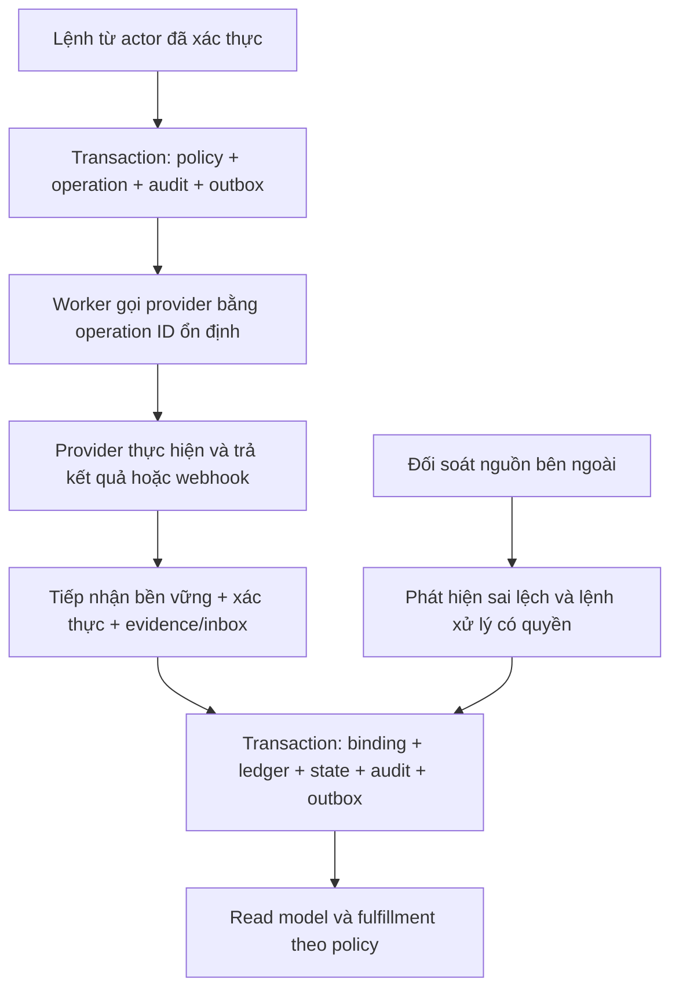

# Kiểm toán sự kiện thanh toán (Payment event audit)

Trong chương **Payment Rules**, kiểm toán sự kiện thanh toán là khả năng giải thích một cách có căn cứ: ai đã yêu cầu một hành động, hệ thống đã kiểm tra quy tắc nào, bằng chứng nào được chấp nhận, tiền được ghi nhận cho nghĩa vụ nào và tác động nghiệp vụ nào đã xảy ra. Chỉ có dòng log “payment success” không đủ để điều tra việc nhận vơ giao dịch, bỏ qua phê duyệt, hoàn tiền trùng hoặc phát hàng dù chưa thu đủ tiền.

Bài học sử dụng một hệ thống thanh toán giả định để thiết kế audit gắn với business invariants, state machine, quyền theo đối tượng, transaction và idempotency. Thuật ngữ provider chỉ nhà cung cấp xử lý thanh toán nói chung; tên trạng thái và cấu trúc event trong bài là mô hình minh họa, không phải hợp đồng API của một nhà cung cấp cụ thể.

## 1. Mục tiêu học tập

Sau bài học, bạn có thể:

- Phân biệt log vận hành, webhook receipt, audit event, payment ledger và dữ liệu đối soát.
- Thiết kế bản ghi audit có nguồn gốc, quan hệ nhân quả, phiên bản dữ liệu và quyết định nghiệp vụ rõ ràng.
- Gắn audit với transaction để không có thay đổi tài chính đã commit nhưng thiếu dấu vết bắt buộc.
- Xử lý sự kiện lặp, đến muộn, mâu thuẫn hoặc chưa ánh xạ mà không cộng tiền hay hoàn tiền nhiều lần.
- Bảo vệ audit trước sửa đổi trái phép, đọc chéo tenant và rò rỉ dữ liệu nhạy cảm.
- Kiểm thử khả năng truy vết một chuỗi thanh toán trong điều kiện có race, timeout và tiến trình chết giữa các bước.

## 2. Audit phải trả lời câu hỏi nghiệp vụ

Giả sử khách hàng phản ánh rằng tài khoản đã bị trừ tiền hai lần nhưng đơn vẫn hiển thị chưa thanh toán. Một nhân viên nhìn thấy:

```text
10:00:01 payment requested
10:00:03 payment failed
10:00:05 payment success
```

Những dòng này chưa cho biết:

- Có một hay hai ý định thu tiền?
- “Failed” là provider từ chối hay chỉ là HTTP timeout?
- “Success” là client báo thành công, authorization được chấp nhận hay capture thực tế?
- Các sự kiện có cùng tài khoản nhận tiền, currency và phiên bản giá không?
- Webhook lặp có làm cộng tiền hai lần không?
- Đơn nào thực sự được phân bổ khoản thu?
- Nhân viên nào đã can thiệp và dựa trên phê duyệt nào?

Audit cần giữ đủ bằng chứng để dựng lại những quan hệ đó. Nó cũng giúp phát hiện đường thực thi bỏ qua policy: ví dụ có capture nhưng không có lệnh được chấp nhận, có refund nhưng thiếu phê duyệt bắt buộc, hoặc order được mở khóa bởi giao dịch thuộc tenant khác.

Audit không thay thế authorization và kiểm tra invariant. Ghi lại một hành động sai không làm hành động đó trở thành hợp lệ.

## 3. Phân biệt các loại bản ghi liên quan

| Loại dữ liệu | Mục đích chính | Không nên dùng thay cho |
|---|---|---|
| Log vận hành | Chẩn đoán lỗi, độ trễ, retry và tình trạng dịch vụ | Bằng chứng duy nhất về tiền đã được ghi nhận |
| Webhook receipt | Ghi nhận một lần nhận thông điệp và kết quả tiếp nhận | Quyết định rằng order đã được thanh toán |
| Inbox nghiệp vụ | Theo dõi một source event đã được nhận, chờ xử lý hoặc xử lý xong | Ledger giao dịch thực tế |
| Audit event | Giải thích hành động, quyền, policy, quyết định và chuyển trạng thái | Bản thân khoản tiền hoặc quyền thực hiện thao tác |
| Payment ledger | Ghi nhận giao dịch và phân bổ tiền theo mô hình tài chính | Toàn bộ lịch sử xác thực và phê duyệt |
| Dữ liệu đối soát | So sánh trạng thái nội bộ với nguồn bên ngoài phù hợp | Cơ chế cập nhật order không qua policy |

Một capture có thể được mô tả bởi nhiều webhook và nhiều audit event, nhưng vẫn chỉ là một khoản thu trong ledger. Đếm số dòng audit có từ “success” để tính doanh thu có thể cộng trùng tiền.

Tương tự, `webhook received` chỉ có nghĩa hệ thống đã tiếp nhận thông điệp theo một mức bền vững xác định. Nó không đồng nghĩa `webhook verified`, `capture applied` hoặc `order released`.

### 3.1. Tách trạng thái xử lý khỏi lịch sử bất biến

Inbox có thể có trạng thái thay đổi như `RECEIVED`, `PROCESSING`, `APPLIED`, `REVIEW_REQUIRED`. Đây là projection phục vụ xử lý công việc.

Audit giữ các sự kiện đã xảy ra, chẳng hạn `PROVIDER_EVENT_VERIFIED`, `PAYMENT_BINDING_MISMATCH_DETECTED`, `CAPTURE_APPLIED`. Không sửa một audit event cũ từ “chưa xác minh” thành “đã xác minh” rồi làm mất dấu giai đoạn trước.

Sự kiện mới có thể tham chiếu sự kiện cũ để bổ sung hoặc đính chính. Điều này không bắt buộc mọi bảng của hệ thống đều là append-only; cần xác định rõ bảng nào là lịch sử, bảng nào là trạng thái xử lý hiện tại.

## 4. Chốt các invariant cần được kiểm toán

Trước khi chọn công cụ log, hãy xác định điều phải giữ đúng:

| Invariant | Audit cần giúp chứng minh điều gì? |
|---|---|
| Hành động payment ở đúng tenant và đối tượng được phép | Actor, scope, quyền hành động và đối tượng đích |
| Amount, currency và tài khoản nhận do server xác định | Pricing snapshot, merchant route và binding provider |
| Mỗi capture thực tế được ghi nhận một lần | Tham chiếu giao dịch tài chính và ledger entry |
| Refund không vượt ngân sách theo policy | Nghĩa vụ hoàn, khoản giữ ngân sách, phê duyệt và kết quả provider |
| Thao tác chưa rõ kết quả không bị coi là thất bại chắc chắn | Operation ID, timeout, trạng thái chờ và lần đối soát tiếp theo |
| Chỉ chuyển trạng thái hợp lệ mới mở khóa fulfillment | Trạng thái trước/sau, version và căn cứ đáp ứng nghĩa vụ |
| Không có tác động trùng do retry hoặc phát lại event | Idempotency scope, source event và định danh tác động nghiệp vụ |
| Ngoại lệ thủ công không bỏ qua quy tắc bắt buộc | Người yêu cầu, người duyệt, phạm vi duyệt và kiểm tra khi thực thi |

Ví dụ, audit chỉ ghi `actorRole = ADMIN` không chứng minh refund hợp lệ. Cần biết actor có quyền gì trên payment cụ thể, số tiền nào được duyệt và nghĩa vụ đó còn bao nhiêu ngân sách.

## 5. Mô hình audit event đủ để truy vết

### 5.1. Các nhóm trường quan trọng

| Nhóm | Trường minh họa | Nguồn đáng tin cậy |
|---|---|---|
| Danh tính bản ghi | `auditEventId`, `schemaVersion`, `eventType` | Server tạo |
| Phạm vi | `tenantId`, `orderId`, `paymentObligationId`, `paymentAttemptId` | Mapping nội bộ đã kiểm tra |
| Chủ thể | `actorId`, `actorType`, `serviceIdentity`, `delegatedGrantId` | Security context hoặc danh tính tích hợp đã xác thực |
| Ý định | `commandId`, `operationId`, `reasonCode` | Lệnh nghiệp vụ đã tiếp nhận |
| Quyết định | `decision`, `policyVersion`, `failureCode`, `approvalId` | Kết quả đánh giá ở server |
| Tài chính | `amount`, `currency`, `ledgerEntryId`, `financialTransactionId` | Snapshot giá, ledger và bằng chứng đã đối chiếu |
| Provider | `provider`, `environment`, `merchantAccountId`, `providerIntentId` | Cấu hình và binding đáng tin cậy |
| Trạng thái | `stateBefore`, `stateAfter`, `versionBefore`, `versionAfter` | Dữ liệu thực tế dưới cơ chế đồng bộ |
| Quan hệ | `correlationId`, `causationId`, `sourceEventId`, `evidenceRef` | Liên kết được quản lý ở server |
| Thời gian | `occurredAt`, `receivedAt`, `recordedAt`, `appliedAt` | Ghi rõ nguồn và ngữ nghĩa từng thời điểm |

Không phải event nào cũng có mọi trường. Một lần từ chối request trước khi tìm được order không thể có `stateBefore` đáng tin cậy. Một webhook chưa ánh xạ không được tự gán tenant từ metadata để làm đủ schema.

Nên có schema theo loại event, hoặc quy định trường bắt buộc theo nhóm. Tránh một bảng JSON không có quy tắc khiến mỗi thành phần ghi cùng tên trường với một nghĩa khác nhau.

### 5.2. Ví dụ một event ghi nhận capture

```json
{
  "auditEventId": "audit_1009",
  "schemaVersion": 1,
  "eventType": "CAPTURE_APPLIED",
  "tenantId": "tenant_1",
  "orderId": "ord_4001",
  "paymentObligationId": "obligation_91",
  "paymentAttemptId": "attempt_601",
  "actorType": "PROVIDER_SERVICE",
  "serviceIdentity": "verified-provider-integration",
  "operationId": "capture_op_77",
  "provider": "PROVIDER_A",
  "environment": "LIVE",
  "merchantAccountId": "merchant_12",
  "providerIntentId": "intent_ext_701",
  "financialTransactionId": "capture_ext_801",
  "amount": 480000,
  "currency": "VND",
  "ledgerEntryId": "ledger_2001",
  "stateBefore": "CAPTURE_PENDING",
  "stateAfter": "CAPTURED",
  "versionBefore": 13,
  "versionAfter": 14,
  "sourceEventId": "provider_evt_901",
  "evidenceRef": "evidence_3001",
  "causationId": "audit_1004",
  "correlationId": "flow_5001",
  "recordedAt": "2026-01-15T10:00:05Z"
}
```

Số tiền trong ví dụ dùng biểu diễn đã được tích hợp quy định. Không giả định mọi currency hoặc mọi API đều dùng cùng đơn vị.

Event này khẳng định capture đã được áp dụng vào ledger, không chỉ nhận được một payload có chữ “captured”. Các version là version thực tế của payment aggregate tương ứng; nếu cần ghi thay đổi order, ghi rõ aggregate hoặc thêm event liên quan thay vì dùng một cặp version mơ hồ cho nhiều đối tượng.

### 5.3. Phân biệt actor thực thi với người khởi tạo

Khách hàng có thể khởi tạo thanh toán, worker gửi capture và provider xác nhận kết quả. Ba bước có ba chủ thể khác nhau.

Đừng ghi actor của webhook là khách hàng chỉ vì payment attempt có `customerId`. Giữ `initiatingActorId` trong lệnh ban đầu, rồi liên kết event provider qua `operationId` hoặc `causationId`.

Với thao tác thay mặt, cần biết người đang hành động, người hoặc tổ chức được đại diện và grant đã dùng. Một chuỗi actor đầy đủ giúp phát hiện việc nhân viên sử dụng quyền hỗ trợ để thực hiện hành động ngoài phạm vi.

## 6. Định danh và quan hệ nhân quả

### 6.1. Không dùng một ID cho mọi mục đích

| Định danh | Phạm vi |
|---|---|
| `requestId` | Một lần HTTP request hoặc một lần thực thi |
| `idempotencyKey` | Một ý định API trong scope đã định nghĩa |
| `operationId` | Một tác động nghiệp vụ ổn định, ví dụ capture hoặc refund |
| `providerEventId` | Một event do provider định danh |
| `financialTransactionId` | Một khoản thu hoặc hoàn thực tế theo hợp đồng tích hợp |
| `auditEventId` | Một sự kiện audit được ghi tại hệ thống |
| `correlationId` | Liên kết các bước trong cùng luồng theo dõi |
| `causationId` | Sự kiện hoặc lệnh trực tiếp dẫn tới bản ghi hiện tại |

Một retry có `requestId` mới nhưng giữ `operationId` cũ. Hai event provider khác ID có thể cùng nói về một capture. Một capture có thể dẫn tới event ghi tiền, event đáp ứng nghĩa vụ và event phát lệnh fulfillment.

Nếu client gửi correlation ID, hãy kiểm tra kích thước và định dạng hoặc ánh xạ sang ID nội bộ. Giá trị đó hỗ trợ theo dõi, không cấp quyền và không cho phép truy vấn xuyên tenant.

### 6.2. Phạm vi provider phải đủ rõ

Khóa dedup điển hình có thể là:

```text
Source event:
  (provider, environment, accountScope, providerEventId)

Financial transaction:
  (provider, environment, merchantAccountId, financialTransactionId)

API intent:
  (tenantId, actorId, operation, idempotencyKey)
```

Cần điều chỉnh khóa theo tính duy nhất mà tích hợp thực sự cung cấp. Nếu nhiều loại object dùng chung một không gian lưu trữ nhưng ID không bảo đảm duy nhất giữa các loại, cần thêm loại object.

Đừng chỉ dedup theo `orderId`: một đơn có thể có nhiều giao dịch hợp lệ. Cũng đừng chỉ dedup khoản thu theo event ID: một giao dịch có thể xuất hiện trong nhiều event.

### 6.3. Nhiều lần nhận không đồng nghĩa nhiều tác động

Audit có thể ghi rằng một event được nhận ba lần, hai lần là duplicate và một lần được áp dụng. Chỉ một ledger entry được tạo cho capture thực tế.

Nếu hai thông điệp cùng scope và event ID nhưng khác nội dung đáng kể, không ghi đè payload cũ. Giữ bằng chứng về khác biệt và chuyển kiểm tra theo chính sách tích hợp. Một digest khác có thể cần được phân tích theo hợp đồng provider; bản thân sự khác biệt chưa đủ để kết luận nguyên nhân là tấn công.

## 7. Audit xuyên suốt vòng đời thanh toán

### 7.1. Các điểm ghi quan trọng

| Giai đoạn | Event minh họa | Điều cần ghi rõ |
|---|---|---|
| Tiếp nhận lệnh | `PAYMENT_COMMAND_ACCEPTED` | Actor, scope, obligation, pricing snapshot, policy |
| Từ chối lệnh | `PAYMENT_COMMAND_DENIED` | Lý do và hành động bị từ chối, không giả có thay đổi tiền |
| Ghi ý định ra ngoài | `PROVIDER_OPERATION_SCHEDULED` | Operation ID, amount, currency, merchant và outbox reference |
| Gọi provider chưa rõ kết quả | `PROVIDER_RESULT_UNKNOWN` | Timeout không phải thất bại tài chính chắc chắn |
| Nhận thông điệp | `PROVIDER_RECEIPT_RECORDED` | Thời điểm nhận, phạm vi nguồn, evidence reference |
| Xác thực bằng chứng | `PROVIDER_EVIDENCE_VERIFIED` | Cơ chế xác minh và phạm vi tài khoản/môi trường phù hợp |
| Không khớp binding | `PAYMENT_BINDING_MISMATCH_DETECTED` | Trường không khớp và disposition, không phân bổ tiền tùy ý |
| Ghi nhận khoản thu | `CAPTURE_APPLIED` | Ledger entry, transaction ID, state/version thực tế |
| Cho phép fulfillment | `PAYMENT_OBLIGATION_SATISFIED` | Điều kiện đã đạt và ý định tác động tiếp theo |
| Giữ ngân sách hoàn | `REFUND_RESERVED` | Nghĩa vụ hoàn, amount và phê duyệt nếu có |
| Kết thúc hoàn tiền | `REFUND_SUCCEEDED` | Giao dịch hoàn thực tế, ledger và giải phóng phần giữ tương ứng |
| Đối soát | `RECONCILIATION_MISMATCH_OPENED` | Nguồn so sánh, sai lệch và quy trình xử lý |

Tên event phải nói đúng điều đã xảy ra. Không ghi `PAYMENT_FAILED` cho mọi exception, vì lỗi mạng không xác định được provider đã thu tiền hay chưa.

### 7.2. Sơ đồ luồng bằng chứng



Audit xuất hiện ở cả lúc chấp nhận ý định và lúc áp dụng bằng chứng. Khoảng giữa hai bước có thể kéo dài; đó là trạng thái cần được mô hình hóa, không phải khoảng trống để tự tạo thao tác mới.

## 8. Gắn audit với transaction

### 8.1. Bảo đảm thay đổi đã commit có audit bắt buộc

Trong một database, transaction ghi nhận capture nên bao gồm các thay đổi liên quan:

```text
BEGIN
  khóa inbox + payment aggregate/obligation theo giao thức thống nhất
  kiểm tra evidence và binding
  ghi capture vào ledger nếu chưa có
  cập nhật ngân sách và state tương ứng
  ghi audit cho quyết định và chuyển trạng thái
  ghi outbox nếu phát sinh tác động tiếp theo
  đánh dấu disposition của inbox
COMMIT
```

Nếu audit bắt buộc không thể lưu, không commit một thay đổi tài chính nội bộ rồi hy vọng log sẽ được bù sau. Khi bằng chứng provider đã được nhận bền vững, giữ nó để retry hoặc đối soát thay vì mất dấu khoản tiền thực tế.

Việc gửi audit trực tiếp tới một hệ thống từ xa sau commit tạo khoảng trống nếu tiến trình chết. Có thể lưu audit hoặc ý định chuyển audit bền vững trong transaction local, rồi xuất sang kho phân tích qua outbox.

### 8.2. Đừng ghi thành công trước commit

Nếu code ghi log `CAPTURE_APPLIED` rồi transaction rollback, audit có thể khẳng định điều chưa xảy ra. Ghi bản ghi audit nghiệp vụ trong cùng transaction giúp nó cùng rollback với ledger và state.

Vẫn có thể có log vận hành “đang thử áp dụng capture”, nhưng tên và lớp dữ liệu phải phân biệt với sự kiện đã commit.

### 8.3. Từ chối và rollback cần cách ghi riêng

Một audit event `COMMAND_DENIED` được chèn trong transaction rồi ném exception làm rollback có thể biến mất cùng transaction. Do đó cần thiết kế riêng đường lưu quyết định từ chối: chẳng hạn ghi một bản ghi sau khi transaction nghiệp vụ đã rollback, hoặc dùng kênh tiếp nhận bền vững có ngữ nghĩa rõ ràng.

Không để cơ chế ghi từ chối vô tình commit những thay đổi nghiệp vụ phải rollback. Cũng không ghi `COMMAND_ACCEPTED` ở một transaction độc lập trước khi biết lệnh thực sự được chấp nhận nguyên tử.

Với request sai xác thực hoặc dữ liệu độc hại có thể phát sinh số lượng rất lớn, kiểm soát kích thước, tần suất và chiến lược ghi sự kiện an ninh. Không cho việc ghi mọi payload không tin cậy trở thành cách làm đầy kho audit. Các sự kiện tiền đã được áp dụng và quyết định phê duyệt quan trọng không được lấy mẫu như log debug.

### 8.4. Audit lỗi không đảo được thế giới bên ngoài

Nếu provider đã thu tiền, lỗi ghi audit local không làm khoản thu biến mất. Hệ thống cần local operation trước cuộc gọi, định danh provider ổn định và evidence/inbox bền vững để khôi phục kết quả.

“Không tiếp tục khi thiếu audit” áp dụng cho việc chấp nhận tác động mới và commit trạng thái nội bộ. Nó không cho phép bỏ qua bằng chứng một tác động bên ngoài đã xảy ra.

## 9. Mã giả xử lý event và audit nguyên tử

Đoạn dưới mô tả xử lý một bằng chứng capture đã được xác thực bằng cơ chế tích hợp. Đây là mã giả, không phải Java có thể biên dịch trực tiếp. Việc chuẩn bị bằng chứng hoặc truy vấn provider nếu cần diễn ra trước transaction dài, rồi được đối chiếu lại dưới giao thức khóa.

```java
void applyVerifiedPaymentEvent(VerifiedEvidence evidence) {
    transactions.execute(() -> {
        InboxRecord inbox = inboxRepository.lock(evidence.sourceEventKey());
        if (inbox.hasFinalDisposition()) {
            return;
        }

        ProviderBinding binding = bindings.findByTrustedScope(
                evidence.provider(), evidence.environment(),
                evidence.merchantAccountId(), evidence.intentId());

        if (binding == null) {
            audit.appendUnmatchedEvidence(evidence);
            inbox.markReviewRequired("UNKNOWN_BINDING");
            return;
        }

        PaymentAggregate payment = payments.lock(binding.paymentId());
        PaymentObligation obligation = obligations.lock(payment.obligationId());

        BindingDecision decision = bindingPolicy.evaluate(
                payment, obligation, evidence);
        if (!decision.isAllowed()) {
            audit.appendBindingMismatch(payment, evidence, decision);
            inbox.markReviewRequired(decision.reasonCode());
            return;
        }

        FinancialEntry existing = ledger.findCapture(evidence.financialKey());
        if (existing != null) {
            requireSameFinancialFacts(existing, evidence);
            audit.appendDuplicateEvidence(payment, existing, evidence);
            inbox.markAppliedAsDuplicate(existing.id());
            return;
        }

        evidence.requireActualCapture();
        PaymentState before = payment.snapshotState();

        FinancialEntry capture = ledger.insertCaptureWithUniqueConstraint(
                payment, evidence);
        payment.applyCapture(capture);
        obligations.applyConfirmedFunds(obligation, capture);

        AuditEvent applied = audit.appendCaptureApplied(
                payment, before, capture, evidence);

        fulfillment.evaluateAndRecordReleaseIfAllowed(
                obligation, applied.id());
        inbox.markApplied(capture.id(), applied.id());
    });
}
```

Những điều cần bảo đảm khi hiện thực:

- `VerifiedEvidence` không được tạo chỉ bằng một cờ `verified = true` trong request. Nó là kết quả của luồng server kiểm tra nguồn và dữ liệu.
- Binding dùng đầy đủ phạm vi provider, môi trường và tài khoản. Không lấy tenant/order từ metadata để thay thế mapping.
- Nhánh không khớp vẫn giữ bằng chứng và audit để điều tra; không phân bổ khoản thu vào một đơn tùy ý.
- `requireSameFinancialFacts` gặp mâu thuẫn phải dẫn tới lưu sai lệch và xử lý review phù hợp, không làm evidence ban đầu mất dấu. Có thể thực hiện disposition đó trong luồng xử lý lỗi có transaction riêng sau rollback.
- Unique constraint trên giao dịch tài chính là lớp bảo vệ cuối trước race. `findCapture` trước đó không tự đủ.
- Khi unique conflict buộc transaction rollback, hãy retry/đọc lại trong transaction mới theo database thực tế. Không tiếp tục một transaction đã lỗi.
- Chuyển ngân sách, audit, trạng thái và outbox nghiệp vụ liên quan cùng commit hoặc rollback trong phạm vi được thiết kế.
- Trạng thái của order có thể khiến fulfillment không được mở khóa, chẳng hạn đơn đã hủy. Khoản thu thật vẫn cần được ghi nhận và xử lý nghĩa vụ tiếp theo.

Nếu nguồn tiền chưa ánh xạ có một kho giao dịch bên ngoài riêng, có thể ghi khoản quan sát tại đó trước khi phân bổ. Cần tách “đã quan sát khoản thu” với “đã ghi khoản thu cho nghĩa vụ này” để tránh tạo một sự thật sai trong ledger của order.

## 10. Thời gian, thứ tự và state machine

### 10.1. Một event có nhiều thời điểm

| Trường | Ý nghĩa |
|---|---|
| `occurredAt` | Thời điểm sự kiện xảy ra theo nguồn cung cấp, có ghi provenance |
| `receivedAt` | Thời điểm hệ thống tiếp nhận thông điệp |
| `verifiedAt` | Thời điểm hoàn tất xác minh bằng chứng |
| `recordedAt` | Thời điểm audit được ghi trong hệ thống |
| `appliedAt` | Thời điểm thay đổi nghiệp vụ được áp dụng theo quy ước đã định nghĩa |

Lưu các thời điểm theo quy ước nhất quán, chẳng hạn UTC, và hiển thị múi giờ phù hợp khi đọc. Không dùng timestamp do client tự khai để chứng minh thanh toán đã xảy ra trước deadline.

Thời gian provider cũng có ngữ nghĩa riêng và có thể khác thứ tự nhận. Độ trễ có thể đo bằng thời gian quan sát, nhưng không suy ra mọi đồng hồ đều đồng bộ tuyệt đối.

### 10.2. Event đến sau không mặc nhiên mới hơn

Ví dụ:

```text
Provider tạo event E1: đang xử lý
Provider tạo event E2: capture thành công
Ứng dụng nhận E2 trước, ghi CAPTURED
Ứng dụng nhận E1 sau
```

Audit ghi cả hai lần quan sát, nhưng state machine không ghi lùi từ `CAPTURED` về `PROCESSING` chỉ vì E1 tới muộn. Nếu E1 được bỏ qua cho mục đích cập nhật state, nên có disposition thể hiện lý do.

Capture, hoàn tiền và tranh chấp là các sự kiện khác nhau. Không sửa audit capture thành “không xảy ra” khi sau đó có refund; ghi event refund mới và liên kết với khoản thu tương ứng.

### 10.3. Thứ tự theo aggregate đáng tin hơn việc sort timestamp

Có thể ghi `aggregateVersion` hoặc `streamSequence` tăng nguyên tử dưới khóa của payment aggregate. Nó thể hiện thứ tự thay đổi đã commit trong phạm vi đó.

Không cần giả định có một thứ tự toàn cục tuyệt đối cho mọi tenant và provider. Dùng quan hệ nhân quả, ledger reference và version để nối các stream liên quan. Việc chỉ sort theo timestamp dễ tạo câu chuyện sai khi đồng hồ lệch hoặc event giao trễ.

## 11. Chống sửa đổi audit và xác định giới hạn bảo đảm

### 11.1. Append-only bắt đầu bằng quyền truy cập

Một số biện pháp nền tảng:

- Tách quyền append audit khỏi quyền đọc báo cáo và quyền quản trị dữ liệu.
- Không cấp quyền update/delete audit cho tài khoản application nếu không có nhu cầu được kiểm soát rõ ràng.
- Mọi đính chính tạo event mới liên kết bản ghi gốc, với actor và lý do.
- Bảo vệ đường xuất audit, sao lưu và công cụ vận hành tương đương đường ghi chính.
- Giám sát truy cập đặc quyền và thay đổi cấu hình liên quan.

Một bảng không có API sửa chưa chắc bất biến: tài khoản database đặc quyền vẫn có thể thay dữ liệu. Cần nói rõ bảo đảm chống ai và trong phạm vi nào.

### 11.2. Hash chain là phát hiện sửa đổi khi có mốc tin cậy

Một thiết kế tùy chọn theo stream:

```text
hash_i = H(
  encode(streamId, sequence_i, previousHash_i, canonicalEvent_i)
)
```

`encode` phải không mơ hồ; biểu diễn canonical và version schema phải được quy định. Không ghép chuỗi tùy ý rồi kỳ vọng các hệ thống tự hiểu giống nhau.

Ghi sequence và hash cần đồng bộ với việc append để hai transaction không cùng chọn một vị trí. Trường hash không được đưa trở lại nội dung để tự tính chính nó.

Nếu người có quyền sửa database cũng có thể tính lại cả chuỗi, hash chain nằm cùng database không đủ chứng minh lịch sử gốc. Cần checkpoint được bảo vệ ở phạm vi độc lập, chữ ký/HMAC với quản lý khóa thích hợp hoặc kho lưu trữ có cơ chế chống sửa phù hợp với yêu cầu hệ thống.

Ngay cả khi chuỗi không bị sửa, nó cũng không chứng minh dữ liệu đầu vào là thật. Xác thực provider, authorization và kiểm tra binding vẫn là các lớp riêng.

### 11.3. Không để đính chính xóa lịch sử tài chính

Nếu audit ghi sai lý do hiển thị, bổ sung event đính chính. Nếu ledger phân bổ nhầm tiền, dùng quy trình điều chỉnh hoặc bút toán tương ứng theo mô hình đã thiết kế.

Không sửa `orderId` trong capture cũ rồi xóa dấu liên kết trước đó. Cách đó có thể làm một khoản thu bị sử dụng hai lần và mất khả năng giải thích ai đã đổi nghĩa vụ.

## 12. Bảo vệ dữ liệu và quyền đọc audit

### 12.1. Không biến audit thành kho bí mật

Không ghi trực tiếp:

- Khóa API, access token, cookie phiên hoặc secret cho client thanh toán.
- Dữ liệu xác thực nhạy cảm của phương tiện thanh toán.
- Toàn bộ payload không giới hạn chỉ vì nó đến từ provider.
- Địa chỉ, số điện thoại hoặc thông tin payer không cần cho câu hỏi kiểm toán.

Dùng ID nội bộ, mã lý do và reference tới evidence đã được kiểm soát. Free-text reason cần giới hạn độ dài và được đánh dấu là nội dung do người dùng hoặc nhân viên khai, không phải kết luận của hệ thống.

Structured logging giúp tránh việc ký tự xuống dòng trong reason tạo ra một dòng giả như `approved by admin`. Giao diện audit phải hiển thị chuỗi như dữ liệu và encode phù hợp với nơi hiển thị.

### 12.2. Evidence thô và audit đã lọc là hai lớp lưu trữ

Nếu cần giữ raw body để điều tra hoặc kiểm chứng cơ chế tích hợp, lưu ở kho được bảo vệ, có hạn chế truy cập và thời hạn lưu theo yêu cầu đã xác định. Audit chính tham chiếu `evidenceRef` thay vì nhân bản body vào mọi event.

Có thể ghi digest của raw body để phát hiện khác biệt, nhưng:

- Digest không tự xác thực nguồn và không chứng minh payload đúng nghiệp vụ.
- Digest của raw body khác digest của JSON đã lọc hoặc canonical hóa; phải đặt tên rõ.
- Nếu raw evidence không còn, cần mô tả đúng giới hạn của việc kiểm chứng lại.
- Không mặc định xem digest hoặc ID liên kết là dữ liệu công khai.

Việc mã hóa evidence không thay authorization. Công cụ giải mã, khóa, backup và export cũng cần được kiểm soát.

### 12.3. Phân quyền đọc, xuất và xử lý là các hành động khác nhau

| Quyền minh họa | Phạm vi |
|---|---|
| `payment.audit.read` | Xem audit cho các payment được phép |
| `payment.audit.export` | Xuất tập dữ liệu theo phạm vi và điều kiện được giao |
| `payment.evidence.read` | Truy cập bằng chứng chi tiết khi có nhu cầu |
| `payment.reconcile.resolve` | Gửi lệnh xử lý sai lệch, không tự bỏ qua phê duyệt |
| `payment.override.approve` | Duyệt ngoại lệ trong phạm vi policy cho phép |

Truy vấn audit phải ràng buộc tenant từ security context và quyền đối với đối tượng. Có `correlationId`, `providerIntentId` hoặc URL tới evidence không cho người dùng quyền đọc toàn bộ luồng.

Việc đọc hoặc export dữ liệu đặc biệt nhạy cảm cũng có thể cần access audit. Không đưa raw evidence vào báo cáo chung chỉ vì người xem có quyền xem trạng thái payment.

## 13. Khi audit hoặc hệ thống xử lý bị lỗi

### 13.1. Chỉ acknowledge theo mức bền vững thực sự đạt được

Nếu phản hồi thành công cho webhook có nghĩa “đã nhận bền vững để xử lý”, cần thật sự lưu được inbox/evidence hoặc đưa vào một hàng đợi bền vững thích hợp trước khi phản hồi.

Không bắt buộc phải xử lý xong ledger trong request webhook nếu kiến trúc dùng worker. Tuy nhiên, không được để phản hồi “đã áp dụng thanh toán” trong khi mới chỉ giữ dữ liệu trong RAM.

Hành vi retry, thời gian lưu và khả năng phát lại phía provider phụ thuộc hợp đồng tích hợp. Không dựa vào giả định rằng provider chắc chắn sẽ gửi mãi cho đến khi ứng dụng phục hồi. Cần cơ chế đối soát và phát hiện tồn đọng.

### 13.2. Phân biệt kênh audit bắt buộc với log phụ trợ

Kho phân tích hoặc dashboard tạm ngừng không nhất thiết chặn thanh toán nếu audit đã được lưu bền vững local và có đường xuất lại. Ngược lại, nếu transaction không thể lưu dấu vết bắt buộc cùng thay đổi, không coi một dòng log tạm thời là đủ để commit.

Thiết kế mức phụ thuộc này trước sự cố. Một lựa chọn xử lý tạm thời không được âm thầm biến thành đường bỏ qua invariant.

### 13.3. Recovery không phải phát lại mọi tác động

Dựng lại read model từ audit không đồng nghĩa gọi lại provider cho mọi event `CAPTURE_REQUESTED`. Một event lịch sử cho biết việc gì đã được chấp nhận hoặc xảy ra, không cấp một quyền thu tiền mới.

Tách chế độ rebuild projection khỏi cơ chế thực thi command/outbox. Khi replay phục hồi công việc, dùng cùng operation ID, kiểm tra trạng thái hiện tại và cơ chế chống trùng ở provider hoặc đối soát tương ứng.

## 14. Đối soát bằng audit và ledger

### 14.1. Những lớp phải so sánh

Một luồng đối soát có thể kiểm tra:

```text
Provider transaction
    <-> internal provider binding
    <-> ledger entry
    <-> payment obligation allocation
    <-> order state / fulfillment release
    <-> audit evidence and decision
```

Không coi một file hoặc báo cáo bên ngoài là nguồn đúng cho mọi khái niệm. Ví dụ capture và settlement là hai mốc khác nhau; cần so sánh cùng loại giao dịch, cùng phạm vi tài khoản và cùng ngữ nghĩa thời gian.

Sai lệch hữu ích để phát hiện:

- Provider đã capture nhưng nội bộ chưa ghi hoặc chưa ánh xạ.
- Ledger có khoản thu nhưng thiếu bằng chứng hoặc binding phù hợp.
- Một capture bị phân bổ cho nhiều nghĩa vụ ngoài policy.
- Refund tồn tại ở provider nhưng local còn `UNKNOWN`.
- Order được mở khóa khi số tiền hoặc điều kiện chưa đủ.
- Có thay đổi state nhưng thiếu audit bắt buộc tương ứng.

### 14.2. Sai lệch phải tạo một quy trình có dấu vết

Khi phát hiện sai lệch, ghi `reconciliationCaseId`, loại sai lệch, bằng chứng, phiên bản dữ liệu và các đối tượng liên quan. Lệnh xử lý cần quyền, policy và phê duyệt nếu được yêu cầu.

Approval phải ràng buộc với payment, số tiền, hành động và phiên bản có liên quan. Một phê duyệt cho refund A không được dùng để hoàn giao dịch B; thay đổi dữ liệu quan trọng phải kiểm tra lại.

Kết thúc case bằng event mới mô tả cách giải quyết và ledger/action reference. Không xóa sai lệch cũ để báo cáo trông sạch.

### 14.3. Không đếm audit event để suy ra tiền

Ví dụ một khoản thu `480.000 VND` có:

```text
1 PAYMENT_COMMAND_ACCEPTED
1 PROVIDER_OPERATION_SCHEDULED
3 PROVIDER_RECEIPT_RECORDED
2 DUPLICATE_EVIDENCE_OBSERVED
1 CAPTURE_APPLIED
1 PAYMENT_OBLIGATION_SATISFIED
```

Tổng tiền thu vẫn là một giao dịch `480.000 VND` theo ledger đã đối soát. Các event mô tả những góc nhìn khác nhau của cùng luồng, không phải các khoản tiền độc lập.

## 15. Ví dụ điều tra một chuỗi sự kiện

Giả sử order `ord_4001` cần thu `480.000 VND`:

1. Actor được phép gửi lệnh thanh toán. Transaction tạo `attempt_601`, giữ ngân sách và ghi audit cùng outbox cho `capture_op_77` theo policy của luồng.
2. Worker gọi provider. Provider xử lý thành công nhưng phản hồi bị mất. Local ghi kết quả chưa rõ; không tạo `capture_op_78` để thử lại tùy tiện.
3. Provider gửi event E1 xác nhận capture C1. Hệ thống tiếp nhận, xác thực, đối chiếu binding và ghi ledger L1 cùng audit A1.
4. Một event E2 khác ID cũng mô tả C1. Hệ thống ghi nhận bằng chứng trùng, liên kết L1, không cộng thêm tiền.
5. Sự kiện trạng thái cũ E0 đến muộn. Audit lưu disposition; state machine không ghi lùi từ captured về processing.
6. Nhân viên kiểm tra order bằng quyền đọc được giao. Họ thấy chuỗi operation, evidence, ledger và policy, không cần lấy secret hay sửa trực tiếp state.

Một cuộc điều tra cần trả lời được vì sao E2 không tạo khoản thu mới, vì sao E0 không đổi state và audit nào cùng transaction với L1. Nếu chỉ tìm được correlation ID mà không tìm được ledger/binding, chuỗi bằng chứng vẫn thiếu.

## 16. Kiểm thử các tình huống tấn công và sự cố

### 16.1. Ma trận tình huống

| Tình huống | Cách thử | Điều cần chứng minh |
|---|---|---|
| Giả actor | Gửi `actorId`, `role`, `approved` trong body | Audit và authorization dùng nguồn đáng tin cậy |
| Chéo tenant | Query audit/evidence bằng ID tenant khác | Không đọc hoặc export ngoài phạm vi |
| Nhận vơ giao dịch | Event nhắc order khác mapping | Không phân bổ tiền theo metadata; có evidence và review |
| Sai amount/currency | Bằng chứng không khớp nghĩa vụ | Không mở khóa đơn, sai lệch không bị mất dấu |
| Sai tài khoản hoặc môi trường | Object thành công ở phạm vi khác | Không gán tiền cho merchant hiện tại |
| Webhook chưa xác thực | Gửi payload có chữ success | Không sinh `CAPTURE_APPLIED` hoặc ledger từ dữ liệu chưa tin cậy |
| Cùng event nhận nhiều lần | Phát lại source event | Có thể thấy nhiều receipt nhưng một tác động tương ứng |
| Event khác cùng capture | Gửi E1, E2 cùng C1 | Một ledger entry, audit có liên kết duplicate |
| Cùng event ID khác nội dung | Thay payload đáng kể | Không ghi đè bằng chứng cũ; có luồng kiểm tra khác biệt |
| Sự kiện tới sai thứ tự | Processing tới sau captured | Lưu quan sát nhưng không ghi lùi state |
| Provider timeout | Provider đã làm nhưng local chưa biết | Audit dùng trạng thái unknown và operation ID cũ |
| Tiến trình chết trước commit | Dừng giữa ledger/audit update | Toàn bộ transaction rollback, inbox còn xử lý lại được |
| Tiến trình chết sau commit | Dừng trước acknowledge | Retry không ghi tiền hay phát hàng trùng |
| Lỗi lưu audit bắt buộc | Cho insert audit thất bại | Không commit riêng ledger/state mà thiếu dấu vết |
| Audit export ngừng | Dừng kho phân tích ngoài | Dấu vết local vẫn bền vững, có backlog để xuất lại |
| Quyết định từ chối rollback | Ném lỗi trong transaction nghiệp vụ | Không có accepted giả; denied được ghi đúng cơ chế riêng |
| Log injection | Reason chứa xuống dòng hoặc nội dung giống log | Không tạo event giả trên giao diện hoặc log |
| Rò dữ liệu | Cài token/secret mẫu vào payload | Không xuất hiện trong audit/read model thông thường |
| Sửa audit trái phép | Dùng tài khoản application thử update/delete | Bị chặn theo mô hình quyền; có cơ chế phát hiện phù hợp |
| Hash chain bị viết lại | Mô phỏng quyền sửa toàn stream | Checkpoint độc lập phát hiện hoặc giới hạn bảo đảm được thể hiện đúng |
| Replay rebuild | Dựng projection từ lịch sử | Không gọi lại capture/refund như lệnh mới |
| Thu tiền sau hủy | Event thật tới khi order đóng | Ghi nhận sự thật, không tự phát hàng, có nghĩa vụ xử lý tiếp |
| Dùng sai approval | Approval của payment/version khác | Không cho ngoại lệ ngoài phạm vi được duyệt |
| Xử lý thủ công | Nhân viên đóng case đối soát | Có actor, quyền, lý do và ledger/action reference |

### 16.2. Kiểm thử concurrency bằng điểm đồng bộ

Dùng barrier hoặc latch để hai worker cùng tới bước kiểm tra giao dịch C1. Không chỉ chèn `sleep` rồi hy vọng xảy ra race.

Một lịch kiểm thử:

```text
1. E1 và E2 được tiếp nhận bền vững; cả hai mô tả C1.
2. Worker A khóa aggregate và chuẩn bị ghi C1.
3. Worker B phải chờ cùng giao thức hoặc cạnh tranh khóa unique.
4. A commit ledger + state + audit + inbox disposition.
5. B đọc lại C1 đã tồn tại, kiểm tra financial facts và ghi duplicate evidence.
6. Tổng khoản thu chỉ tăng một lần; không có hai lệnh fulfillment có hiệu lực.
```

Lặp lại với A rollback trước commit và với A chết sau commit. Cần kiểm tra cả kết quả dữ liệu lẫn câu chuyện audit: không có `CAPTURE_APPLIED` đã commit cho một ledger entry bị rollback.

### 16.3. Assertion dựa trên invariant

Ngoài HTTP status, kiểm tra:

- Mọi ledger/state transition quan trọng đã commit đều có audit bắt buộc và reference đúng.
- Không có audit khẳng định thành công cho transaction đã rollback.
- Một capture thực tế chỉ có một khoản ghi nhận và đúng phạm vi allocation.
- Mọi evidence đã tiếp nhận bền vững đều có disposition hoặc còn trong backlog có thể xử lý.
- Audit nêu đúng actor, merchant, environment, policy và version.
- Denied, duplicate, unknown, applied và review không bị gộp thành cùng một nhãn success/failure.
- Truy vấn, export và truy cập evidence giữ đúng quyền theo đối tượng.
- Rebuild và retry không tạo tác động tài chính mới ngoài ý định đã có.

Không viết assertion rằng “mỗi payment chỉ có một audit event”. Một luồng hợp lệ cần nhiều sự kiện; điều cần chống trùng là hiệu ứng nghiệp vụ và loại sự kiện áp dụng tương ứng, không phải toàn bộ lịch sử.

## 17. Vận hành và cảnh báo

Các tín hiệu nên theo dõi gồm:

- Payment có state chuyển đổi nhưng thiếu audit hoặc ledger reference bắt buộc.
- Tăng đột biến lỗi binding, sự kiện chưa ánh xạ hoặc khác biệt payload cùng source ID.
- Operation ở trạng thái unknown, inbox chưa xử lý, outbox xuất audit bị chậm.
- Nhiều ngoại lệ thủ công hoặc nhiều lần truy cập audit ngoài phạm vi.
- Sai lệch giữa provider, ledger, obligation và trạng thái fulfillment.
- Nỗ lực sửa/xóa audit hoặc thay cấu hình checkpoint, key và retention ngoài quy trình.

Ngưỡng cảnh báo phụ thuộc lưu lượng, phương thức thanh toán và thời gian xử lý thông thường. Không lấy một timeout hoặc một lần đổi phương thức làm bằng chứng chắc chắn về gian lận.

Quy trình ứng phó cần xác định ai được xem evidence, ai được sửa mapping thông qua lệnh, ai được duyệt hoàn và cách theo dõi nghĩa vụ chưa kết thúc. Thời hạn lưu và cách xuất bằng chứng phải theo yêu cầu thực tế của tổ chức; không mặc định một con số chung cho mọi hệ thống.

## 18. Những ngộ nhận cần tránh

| Ngộ nhận | Cách hiểu đúng |
|---|---|
| Có log là có audit | Audit cần ngữ nghĩa, nguồn gốc, quyền và liên kết tới dữ liệu đã commit |
| Chữ ký webhook đủ để đánh dấu paid | Vẫn phải kiểm tra binding, số tiền, currency, merchant và nghĩa vụ |
| Source event ID duy nhất thì tiền không trùng | Nhiều source event có thể mô tả cùng giao dịch tài chính |
| Ghi accepted trước giúp không mất dấu | Có thể tạo thành công giả nếu transaction nghiệp vụ rollback |
| Timeout nghĩa là payment failed | Có thể chưa biết kết quả; cần operation và đối soát |
| Hash payload chứng minh provider gửi nó | Hash chỉ hỗ trợ so sánh nội dung, không tự xác thực nguồn |
| Append-only trong code chống được mọi quản trị viên | Cần quyền, kiểm soát đặc quyền và mốc tin cậy phù hợp |
| Audit chứa gì cũng tốt cho điều tra | Thu thập quá mức làm tăng rò rỉ và quyền truy cập không cần thiết |
| Replay audit nghĩa là thực hiện lại payment | Rebuild projection và thực thi tác động là hai cơ chế riêng |

## 19. Bài tập vận dụng

### Bài tập 1: Thiết kế một audit schema

Một hệ thống có nhiều tenant và merchant account. Capture có thể được xác nhận bằng webhook hoặc truy vấn server-to-server. Nhân viên được phép xin hoàn tiền nhưng khoản vượt ngưỡng nội bộ cần người khác duyệt.

Hãy xác định trường bắt buộc cho `CAPTURE_APPLIED`, `REFUND_RESERVED`, `REFUND_SUCCEEDED` và `COMMAND_DENIED`. Nêu trường nào do server suy ra, trường nào là nội dung người gọi khai và reference nào chứng minh phạm vi phê duyệt.

Gợi ý: người khởi tạo, người duyệt và provider xác nhận không phải cùng một actor.

### Bài tập 2: Hai event cho cùng khoản thu

E1 và E2 có event ID khác nhau nhưng cùng mô tả capture C1 trị giá `480.000 VND`. Worker A commit E1 rồi chết trước phản hồi; E1 được giao lại, còn E2 được xử lý đồng thời.

Hãy mô tả các khóa dedup, transaction boundary và audit cần có. Nêu vì sao đếm event thành công hoặc chỉ dedup E1 là chưa đủ.

Gợi ý: receipt, source event, financial transaction và audit event là bốn phạm vi khác nhau.

### Bài tập 3: Audit store gặp sự cố

Kho phân tích audit từ xa ngừng trong 30 phút. Database nghiệp vụ vẫn hoạt động; một webhook báo khoản thu thật vừa tới.

Hãy so sánh hai kiến trúc: chỉ gửi audit qua HTTP sau commit và lưu audit/outbox bền vững cùng transaction local. Xác định khi nào có thể tiếp tục, khi nào phải giữ pending và dữ liệu nào bảo đảm khôi phục sau sự cố.

Gợi ý: không được bỏ qua sự thật tiền đã thu, cũng không được commit một thay đổi quan trọng mà thiếu dấu vết bắt buộc theo thiết kế.

## 20. Checklist triển khai

- [ ] Audit, webhook receipt, inbox, ledger và log vận hành có ngữ nghĩa tách biệt.
- [ ] Event quan trọng gắn với actor, tenant, order/obligation, provider scope và policy đáng tin cậy.
- [ ] Amount, currency, version và state trước/sau lấy từ dữ liệu thực tế được đồng bộ.
- [ ] Có operation ID, source event ID, financial transaction ID và quan hệ nhân quả phù hợp.
- [ ] Dedup event không thay thế dedup khoản thu, refund hoặc fulfillment.
- [ ] Audit bắt buộc và thay đổi nghiệp vụ liên quan commit nguyên tử trong ranh giới được thiết kế.
- [ ] Quyết định từ chối, rollback và kết quả provider chưa rõ được ghi đúng ngữ nghĩa.
- [ ] Evidence chưa ánh xạ hoặc mâu thuẫn vẫn bền vững và có luồng xử lý.
- [ ] Event đến muộn không ghi lùi state; đính chính không xóa lịch sử.
- [ ] Quyền append, đọc, export, xem evidence và xử lý đối soát được kiểm soát riêng.
- [ ] Có biện pháp chống sửa phù hợp với mô hình đe dọa và giới hạn bảo đảm rõ ràng.
- [ ] Secret và dữ liệu cá nhân không cần thiết không xuất hiện trong audit thông thường.
- [ ] Recovery/rebuild không phát lại tác động tài chính như lệnh mới.
- [ ] Kiểm thử có race, duplicate, timeout, crash, audit failure và truy cập chéo tenant.
- [ ] Có đối soát và cảnh báo cho nghĩa vụ, evidence hoặc operation tồn đọng.

Payment event audit có giá trị khi nó nối được bằng chứng đáng tin cậy với quyết định và tác động đã commit. Một lịch sử tốt phải giải thích được khoản tiền nào, thuộc nghĩa vụ nào, được xử lý vì quy tắc nào và vì sao retry hay sự kiện đến muộn không làm sai quyền, sai tiền hoặc sai trạng thái.
