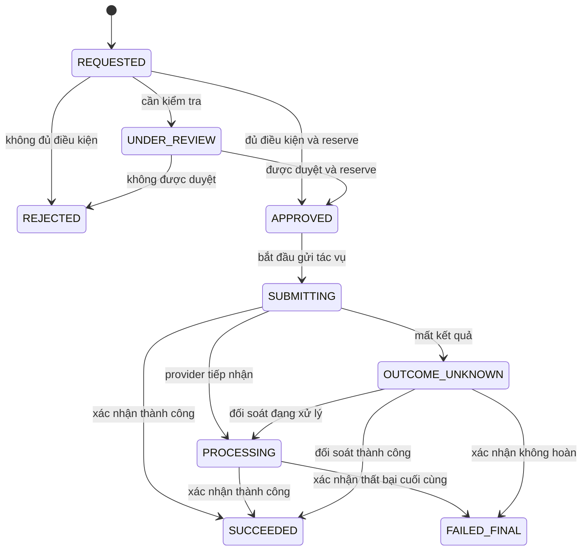

# Điều kiện đủ để hoàn tiền (Refund eligibility)

## 1. Hoàn tiền là một quyết định chuyển tài sản

Trong chương **Refund Rules**, refund eligibility xác định một yêu cầu có đủ điều kiện được chấp nhận để hoàn tiền hay không. Đây là ranh giới bảo mật nghiệp vụ: một lỗi kiểm tra quyền, số tiền hoặc trạng thái có thể chuyển tiền ra khỏi hệ thống dù người gọi không khai thác bất kỳ lỗ hổng injection nào.

Những tình huống lạm dụng thường gặp:

- Yêu cầu hoàn tiền cho đơn của người khác.
- Tự sửa số tiền hoặc chuyển tiền sang tài khoản do người gọi chỉ định.
- Hoàn theo giá niêm yết dù khách đã mua với giá giảm.
- Chia nhỏ nhiều yêu cầu để vượt hạn mức hoặc né phê duyệt.
- Dùng cùng bằng chứng trả hàng để được hoàn nhiều lần.
- Gửi request đồng thời trước khi hệ thống kịp trừ số tiền còn có thể hoàn.
- Lợi dụng timeout để khiến hệ thống gửi thêm một lệnh hoàn mới.
- Hoàn tiền cho khoản chưa thực sự được thu hoặc đã bị xử lý theo một luồng khác.

Một API an toàn cần trả lời ba câu hỏi riêng:

1. **Ai được yêu cầu hoặc phê duyệt trên đúng đối tượng này?**
2. **Yêu cầu đáp ứng những điều kiện nghiệp vụ và tài chính nào?**
3. **Hạn mức hoàn có được giữ nguyên tử trước khi lệnh ra bên ngoài hay không?**

Kết quả “đủ điều kiện” không đồng nghĩa tiền đã được hoàn. Nó chỉ cho phép đi tiếp vào bước chấp nhận và giữ quyền hoàn theo một quy trình được kiểm soát.

## 2. Xác định phạm vi và thuật ngữ

### 2.1. Mô hình cơ sở

Bài học trước hết xét mô hình:

- Một đơn gắn với một khoản thu đã xác minh, trong một loại tiền.
- Có thể hoàn toàn bộ hoặc một phần theo chính sách máy chủ.
- Tiền hoàn về phương thức thanh toán gốc.
- Yêu cầu có thể cần kiểm tra trả hàng hoặc phê duyệt.
- Hệ thống giữ hạn mức khi chấp nhận hoàn, trước khi gửi lệnh cho cổng thanh toán.
- Transaction cục bộ không bao gồm tác động ở cổng thanh toán.

Nhiều lần thu tiền, thanh toán kết hợp, trả bằng điểm hoặc hoàn sang phương thức khác cần mô hình phân bổ và quyền riêng. Không mở rộng mô hình chỉ bằng cách cho client truyền thêm `paymentId` hoặc `recipientAccount`.

### 2.2. Phân biệt những sự thật liên quan

| Khái niệm | Ý nghĩa |
| --- | --- |
| Authorization | Quyền thu tiền theo giao thức thanh toán; không mặc nhiên là tiền đã thu |
| Capture/collection | Khoản thu mà hệ thống đã xác minh theo chính sách |
| Refund request | Yêu cầu xem xét hoàn tiền, chưa chắc đã được chấp nhận |
| Refund approval | Quyết định cho phép hoàn theo phạm vi và số tiền xác định |
| Refund reservation | Phần hạn mức đã được giữ cho một lệnh hoàn đang hoạt động |
| Refund success | Có bằng chứng có thẩm quyền rằng tác vụ hoàn đã thành công |
| Reversal/dispute adjustment | Thay đổi khác có thể ảnh hưởng nguồn tiền được hoàn; cần xử lý theo mô hình riêng |

Nếu khoản tiền chỉ được authorization mà chưa capture, thao tác phù hợp có thể là hủy authorization theo giao thức của nguồn thanh toán. Không gọi mọi cách đảo giao dịch là refund rồi áp dụng cùng một công thức.

Một đơn ở trạng thái `CANCELLED` cũng chưa chứng minh tiền đã quay về khách. Vòng đời đơn, trả hàng và hoàn tiền cần liên kết với nhau nhưng không nên bị gộp thành một trường trạng thái.

## 3. Tách quyền thao tác khỏi điều kiện đủ để hoàn

### 3.1. Quyền theo đối tượng

Khách có thể được tạo yêu cầu cho đơn của mình. Điều đó không có nghĩa khách được:

- Phê duyệt yêu cầu do chính mình tạo.
- Chọn giao dịch nguồn tùy ý.
- Chọn một người nhận mới.
- Ghi nhận rằng kho đã nhận hàng trả.
- Tự đặt trạng thái hoàn tiền thành công.

Nhân viên có role `REFUND_OPERATOR` vẫn phải bị giới hạn theo tenant, cửa hàng, khu vực, loại hoàn hoặc hạn mức được cấp.

Một chính sách minh họa:

```text
Khách tạo yêu cầu:
    cùng tenant
    AND là chủ đơn
    AND được phép tạo yêu cầu cho loại giao dịch này

Nhân viên duyệt:
    cùng tenant
    AND có quyền REFUND_APPROVE
    AND đơn thuộc phạm vi vận hành
    AND số tiền nằm trong thẩm quyền
    AND đáp ứng quy tắc phân tách nhiệm vụ nếu áp dụng
```

`tenantId`, danh tính và hạn mức quyền phải được xác lập từ nguồn có thẩm quyền. Không lấy `approvedBy`, `role` hoặc `tenantId` trong body làm căn cứ.

### 3.2. Kiểm tra quan hệ giữa các đối tượng

Ngay cả khi từng ID tồn tại, máy chủ vẫn cần kiểm tra quan hệ:

```text
refund request
    thuộc đúng order
    thuộc đúng tenant
    tham chiếu đúng capture đã thu cho order
    áp dụng đúng line/return entitlement
    hoàn về đúng phương thức gốc được hệ thống xác lập
```

Một kiểu tấn công là dùng orderId của mình nhưng thay captureId bằng giao dịch của người khác. Chỉ kiểm tra quyền trên order mà không kiểm tra quan hệ với nguồn tiền vẫn có thể gây sai lệch nghiêm trọng.

ID khó đoán không thay thế kiểm tra quyền và liên kết đối tượng.

### 3.3. Hoàn sang phương thức khác là một quyền khác

Trong mô hình cơ sở, máy chủ lấy đích hoàn từ khoản thu gốc; client không gửi số tài khoản đích.

Nếu doanh nghiệp có quy trình chi trả thay thế, cần xác minh người thụ hưởng, quyền thực hiện, phê duyệt và chống chi trùng riêng. Không cho một tham số `alternateDestination` trở thành đường vòng bỏ qua quy tắc của refund.

## 4. Các nhóm điều kiện nghiệp vụ

Refund eligibility thường là phép AND của nhiều điều kiện:

```text
canApproveRefund =
    actorCanApproveThisRequest
    AND sourcePaymentIsEligible
    AND orderAndReasonAllowRefund
    AND requestIsWithinApplicableWindow
    AND requiredReturnEvidenceIsValid
    AND requestedScopeIsNotAlreadyConsumed
    AND serverCalculatedAmountIsPositive
    AND refundBudgetCanBeReserved
    AND requiredApprovalIsSatisfied
    AND noBlockingHold
```

Không thay AND bằng OR để làm luồng “dễ chạy hơn”. Đã trả hàng không tự chứng minh có tiền để hoàn; đã thu tiền không tự chứng minh mọi người dùng đều được yêu cầu hoàn.

| Nhóm điều kiện | Ví dụ kiểm tra | Mã lý do minh họa |
| --- | --- | --- |
| Nguồn tiền | Capture đã xác minh, đúng tài khoản và tiền tệ | `PAYMENT_NOT_REFUNDABLE` |
| Trạng thái/nguyên nhân | Hủy trước thực hiện, trả hàng hoặc điều chỉnh theo policy | `REFUND_REASON_NOT_ALLOWED` |
| Thời hạn | Dựa trên mốc và thời điểm do máy chủ xác lập | `REFUND_WINDOW_EXPIRED` |
| Bằng chứng trả hàng | Kho đã công nhận đúng hàng và số lượng | `RETURN_EVIDENCE_REQUIRED` |
| Quyền lợi còn lại | Chưa hoàn hoặc giữ quyền hoàn cho cùng phạm vi | `REFUND_SCOPE_ALREADY_RESERVED` |
| Số tiền | Tính từ giá trị giao dịch đã chốt, không theo client | `INVALID_REFUND_AMOUNT` |
| Hạn mức nguồn tiền | Còn đủ sau các khoản thành công và đang giữ | `REFUND_BUDGET_EXCEEDED` |
| Phê duyệt | Đúng cấp và không vi phạm phân tách nhiệm vụ | `APPROVAL_REQUIRED` |
| Trạng thái chặn | Không có hold bắt buộc | `REFUND_ON_HOLD` |

Tên trạng thái đơn không phải điều kiện duy nhất. Đơn đã giao có thể được hoàn theo quy trình trả hàng; đơn đã hủy có thể không cần hoàn nếu chưa thu tiền. Policy phải diễn đạt đúng nghĩa vụ thực tế.

## 5. Nguồn dữ liệu quyết định và dữ liệu không được tin

| Dữ liệu | Nguồn quyết định | Đầu vào không đủ làm bằng chứng |
| --- | --- | --- |
| Số tiền đã thu | Giao dịch được xác minh và sổ theo dõi nguồn tiền | `paid=true` hoặc trang redirect thành công |
| Giá và chiết khấu | Snapshot giao dịch do máy chủ chốt | Giá hiện tại trên catalog hoặc giá client gửi |
| Tiền tệ | Giao dịch nguồn và đơn đã chốt | Currency tùy ý trong request |
| Khoản đã/đang hoàn | Ledger và các reservation hoàn đang hoạt động | Tổng client tính hoặc cache cũ |
| Hàng trả được công nhận | Quy trình tiếp nhận của kho có thẩm quyền | Nút “đã gửi trả” do khách bấm |
| Thời điểm yêu cầu | Timestamp máy chủ ghi nhận bất biến theo policy | `requestedAt` do client tự khai |
| Đích hoàn | Liên kết với phương thức thanh toán gốc | Tài khoản mới trong body |
| Quyền duyệt | Danh tính, phạm vi và hạn mức được quản lý | Role, người duyệt hoặc cờ override từ client |

Read model và cache có thể dùng để hiển thị, nhưng quyết định chấp nhận hoàn cần dữ liệu đủ mới hoặc một giao thức giữ quyền từ nguồn sở hữu.

Nếu chỉ đọc một bản sao “còn được hoàn 500.000” rồi gửi lệnh, hệ thống chưa bảo vệ được phần tiền đó trước request cạnh tranh.

## 6. Thời hạn, trả hàng và phê duyệt

### 6.1. Thời hạn phải có mốc và ngữ nghĩa rõ ràng

Một quy tắc như “được hoàn trong N ngày” còn thiếu:

- Tính từ lúc thanh toán, bàn giao hay xác nhận nhận hàng?
- Xét thời điểm khách gửi yêu cầu hay thời điểm nhân viên duyệt?
- Dùng timezone và cách tính khoảng thời gian nào?
- Yêu cầu bổ sung bằng chứng có giữ quyền theo thời điểm tiếp nhận ban đầu không?

Đây là chính sách của hệ thống cần được định nghĩa; bài học không áp đặt một thời hạn pháp lý hoặc thương mại cụ thể.

Nếu policy xét thời điểm tiếp nhận, máy chủ phải lưu thời điểm đó và không cho client backdate. Nếu xử lý kéo dài, không được tùy ý đổi sang thời điểm duyệt để từ chối hoặc tự kéo dài quyền bằng cách sửa timestamp.

### 6.2. Bằng chứng trả hàng phải gắn đúng phạm vi

Cần kiểm tra return request, dòng hàng, số lượng và kết quả tiếp nhận. Cùng một lần nhận hàng không được dùng để mở nhiều quyền hoàn trùng nhau.

Nếu policy cho phép hoàn trước khi nhận hàng hoặc không cần trả hàng, đó phải là nhánh được xác định với quyền và giới hạn phù hợp. Không coi `returnRequired=false` do client gửi là một ngoại lệ hợp lệ.

### 6.3. Hạn mức duyệt cần chống chia nhỏ

Giả sử một cấp nhân viên được duyệt đến một ngưỡng nhất định. Nếu chỉ kiểm tra số tiền từng request, người gọi có thể chia một nghĩa vụ hoàn lớn thành nhiều request nhỏ để né cấp duyệt cao hơn.

Policy cần nêu ngưỡng áp dụng theo request, đơn, sự cố hay tổng phạm vi liên quan. Nếu là ngưỡng cộng dồn, phải tính cả phần đã duyệt và đang được giữ theo cùng phạm vi, với cơ chế đồng bộ phù hợp.

Phê duyệt nên gắn với số tiền, tiền tệ, nguồn tiền, phạm vi dòng hàng và phiên bản nội dung được duyệt. Sửa những trường đó phải làm phê duyệt cũ hết hiệu lực hoặc bị cấm sửa.

## 7. Tính số tiền được hoàn từ giao dịch đã chốt

### 7.1. Hoàn theo giá trị thực tế, không theo giá niêm yết

Giả sử đơn có hai sản phẩm:

| Sản phẩm | Giá trước giảm | Chiết khấu đã phân bổ | Giá trị hàng đã thu |
| --- | ---: | ---: | ---: |
| A | 600.000 VND | 60.000 VND | 540.000 VND |
| B | 400.000 VND | 40.000 VND | 360.000 VND |
| Tổng | 1.000.000 VND | 100.000 VND | 900.000 VND |

Trong ví dụ chỉ xét tiền hàng, hoàn sản phẩm A có căn cứ tối đa 540.000 VND theo phần giá trị đã thu và policy áp dụng, không phải 600.000 VND lấy từ giá niêm yết.

Phí giao hàng, thuế, voucher, điểm thưởng và các thành phần khác cần quy tắc riêng. Không mặc định mọi khoản đều hoàn hoặc đều không hoàn. Dữ liệu phân bổ cần được lưu khi chốt giao dịch hoặc có quy trình tính có thể tái hiện.

Nếu lấy giá hiện tại của sản phẩm, việc catalog tăng giá sau mua có thể khiến người dùng nhận lại nhiều hơn giá trị đã trả.

### 7.2. Làm tròn và đơn vị tiền

Nên dùng đơn vị nhỏ nhất theo quy ước của tiền tệ/giao thức hoặc kiểu số thập phân chính xác. Không dùng số thực nhị phân cho phép tính quyết định tiền hoàn.

Cần bảo đảm:

```text
tổng phân bổ chiết khấu = tổng chiết khấu đã áp dụng
tổng giá trị các thành phần = giá trị giao dịch đã chốt
tổng phần đã hoàn + phần đang giữ không vượt giới hạn tương ứng
```

Khi phân bổ tạo phần lẻ, dùng quy tắc xác định để tổng vẫn khớp. Không làm tròn từng request theo cách mỗi lần đều có lợi cho người gọi, rồi để nhiều lần hoàn nhỏ tích lũy vượt giá trị ban đầu.

Kiểm tra giới hạn kiểu số, phép cộng/trừ và chuyển đổi đơn vị. Không giả định mọi tiền tệ có cùng số chữ số thập phân.

### 7.3. Có hai lớp trần cần kiểm soát

**Trần nguồn tiền** bảo vệ khoản thu:

```text
Tổng nghĩa vụ hoàn không vượt phần nguồn tiền còn được phép hoàn.
```

**Trần quyền lợi nghiệp vụ** bảo vệ lý do và phạm vi hoàn:

```text
Không hoàn nhiều lần cho cùng số lượng,
không hoàn vượt giá trị được phép của dòng hàng,
không dùng lại cùng quyền giao bù/điều chỉnh ngoài policy.
```

Chỉ kiểm soát tổng tiền ở capture chưa đủ. Một khách có thể cố hoàn quá mức cho sản phẩm A nhưng vẫn nằm dưới tổng tiền của cả đơn có sản phẩm B.

Với hoàn theo hàng trả, cần theo dõi số lượng được công nhận và phần đã/đang dùng quyền hoàn. Với điều chỉnh giá hoặc thiện chí không dựa trên số lượng, cần trần số tiền và loại nghĩa vụ riêng; không dùng việc không trừ số lượng để bỏ qua giới hạn giá trị.

## 8. Hạn mức hoàn phải tính cả phần đang giữ

### 8.1. Mô hình ngân sách theo một khoản thu

Trong mô hình một capture và một loại tiền, ký hiệu:

- `C`: số tiền đã thu được xác minh.
- `F`: số tiền hoàn thành công đã được công nhận.
- `P`: số tiền đang giữ cho các lệnh hoàn chưa có kết quả cuối cùng.
- `E`: phần nguồn tiền không còn được phép hoàn do các điều chỉnh khác đã được công nhận, không trùng với F hoặc P.

```text
availableRefundBudget = C - F - P - E
```

Một yêu cầu mới chỉ có thể được giữ hạn mức khi:

```text
requestedAmount > 0
AND requestedAmount <= availableRefundBudget
```

Công thức chỉ đúng khi các số cùng capture, cùng tiền tệ và các nhóm không đếm trùng. Một vụ tranh chấp chưa rõ kết quả không nên bị tự động biến thành số E tùy ý; có thể cần hold và đối soát theo chính sách.

Nếu hệ thống có nhiều capture, phải phân bổ từng phần hoàn về từng nguồn và áp dụng giới hạn cho từng nguồn. Tổng toàn đơn không cho phép gửi một khoản hoàn vượt phần có thể hoàn của capture được chọn.

### 8.2. Ví dụ có yêu cầu đang xử lý

```text
Đã thu C                       = 1.000.000
Đã hoàn thành công F            =   200.000
Đang giữ cho refund khác P      =   500.000
Điều chỉnh khác không trùng E   =         0

Còn có thể giữ cho yêu cầu mới  =   300.000
```

Một yêu cầu 400.000 phải bị từ chối hoặc điều chỉnh theo một quyết định mới hợp lệ. Nếu chỉ trừ F, hệ thống sẽ tưởng còn 800.000 và dễ chấp nhận quá mức.

Các trạng thái như đã duyệt, đang gửi, provider đang xử lý và chưa rõ kết quả đều có thể phải nằm trong P. Không chỉ tính các khoản đã hoàn thành công.

### 8.3. Khi hoàn thành, chuyển nhóm nguyên tử

Khi có bằng chứng refund thành công:

```text
P = P - refundAmount
F = F + refundAmount
refund.state = SUCCEEDED
```

Ba thay đổi phải nhất quán trong transaction cục bộ. Không cộng F mà quên giảm P, hoặc giảm P trước rồi để một khoảng trống cho request mới.

Khi có bằng chứng chắc chắn rằng lệnh đã thất bại cuối cùng và không tạo hoàn tiền:

```text
P = P - refundAmount
refund.state = FAILED_FINAL
```

Việc giải phóng quyền lợi theo dòng hàng cũng phải đi cùng quy tắc tương ứng. Nếu đơn giản giảm P nhưng để trạng thái lệnh cũ vẫn có thể được worker gửi lại, cùng số tiền có thể được dùng hai lần.

Sự kiện thành công bị gửi lại không được thực hiện phép chuyển nhóm lần nữa. Cần kiểm tra trạng thái lệnh, chống trùng sự kiện và/hoặc ràng buộc duy nhất cho bút toán nghiệp vụ tương ứng.

### 8.4. Timeout không làm tăng ngân sách còn lại

Một cuộc gọi hoàn có thể thành công ở provider nhưng mất response. Khi đó phần tiền vẫn phải được giữ.

Không thực hiện:

```text
timeout -> coi như thất bại -> giải phóng P -> tạo refund mới
```

Thay vào đó:

```text
timeout -> OUTCOME_UNKNOWN
        -> giữ P
        -> truy vấn hoặc đối soát cùng định danh
        -> chỉ chốt SUCCEEDED/FAILED_FINAL khi đủ bằng chứng
```

“Chưa thấy thành công” không tương đương “chắc chắn chưa hoàn”.

### 8.5. Nguồn bên ngoài có thể thay đổi ngoài luồng cục bộ

Một nhân viên có thể hoàn trực tiếp ở dashboard của provider hoặc nguồn tiền bị điều chỉnh từ một luồng khác. Nếu thay đổi đó chưa được đồng bộ, ngân sách cục bộ có thể đã cũ.

Cần xác định nơi sở hữu quyết định hoàn, kiểm soát các đường thao tác và đối soát các thay đổi bên ngoài. Khi không xác minh được nguồn tiền còn có thể hoàn, tạm hoãn hoặc chặn theo policy.

Khóa một hàng trong cơ sở dữ liệu của ứng dụng không khóa được mọi thao tác tại provider. Không tuyên bố bất biến toàn hệ thống chỉ dựa trên một transaction cục bộ.

## 9. Phân loại kết quả eligibility

Một quyết định nội bộ có thể gồm bốn loại:

| Kết quả | Ý nghĩa | Hành động |
| --- | --- | --- |
| `ALLOW` | Đủ căn cứ để tiến tới giữ hạn mức trong giao thức được thiết kế | Thử reserve nguyên tử |
| `DENY` | Có điều kiện xác định không đáp ứng | Từ chối với mã lý do phù hợp |
| `REVIEW` | Cần quyết định hoặc bằng chứng phê duyệt bổ sung | Chuyển hàng đợi kiểm tra |
| `DEFER` | Chưa xác minh được dữ liệu bắt buộc | Chờ dữ liệu, thử lại hoặc đối soát |

```java
record RefundEligibilityDecision(
        RefundEligibilityOutcome outcome,
        List<String> reasonCodes,
        long requestVersion,
        String policyVersion) {
}

enum RefundEligibilityOutcome {
    ALLOW, DENY, REVIEW, DEFER
}
```

`ALLOW` từ một lần preview không hứa rằng lệnh sẽ được chấp nhận sau đó. Request khác có thể giữ hạn mức trước, dữ liệu trả hàng có thể bị hiệu chỉnh hoặc một hold mới được thêm.

Nếu không lấy được trạng thái thanh toán đáng tin cậy, không tự chuyển sang ALLOW chỉ để tránh làm khách chờ. Cũng không nhất thiết ghi nhận DENY vĩnh viễn cho một lỗi dữ liệu tạm thời.

Reason code trả cho khách cần phù hợp quyền truy cập. Chi tiết kiểm soát nội bộ, cấu hình rủi ro hoặc thông tin giao dịch của người khác không được lộ qua response.

## 10. State machine làm rõ thời điểm giữ hạn mức

Một mô hình minh họa:



Hợp đồng trong mô hình này:

- `REQUESTED` và `UNDER_REVIEW` chưa tự giữ tiền và chưa bảo đảm sẽ được duyệt.
- Chuyển sang `APPROVED` đồng thời reserve số tiền và phạm vi quyền lợi.
- `APPROVED`, `SUBMITTING`, `PROCESSING`, `OUTCOME_UNKNOWN` vẫn tính vào P.
- `SUCCEEDED` chuyển số tiền từ P sang F.
- `FAILED_FINAL` chỉ giải phóng khi có bằng chứng phù hợp rằng tác vụ không hoàn và không còn tiếp tục được gửi tùy tiện.
- Một trạng thái lỗi kỹ thuật không mặc nhiên là `FAILED_FINAL`.

Nếu provider trả lỗi từ chối chắc chắn ngay tại bước gửi, hệ thống có thể bổ sung cạnh trực tiếp đến `FAILED_FINAL` sau khi xác định ngữ nghĩa đó. Không suy ra cạnh này từ mọi lỗi HTTP hoặc timeout.

Hủy một lệnh đã được duyệt là quy trình riêng. Nếu outbox có thể đang được worker gửi, không được chỉ đổi trạng thái rồi giải phóng tiền; cần phối hợp dừng tác vụ và xác minh chưa có tác động bên ngoài.

## 11. Giữ hạn mức nguyên tử để chặn race condition

### 11.1. Vì sao đọc rồi kiểm tra chưa đủ?

Giả sử còn 800.000 có thể hoàn:

```text
Request A đọc còn 800.000, muốn hoàn 500.000.
Request B đọc còn 800.000, muốn hoàn 500.000.
Cả hai đều kết luận đủ điều kiện.
Cả hai cùng gửi provider.
```

Nếu không reserve nguyên tử, tổng tác vụ mới là 1.000.000 dù chỉ còn 800.000.

Đặt các lệnh đọc và ghi trong cùng transaction chưa tự chứng minh an toàn. Cần khóa, optimistic locking hoặc cập nhật có điều kiện phù hợp với dữ liệu và hệ quản trị.

### 11.2. Cập nhật có điều kiện theo ngân sách nguồn tiền

Một schema ngân sách có thể lưu `captured_minor`, `refunded_minor`, `reserved_minor`, `unavailable_minor`, `currency`, `state` và `version`.

Phép reserve minh họa:

```sql
UPDATE refund_budgets
SET reserved_minor = reserved_minor + :amount_minor,
    version = version + 1
WHERE tenant_id = :tenant_id
  AND capture_id = :capture_id
  AND currency = :currency
  AND state = 'OPEN'
  AND version = :expected_budget_version
  AND :amount_minor > 0
  AND :amount_minor <= (
      captured_minor
      - refunded_minor
      - reserved_minor
      - unavailable_minor
  );
```

Ứng dụng chỉ tiếp tục nếu cập nhật đúng một hàng. Nếu hai request dùng cùng phiên bản, một request có thể thắng; request kia phải xử lý xung đột rồi đánh giá lại theo hợp đồng, không được tiếp tục gửi tiền.

Các tham số tiền và nguồn tiền phải xuất phát từ quote và liên kết đã được máy chủ kiểm tra. SQL không cứu được thiết kế lấy `amount_minor` tùy ý từ client mà bỏ qua phạm vi hoàn.

### 11.3. Cần giữ cả quyền hoàn theo dòng hàng

Trong cùng transaction, hệ thống còn phải giữ phần quyền lợi:

```text
capture budget:
    reserve số tiền

refund entitlement:
    reserve số lượng hoặc giá trị được phép theo phạm vi nghiệp vụ

refund request:
    ghi APPROVED và quote bất biến

audit + outbox:
    lưu quyết định và ý định gửi lệnh
```

Nếu giữ budget thành công nhưng giữ entitlement thất bại, rollback toàn bộ. Nếu chỉ reserve tổng tiền, hai request vẫn có thể cố dùng cùng một quyền trả hàng cho các phần giá trị khác nhau.

Các hàng liên quan cần khóa theo thứ tự nhất quán hoặc dùng giao thức phiên bản chung để giảm deadlock và tránh quyết định dựa trên dữ liệu cũ.

Một ràng buộc duy nhất trên `refundId` không ngăn hai refundId khác nhau dùng cùng quyền lợi. Cần giới hạn theo nguồn tiền, phạm vi dòng hàng và loại nghĩa vụ tương ứng.

### 11.4. Tất cả đường ghi phải tham gia cùng giao thức

Những thao tác ảnh hưởng eligibility gồm:

- Tạo hoặc giải phóng reservation hoàn.
- Công nhận refund thành công.
- Ghi nhận điều chỉnh nguồn tiền.
- Thay đổi phạm vi trả hàng.
- Thêm hold.
- Sửa nội dung làm phê duyệt mất hiệu lực.
- Thực hiện hoàn từ công cụ quản trị.

Nếu một job hoặc công cụ quản trị cập nhật trực tiếp số tiền mà bỏ qua giao thức, phần API chính có khóa đúng vẫn không đủ.

Khi nhận sự thật bên ngoài làm số liệu không còn khớp, cần ghi nhận và chuyển sang trạng thái đối soát/hold. Không âm thầm cắt số âm về 0 rồi coi mọi thứ hợp lệ; cũng không bỏ bằng chứng giao dịch thực tế chỉ để giữ một phép kiểm tra dữ liệu luôn xanh.

## 12. Minh họa phê duyệt refund trong Java

Đoạn sau là khung nghiệp vụ, không phải ứng dụng độc lập. Nó giả định các dữ liệu cục bộ liên quan có thể tham gia cùng transaction. Phần gửi provider diễn ra sau commit.

```java
@Transactional
public RefundApproval approve(
        VerifiedActor actor,
        ApproveRefundCommand command) {

    // Repository tải và khóa theo tenant đáng tin cậy,
    // với thứ tự khóa thống nhất cho các đường ghi liên quan.
    RefundFacts facts = refundFacts.lockForApproval(
            actor.tenantId(), command.refundRequestId());

    RefundRequest request = facts.request();
    access.requireCanApprove(actor, facts.order(), request);

    if (request.version() != command.expectedRequestVersion()) {
        throw new RefundConflictException("REFUND_VERSION_CONFLICT");
    }

    // Chỉ tính từ snapshot giao dịch, bằng chứng và policy phía máy chủ.
    RefundQuote quote = calculator.calculate(
            facts, request.requestedScope());

    Instant now = trustedClock.instant();
    RefundEligibilityDecision decision =
            eligibility.evaluate(actor, facts, quote, now);

    if (decision.outcome() != RefundEligibilityOutcome.ALLOW) {
        throw new RefundNotEligibleException(decision);
    }

    // Mỗi hàm reserve phải kiểm tra trạng thái/phiên bản/số hàng ghi.
    refundBudgets.reserveOrThrow(
            facts.captureId(),
            facts.budgetVersion(),
            quote.amountMinor(),
            quote.currency());

    refundRights.reserveAllOrThrow(
            request.id(),
            quote.entitlementAllocations());

    refundRequests.markApprovedOrThrow(
            request.id(),
            request.version(),
            quote,
            facts.originalPaymentDestinationRef(),
            actor.id(),
            now);

    audit.appendRefundApproved(
            request.id(),
            actor.id(),
            quote,
            decision.policyVersion(),
            request.version() + 1,
            now);

    outbox.appendSubmitRefund(
            request.id(),
            facts.captureId(),
            quote.amountMinor(),
            quote.currency(),
            facts.originalPaymentDestinationRef());

    return new RefundApproval(
            request.id(),
            "APPROVED",
            quote.amountMinor(),
            quote.currency(),
            request.version() + 1);
}
```

Hợp đồng triển khai:

1. `VerifiedActor` được tạo từ xác thực và quyền đáng tin cậy, không deserialize trực tiếp từ body.
2. `lockForApproval` kiểm tra đúng tenant và quan hệ request–order–capture, bảo vệ các dữ liệu dùng quyết định.
3. `eligibility` kiểm tra trạng thái nguồn, quyền hạn duyệt, bằng chứng, policy và mọi hold bắt buộc.
4. `markApprovedOrThrow` chỉ chấp nhận các trạng thái được phép; quote và đích hoàn đã duyệt không được sửa tùy ý.
5. Budget, entitlement, request, audit và outbox cùng commit hoặc cùng rollback; cấu hình ngoại lệ phải thực sự bảo đảm điều đó.
6. Lớp idempotency lưu kết quả lệnh và nhận diện retry; ví dụ chưa thể hiện lớp này.
7. Không gọi provider trong khi giữ transaction rồi kỳ vọng rollback sẽ lấy tiền trở lại.
8. Response `APPROVED` thể hiện đã chấp nhận và giữ hạn mức, chưa phải xác nhận hoàn thành.
9. Dữ liệu ở dịch vụ khác cần giao thức giữ quyền/đối soát riêng; khóa cục bộ không bảo vệ được dữ liệu từ xa.

Trong trường hợp tranh chấp phiên bản, có thể tải lại để hiển thị trạng thái mới. Không tự động thay `expectedVersion` của người gọi rồi tiếp tục phê duyệt một nội dung đã thay đổi.

## 13. API cần thể hiện ý định, không nhận sự thật tự khai

### 13.1. Request của khách hàng

Một API tạo yêu cầu có thể nhận phạm vi và lý do:

```http
POST /orders/{orderId}/refund-requests
Idempotency-Key: 3c0fe249-...

{
  "reason": "RETURN_ACCEPTED",
  "items": [
    {
      "orderLineId": "line-a",
      "quantity": 1
    }
  ]
}
```

`reason` là lý do khách đề nghị, không phải bằng chứng kho đã nhận hàng. Máy chủ tự ánh xạ sang bằng chứng và policy phù hợp.

Những trường không được gán hàng loạt từ request:

```text
approvedBy
approvedAmount
paidAmount
refundSucceeded
providerRefundId
returnAccepted
destinationAccount
tenantId dùng làm nguồn quyền
```

Nếu sản phẩm cho khách đề nghị một số tiền, số tiền đó chỉ là ý định cần được kiểm tra theo quote và policy. Nó không được trở thành số tiền gửi provider trước khi máy chủ xác lập.

### 13.2. Preview và approval là hai bước khác nhau

Một response preview có thể là:

```json
{
  "outcome": "REVIEW",
  "proposedAmountMinor": 540000,
  "currency": "VND",
  "requestVersion": 3,
  "policyVersion": "refund-policy-5",
  "reasonCodes": [
    "APPROVAL_REQUIRED"
  ]
}
```

Ví dụ sử dụng đơn vị nguyên theo quy ước của giao dịch minh họa.

Preview không reserve ngân sách. Approval phải kiểm tra lại dữ liệu và giữ hạn mức nguyên tử.

Một quote hoặc token có chữ ký chỉ chứng minh nội dung được phát hành và không bị sửa theo cơ chế đó. Nó không tự chứng minh ngân sách chưa bị dùng, phê duyệt chưa bị thu hồi hoặc nguồn tiền vẫn đủ điều kiện.

### 13.3. Mã lỗi và trạng thái cần diễn đạt đúng

| Trường hợp | Phản hồi minh họa |
| --- | --- |
| Không có quyền hoặc tài nguyên ngoài phạm vi | `403` hoặc `404` theo chính sách |
| Phiên bản cũ, trạng thái đã đổi hoặc hạn mức bị request khác giữ | `409` với mã lỗi nghiệp vụ |
| Payload/số lượng không hợp lệ | `400` hoặc `422` theo hợp đồng |
| Đã nhận tác vụ chờ xử lý | `202` nếu API có ngữ nghĩa tiếp nhận bất đồng bộ |
| Trả kết quả yêu cầu/phê duyệt đã commit | `200` hoặc mã phù hợp hợp đồng, kèm trạng thái nghiệp vụ rõ ràng |

Không trả `REFUNDED` khi chỉ ghi outbox. Khách cần biết hệ thống đang xem xét, đã duyệt, đang xử lý hay đã nhận xác nhận thành công.

## 14. Idempotency từ yêu cầu đến provider

### 14.1. Retry cùng lệnh

Phạm vi key cần gắn với tenant, caller/client scope và operation. Fingerprint phải bao gồm tài nguyên, phạm vi dòng hàng, lý do và những trường nghiệp vụ có ý nghĩa.

Các quy tắc chính:

- Cùng key và cùng fingerprint trả về cùng kết quả đã ghi nhận.
- Cùng key nhưng khác đơn, số lượng hoặc nội dung phải bị từ chối.
- Xác thực và quyền truy cập vẫn được kiểm tra trước khi trả kết quả cũ.
- Hai request cùng key không được đều chạy nghiệp vụ rồi mới lưu kết quả.
- Kết quả chấp nhận cục bộ và reservation được ghi nhận nhất quán.
- Dùng key mới không vượt được trần tiền hoặc quyền lợi đã bị giữ.

Khi retry lệnh phê duyệt đã commit, lớp idempotency cần tìm lại kết quả đó theo hợp đồng. Không để kiểm tra version của lệnh mới khiến retry hợp lệ bị hiểu sai thành một phê duyệt hoàn toàn khác.

### 14.2. Retry tác vụ ra ngoài

Worker dùng một định danh hoàn ổn định, chẳng hạn `refundRequestId`, để liên kết mọi lần gửi. Nếu provider hỗ trợ idempotency, sử dụng theo đúng phạm vi và ngữ nghĩa của giao thức đó.

Không tạo một mã hoàn nghiệp vụ mới cho mỗi lần worker chạy.

Khi không chắc tác vụ đã thành công:

```text
giữ reservation
truy vấn theo mã tham chiếu/provider id
tiếp nhận webhook đã xác minh
đối soát số tiền, tiền tệ, capture và trạng thái
chốt kết quả bằng cập nhật có điều kiện
```

Thời hạn lưu idempotency của provider có thể khác thời gian tác vụ treo. Không tự gửi lại sau thời gian dài với giả định key cũ vẫn ngăn trùng; cần đối soát theo hợp đồng tích hợp.

Nếu nguồn không hỗ trợ cơ chế chống trùng hoặc truy vấn đủ mạnh, hệ thống phải có cách xử lý tác vụ không rõ kết quả. Outbox và retry cục bộ không tự bảo đảm tác động tiền chỉ xảy ra một lần.

### 14.3. Sự kiện khác mã vẫn có thể mô tả cùng một refund

Provider có thể gửi nhiều sự kiện về một giao dịch. Chống trùng theo `sourceEventId` bảo vệ việc xử lý lại cùng thông điệp; trạng thái refund và ràng buộc ledger bảo vệ việc ghi nhận cùng tác động nhiều lần.

Một webhook thành công thứ hai với eventId khác không được cộng thêm F hoặc giải phóng thêm P cho cùng refund.

Không suy ra thứ tự bằng “webhook đến sau ghi đè webhook đến trước”. Khi kết quả mâu thuẫn, giữ bằng chứng và đối soát theo nguồn có thẩm quyền.

## 15. Những trường hợp cần mở rộng mô hình

### 15.1. Nhiều nguồn thanh toán

Nếu đơn được thanh toán bằng hai capture hoặc kết hợp tiền với quyền lợi khác, cần lưu phân bổ rõ ràng.

Ví dụ:

```text
refund tổng = phần hoàn từ capture A
            + phần hoàn từ capture B
            + phần phục hồi quyền lợi theo policy
```

Mỗi phần có hạn mức, loại tài sản, định danh và trạng thái riêng. Không cộng các loại tiền khác nhau hoặc điểm thưởng thành một số rồi gửi về một nguồn bất kỳ.

Việc quy đổi nếu có phải theo chính sách và dữ liệu tỷ giá có xuất xứ, không lấy giá trị client tự truyền. Hoàn về nhiều nguồn có thể hoàn tất ở những thời điểm khác nhau; trạng thái tổng phải thể hiện phần còn chờ.

### 15.2. Hủy đơn đã chốt nghĩa vụ hoàn

Trong mô hình trước, `REQUESTED` là ticket xin xem xét, chưa cam kết hoàn.

Nếu một lệnh hủy đã **chấp nhận nghĩa vụ hoàn tiền**, reservation hoặc cơ chế giữ nguồn tương đương phải được ghi nhận tại ranh giới chấp nhận nghĩa vụ đó. Không chờ đến lúc nhân viên duyệt ở màn hình refund mới bắt đầu giữ tiền, trong khi những tác vụ khác vẫn có thể dùng nguồn tiền.

Cần tránh hai luồng cùng tạo nghĩa vụ cho một sự việc:

```text
hủy đơn tự tạo refund
+ khách gửi yêu cầu refund thủ công cho cùng phần hàng
```

Chúng phải liên kết về cùng nghĩa vụ hoặc chịu giới hạn entitlement/budget để không tạo hoàn trùng.

### 15.3. Hoàn trước khi nhận hàng trả

Đây có thể là lựa chọn nghiệp vụ, nhưng cần xác định:

- Ai đủ quyền chấp nhận ngoại lệ.
- Phạm vi và số tiền được phép.
- Bằng chứng thay thế hoặc tiêu chí áp dụng.
- Cách chống lạm dụng lặp lại theo đơn và quyền lợi.
- Cách xử lý nếu hàng không được trả như đã cam kết.

Không để khách tự chọn nhánh này bằng cách bỏ trường return hoặc đổi reason code.

### 15.4. Điều chỉnh, bồi hoàn và giao bù

Một khoản điều chỉnh giá, bồi hoàn hoặc phục hồi điểm có thể khác với hoàn phần tiền hàng trả. Cần phân loại nghĩa vụ để không cộng trùng quyền lợi cho cùng sự cố ngoài policy.

Nếu một nhân viên đã cấp giao bù, yêu cầu hoàn thêm vẫn phải được đánh giá theo chính sách của doanh nghiệp. Không mặc định mọi hình thức đều loại trừ nhau, cũng không mặc định được nhận tất cả. Phải có dữ liệu liên kết và quyết định rõ ràng.

## 16. Ví dụ đi qua một cuộc đua hoàn tiền

Giả sử:

```text
Capture C1 đã thu: 1.000.000
Đã hoàn thành công: 200.000
Chưa có reservation khác
Còn có thể giữ: 800.000
```

Hai request R1 và R2, mỗi request 500.000, đồng thời được gửi phê duyệt. Giả sử cả hai có phạm vi nghiệp vụ hợp lệ riêng, nhưng cùng dùng ngân sách C1.

### Bước 1: R1 thắng reserve

```text
P tăng từ 0 lên 500.000
R1 -> APPROVED
ghi audit và outbox
commit
```

### Bước 2: R2 đánh giá lại dữ liệu được bảo vệ

```text
Còn có thể giữ:
    1.000.000 - 200.000 - 500.000 = 300.000

R2 cần 500.000:
    không đủ hạn mức
```

R2 không được tạo outbox gửi tiền. Nếu quy tắc sản phẩm cho phép đề nghị số tiền khác, đó phải là nội dung mới được người có quyền chấp nhận; hệ thống không âm thầm hạ số tiền đã đề nghị rồi coi như cùng quyết định.

### Bước 3: R1 timeout ở provider

```text
R1 -> OUTCOME_UNKNOWN
P vẫn = 500.000
```

R2 vẫn không được lấy thêm 500.000. Timeout không giải phóng nguồn.

### Bước 4: Đối soát R1 thành công

```text
P giảm từ 500.000 xuống 0
F tăng từ 200.000 lên 700.000
R1 -> SUCCEEDED
```

Ngân sách còn 300.000. Webhook thành công bị phát lại không làm F tăng tiếp.

Nếu thay vì thành công, nguồn có thẩm quyền xác nhận R1 thất bại cuối cùng và không còn có thể được thực hiện, hệ thống giải phóng reservation theo giao thức. Khi đó một yêu cầu mới được đánh giá lại với ngân sách mới; không sử dụng một kết quả ALLOW cũ như giấy phép vô thời hạn.

## 17. Audit và đối soát hỗ trợ kiểm tra eligibility

Một quyết định phê duyệt nên có đủ bằng chứng để giải thích:

```text
refundRequestId, commandId, tenantId
orderId, captureId
actorId và phạm vi quyền được áp dụng
reasonCode
requestVersion, businessRevision, policyVersion
amountMinor, currency
phân bổ theo dòng hàng/entitlement
bằng chứng thanh toán, trả hàng và phê duyệt
reservation reference
original destination reference
acceptedAt, correlationId
```

Không ghi số tài khoản đầy đủ, token hoặc dữ liệu thanh toán nhạy cảm chỉ để tạo cảm giác “audit đầy đủ”. Dùng tham chiếu có kiểm soát đến bằng chứng phù hợp.

Các lần từ chối do sai quyền, vượt trần hoặc dùng lại entitlement cần được ghi nhận theo cơ chế không bị mất cùng rollback nghiệp vụ. Chi tiết nội bộ chỉ được xem bởi người có quyền.

Các phép đối soát hữu ích:

- Tổng reservation khớp các refund còn giữ hạn mức.
- Các refund thành công có bằng chứng và ledger tương ứng.
- Số tiền, tiền tệ và capture của kết quả provider khớp lệnh đã duyệt.
- Không có một reservation bị giải phóng trong khi worker vẫn có thể gửi tác vụ đó.
- Không có refund thủ công ở provider chưa được đưa vào nguồn dữ liệu quyết định.
- Không có entitlement bị dùng vượt giới hạn theo dòng hàng.

Nếu nhận một sự kiện thành công mâu thuẫn với kết luận `FAILED_FINAL` trước đó, không áp dụng mù quáng phép giảm P thêm lần nữa. Ghi bằng chứng, chặn phạm vi có nguy cơ và đối soát sự thật tài chính cùng nguyên nhân kết luận sai.

Các tín hiệu cần theo dõi gồm nhiều lần vượt ngân sách, nhiều yêu cầu nhỏ sát ngưỡng duyệt, cố đổi đích hoàn, tác vụ `OUTCOME_UNKNOWN` quá lâu và chênh lệch giữa nguồn thanh toán với ledger cục bộ.

## 18. Ma trận kiểm thử tình huống tấn công logic

Kiểm thử cần quan sát trạng thái, số dư, quyền lợi, audit và outbox sau commit. Chỉ kiểm tra HTTP status có thể bỏ sót việc API trả lỗi nhưng đã tạo tác vụ hoàn.

| Tình huống | Cách thử | Kết quả bắt buộc |
| --- | --- | --- |
| Sai chủ đơn | Khách B xin hoàn đơn của khách A | Bị từ chối; không lộ dữ liệu vượt quyền |
| Sai tenant | Nhân viên tenant A thao tác request tenant B | Không truy cập hoặc thay đổi nguồn tiền |
| Tráo capture | Dùng order hợp lệ nhưng capture của đơn khác | Bị từ chối theo quan hệ đối tượng |
| Đổi đích hoàn | Thêm tài khoản đích vào payload | Không thay đích gốc; không tạo chuyển tiền ngoài quy trình |
| Giả người duyệt | Truyền `approvedBy` hoặc role cao hơn | Máy chủ không dùng giá trị đó làm quyền |
| Chưa capture | Xin refund một authorization chưa thu | Không xử lý như hoàn khoản đã thu |
| Sửa giá | Xin hoàn giá niêm yết thay vì giá đã giảm | Số tiền được tính/giới hạn theo giao dịch đã chốt |
| Sai tiền tệ | Đổi currency để tăng giá trị | Bị từ chối hoặc bỏ trường không thuộc hợp đồng; không đổi giao dịch nguồn |
| Số tiền bất hợp lệ | Gửi âm, 0, quá lớn hoặc sai đơn vị | Không giữ hạn mức và không tạo tác vụ |
| Làm tròn lặp | Gửi nhiều hoàn nhỏ ở ranh giới phân bổ | Tổng không vượt giá trị được phép |
| Trả hàng chưa được công nhận | Chỉ đánh dấu khách đã gửi hàng | Không biến thành bằng chứng tiếp nhận nếu policy cần kho xác nhận |
| Dùng lại bằng chứng | Hai request dùng cùng phần hàng trả | Entitlement ngăn dùng vượt phạm vi |
| Đổi nội dung sau duyệt | Sửa tiền, capture hoặc dòng hàng | Bị chặn hoặc phải đánh giá/phê duyệt lại |
| Backdate | Gửi timestamp trong cửa sổ dù thực tế đã quá hạn | Quyết định dùng thời điểm máy chủ và policy áp dụng |
| Né ngưỡng duyệt | Chia nghĩa vụ lớn thành nhiều request nhỏ | Áp dụng đúng phạm vi cộng dồn của policy |
| Cạnh tranh số dư | Hai request khác key cùng dùng ngân sách | Tổng reservation không vượt nguồn còn được phép |
| Bỏ qua phần đang giữ | Xin hoàn thêm khi refund khác đang xử lý | P được tính vào giới hạn |
| Retry cùng key | Gửi lại sau timeout client | Tìm cùng request/kết quả; không giữ tiền thêm |
| Key đổi nội dung | Cùng key nhưng khác dòng hàng hoặc số tiền | Bị từ chối do fingerprint khác |
| Đổi key để lặp | Tạo lệnh mới cho cùng phạm vi đã được giữ | State machine và entitlement ngăn hoàn trùng |
| Timeout provider | Provider có thể đã xử lý nhưng mất response | Giữ reservation; đối soát cùng tác vụ |
| Webhook trùng | Phát lại cùng sự kiện hoặc cùng thành công bằng mã khác | Không tăng F hay giảm P lần thứ hai |
| Nguồn giả | Callback sai chữ ký/tài khoản/capture | Không công nhận hoàn thành |
| Lỗi ghi audit/outbox | Gây lỗi trước commit phê duyệt | Budget, quyền lợi và trạng thái cùng rollback |
| Lỗi sau commit | Mất response khi đã chấp nhận | Retry tìm kết quả cũ, không tạo lệnh mới |
| Hoàn ngoài luồng | Thêm refund trực tiếp ở provider | Được đối soát; nguồn cũ không tiếp tục cấp vượt theo giả định sai |
| Hủy đơn và refund thủ công | Hai luồng tạo nghĩa vụ cho cùng sự việc | Liên kết hoặc giới hạn ngăn hoàn trùng |
| Giải phóng quá sớm | Cố bỏ reservation khi worker có thể đang gửi | Bị chặn cho đến khi có kết luận an toàn |

### 18.1. Kiểm thử đồng thời có điều phối

Tạo các cuộc đua thực sự bằng hai transaction độc lập:

```text
approve refund A vs approve refund B
approve vs thêm hold
approve vs sửa bằng chứng trả hàng
xác nhận thành công vs nhận lại cùng kết quả
giải phóng reservation vs bắt đầu gửi tác vụ
```

Dùng barrier hoặc cơ chế đồng bộ để điều khiển thời điểm tranh chấp, thay vì chỉ chèn sleep rồi hy vọng race xuất hiện.

Với dữ liệu trong mô hình bình thường, kiểm tra:

```text
F >= 0
P >= 0
E >= 0
F + P + E <= C
```

Đồng thời kiểm tra trần theo dòng hàng và quyền lợi, không chỉ trần capture.

Các sự thật bên ngoài không khớp mô hình phải đi vào luồng phát hiện/đối soát đã thiết kế. Không viết test chỉ ép mọi sự kiện bất thường bị bỏ qua để phương trình luôn đúng.

### 18.2. Kiểm thử điểm lỗi

Chủ động gây lỗi:

```text
sau reserve budget
sau reserve entitlement đầu tiên
sau ghi APPROVED
trước ghi outbox
trước commit
sau commit nhưng trước response
sau provider xử lý nhưng trước ghi nhận kết quả
```

Kỳ vọng cốt lõi:

- Lỗi trước commit không để lại nghĩa vụ chấp nhận một phần.
- Lỗi sau commit không khiến retry tạo thêm lệnh hoàn.
- Không có tác vụ provider từ transaction đã rollback.
- Tác động bên ngoài chưa rõ không làm hạn mức được dùng lại.
- Thành công chỉ được ghi nhận một lần theo tác vụ.

Các kiểm thử transaction và đồng thời cần môi trường có hành vi tương ứng hệ quản trị mục tiêu. Mock repository không chứng minh được hiệu quả của khóa, unique constraint hoặc cập nhật có điều kiện.

## 19. Câu hỏi tự đánh giá

1. Ai có quyền yêu cầu và ai có quyền duyệt refund trên đúng đơn này?
2. Capture có thực sự thuộc đơn và tenant đang xử lý không?
3. Số tiền được tính từ snapshot nào, đã phân bổ giảm giá và các thành phần liên quan chưa?
4. Hệ thống giữ trần theo capture và quyền lợi theo dòng hàng bằng cơ chế nào?
5. Các refund đang gửi, đang xử lý hoặc chưa rõ kết quả có còn giữ hạn mức không?
6. Policy thời hạn dựa trên mốc và timestamp do nguồn nào xác lập?
7. Phê duyệt có còn hiệu lực nếu số tiền hoặc phạm vi thay đổi?
8. Chia nhỏ request có né được ngưỡng duyệt không?
9. Timeout có thể khiến một tác vụ mới được tạo và dùng lại tiền đã giữ không?
10. Khi provider và dữ liệu cục bộ mâu thuẫn, ai sở hữu việc đối soát và ngăn xử lý tiếp?

Refund eligibility an toàn cần gắn quyền theo đối tượng, bằng chứng nguồn tiền và policy với một bước giữ hạn mức nguyên tử. Khi lệnh đã được chấp nhận, định danh ổn định, state machine và đối soát phải tiếp tục bảo vệ khoản tiền đó cho đến khi kết quả được xác định.
