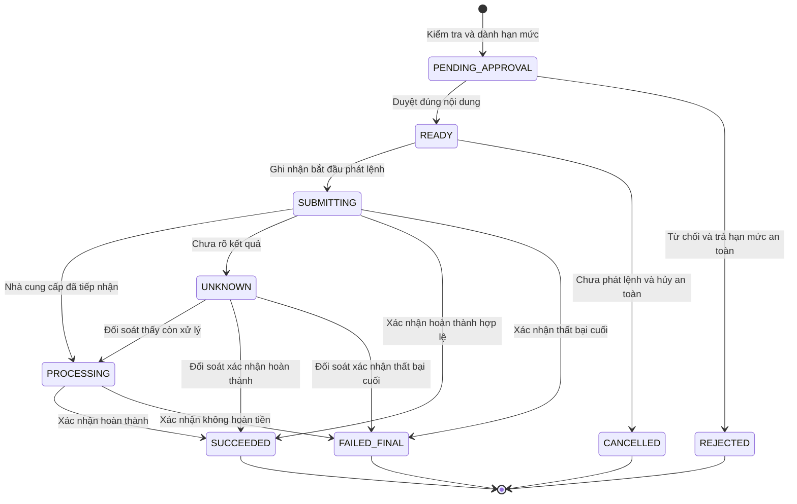

# Refund amount limit: bảo vệ hạn mức số tiền hoàn

Trong chương **Refund Rules**, hạn mức hoàn tiền bảo đảm rằng một yêu cầu hoàn không vượt quá giá trị được phép của giao dịch và của nghiệp vụ. Điều kiện này không chỉ là `refundAmount <= orderTotal`: một đơn có thể được thu nhiều lần, hoàn một phần, có khoản hoàn đang chờ, có tranh chấp hoặc được bồi hoàn qua nhiều kênh.

Một người có quyền yêu cầu hoàn vẫn có thể cố gửi đồng thời nhiều yêu cầu, chia nhỏ khoản hoàn để né phê duyệt hoặc dùng nhiều hồ sơ trả hàng cho cùng một sản phẩm. Bài học tập trung vào business invariants, phân quyền theo đối tượng, state machine, transaction, idempotency và kiểm thử các chuỗi lạm dụng đó.

## 1. Mục tiêu và tình huống xuất phát

Sau bài học, bạn có thể:

- Phân biệt số tiền đã thu, giá trị được phép hoàn theo nghiệp vụ và số tiền còn khả dụng để hoàn.
- Xây hạn mức theo capture, đơn, dòng hàng và căn cứ hoàn, thay vì chỉ so sánh với tổng tiền đơn.
- Tính cả khoản đang dành, đang xử lý và chưa rõ kết quả để ngăn nhiều request cùng dùng một số dư.
- Gắn quyết định phê duyệt với đúng số tiền và phân bổ đã được kiểm tra.
- Xử lý timeout, callback và nhiều giao dịch thanh toán mà không hoàn vượt hoặc hoàn lặp.

Giả sử một đơn có tổng tiền 1.000.000 đồng đã được thu thành công. Khách đã nhận lại 300.000 đồng, một khoản 400.000 đồng đang xử lý và 100.000 đồng đang bị phong tỏa theo chính sách do có tranh chấp trên phần tiền riêng biệt. Với giả định các phần này không chồng lấn, số còn có thể dành cho hoàn mới chỉ là 200.000 đồng.

Nếu API chỉ trừ khoản đã hoàn thành, nó sẽ nhìn thấy 700.000 đồng và có thể cho phép bồi hoàn vượt mức. Nếu API chỉ so sánh từng request với 1.000.000 đồng, nhiều request nhỏ đều có thể qua kiểm tra dù tổng lớn hơn tiền đã thu.

Các ví dụ trong bài là chính sách thiết kế minh họa. Điều kiện thương mại, thuế, phí và khả năng của nhà cung cấp cần được mô hình hóa theo sản phẩm; không coi một công thức chung là đáp án cho mọi loại hoàn tiền.

## 2. Phân biệt các số tiền thường bị dùng lẫn

| Đại lượng | Ý nghĩa | Không được suy diễn |
| --- | --- | --- |
| Tổng tiền đơn | Giá trị theo phiên bản điều kiện đơn đã chấp nhận | Không chứng minh đã thu đủ tiền |
| Authorization | Khoản được chấp thuận giữ hoặc dành hạn mức ở hệ thống thanh toán | Chưa phải capture để áp dụng nghiệp vụ refund trong mô hình này |
| Capture thành công | Khoản đã được xác nhận thu theo giao thức tích hợp | Chưa có nghĩa mọi phần của khoản đó đều đủ điều kiện hoàn |
| Giá trị đủ điều kiện hoàn | Giá trị được căn cứ hủy, trả hàng hoặc điều chỉnh cho phép | Không tự chứng minh còn số dư trên giao dịch để thực hiện |
| Refund đã thành công | Khoản đã được xác nhận hoàn theo bằng chứng tin cậy | Phải phân biệt với mới tiếp nhận yêu cầu |
| Refund đang dành hoặc xử lý | Khoản đã chiếm hạn mức nhưng chưa kết thúc | Không được bỏ qua khi tính số còn lại |
| Refund chưa rõ kết quả | Thao tác có thể đã xảy ra bên ngoài nhưng chưa xác định chắc | Không được coi là thất bại để hoàn lại ngay |
| Bồi hoàn qua kênh khác | Ví dụ credit hoặc điều chỉnh được chính sách công nhận | Có thể tiêu thụ cùng quyền lợi nghiệp vụ dù không là refund qua nhà cung cấp |

Bài học dùng refund cho khoản hoàn trên tiền đã capture. Nếu tiền mới được authorization, giải phóng hoặc hủy authorization là một nghiệp vụ khác. Không đưa cả hai vào một bộ đếm rồi làm mất sự khác biệt về nguồn tiền và trạng thái.

Cũng cần phân biệt **quyền yêu cầu hoàn**, **quyền phê duyệt**, **quyền phát lệnh thanh toán** và **đích nhận tiền**. Chủ đơn hiện tại không tự động có quyền đổi đích hoàn của người đã trả tiền.

## 3. Các cách lạm dụng hạn mức hoàn

| Cách lạm dụng | Sai sót bị khai thác | Hậu quả |
| --- | --- | --- |
| Gửi nhiều request nhỏ | Chỉ kiểm tra từng request | Tổng hoàn vượt mức |
| Gửi hai request đồng thời | Đọc số dư rồi ghi không có đồng bộ | Cả hai cùng chiếm một số dư |
| Timeout rồi đổi idempotency key | Chỉ chống trùng theo khóa, không giữ hạn mức | Tạo hai khoản hoàn cho cùng phần tiền |
| Chọn capture của đơn khác | Chỉ kiểm tra quyền ở order trên URL | Hoàn từ giao dịch ngoài phạm vi |
| Mở nhiều hồ sơ cho cùng lượng hàng trả | Hạn mức chỉ gắn riêng từng hồ sơ | Một quyền lợi được hoàn nhiều lần |
| Sửa số tiền sau khi duyệt | Approval không ràng buộc phiên bản nội dung | Duyệt khoản nhỏ nhưng gửi khoản lớn |
| Chia nhỏ để dưới ngưỡng duyệt | Ngưỡng chỉ xét số tiền mỗi request | Né phê duyệt của tổng nghĩa vụ |
| Đổi currency hoặc đơn vị tiền | So sánh số thuần thiếu ngữ cảnh | Hạn mức sai nhiều bậc giá trị |
| Áp lại giảm giá, phí hoặc phần dư làm tròn | Mỗi lần hoàn tự tính lại công thức | Tích lũy giá trị hoàn vượt phân bổ |
| Callback lặp hoặc khác ID cho cùng thao tác | Cộng tiền theo số lần nhận thông báo | Bộ đếm sai và tác dụng phụ lặp |
| Hoàn qua thẻ rồi tiếp tục cấp credit cho cùng căn cứ | Các kênh dùng sổ độc lập hoàn toàn | Bồi hoàn hai lần cùng một quyền lợi |
| Hạ khoản đang chờ thành thất bại vì quá lâu | Không đối soát kết quả ngoài hệ thống | Giải phóng tiền để hoàn thêm dù lần trước đã thành công |

Đăng nhập, kiểm tra schema và giới hạn tần suất đều hữu ích. Tuy nhiên, chúng không tự chứng minh một đồng tiền hoặc một đơn vị quyền lợi chưa được dùng bởi thao tác khác.

## 4. Mô hình bất biến theo phạm vi hạn mức

### 4.1. Công thức cho một phạm vi đã xác định

Với một phạm vi hạn mức `s` có cùng tiền tệ và ý nghĩa nghiệp vụ, đặt:

- `B_s`: giới hạn được phép của phạm vi.
- `R_s`: số tiền đã được xác nhận tiêu thụ bởi các khoản hoàn hoặc bồi hoàn áp dụng vào phạm vi đó.
- `P_s`: số tiền đã dành cho các yêu cầu chưa kết thúc, gồm cả đang chờ phê duyệt nếu chính sách đã giữ chỗ.
- `X_s`: phần đang bị phong tỏa hoặc không được phép hoàn thêm theo chính sách, chưa được tính trong `R_s` hoặc `P_s`.
- `q_s`: phần của yêu cầu mới sẽ tiêu thụ phạm vi này.

Điều kiện tiếp nhận một phần hoàn mới:

```text
B_s >= 0
R_s >= 0, P_s >= 0, X_s >= 0
q_s > 0
R_s + P_s + X_s + q_s <= B_s

available_s = max(0, B_s - R_s - P_s - X_s)
```

`P_s` không phải số tiền đang giữ ở ngân hàng. Đây là lượng được giữ trong sổ hạn mức nội bộ để những thao tác khác không sử dụng cùng phần còn lại.

`X_s` chỉ dùng khi mô hình có phần phong tỏa tương ứng. Không vừa cộng một khoản tranh chấp vào `X_s`, vừa tính chính khoản đó trong `R_s` rồi trừ hai lần. Cần ánh xạ các khoản về phần tiền hoặc quyền lợi nguồn để xác định chồng lấn.

### 4.2. Những phạm vi cần kiểm tra

| Phạm vi | Giới hạn điển hình | Mục đích |
| --- | --- | --- |
| Capture | Giá trị capture đã xác nhận, sau khi xét các phần không khả dụng | Không hoàn vượt nguồn tiền của giao dịch |
| Đơn hoặc nghĩa vụ thu | Tổng được phép bồi hoàn trên nghĩa vụ đã xác định | Chống dùng nhiều capture hoặc nhiều kênh để vượt tổng |
| Dòng hàng hoặc đơn vị quyền lợi | Giá trị đã phân bổ cho phần được hủy hoặc trả hợp lệ | Không hoàn giá niêm yết cao hơn giá thực trả |
| Hồ sơ hoàn | Số tiền được căn cứ nghiệp vụ và quyết định phê duyệt cho phép | Không vượt lý do được chấp nhận |
| Nhóm phê duyệt hoặc hạn mức vận hành | Tổng mức có thể tự duyệt theo chính sách | Chống chia nhỏ yêu cầu để né kiểm soát |

Một yêu cầu phải thỏa mọi phạm vi liên quan, nhưng không cộng các bộ đếm của nhiều phạm vi thành một tổng tiền mới. Cùng 100.000 đồng có thể được ghi nhận ở cả phạm vi capture và dòng hàng để kiểm tra hai bất biến khác nhau; nó vẫn chỉ là một khoản hoàn thực tế.

Nếu yêu cầu chỉ dùng một capture và một căn cứ, số tiền có thể được giới hạn bởi số nhỏ nhất của các mức còn lại tương ứng. Nếu yêu cầu dùng nhiều capture, cần một kế hoạch phân bổ: mỗi phần phải thỏa hạn mức capture của chính nó và tổng các phần thỏa hạn mức cấp đơn cùng căn cứ. Không lấy mức nhỏ nhất của mọi capture rồi xem đó là giới hạn cho cả yêu cầu.

### 4.3. Ví dụ nhiều capture

Giả sử cùng một tiền tệ:

| Capture | Đã thu | Đã hoàn | Đang dành | Còn lại |
| --- | --- | --- | --- | --- |
| A | 600.000 | 200.000 | 100.000 | 300.000 |
| B | 400.000 | 0 | 0 | 400.000 |

Nguồn tiền còn lại tổng cộng là 700.000 đồng. Nếu căn cứ trả hàng chỉ cho hoàn 550.000 đồng, yêu cầu mới không được vượt 550.000 đồng dù nguồn giao dịch còn nhiều hơn.

Một kế hoạch hợp lệ có thể dành 300.000 đồng từ A và 250.000 đồng từ B, nếu chính sách phân bổ cho phép. Không được dành 550.000 đồng từ A chỉ vì tổng hai capture còn đủ.

### 4.4. Sự kiện bên ngoài có thể làm phát sinh thiếu hụt

Một khoản tranh chấp, điều chỉnh hoặc refund thực hiện trực tiếp ở hệ thống nhà cung cấp có thể xuất hiện sau quyết định cục bộ. Nếu sự kiện mới làm số đang tiêu thụ và đang dành vượt giới hạn đã biết, phải ghi nhận đúng thực tế, chặn lệnh mới và đối soát các khoản chưa phát hành.

Không cắt bớt số tiền sự kiện để làm công thức trông hợp lệ, hoặc tự xóa refund đã thành công. Bất biến tiếp nhận lệnh giúp kiểm soát những quyết định ứng dụng chủ động đưa ra; nó không thể ngăn tuyệt đối tác dụng ngoài hệ thống nếu các kênh đó không tham gia cùng giao thức.

## 5. Xác định giá trị đủ điều kiện từ dữ liệu đã chốt

### 5.1. Không dùng giá hiện tại hoặc giá niêm yết

Ví dụ khách mua ba sản phẩm, giá mỗi sản phẩm 100.000 đồng và được giảm tổng cộng 30.000 đồng cho dòng hàng. Giá trị hàng thực trả là 270.000 đồng. Trong ví dụ chia hết, mỗi sản phẩm mang giá trị 90.000 đồng.

Nếu khách trả một sản phẩm đủ điều kiện, phần giá trị hàng được xét hoàn là 90.000 đồng theo phân bổ này, không phải 100.000 đồng. Có hoàn phí giao hay không là quyết định riêng của chính sách; không tự hoàn toàn bộ phí mỗi khi mở hồ sơ mới.

Máy chủ cần dựa vào bản chốt và phân bổ bền vững:

```text
Giá trị dòng sau giảm
  -> phân bổ xuống phần hàng đủ điều kiện
  -> áp dụng điều kiện phí, điều chỉnh và phạm vi được duyệt
  -> trừ phần quyền lợi đã tiêu thụ hoặc đang dành
  -> đối chiếu nguồn capture có thể hoàn
```

Không lấy công thức tính giỏ hàng hiện tại để tính lại quyền lợi lịch sử. Giá sản phẩm, chương trình giảm giá hoặc cấu hình phí có thể đã đổi sau lúc mua.

### 5.2. Làm tròn phải có phần dư xác định

Giả sử một khoản 10.000 đơn vị tiền nhỏ nhất cần chia cho ba phần. Có thể lưu phân bổ 3.333, 3.333 và 3.334 để tổng vẫn là 10.000. Mỗi lần hoàn sử dụng phần đã được phân bổ cho đúng đối tượng, thay vì tự làm tròn lại một phần ba.

Dùng số nguyên theo đơn vị nhỏ nhất đã thống nhất hoặc một kiểu decimal với scale được kiểm soát. Kiểm tra tràn số khi cộng và giới hạn miền đầu vào. Không dùng số thực nhị phân rồi dựa vào so sánh gần đúng để quyết định có vượt hạn mức tiền không.

### 5.3. Căn cứ hoàn không được nhân bản quyền lợi

Một phiếu nhận trả có thể là bằng chứng, nhưng không nên tự tạo một hạn mức mới mỗi lần nó được tham chiếu. Cần liên kết căn cứ với dòng, lượng hoặc đơn vị quyền lợi nguồn và theo dõi phần đã tiêu thụ.

Nếu hai hồ sơ cùng yêu cầu hoàn cho một sản phẩm đã trả, chúng phải tranh chấp trên cùng quyền lợi đó. Chỉ giới hạn mỗi hồ sơ ở 90.000 đồng sẽ không ngăn hai hồ sơ cùng hoàn tổng cộng 180.000 đồng.

Hủy, trả hàng, giảm giá sau bán và bồi thường có thể có căn cứ khác nhau. Phải định nghĩa khi nào chúng tiêu thụ cùng quyền lợi, khi nào được cộng thêm theo một quyết định riêng; không mặc định mọi căn cứ mới đều mở lại toàn bộ giá trị đơn.

## 6. Tiền tệ, kênh bồi hoàn và đích nhận

Hạn mức phải chứa cả mã tiền tệ. Không so sánh `100` của hai tiền tệ khác nhau như cùng một giá trị. Nếu sản phẩm có hoàn qua chuyển đổi tiền tệ, cần quy tắc tỷ giá, thời điểm, phần chênh lệch và phê duyệt tương ứng; không thêm phép đổi ngầm vào công thức giới hạn.

Hoàn qua phương thức thanh toán gốc và cấp credit có thể tiêu thụ cùng quyền lợi thương mại nhưng có nguồn thực hiện khác nhau. Ví dụ căn cứ chỉ cho bồi hoàn 200.000 đồng: hoàn qua thẻ 100.000 đồng rồi cấp credit 100.000 đồng có thể đã dùng hết quyền lợi, dù capture vẫn còn tiền có thể hoàn về kỹ thuật.

Khoản hỗ trợ thiện chí vượt giá trị mua, nếu sản phẩm cho phép, phải đi qua ngân sách và phê duyệt riêng. Không nới `refund_limit` để dùng refund làm đường chi tiền không còn gắn với căn cứ ban đầu.

Đích hoàn nên được xác định từ giao dịch nguồn theo chính sách tích hợp. Client không được sửa tài khoản nhận hoặc provider reference trong cùng request chỉ vì số tiền còn dưới hạn mức. Trường hợp phải chuyển sang đích khác cần quy trình xác minh và phê duyệt riêng.

## 7. Quyền theo đối tượng và ngưỡng phê duyệt

Người gọi phải có quyền trên đúng đơn, căn cứ và giao dịch nguồn. Một vai trò chung như `SUPPORT_AGENT` không tự cho quyền hoàn mọi đơn hoặc chọn mọi merchant account.

| Chủ thể | Quyền có thể được cấp | Kiểm soát bắt buộc đi kèm |
| --- | --- | --- |
| Khách hàng | Gửi yêu cầu theo đơn hoặc phần hàng của mình | Quyền hiện tại, căn cứ, phạm vi dữ liệu được xem |
| Nhân viên hỗ trợ | Đề xuất hoặc tiếp nhận khoản hoàn | Tenant, nhóm phụ trách, giới hạn đề xuất |
| Người duyệt | Phê duyệt một nội dung cụ thể | Ngưỡng, phiên bản, phân tách nhiệm vụ nếu chính sách yêu cầu |
| Dịch vụ hoàn tiền | Phát lệnh đã được cho phép | Reservation, approval, trạng thái và ánh xạ provider |
| Tác vụ đối soát | Ghi nhận bằng chứng kết quả hoặc đề xuất điều chỉnh | Nguồn bằng chứng, quyền điều chỉnh và audit |

Các quan hệ cần được đối chiếu phía máy chủ:

```text
actor và tenant đã xác minh
  -> order thuộc phạm vi được phép
    -> căn cứ hoàn gắn đúng order và phần quyền lợi
      -> capture thực sự tài trợ cho phạm vi cần hoàn
        -> operation được gửi đến đúng provider account
```

Không tải capture chỉ bằng ID rồi tin rằng nó thuộc order trên URL. Khóa ngoại hoặc ràng buộc tương đương nên hỗ trợ các quan hệ cùng tenant.

### 7.1. Phê duyệt phải gắn nội dung bất biến

Approval nên gắn `refund_request_id`, version hoặc dấu vân tay của số tiền, tiền tệ, căn cứ và kế hoạch phân bổ. Sau khi được duyệt, đổi bất kỳ thuộc tính có ý nghĩa nào phải tạo phiên bản mới và xét lại quyền duyệt.

Một cờ `approved = true` không đủ nếu request vẫn cho sửa `amount` hoặc capture nguồn. Worker phải xác minh approval còn khớp nội dung sẽ gửi, không chỉ kiểm tra có người từng duyệt bản ghi.

### 7.2. Chặn chia nhỏ để né ngưỡng

Giả sử nhân viên được tự xử lý tối đa 200.000 đồng cho một nghĩa vụ theo chính sách. Tạo ba yêu cầu 190.000 đồng không được tự biến thành ba khoản độc lập nếu thực chất đều bồi hoàn cho cùng căn cứ hoặc cùng nhóm nghĩa vụ.

Cần định nghĩa phạm vi tổng hợp của ngưỡng: theo đơn, căn cứ, khoảng thời gian hoặc nhóm điều chỉnh cụ thể. Tổng hợp phải tính cả khoản đang chờ và đã duyệt theo chính sách. Không đưa ra một khoảng thời gian tùy tiện rồi mặc định nó chống được mọi hình thức chia nhỏ.

Approval không thay thế hạn mức tài chính: một người duyệt có thẩm quyền vẫn không được làm refund vượt nguồn tiền hoặc quyền lợi. Ngoại lệ hỗ trợ thêm phải dùng nghiệp vụ và ngân sách riêng.

## 8. State machine và thời điểm giữ hạn mức

Trong ví dụ, hệ thống giữ hạn mức khi tiếp nhận yêu cầu hợp lệ để chờ phê duyệt. Đây là một lựa chọn thiết kế; sản phẩm giữ hạn mức ở lúc duyệt phải kiểm tra lại đầy đủ tại lúc đó.



`PENDING_APPROVAL`, `READY`, `SUBMITTING`, `PROCESSING` và `UNKNOWN` đều tiếp tục chiếm `P_s` trong chính sách này. Tên trạng thái ở nhà cung cấp có thể khác; cần ánh xạ ý nghĩa, không chỉ ánh xạ chuỗi ký tự.

| Sự kiện | Thay đổi hạn mức |
| --- | --- |
| Tiếp nhận và giữ khoản `q` | `P_s += q` trên mọi phạm vi bị tiêu thụ |
| Duyệt hoặc gửi lệnh | Không giữ thêm lần nữa |
| Xác nhận hoàn thành | `P_s -= q`, `R_s += q` đúng một lần |
| Từ chối trước khi có thể gửi | `P_s -= q` |
| Thất bại cuối có căn cứ chắc chắn | `P_s -= q` |
| Timeout hoặc phản hồi chưa rõ | Giữ nguyên `P_s` |
| Nhận lại thông báo đã xử lý | Không đổi bộ đếm |

Không giải phóng hạn mức chỉ vì `updated_at` đã cũ hoặc worker đã hết lease. Lease hết hạn chỉ nói về quyền xử lý của worker, không chứng minh nhà cung cấp chưa hoàn tiền.

Giữ chỗ trước phê duyệt cũng có nguy cơ bị lạm dụng để làm cạn hạn mức. Có thể giới hạn số đề nghị đang chờ và hết hạn các đề nghị chắc chắn chưa được phát hành. Không áp dụng cùng cơ chế hết hạn đó cho thao tác đã có thể ra ngoài.

## 9. Mô hình dữ liệu cho hạn mức và dấu vết

```text
captures
  id, tenant_id, order_id
  provider_id, provider_account_id, provider_capture_ref
  captured_amount_minor, currency, state

refund_entitlements
  id, tenant_id, order_id
  source_type, source_reference
  order_terms_version, policy_version
  eligible_amount_minor, currency
  version

refund_budget_scopes
  id, tenant_id, scope_type, scope_reference
  currency
  limit_minor
  consumed_minor
  reserved_minor
  blocked_minor
  version

refund_requests
  id, tenant_id, order_id, entitlement_id
  amount_minor, currency
  plan_version, plan_fingerprint
  state, requested_by

refund_allocations
  refund_request_id, budget_scope_id
  amount_minor, currency
  reservation_state

refund_operations
  id, tenant_id, refund_request_id, capture_id
  amount_minor, currency
  provider_idempotency_key, provider_refund_ref
  state, accounting_applied_version

refund_approvals
  refund_request_id, plan_version, plan_fingerprint
  approved_by, approved_amount_minor, approved_at

refund_ledger_events
  event_id, refund_request_id, operation_id, budget_scope_id
  event_type, amount_minor, evidence_reference

command_idempotency
  tenant_id, actor_id, command_type, idempotency_key
  request_fingerprint, result_reference

outbox_events
  event_id, aggregate_id, event_type, payload, published_at

provider_inbox
  provider_id, provider_account_id, external_event_id
  received_at, processing_result
```

Mô hình trên là gợi ý về các trách nhiệm, không phải schema hoàn chỉnh. Một request dùng nhiều capture có nhiều operation con; phân bổ hạn mức phải biểu diễn được phần nào tương ứng operation nào để ghi nhận thành công từng phần.

`consumed_minor` có thể phản ánh refund qua nhà cung cấp trong phạm vi capture, nhưng phản ánh cả credit được công nhận trong phạm vi quyền lợi cấp đơn. Cần quy định ý nghĩa cho từng loại scope, không lấy tổng mọi scope làm tổng tiền đã thực chi.

Ràng buộc dữ liệu hữu ích gồm lượng không âm, tiền tệ khớp phạm vi, khóa duy nhất của idempotency, quan hệ cùng tenant và định danh operation hoặc provider refund duy nhất trong phạm vi tài khoản tích hợp. Ràng buộc từng dòng không tự bảo vệ tổng phân bổ trên nhiều capture; cần transaction hoặc cơ chế điều phối tương đương.

Chọn nguồn sự thật rõ ràng: ledger và các bộ đếm phải được cập nhật nhất quán, hoặc bộ đếm là dữ liệu dẫn xuất có cơ chế phục hồi được xác định. Không để một endpoint dựa vào ledger, endpoint khác dựa vào cache cũ rồi cùng phát lệnh.

## 10. Dành hạn mức trong transaction

### 10.1. Cuộc đua cần ngăn

Giả sử còn 500.000 đồng:

```text
T1 đọc available = 500.000, muốn hoàn 400.000
T2 đọc available = 500.000, muốn hoàn 400.000
T1 kiểm tra đủ, tạo yêu cầu
T2 kiểm tra đủ, tạo yêu cầu
Tổng đã dành mới = 800.000, vượt số còn lại
```

Kiểm tra lần hai trên cùng dữ liệu không được bảo vệ vẫn có thể sai. Quyết định đủ hạn mức và thao tác giữ chỗ phải nằm trong cùng ranh giới nhất quán.

### 10.2. Luồng tiếp nhận minh họa bằng Java

Đây là mã giả, không phải triển khai Java hoàn chỉnh. Ví dụ giả định dữ liệu cần quyết định nằm trong cùng miền transaction.

```java
RefundReceipt requestRefund(Principal principal, RefundCommand command) {
    Actor actor = authenticatedActor(principal);
    NormalizedRefundCommand cmd = normalizeAndValidate(command);

    return transaction.run(() -> {
        Replay replay = idempotency.claimOrReplay(
            actor.tenantId(), actor.id(), "REQUEST_REFUND",
            cmd.idempotencyKey(), fingerprintOfCommand(cmd)
        );
        if (replay.isCompleted()) {
            return replay.minimalReceipt();
        }

        // Khóa order, căn cứ và mọi scope chia sẻ theo một thứ tự thống nhất.
        RefundContext context = refundContexts.lockGraphInCanonicalOrder(
            actor.tenantId(), cmd.orderId(), cmd.entitlementId()
        );
        requireCanRequestRefund(actor, context);
        requireCorrectObjectRelationships(context);
        requireCurrentRefundBasis(context);
        requireExpectedVersion(context, cmd.expectedEntitlementVersion());
        requirePositiveAmountAndCurrency(cmd, context);

        RefundPlan plan = planner.allocateOnServer(
            context, cmd.requestedAmountMinor()
        );
        requirePlanTotalMatchesRequest(plan, cmd);
        requirePlanWithinEveryBudget(plan, context);
        requireApprovalPolicyApplicable(actor, plan, context);

        RefundRequest request = refunds.createImmutablePlan(plan, actor);
        for (BudgetUse use : plan.normalizedBudgetUses()) {
            budgets.reserve(use.scopeId(), request.id(), use.amount());
            ledger.append(reservationCreated(request, use));
        }

        audit.append(refundRequested(actor, request, context));
        outbox.append(refundAwaitingApproval(request.id()));

        RefundReceipt receipt = receiptOf(request);
        idempotency.complete(receipt);
        return receipt;
    });
}
```

Những điểm cần giữ khi hiện thực:

- `requestedAmountMinor` là mong muốn của người gọi, không phải số tiền đã được chấp thuận. Máy chủ kiểm tra và tạo kế hoạch nguồn cùng hạn mức.
- Chuẩn hóa các dòng và phân bổ trước khi xét tổng. Nếu payload lặp một capture hoặc phần hàng, phải từ chối hoặc gộp có kiểm tra tràn số; không kiểm tra từng phần tử rồi bỏ qua tổng.
- Khóa mọi scope chia sẻ liên quan, không chỉ request mới. Hai request khác ID nhưng cùng capture hoặc cùng quyền lợi vẫn phải tranh chấp.
- Nếu một phần kế hoạch không đủ điều kiện, ví dụ chọn rollback toàn bộ lúc tiếp nhận. Nếu sản phẩm cho kết quả một phần, API phải mô tả rõ phần được nhận, không lặng lẽ giảm số tiền.
- Tạo request, giữ hạn mức, ghi ledger, idempotency và sự kiện phải cùng commit hoặc cùng rollback.
- Chưa gọi nhà cung cấp trong transaction dành hạn mức. Lệnh bên ngoài được phát từ ý định đã commit và đã có approval phù hợp.

### 10.3. Cập nhật có điều kiện cho một scope

Một cách khác để chiếm hạn mức là cập nhật có điều kiện:

```sql
UPDATE refund_budget_scopes
SET reserved_minor = reserved_minor + :amount_minor,
    version = version + 1
WHERE tenant_id = :tenant_id
  AND id = :scope_id
  AND currency = :currency
  AND version = :expected_version
  AND :amount_minor > 0
  AND limit_minor - consumed_minor - reserved_minor - blocked_minor
      >= :amount_minor;
```

Phải kiểm tra có đúng một dòng được cập nhật. Nếu không, tải lại và quyết định xung đột hoặc từ chối trên trạng thái mới; không tiếp tục như đã giữ tiền thành công.

SQL này chỉ bảo vệ một scope. Kế hoạch nhiều scope vẫn cần transaction: nếu cập nhật capture thành công nhưng scope quyền lợi thất bại, phần trước phải rollback. Phân quyền, căn cứ hoàn, approval và quan hệ dữ liệu cũng chưa được chứng minh chỉ bằng câu SQL.

Một thứ tự lấy khóa thống nhất giúp giảm deadlock. Nếu phải retry transaction do xung đột, chạy lại kiểm tra trên dữ liệu hiện tại; không lặp một quyết định dựa trên số dư cũ.

## 11. Từ approval đến nhà cung cấp: không giữ chỗ lại và không thả sớm

Khi được duyệt, request chuyển sang `READY` với đúng `plan_version` và `plan_fingerprint`. Khoản đó đã chiếm hạn mức, nên không cộng `P_s` thêm khi worker bắt đầu gửi.

Một luồng worker có thể:

1. Tải request, approval và các operation con; xác minh tenant, nội dung và trạng thái.
2. Trong transaction, kiểm tra reservation còn hiệu lực và điều kiện nhạy cảm chưa bị vô hiệu hóa. Ghi nhận operation chuẩn bị gửi với định danh ổn định rồi commit.
3. Gọi provider account đã ánh xạ, refund trên đúng capture và số tiền được lưu ở operation.
4. Ghi phản hồi có bằng chứng trong transaction tiếp theo. Phản hồi tiếp nhận chỉ chuyển sang đang xử lý nếu đó là ý nghĩa của giao thức.
5. Khi có kết quả cuối, chuyển lượng từ đang dành sang đã tiêu thụ hoặc giải phóng đúng một lần.

Đánh dấu đang gửi là điểm cục bộ để phân biệt lệnh còn có thể hủy chắc chắn với lệnh đã có thể ra ngoài. Một worker dừng ngay sau đó có thể chưa gửi, nhưng hệ thống không nên dùng suy đoán đó để giải phóng rồi tạo refund mới.

Nếu tiến trình dừng sau khi provider đã thực hiện nhưng trước khi ghi nhận, phải dùng cùng định danh thao tác hoặc truy vấn kết quả. Không thể rollback khoản hoàn ngoài hệ thống bằng rollback cơ sở dữ liệu.

Nếu approval hoặc chính sách bị thu hồi trước khi phát hành, lệnh chưa gửi có thể bị chặn. Nếu đã có thể gửi, cần đối soát và xử lý theo khả năng thực tế, không hứa rằng thu hồi cục bộ sẽ lấy lại khoản tiền đã hoàn.

## 12. Idempotency bảo vệ retry, hạn mức bảo vệ cả khóa mới

Phạm vi idempotency minh họa:

```text
(tenant_id, actor_id, command_type, idempotency_key)
```

Dấu vân tay của request gồm order, căn cứ, phiên bản kỳ vọng, số tiền yêu cầu, tiền tệ và lựa chọn có ý nghĩa. Kế hoạch phân bổ do máy chủ quyết định ở lần đầu được lưu bất biến cùng request.

Khi replay cùng lệnh đã được tiếp nhận, trả biên nhận tối thiểu của request cũ. Không tính lại số còn lại hiện tại rồi âm thầm sửa kế hoạch. Nếu đổi nội dung, phải dùng một quyết định mới và vẫn chịu hạn mức.

| Trường hợp | Hành vi mong muốn |
| --- | --- |
| Cùng khóa, cùng actor, cùng nội dung | Cùng request hoặc biên nhận |
| Cùng khóa nhưng đổi amount, currency hoặc căn cứ | Từ chối do nội dung khác |
| Hai request cùng khóa đến đồng thời | Một lần tiếp nhận nhờ ràng buộc duy nhất hoặc cơ chế giữ chỗ tương đương |
| Khóa mới khi request cũ còn `UNKNOWN` | Phần tiền cũ vẫn chiếm hạn mức; không coi là chưa hoàn |
| Worker gửi lại cùng operation | Dùng định danh provider ổn định theo hợp đồng tích hợp |
| Actor khác dùng chuỗi khóa giống nhau | Không nhận dữ liệu riêng tư của actor ban đầu |
| Khóa hết thời gian lưu | Ledger, trạng thái và hạn mức vẫn bảo vệ kết quả nghiệp vụ |

Khóa phía ứng dụng và khóa nhà cung cấp là hai lớp khác nhau. Không giả định mọi provider đều có cùng phạm vi hoặc thời gian chống trùng. Nếu không thể tin chắc việc gửi lại an toàn, ưu tiên truy vấn, đối soát hoặc xử lý ngoại lệ thay vì phát lệnh mới.

Với yêu cầu dùng nhiều capture, mỗi operation con cần định danh riêng ổn định. Nếu operation A đã thành công còn B thất bại chắc chắn, chỉ xử lý lại phần B theo quyết định phù hợp; không phát lại cả tổng tiền như một refund mới.

## 13. Callback, kết quả từng phần và đối soát

### 13.1. Ghi nhận kết quả đúng một lần

Xác thực nguồn callback là điều kiện đầu tiên, chưa đủ để cộng tiền vào sổ. Luồng nhận cần:

1. Xác minh thông điệp theo giao thức tích hợp và xác định đúng provider account.
2. Ánh xạ tới operation nội bộ, capture, tenant, số tiền và tiền tệ đã lưu.
3. Kiểm tra ý nghĩa trạng thái và bằng chứng kết quả cuối.
4. Trong transaction, ghi inbox, khóa operation cùng các reservation liên quan và chỉ áp dụng thay đổi nếu chưa được áp dụng.
5. Chuyển đúng phần `P_s` sang `R_s`, hoặc trả lại `P_s` nếu chắc chắn thất bại cuối.
6. Ghi ledger, trạng thái và outbox cho thông báo trong cùng ranh giới nhất quán.

Inbox chống lặp cùng event ID, nhưng provider có thể gửi nhiều event ID cho cùng một refund. Vì vậy cần bảo vệ thêm bằng trạng thái operation, định danh refund bên ngoài và dấu đã áp dụng thay đổi kế toán.

Một callback thành công đến sau một phản hồi API thành công không phải khoản hoàn mới. Tương tự, phản hồi API chỉ xác nhận tiếp nhận không được làm `R_s` tăng trước bằng chứng hoàn thành.

Nếu đã ghi nhận thành công, một thông báo cũ hoặc có nội dung mâu thuẫn không tự chuyển về thất bại và mở hạn mức. Cần đối soát hoặc một sự kiện điều chỉnh riêng có thẩm quyền, không viết lại lịch sử để tạo số dư mới.

### 13.2. Không dùng một trạng thái tổng để giải phóng mọi phần

Xét kế hoạch hoàn 550.000 đồng gồm A: 300.000 và B: 250.000. Nếu A đã thành công, còn B chưa rõ kết quả:

| Phạm vi | Đã tiêu thụ từ kế hoạch | Còn đang dành từ kế hoạch |
| --- | --- | --- |
| Capture A | 300.000 | 0 |
| Capture B | 0 | 250.000 |
| Căn cứ hoàn chung | 300.000 | 250.000 |

Request tổng có thể hiển thị đã hoàn một phần và đang chờ phần còn lại. Không đánh dấu toàn bộ 550.000 đồng thành công, cũng không giải phóng toàn bộ vì một nhánh lỗi.

Nếu B thất bại cuối, chỉ trả lại reservation của 250.000 đồng ở những scope tương ứng. Phần A vẫn là đã tiêu thụ. Nếu B thành công, chuyển riêng 250.000 đồng sang đã tiêu thụ; không chuyển lại 550.000 đồng.

### 13.3. Những nguồn thay đổi phải được đưa vào cùng sổ

Refund từ dashboard nhà cung cấp, công cụ hỗ trợ khác hoặc hệ thống cũ cũng tiêu thụ nguồn capture. Nếu chúng không tham gia giao thức cục bộ, cần cơ chế nhập và đối soát.

Khi nhập một refund bên ngoài, kiểm tra nó có phải chính operation nội bộ đang `UNKNOWN` hay không bằng ánh xạ tin cậy. Nếu là cùng thao tác, cập nhật kết quả cũ thay vì ghi thêm một khoản hoàn khác. Nếu là một khoản thực sự khác, ghi nhận đúng và giảm khả năng hoàn tiếp theo.

Nếu chưa biết khoản ngoài hệ thống ứng với căn cứ thương mại nào, vẫn phải phản ánh việc nó đã tiêu thụ nguồn capture và phong tỏa phạm vi cần điều tra theo chính sách. Không bỏ qua chỉ vì chưa ánh xạ được đầy đủ.

Tranh chấp hoặc điều chỉnh mới có thể chồng lên phần đã hoàn. Cần đối chiếu định danh nguồn và phần tiền liên quan để không đếm hai lần. Khi không thể phân loại chắc chắn, chặn lệnh mới trong phạm vi liên quan và chuyển đối soát; không tự suy luận rằng tổng hai thông báo luôn là tổng tiền riêng biệt.

## 14. API báo số còn lại và điều kiện thay đổi

Một API có thể cho client xem trước mức có thể hoàn:

```http
GET /orders/{orderId}/refund-quote?entitlementId=entitlement-example
```

Phản hồi minh họa:

```json
{
  "currency": "VND",
  "maxRequestableMinor": 200000,
  "entitlementVersion": 7,
  "quoteReference": "quote-example"
}
```

Đây là kết quả xem trước theo quyền và dữ liệu tại thời điểm đọc, không phải reservation. Khi tiếp nhận lệnh thật, máy chủ phải kiểm tra lại và chiếm hạn mức nhất quán:

```http
POST /orders/{orderId}/refund-requests
Idempotency-Key: refund-example
Content-Type: application/json

{
  "entitlementId": "entitlement-example",
  "requestedAmountMinor": 200000,
  "currency": "VND",
  "expectedEntitlementVersion": 7
}
```

Actor và tenant lấy từ ngữ cảnh đã xác minh. Client không quyết định `consumedMinor`, `reservedMinor`, provider reference, trạng thái, người duyệt hoặc đích hoàn tùy ý.

Ngay cả khi phiên bản căn cứ chưa đổi, hạn mức capture có thể đã thay đổi do request khác. Vì vậy version của quote không thay thế việc kiểm tra mọi scope hiện tại.

Khi không còn đủ số tiền yêu cầu, trả kết quả xung đột hoặc lỗi nghiệp vụ theo hợp đồng. Không tự hạ số tiền đã được người dùng xác nhận rồi gửi khoản khác mà không thông báo. Nếu muốn hỗ trợ hoàn tối đa phần còn lại, đó phải là một loại lệnh có ý nghĩa rõ ràng và được xác nhận phù hợp.

Các mã lỗi nội bộ có thể phân biệt `AMOUNT_EXCEEDS_AVAILABLE`, `ENTITLEMENT_ALREADY_USED`, `PLAN_CHANGED`, `APPROVAL_REQUIRED` và `RESULT_UNKNOWN`. API bên ngoài cần tránh làm lộ sự tồn tại của giao dịch hoặc căn cứ mà actor không có quyền xem.

## 15. Audit và giám sát để dựng lại quyết định

Một sự kiện giữ hạn mức có thể ghi:

```json
{
  "eventType": "REFUND_BUDGET_RESERVED",
  "eventId": "event-example",
  "tenantId": "tenant-T",
  "orderId": "order-example",
  "refundRequestId": "refund-example",
  "entitlementId": "entitlement-example",
  "amountMinor": 200000,
  "currency": "VND",
  "planVersion": 1,
  "planFingerprint": "fingerprint-example",
  "actorId": "support-user-example",
  "policyVersion": "refund-policy-v3",
  "correlationId": "correlation-example"
}
```

Ledger chi tiết cần liên kết từng scope, operation, lượng thay đổi, thời điểm, bằng chứng và trạng thái trước–sau khi cần. Approval phải truy ra ai đã duyệt đúng phiên bản nào. Điều chỉnh thủ công cần lý do và quyền riêng, không chỉ sửa trực tiếp bộ đếm.

Không ghi provider secret, cookie, token phương thức hoặc toàn bộ dữ liệu tài chính nhạy cảm vào log để tiện điều tra. Sự kiện có thể dùng ID nội bộ và tham chiếu tới bằng chứng được bảo vệ.

Các tín hiệu hữu ích gồm:

- Nhiều lần yêu cầu vượt mức hoặc đổi số tiền khi dùng lại khóa.
- Nhiều hồ sơ cho cùng quyền lợi nguồn hoặc nhiều khoản ngay dưới ngưỡng phê duyệt.
- Khoản `UNKNOWN` kéo dài, reservation không có operation tương ứng hoặc ngược lại.
- Sai lệch giữa ledger với bộ đếm, giữa capture với refund tại provider.
- Refund ngoài hệ thống xuất hiện sau khi đã có request đang dành cùng số dư.
- Kết quả không khớp tiền tệ, provider account hoặc số tiền kế hoạch.

Cảnh báo hỗ trợ điều tra và phát hiện quy trình sai. Không tự tăng hạn mức hoặc đánh dấu thất bại chỉ để làm cảnh báo biến mất.

## 16. Kiểm thử các chuỗi tấn công logic

Kiểm thử cần xác nhận ledger, reservation, trạng thái request, operation và số lệnh bên ngoài. Chỉ thấy HTTP 200 hoặc 409 không chứng minh tiền chưa bị hoàn hai lần.

| Nhóm | Tình huống | Kết quả cần chứng minh |
| --- | --- | --- |
| Luồng chuẩn | Capture đủ nguồn, căn cứ hợp lệ, một khoản hoàn được duyệt | Giữ đúng hạn mức, thành công chuyển `P` sang `R` một lần |
| Giới hạn nguồn | Chỉ authorization chưa capture | Không dùng như nguồn refund trong mô hình này |
| Vượt capture | Căn cứ cho phép nhiều hơn nguồn capture còn lại | Không hoàn vượt phần tiền nguồn |
| Vượt quyền lợi | Capture còn nhiều nhưng căn cứ chỉ cho ít hơn | Giới hạn thương mại vẫn được áp dụng |
| Số tiền bất thường | Âm, bằng không, sai scale hoặc gây tràn | Bị chặn trước khi giữ hạn mức |
| Sai tiền tệ | Currency không khớp phạm vi | Không so sánh số thuần hoặc đổi ngầm |
| Sai quan hệ | Capture hoặc căn cứ của đơn khác | Không phát lệnh, không lộ dữ liệu ngoài phạm vi |
| Khác tenant | Actor hoặc giao dịch ngoài tenant | Không giữ hoặc tiêu thụ nguồn trái quyền |
| Hai request đồng thời | Còn 500.000, hai yêu cầu mỗi khoản 400.000 | Không cùng giữ tổng 800.000 |
| Request khác khóa | Hai khóa mới cùng bồi hoàn một quyền lợi | Hạn mức chung vẫn chặn, không chỉ dựa vào khóa |
| Dòng lặp | Cùng capture hoặc phần hàng lặp trong payload | Tổng được chuẩn hóa hoặc bị từ chối, không vượt qua kiểm tra từng dòng |
| Hai hồ sơ trả hàng | Cùng đơn vị quyền lợi được đưa vào hai hồ sơ | Không nhân đôi hạn mức khi tạo căn cứ mới |
| Chia nhỏ phê duyệt | Nhiều khoản dưới ngưỡng cùng một nhóm nghĩa vụ | Tổng hợp đúng phạm vi chính sách và buộc duyệt khi cần |
| Sửa sau duyệt | Đổi amount hoặc capture sau approval | Approval cũ không còn khớp, worker không gửi |
| Quote cũ | Có request khác dùng số dư sau lúc lấy quote | Lệnh thật kiểm tra lại, không tin số hiển thị cũ |
| Timeout sau xử lý | Provider đã hoàn nhưng mất phản hồi | Giữ `UNKNOWN`, không giải phóng để tạo khoản mới |
| Retry cùng khóa | Mất phản hồi sau khi tiếp nhận đã commit | Cùng request, không giữ thêm hạn mức |
| Đổi nội dung cùng khóa | Đổi amount, currency hoặc căn cứ | Từ chối do dấu vân tay khác |
| Callback trùng | Cùng event ID đến nhiều lần | Một lần chuyển reservation sang tiêu thụ |
| Callback khác ID | Hai sự kiện cùng báo một refund | Không cộng `R` hai lần |
| Callback sai ánh xạ | Thông điệp thật nhưng sai capture, amount hoặc currency | Không ghi nhận cho operation không khớp |
| Thứ tự thông báo | Success đã ghi rồi thông báo cũ đến | Không lùi trạng thái để mở lại hạn mức |
| Kết quả từng phần | Capture A thành công, B chưa rõ | Chỉ A chuyển sang đã tiêu thụ; B vẫn giữ hạn mức |
| Thất bại một nhánh | A thành công, B thất bại cuối | Chỉ giải phóng phần B; không phát lại toàn bộ request |
| Nhiều kênh | Hoàn qua thẻ rồi cấp credit cho cùng căn cứ | Tổng quyền lợi không vượt phạm vi được chấp nhận |
| Giảm giá và làm tròn | Hoàn nhiều phần theo thứ tự khác nhau | Tổng không vượt phân bổ bền vững |
| Lỗi transaction | Lỗi sau giữ scope đầu nhưng trước scope sau | Toàn bộ kế hoạch chưa tiếp nhận cùng rollback |
| Refund ngoài hệ thống | Provider có refund chưa ghi cục bộ | Nhập đúng hoặc đối soát; không bỏ qua nguồn đã tiêu thụ |
| Tranh chấp chồng lấn | Cùng phần tiền có nhiều loại thông báo | Không trừ lặp; khoản chưa phân loại bị kiểm soát phù hợp |
| Đổi đích hoàn | Actor sửa tài khoản nhận trong request bình thường | Không được suy ra quyền đổi đích từ số tiền còn đủ |
| Hủy request đang gửi | Worker có thể đã phát lệnh ra ngoài | Không giải phóng chỉ vì người dùng bấm hủy |

Với cuộc đua, dùng điểm đồng bộ có kiểm soát để các transaction cùng chạm vị trí kiểm tra và giữ số dư. Không chỉ gửi hai request rồi hy vọng hệ điều hành tạo ra đúng cuộc đua.

Có thể kiểm tra thuộc tính sau nhiều chuỗi lệnh: lượng tiền không âm, không tiếp nhận lệnh mới vượt số còn khả dụng, mỗi operation áp dụng thay đổi một lần, tổng phân bổ capture bằng phần cần hoàn và các scope cùng phản ánh đúng phần đã tiêu thụ. Với sự kiện bên ngoài gây thiếu hụt, kiểm tra hệ thống ghi đúng thực tế, chặn phát hành mới và đưa vào đối soát thay vì che sai lệch.

## 17. Bài thực hành

Cho thiết kế ban đầu:

```java
void refund(String orderId, long amount) {
    requireSupportRole();
    Order order = orders.find(orderId);
    if (amount <= order.total() - order.refundedAmount()) {
        provider.refund(order.paymentReference(), amount);
        order.setRefundedAmount(order.refundedAmount() + amount);
        orders.save(order);
    }
}
```

Hãy phân tích:

1. Tổng tiền đơn có chứng minh đã capture và còn nguồn hoàn không?
2. `refundedAmount` đang đại diện thành công hay cả đang xử lý? Khoản timeout nằm ở đâu?
3. Hai request mỗi khoản 400.000 đồng trên số còn lại 500.000 đồng sẽ gây ra điều gì?
4. Capture, căn cứ và actor đã được ràng buộc đúng tenant cùng phạm vi chưa?
5. Khi provider thành công nhưng `save` lỗi, retry sẽ làm gì?
6. Nếu một đơn có nhiều capture, nhiều khoản giảm giá và nhiều hồ sơ trả hàng, công thức trên thiếu những phạm vi nào?
7. Approval và quyền đổi đích nhận tiền được kiểm soát ở đâu?

Một phương án sửa cần có căn cứ hoàn, kế hoạch phân bổ bất biến, các scope chia sẻ, reservation trong transaction, approval gắn phiên bản, operation ổn định, idempotency, callback và đối soát. Hãy dùng cả trường hợp hai request đồng thời và trường hợp một operation thành công còn operation khác chưa rõ để chứng minh không có phần tiền nào được dùng lại sai quy tắc.

## 18. Những điểm cần nhớ

- Số tiền tối đa phải thỏa nguồn capture và quyền lợi nghiệp vụ; tổng tiền đơn không đủ làm hạn mức duy nhất.
- Khoản đã dành, đang xử lý và chưa rõ kết quả đều có thể làm giảm số còn được phép hoàn.
- Hai yêu cầu khác ID vẫn phải tranh chấp trên cùng capture hoặc quyền lợi nguồn để ngăn hoàn vượt tổng.
- Số tiền và phân bổ đã duyệt phải gắn phiên bản; chia nhỏ request không được tự bỏ qua ngưỡng của cùng nghĩa vụ.
- Thành công chuyển hạn mức từ đang dành sang đã tiêu thụ; thất bại chắc chắn mới cho giải phóng, và mỗi thay đổi chỉ áp dụng một lần.
- Nhiều capture, nhiều kênh bồi hoàn và sự kiện ngoài hệ thống cần ledger cùng đối soát để giữ đúng phạm vi tiền và lịch sử quyết định.
