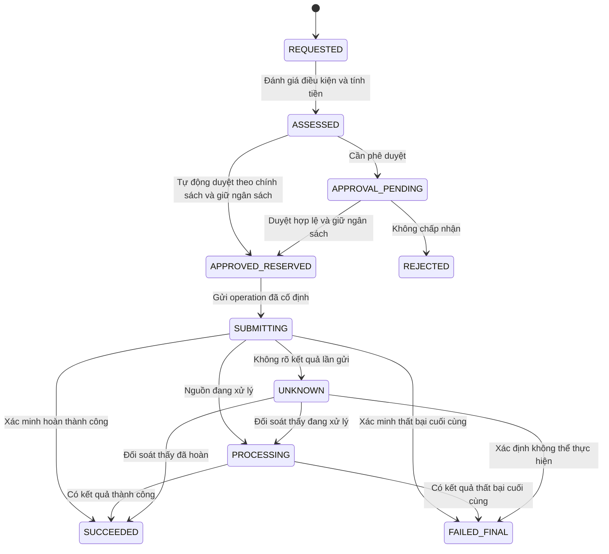

# Partial refund policy: hoàn tiền một phần theo quyền lợi và số tiền thực thu

## 1. Hoàn tiền một phần là một chính sách, không chỉ là một số tiền

**Partial refund** là hoàn lại một phần tiền của giao dịch đã được thu, trong khi phần còn lại vẫn gắn với hàng hóa, dịch vụ hoặc nghĩa vụ được giữ nguyên. Chính sách hoàn một phần xác định ai được yêu cầu, trường hợp nào được hoàn, thành phần nào được hoàn và tổng các lần hoàn được giới hạn ra sao.

Trong chương Refund Rules, đây là một điểm quan trọng của bảo mật logic nghiệp vụ. Một endpoint nhận `orderId` và `amount` rồi gọi nhà cung cấp thanh toán có thể bị lạm dụng để hoàn vượt tiền đã thu, hoàn cùng một mặt hàng nhiều lần, bỏ qua phê duyệt hoặc biến tiền khuyến mãi thành tiền mặt.

Ví dụ, đơn có ba sản phẩm nhưng khách chỉ trả lại một sản phẩm. Số tiền hoàn không nhất thiết bằng giá niêm yết hiện tại của sản phẩm đó: đơn gốc có thể dùng coupon, có thuế, phí giao hàng và nhiều phương tiện thanh toán. Ngoài ra, một khoản hoàn khác có thể đang xử lý mà chưa có kết quả cuối.

Mục tiêu bài học là thiết kế chính sách hoàn một phần có business invariants rõ ràng, liên kết với state machine, quyền theo đối tượng, transaction, idempotency và kiểm thử các tình huống tấn công logic.

### Phân biệt các nghiệp vụ liên quan

| Nghiệp vụ | Ý nghĩa | Không nên suy diễn thành |
|---|---|---|
| Return request | Yêu cầu trả hàng hoặc xử lý sản phẩm | Tiền đã được hoàn |
| Refund assessment | Đánh giá điều kiện và số tiền có thể hoàn | Nhà cung cấp đã chấp nhận trả tiền |
| Refund approval | Người hoặc chính sách có quyền cho phép hoàn | Giao dịch hoàn đã thành công |
| Refund operation | Thao tác hoàn một phần tiền từ giao dịch nguồn | Một khoản thanh toán mới đến người nhận tùy ý |
| Credit hoặc compensation | Tín dụng, ưu đãi hoặc khoản bồi hoàn theo chính sách riêng | Luôn là refund của tiền đã thu |

Không phải mọi khoản hoàn đều đòi hỏi khách trả hàng, chẳng hạn điều chỉnh dịch vụ hoặc chênh lệch được chấp nhận theo chính sách. Nhưng việc miễn trả hàng phải là quyết định nghiệp vụ có căn cứ, không phải một cờ `returnNotRequired` mà client tự gửi để được bỏ qua điều kiện.

## 2. Những bất biến cần giữ ở nhiều phạm vi

### 2.1. Phạm vi đối tượng và điều kiện quyền lợi

- Refund thuộc đúng tenant, order và giao dịch nguồn mà người gọi có quyền thao tác.
- Mặt hàng, số lượng và lý do được đánh giá từ dữ liệu server; quyền yêu cầu không đồng nghĩa quyền phê duyệt hoặc thực hiện hoàn.
- Một phần quyền lợi không được dùng lại qua nhiều hồ sơ để nhận hoàn trùng.
- Điều kiện trả hàng, nghiệm thu, hủy dịch vụ hoặc ngoại lệ được kiểm tra theo loại yêu cầu và version chính sách áp dụng.
- Số tiền, phương thức nhận và phạm vi được duyệt phải khớp quyết định thực hiện; thay đổi nội dung cần đánh giá lại quyền và phê duyệt.

### 2.2. Phạm vi tiền và giao dịch nguồn

Trong mô hình đơn giản, một capture thành công, một tiền tệ và không có khoản điều chỉnh khác:

```text
C = tiền đã capture được xác minh
R = tổng tiền refund đã thành công
P = tổng tiền đang được giữ cho refund chưa có kết quả cuối

remainingCapacity = C − R − P

Điều kiện cấp khoản hoàn mới A:
    A > 0
    A <= remainingCapacity
```

Không chỉ tính `C − R`. Các khoản đã được chấp nhận để xử lý hoặc chưa rõ kết quả cũng đang chiếm khả năng hoàn tiền, vì chúng có thể đã hoặc sẽ làm tiền rời giao dịch nguồn.

Đây là điều kiện cấp mới của hệ thống, không phải lý do từ chối lưu sự thật tài chính ngoài hệ thống. Nếu một khoản hoàn từ cổng quản trị nhà cung cấp hoặc một điều chỉnh khác làm số liệu thực tế không còn khớp, phải lưu giao dịch, chặn cấp thêm khi cần và đối soát.

### 2.3. Phạm vi từng thành phần của đơn

Tổng tiền còn được hoàn không đủ chứng minh một yêu cầu cụ thể hợp lệ. Một đơn còn 500.000 VND khả năng hoàn cũng không cho phép hoàn lần thứ hai cho cùng sản phẩm đã được xử lý xong.

Cần kiểm soát đồng thời:

- Ngân sách tiền theo capture hoặc nguồn thanh toán.
- Quyền lợi theo dòng hàng, đơn vị hoặc phần dịch vụ được hoàn.
- Phần thuế, phí và vận chuyển đã được hoàn hoặc đang giữ.
- Các giới hạn và phê duyệt tích lũy theo hồ sơ, order hoặc phạm vi chính sách.

Các phép cộng/trừ phải dùng biểu diễn tiền chính xác, cùng tiền tệ và đơn vị; không dùng `double` để quyết định số tiền hoàn. Cần giới hạn miền giá trị và phát hiện tràn số trong tính toán.

## 3. Nguồn tính tiền: giao dịch gốc và chính sách có version

Một refund quote đáng tin cần dựa vào các dữ liệu có thẩm quyền:

| Nguồn dữ liệu | Nội dung sử dụng | Rủi ro nếu lấy sai nguồn |
|---|---|---|
| Snapshot giá đã chấp nhận | Đơn giá, số lượng, giảm giá, thuế, phí và tiền tệ | Hoàn theo giá catalog mới thay vì khoản đã mua |
| Capture đã xác minh | Số tiền thực thu và giao dịch nguồn có thể hoàn | Hoàn cả phần chỉ mới authorize hoặc chưa thu được |
| Allocation gốc | Phân bổ coupon, thuế và tiền thanh toán theo phần quyền lợi | Hoàn vượt phần thực trả hoặc biến ưu đãi thành tiền |
| Return/service case | Phần hàng hoặc dịch vụ đủ điều kiện và căn cứ xác minh | Dùng lại cùng một lần trả hàng cho nhiều refund |
| Refund ledger/reservations | Khoản đã hoàn, đang giữ và chưa rõ kết quả | Cấp chồng ngân sách cho các yêu cầu đồng thời |
| Policy version và quyết định phê duyệt | Quy tắc tính, thành phần được hoàn, quyền xử lý | Thay chính sách hoặc số tiền sau khi đã được duyệt |

Chính sách cần xác định version nào áp dụng: điều kiện gắn với giao dịch gốc, quy tắc xử lý được phê duyệt hiện hành hoặc một ngoại lệ có căn cứ. Không tự chạy bản mới nhất của bộ quy tắc rồi coi đó đương nhiên là quyền lợi của giao dịch cũ.

Lưu refund quote hoặc calculation snapshot gồm phần được yêu cầu, các thành phần tính toán, khoản khấu trừ hợp lệ, tổng được hoàn, version đầu vào và chính sách. Khi thực hiện, kiểm tra quote vẫn khớp; nếu quyền lợi hoặc khả năng hoàn đã thay đổi thì đánh giá lại thay vì dùng một con số cũ tùy ý.

## 4. Ví dụ tính hoàn một sản phẩm từ đơn có giảm giá và thuế

Giả sử một đơn dùng VND có ba đơn vị của cùng sản phẩm. Giá chưa gồm thuế; mức thuế 8% dưới đây chỉ là dữ liệu giả định để minh họa phép tính. Chính sách ví dụ cho hoàn phần hàng và phần thuế tương ứng, còn phí giao hàng không hoàn trong trường hợp đang xét.

| Thành phần của đơn gốc | Số tiền |
|---|---:|
| Ba sản phẩm, mỗi sản phẩm 100.000 VND | 300.000 VND |
| Giảm giá đã phân bổ cho dòng hàng | 30.000 VND |
| Giá sau giảm | 270.000 VND |
| Thuế minh họa 8% trên giá sau giảm | 21.600 VND |
| Phí giao hàng | 15.000 VND |
| Tổng đã thu | 306.600 VND |

Allocation gốc cho mỗi đơn vị trong ví dụ:

```text
Giá trước giảm:       100.000
Giảm giá phân bổ:      10.000
Giá thực trả của hàng: 90.000
Thuế phân bổ:           7.200
Phần có thể hoàn:      97.200 VND
```

Khách trả một đơn vị đủ điều kiện, nên khoản hoàn được tính là 97.200 VND. Hoàn 108.000 VND theo giá trước giảm cộng thuế sẽ trả lại nhiều hơn phần thực trả của đơn vị đó.

Sau lần hoàn thứ nhất thành công, phần tiền còn lại trong giao dịch là 209.400 VND, gồm hai đơn vị đã mua và phí giao hàng. Nếu hai đơn vị còn lại sau đó cũng được hoàn theo cùng chính sách, tổng tiền hàng và thuế được hoàn là 291.600 VND; 15.000 VND phí giao hàng vẫn được giữ lại trong ví dụ này.

Không suy ra rằng mọi chính sách đều không hoàn vận chuyển. Điểm cần giữ là kết quả phải giải thích được từ thành phần gốc và điều kiện áp dụng, thay vì trừ hoặc cộng phí theo một mặc định không được xác định.

## 5. Phân bổ giảm giá, thuế, vận chuyển và các khoản khấu trừ

### 5.1. Giảm giá phải theo phần thực trả

Coupon áp dụng cấp order cần được phân bổ xuống các phần quyền lợi có thể hoàn theo quy tắc xác định. Nếu không lưu hoặc tái tạo được allocation đáng tin, người dùng có thể chọn hoàn các món có lợi nhất để nhận về nhiều hơn phần tiền đã chi cho chúng.

Ví dụ riêng, không có thuế và phí: ba đơn vị cùng giá 100.000 VND được giảm tổng 10.000 VND. Có thể phân bổ khoản giảm thành 3.334, 3.333 và 3.333 VND theo một quy tắc cố định. Khi đó phần thực trả tương ứng là 96.666, 96.667 và 96.667 VND, tổng đúng 290.000 VND.

Nếu mọi lần hoàn đều tự làm tròn phần thực trả thành 96.667 VND, ba lần sẽ hoàn dư 1 VND. Cần lưu allocation theo đơn vị hoặc cơ chế phần dư ổn định, cùng cách chọn phần đã dùng, để nhiều lần hoàn vẫn khớp tổng gốc.

Không mặc định coupon luôn được trả lại thành tiền. Một mã giảm giá không phải nguồn tiền đã thu; việc cấp lại coupon hoặc điểm là nghiệp vụ riêng và cũng cần chống lặp.

### 5.2. Điều kiện ưu đãi sau hoàn cần được định nghĩa trước

Một chương trình có thể đặt điều kiện theo tổng giỏ hoặc tổ hợp sản phẩm. Nếu hoàn một phần làm thay đổi điều kiện ưu đãi, hệ thống phải áp dụng chính sách đã được xác định cho giao dịch, hiển thị rõ phép tính và giữ căn cứ version.

Không tự tính lại phần hàng còn giữ theo giá catalog hiện tại để lấy phần chênh rồi trừ vào refund. Nếu có cơ chế điều chỉnh ưu đãi, nó phải là một thành phần tính có quy tắc rõ, không bị dùng để thu phí tùy ý hoặc cho phép client chọn cách phân bổ có lợi sau khi mua.

### 5.3. Thuế không được tính lại một cách tùy tiện

Tính phần thuế được hoàn từ dữ liệu và quy tắc được áp dụng cho giao dịch, theo cấp tính phù hợp như đơn vị, dòng hoặc chứng từ. Giá đã gồm thuế và giá chưa gồm thuế cần cách phân rã khác nhau.

Không nhân đơn giá hiện tại với một thuế suất mới rồi coi đó là thuế của hàng đã mua. Tổng phần thuế được hoàn qua nhiều lần cũng cần khớp phần đủ điều kiện của giao dịch gốc, bao gồm xử lý phần dư làm tròn.

### 5.4. Phí giao hàng và phí khác có ngân sách riêng

Chính sách có thể phân biệt trả một phần vì khách đổi ý, thiếu hàng, lỗi giao nhận hoặc dịch vụ không được thực hiện. Một số thành phần phí có thể chỉ được hoàn trong những điều kiện nhất định.

Nếu phí vận chuyển chỉ được hoàn một lần khi đạt điều kiện tổng thể, cần một claim hoặc allocation riêng cho khoản phí đó. Không để mỗi yêu cầu hoàn từng sản phẩm đều lấy lại toàn bộ phí giao hàng.

Phí mà nhà cung cấp thanh toán thu của người bán không tự trở thành khoản được phép trừ của khách. Nếu nghiệp vụ có khoản khấu trừ hoặc phí xử lý áp dụng, phải có căn cứ chính sách, quyền thực hiện và phép tính rõ ràng. Khoản cần thu thêm hoặc bồi hoàn vượt tiền gốc phải có loại nghiệp vụ riêng, không biểu diễn bằng refund âm hoặc vượt giới hạn nguồn.

## 6. Giữ ngân sách cho khoản đang hoàn và kết quả chưa rõ

Giả sử một capture đã thu 1.000.000 VND:

```text
Đã hoàn thành công R:        300.000
Đang giữ để xử lý P:         200.000
Khả năng còn cấp mới:        500.000 VND
```

Nếu hai request đồng thời đều đọc 500.000 VND rồi mỗi request xin 400.000 VND, kiểm tra từng request bằng `amount <= remaining` ngoài transaction sẽ cho cả hai qua. Tổng tiền đã hoàn và được giữ sẽ vượt tiền đã thu.

Cần cấp reservation bằng thao tác nguyên tử, chẳng hạn khóa số dư của capture rồi kiểm tra và giữ tiền, hoặc cập nhật có điều kiện theo version và số dư. Quyền lợi theo sản phẩm/đơn vị cũng phải được giữ tương ứng để hai request không chiếm cùng một phần hàng.

Reservation có thể có vòng đời:

```text
HELD → SETTLED: nguồn xác nhận refund thành công
HELD → RELEASED: xác định thao tác không còn có thể hoàn tiền
```

Khi thành công số tiền A, chuyển A từ phần đang giữ sang phần đã hoàn trong cùng transaction local. Không vừa giữ nguyên reservation vừa cộng hoàn thành công làm giảm khả năng hai lần. Khi thất bại cuối cùng được xác minh, giải phóng đúng phần đã giữ bằng thao tác idempotent.

Timeout không đủ để giải phóng reservation. Nhà cung cấp có thể đã hoàn tiền nhưng response chưa về. Hết ngân sách retry hoặc hết thời gian chờ giao diện cũng không chứng minh khoản đó sẽ không được thực hiện.

Nếu cần hủy một khoản chưa gửi, phải bảo đảm worker không còn có thể gửi operation đó sau khi reservation được giải phóng. Nếu đã gửi hoặc chưa rõ có gửi thành công hay không, cần đối soát hoặc hủy theo hợp đồng nguồn trước khi coi ngân sách đã an toàn để dùng lại.

## 7. State machine và phê duyệt gắn với nội dung hoàn



Sơ đồ gộp phê duyệt đủ điều kiện thực hiện và giữ ngân sách vào `APPROVED_RESERVED`. Một hệ thống tách hai trạng thái phải làm rõ rằng được duyệt về mặt quyền không đồng nghĩa vẫn còn đủ ngân sách lúc thực hiện.

Quyết định phê duyệt nên gắn với refund case revision, danh sách quyền lợi, tổng tiền, nguồn tiền và calculation/policy version. Nếu số tiền hoặc nội dung thay đổi sau đó, không tiếp tục dùng chữ ký phê duyệt cũ cho nội dung mới.

Với quy tắc người đề xuất không tự duyệt, cần kiểm tra danh tính thực tế và quyền đại diện, không chỉ so hai trường `requestedBy`/`approvedBy` do request tự khai. Với ngưỡng phê duyệt, xét phạm vi tích lũy phù hợp để không thể chia một khoản lớn thành nhiều khoản nhỏ nhằm đi vòng.

`SUCCEEDED` có nghĩa nguồn đã xác nhận hiệu ứng hoàn theo hợp đồng, không nhất thiết khách đã nhìn thấy tiền trên mọi giao diện ngân hàng ngay lập tức. Approval, gửi yêu cầu và thành công cần có tên trạng thái và thông báo riêng.

## 8. Ví dụ Java: đánh giá và giữ khoản hoàn trong transaction

Đoạn mã sau mô tả các cổng nghiệp vụ; không phải lớp có thể biên dịch độc lập. Ví dụ dùng một capture, một tiền tệ và database local chứa refund balance, case, allocation, reservation, operation, command và outbox. Không gọi nhà cung cấp thanh toán trong transaction này.

```java
RefundView reserveRefund(RefundCommand command, AuthenticatedActor actor) {
    return transactions.required(() -> {
        var reference = cases.requireScopedReference(
                actor.tenantId(), command.caseId());
        authorization.requireRequestOrExecuteRefund(actor, reference);

        var claim = commands.claimOrRead(
                actor,
                "RESERVE_PARTIAL_REFUND",
                command.idempotencyKey(),
                fingerprints.forRefund(command));

        if (claim.isCompleted()) {
            return views.currentAuthorizedRefund(claim.refundId(), actor);
        }

        var balance = refundBalances.lock(
                actor.tenantId(), reference.captureId());
        var refundCase = cases.lock(reference.caseId());
        var entitlements = allocations.lockOrdered(refundCase.entitlementIds());

        rules.requireCurrentCaseRevision(refundCase, command.caseVersion());
        rules.requireVerifiedEligibility(refundCase);
        authorization.requireCurrentRefundAuthority(actor, refundCase);

        var plan = calculator.fromOriginalTransaction(
                refundCase,
                snapshots.requireOriginal(refundCase.orderId()),
                entitlements,
                policies.resolveFor(refundCase));

        approvals.requireValidForExactPlan(
                actor, refundCase, plan, cumulativeExposure.forCase(refundCase));
        limits.requireCapacity(balance, entitlements, plan);

        var reservation = reservations.create(plan, balance);
        refundBalances.reserveIfVersionMatches(balance, reservation);
        allocations.reserve(entitlements, reservation);
        reservations.insert(reservation);

        var refund = refunds.createWithImmutablePlan(refundCase, plan, reservation);
        var operation = operations.createRefundWithStableKey(
                refund, balance.originalProviderTransaction());

        refunds.insert(refund);
        operations.insert(operation);
        outbox.appendRefundRequested(operation);

        commands.complete(claim, refund.id());
        return views.forReservedRefund(refund);
    });
}
```

Những điều kiện bắt buộc khi triển khai ví dụ:

- Mọi đường cấp hoàn, gồm job và công cụ quản trị, phải dùng cùng cơ chế bảo vệ ngân sách và allocation.
- Khóa phải có thứ tự nhất quán; việc dùng nhiều capture hoặc nhiều order cần mở rộng giao thức khóa để tránh deadlock và kiểm tra thiếu phạm vi.
- Quan hệ tenant, order, case và capture phải được xác minh; tham chiếu dùng để tìm dữ liệu không tự là bằng chứng quyền truy cập.
- `reserveIfVersionMatches` kiểm tra số dòng cập nhật đúng một và gây rollback khi xung đột hoặc không đủ khả năng hoàn. Không bỏ qua kết quả cập nhật.
- Kiểm tra phê duyệt tích lũy cũng cần bảo vệ trước cạnh tranh; hai request không được cùng vượt ngưỡng chỉ vì đọc cùng tổng cũ.
- Allocation và balance được giữ cùng transaction, không chỉ khóa một bên rồi để bên còn lại có thể bị chiếm trùng.
- `claimOrRead` dùng unique và kiểm tra fingerprint. Cùng khóa khác ý định bị từ chối; hai khóa khác nhau vẫn chịu giới hạn ngân sách và quyền lợi.
- Plan, amount, currency, nguồn giao dịch và provider key bất biến sau khi operation được tạo để gửi. Lỗi ở bất kỳ bước ghi local nào phải rollback toàn bộ reservation.

Việc đã giữ ngân sách không cho phép bỏ qua điều kiện thực hiện còn hiệu lực như phong tỏa rủi ro hoặc trạng thái nguồn. Nếu phát sinh điều kiện mới trước gửi, cần trạng thái giữ/chờ/hủy có quy tắc rõ; không sửa số tiền trong operation đã chốt rồi vẫn dùng phê duyệt cũ.

## 9. Gửi refund, retry và xử lý kết quả nguồn

Mỗi operation hoàn có khóa idempotency ổn định tại nhà cung cấp. Retry cùng operation giữ nguyên giao dịch nguồn, số tiền, tiền tệ và khóa; không tạo refund mới chỉ vì timeout.

```text
Commit plan + reservation + operation + outbox
  → worker gửi bằng provider key đã lưu
  → response/webhook/truy vấn được xác minh và đối chiếu
  → áp dụng kết quả theo một luồng chung
```

Khi nguồn xác nhận thành công, trong ranh giới local phù hợp:

1. Deduplicate quan sát và nhận diện hiệu ứng refund nguồn.
2. Kiểm tra provider account, capture, operation, amount và currency.
3. Ghi monetary record hoặc refund ledger theo định danh hiệu ứng nguồn.
4. Chuyển reservation từ giữ sang đã quyết toán và allocation sang đã hoàn, không đếm hai lần.
5. Cập nhật trạng thái refund, history và outbox cho các tác động sau đó.

Response đồng bộ và webhook có thể cùng nói về một refund. Chống lặp theo ID message chưa đủ nếu hai message khác nhau cùng chỉ một hiệu ứng tiền. Cần định danh giao dịch refund trong phạm vi nguồn thích hợp và quy tắc áp dụng idempotent.

Nếu kết quả chưa rõ, tiếp tục giữ reservation và đối soát. Chỉ giải phóng khi có căn cứ rằng operation không còn có thể hoàn, không chỉ vì một lỗi HTTP hoặc số lần thử đã hết. Khoảng bảo đảm idempotency của nguồn cũng cần được xét trước khi gửi lại một operation cũ.

Nhà cung cấp có thể áp dụng giới hạn số lần hoàn, mức tối thiểu, phần dư hoặc khả năng hoàn của một giao dịch theo hợp đồng riêng. Adapter phải kiểm tra điều kiện phù hợp và lưu kết quả cuối thật; không tự thay amount thành phần nguồn có thể chấp nhận mà không có plan/phê duyệt mới.

## 10. Nhiều capture, nhiều phương tiện và tín dụng cửa hàng

### 10.1. Giới hạn theo từng capture

Một order có thể được thu qua nhiều capture. Khả năng hoàn tổng của order không đồng nghĩa một capture bất kỳ đủ để hoàn toàn bộ yêu cầu.

Ví dụ, capture C1 thu 400.000 VND và C2 thu 600.000 VND. Nếu C1 đã hoàn hết 400.000 VND, một yêu cầu mới 200.000 VND không thể tiếp tục gắn vào C1 dù order tổng còn tiền. Plan phải chọn và giữ phần tương ứng trên nguồn hợp lệ.

Nếu một refund nghiệp vụ chia thành nhiều operation nguồn, cần theo dõi trạng thái từng phần. Một phần thành công và phần khác chưa rõ không được báo toàn bộ đã hoàn, cũng không giải phóng tất cả reservation như thể chưa có phần nào thực hiện.

### 10.2. Không đổi nguồn tiền thành tiền mặt tùy ý

Một đơn dùng thẻ và gift card hoặc ví tín dụng cần chính sách phân bổ nguồn khi hoàn. Không tự hoàn toàn bộ giá trị hàng về thẻ nếu một phần giao dịch vốn được trả bằng tín dụng không rút được thành tiền.

Phải phân biệt:

- Giảm giá/coupon: phần giá chưa từng được thu.
- Số dư ví hoặc gift card đã dùng: nguồn giá trị cần hoàn theo chính sách riêng.
- Tiền thu qua thẻ/chuyển khoản: nguồn tiền có giao dịch gốc để đối chiếu.
- Điểm hoặc tín dụng bồi hoàn cấp thêm: một hiệu ứng nghiệp vụ khác với hoàn tiền gốc.

Tổng plan cần khớp các phần theo nguồn và không vượt quyền lợi hoặc ngân sách từng nguồn. Việc hoàn về phương thức gốc nên theo chính sách và khả năng tích hợp; nếu phải đổi đích nhận thì đó là luồng ngoại lệ có xác minh người hưởng, quyền và audit riêng, không phải một `bankAccount` tùy ý trong request refund.

### 10.3. Không cộng các tiền tệ khác nhau như số nguyên cùng đơn vị

Nếu giao dịch có nhiều tiền tệ hoặc chuyển đổi, lưu rõ nghĩa vụ và giao dịch nguồn theo từng tiền tệ, cùng quy tắc/tỷ giá được áp dụng khi cần. Không tính khả năng hoàn bằng cách cộng trực tiếp VND với USD, hoặc lấy tỷ giá hiện tại để làm như đó là số tiền gốc đã thu.

## 11. Các đường lạm dụng thường gặp

| Tình huống | Lỗi nghiệp vụ | Điểm chặn |
|---|---|---|
| Sửa `amount` trong request | Client tự quyết định số tiền được hoàn | Server tính plan hoặc xác minh khoản điều chỉnh theo chính sách và quyền riêng |
| Đổi orderId/captureId | Hoàn từ tiền của người hoặc tenant khác | Quyền theo đối tượng và kiểm tra quan hệ order–capture–case |
| Hoàn cùng đơn vị qua nhiều hồ sơ | Không giữ và tiêu thụ quyền lợi theo phần hàng | Claim/allocation có định danh và kiểm soát cạnh tranh |
| Chỉ trừ refund đã thành công | Bỏ sót khoản đang xử lý hoặc chưa rõ | Reservation được tính vào khả năng còn cấp mới |
| Chia nhỏ để né duyệt | Ngưỡng chỉ xét từng request | Đánh giá tích lũy theo phạm vi chính sách, gồm phần đang giữ |
| Sửa plan sau phê duyệt | Phê duyệt không ràng buộc nội dung thực thi | Revision/fingerprint của plan và duyệt lại khi thay đổi |
| Hoàn theo giá niêm yết | Không trừ coupon hoặc dùng giá mới | Snapshot và allocation giao dịch gốc |
| Hoàn phí giao hàng nhiều lần | Không coi phí là một phần quyền lợi riêng | Ngân sách/claim cho từng thành phần phí |
| Chuyển sang tài khoản mới | Refund trở thành đường rút tiền tùy ý | Nguồn/đích theo chính sách; ngoại lệ có xác minh và quyền riêng |
| Timeout rồi giải phóng | Refund cũ vẫn có thể thành công trong khi khoản mới đã được cấp | Giữ reservation đến khi có kết quả đủ căn cứ |
| Dùng vai trò hỗ trợ để tự hoàn | Quyền xem hoặc tạo case bị hiểu là quyền thực hiện | Tách quyền yêu cầu, duyệt, gửi và xử lý ngoại lệ |

Không nên chặn mọi request có số tiền do người dùng đề xuất nếu sản phẩm có nghiệp vụ điều chỉnh số tiền thủ công. Nhưng số tiền đề xuất chỉ là đầu vào: server vẫn xác minh lý do, ngân sách, quyền hạn, người hưởng và phê duyệt phù hợp. Một trường hợp hỗ trợ hợp lệ không được trở thành đường đi vòng cho tất cả refund.

## 12. Tranh chấp, điều chỉnh ngoài hệ thống và sửa sai

Một capture có thể bị refund từ công cụ của nhà cung cấp, bị đảo giao dịch hoặc đi vào tranh chấp. Khả năng hoàn local phải được đối soát với các hiệu ứng đó; không giả định mọi thay đổi tiền đều xuất phát từ service nội bộ.

Khi mở rộng công thức khả năng hoàn, phải định nghĩa các khoản giảm và phong tỏa không chồng lặp. Không trừ vừa khoản tranh chấp đang giữ vừa khoản giảm cuối cùng của chính khoản đó như hai dòng độc lập. Ngược lại, cũng không bỏ qua một hạn chế nguồn chỉ vì order vẫn đang `PAID`.

Nếu sự kiện bên ngoài làm số dư khả dụng âm hoặc không nhất quán với reservation hiện có, giữ sự thật nguồn, ngừng cấp thêm theo chính sách và xử lý xung đột. Không sửa số tiền capture gốc hoặc xóa refund thành công để ép bảng số dư quay về một bất biến giả.

Refund đã thành công không được “hủy” bằng cách đổi status local thành `CANCELLED` rồi hoàn lại lần nữa. Nếu cần xử lý một khoản hoàn nhầm, phải dùng nghiệp vụ có căn cứ và quyền riêng; không giả định có thể thu lại từ khách chỉ bằng đảo một cờ trong database.

Thay đổi chính sách hoặc sửa lỗi tính toán cũng cần có lịch sử. Calculation snapshot cũ phải tiếp tục giải thích được vì sao đã hoàn con số đó; khoản điều chỉnh sau này có tham chiếu tới quyết định trước và được xét trong ngân sách còn lại hoặc loại bồi hoàn riêng phù hợp.

## 13. Kiểm thử theo quyền lợi, tiền và cạnh tranh

| Tình huống | Thiết lập và hành động | Kết quả cần chứng minh |
|---|---|---|
| Luồng chuẩn | Dùng đơn ví dụ, hoàn một sản phẩm đủ điều kiện | Plan 97.200 VND, phân rã khớp và reservation đúng nguồn |
| Catalog thay đổi | Đổi giá sản phẩm sau khi mua | Refund vẫn dựa vào snapshot/policy được áp dụng, không lấy giá catalog mới |
| Giảm giá và thuế | Hoàn lần lượt các đơn vị có allocation | Tổng phần hàng/thuế không vượt phần đủ điều kiện gốc |
| Phần dư làm tròn | Hoàn ba đơn vị của ví dụ coupon 10.000 VND | Tổng 290.000 VND, không tăng thêm 1 VND qua nhiều lần |
| Phí vận chuyển | Gửi nhiều case cho cùng order có phí chỉ được hoàn một lần | Không hoàn lặp toàn bộ phí ở từng case |
| Request giả | Sửa amount, approvedBy, nguồn giao dịch hoặc cờ miễn trả hàng | Dữ liệu client không quyết định quyền và kết quả chuẩn |
| Quyền theo đối tượng | Đổi tenant/order/capture hoặc dùng tài khoản chỉ có quyền xem | Không tạo, thực hiện hay đọc refund ngoài phạm vi |
| Phê duyệt cũ | Duyệt plan rồi đổi số lượng hoặc tiền | Không gửi operation mới bằng phê duyệt của nội dung cũ |
| Chia nhỏ khoản hoàn | Nhiều request riêng lẻ dưới ngưỡng cùng order/case | Kiểm tra tích lũy và cạnh tranh không cho đi vòng ngưỡng |
| Hoàn trùng sản phẩm | Hai case cùng chiếm một unit allocation | Chỉ một quyền lợi được giữ/tiêu thụ, dù tổng tiền order còn nhiều |
| Ngân sách cạnh tranh | Hai request 400.000 VND tranh phần còn 500.000 VND | Không cấp thành công cả hai; không có reservation vượt khả năng |
| Khoản đang chờ | Có 200.000 VND đang giữ rồi xin thêm | Khả năng mới đã trừ phần đang giữ, không chỉ phần thành công |
| Timeout sau khi nguồn hoàn | Nguồn thực hiện xong nhưng response mất | Giữ reservation, retry/đối soát cùng operation, không cấp chồng |
| Thất bại cuối cùng | Xác minh operation không còn có thể hoàn | Giải phóng đúng tiền và quyền lợi một lần theo chính sách |
| Hủy cạnh tranh worker | Cố giải phóng reservation khi worker có thể gửi | Giao thức ngăn gửi sau giải phóng hoặc giữ chờ đối soát khi chưa an toàn |
| Message lặp | Response, webhook và retry cùng báo một refund | Một hiệu ứng ledger, reservation được quyết toán một lần |
| Khác client key | Gửi hai khóa cho cùng quyền lợi hoặc khả năng | Bất biến allocation/balance vẫn ngăn hoàn trùng |
| Nhiều nguồn | Một phần đã hoàn trên C1, nguồn khác còn tiền | Không hoàn vượt từng nguồn; tổng plan khớp các operation |
| Thực hiện một phần | Refund chia hai nguồn, một nguồn thành công, nguồn kia timeout | Trạng thái và reservation từng phần đúng, không báo toàn bộ thành công/thất bại giả |
| Gift card/coupon | Đơn kết hợp tiền và ưu đãi | Không biến phần chưa thu bằng tiền thành khoản hoàn tiền mặt tùy ý |
| Lỗi transaction | Gây lỗi khi ghi operation/outbox sau bước giữ balance | Balance, allocation, reservation và command rollback nhất quán |
| Hoàn ngoài hệ thống | Nhập quan sát refund từ công cụ nhà cung cấp | Lưu dòng tiền, cập nhật/đối soát khả năng và ngăn cấp thêm sai |

Kiểm thử phải quan sát plan, allocation, balance/reservation, các operation nguồn và hiệu ứng tiền, không chỉ mã HTTP. Với race condition, dùng điểm đồng bộ để các request cùng đi vào vùng kiểm tra/cấp ngân sách; chạy tuần tự không kiểm tra được lỗi đọc cùng số dư cũ.

Với timeout, nhà cung cấp giả lập cần thật sự tạo refund rồi mới làm mất response. Với rollback, gây lỗi đúng sau bước giữ tiền hoặc giữ quyền lợi để chứng minh không có dữ liệu bị kẹt ngoài transaction đã thiết kế.

## 14. Audit và cách giải thích một khoản hoàn một phần

Mỗi refund nên liên kết được order, capture và các nguồn tiền, case/return evidence, phần quyền lợi được hoàn, calculation snapshot, policy version, người yêu cầu, người duyệt, reservation và operation gửi đi. Không đưa bí mật thanh toán hoặc dữ liệu cá nhân dư thừa vào audit.

Theo dõi các dấu hiệu như nhiều refund nhỏ sát ngưỡng duyệt, cùng sản phẩm xuất hiện trong nhiều case, reservation chưa rõ kéo dài, phí bị hoàn nhiều lần, điều chỉnh thủ công tăng bất thường và chênh lệch giữa ledger nội bộ với nhà cung cấp.

Khi xem một khoản hoàn, cần trả lời được: khách có quyền lợi nào, số tiền được suy ra từ giao dịch gốc ra sao, phần đó đã từng được hoàn hoặc giữ chưa, ai cho phép và tiền thực sự đi qua nguồn nào. Khi các câu trả lời gắn với dữ liệu có thẩm quyền và thao tác nguyên tử, partial refund mới không trở thành lối tắt vượt qua quy tắc nghiệp vụ.
