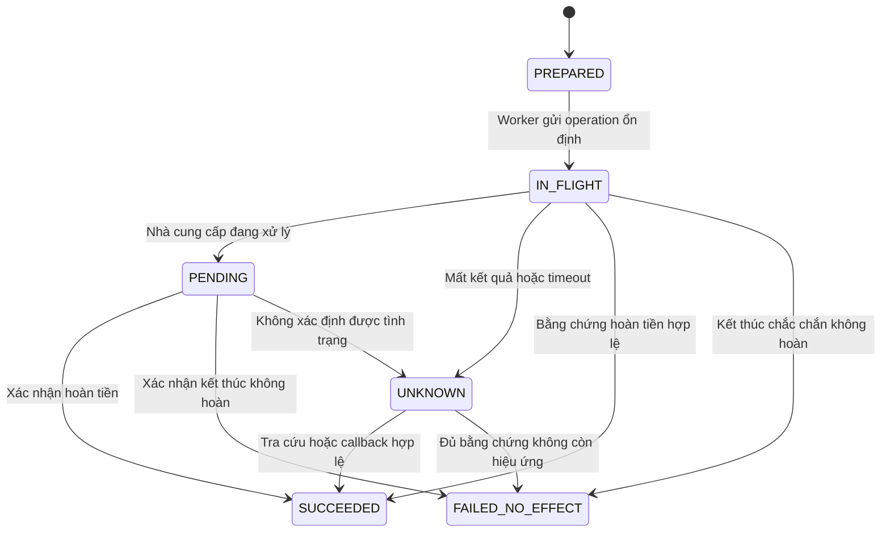

# Refund idempotency — Hoàn tiền an toàn khi yêu cầu bị gửi lại

Một yêu cầu hoàn tiền có thể đã được nhà cung cấp thực hiện nhưng response chưa về tới hệ thống. Nếu backend coi timeout là thất bại rồi tạo một refund mới, khách hàng có thể nhận tiền hai lần. Tình huống tương tự xuất hiện khi người dùng bấm lại, nhân viên hỗ trợ thao tác cùng lúc với tác vụ tự động, worker xử lý lại message hoặc webhook được phát lại.

Trong chương **Refund Rules**, idempotency của hoàn tiền là khả năng nhận diện cùng một ý định hoàn tiền và giữ cho các lần xử lý lại không tạo thêm hiệu ứng tài chính. Đây là yêu cầu về logic nghiệp vụ, không chỉ là việc thêm một header vào HTTP request.

## 1. Idempotency bảo vệ điều gì?

### 1.1. Một ý định, nhiều lần truyền tải

Giả sử hồ sơ trả hàng R được duyệt hoàn 300.000 VND. Một người gọi gửi lại cùng yêu cầu năm lần vì kết nối kém. Kết quả mong muốn là một ý định hoàn 300.000 VND, không phải năm khoản hoàn.

Cần phân biệt:

- **Lần gọi API**: một lần gửi request, có thể thất bại hoặc mất response.
- **Ý định hoàn tiền**: quyết định hoàn một khoản theo căn cứ nghiệp vụ cụ thể.
- **Operation hoàn tiền**: một thao tác tài chính để thực hiện toàn bộ hoặc một phần ý định.
- **Delivery hoặc sự kiện**: một lần truyền thông tin về operation.
- **Bản ghi tài chính**: khoản hoàn đã thực sự được xác nhận và ghi nhận.

Một ý định có thể cần nhiều operation, chẳng hạn hoàn về hai khoản capture gốc. Retry phải tiếp tục đúng ý định và operation còn thiếu, không khởi tạo lại tất cả.

### 1.2. Không cấm mọi khoản hoàn giống nhau

Hai khoản hoàn cùng số tiền trên một giao dịch chưa chắc là trùng. Khách có thể trả hai sản phẩm khác nhau, mỗi sản phẩm được hoàn 100.000 VND.

Vì vậy, khóa chống trùng không nên chỉ là:

```text
captureId + amount
```

Cần nhận diện căn cứ nghiệp vụ của từng khoản. Ngược lại, đổi idempotency key không được làm một căn cứ hoàn đã được thực hiện trở thành một quyền nhận tiền mới.

### 1.3. Phạm vi của ví dụ

Bài dùng mô hình:

- Hoàn về giao dịch thanh toán gốc theo phân bổ được máy chủ phê duyệt.
- Số tiền lưu theo đơn vị nhỏ nhất cùng tiền tệ đã xác định.
- Mỗi quyền hoàn được phê duyệt có một định danh nghiệp vụ bền vững.
- Những thao tác tài chính chưa rõ kết quả vẫn giữ ngân sách liên quan.
- Transaction local không bao phủ trực tiếp nhà cung cấp bên ngoài.

Các quy tắc về tranh chấp, thời hạn hoàn hoặc chuyển sang phương thức khác phụ thuộc nghiệp vụ và tích hợp. Chúng cần được định nghĩa riêng, không được dùng retry như cách bỏ qua điều kiện.

## 2. Một timeline tạo ra hoàn tiền trùng

Giả sử khách đã trả 1.000.000 VND và được duyệt hoàn 300.000 VND:

```text
T1  Backend tạo refund operation O1.
T2  Backend gửi yêu cầu tới nhà cung cấp.
T3  Nhà cung cấp đã hoàn 300.000 VND.
T4  Kết nối đứt trước khi backend nhận response.
T5  Backend đánh dấu O1 thất bại và trả lỗi.
T6  Client gửi lại với request mới.
T7  Backend tạo O2, tiếp tục hoàn 300.000 VND.
T8  Callback của O1 đến; tổng thực tế đã hoàn là 600.000 VND.
```

Một phép kiểm tra “tổng đã hoàn trong database chưa vượt mức” ở T6 vẫn có thể cho qua vì O1 chưa được ghi nhận thành công. Nếu phần 300.000 VND của O1 được giữ như ngân sách chưa rõ kết quả, hệ thống sẽ không cấp lại quyền đó cho O2.

Hai bảo vệ cần phối hợp:

1. Cùng ý định được ánh xạ về đối tượng đã tồn tại.
2. Phần ngân sách chưa được giải quyết không bị xem như còn trống.

Chỉ có một trong hai vẫn chưa đủ cho mọi tình huống.

## 3. Các định danh cần tách biệt

| Định danh | Mục đích | Ví dụ phạm vi |
| --- | --- | --- |
| API idempotency key | Nhận diện người gọi đang gửi lại cùng request có ý nghĩa | Tenant, không gian người gọi, loại lệnh |
| Business refund key | Nhận diện một quyền hoàn được phê duyệt | Hồ sơ trả hàng và quyền hoàn cụ thể |
| Refund intent ID | Theo dõi một ý định hoàn trong ứng dụng | Định danh nội bộ ổn định |
| Refund operation ID | Nhận diện một thao tác về một nguồn tiền gốc | Một allocation của intent |
| Provider idempotency key | Giúp nhà cung cấp nhận diện lần gửi lại cùng operation | Theo phạm vi hợp đồng của nhà cung cấp |
| Provider refund reference | Nhận diện khoản hoàn bên ngoài | Provider, account, môi trường |
| Event ID | Nhận diện thông báo được nhận | Phạm vi sự kiện của tích hợp |
| Ledger/journal identity | Ngăn ghi nhận một hiệu ứng tài chính nhiều lần | Operation và loại phát sinh |

Không dùng event ID làm định danh của ý định hoàn: một operation có thể sinh nhiều event. Không dùng correlation ID của request làm provider key nếu correlation ID thay đổi ở mỗi lần gửi.

### 3.1. API key không thay thế business key

Một nhân viên và một job tự động có thể dùng hai API key khác nhau nhưng cùng xử lý hồ sơ trả hàng R. Nếu chỉ chống lặp theo key do client chọn, cả hai vẫn có thể tạo refund.

Business refund key phải xuất phát từ quyền hoàn mà hệ thống đã phê duyệt. Ví dụ, một hồ sơ trả hàng có thể có các quyền hoàn riêng theo nhóm hàng hoặc đợt xử lý. Định danh cần đủ cụ thể để cho phép những khoản hợp lệ khác nhau, đồng thời không cho thực hiện lại cùng quyền.

Không mặc định mọi thay đổi revision phê duyệt đều cấp quyền hoàn mới. Nếu sửa phần mô tả của một quyết định cũ mà hệ thống sinh business key mới, người dùng có thể nhận lại cùng khoản tiền.

### 3.2. Provider key gắn với operation, không gắn với lần gửi

Khi tạo operation O1, hệ thống chọn một provider idempotency key phù hợp rồi lưu bất biến. Mọi lần gửi lại O1 đều dùng cùng key và cùng nội dung có ý nghĩa.

Không tạo UUID mới mỗi lần worker gọi mạng. Không tự đổi key sau timeout. Cũng không đổi công thức tạo key theo phiên bản triển khai rồi áp công thức mới cho operation đang chờ.

Nếu operation có nội dung cần thay đổi, phải đi qua quy trình nghiệp vụ xác định đó là sửa ý định chưa gửi, hủy an toàn hay tạo operation mới. Không sửa request dưới cùng key rồi hy vọng nhà cung cấp chọn đúng.

## 4. Nguồn có thẩm quyền và quyền thao tác

Một request tạo ý định có thể chỉ cần:

```http
POST /refund-cases/case_701/refund-intents
Idempotency-Key: refund-request-81
Content-Type: application/json

{
  "expectedApprovalRevision": 4
}
```

Backend lấy số tiền, tiền tệ, giao dịch gốc và cách phân bổ từ quyết định phê duyệt có thẩm quyền. Nếu nghiệp vụ cho người có quyền đề xuất hoàn một phần, số tiền đề xuất vẫn phải nằm trong quyền hoàn và ngân sách còn lại.

| Dữ liệu | Nguồn quyết định |
| --- | --- |
| Actor và tenant | Ngữ cảnh xác thực đã kiểm tra |
| Quyền hoàn, hạn mức và căn cứ | Hồ sơ nghiệp vụ cùng quyết định phê duyệt |
| Capture gốc và merchant account | Liên kết thanh toán nội bộ đã xác lập |
| Tiền tệ và số tiền từng allocation | Chính sách và phân bổ phía máy chủ |
| Điểm đến khoản hoàn | Giao dịch/phương thức gốc hoặc quy trình ngoại lệ được phép |
| Operation ID và provider key | Backend tạo và lưu trước khi gọi ra ngoài |
| Kết quả hoàn | Bằng chứng từ tích hợp hoặc đối soát được xác minh |

Idempotency key không phải token xác thực. Người biết key vẫn phải có quyền xem hoặc yêu cầu thao tác với đối tượng.

Khi trả lại kết quả đã lưu, backend cần kiểm tra quyền hiện tại của người gọi. Không để một endpoint “lấy kết quả theo key” làm lộ thông tin tài chính của người khác.

Không chấp nhận tài khoản nhận tiền mới từ một request retry. Hoàn về tài khoản tùy ý là thay đổi quan trọng về nghiệp vụ và rủi ro; nếu được phép, nó cần quy trình riêng, không được coi như cùng request cũ.

## 5. Bất biến về quyền hoàn và ngân sách

### 5.1. Một quyền hoàn chỉ tạo một ý định tương ứng

Trong mô hình của bài:

```text
Với mỗi businessRefundKey:
  có tối đa một RefundIntent có thẩm quyền thực hiện quyền đó
```

Intent có thể chứa lịch sử thất bại và các bước khôi phục. Không xóa intent thất bại rồi tạo mới để tránh phải giải quyết một operation chưa rõ kết quả.

Nếu nghiệp vụ cho phép nhiều đợt hoàn từ một hồ sơ, từng đợt cần quyền và định danh riêng. Không áp UNIQUE chỉ theo returnCaseId nếu điều đó chặn các đợt hoàn hợp lệ.

### 5.2. Ngân sách trên giao dịch gốc

Với một capture trong mô hình đơn giản:

```text
confirmedRefundedMinor >= 0
reservedRefundMinor >= 0

confirmedRefundedMinor + reservedRefundMinor
<= refundableLimitMinor
```

Trong đó:

- `confirmedRefundedMinor`: tiền hoàn đã được xác nhận.
- `reservedRefundMinor`: tiền dành cho operation chưa được giải quyết dứt điểm.
- `refundableLimitMinor`: mức được hoàn theo dữ liệu capture và chính sách áp dụng.

Giới hạn phải xem trên toàn bộ intent dùng chung capture, không chỉ một API endpoint. Một refund thủ công và một refund tự động vẫn cạnh tranh cùng ngân sách.

Ví dụ:

```text
Giới hạn được hoàn:               1.000.000 VND
Đã hoàn được xác nhận:              200.000 VND
Đang giữ cho operation chưa rõ:     300.000 VND
Còn được cấp cho operation mới:     500.000 VND
```

Không cộng lại 300.000 VND vào số còn trống chỉ vì worker hết lease hoặc client nhận timeout.

### 5.3. Ngân sách nghiệp vụ khác ngân sách giao dịch

Một capture có thể còn 800.000 VND để hoàn, nhưng hồ sơ trả hàng chỉ được duyệt 300.000 VND. Khoản hoàn phải vừa đáp ứng quyền nghiệp vụ vừa đáp ứng phần được hoàn của capture.

Cần bảo vệ cả hai phạm vi khi nhiều yêu cầu đồng thời tranh cùng quyền hoặc cùng giao dịch gốc. Khóa hồ sơ trả hàng không tự bảo vệ capture dùng chung với hồ sơ khác.

Trong hệ thống có tranh chấp hoặc điều chỉnh tài chính khác, cách xác định phần còn được hoàn phải xét các ảnh hưởng tương ứng và tránh trừ lặp cùng một khoản. Công thức đơn giản ở đây không tự thay thế mô hình đó.

### 5.4. Chuyển ngân sách đúng một lần

Khi operation thành công, phần giữ chỗ được chuyển thành tiền đã hoàn trong cùng transaction:

```text
reservedRefundMinor -= operation.amountMinor
confirmedRefundedMinor += operation.amountMinor
```

Điều kiện là kết quả đã được xác minh và khớp operation. Event lặp không được chạy phép chuyển này lần nữa.

Khi có bằng chứng đủ chắc chắn operation kết thúc mà không hoàn tiền, mới giải phóng reservation. Không giải phóng chỉ vì hết số lần retry hoặc không nhận callback.

## 6. Mô hình dữ liệu và ràng buộc

Một mô hình khái niệm:

```text
RefundEntitlement
  id, tenant_id, case_id, approved_revision
  approved_amount_minor, currency, business_refund_key

RefundIntent
  id, tenant_id, business_refund_key
  approved_revision, semantic_fingerprint, state, version

RefundOperation
  id, intent_id, original_capture_id
  provider, provider_account_id, environment
  amount_minor, currency, destination_policy
  provider_idempotency_key, provider_refund_reference
  state, reservation_state, version

CaptureRefundBalance
  capture_id, tenant_id, refundable_limit_minor
  confirmed_refunded_minor, reserved_refund_minor, version

IdempotencyResult
  tenant_id, caller_namespace, command_name, key
  request_fingerprint, response_status, response_body

RefundJournal
  operation_id, entry_kind, amount_minor, currency

Inbox / Outbox
  định danh sự kiện, trạng thái xử lý và dữ liệu truyền tải
```

Ràng buộc quan trọng có thể gồm:

- Duy nhất business refund key trong phạm vi tenant.
- Duy nhất API key theo không gian người gọi và loại lệnh.
- Duy nhất provider refund reference trong phạm vi provider/account/môi trường.
- Duy nhất phát sinh xác nhận hoàn của một operation theo mô hình journal.
- Khóa ngoại bảo vệ quan hệ intent, operation, capture và tenant.

Ví dụ chỉ mục, giả định các bảng và cột không null cần thiết đã được định nghĩa; chỉ mục có điều kiện dưới đây dùng cú pháp PostgreSQL:

```sql
CREATE UNIQUE INDEX uq_refund_business_key
ON refund_intents (tenant_id, business_refund_key);

CREATE UNIQUE INDEX uq_refund_api_key
ON idempotency_results (
    tenant_id, caller_namespace, command_name, idempotency_key
);

CREATE UNIQUE INDEX uq_provider_refund_reference
ON refund_operations (
    provider, provider_account_id, environment, provider_refund_reference
)
WHERE provider_refund_reference IS NOT NULL;

CREATE UNIQUE INDEX uq_refund_journal_effect
ON refund_journal (operation_id, entry_kind);
```

Ràng buộc journal cuối giả định một operation chỉ có một phát sinh cho mỗi loại tương ứng. Nếu mô hình cho phép nhiều phần xác nhận độc lập trong một operation, cần định danh phát sinh đủ cụ thể; không dùng ràng buộc này để làm mất giao dịch hợp lệ.

Chỉ mục duy nhất là lớp bảo vệ khi cạnh tranh, không thay thế việc kiểm tra quyền, fingerprint và trạng thái.

## 7. Tạo ý định và giữ ngân sách trong transaction

### 7.1. Thứ tự xử lý khái niệm

Một luồng tạo intent có thể thực hiện:

```text
1. Xác thực actor, tenant và định dạng request.
2. Chuẩn hóa nội dung có ý nghĩa để tạo request fingerprint.
3. Bắt đầu transaction.
4. Nhận quyền xử lý API key bằng ràng buộc duy nhất.
   - Có kết quả cùng fingerprint: kiểm tra quyền và trả kết quả đã lưu.
   - Cùng key khác fingerprint: từ chối xung đột.
5. Khóa quyền hoàn/hồ sơ liên quan; kiểm tra quyền thao tác.
6. Tìm intent theo business refund key.
   - Đã có cùng ý nghĩa: liên kết request hiện tại tới intent đó.
   - Có nội dung xung đột: không tạo thêm, trả lỗi hoặc yêu cầu đối soát.
7. Với intent mới: kiểm tra approval revision và trạng thái còn cho thực hiện.
8. Khóa hoặc cập nhật có điều kiện các ngân sách capture theo thứ tự ổn định.
9. Tạo intent, các operation, provider key và reservation.
10. Ghi outbox cùng kết quả API.
11. Commit; trả định danh intent.
```

Bước nhận quyền xử lý key không phải SELECT rồi tin rằng không có request khác. Nó phải chịu ràng buộc duy nhất và có cách xử lý transaction đang giữ cùng key.

Nếu không thể bảo đảm quyền trên đối tượng, không trả thông tin từ kết quả cũ. Việc kiểm tra key không được tạo đường bỏ qua kiểm tra quyền.

Nếu cùng key được dùng cho hồ sơ khác, fingerprint phải bao phủ đối tượng trong URL và làm xung đột được phát hiện. Không chỉ băm body rỗng rồi coi hai lệnh trên hai hồ sơ là giống nhau.

### 7.2. Ví dụ giữ ngân sách có điều kiện

Giả định dữ liệu có ràng buộc không âm, cùng tiền tệ và tham số đã được giới hạn theo miền giá trị nghiệp vụ:

```sql
UPDATE capture_refund_balances
SET reserved_refund_minor = reserved_refund_minor + :amount_minor,
    version = version + 1
WHERE capture_id = :capture_id
  AND tenant_id = :tenant_id
  AND currency = :currency
  AND version = :expected_version
  AND :amount_minor > 0
  AND confirmed_refunded_minor <= refundable_limit_minor
  AND reserved_refund_minor
      <= refundable_limit_minor - confirmed_refunded_minor
  AND :amount_minor
      <= refundable_limit_minor
         - confirmed_refunded_minor
         - reserved_refund_minor;
```

Phải kiểm tra đúng một hàng được cập nhật. Nếu không, đọc lại hoặc trả xung đột theo hợp đồng; không tiếp tục gửi lệnh ra nhà cung cấp.

Tạo operation và giữ ngân sách nằm trong cùng transaction local. Nếu tạo operation hoặc outbox thất bại, reservation cũng rollback. Nếu có nhiều capture, phải bảo đảm toàn bộ phân bổ được xử lý nhất quán theo mô hình đã chọn.

Quyền hoàn nghiệp vụ cũng cần được giữ hoặc chuyển sang trạng thái đang thực hiện trong transaction này. Kiểm tra giới hạn capture không tự chặn hai intent tiêu cùng một quyền hoàn.

### 7.3. Hợp đồng phản hồi cho thao tác bất đồng bộ

Một lựa chọn dễ giải thích là lệnh tạo trả:

```http
HTTP/1.1 202 Accepted
Location: /refund-intents/refund_901
Content-Type: application/json

{
  "refundIntentId": "refund_901",
  "statusUrl": "/refund-intents/refund_901"
}
```

Response này xác nhận ý định đã được nhận bền vững, chưa chứng minh tiền đã về khách. Trạng thái hiện tại được đọc qua tài nguyên intent.

Trong hợp đồng này, retry cùng API key trả lại phản hồi tạo đã lưu sau kiểm tra quyền. Lệnh với key mới nhưng cùng business key có thể trả tài nguyên intent đã có theo hợp đồng API. Không tạo intent mới chỉ để mỗi key có một ID khác nhau.

Cần quy định rõ phản hồi nào được lưu và trường hợp nào cho retry. Lỗi xác thực hoặc request không hợp lệ không mặc nhiên là một ý định hoàn đã được chấp nhận.

## 8. Gửi ra nhà cung cấp và quản lý kết quả chưa rõ

### 8.1. Lưu trước, gửi sau

Worker lấy operation đã commit và gửi cùng provider key được lưu:

```text
operation O1
  capture = C1
  amount = 300.000 VND
  providerKey = key đã chọn khi tạo O1

Mọi lần delivery của O1:
  cùng account và môi trường
  cùng capture, amount, currency, destination policy
  cùng providerKey
```

Lease của worker giúp phân công xử lý nội bộ nhưng không tự bảo đảm chỉ một request tới nhà cung cấp. Nếu lease hết hạn trong khi worker cũ vẫn chạy, worker mới có thể gửi cùng lúc. Cơ chế nhận việc, kiểm soát phiên bản và provider idempotency cần phối hợp; việc đổi worker không được đổi operation.

Không giữ khóa cơ sở dữ liệu dài trong khi chờ mạng. Lưu trạng thái và phần ngân sách trước, gọi bên ngoài, rồi xác nhận trong transaction riêng.

### 8.2. State machine cho một operation



PREPARED, IN_FLIGHT, PENDING và UNKNOWN còn giữ reservation theo mô hình của bài. SUCCEEDED chuyển reservation thành tiền đã hoàn. FAILED_NO_EFFECT chỉ giải phóng khi điều kiện không có hiệu ứng đã thực sự được xác nhận.

Tên trạng thái không tạo ra sự chắc chắn. Nếu tích hợp vẫn có thể hoàn thành sau một trạng thái bên ngoài mang tên “failed”, adapter không được tùy tiện ánh xạ nó thành FAILED_NO_EFFECT.

### 8.3. Không suy diễn từ timeout

Khi không biết kết quả, có thể:

- Tra cứu operation hoặc refund reference theo khả năng nhà cung cấp.
- Retry cùng nội dung và key nếu hợp đồng còn bảo đảm phù hợp.
- Chờ callback trong trạng thái đã lưu.
- Đưa vào đối soát khi không thể kết luận tự động.

Không gửi operation mới chỉ vì muốn cho người dùng một kết quả nhanh. Giới hạn retry là giới hạn nỗ lực vận hành, không phải bằng chứng tiền chưa được hoàn.

### 8.4. Key của nhà cung cấp có thể không tồn tại mãi

Phạm vi, thời hạn lưu và phản ứng khi dùng lại key phụ thuộc tích hợp. Sau khi hết thời hạn bảo vệ, gửi lại cùng key không tự bảo đảm nhà cung cấp sẽ nhận diện operation cũ.

Trước khi gửi tiếp một operation lâu ngày chưa rõ kết quả, cần đối chiếu giao dịch, reference và lịch sử theo khả năng nhà cung cấp. Nếu không thể chứng minh an toàn, giữ trạng thái đối soát và yêu cầu xử lý có thẩm quyền thay vì giả định không có refund.

Nếu nhà cung cấp không hỗ trợ idempotency hoặc định danh tra cứu đủ mạnh, local outbox không thể một mình bảo đảm hiệu ứng tài chính chỉ xảy ra một lần. Cần thiết kế giới hạn tự động gửi lại và quy trình khôi phục phù hợp với khả năng thực tế.

## 9. Áp dụng kết quả và webhook không lặp hiệu ứng

### 9.1. Xác minh kết quả đúng operation

Dù kết quả đến từ response, webhook hay job tra cứu, cần đối chiếu:

- Provider, account và môi trường.
- Refund reference và liên kết tới capture gốc.
- Operation nội bộ hoặc tham chiếu ổn định đã biết.
- Số tiền, tiền tệ và ý nghĩa trạng thái.
- Dữ liệu đang giữ ngân sách và lịch sử đã áp dụng.

Không lấy `refundIntentId` trong metadata tùy ý làm bằng chứng duy nhất. Dữ liệu đối chiếu phải đi qua liên kết do backend kiểm soát.

Callback có chữ ký đúng nhưng khác số tiền không được chạy phép chuyển ngân sách của operation như thể đã khớp. Cần ghi nhận bằng chứng, xác định thực tế tài chính và đối soát sai lệch.

### 9.2. Chuyển trạng thái thành công một lần

Luồng khái niệm:

```text
Bắt đầu transaction
  khóa operation và ngân sách capture theo giao thức chung
  nếu cùng hiệu ứng đã được áp dụng: trả kết quả hiện tại
  xác minh bằng chứng và quan hệ với operation
  ghi journal có định danh duy nhất
  chuyển reservation thành confirmed refund
  đánh dấu operation SUCCEEDED
  tính lại trạng thái tổng hợp của intent
  đánh dấu event đã áp dụng và ghi outbox cần thiết
Commit
```

Thao tác “nếu đã thành công thì bỏ qua” phải nằm dưới cơ chế cạnh tranh phù hợp. Hai worker cùng đọc chưa thành công rồi cùng cộng tiền vẫn là lỗi nếu không có khóa hoặc ràng buộc cuối cùng.

Event lặp cần được nhận diện cả ở mức event và ở mức refund tài chính. Hai event ID khác nhau có thể cùng thông báo một refund; chống trùng theo event ID không đủ.

### 9.3. Không lùi kết quả tài chính đã biết

Một event PENDING đến sau SUCCEEDED không được làm operation quay lại chờ. Một thông báo lỗi cũ không được giải phóng ngân sách đã chuyển sang confirmed.

Nếu có sự kiện mới làm thay đổi thực tế tài chính theo hợp đồng của phương thức thanh toán, phải mô hình thành nghiệp vụ tương ứng, không xóa lịch sử refund đã xảy ra bằng cách đổi một cột thành “chưa hoàn”.

### 9.4. Xử lý bằng chứng ngoài dự kiến

Có thể xuất hiện refund được thao tác ở dashboard nhà cung cấp mà ứng dụng chưa biết. Hệ thống phải ghi nhận và đối soát thực tế đó, cập nhật khả năng hoàn theo mô hình thích hợp.

Không bỏ qua khoản tiền đã thực sự ra ngoài để giữ cho tổng nội bộ “đẹp”. Cũng không tự gán nó vào một operation chỉ vì cùng số tiền. Sai lệch cần được bảo toàn nguồn gốc và xử lý có dấu vết.

## 10. Chuẩn hóa ý nghĩa request trước khi chống lặp

### 10.1. Những gì cần được bao phủ

Fingerprint của lệnh cần phản ánh những dữ kiện thay đổi ý nghĩa:

```text
loại và phiên bản lệnh
đối tượng nghiệp vụ trong URL
business refund key hoặc quyền hoàn liên quan
approval revision cần đối chiếu
tập allocation và capture đích
amount, currency, destination policy
các tùy chọn có ảnh hưởng tới hiệu ứng
```

Không dùng chuỗi JSON thô làm định nghĩa duy nhất của “cùng nội dung”. Thứ tự trường và cách biểu diễn có thể khác nhưng ý nghĩa giống nhau. Ngược lại, bỏ một trường ảnh hưởng điểm đến tiền khỏi fingerprint có thể làm hai yêu cầu khác nhau bị coi là giống.

Máy chủ cần chuẩn hóa danh sách allocation theo quy tắc xác định, kiểm tra dòng trùng và xây dựng biểu diễn ổn định. Không để client tự gửi fingerprint rồi dùng nó thay kiểm tra.

### 10.2. Ví dụ Java về ý nghĩa của một allocation

Đoạn mã dưới minh họa một giá trị miền để so sánh nội dung, không triển khai hash, API hay transaction. Các định danh và chính sách phải do backend xác thực trước khi xây dựng giá trị.

```java
import java.util.Objects;
import java.util.UUID;

public final class RefundMeaningRules {
    public record RefundMeaning(
            UUID entitlementId,
            UUID originalCaptureId,
            long approvedRevision,
            long amountMinor,
            String currency,
            String destinationPolicy) {

        public RefundMeaning {
            Objects.requireNonNull(entitlementId);
            Objects.requireNonNull(originalCaptureId);
            Objects.requireNonNull(currency);
            Objects.requireNonNull(destinationPolicy);

            if (approvedRevision < 0 || amountMinor <= 0) {
                throw new IllegalArgumentException("Invalid refund meaning");
            }
            if (currency.isBlank() || destinationPolicy.isBlank()) {
                throw new IllegalArgumentException("Missing refund context");
            }
        }
    }

    public static void requireSameMeaning(
            RefundMeaning recorded,
            RefundMeaning retried) {

        Objects.requireNonNull(recorded);
        Objects.requireNonNull(retried);

        if (!recorded.equals(retried)) {
            throw new IllegalStateException("Idempotency key conflict");
        }
    }

    private RefundMeaningRules() {}
}
```

Record equality giúp minh họa “cùng ý nghĩa” trên giá trị đã chuẩn hóa. Code không tự xác thực quyền hoàn, tiền tệ được hỗ trợ hoặc điểm đến hợp lệ. Tên trường và constructor không thay thế chính sách nghiệp vụ.

Nếu lưu một digest, cần biểu diễn canonical được định nghĩa ổn định và cơ chế digest phù hợp. Việc so sánh còn phải theo đúng phạm vi tenant và lệnh; hai giá trị bằng nhau không cho phép đọc kết quả của người khác.

Đừng thêm timestamp lần gửi, correlation ID mới hoặc API key mới vào ý nghĩa nghiệp vụ khiến mọi lần retry trở thành khác nhau. Ngược lại, nếu thay số tiền hoặc allocation, đó phải là khác biệt được phát hiện.

## 11. Những điểm tiến trình có thể dừng và cách khôi phục

| Điểm dừng | Trạng thái có thể có | Cách khôi phục cần giữ bất biến |
| --- | --- | --- |
| Trước transaction tạo intent | Chưa có quyền thực hiện được lưu | Retry có thể tạo hoặc tìm intent theo business key |
| Sau commit nhưng trước khi worker gửi | Intent, operation và reservation đã tồn tại | Worker xử lý operation đó, không tạo operation mới |
| Sau khi gửi nhưng trước khi biết kết quả | Nhà cung cấp có thể đã hoàn | Giữ reservation, tra cứu hoặc retry an toàn cùng operation |
| Sau response thành công nhưng trước local commit | Bên ngoài đã hoàn, local chưa ghi nhận | Khôi phục bằng cùng operation và bằng chứng, ghi journal một lần |
| Sau local commit nhưng trước response cho client | Intent đã tồn tại hoặc đã hoàn | API replay trả tài nguyên đã có, không hoàn thêm |
| Sau ghi journal nhưng transaction rollback | Các ghi local trong transaction chưa có hiệu lực | Retry transaction và đối chiếu kết quả ngoài, không cộng lặp |
| Sau consumer xử lý nhưng trước khi ack message | Message có thể được gửi lại | Consumer idempotent trên operation và hiệu ứng |
| Sau mất lease khi cuộc gọi cũ còn chạy | Có thể hai worker cùng gửi | Cùng key/nội dung và cơ chế nhận việc; không cấp quyền tài chính mới |

Các bảng local tham gia một thay đổi phải được commit nhất quán. Nếu journal nằm ở một dịch vụ khác, không còn một transaction chung: cần operation ID ổn định, consumer chống lặp và trạng thái phản ánh phần chưa hoàn tất.

Một refund đã hoàn thành ở nhà cung cấp không thể được “rollback” bằng rollback database. Bất kỳ sửa sai tài chính nào phải là một nghiệp vụ riêng có thẩm quyền.

## 12. Hoàn nhiều phần, nguồn tiền hỗn hợp và thao tác hàng loạt

### 12.1. Không chạy lại phần đã thành công

Một intent hoàn 500.000 VND được phân bổ:

```text
Operation O1: 300.000 VND về capture C1
Operation O2: 200.000 VND về capture C2
```

Nếu O1 thành công còn O2 chưa rõ kết quả, intent phải thể hiện trạng thái hoàn một phần hoặc đang đối soát phù hợp. Retry không được tạo lại O1, cũng không giải phóng ngân sách O2 để thử thêm một operation tương đương.

Trạng thái tổng hợp của intent được suy ra từ các operation và allocation, không từ kết quả của lần gọi cuối cùng. Một operation thất bại không làm mọi operation trước đó trở thành chưa từng thực hiện.

Nếu operation cũ đã được xác nhận kết thúc không có hiệu ứng và chính sách cho phép thử theo cách khác, có thể tạo operation kế nhiệm trong cùng intent. Cần lưu quan hệ thay thế, cấp ngân sách đúng và ngăn operation cũ tiếp tục được gửi. Không tạo lại toàn bộ quyền hoàn như một hồ sơ mới.

### 12.2. Ví, gift card và tiền ngoài hệ thống

Khi đơn thanh toán bằng nhiều nguồn, quy tắc hoàn phải xác định bao nhiêu về ví, bao nhiêu về giao dịch ngoài. Mỗi allocation có định danh ổn định và hiệu ứng chống lặp riêng.

Ví dụ một thông báo refund lặp không được vừa cộng lại số dư ví vừa gửi thêm tiền về thẻ. Nếu các nguồn nằm ở nhiều dịch vụ, cần theo dõi từng phần cùng intent và xử lý phần chưa hoàn tất; không có một transaction local bao trùm tất cả.

“Bù trừ” không có nghĩa tự động rút lại tiền khách đã nhận từ một nguồn để sửa lỗi nguồn khác. Các hành động tài chính tiếp theo phải được chính sách cho phép.

### 12.3. Batch refund

Một API xử lý nhiều hồ sơ cần quy định atomic toàn batch hay kết quả từng phần. Trong cả hai cách, từng quyền hoàn vẫn cần business key và operation ổn định.

Retry một batch có các phần đã thành công phải trả hoặc tiếp tục các phần đó theo trạng thái đã lưu, không tạo refund mới cho mọi dòng. Batch key không thay thế định danh của từng hiệu ứng.

Nếu cho retry một tập con, định danh từng phần phải được giữ. Không đổi thứ tự danh sách rồi coi đó là toàn bộ ý định mới để vượt chống trùng.

## 13. Hết hạn key, thay đổi phê duyệt và hủy

### 13.1. Cache chống lặp có thể hết hạn, quyền hoàn thì không được quên

API result có thể có chính sách lưu hữu hạn. Khi một key cũ không còn trong cache, business refund key, intent, operation và lịch sử tài chính vẫn cần đủ để không cấp lại cùng quyền hoàn.

Không dùng việc xóa cache như cách “mở khóa cho khách thử lại”. Với operation UNKNOWN, xóa cache cũng không làm khoản tiền đó trở thành chưa gửi.

Khi chuyển dữ liệu hoặc triển khai phiên bản mới, cần bảo toàn định danh nghiệp vụ, provider key đã chọn và phạm vi chống trùng. Một migration làm đổi các định danh này có thể khiến yêu cầu cũ được phát lại như nghiệp vụ mới.

### 13.2. Phê duyệt thay đổi không tự xóa nghĩa vụ đã thực hiện

Nếu đã hoàn 300.000 VND rồi quyết định được điều chỉnh lên 400.000 VND, chính sách có thể chỉ cho hoàn thêm 100.000 VND. Không cấp lại toàn bộ 400.000 VND dưới revision mới mà bỏ qua lịch sử 300.000 VND.

Nếu sửa quyết định từ 300.000 xuống 200.000 VND khi operation chưa rõ kết quả, không thể giả định 300.000 VND chưa ra ngoài. Cần đối soát và quy trình xử lý chênh lệch, không sửa trực tiếp operation đang gửi.

Quyền hoàn bổ sung phải phản ánh phần mới thực sự được phê duyệt, có liên kết với lịch sử. Revision chỉ là cơ chế kiểm soát thay đổi; nó không tự chứng minh được nhận tiền thêm.

### 13.3. Hủy phải phối hợp với đường gửi

Một operation PREPARED có thể được hủy an toàn nếu hệ thống bảo đảm chưa gửi và không còn worker nào được phép gửi nó. Cần phối hợp trạng thái, version, cơ chế nhận việc và outbox; không chỉ xóa message trong một hàng đợi.

Với operation IN_FLIGHT, PENDING hoặc UNKNOWN, lệnh hủy nội bộ chưa chắc hủy được hiệu ứng bên ngoài. Không giải phóng ngân sách khi chưa có bằng chứng đủ chắc chắn.

Nếu refund đến muộn sau lệnh hủy, vẫn ghi nhận thực tế tài chính và xử lý theo chính sách. Không bỏ qua callback vì màn hình đã hiển thị “đã hủy”.

## 14. Kiểm thử tình huống tấn công logic

Mục tiêu là kiểm tra dữ liệu đã commit, lượng ngân sách, số operation và các hiệu ứng tài chính; không chỉ kiểm tra hai response có giống nhau hay không.

| Tình huống | Kết quả và bất biến cần quan sát |
| --- | --- |
| Gửi lại cùng key và cùng nội dung sau khi mất response | Trả về intent cũ, không tạo reservation hoặc operation mới |
| Hai request cùng key đến đồng thời | Một kết quả có thẩm quyền, không thực hiện hai lần |
| Cùng key nhưng đổi amount, capture hoặc điểm đến | Phát hiện xung đột, không gửi nội dung mới |
| Cùng key và body nhưng đổi hồ sơ trong URL | Đối tượng nằm trong fingerprint, không trả nhầm kết quả |
| Hai key khác nhau cùng thực hiện một quyền hoàn | Cùng business key dẫn tới intent đã có |
| Nhân viên và job tự động cùng hoàn một hồ sơ | Phạm vi actor khác nhau không tạo hai quyền nhận tiền |
| Hai hồ sơ hợp lệ khác nhau cùng số tiền trên một capture | Không gộp nhầm; cả hai vẫn phải tuân ngân sách chung |
| Hai yêu cầu tranh phần ngân sách cuối của capture | Không cấp vượt mức cho phép |
| Gửi lại sau khi operation bị timeout | Vẫn cùng operation/key và giữ ngân sách chưa rõ |
| Worker mất lease trong khi cuộc gọi cũ còn chạy | Worker mới không tạo operation hoặc key khác |
| Nhà cung cấp thành công nhưng local commit lỗi | Khôi phục ghi nhận một lần, không hoàn lại lần nữa |
| Webhook và response cùng xác nhận | Chuyển reservation thành confirmed đúng một lần |
| Hai event ID cùng tham chiếu một refund | Không cộng tiền đã hoàn hai lần |
| Webhook PENDING cũ đến sau SUCCEEDED | Không lùi trạng thái hoặc cấp lại reservation |
| Webhook xác thực nhưng khác amount/currency/account | Không áp dụng mù quáng; đưa sai lệch vào đối soát |
| O1 thành công, O2 chưa rõ trong intent nhiều phần | Retry không chạy lại O1 hoặc clone O2 |
| API key hết thời gian lưu rồi request cũ quay lại | Business key và lịch sử vẫn ngăn tạo quyền hoàn mới |
| Tăng revision phê duyệt sau khi đã hoàn một phần | Chỉ phần quyền bổ sung hợp lệ được cấp |
| Hủy đồng thời với worker chuẩn bị gửi | Hoặc hủy an toàn, hoặc tiếp tục giữ trạng thái chưa chắc chắn; không giải phóng sai |
| Người không có quyền biết idempotency key | Không đọc được kết quả hoặc thực hiện refund |
| Đổi tài khoản nhận tiền trong request retry | Không thay điểm đến dưới cùng ý định |
| Job quản trị bỏ qua API phổ thông | Vẫn giữ quyền hoàn, ngân sách và lịch sử chống trùng |

Để kiểm thử cạnh tranh có ý nghĩa, đồng bộ các luồng tại điểm giành key, quyền hoàn hoặc ngân sách. Không chỉ gửi hai request gần nhau rồi hy vọng chúng cùng vượt qua bước đọc.

Các bất biến có thể được kiểm tra sau mỗi chuỗi thao tác:

```text
mỗi businessRefundKey có tối đa một intent tương ứng
mỗi operation giữ nguyên nội dung và provider key qua các lần gửi
confirmedRefunded + reservedRefund <= refundableLimit
mỗi hiệu ứng đã xác nhận được ghi nhận một lần
UNKNOWN không tự giải phóng reservation
intent nhiều phần không quên những phần đã thành công
```

Có thể thử chuỗi:

```text
tạo intent
→ worker gửi
→ timeout
→ client retry với cùng key
→ nhân viên thử lại bằng key khác
→ callback thành công
→ callback được phát lại
→ message cũ được giao lại
```

Kết quả mong muốn là cùng một ý định được tiếp tục và ghi nhận, không tạo thêm quyền hoàn.

Kiểm thử tích hợp cần xác nhận cách nhà cung cấp xử lý retry và key theo hợp đồng. Một mock luôn trả thành công cho mọi key có thể không bộc lộ lỗi khi hết thời hạn chống lặp hoặc khi cùng key khác nội dung.

## 15. Quan sát và khôi phục vận hành

Dữ liệu theo dõi hữu ích gồm:

- Intent, entitlement, business key và operation liên quan.
- Tenant, capture gốc, provider account và môi trường.
- Amount, currency và allocation đã phê duyệt.
- Số lần gửi, thời điểm gửi, provider reference và trạng thái hiện tại.
- Reservation được giữ, chuyển hoặc giải phóng bởi chuyển trạng thái nào.
- Kết quả so sánh fingerprint và các xung đột được phát hiện.
- Bằng chứng dùng để kết luận SUCCEEDED hoặc FAILED_NO_EFFECT.

Không ghi secret hoặc dữ liệu thanh toán nhạy cảm vào log. Việc ghi “đã hoàn thành công” cần tương ứng với kết quả đã được xác minh và transaction đã commit.

Có thể cảnh báo khi operation UNKNOWN tồn tại quá lâu, intent chỉ hoàn một phần, cùng quyền hoàn liên tục được yêu cầu bằng key mới hoặc số dư reservation không khớp operation đang giữ.

Nếu nhà cung cấp trả hai refund reference thực sự khác nhau cho cùng operation, không coi chúng là hai event trùng rồi bỏ một khoản. Đây là sai lệch tài chính cần ghi nhận riêng và điều tra. Ràng buộc journal cho hiệu ứng dự kiến phải giúp phát hiện bất thường, không được làm mất bằng chứng dòng tiền thực tế.

Một quy trình khôi phục nên:

1. Xác định đúng intent và operation, giữ nguyên định danh đã có.
2. Đối chiếu request đã gửi, account, reference và kết quả tại nhà cung cấp.
3. Chỉ áp dụng một kết luận khi có bằng chứng đủ chắc chắn.
4. Cập nhật ngân sách, journal và trạng thái theo transaction hoặc giao thức liên dịch vụ đã định nghĩa.
5. Lưu người thực hiện và lý do nếu cần quyết định thủ công.

Không sửa trực tiếp số tiền đã hoàn hoặc xóa operation để hàng đợi chạy lại cho thuận tiện. Cách đó có thể biến một sự cố vận hành thành hoàn trùng.

## 16. Tự kiểm tra thiết kế

Trước khi coi luồng hoàn tiền là idempotent, cần trả lời rõ:

1. Một ý định hoàn được nhận diện bằng gì, ngoài key tùy chọn của client?
2. Hai actor hoặc hai key khác nhau có thể tiêu cùng một quyền hoàn không?
3. Provider key được chọn lúc nào và có thay đổi khi retry hoặc triển khai phiên bản mới không?
4. Ngân sách nào ngăn hai operation dùng chung capture vượt giới hạn?
5. Khi timeout, phần tiền chưa rõ kết quả được giữ ở đâu?
6. Bằng chứng nào cho phép giải phóng reservation hoặc tạo operation kế nhiệm?
7. Event ID và refund reference được chống trùng ở những lớp nào?
8. Intent nhiều phần có tiếp tục đúng phần còn thiếu hay chạy lại mọi phần?
9. Sau khi cache hết hạn, hệ thống còn biết quyền nào đã được thực hiện không?
10. Những đường thủ công, batch và job nền có giữ cùng bất biến không?

Hoàn tiền idempotent đòi hỏi một chuỗi định danh ổn định và các quyết định giữ ngân sách đúng thời điểm. Khi retry luôn quay lại đúng ý định, operation chưa rõ vẫn được theo dõi và kết quả được áp dụng một lần, lỗi mạng hoặc việc phát lại request sẽ không trở thành quyền nhận thêm tiền ngoài phê duyệt.
