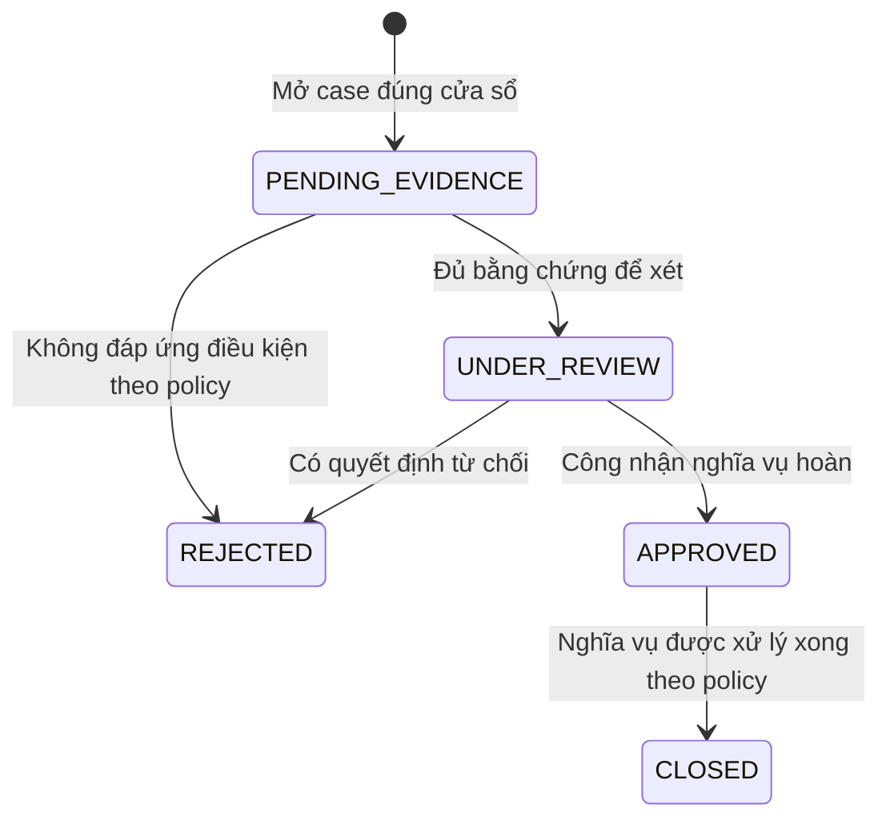
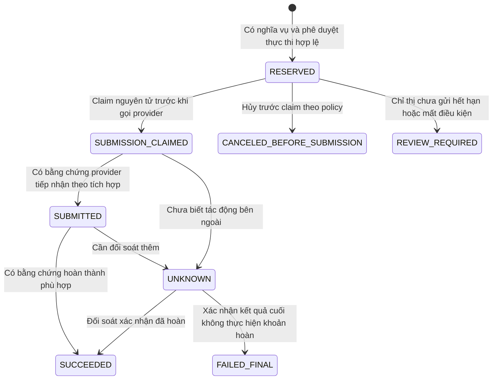

# Thời điểm và thời hạn hoàn tiền (Refund timing)

Trong chương **Refund Rules**, thời gian là một phần của quyền thực hiện nghiệp vụ: khách hàng có thể được gửi yêu cầu hoàn trong một khoảng xác định, nhân viên phải hoàn tất phê duyệt trước một mốc khác và worker chỉ được gửi một lệnh hoàn khi lệnh đó còn hợp lệ. Nếu các mốc bị trộn lẫn, người dùng có thể lùi ngày để vượt thời hạn, retry có thể tạo khoản hoàn mới hoặc một tác vụ chậm có thể hoàn tiền sau khi chỉ thị đã bị thu hồi.

Bài học sử dụng hệ thống bán hàng giả định để bảo vệ các quy tắc thời gian bằng business invariants, state machine, quyền theo đối tượng, transaction, idempotency và kiểm thử lịch chạy. Các khoảng thời gian trong ví dụ là chính sách minh họa, không phải quy định pháp luật hoặc thời hạn của một nhà cung cấp thanh toán cụ thể.

## 1. Mục tiêu học tập

Sau bài học, bạn có thể:

- Phân biệt thời hạn được gửi yêu cầu, thời điểm đủ điều kiện hoàn, hạn phê duyệt, hạn gửi provider và thời gian người nhận thực sự thấy tiền.
- Xác định nguồn thời gian, mốc bắt đầu, quy tắc tại đúng deadline và phiên bản chính sách cần lưu.
- Giữ đúng quyền lợi của yêu cầu đã được tiếp nhận hợp lệ mà không bỏ qua các điều kiện thực thi về sau.
- Chặn race giữa hoàn tiền, hủy chỉ thị, hết hạn phê duyệt và các luồng cùng sử dụng ngân sách hoàn.
- Xử lý timeout, retry và callback đến muộn mà không giải phóng ngân sách hoặc tạo khoản hoàn trùng.
- Thiết kế kiểm thử thời gian có điều khiển, thay vì phụ thuộc vào đồng hồ thực hoặc `sleep`.

## 2. Refund timing không phải một cột refundAt

Một chuỗi hoàn tiền có nhiều sự kiện khác nhau:

```text
Thanh toán được capture
  -> hàng được giao
  -> khách mở yêu cầu hoàn
  -> hàng trả hoặc bằng chứng được xác nhận
  -> nhân viên duyệt nghĩa vụ hoàn
  -> hệ thống giữ ngân sách và lập chỉ thị
  -> worker gửi chỉ thị tới provider
  -> provider xác nhận kết quả
  -> người nhận có thể sử dụng khoản tiền theo luồng thanh toán
```

Những sự kiện này không nhất thiết xảy ra liền nhau. Một request có thể được chấp nhận đúng hạn nhưng xử lý sau hạn; một provider có thể đã thực hiện dù ứng dụng timeout; một phản hồi “đã tiếp nhận hoàn tiền” chưa chứng minh tiền đã xuất hiện trong tài khoản của người nhận.

| Mốc | Câu hỏi nghiệp vụ |
|---|---|
| `capturedAt` | Đã có khoản tiền thực thu phù hợp để xét hoàn chưa? |
| `eligibilityAnchorAt` | Sự kiện nào bắt đầu cửa sổ tiếp nhận yêu cầu? |
| `caseAcceptedAt` | Khi nào yêu cầu được hệ thống chấp nhận theo quy tắc thời gian? |
| `caseDeadlineAt` | Khi nào hết quyền khởi tạo yêu cầu theo chính sách này? |
| `evidenceDeadlineAt` | Nếu có, khi nào phải cung cấp đủ bằng chứng? |
| `approvedAt` | Khi nào nghĩa vụ hoặc chỉ thị hoàn được phê duyệt? |
| `approvalExpiresAt` | Phê duyệt thực thi có còn hiệu lực để bắt đầu tác động không? |
| `scheduledAt` | Khi nào hệ thống dự kiến bắt đầu thực hiện? |
| `providerLatestSubmitAt` | Tích hợp có mốc cuối nào cho phép gửi loại thao tác này không? |
| `submittedAt` | Khi nào ứng dụng đã gửi hoặc ghi nhận việc gửi theo ngữ nghĩa tích hợp? |
| `providerCompletedAt` | Provider xác nhận hoàn tất sự kiện nào và tại thời điểm nào? |
| `customerPromiseDueAt` | Cam kết vận hành nào cần theo dõi với khách hàng? |

Không phải hệ thống nào cũng có tất cả các mốc. Mỗi mốc có trong mô hình phải có nguồn và ý nghĩa rõ ràng; không dùng một timestamp để trả lời mọi câu hỏi.

## 3. Thiết kế một chính sách thời gian cụ thể

### 3.1. Chính sách minh họa

Chọn các quy tắc sau cho bài học:

- Yêu cầu hoàn theo quy trình trả hàng chỉ được mở sau khi có sự kiện giao hàng đã được xác minh.
- Cửa sổ mở yêu cầu kéo dài **14 khoảng 24 giờ** từ mốc giao hàng được chấp nhận, với đầu cuối loại trừ.
- Backend xét thời hạn tại `decisionTime` lấy từ nguồn thời gian server đã chọn sau khi khóa đối tượng cần quyết định.
- Yêu cầu đúng hạn có thể ở trạng thái chờ bằng chứng hoặc kiểm tra hàng trả; chưa được xem là một khoản hoàn đã được duyệt.
- Việc kiểm tra bằng chứng có thể hoàn tất sau `caseDeadlineAt` mà không làm yêu cầu ban đầu tự trở thành nộp muộn. Nếu có hạn bổ sung bằng chứng, đó là mốc riêng được chốt cho case.
- Chỉ lập chỉ thị hoàn khi điều kiện bằng chứng, quyền, phê duyệt và ngân sách đều được đáp ứng.
- Phê duyệt thực thi có thể có thời hạn riêng. Hết hạn chỉ thị chưa gửi không tự xóa nghĩa vụ đã được công nhận; cần duyệt lại hoặc xử lý theo quy trình.
- Sau khi thao tác có thể đã tới provider, chưa được giải phóng ngân sách chỉ vì hết hạn, mất lease hoặc timeout.

Đây là một lựa chọn sản phẩm cụ thể. Sản phẩm khác có thể xét thời điểm tiếp nhận bền vững thay vì thời điểm quyết định, hoặc có mốc bắt đầu khác; không được trộn các lựa chọn trong cùng luồng mà không giải thích.

### 3.2. Biểu thức đủ rõ để kiểm thử

Với chính sách minh họa:

```text
caseDeadlineAt = eligibilityAnchorAt + Duration.ofDays(14)

timelyNewCase = eligibilityAnchorAt <= decisionTime
            AND decisionTime < caseDeadlineAt
```

Trong biểu thức này, 14 ngày là 14 lần 24 giờ. Nó không tự mang nghĩa 14 ngày theo lịch địa phương hoặc 14 ngày làm việc.

Một case đúng hạn chỉ đáp ứng điều kiện thời gian để mở quy trình. Để thực hiện hoàn còn cần các điều kiện khác:

```text
mayCreateRefundInstruction = actorMayActOnCase
                         AND caseWasAcceptedUnderApplicablePolicy
                         AND requiredEvidenceIsSatisfied
                         AND currentExecutionApprovalIsValid
                         AND refundBudgetIsAvailable
                         AND paymentAndProviderRulesAllowExecution
```

Không gộp tất cả thành `now < deadline && isAdmin`. Quyền nhân viên không tự làm ngân sách hợp lệ hoặc biến một giao dịch chưa rõ kết quả thành chưa thực hiện.

### 3.3. Ví dụ yêu cầu đúng hạn nhưng kiểm tra sau hạn

```text
Mốc giao hàng đã xác minh:  2026-04-03T03:00:00Z
Hạn mở case:               2026-04-17T03:00:00Z
Case được chấp nhận:       2026-04-16T10:00:00Z
Bằng chứng được xác nhận:  2026-04-18T04:00:00Z
```

Case đã được mở đúng cửa sổ. Khi xác nhận bằng chứng ngày 18, không chạy lại điều kiện “mở case mới trước ngày 17” rồi từ chối case cũ. Thay vào đó, kiểm tra trạng thái, hạn bằng chứng nếu có, policy đã chốt và các điều kiện thực thi tương ứng.

Ngược lại, chỉ gửi một body tự khai `requestedAt = 2026-04-16` vào ngày 18 không chứng minh case đã được tiếp nhận đúng hạn.

## 4. Nguồn thời gian và dữ liệu mốc bắt đầu

### 4.1. Không để client tự quyết quá khứ

Client không được tự xác lập các trường có tính quyết định:

```json
{
  "requestedAt": "<thời điểm do người gọi tự khai>",
  "deliveredAt": "<mốc giao hàng tự khai>",
  "deadlineAt": "<hạn tự chọn>",
  "approvedAt": "<mốc phê duyệt tự khai>",
  "forceEligible": true
}
```

Một số trường do client gửi có thể hữu ích cho diễn giải, nhưng phải được đánh dấu là nội dung khai báo và không thay nguồn thời gian có thẩm quyền.

Lấy mốc giao hàng hoặc nhận hàng trả từ sự kiện đã được xác minh và ánh xạ đúng order, shipment hoặc dòng hàng. Không dùng một callback chưa xác thực hoặc metadata tùy ý để kéo dài cửa sổ hoàn.

### 4.2. Phân biệt thời điểm sự kiện xảy ra và thời điểm nhận sự kiện

Một thông điệp giao hàng có thể tới muộn. Cần quyết định policy dùng:

- Thời điểm giao thực tế theo bằng chứng được chấp nhận.
- Thời điểm hệ thống xác nhận giao.
- Hoặc mốc khác được định nghĩa rõ.

Không tự chọn mốc có lợi nhất trong từng request. Lưu provenance: nguồn sự kiện, định danh, phiên bản và thời điểm tiếp nhận, để giải thích cách tính deadline.

Nếu mốc gốc được đính chính, không âm thầm tính lại rồi xóa dấu một case đã được chấp nhận. Ghi thay đổi và đánh giá tác động theo policy, đặc biệt khi quyết định trước dựa trên dữ liệu sai.

### 4.3. Thời điểm quyết định phải đúng với lời hứa của hệ thống

Trong ví dụ, request phải chờ khóa tới sau deadline có thể bị từ chối dù đến server trước hạn. Điều đó là hệ quả của việc chọn `decisionTime` sau khóa.

Nếu sản phẩm muốn đảm bảo “gửi tới hệ thống trước hạn là đủ”, cần một điểm tiếp nhận bền vững có xác thực, định danh chống trùng và thời gian server đáng tin cậy. Một timestamp ở load balancer hoặc header client không tự đáp ứng yêu cầu đó.

Với API database hoặc framework dùng để lấy thời gian, cần xác định nó trả thời gian tại thời điểm gọi hay thời điểm bắt đầu transaction. Không đặt tên hàm `now()` rồi giả định nó luôn thể hiện thời điểm sau khi đã đợi khóa.

### 4.4. Độ chính xác và đồng hồ

Chọn độ chính xác lưu và so sánh nhất quán, chẳng hạn mili giây. Nếu application so sánh nano giây nhưng database làm tròn sang đơn vị khác, hành vi tại biên có thể không đúng với bài kiểm thử.

Các service cần quy ước nguồn thời gian và giám sát sai lệch đồng hồ phù hợp. Không dùng thời gian còn lại trên giao diện như một bằng chứng authorization. Countdown chỉ là thông tin ước lượng; backend quyết định trên dữ liệu có thẩm quyền.

## 5. Khoảng thời gian, ngày theo lịch và ngày làm việc

Ba cách diễn đạt sau khác nhau:

| Quy tắc | Cách hiểu |
|---|---|
| 14 lần 24 giờ | Cộng một duration cố định vào một instant |
| Đến cuối ngày thứ 14 ở múi giờ chính sách | Tính theo ngày địa phương, giờ cắt và timezone đã định nghĩa |
| 14 ngày làm việc | Dùng lịch làm việc, ngày nghỉ và quy tắc đếm được quản lý |

Nếu chọn lịch địa phương, cần xử lý chuyển ngày, độ dài ngày và thay đổi offset theo quy tắc của múi giờ được hỗ trợ. Không giả định mọi ngày lịch ở mọi nơi đều bằng 24 giờ.

Nếu chọn ngày làm việc, cần định nghĩa ngày bắt đầu có được tính không, giờ cắt trong ngày và lịch nghỉ nào áp dụng. Cụm “trong ba ngày làm việc” chưa đủ để viết một phép cộng chính xác nếu những dữ liệu này chưa có.

Nên lưu:

```text
timingPolicyVersion
eligibilityAnchorAt
anchorSourceRef
policyTimeZone, nếu chính sách phụ thuộc múi giờ
businessCalendarVersion, nếu áp dụng lịch làm việc
computedDeadlineAt
deadlineBoundaryRule
```

Lưu deadline đã chốt giúp tránh diễn giải lại đơn cũ bằng cấu hình mới. Nếu thay đổi được phép áp dụng hồi tố, đó phải là quyết định có version và audit riêng.

## 6. Business invariants về thời gian hoàn tiền

| Invariant | Cách bảo vệ điển hình |
|---|---|
| Case mới được xét theo đúng mốc và policy | Deadline server tính, nguồn anchor được xác minh |
| Replay không làm mới `caseAcceptedAt` hoặc deadline | Idempotency và định danh phạm vi case |
| Case đã tiếp nhận đúng hạn không bị coi thành case mới vì worker chạy chậm | Lưu quyết định ban đầu và tách các deadline |
| Phê duyệt hết hạn không được dùng để bắt đầu tác động mới | Kiểm tra thời gian và claim thực thi nguyên tử |
| Case pending không tự trở thành nghĩa vụ hoàn chắc chắn | State machine cho bằng chứng và phê duyệt |
| Chỉ thị có thể đã gửi không được mất dấu hoặc giải phóng ngân sách tùy tiện | Operation ID, trạng thái unknown và đối soát |
| Tổng hoàn đã thành công cộng khoản đang giữ không vượt giới hạn được phép | Ledger và transaction dùng chung giữa các luồng hoàn |
| Callback đến muộn không bị bỏ qua chỉ vì deadline local đã qua | Áp dụng sự thật tài chính vào đúng operation |
| Hết hạn công việc không tự xóa nghĩa vụ đã công nhận | Tách nghĩa vụ với chỉ thị thực thi |

Không có một `if (now < refundDeadline)` nào đủ bảo vệ toàn bộ chuỗi. Từng invariant cần gắn với một điểm quyết định và một cơ chế đồng bộ cụ thể.

## 7. Tách refund case, nghĩa vụ và chỉ thị thực thi

### 7.1. Ba đối tượng có tuổi thọ khác nhau

```text
RefundCase
  Yêu cầu, phạm vi hàng, policy thời gian và bằng chứng.

RefundObligation
  Số tiền được công nhận phải hoàn theo quyết định nghiệp vụ.

RefundInstruction
  Một chỉ thị thực thi khoản hoàn qua phương thức/provider cụ thể.
```

Một case mở đúng hạn có thể bị từ chối sau kiểm tra bằng chứng. Một nghĩa vụ đã được công nhận có thể cần chỉ thị mới nếu chỉ thị chưa gửi hết hạn phê duyệt. Một chỉ thị đã tới provider có thể còn chờ xác minh sau khi lease worker hết hạn.

Không dùng chung một cột `expiresAt` cho cả ba đối tượng. Hệ quả của hết hạn cũng khác nhau: ngừng nhận case mới, yêu cầu bổ sung bằng chứng, duyệt lại chỉ thị hoặc chuyển vận hành.

### 7.2. State machine minh họa cho case



`APPROVED` không đồng nghĩa tiền đã vào tài khoản người nhận. `CLOSED` phải có định nghĩa rõ, không được dùng để che một nghĩa vụ hoàn còn tồn.

### 7.3. State machine minh họa cho chỉ thị



Sơ đồ không liệt kê mọi trường hợp của mọi provider. Chỉ dùng `FAILED_FINAL` khi bằng chứng và hợp đồng tích hợp đủ để kết luận; lỗi HTTP hoặc timeout riêng lẻ không tự mang ý nghĩa đó.

## 8. Transaction khi tiếp nhận yêu cầu đúng hạn

### 8.1. Chọn điểm quyết định có thể chứng minh

Trong ví dụ, mở case thực hiện trong một transaction:

1. Khóa đối tượng hoặc phạm vi hoàn cần xét.
2. Kiểm tra quyền theo tenant, order và phạm vi hàng.
3. Giải quyết replay hoặc case đã có trước khi xét case mới.
4. Lấy `decisionTime` theo nguồn và ngữ nghĩa đã chọn.
5. Tải policy và anchor có version phù hợp.
6. Kiểm tra cửa sổ và trạng thái.
7. Ghi case, quyết định thời gian, idempotency, audit và outbox nếu có.

Nếu transaction rollback, chưa có case được chấp nhận. Không ghi một log độc lập “đã mở đúng hạn” rồi dùng nó như bằng chứng thay cho dữ liệu đã commit.

### 8.2. Mã giả mở refund case

Đây là mã giả mô tả thứ tự kiểm tra, không phải Java có thể biên dịch trực tiếp:

```java
RefundCaseReply openRefundCase(
        AuthenticatedActor actor,
        OrderId orderId,
        OpenRefundCaseCommand command,
        String idempotencyKey) {

    validateAllowedFieldsAndLimits(command, idempotencyKey);

    return transactions.execute(() -> {
        Order order = orders.lockByTenantAndId(actor.tenantId(), orderId)
                .orElseThrow(this::notFound);
        authorization.requireCanRequestRefund(actor, order);

        RequestScope scope = scopeFor(actor, "OPEN_REFUND_CASE", idempotencyKey);
        Fingerprint fingerprint = fingerprintOf(orderId, command);

        StoredRequest previous = idempotency.find(scope);
        if (previous != null) {
            requireSameFingerprint(previous, fingerprint);
            return previous.originalReplyOrProcessingReply();
        }
        idempotency.claimWithUniqueConstraint(scope, fingerprint);

        RefundScope refundScope = scopes.resolveAndValidate(order, command.items());
        RefundCase existing = cases.findCaseForSameAcceptedRequestScope(refundScope);
        if (existing != null) {
            RefundCaseReply reply = replyForExistingCase(existing);
            idempotency.complete(scope, reply);
            return reply;
        }

        order.requireVersion(command.expectedOrderVersion());
        TimingPolicy policy = policies.forRefundScope(order, refundScope);
        VerifiedAnchor anchor = anchors.loadForScope(order, refundScope);
        Instant decisionTime = databaseClock.currentDecisionTime();

        policy.requireMayOpenCase(order, refundScope, anchor, decisionTime);

        RefundCase created = cases.createPendingEvidence(
                refundScope, policy.snapshot(), anchor,
                decisionTime, policy.computeCaseDeadline(anchor));

        audit.recordCaseAccepted(actor, created);
        outbox.appendCaseOpenedIfNeeded(created);

        RefundCaseReply reply = accepted(created.id());
        idempotency.complete(scope, reply);
        return reply;
    });
}
```

Những điều cần làm rõ khi hiện thực:

- `resolveAndValidate` không cho line item của đơn khác, số lượng âm, dòng lặp hoặc phần hàng đã được xử lý sử dụng lại ngoài policy.
- Phạm vi case phải phản ánh mô hình hủy/hoàn từng phần; không mặc định chỉ một case cho mọi nhu cầu của một order.
- Request với reason hoặc phạm vi khác không được âm thầm ghi đè case cũ. Hợp đồng có thể trả case hiện có hoặc báo xung đột phù hợp.
- Ràng buộc duy nhất hoặc khóa nghiệp vụ ngăn hai request cùng chấp nhận một phạm vi không được phép trùng.
- Khóa order chỉ đủ nếu các bên thay đổi dữ liệu liên quan cùng tôn trọng giao thức. Cần bảo vệ cả anchor, scope hoặc version phụ thuộc theo mô hình thực tế.
- Nếu unique conflict làm transaction lỗi, rollback và đọc lại theo giao thức của database; không tiếp tục transaction đã hỏng.

## 9. Retry không được tạo lại thời gian

### 9.1. Cùng ý định giữ nguyên quyết định ban đầu

Giả sử case được chấp nhận lúc `02:59:59Z`, deadline là `03:00:00Z`, nhưng phản hồi bị mất. Client retry cùng key lúc `03:01:00Z`.

Sau khi kiểm tra quyền hiện tại và fingerprint, server trả kết quả đã lưu. Không xét đây là yêu cầu mới quá hạn và không tạo case mới có `caseAcceptedAt = 03:01:00Z`.

Phản hồi idempotency có thể là bản phản hồi ban đầu. Client đọc endpoint trạng thái để biết case hiện tại đã tới bước nào. Cần mô tả rõ hợp đồng đó.

### 9.2. Key mới không khởi động lại cửa sổ

Người dùng có thể cố tình gửi key mới mỗi lần, đổi reason hoặc đóng/mở lại yêu cầu. Thời hạn vẫn dựa trên anchor và policy của phạm vi gốc, trừ khi có nghiệp vụ mới thật sự được định nghĩa.

Không tính `caseDeadlineAt = now + 14 ngày` mỗi lần người dùng mở màn hình hoặc retry. Cũng không cho một sự kiện giao lặp tự tạo anchor mới để kéo dài deadline.

### 9.3. Chờ bằng chứng không phải chờ vô hạn theo mặc định

Nếu policy có `evidenceDeadlineAt`, lưu mốc đó lúc cần chốt và định nghĩa quyền gia hạn. Retry hoặc upload lại cùng bằng chứng không tự làm mới hạn.

Khi hết hạn, chuyển case theo quy tắc đã định nghĩa và ghi quyết định. Không suy ra mọi case đã mở đúng hạn đều phải được hoàn dù điều kiện bằng chứng chưa từng đáp ứng.

## 10. Từ nghĩa vụ được duyệt đến thời điểm gửi provider

### 10.1. Kiểm tra điều kiện hiện tại mà không xóa quyết định quá khứ

Khi phê duyệt thực thi, backend cần kiểm tra:

- Case đã được tiếp nhận theo policy phù hợp và chưa có quyết định kết thúc không cho thực hiện.
- Bằng chứng bắt buộc đã được xác nhận và không bị thay đổi ngoài quy trình.
- Người duyệt có quyền với payment/case và không vi phạm điều kiện phân tách nhiệm vụ nếu policy yêu cầu.
- Số tiền, currency, phương thức hoàn và tài khoản thanh toán gốc được xác định từ server.
- Các khoản hoàn trước hoặc đang thực hiện đã được tính vào ngân sách.
- Phê duyệt và điều kiện provider còn phù hợp cho việc lập chỉ thị.

Đây là kiểm tra điều kiện thực thi mới, không phải cố ý chạy lại cửa sổ mở case cũ bằng `now` mới.

### 10.2. Claim thực thi và hết hạn phê duyệt phải cạnh tranh nguyên tử

Một thao tác claim có thể dùng khóa hàng hoặc cập nhật có điều kiện. SQL sau chỉ minh họa:

```sql
UPDATE refund_instruction
SET state = 'SUBMISSION_CLAIMED',
    claimed_at = :trusted_decision_time,
    execution_version = execution_version + 1
WHERE tenant_id = :trusted_tenant_id
  AND id = :instruction_id
  AND state = 'RESERVED'
  AND approval_expires_at > :trusted_decision_time
  AND version = :expected_version;
```

Phải kiểm tra có đúng một hàng cập nhật. Các điều kiện khác như lịch gửi, ràng buộc provider và ngân sách cũng cần được bảo vệ trong giao thức thực tế; câu SQL này riêng lẻ không phải một bộ máy hoàn tiền đầy đủ.

Luồng hủy hoặc đưa chỉ thị hết hạn sang review phải cạnh tranh trên cùng state/version. Nếu worker đã claim trước, không được xử lý như chỉ thị chắc chắn chưa có khả năng gửi.

### 10.3. Nêu rõ phê duyệt có hiệu lực tới bước nào

Cần chọn ngữ nghĩa: phê duyệt cho phép claim trước hạn, hay yêu cầu một điểm thực thi khác cũng phải trước hạn. Trong ví dụ, nó cho phép chấp nhận ý định gửi trước hạn. Chỉ thị sau claim vẫn chịu giới hạn gửi và kiểm soát độ trễ riêng.

Nếu worker bị dừng lâu sau claim, không coi phê duyệt cũ là quyền gửi vô hạn. Có thể có `latestStartAt` hoặc điều kiện kiểm tra trước phát lệnh. Khi không còn an toàn để gửi, chuyển xử lý phù hợp mà không tự giải phóng một tác động chưa rõ.

Không thể bảo đảm provider nhận request trước một mốc tuyệt đối chỉ bằng việc đọc đồng hồ local trước khi gọi HTTP. Độ trễ mạng và xử lý ngoài hệ thống cần được tính trong thiết kế, cùng bằng chứng tiếp nhận và hành vi khi sát hạn.

## 11. Ngân sách hoàn tiền trong lúc chờ

Với một payment và currency, đặt:

```text
C = tổng capture đã xác nhận có thể dùng để hoàn
S = tổng refund đã thành công
R = tổng tiền đang giữ cho các chỉ thị hoàn chưa kết thúc,
    bao gồm các thao tác chưa rõ kết quả

available = C - S - R
S + R <= C
```

Lập chỉ thị mới cần đồng thời đáp ứng số tiền được công nhận theo case và ngân sách còn lại. Mọi luồng hoàn như trả hàng, hủy đơn và hỗ trợ thủ công phải dùng chung cơ chế giới hạn phù hợp.

Ví dụ:

```text
Đã capture:                        480.000 VND
Đã hoàn thành công:                  80.000 VND
Chỉ thị đang UNKNOWN:               100.000 VND
Ngân sách chưa bị sử dụng/giữ:       300.000 VND
```

Không cho hoàn mới `400.000 VND` bằng cách coi chỉ thị unknown là hết hạn và cộng `100.000 VND` trở lại. Provider có thể đã hoàn khoản đó.

Khi một refund thành công, chuyển phần tương ứng từ `R` sang `S` trong cùng transaction; không vừa giữ trong `R` vừa cộng `S` mà không kết thúc reservation. Khi có bằng chứng kết thúc chắc chắn không hoàn, mới xử lý giải phóng theo policy.

Ngân sách local không được dùng để che giao dịch thực tế. Nếu phát hiện provider đã hoàn ngoài dự kiến hoặc vượt giới hạn vì một đường thực thi khác, vẫn ghi nhận sự thật và đưa vào đối soát; không bỏ callback để công thức trông đúng.

## 12. Timeout, lease và callback đến muộn

### 12.1. Lease hết hạn không có nghĩa provider chưa làm

Worker A có thể gửi refund rồi mất kết nối. Lease của A hết hạn, worker B nhận công việc. Nếu B tạo operation mới và gửi lại, khách có thể nhận hai khoản hoàn.

Lease điều phối quyền xử lý local. Nó không tự thu hồi request đã tới provider và không chứng minh tác động chưa xảy ra.

Retry cùng nghĩa vụ phải giữ định danh như `refundOperationId`, amount, currency và phương thức đích đã được chấp nhận. Nếu provider hỗ trợ idempotency, dùng lại key theo hợp đồng tích hợp. Nếu không có chống trùng hoặc tra cứu đủ tin cậy, chuyển đối soát thay vì tự gửi lại thao tác chưa biết kết quả.

### 12.2. Không giải phóng ngân sách vì job quá tuổi

Tác vụ có thể bị hệ thống scheduler đánh dấu hết hạn hoặc chuyển hàng đợi lỗi. Đó là trạng thái xử lý công việc, không phải bằng chứng refund đã thất bại cuối cùng.

Nếu tác động có thể đã gửi, giữ nghĩa vụ và ngân sách phù hợp, ghi trạng thái chưa rõ và đối soát. Muốn giải phóng sau lỗi cần bằng chứng rằng thao tác không còn có thể tạo khoản hoàn theo hợp đồng provider.

### 12.3. Hủy an toàn trước gửi cần hàng rào thực sự

Nếu chỉ thị vẫn ở `RESERVED` và luồng hủy thắng cập nhật nguyên tử trước worker claim, có thể hủy chỉ thị chưa gửi theo policy và xử lý reservation tương ứng.

Nếu một worker cũ đã có quyền thực thi, chỉ đổi cờ trong bảng hoặc hết lease không đủ. Cần chứng minh worker đó không còn được phát lệnh theo giao thức đang áp dụng. Fencing token chỉ bảo vệ nơi thực thi nếu bên đó thực sự kiểm tra token; nó không tự vô hiệu hóa một HTTP request đã phát ra.

### 12.4. Callback sau deadline vẫn có thể là sự thật

Nếu callback xác thực báo refund đã thành công sau `approvalExpiresAt` hoặc `customerPromiseDueAt`, không bỏ qua chỉ vì local đã quá hạn.

Ánh xạ tới đúng operation, đối chiếu số tiền/currency/phạm vi provider, dedup theo giao dịch hoàn thực tế và cập nhật ledger. Việc có dấu hiệu thực thi muộn cần audit và điều tra, nhưng không thay đổi sự thật tiền đã được chuyển theo bằng chứng.

Một callback thất bại cũ không được ghi đè thành công đã xác nhận. Nếu thông tin mâu thuẫn, tra cứu và đối soát thay vì chọn thông điệp đến sau.

## 13. Ràng buộc của payment, provider và phương thức hoàn

### 13.1. Chưa capture có thể cần nghiệp vụ khác

Nếu tiền chỉ mới được authorization, thao tác phù hợp có thể là hủy authorization theo khả năng tích hợp, không phải tạo một refund như với khoản đã capture.

Không giả định mọi provider bắt buộc chờ settlement mới được hoàn, cũng không giả định mọi payment vừa capture đều hoàn được ngay. Điều kiện và cửa sổ kỹ thuật phải lấy từ hợp đồng của tích hợp cụ thể, được mô hình hóa thành policy hoặc capability đáng tin cậy.

Capture có thể tới muộn sau khi đơn hủy. Khi đó ghi nhận khoản thu thực tế và lập nghĩa vụ xử lý phù hợp; không coi “chưa có tiền ở thời điểm hủy” là bằng chứng không bao giờ cần hoàn.

### 13.2. Hạn gửi provider khác quyền yêu cầu hoàn của khách

Khách có thể có một case được chấp nhận hợp lệ, trong khi phương thức gốc không còn cho phép gửi refund theo đường kỹ thuật thông thường. Không tự kết luận nghĩa vụ biến mất.

Cần chuyển sang quy trình xử lý được phê duyệt, có xác minh người nhận và chống trùng. Không cho khách tự đổi tài khoản đích bằng một trường request rồi giải ngân thiếu kiểm soát.

Nếu có `providerLatestSubmitAt`, hệ thống phải tính lịch xử lý, cảnh báo và giới hạn retry phù hợp. Một khoảng đệm vận hành có thể giảm rủi ro sát hạn, nhưng không phải bảo đảm tuyệt đối về thời điểm nhận bên ngoài.

### 13.3. Tách thời gian provider xử lý và tiền khả dụng cho khách

Một provider có thể phân biệt tiếp nhận lệnh, hoàn tất xử lý và các mốc khác. Chỉ hiển thị điều mà bằng chứng thực sự hỗ trợ.

Ví dụ, `SUBMITTED` có thể được diễn đạt là “đã gửi yêu cầu hoàn”; `SUCCEEDED` cần định nghĩa theo tích hợp. Không dùng trạng thái này để tuyên bố “tiền đã vào tài khoản của bạn” nếu hệ thống không có dữ liệu chứng minh mốc đó.

Cam kết vận hành hoặc ước lượng phải nêu rõ mốc bắt đầu và cách tính. Nếu đã quá hẹn, mở xử lý hỗ trợ và đối soát; không gửi refund thứ hai chỉ vì khách chưa thấy tiền.

## 14. Quyền ngoại lệ và audit thời gian

### 14.1. Ngoại lệ không phải sửa đồng hồ

Nếu chính sách cho phép nhân viên nhận case muộn, dùng quyền và lệnh riêng, chẳng hạn `refund.case.accept_late`. Ghi quyết định ngoại lệ, actor, lý do, approval và phạm vi cụ thể.

Không sửa `caseAcceptedAt` về quá khứ để giả vờ yêu cầu đúng hạn. Không sửa mốc giao hàng hoặc version policy chỉ để qua một điều kiện.

Quyền chấp nhận case muộn không tự cho phép hoàn vượt tiền đã thu, đổi người nhận tiền hoặc bỏ qua trạng thái provider chưa rõ. Những invariant đó cần bảo vệ riêng.

### 14.2. Dữ liệu cần truy vết

```text
tenantId, orderId, refundScopeId, refundCaseId
refundObligationId, refundInstructionId, refundOperationId
actorId, actorType, approvalId
timingPolicyVersion, anchorSourceRef, eligibilityAnchorAt
caseAcceptedAt, caseDeadlineAt, evidenceDeadlineAt
approvedAt, approvalExpiresAt, scheduledAt, claimTime
submittedAt, providerCompletedAt, receivedAt, recordedAt
amount, currency, reservationId, providerRefundId
decision, reasonCode, stateBefore, stateAfter, version
```

Không phải mọi event đều có tất cả trường. Ghi rõ nguồn từng mốc và phân biệt thời điểm provider nói sự kiện xảy ra với thời điểm ứng dụng nhận được thông điệp.

Audit phải cùng transaction với quyết định quan trọng khi cùng phạm vi dữ liệu, hoặc có cơ chế bền vững tương đương được xác định. Không ghi secret, token hoặc toàn bộ dữ liệu phương tiện thanh toán vào audit.

## 15. Hợp đồng API và trải nghiệm người dùng

Một luồng API có thể tách:

```text
POST /orders/{orderId}/refund-cases
  -> mở case và trả quyết định tiếp nhận

POST /refund-cases/{caseId}/evidence
  -> bổ sung bằng chứng theo hạn và quyền tương ứng

POST /refund-cases/{caseId}/approvals
  -> lệnh có quyền để công nhận nghĩa vụ/duyệt thực thi

GET /refund-cases/{caseId}
  -> đọc case, nghĩa vụ và tiến độ xử lý được phép xem
```

Mọi endpoint cần kiểm tra tenant và quyền đối với đối tượng. Biết `caseId` hoặc `refundOperationId` không phải quyền đọc hoặc thực thi.

Một phản hồi mở case có thể là:

```json
{
  "refundCaseId": "case_701",
  "caseState": "PENDING_EVIDENCE",
  "caseAcceptedAt": "2026-04-16T10:00:00Z",
  "caseDeadlineAt": "2026-04-17T03:00:00Z",
  "refundExecutionState": "NOT_CREATED"
}
```

Không diễn đạt là “đã hoàn tiền” chỉ vì case được mở. Nếu cần trả deadline bằng chứng hoặc tiến độ provider, dùng trường riêng với ngữ nghĩa rõ.

Mã lỗi nghiệp vụ minh họa:

- `REFUND_CASE_TOO_EARLY`: chưa có mốc bắt đầu hoặc chưa tới cửa sổ được phép.
- `REFUND_CASE_DEADLINE_PASSED`: yêu cầu mới không đáp ứng hạn tiếp nhận.
- `REFUND_EVIDENCE_REQUIRED`: còn thiếu điều kiện để xét nghĩa vụ.
- `REFUND_APPROVAL_EXPIRED`: cần xử lý phê duyệt thực thi lại.
- `REFUND_OPERATION_UNRESOLVED`: còn thao tác có thể đã tác động bên ngoài.
- `REFUND_PROVIDER_WINDOW_UNAVAILABLE`: chưa thể dùng đường thực thi được yêu cầu.
- `REFUND_BUDGET_CONFLICT`: ngân sách hiện tại không đáp ứng.

Lỗi phải giúp người có quyền biết bước tiếp theo mà không lộ thông tin payment của khách khác. Nút bấm và countdown hỗ trợ trải nghiệm; backend vẫn kiểm tra toàn bộ quy tắc khi nhận request trực tiếp.

## 16. Kiểm thử các tình huống tấn công thời gian

### 16.1. Ma trận tình huống

| Tình huống | Cách thử | Kết quả cần chứng minh |
|---|---|---|
| Chưa tới cửa sổ | Mở case trước anchor hợp lệ | Không được chấp nhận như đã đủ điều kiện thời gian |
| Trước deadline | Đặt clock ngay trước mốc theo độ chính xác đã chọn | Case mới được xét đúng quy tắc đầu cuối |
| Đúng deadline | `decisionTime == caseDeadlineAt` | Bị từ chối trong ví dụ dùng đầu cuối loại trừ |
| Sau deadline | Mở case mới khi đã quá hạn | Không cho lùi ngày bằng request |
| Giờ client sai | Đổi timezone hoặc đồng hồ thiết bị | Không ảnh hưởng nguồn quyết định backend |
| Giả mốc giao | Gửi `deliveredAt` hoặc callback chưa xác thực | Không tạo anchor có thẩm quyền |
| Sự kiện giao lặp | Replay cùng sự kiện | Không làm mới anchor hoặc deadline |
| Chờ khóa qua hạn | Request đến sớm, được xét muộn | Hành vi khớp chính sách điểm quyết định đã công bố |
| API clock có ngữ nghĩa khác | Transaction bắt đầu trước hạn, đợi khóa tới sau | Không vô tình dùng thời gian cũ nếu policy yêu cầu thời điểm sau khóa |
| Retry sau deadline | Replay key đã commit trước hạn | Trả case cũ sau kiểm tra quyền, không tạo lại thời gian |
| Key mới cùng phạm vi | Gửi lại sau hạn bằng key khác | Không kéo dài cửa sổ hoặc chấp nhận trùng |
| Bằng chứng tới sau hạn mở case | Case đúng hạn, kiểm tra sau đó | Không xét như case mới; vẫn kiểm tra hạn bằng chứng riêng nếu có |
| Hạn bằng chứng hết | Upload lại để làm mới thời gian | Không tự gia hạn ngoài policy |
| Policy cấu hình đổi | Đổi thời lượng sau khi case được mở | Không âm thầm diễn giải lại quyết định đã chốt |
| Lịch địa phương | Đổi ngày, offset hoặc lịch nghỉ trong fixture | Tính theo đúng loại chính sách, không lẫn duration với ngày làm việc |
| Phê duyệt hết hạn | Worker claim tại hoặc sau mốc loại trừ | Không bắt đầu tác động mới bằng approval hết hiệu lực |
| Hủy đua claim | Chạy đồng thời cancel và claim | Một transition thắng; không vừa giải phóng ngân sách vừa cho gửi |
| Lease hết sau gửi | Dừng worker sau khi provider nhận | Không tạo operation mới hoặc giải phóng ngân sách chỉ vì lease |
| Callback muộn | Provider success sau deadline local | Ghi nhận sự thật đúng operation, không bỏ callback |
| Callback trùng/sai thứ tự | Giao nhiều lần và đảo lịch | Không hoàn trùng, không ghi đè success bằng trạng thái cũ |
| Hai luồng cùng hoàn | Hỗ trợ và case cùng giữ ngân sách | Tổng đã hoàn và đang giữ không vượt giới hạn chấp nhận |
| Provider sắp hết cửa sổ | Hàng đợi chậm, retry sát hạn | Có kiểm soát gửi/review, không tuyên bố chắc chắn đã hoàn |
| Khách chưa thấy tiền | Báo chậm sau provider success | Đối soát và hỗ trợ, không tự hoàn lần hai |
| Chéo quyền | Dùng case/payment người khác | Không đọc hoặc sửa timeline, không gửi refund |
| Ngoại lệ thủ công | Nhân viên chấp nhận case muộn | Có quyền và audit, không backdate hoặc vượt invariant tiền |

### 16.2. Dùng clock và lịch giả lập

Inject một clock có thể điều khiển trong kiểm thử. Không sửa đồng hồ hệ thống production và không chờ 14 ngày thực để kiểm tra một deadline.

Một kịch bản tối thiểu:

```text
anchor = T0
deadline = T0 + 14 lần 24 giờ

clock = deadline - một đơn vị chính xác được lưu
  -> mở case A, commit thành công

clock = deadline
  -> replay key của A: nhận kết quả cũ
  -> mở case mới ở phạm vi chưa có case: bị từ chối theo policy

clock = deadline + một ngày
  -> xác minh bằng chứng A: xét trạng thái và hạn bằng chứng của A,
     không chạy điều kiện mở case mới thay cho điều kiện đó
```

Với lịch ngày làm việc, tạo fixture cho ngày nghỉ, giờ cắt và múi giờ được hỗ trợ. Kiểm tra deadline đã lưu không bị diễn giải lại ngoài chủ đích khi thay version lịch.

### 16.3. Điều khiển lịch chạy đồng thời

Dùng barrier/latch để worker và lệnh hủy cùng tới bước claim:

```text
Lịch A - Hủy trước claim:
  1. Cancel thắng transition RESERVED -> CANCELED_BEFORE_SUBMISSION.
  2. Worker cập nhật có điều kiện thất bại.
  3. Không phát request provider cho chỉ thị đó.

Lịch B - Claim trước hủy:
  1. Worker thắng RESERVED -> SUBMISSION_CLAIMED.
  2. Cancel không còn được xử lý như chắc chắn chưa gửi.
  3. Không giải phóng ngân sách tùy tiện; điều phối kết quả theo giao thức.
```

Thêm provider giả lập có điểm dừng trước nhận request, sau thực hiện và trước trả phản hồi. Restart worker và cho callback tới sau khi job đã bị scheduler đánh dấu quá tuổi để kiểm tra đường khôi phục.

### 16.4. Assertion phải kiểm tra tiền và quyết định thời gian

Ngoài HTTP status, kiểm tra:

- Anchor, deadline, policy version và `caseAcceptedAt` đã được chốt đúng.
- Retry không tăng số case hoặc làm mới timeline ngoài quy tắc.
- Một phạm vi hàng và nghĩa vụ không bị sử dụng trùng.
- Chỉ thị được claim trong điều kiện approval hợp lệ đã định nghĩa.
- Không có provider operation mới chỉ vì timeout hoặc lease hết hạn.
- Ledger và ngân sách đúng trước/sau callback lặp, muộn hoặc mâu thuẫn.
- Case pending, nghĩa vụ được công nhận, chỉ thị submitted và tiền đã hoàn được phân biệt.
- Audit giải thích được ngoại lệ, hết hạn và quyết định khôi phục.

Số lần gọi HTTP có thể lớn hơn một trong một retry an toàn. Điều cần chứng minh là định danh được giữ ổn định và số hiệu ứng hoàn thực tế không bị nhân đôi.

## 17. Theo dõi thời gian xử lý và tồn đọng

Các chỉ số hữu ích gồm:

- Case gần hết hạn bằng chứng hoặc chờ review quá lâu.
- Nghĩa vụ đã công nhận nhưng chưa có chỉ thị hợp lệ.
- Approval sắp hết hạn trước lịch gửi dự kiến.
- Chỉ thị gần giới hạn provider nhưng chưa được xử lý.
- Operation `UNKNOWN`, inbox callback hoặc outbox tồn đọng.
- Chênh lệch giữa thời điểm gửi, provider xác nhận và mốc phản hồi cho khách.
- Số case muộn được chấp nhận bằng ngoại lệ và số lần sửa anchor.

Mỗi cảnh báo cần trỏ tới nghĩa vụ và operation cụ thể. Không dùng cảnh báo “quá thời gian” như lệnh tự tạo khoản hoàn thay thế.

Khi có sự cố kéo dài, quy trình vận hành phải phân biệt chưa gửi chắc chắn, đã gửi, chưa rõ kết quả và đã thành công. Nhân viên dùng lệnh có quyền, phê duyệt và audit tương ứng; không sửa trực tiếp timestamp để đưa bản ghi trở lại trạng thái có thể gửi.

## 18. Những ngộ nhận cần tránh

| Ngộ nhận | Cách hiểu đúng |
|---|---|
| Chỉ có một deadline cho refund | Hạn mở case, bằng chứng, phê duyệt, gửi provider và cam kết xử lý khác nhau |
| Gửi request trước hạn là chắc chắn được chấp nhận | Phụ thuộc điểm tiếp nhận/quyết định đã được định nghĩa và chứng minh |
| Retry sau hạn luôn phải bị từ chối | Replay của ý định đã commit trả kết quả cũ sau kiểm tra quyền |
| Đã mở case đúng hạn là chắc chắn được hoàn | Vẫn phải đáp ứng bằng chứng, quyền, nghĩa vụ và ngân sách |
| Phê duyệt hết hạn thì khoản nợ hoàn biến mất | Có thể chỉ thị cần duyệt lại; nghĩa vụ có vòng đời riêng |
| Lease hoặc job hết hạn chứng minh chưa gửi | Provider có thể đã nhận hoặc thực hiện |
| Timeout là refund thất bại | Có thể chưa biết kết quả, cần giữ định danh và đối soát |
| Provider success nghĩa là khách chắc chắn đã thấy tiền | Chỉ kết luận theo mốc mà tích hợp có bằng chứng |
| Admin có thể lùi ngày để tạo ngoại lệ | Ngoại lệ cần lệnh riêng và audit, không giả lịch sử |

## 19. Bài tập vận dụng

### Bài tập 1: Định nghĩa các mốc thời gian

Một sản phẩm cho mở case trong 14 ngày theo lịch địa phương kể từ xác nhận giao, với giờ cắt cuối ngày. Case đúng hạn có bảy ngày để bổ sung bằng chứng. Sau duyệt, chỉ thị thực thi có hiệu lực 30 phút trước claim.

Hãy xác định nguồn anchor, timezone, cách đếm ngày, quy tắc tại biên và dữ liệu cần lưu. Nêu vì sao chính sách này không thể hiện thực bằng một phép cộng `14 * 24 giờ` duy nhất.

Gợi ý: các con số là giả định của bài tập, không phải thời hạn chung cho mọi hệ thống.

### Bài tập 2: Retry sau deadline

Case A commit một đơn vị thời gian trước deadline nhưng client mất phản hồi. Hai phút sau, client retry cùng key; một request khác dùng key mới cho cùng phạm vi.

Hãy mô tả authorization, idempotency, ràng buộc nghiệp vụ và timeline phải trả về. Nêu trường hợp payload khác và trường hợp actor đã bị thu hồi quyền.

Gợi ý: quyết định đúng hạn được giữ lại, nhưng quyền đọc hiện tại vẫn phải kiểm tra.

### Bài tập 3: Provider đã hoàn nhưng worker chết

Chỉ thị `refund_op_1` được provider thực hiện. Worker chết trước khi lưu kết quả; lease hết hạn, approval cũng hết hạn và khách báo chưa thấy tiền.

Hãy xác định trạng thái cần giữ, ngân sách nào không được giải phóng, cách đối soát và hành vi khi callback thành công tới muộn. Nêu vì sao tạo `refund_op_2` để “thử lại cho nhanh” là không an toàn.

Gợi ý: hết hạn local không đảo được tác động đã xảy ra bên ngoài.

## 20. Checklist triển khai

- [ ] Có phân biệt quyền mở case, nghĩa vụ hoàn và chỉ thị thực thi.
- [ ] Anchor, nguồn thời gian, điểm quyết định và quy tắc tại đúng deadline được định nghĩa rõ.
- [ ] Duration, ngày lịch và ngày làm việc không bị dùng lẫn.
- [ ] Policy version, nguồn anchor và deadline đã chốt được lưu đủ để truy vết.
- [ ] Client không tự quyết timestamp, deadline, trạng thái duyệt hoặc ngân sách.
- [ ] Quyền theo tenant, order, payment và phạm vi hàng được kiểm tra ở mọi lệnh.
- [ ] Replay giữ quyết định ban đầu; key mới hoặc sự kiện lặp không làm mới cửa sổ.
- [ ] Bằng chứng và phê duyệt có điều kiện thời gian riêng, không xóa lịch sử case đúng hạn.
- [ ] Claim, hủy và hết hạn chỉ thị cạnh tranh bằng cùng giao thức khóa/version.
- [ ] Timeout, lease hết hạn và job quá tuổi không tự giải phóng ngân sách hoặc tạo operation mới.
- [ ] Callback muộn được đối chiếu, dedup và ghi ledger theo sự thật tài chính.
- [ ] Điều kiện provider và mốc hiển thị cho khách có ngữ nghĩa chính xác.
- [ ] Ngoại lệ được cấp quyền và audit; không backdate để qua kiểm tra.
- [ ] Có kiểm thử biên thời gian, race, retry, clock, lịch và tiến trình chết.
- [ ] Cảnh báo tồn đọng dẫn tới đối soát hoặc lệnh nghiệp vụ được kiểm soát.

Refund timing được bảo vệ khi hệ thống giữ đúng ý nghĩa của từng mốc: khi nào một yêu cầu được tiếp nhận, khi nào nghĩa vụ được công nhận, khi nào được phép tạo tác động và khi nào kết quả đã được xác minh. Thời gian trôi qua có thể thay đổi quyền bắt đầu thao tác mới, nhưng không được làm mất lịch sử, tạo tiền hoàn trùng hoặc xóa nghĩa vụ chưa được giải quyết.
