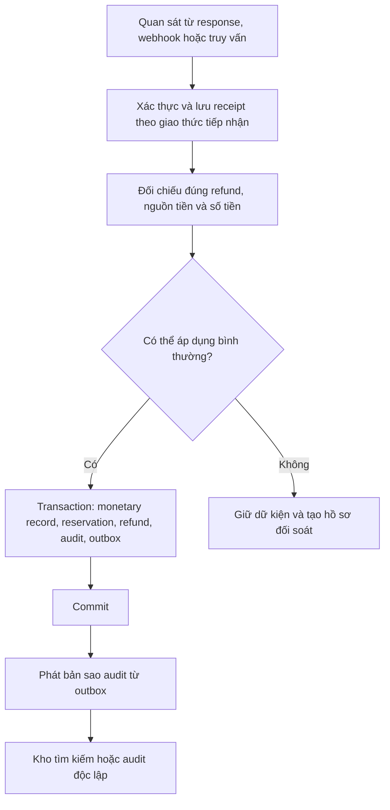

# Refund audit entry: ghi nhận quyết định và kết quả hoàn tiền có thể kiểm chứng

## 1. Audit entry của refund phải chứng minh điều gì?

**Refund audit entry** là bản ghi có cấu trúc về một quyết định, thay đổi hoặc kết quả quan trọng trong vòng đời hoàn tiền. Nó giúp giải thích ai đã thực hiện việc gì, với quyền nào, dựa trên dữ liệu và phê duyệt nào, cho khoản tiền nào và kết quả nào đã được hệ thống chấp nhận.

Trong chương Refund Rules, audit không chỉ để biết một endpoint đã được gọi. Hoàn tiền là nghiệp vụ có thể bị lạm dụng qua việc sửa số tiền, đổi giao dịch nguồn, tự phê duyệt, hoàn trùng hoặc bỏ qua khoản đang xử lý. Một dòng `refund success` thiếu định danh giao dịch và ngữ nghĩa trạng thái không đủ để điều tra những tình huống đó.

Ví dụ, nhân viên đã duyệt hoàn 97.200 VND nhưng operation gửi đi lại là 197.200 VND. Nếu audit chỉ ghi “đã được duyệt” và “đã hoàn”, hệ thống không thể chỉ ra nội dung phê duyệt nào đã bị thay đổi. Một audit entry hữu ích cần liên kết quyết định với đúng refund plan, revision, số tiền và nguồn tiền được thực thi.

Mục tiêu bài học là thiết kế bản ghi audit gắn với business invariants, state machine, quyền theo đối tượng, transaction, idempotency và kiểm thử tấn công logic. Audit phải phản ánh nghiệp vụ đã được kiểm tra; nó không thay thế việc kiểm tra đó.

## 2. Phân biệt audit nghiệp vụ, dữ kiện nguồn, ledger và log kỹ thuật

| Loại bản ghi | Câu hỏi được trả lời | Điều không được suy diễn |
|---|---|---|
| Refund audit entry | Quyết định hoặc thay đổi nào đã được chấp nhận, ai thực hiện và dựa vào đâu? | Mọi request xuất hiện đều đã tạo hiệu ứng tiền |
| Provider observation/receipt | Nhà cung cấp đã trả hoặc gửi thông tin gì, qua nguồn nào? | Payload đã được xác thực luôn đủ điều kiện cập nhật refund |
| Monetary ledger/effect record | Hiệu ứng tiền nào đã được xác minh và ghi nhận? | Có thể cộng mọi trường amount trong audit để ra tổng tiền đã hoàn |
| Security log | Ai đã thử hành vi bị từ chối, vượt quyền hoặc sửa payload? | Hành vi bị từ chối là một refund thành công |
| Technical log/trace | Request qua đâu, lỗi gì, mất bao lâu, retry mấy lần? | Log success trước commit là bằng chứng transaction đã thành công |
| Audit projection/export | Bản chiếu hoặc bản sao phục vụ tìm kiếm, vận hành, đối chiếu | Nó luôn mới bằng nguồn chuẩn hoặc có quyền sửa nghiệp vụ |

Một webhook có chữ ký hợp lệ vẫn có thể nói về provider account khác, refund khác, số tiền khác hoặc một operation cũ. Lưu receipt là giữ dữ kiện nguồn; chấp nhận `REFUND_SUCCEEDED` cần thêm đối chiếu nghiệp vụ.

Tương tự, approval không phải dòng tiền. Thông báo từ worker rằng đã gửi request không phải bằng chứng nhà cung cấp đã hoàn tiền. Những khác biệt này phải xuất hiện trong tên sự kiện và cấu trúc audit.

## 3. Định nghĩa từ vựng sự kiện theo state machine

Nên đặt tên sự kiện đủ cụ thể để người đọc không cần đoán “đã hoàn” nghĩa là giai đoạn nào.

| Sự kiện minh họa | Ý nghĩa được phép khẳng định | Căn cứ cần liên kết |
|---|---|---|
| `REFUND_REQUESTED` | Yêu cầu hoàn đã được tiếp nhận theo luồng nghiệp vụ | Người yêu cầu, đối tượng, lý do, nội dung đề xuất |
| `REFUND_ASSESSED` | Điều kiện và số tiền đã được tính/đánh giá | Calculation snapshot, allocation, policy version |
| `REFUND_APPROVED` | Người hoặc chính sách có quyền đã duyệt nội dung cụ thể | Quyết định duyệt, plan revision, phạm vi quyền |
| `REFUND_REJECTED` | Một yêu cầu đã có quyết định không chấp nhận | Lý do và chủ thể/quy tắc ra quyết định |
| `REFUND_RESERVED` | Khả năng hoàn và quyền lợi đã được giữ | Reservation, capture, allocation, số dư liên quan |
| `REFUND_SUBMISSION_RECORDED` | Hệ thống ghi nhận một lần gửi theo mô hình dispatch | Operation, tham chiếu dispatch; không khẳng định đã hoàn |
| `REFUND_OUTCOME_UNKNOWN` | Chưa xác định được kết quả sau sự cố liên lạc | Operation hiện hữu, quan sát lỗi, tình trạng reservation |
| `REFUND_SUCCEEDED` | Hiệu ứng hoàn tiền đã được xác minh và áp dụng | Provider refund ID, monetary record, plan và reservation |
| `REFUND_FAILED_FINAL` | Có căn cứ thao tác không còn có thể hoàn theo hợp đồng nguồn | Kết quả nguồn đã đối chiếu và quyết định xử lý |
| `REFUND_RESERVATION_RELEASED` | Khoản giữ đã được giải phóng hợp lệ | Reservation và căn cứ an toàn để giải phóng |
| `REFUND_RECONCILIATION_REQUIRED` | Có chênh lệch hoặc dữ kiện chưa thể áp dụng bình thường | Receipt, loại sai lệch và hồ sơ đối soát |

Đây là bộ từ vựng minh họa, không bắt buộc mỗi hệ thống dùng đủ mọi tên. Có thể gộp một số thay đổi trong một quyết định nguyên tử; khi đó payload phải thể hiện đầy đủ các hiệu ứng liên quan.

Không gọi chung mọi giai đoạn là `REFUND_ISSUED` nếu người dùng có thể hiểu đó là tiền đã được hoàn. Cũng không tự tạo một sự kiện thành công chỉ vì người có quyền đã nhấn nút duyệt.

Trong mô hình của bài, mỗi thay đổi nghiệp vụ được chấp nhận làm `refundVersion` tăng một và có đúng một audit entry chuẩn tương ứng. Nếu một transaction tạo nhiều entry, cần thêm thứ tự như `eventIndex`, hoặc một sequence audit độc lập được định nghĩa rõ.

Các lần gửi mạng, quan sát nguồn và hành vi truy cập bị từ chối có thể được lưu ở kho riêng. Không bắt chúng dùng chung một version với thay đổi nghiệp vụ rồi vẫn giả định mỗi version chỉ có một entry.

## 4. Trường dữ liệu và nguồn có thẩm quyền

| Nhóm dữ liệu | Trường minh họa | Nguồn và điều kiện tin cậy |
|---|---|---|
| Định danh entry | `eventId`, `eventType`, `schemaVersion` | Server tạo và kiểm tra cấu trúc theo hợp đồng |
| Phạm vi | `tenantId`, `refundId`, `orderId`, `captureId` | Quan hệ được server xác minh, không chỉ lấy từ payload |
| Thứ tự | `refundVersion`, `previousVersion` | Được cấp trong giao thức cập nhật aggregate |
| Chủ thể | `actorType`, `actorId`, người đại diện nếu có | Ngữ cảnh xác thực hoặc danh tính dịch vụ đã kiểm tra |
| Phê duyệt | `approvalId`, người duyệt, `planRevision`, phạm vi được duyệt | Quyết định có hiệu lực cho đúng nội dung thực thi |
| Tiền và quyền lợi | `amountMinor`, `currency`, `currencyScale`, allocation/plan reference | Calculation snapshot và giao dịch gốc được chấp nhận |
| Trạng thái | `fromState`, `toState`, các tham chiếu hiệu ứng | Trạng thái đã đọc và cập nhật trong transaction |
| Dữ kiện nguồn | Provider account, operation/refund ID, verification reference | Kết quả tích hợp đã xác thực và đối chiếu |
| Liên kết xử lý | `commandId`, `operationId`, `correlationId`, `causationId` | Định danh bền dùng để lần theo cùng quá trình |
| Thời gian | `recordedAt`, `receivedAt`, `sourceOccurredAt` | Phân biệt đồng hồ ghi nhận, tiếp nhận và thời gian nguồn báo |
| Lý do | `reasonCode`, ghi chú giới hạn | Mã theo nghiệp vụ; ghi chú vẫn là dữ liệu không đáng tin |

### Không gộp người yêu cầu, người duyệt và người thực thi

Một khoản hoàn có thể do khách yêu cầu, nhân viên hỗ trợ lập hồ sơ, quản lý duyệt và worker thực hiện. Audit phải giữ được các vai trò đó. Không ghi actor của `REFUND_SUCCEEDED` là khách hàng chỉ vì khách là chủ đơn, trong khi tác nhân áp dụng kết quả là service xử lý thanh toán.

Nếu hỗ trợ thao tác thay mặt, ghi người thao tác thực tế và chủ thể được đại diện, cùng tham chiếu căn cứ quyền. Một trường `onBehalfOf` do client tự khai không đủ tạo quyền đại diện.

Nếu tài khoản người dùng sau này bị khóa hoặc đổi tên, lịch sử vẫn cần truy được chủ thể đã thực hiện. Tránh thiết kế xóa một tài khoản làm cascade mất audit. Thông tin nhận diện lưu trong audit phải ở mức cần thiết theo chính sách, không nhân bản tùy ý mọi thuộc tính hồ sơ.

## 5. Ví dụ entry khi refund chuyển từ chưa rõ sang thành công

Giả sử một khoản hoàn 97.200 VND đã được giữ từ capture gốc 306.600 VND. Worker gửi operation nhưng mất response, nên refund ở `UNKNOWN`. Sau đó một quan sát nguồn được xác minh cho thấy operation đã thành công.

```json
{
  "eventId": "audit-rf81-v7",
  "eventType": "REFUND_SUCCEEDED",
  "schemaVersion": 1,
  "tenantId": "tenant-a",
  "refundId": "refund-81",
  "refundVersion": 7,
  "previousVersion": 6,
  "orderId": "order-41",
  "captureId": "capture-12",
  "operationId": "refund-operation-81",
  "commandId": "command-502",
  "actor": {
    "type": "SERVICE",
    "id": "refund-result-processor"
  },
  "approval": {
    "decisionId": "approval-33",
    "approvedBy": "staff-8",
    "planRevision": 3
  },
  "calculation": {
    "snapshotId": "refund-plan-81-r3",
    "policyVersion": "refund-policy-v4",
    "amountMinor": 97200,
    "currency": "VND",
    "currencyScale": 0
  },
  "change": {
    "fromState": "UNKNOWN",
    "toState": "SUCCEEDED",
    "reservationId": "reservation-81",
    "monetaryRecordId": "refund-effect-901"
  },
  "source": {
    "providerAccountId": "merchant-main",
    "providerRefundId": "provider-refund-88",
    "observationId": "receipt-709",
    "verificationReference": "verification-709"
  },
  "sourceOccurredAt": "2026-11-22T03:00:00Z",
  "receivedAt": "2026-11-22T03:02:00Z",
  "recordedAt": "2026-11-22T03:02:01Z"
}
```

Các định danh và thời gian là dữ liệu minh họa. Entry không chứa OTP, token truy cập, mã bảo mật thẻ hay toàn bộ raw webhook. Nó liên kết tới bằng chứng được quản lý riêng và tới monetary record có thẩm quyền.

Trước kết quả này, khoản 97.200 VND nằm trong phần đang giữ. Sau kết quả, nó chuyển sang phần đã hoàn. Khả năng còn được cấp mới không tăng chỉ vì reservation đã được quyết toán; cũng không giảm thêm lần nữa vì vừa cộng hoàn thành công vừa giữ nguyên khoản pending.

Nếu audit có lưu số dư trước/sau để hỗ trợ điều tra, các giá trị phải được lấy từ cùng quyết định transaction, kèm phạm vi như capture và tiền tệ. Không lấy một số từ cache rồi coi đó là snapshot số dư chuẩn.

## 6. Audit phải gắn nguyên tử với quyết định local

### 6.1. Hai kiểu ghi dễ tạo bằng chứng sai

```text
UPDATE refund thành SUCCEEDED
COMMIT
INSERT audit

Rủi ro: tiến trình dừng sau commit → trạng thái thành công nhưng thiếu audit.
```

```text
INSERT audit REFUND_SUCCEEDED
COMMIT
UPDATE refund và ledger

Rủi ro: cập nhật thất bại → audit khẳng định kết quả chưa được áp dụng.
```

Với dữ liệu cùng database, thay đổi refund, monetary record, reservation, audit và outbox nên cùng transaction phù hợp. Một lỗi append audit local trong ranh giới đó phải làm transaction thất bại, thay vì bị bắt rồi bỏ qua để tiếp tục commit.

Điều này không có nghĩa transaction local hoàn tác được tiền bên ngoài. Nếu nhà cung cấp đã hoàn nhưng bước ghi local thất bại, tiền vẫn có thể đã đi. Hệ thống cần giữ hoặc nhận lại dữ kiện nguồn, rồi áp dụng lại cùng kết quả một cách idempotent; không gửi một refund mới để “làm lại cho đủ audit”.

### 6.2. Luồng tổng quát



Kho audit bên ngoài tạm thời không truy cập được không nhất thiết buộc rollback một quyết định local đã có audit bền và outbox cùng commit. Khi đó cần theo dõi backlog, retry việc xuất và cảnh báo độ trễ theo chính sách. Không được đánh dấu đã xuất trước khi cơ chế giao nhận tương ứng hoàn tất.

Ngược lại, nếu thiết kế chỉ gửi audit ra một dịch vụ từ xa sau commit mà không có bản ghi hoặc ý định bền, nó có khoảng mất audit khi tiến trình dừng. Sampling của log/tracing cũng không phù hợp để thay thế nguồn audit nghiệp vụ bắt buộc đầy đủ.

## 7. Ví dụ Java: tạo entry từ kết quả đã được đối chiếu

Đoạn sau là mã mô tả các cổng nghiệp vụ, không phải lớp có thể biên dịch độc lập. Receipt đã được lưu bền qua giao thức tiếp nhận; ví dụ thể hiện nhánh kết quả thành công có thể áp dụng bình thường. Monetary record, reservation, refund, audit và outbox cùng database local.

```java
ApplyResult applySuccessfulRefund(ObservationId receiptId) {
    return transactions.required(() -> {
        var receipt = observations.lockVerifiedReceipt(receiptId);
        if (receipt.isApplied()) {
            return receipt.savedApplyResult();
        }

        var refund = refunds.lockByTrustedOperationMapping(
                receipt.verifiedProviderAccount(),
                receipt.operationReference());

        var outcome = reconciliation.requireMatchingSuccessfulRefund(
                receipt, refund);

        var existingEffect = monetaryRecords.findRefundEffect(
                outcome.providerAccount(), outcome.providerRefundId());
        if (existingEffect != null) {
            reconciliation.requireSameBusinessMapping(
                    existingEffect, refund, outcome);
            observations.markAppliedToExistingEffect(receipt, existingEffect);
            return ApplyResult.alreadyApplied(existingEffect.id());
        }

        var before = refund.snapshot();
        var reservation = reservations.lockForRefund(refund.id());
        rules.requireApplicableSuccess(refund, reservation, outcome);

        var effect = monetaryRecords.recordVerifiedRefund(outcome, refund);
        reservations.settleOnce(reservation, effect);
        refund.markSucceeded(Math.incrementExact(before.version()), effect);

        var entry = auditFactory.refundSucceeded(
                before,
                refund.snapshot(),
                effect,
                reservation,
                receipt,
                executionIdentity.currentService(),
                clock.instant());

        refunds.saveWithExpectedVersion(refund, before.version());
        auditEntries.append(entry);
        outbox.appendAuditEntryCreated(entry);

        var result = ApplyResult.applied(effect.id(), entry.eventId());
        observations.markApplied(receipt, result);
        return result;
    });
}
```

Các hợp đồng phải được bảo đảm khi triển khai:

- `lockVerifiedReceipt` không có nghĩa chỉ cần một cờ `verified: true` từ request. Danh tính nguồn và trạng thái xác minh do adapter có quyền tạo.
- Mapping tới refund dựa trên provider account và operation đã được thiết lập, không dựa trên tenant/refundId tùy ý mà payload tự khai.
- `requireMatchingSuccessfulRefund` kiểm tra loại hiệu ứng, giao dịch nguồn, amount, currency và quan hệ operation. Nhánh không khớp phải đi vào quy trình đối soát giữ nguyên receipt, không bị xóa hoặc lặp lỗi vô hạn.
- Monetary record có unique cho hiệu ứng nguồn ở đúng phạm vi account/môi trường; không chỉ dựa vào ID webhook. Xử lý cạnh tranh của unique phải nằm trong adapter hoặc giao thức transaction thích hợp.
- Nhánh gặp existing effect giả định lần áp dụng trước đã commit nhất quán effect, refund và audit. Nếu dữ liệu thực tế bị lệch, cần điều tra thay vì lấy nhánh duplicate để che lỗi.
- `settleOnce` không cộng lại tiền hoặc giải phóng thêm capacity khi nhận lặp. `saveWithExpectedVersion` kiểm tra cập nhật thành công đúng một đối tượng và rollback khi xung đột.
- `auditFactory` xây entry từ trạng thái và bằng chứng đã chấp nhận. Không deserialize entry hoàn chỉnh từ payload của client hay provider rồi append thẳng.
- Lỗi append audit hoặc outbox làm toàn bộ lần áp dụng local rollback; receipt đã lưu bền còn đó để xử lý lại, không tạo operation hoàn mới.

Nếu ledger hoặc dịch vụ hoàn nằm ở hệ thống khác, không được giả định transaction ở ví dụ bao trùm chúng. Cần xác định sự kiện nguồn có thẩm quyền, giao thức phối hợp và điểm ghi audit ở từng ranh giới.

## 8. Idempotency và thứ tự: audit gì khi sự kiện đến lặp?

### 8.1. Không tạo nhiều thành công nghiệp vụ cho cùng hiệu ứng

Một response, một webhook và một truy vấn có thể cùng xác nhận một provider refund. Có thể lưu cả ba quan sát phục vụ điều tra, nhưng chỉ tạo một hiệu ứng tiền và một quyết định `REFUND_SUCCEEDED` cho cùng lần áp dụng nghiệp vụ.

```text
Receipt A → provider refund X → effect X → audit success version 7
Receipt B → provider refund X → liên kết effect X đã có
Receipt C → provider refund X → liên kết effect X đã có
```

Không gọi cả ba entry là ba lần hoàn thành công rồi hy vọng người đọc tự deduplicate. Ngược lại, hai provider refund ID khác nhau có thể là hai dòng tiền thực tế, kể cả khi chúng gắn với cùng order. Không bỏ một giao dịch đi chỉ vì order đã được đánh dấu hoàn đủ.

Client idempotency, provider idempotency, observation deduplication và effect deduplication giải quyết các ranh giới khác nhau. Audit cần liên kết được chúng bằng tham chiếu, nhưng không gộp mọi ID thành một trường không rõ ý nghĩa.

### 8.2. Version nghiệp vụ quan trọng hơn timestamp cho thứ tự áp dụng

Với mô hình một entry cho một thay đổi, có thể dùng unique `(tenantId, refundId, refundVersion)`. Cùng version nhưng eventId hoặc nội dung khác phải là xung đột cần xử lý, không tự coi là duplicate hợp lệ.

Timestamp bằng nhau hoặc lệch đồng hồ không quyết định ai duyệt trước, ai gửi sau. `sourceOccurredAt` có thể sớm hơn nhiều so với thời điểm server nhận. Đọc timeline theo version nghiệp vụ; hiển thị các mốc thời gian đúng ý nghĩa và không sửa thời gian ghi nhận để giả vờ entry đã có từ trước.

### 8.3. Xuất audit có thể giao lặp

Outbox publisher có thể gửi thành công rồi dừng trước khi đánh dấu. Kho nhận cần deduplicate theo eventId và kiểm tra nội dung/version tương ứng. Cùng eventId nhưng payload khác không nên bị âm thầm ghi đè.

Nếu bản chiếu nhận version vượt trước, giữ chờ hoặc yêu cầu bù phần thiếu theo giao thức. Phân biệt “đã nhận” và “đã áp dụng” để không bỏ vĩnh viễn một entry bị trì hoãn vì thiếu phiên bản trước.

## 9. Ghi số tiền và phê duyệt sao cho không tạo bằng chứng gây hiểu nhầm

### 9.1. Một trường amount không đủ nếu không có ngữ nghĩa

Các sự kiện request, approved, reserved và succeeded có thể đều mang 97.200 VND nhưng không đại diện bốn khoản tiền đã hoàn. Amount cần có ý nghĩa theo eventType hoặc một trường money effect rõ ràng.

Số liệu tổng hoàn thành công nên lấy từ monetary ledger/effect record có thẩm quyền. Audit liên kết tới những bản ghi đó để giải thích, không thay thế bằng phép cộng mọi dòng timeline.

Với partial refund, giữ tham chiếu calculation snapshot và các phần hàng/thuế/phí được hoàn. Với nhiều nguồn thanh toán, lưu được từng phần theo capture, phương tiện và tiền tệ. Không để một con số tổng che đi việc một phần đã thành công còn phần kia chưa rõ.

### 9.2. Phê duyệt phải ràng buộc đúng nội dung

Entry phê duyệt cần chỉ ra plan revision, số tiền/tiền tệ, quyền lợi, nguồn tiền và phạm vi được cho phép. Entry thực hiện phải tham chiếu quyết định còn hiệu lực cho chính nội dung đó.

Nếu plan đổi từ 97.200 sang 197.200 VND, lịch sử cần thể hiện việc đánh giá lại hoặc yêu cầu duyệt mới theo quy tắc. Không sửa entry phê duyệt cũ để khiến nó có vẻ đã duyệt con số mới.

Khi áp dụng ngưỡng tích lũy hoặc quy tắc không tự duyệt, lưu tham chiếu tới quyết định kiểm tra và các dữ kiện cần giải thích, chẳng hạn phạm vi tích lũy được xét và danh tính thực tế. Một chuỗi ghi chú “đã kiểm tra quyền” không đủ nếu không truy được quyết định và nội dung thực thi.

### 9.3. Chưa rõ kết quả vẫn phải có ngôn ngữ chính xác

Timeout không được audit là `REFUND_FAILED_FINAL` nếu chưa có căn cứ kết thúc. Hết ngân sách retry cũng không tự cho phép ghi đã giải phóng reservation.

Nếu thành công đến muộn sau `UNKNOWN`, append quyết định thành công với liên kết tới cùng operation. Không xóa entry unknown trước đó; nó giải thích vì sao đã giữ ngân sách và vì sao kết quả được ghi nhận muộn.

## 10. Quyền ghi, quyền đọc và các đường đi vòng

### 10.1. Không cho audit trở thành API thực thi refund

Một endpoint nhận tùy ý `eventType`, `approvedBy`, `toState`, `amount` rồi cập nhật refund theo entry là lối đi vòng nguy hiểm. Lệnh nghiệp vụ phải được xác thực, kiểm tra quyền và bất biến trước; audit là kết quả của quyết định đó.

Nhân viên có quyền xem case không mặc nhiên có quyền phê duyệt. Người có quyền phê duyệt không mặc nhiên được sửa một entry cũ hoặc thay nguồn tiền. Các thao tác thủ công và ngoại lệ cần quyền, lý do và căn cứ riêng.

Ở tầng lưu trữ, có thể hạn chế tài khoản ứng dụng chỉ append audit qua đường kiểm soát, không UPDATE/DELETE thường ngày. Nhưng chỉ cấm sửa entry chưa đủ: cần bảo vệ cả đường cập nhật refund và ledger, nếu không kẻ có quyền vẫn có thể đổi trạng thái mà bỏ qua audit.

### 10.2. Đọc theo đúng tenant và đối tượng

Mọi truy vấn timeline, export, tìm kiếm và tải bằng chứng phải áp dụng phạm vi quyền trước khi trả dữ liệu. Biết refundId hoặc eventId không có nghĩa được xem audit.

Một bản chiếu cho khách hàng có thể ẩn danh tính nhân viên, lý do nội bộ hoặc tín hiệu rủi ro. Việc lọc response không được làm thay đổi entry gốc. Bản export nội bộ cũng không được mặc định bỏ kiểm tra tenant chỉ vì người gọi có vai trò hỗ trợ.

### 10.3. Ghi chú không có thẩm quyền như quyết định

Nội dung “quản lý đã duyệt” trong ghi chú của người dùng chỉ là văn bản nếu không có approval record được xác minh. Không suy ra quyền từ chuỗi tự do.

Ghi chú cần giới hạn kích thước, được hiển thị an toàn theo ngữ cảnh và không làm giả cấu trúc log bằng ký tự điều khiển. Tránh lưu toàn bộ request chỉ để có nhiều thông tin hơn, vì nó có thể chứa bí mật hoặc dữ liệu cá nhân không cần thiết.

## 11. Append-only, dấu toàn vẹn và giới hạn bằng chứng

Tính bất biến cần được mô tả theo mô hình đe dọa: API có được sửa không, tài khoản ứng dụng có quyền gì, quản trị database có thể làm gì và ai kiểm soát kho sao lưu hoặc điểm neo.

Một digest hoặc hash chain có thể hỗ trợ phát hiện thay đổi:

```text
canonicalEntry = serializeCanonical(
    chainId, tenantId, refundId, refundVersion,
    eventId, eventType, schemaVersion,
    actor, decisionReferences, moneyReferences,
    stateChange, recordedAt, sourceReferences
)

entryDigest[n] = HASH(domainTag || entryDigest[n-1] || canonicalEntry[n])
```

Canonicalization cần quy định encoding, thứ tự trường, biểu diễn tiền/thời gian/null và cách phân ranh giới dữ liệu. Trường bằng chứng chứa chính digest không được tạo vòng tham chiếu tự tính. Lưu version thuật toán và hợp đồng serialization để kiểm tra được entry cũ sau này.

Hash nằm cùng dữ liệu không tự chống người có thể sửa cả entry lẫn hash. HMAC hoặc chữ ký có thể tăng khả năng phát hiện giả mạo khi khóa được quản lý phù hợp, nhưng không chứng minh quyết định gốc hợp lệ nếu thành phần có quyền ký đã tạo dữ liệu sai.

Một chuỗi tự khớp cũng chưa chứng minh đầy đủ: phần đuôi có thể bị xóa cùng head local. Nếu cần phát hiện điều đó, phải có mốc version/digest đáng tin ở miền kiểm soát độc lập và kiểm tra độ đầy đủ của chuỗi. Neo theo lô chỉ bảo vệ tới mốc đã neo; phần mới hơn còn một khoảng chưa có điểm đối chiếu ngoài.

Những cơ chế này bổ sung cho authorization, transaction, idempotency và backup. Không dùng chữ ký như lý do chấp nhận request của sai tenant, hoặc dùng hash chain như bằng chứng đã nhận đủ tiền từ nhà cung cấp.

## 12. Sửa sai, phục hồi và lưu trữ dữ liệu nhạy cảm

### 12.1. Đính chính bằng một bản ghi mới

Nếu một quyết định ghi nhầm lý do hoặc cần điều chỉnh nghiệp vụ, append entry đính chính có quyền và liên kết entry bị tác động. Phân biệt sửa mô tả với thay đổi tiền: việc bổ sung ghi chú không được tự biến thành một refund operation mới.

Nếu phát hiện audit thiếu sau sự cố, cần đối chiếu monetary ledger, receipt, outbox, backup và nguồn bên ngoài. Bản ghi được phục hồi phải thể hiện nguồn và thời điểm phục hồi; không gán recordedAt cũ để tạo cảm giác nó đã tồn tại nguyên vẹn từ đầu.

Không tạo thêm `REFUND_SUCCEEDED` thông thường chỉ để vá thiếu dữ liệu mà không kiểm tra hiệu ứng đã được ghi nhận. Cần phân biệt entry gốc, bằng chứng phục hồi và quyết định điều chỉnh sau sự cố.

### 12.2. Tối thiểu hóa dữ liệu ngay từ schema

Audit thường được sao chép sang kho tìm kiếm, backup và hệ thống đối soát. Vì vậy, không ghi mã bảo mật thẻ, credential, token truy cập, dữ liệu xác thực hoặc chi tiết tài khoản nhận tiền không cần thiết vào entry.

Có thể lưu tham chiếu tới bằng chứng được kiểm soát quyền và thời hạn giữ. Ghi nhận loại xác minh, key identifier hoặc verification reference phù hợp mà không lưu bí mật dùng để xác minh.

Chính sách che, xóa hoặc giảm nhận diện cần được thiết kế cùng cơ chế toàn vẹn và lưu trữ. Sửa payload đã băm sẽ làm kiểm tra thay đổi; không âm thầm tính lại hash rồi tuyên bố chưa có chỉnh sửa. Backup và kho neo cũng cần phạm vi truy cập, thời hạn và khả năng khôi phục phù hợp với mục đích lưu.

### 12.3. Theo dõi việc xuất và khả năng đọc lại

Cần biết entry nào đã được xuất, bản chiếu đang tới version nào và có khoảng trống hay payload xung đột không. Tắt hệ thống tìm kiếm không được làm mất nguồn audit local; ngược lại, có nguồn local không đủ nếu dữ liệu đã quá hạn mà bản sao bắt buộc chưa được lưu theo chính sách.

Schema evolution phải giữ cách giải thích entry cũ. Không đổi ý nghĩa `amountMinor` hoặc `eventType` ở cùng schemaVersion rồi để bộ đọc hiện tại diễn giải lại quá khứ theo quy tắc mới.

## 13. Kiểm thử tính đúng của audit và các tình huống lạm dụng

| Tình huống | Thiết lập và hành động | Kết quả cần chứng minh |
|---|---|---|
| Luồng thành công | Áp dụng refund đã đối chiếu đúng | Monetary record, reservation, refund và entry cùng commit, liên kết đủ căn cứ |
| Approval chưa phải tiền | Duyệt nhưng chưa gửi/hoàn | Không có entry khẳng định tiền đã hoàn |
| Giả actor | Gửi actorId/approvedBy quản trị trong request | Actor và người duyệt chuẩn đến từ danh tính/quyết định đã xác minh |
| Truy cập chéo | Đổi tenant, refundId hoặc eventId khi đọc/export | Không lộ timeline, tiền hoặc bằng chứng ngoài quyền |
| Plan đổi sau duyệt | Đổi amount, nguồn hoặc quyền lợi | Entry thực hiện không thể dùng approval sai revision; lịch sử không bị sửa |
| Audit insert lỗi | Gây lỗi sau ghi ledger nhưng trước append audit local | Toàn bộ lần áp dụng local rollback; receipt còn để xử lý lại |
| Tiền đã hoàn ngoài nguồn | Provider hoàn xong nhưng local transaction thất bại | Khôi phục từ cùng dữ kiện/operation, không gửi refund mới để vá audit |
| Outbox lỗi | Làm insert outbox thất bại trong transaction | Không commit trạng thái mới mà thiếu ý định xuất đã thiết kế |
| Kho export ngừng | Local commit rồi kho ngoài không nhận được | Entry và outbox còn bền, backlog được theo dõi và gửi lại an toàn |
| Message lặp | Publisher giao lại cùng event nhiều lần | Một entry ở bản chiếu; cùng ID khác payload bị phát hiện |
| Nhiều quan sát cùng tiền | Response, webhook và query cùng nói về refund X | Có thể có nhiều receipt nhưng một effect và một chuyển thành công nghiệp vụ |
| Hai dòng tiền thực | Hai provider refund khác ID cùng liên quan một order | Lưu và đối soát cả hai, không bỏ một dòng chỉ vì refund/order đã thành công |
| Timeout | Không biết nguồn đã hoàn hay chưa | Entry UNKNOWN đúng ngữ nghĩa, không ghi thất bại cuối hoặc giải phóng giả |
| Kết quả đến muộn | UNKNOWN rồi nhận thành công đã xác minh | Append kết quả mới, giữ lịch sử chưa rõ và cùng operation |
| Cạnh tranh | Hai worker áp dụng cùng outcome đồng thời | Unique/lock/version giữ một hiệu ứng và một entry thành công |
| Version xung đột | Cùng refundVersion với nội dung khác | Bị chặn hoặc báo xung đột, không ghi đè yên lặng |
| Sắp xếp sai thời gian | Timestamp bằng nhau hoặc nguồn báo sớm/muộn | Thứ tự áp dụng theo version, các mốc thời gian được phân biệt |
| Sửa/xóa entry | Dùng API hoặc tài khoản ứng dụng thường ngày | Bị ngăn theo cơ chế quyền đã cấu hình; không có đường quản trị tùy ý |
| Xóa phần đuôi | Xóa entry và head local trong môi trường kiểm thử | Mốc độc lập phát hiện mất phần đã neo; giới hạn phần chưa neo được xác định |
| Rò dữ liệu | Gửi request có credential hoặc thông tin nhạy cảm | Entry/log/export không lưu bí mật ngoài schema cho phép |
| Khôi phục và đọc schema cũ | Phục hồi backup hoặc dùng bộ đọc mới | Liên kết, version, nguồn phục hồi và ngữ nghĩa entry cũ còn kiểm tra được |

Kiểm thử phải quan sát dữ liệu thực tế, không chỉ response HTTP hoặc một dòng log. Với rollback, gây lỗi đúng giữa ledger, reservation, refund, audit và outbox. Với race condition, dùng điểm đồng bộ để các worker thực sự cùng chạm vùng áp dụng kết quả.

Kiểm thử export cũng cần trường hợp gửi thành công nhưng publisher chưa kịp đánh dấu, vì đó là nguồn message lặp tự nhiên. Kiểm thử phục hồi phải phân biệt việc dựng lại một bản chiếu với việc tạo bằng chứng cho một audit entry gốc đã bị mất.

## 14. Đọc một refund audit trail để điều tra

Một timeline có thẩm quyền nên được lấy trong phạm vi tenant và refund đã kiểm tra quyền. Dạng truy vấn minh họa:

```sql
SELECT refund_version,
       event_type,
       recorded_at,
       actor_type,
       actor_id,
       operation_id,
       monetary_record_id
FROM refund_audit
WHERE tenant_id = :authorized_tenant_id
  AND refund_id = :authorized_refund_id
ORDER BY refund_version;
```

Các tham số phải được bind và phạm vi quyền phải do server xác định. Truy vấn minh họa chưa bao gồm phân trang, bản chiếu hoặc kiểm tra snapshot đọc nhất quán của một hệ thống cụ thể.

Khi điều tra, đối chiếu lần lượt nội dung yêu cầu, plan được tính, approval đúng revision, reservation, operation gửi đi và hiệu ứng tiền đã xác minh. Tìm điểm mà số tiền, nguồn, chủ thể hoặc trạng thái không còn khớp, đồng thời kiểm tra receipt chưa áp dụng và các khoảng trống export.

Kết luận cần chỉ rõ dữ kiện nào là nguồn gốc, quyết định nào đã commit và phần nào đang cần đối soát hoặc đã được phục hồi. Một refund audit entry đáng tin phải giúp giải thích được điều đó mà không cần suy đoán từ những dòng log thành công chung chung.
