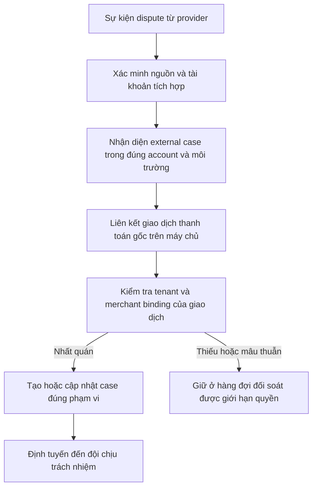

# Quyền sở hữu và trách nhiệm xử lý hồ sơ chargeback (Chargeback case ownership)

## 1. Case ownership là một ranh giới bảo mật nghiệp vụ

Chargeback case là hồ sơ xử lý tranh chấp liên quan đến một giao dịch thanh toán. Trong tài liệu Stripe, dispute được mô tả là tình huống chủ thẻ đặt vấn đề về một khoản thanh toán với bên phát hành thẻ. Hồ sơ này khác với một yêu cầu hoàn tiền nội bộ do ứng dụng tự tiếp nhận. [Stripe — Disputes](https://docs.stripe.com/disputes)

Trong chương **Chargeback Rules**, **case ownership** xác định hồ sơ thuộc phạm vi tổ chức nào, đội nào chịu trách nhiệm và người nào được thực hiện từng hành động. Đây là vấn đề bảo mật nghiệp vụ vì phân công sai có thể dẫn đến:

- Người tenant A đọc bằng chứng của tenant B.
- Nhân viên tự nhận một hồ sơ không thuộc phạm vi của mình.
- Người đã bị bàn giao hồ sơ vẫn gửi bằng chứng bằng request cũ.
- Hai nhân viên cùng đưa ra quyết định trái ngược.
- Tích hợp gửi phản hồi bằng sai tài khoản merchant.
- Hồ sơ không có người chịu trách nhiệm cho đến khi quá hạn.
- Thay đổi người xử lý bị lợi dụng để che giấu lịch sử hoặc né phê duyệt.

Một bảng có cột `assignedTo` chưa đủ bảo vệ các quy tắc này. Cần kết hợp nguồn xác lập phạm vi, quyền theo đối tượng, state machine, phiên bản, transaction, idempotency và audit.

Bài học mô hình hóa ownership trong ứng dụng. Trạng thái, thời hạn và các hành động được provider hỗ trợ phải được ánh xạ theo tích hợp thực tế; không dùng các tên trạng thái minh họa dưới đây như hợp đồng chung của mọi mạng thẻ.

## 2. Phân biệt bốn lớp thường bị gọi chung là “owner”

| Lớp | Câu hỏi được trả lời | Ví dụ |
| --- | --- | --- |
| Phạm vi tổ chức/merchant | Hồ sơ nằm trong miền dữ liệu và vận hành nào? | Tenant A, merchant account M1 |
| Đơn vị chịu trách nhiệm | Đội nào có trách nhiệm điều phối và bảo đảm hồ sơ được xử lý? | Đội Dispute Operations |
| Người được phân công | Ai đang trực tiếp xử lý công việc? | Nhân viên U17 |
| Quyền thực hiện hành động | Ai được đọc, bàn giao, duyệt hoặc gửi phản hồi? | U17 được chuẩn bị; U20 được duyệt và gửi |

Ngoài ra, bên có quyền ra quyết định tranh chấp trong quy trình thanh toán là một vai trò bên ngoài ứng dụng. Đổi người xử lý nội bộ không chuyển quyền quyết định đó cho nhân viên, cũng không tự đổi trách nhiệm tài chính giữa các bên.

### 2.1. Phạm vi hồ sơ không phải trường người dùng tùy chọn

`tenantId`, `providerAccountRef` và giao dịch nguồn phải được xác lập từ dữ liệu tích hợp đã xác minh cùng liên kết thanh toán trên máy chủ.

Một nhân viên được chuyển từ đội X sang đội Y không có nghĩa các case thuộc tenant X tự chuyển sang tenant Y. Tương tự, đổi `assignedUserId` không làm thay đổi merchant account ở provider.

### 2.2. Assignment thể hiện trách nhiệm, không tự tạo mọi quyền

Một người được phân công vẫn phải:

- Có tài khoản hoạt động.
- Thuộc phạm vi tenant và đội phù hợp.
- Có capability cần thiết cho hành động.
- Đáp ứng điều kiện phân tách nhiệm vụ hoặc phê duyệt nếu áp dụng.
- Thao tác trên phiên bản ownership hiện tại.

Không được viết quy tắc duy nhất:

```text
case.assignedUserId == actor.id => cho phép mọi hành động
```

Một người có thể được chuẩn bị bằng chứng nhưng không được tự chấp nhận kết quả bất lợi hoặc gửi phản hồi cuối cùng.

### 2.3. Khách hàng của giao dịch không mặc nhiên được xem case nội bộ

Chủ đơn có thể được xem lịch sử mua hàng hoặc tiến trình hỗ trợ theo sản phẩm. Điều đó không tự tạo quyền xem bằng chứng, ghi chú điều tra, dữ liệu merchant hoặc các quyết định nội bộ trong chargeback case.

Quyền sở hữu đơn hàng của khách và quyền quản lý hồ sơ tranh chấp của merchant là hai quan hệ khác nhau.

## 3. Xác định invariant trước khi thiết kế API

Các invariant cốt lõi:

1. Mỗi case được liên kết với một danh tính bên ngoài và phạm vi giao dịch đã được xác minh; request không được tự đặt phạm vi đó.
2. Mọi thao tác đọc hoặc ghi phải được kiểm tra trên đúng case, tenant, merchant scope và capability.
3. Một case có đơn vị chịu trách nhiệm rõ ràng; trạng thái chưa có cá nhân xử lý phải có hàng đợi và cơ chế nhận trách nhiệm.
4. Bàn giao không được làm mất deadline, bằng chứng, lệnh đang xử lý hoặc lịch sử quyết định.
5. Người đã mất quyền theo assignment không được dùng request cũ để tiếp tục thao tác thuộc quyền đã mất.
6. Một hành động có tác động bên ngoài chỉ được chấp nhận theo một quyết định quyền hợp lệ và một nội dung đã chốt.
7. Retry không tạo nhiều lần bàn giao hoặc nhiều lệnh phản hồi không mong muốn.
8. Đổi người xử lý không được biến thành sửa tenant hoặc chuyển merchant account trái phép.
9. Mỗi thay đổi ownership đã commit phải có audit tương ứng.

“Invariant một đơn vị chịu trách nhiệm” không cấm nhiều cộng tác viên. Nó yêu cầu hệ thống phân biệt người chịu trách nhiệm chính với người được xem, người hỗ trợ và người duyệt.

Một mô hình cho phép nhiều người chỉnh sửa cũng cần quy tắc xử lý cạnh tranh; không thể bỏ qua vì tất cả đều thuộc cùng đội.

## 4. Xác lập case scope từ dữ liệu có thẩm quyền

### 4.1. Chuỗi ánh xạ khi tiếp nhận sự kiện

Một luồng minh họa:



Tài liệu Adyen tổ chức việc xem dispute trong ngữ cảnh merchant account và yêu cầu các role thích hợp cho quản lý dispute. Điều đó minh họa rằng định danh case và quyền hành động cần được hiểu trong phạm vi tài khoản vận hành, không chỉ theo một case ID trần. Các capability trong bài là thiết kế của ứng dụng, không phải tên role bắt buộc của Adyen. [Adyen — Manage disputes](https://docs.adyen.com/risk-management/manage-disputes)

### 4.2. Khóa nhận diện bên ngoài phải có phạm vi

Một khóa nghiệp vụ có thể là:

```text
provider
+ environment
+ providerAccountRef
+ externalCaseId
```

Mục tiêu là không coi hai mã case giống nhau ở hai tài khoản hoặc môi trường khác nhau là cùng một case.

Sự kiện trùng được nhận diện theo event ID trong phạm vi nguồn; case được nhận diện theo khóa của case. Hai loại khóa này giải quyết hai vấn đề khác nhau.

Không nhận case scope chỉ từ:

- `tenantId` nằm trong metadata do người dùng từng tự truyền.
- Email khách hàng.
- Số tiền và thời gian “gần giống”.
- orderId gửi từ một request quản trị chưa kiểm tra quan hệ.
- Nhân viên nào bấm nút “claim” đầu tiên.

Các dữ liệu đó có thể hỗ trợ đối soát nhưng không tự đủ thẩm quyền xác lập ownership.

### 4.3. Tài khoản dùng chung cần liên kết giao dịch gốc

Nếu một platform dùng chung tài khoản tích hợp cho nhiều tenant, provider account chỉ xác lập miền tích hợp, chưa đủ xác định tenant chịu trách nhiệm của từng case.

Cần dùng liên kết giao dịch đã được máy chủ ghi nhận khi tạo hoặc ghi nhận khoản thanh toán:

```text
provider transaction
    -> payment record
    -> merchant/tenant binding có xuất xứ
    -> order hoặc phạm vi nghĩa vụ liên quan
```

Không lấy tenant đầu tiên tìm thấy trong một danh sách đơn. Nếu một thanh toán liên quan nhiều đơn hoặc nhiều bên bán, cần mô hình trách nhiệm riêng, có thể gồm case chính ở platform và các nhiệm vụ con với phạm vi bằng chứng giới hạn.

Mô hình cơ sở của bài học giả sử mỗi case đã xác định được một tenant chịu trách nhiệm chính. Trường hợp nhiều bên không được giải quyết bằng cách sao chép toàn bộ case cho mọi tenant.

### 4.4. Không tự sửa tenant khi dữ liệu mâu thuẫn

Nếu case đã được liên kết với tenant A nhưng sự kiện sau gợi ra tenant B:

- Giữ lại bằng chứng và mapping version liên quan.
- Chặn các hành động nhạy cảm theo chính sách đối soát.
- Xác minh lại giao dịch nguồn và tài khoản tích hợp.
- Thực hiện quy trình hiệu chỉnh có quyền, lý do và audit.

Không tự cập nhật `tenant_id = B` để sự kiện “chạy qua”. Đó có thể là lỗi mapping, event sai phạm vi hoặc một đường tấn công làm dịch chuyển dữ liệu.

Khi thay đổi cấu hình liên kết merchant account, cần giữ được xuất xứ của các giao dịch cũ. Một dispute đến muộn không nên bị định tuyến sang tenant mới chỉ vì cấu hình hiện tại của account đã đổi.

## 5. Mô hình dữ liệu tách scope, assignment và workflow

Một bản ghi case có thể gồm:

```text
identity:
    caseId
    provider, environment, providerAccountRef, externalCaseId
    paymentRef

scope:
    tenantId
    merchantBindingRef
    scopeBindingVersion

responsibility:
    responsibleTeamId
    assignedUserId
    ownershipVersion

workflow:
    localState
    externalStatus
    submissionState
    caseVersion

evidence:
    evidenceBundleRef
    evidenceBundleVersion

timing:
    responseDueAt
    deadlineSourceRef
    createdAt, updatedAt
```

### 5.1. Ý nghĩa từng nhóm

- **Scope** là ranh giới dữ liệu và quan hệ giao dịch. API phân công thông thường không được sửa nhóm này.
- **Responsibility** là đội và cá nhân chịu trách nhiệm công việc.
- **Workflow** biểu diễn tiến độ xử lý, không suy ra hoàn toàn từ việc đã có người được gán.
- **Evidence** nhận diện đúng bộ bằng chứng; không chỉ trỏ đến một thư mục luôn thay đổi.
- **Timing** giữ mốc từ nguồn và chính sách áp dụng; bàn giao không làm deadline bắt đầu lại.

`ownershipVersion` tăng khi thay đổi phân công, đội chịu trách nhiệm hoặc ủy quyền theo mô hình đã chọn. `caseVersion` có thể tăng rộng hơn khi trạng thái nghiệp vụ thay đổi.

Hai phiên bản không thay thế nhau. Case có thể nhận kết quả từ provider nhưng không đổi người xử lý; ngược lại, đổi người xử lý không đồng nghĩa provider đã chuyển sang giai đoạn mới.

### 5.2. Chưa có cá nhân không được trở thành không ai chịu trách nhiệm

Một case đã xác lập scope có thể ở hàng đợi của đội:

```text
responsibleTeamId = team-dispute-a
assignedUserId = null
```

Đây là trạng thái hợp lệ nếu đội có cơ chế nhận việc, theo dõi deadline và escalation.

Không nên để:

```text
responsibleTeamId = null
assignedUserId = null
và không có hàng đợi nào theo dõi
```

Các sự kiện chưa xác lập được scope nên ở vùng intake/đối soát có quyền riêng, không giả làm case bình thường rồi gán tenant ngẫu nhiên để thỏa ràng buộc dữ liệu.

### 5.3. Tách assignment khỏi trạng thái phản hồi

Ví dụ:

```text
localState = OPEN
assignedUserId = U17
submissionState = PENDING
```

Nghĩa là U17 đang chịu trách nhiệm, đã có lệnh phản hồi được chấp nhận và đang chờ kết quả. Đổi người xử lý không được tự tạo phản hồi mới hoặc làm lệnh đang chờ biến mất.

Sau khi phản hồi được xác nhận, vẫn có thể cần người theo dõi kết quả. “Đã gửi bằng chứng” không đồng nghĩa hồ sơ đã được giải quyết cuối cùng.

## 6. Quyền theo đối tượng cho từng hành động

Một mô hình capability minh họa:

| Capability | Hành động | Điều kiện bổ sung điển hình |
| --- | --- | --- |
| `CASE_READ` | Xem metadata hồ sơ | Đúng tenant, merchant scope và phạm vi đội |
| `CASE_EVIDENCE_READ` | Xem/tải bằng chứng | Đúng case, loại dữ liệu và mục đích được cấp |
| `CASE_ASSIGN` | Gán người trong đội/phạm vi được quản lý | Người nhận hợp lệ, version hiện tại |
| `CASE_TRANSFER_TEAM` | Chuyển đội chịu trách nhiệm | Đội nhận được phép xử lý merchant scope đó |
| `CASE_EVIDENCE_EDIT` | Chuẩn bị bộ bằng chứng | Đúng assignment/ủy quyền và phiên bản bằng chứng |
| `CASE_SUBMIT_RESPONSE` | Chấp nhận lệnh gửi phản hồi | Đủ quyền, đúng giai đoạn, deadline và bộ bằng chứng đã chốt |
| `CASE_ACCEPT_DISPUTE` | Chấp nhận tranh chấp nếu tích hợp hỗ trợ | Quyền riêng và phê duyệt theo chính sách |
| `CASE_SCOPE_CORRECT` | Hiệu chỉnh binding bị sai | Quy trình đặc quyền có bằng chứng và kiểm soát riêng |

Các capability này thuộc thiết kế nội bộ. Chúng phải được ánh xạ sang khả năng thật của provider, không tạo ra những hành động mà tích hợp không hỗ trợ.

### 6.1. Phép kiểm tra quyền phải kết hợp nhiều chiều

Ví dụ đối với gửi phản hồi:

```text
canSubmit =
    actor đang hoạt động và được xác thực
    AND actor có CASE_SUBMIT_RESPONSE
    AND actor thuộc tenant và merchant scope của case
    AND actor là người được phân công hoặc được ủy quyền hợp lệ
    AND assignment hiện tại khớp phiên bản của lệnh
    AND workflow cho phép gửi ở giai đoạn này
    AND bộ bằng chứng và phê duyệt còn hợp lệ
```

Nếu supervisor được phép thao tác thay, quyền đó phải được diễn đạt rõ và lưu lý do. Không để mọi người có nhãn “admin” tự vượt toàn bộ tenant và kiểm soát phê duyệt.

### 6.2. Kiểm tra quyền ở mọi đường truy cập

Bao gồm:

- Xem chi tiết, danh sách và tìm kiếm case.
- Tải bằng chứng hoặc file đính kèm.
- Export báo cáo.
- Gán, nhận, bàn giao và bỏ phân công.
- Chỉnh sửa ghi chú hoặc bộ bằng chứng.
- Chấp nhận lệnh gửi phản hồi.
- Job tự động, batch và công cụ quản trị.

Một API chi tiết có scope đúng nhưng endpoint tải file chỉ kiểm tra fileId vẫn có thể làm lộ dữ liệu chéo tenant.

Quyền trên file phải gắn lại với case và người gọi. Không coi đường dẫn object storage hoặc UUID là một ranh giới bảo mật.

### 6.3. Assignment không thay thế trạng thái thành viên

Một người từng thuộc đội nhưng đã bị khóa tài khoản không được tiếp tục thao tác chỉ vì `assignedUserId` vẫn trỏ đến họ.

Tùy mô hình quyền, cần kiểm tra trạng thái thành viên hoặc phiên bản quyền thích hợp. Token cũ hoặc cache role cũ có thể không đáp ứng yêu cầu thu hồi tức thời.

Nếu thay đổi quyền cần có hiệu lực ngay tại thời điểm chấp nhận lệnh, cơ chế xác minh quyền phải tham gia ranh giới quyết định tương ứng. Khóa hàng case không tự khóa được nguồn phân quyền ở một dịch vụ khác.

## 7. Quy trình nhận việc và bàn giao

### 7.1. Nhận việc từ hàng đợi

Một lệnh `claimCase` nên kiểm tra:

1. Case đã có scope hợp lệ và nằm trong hàng đợi mà người gọi được phép nhận.
2. Case còn ở trạng thái cho phép nhận việc.
3. Chưa có người khác nhận, hoặc policy cho phép nhận lại theo điều kiện rõ ràng.
4. Người nhận đang hoạt động và đủ capability.
5. Phiên bản ownership vẫn khớp.
6. Ghi assignment và audit trong cùng transaction.

Nếu hai người cùng nhận một case chưa phân công, chỉ một quyết định được commit theo giao thức đã chọn. Người còn lại nhận xung đột hoặc trạng thái mới; không được ghi đè người thắng.

### 7.2. Bàn giao có chủ đích

Lệnh bàn giao nên thể hiện:

```text
caseId
targetTeamId / targetUserId
expectedOwnershipVersion
reasonCode
commandId hoặc idempotency key
```

Máy chủ tự xác lập người thực hiện và phạm vi hồ sơ. Payload không được có quyền sửa `tenantId`, `providerAccountRef`, `externalCaseId` hoặc deadline.

Tại thời điểm bàn giao, kiểm tra đội/người nhận có thể tiếp nhận đúng scope và hành động cần làm. Gán thành công cho người không thể đọc hoặc xử lý case sẽ tạo một hồ sơ bị bỏ rơi dù cột assignee không rỗng.

### 7.3. Handoff cần giữ ngữ cảnh công việc

Thông tin bàn giao có thể gồm:

- Giai đoạn hiện tại và deadline còn lại.
- Bộ bằng chứng nào đang được chuẩn bị hoặc đã duyệt.
- Lệnh nào đã được chấp nhận, đang chờ hoặc chưa rõ kết quả.
- Những quyết định nào cần phê duyệt bổ sung.
- Các cảnh báo đối soát hoặc dữ liệu còn thiếu.

Chỉ lưu dữ liệu cần thiết, không sao chép bí mật thanh toán vào ghi chú tự do.

Đổi người xử lý không nên tự xóa phê duyệt còn hợp lệ, cũng không tự giữ phê duyệt nếu người nhận sửa nội dung thuộc phạm vi đã duyệt. Cần quy tắc riêng cho hiệu lực của bằng chứng và phê duyệt.

### 7.4. Deadline không được đặt lại

Một kẻ lạm dụng hoặc thao tác sai có thể liên tục bàn giao để làm mới bộ đếm thời gian ở giao diện.

Thay vì tính deadline từ `assignedAt`, dùng `responseDueAt` gắn với nguồn và phiên bản đã xác lập. Deadline có thể thay đổi nếu có thông tin có thẩm quyền từ tích hợp; khi đó cần ghi rõ nguồn thay đổi.

Timer và escalation phải tìm người/đội chịu trách nhiệm hiện tại khi thực hiện. Bàn giao không được làm mất tác vụ theo dõi.

Không áp đặt một số ngày chung cho mọi case. Giai đoạn và thời hạn phải theo dữ liệu, khả năng và quy tắc của tích hợp tương ứng.

## 8. Cạnh tranh giữa bàn giao và gửi phản hồi

### 8.1. Request cũ của người đã mất assignment

Giả sử U17 đang xử lý case ở `ownershipVersion = 8`:

```text
U17 mở màn hình và chuẩn bị gửi.
Supervisor bàn giao cho U20, version tăng thành 9.
U17 gửi request cũ mang version 8.
```

Hệ thống phải kiểm tra assignment hiện tại và version tại ranh giới chấp nhận lệnh. Request của U17 không được tiếp tục chỉ vì giao diện đã tải trước khi bàn giao.

Nếu U17 vẫn có quyền đọc theo đội, quyền đọc đó có thể còn hợp lệ. Nhưng các quyền phụ thuộc assignment đã mất, chẳng hạn gửi phản hồi, phải bị chặn.

### 8.2. Lệnh đã được chấp nhận trước khi bàn giao

Đây là tình huống khác:

```text
Transaction chấp nhận lệnh của U17 commit.
Outbox đã có lệnh gửi bằng chứng.
Sau đó có yêu cầu bàn giao.
```

Đổi assignment không tự thu hồi lệnh đã commit. Phải xác định chính sách rõ ràng.

Trong mô hình minh họa của bài học:

- Bàn giao thông thường bị chặn khi `submissionState` là `PENDING` hoặc `OUTCOME_UNKNOWN`.
- Lệnh đã chấp nhận giữ nguyên commandId, bộ bằng chứng, tài khoản tích hợp và người khởi tạo.
- Handoff đặc biệt nếu cần phải tiếp nhận trách nhiệm với **cùng tác vụ đang tồn tại**, không tạo lệnh gửi mới.
- Muốn dừng tác vụ phải có giao thức dừng/đối soát phù hợp; không chỉ đổi một cột.

Đây là một lựa chọn thiết kế để làm rõ bất biến, không phải quy tắc bắt buộc của mọi doanh nghiệp. Một mô hình cho phép bàn giao trong lúc gửi vẫn phải bảo vệ vòng đời lệnh, trách nhiệm và khả năng truy vết tương đương.

### 8.3. Không giữ khóa cơ sở dữ liệu suốt thời gian con người xử lý

Transaction dùng để bảo vệ quyết định ngắn: gán case, chấp nhận lệnh, ghi audit và outbox. Không giữ khóa hàng trong nhiều phút khi người dùng đọc hồ sơ hoặc trong lúc chờ mạng.

Một edit lease có thể hỗ trợ trải nghiệm cộng tác, nhưng lease không thay thế quyền. Nếu dùng lease, thao tác ghi phải kiểm tra token/phiên bản còn hiệu lực; token cũ không được tiếp tục sau khi lease được cấp lại.

Lease hết hạn không làm tenant thay đổi và không tự chứng minh một lệnh bên ngoài chưa được gửi.

## 9. Minh họa bàn giao nguyên tử bằng SQL và Java

### 9.1. Cập nhật có điều kiện

Một lệnh bàn giao có thể dùng phép cập nhật:

```sql
UPDATE chargeback_cases
SET responsible_team_id = :target_team_id,
    assigned_user_id = :target_user_id,
    ownership_version = ownership_version + 1,
    case_version = case_version + 1,
    assigned_at = :now
WHERE id = :case_id
  AND tenant_id = :authenticated_tenant_id
  AND ownership_version = :expected_ownership_version
  AND case_version = :expected_case_version
  AND local_state = 'OPEN'
  AND submission_state NOT IN ('PENDING', 'OUTCOME_UNKNOWN');
```

Ứng dụng chỉ tiếp tục khi đúng một hàng được cập nhật. Không có hàng nào thay đổi phải được xử lý như xung đột, không tìm thấy hoặc không đúng điều kiện theo chính sách tránh lộ tài nguyên.

SQL trên không tự kiểm tra capability của actor hoặc phạm vi người nhận. Các điều kiện đó phải được xác minh trên dữ liệu được bảo vệ trong cùng giao thức quyết định.

Đặc biệt, người nhận phải thuộc đúng tenant, đội và merchant scope. Một ID người dùng tồn tại trong cơ sở dữ liệu không đủ để trở thành assignee hợp lệ.

### 9.2. Khung nghiệp vụ Java

Ví dụ giả định case, dữ liệu assignment liên quan, audit và outbox cùng ở cơ sở dữ liệu cục bộ. Các repository là thành phần minh họa.

```java
@Transactional
public AssignmentResult transferCase(
        VerifiedActor actor,
        TransferCaseCommand command) {

    AssignmentFacts facts = assignmentFacts.lockForTransfer(
            actor.tenantId(),
            command.caseId(),
            command.targetTeamId(),
            command.targetUserId());

    ChargebackCase current = facts.chargebackCase();
    access.requireCanTransfer(actor, current);

    if (current.ownershipVersion()
            != command.expectedOwnershipVersion()) {
        throw new CaseConflictException("CASE_OWNERSHIP_CHANGED");
    }

    transferRules.requireTransferableState(current);
    transferRules.requireNoInFlightSubmission(current);
    transferRules.requireRecipientAllowed(
            current, facts.targetTeam(), facts.targetUser());

    Instant now = trustedClock.instant();

    int changed = cases.transferIfVersionMatches(
            current.id(),
            actor.tenantId(),
            current.ownershipVersion(),
            current.caseVersion(),
            command.targetTeamId(),
            command.targetUserId(),
            now);

    if (changed != 1) {
        throw new CaseConflictException("CASE_CONCURRENTLY_CHANGED");
    }

    audit.appendOwnershipChanged(
            current.id(),
            actor.id(),
            current.responsibleTeamId(),
            current.assignedUserId(),
            command.targetTeamId(),
            command.targetUserId(),
            current.ownershipVersion() + 1,
            command.reasonCode(),
            now);

    outbox.appendCaseAssigned(
            current.id(),
            command.targetTeamId(),
            command.targetUserId(),
            current.ownershipVersion() + 1);

    return new AssignmentResult(
            current.id(),
            command.targetTeamId(),
            command.targetUserId(),
            current.ownershipVersion() + 1);
}
```

Hợp đồng triển khai cần có:

1. `VerifiedActor` lấy từ ngữ cảnh xác thực và quyền đã kiểm chứng.
2. `lockForTransfer` tải đúng tenant, bảo vệ case và dữ liệu assignment theo thứ tự khóa thống nhất.
3. Quyền và trạng thái thành viên được kiểm tra theo mô hình thu hồi quyền đã xác định. Nếu cần nhất quán tức thời với thay đổi membership, nguồn membership phải tham gia giao thức tương ứng.
4. `transferIfVersionMatches` kiểm tra trạng thái, phiên bản và affected rows như SQL minh họa.
5. Audit và outbox cùng transaction; lỗi ghi bất kỳ phần bắt buộc nào làm rollback việc bàn giao.
6. Cấu hình ngoại lệ thực sự bảo đảm rollback.
7. Lớp idempotency nhận diện cùng một lệnh và lưu kết quả nhất quán; ví dụ chưa thể hiện lớp đó.
8. Outbox chỉ chứa thông tin định tuyến cần thiết, không sao chép toàn bộ bằng chứng vào thông báo phân công.
9. Không gọi provider hoặc chờ người nhận xác nhận trực tiếp trong transaction này.

Nếu dữ liệu quyền hoặc assignment nằm ở dịch vụ khác, khóa hàng case không tự tạo transaction phân tán. Cần thiết kế version, token quyền hoặc điểm quyết định có thẩm quyền phù hợp với yêu cầu.

### 9.3. Khóa bản ghi không thay thế kiểm tra đúng quyền

Một transaction có thể tuần tự hóa việc bàn giao nhưng vẫn gán sai người nếu policy sai. Ngược lại, policy đúng nhưng cập nhật không kiểm tra phiên bản vẫn có thể bị request cũ ghi đè.

Hai lớp cần đi cùng nhau:

```text
authorization:
    người này có được chuyển case này cho người kia không?

concurrency control:
    quyết định có còn áp dụng cho phiên bản hiện tại không?
```

Không tự retry bằng cách thay phiên bản mới rồi áp dụng lại cùng ý định bàn giao. Người nhận hoặc trạng thái gửi phản hồi có thể đã thay đổi; cần đánh giá lại lệnh theo hợp đồng.

## 10. Chấp nhận lệnh phản hồi dưới đúng ownership

### 10.1. Nội dung phải được chốt tại thời điểm chấp nhận

Lệnh gửi phản hồi nên tham chiếu:

```text
caseId
responseStageRef
expectedOwnershipVersion
expectedCaseVersion
evidenceBundleRef + evidenceBundleVersion
approvalRef nếu bắt buộc
commandId
```

`responseStageRef` được máy chủ ánh xạ từ workflow và dữ liệu provider. Người gọi không được tự tạo một “vòng phản hồi mới” để vượt giới hạn gửi.

Trước commit:

- Kiểm tra capability và assignment/ủy quyền hiện tại.
- Xác minh scope case và tài khoản tích hợp.
- Kiểm tra giai đoạn, deadline và điều kiện nghiệp vụ.
- Kiểm tra bằng chứng, phê duyệt và phiên bản.
- Ghi lệnh bất biến, audit và outbox.
- Đặt trạng thái gửi tương ứng để các lệnh cạnh tranh thấy việc đã chấp nhận.

Chỉ có quyền đọc case không đủ để tạo lệnh này.

### 10.2. Worker thực thi quyết định đã được chấp nhận

Worker không lấy tài khoản provider, external case ID hoặc file bằng chứng tùy ý từ một payload người dùng mới gửi.

Nó thực thi tác vụ đã được máy chủ chấp nhận với:

```text
đúng case
đúng provider account
đúng response stage
đúng phiên bản evidence
đúng commandId
đúng người khởi tạo đã được ghi nhận
```

Worker dùng danh tính dịch vụ; audit vẫn giữ người khởi tạo lệnh. Không thay người khởi tạo thành assignee mới chỉ vì thời điểm worker chạy muộn hơn.

Nếu policy yêu cầu thu hồi lệnh khi quyền nhân viên thay đổi, cần quy trình pause/cancel của tác vụ trước khi thực hiện và xử lý trường hợp đã gửi. Thu hồi tài khoản không tự chứng minh cuộc gọi bên ngoài chưa xảy ra.

### 10.3. Retry không tạo phản hồi mới

Có ba lớp chống lặp:

| Lớp | Ví dụ | Cơ chế |
| --- | --- | --- |
| API | Client gửi lại lệnh bàn giao hoặc submit | Idempotency key, fingerprint và kết quả đã lưu |
| Nghiệp vụ | Người dùng đổi key để gửi lại cùng phản hồi | Giới hạn theo case/giai đoạn và state machine |
| Tích hợp | Worker gửi lại sau timeout | commandId ổn định, khả năng chống trùng/truy vấn của provider |

Nếu dùng cùng key nhưng đổi case, người nhận hoặc bộ bằng chứng, phải từ chối nội dung không khớp.

Retry lệnh đã commit phải tìm kết quả cũ theo quyền được cấp. Đổi key không được tạo một tác vụ phản hồi thứ hai khi vòng phản hồi hiện tại không cho phép.

Sau timeout, giữ `OUTCOME_UNKNOWN` và đối soát cùng tác vụ theo giao thức tích hợp. Không tạo commandId mới chỉ vì chưa nhận response.

Outbox bảo vệ việc lưu ý định gửi cùng transaction; nó không tự bảo đảm provider chỉ thực hiện đúng một lần.

## 11. Quyền trên bằng chứng là một phần của ownership

### 11.1. Kiểm tra quan hệ file–case

Khi đính kèm hoặc gửi bằng chứng, cần xác minh:

```text
evidence thuộc tenant được phép
AND evidence được cấp cho đúng case hoặc phạm vi tài liệu dùng chung hợp lệ
AND actor có quyền sử dụng loại evidence đó
AND evidence version đúng với phiên bản được duyệt
```

Chỉ kiểm tra cùng tenant vẫn chưa đủ. Một file của case khác trong cùng tổ chức có thể chứa thông tin khách hàng không liên quan và không được phép đưa vào hồ sơ hiện tại.

Nếu dùng tài liệu chung như điều khoản bán hàng, phải có loại scope dùng chung được xác định rõ, không coi mọi file tenant đều dùng được.

### 11.2. Bàn giao không sao chép quyền ra ngoài scope

Người nhận case chỉ được quyền theo policy của họ. Nếu không đủ quyền xem một loại evidence bắt buộc, quy trình cần giải quyết việc cấp quyền hợp lệ hoặc chọn người nhận khác.

Không gửi toàn bộ evidence trong email/thông báo phân công chỉ vì người nhận là assignee. Thông báo nên dẫn về ứng dụng kiểm tra quyền tại thời điểm truy cập.

### 11.3. Link tải có thời hạn vẫn có giới hạn thu hồi

Một URL ký sẵn có thể còn dùng được đến khi hết hạn theo cơ chế lưu trữ, dù assignment đã thay đổi. Thời hạn ngắn làm giảm cửa sổ truy cập nhưng không tự bảo đảm thu hồi tức thời.

Nếu yêu cầu kiểm tra quyền ở mỗi lượt tải hoặc thu hồi ngay, cần gateway tải có xác thực hoặc cơ chế thu hồi phù hợp. Phải kiểm tra quyền trên case và evidence trước khi cấp quyền truy cập dữ liệu.

Bản thân việc người dùng không còn là assignee có làm mất quyền đọc hay không phụ thuộc policy. Điều phải bảo đảm là quyền không được tồn tại chỉ do một quyết định cũ trái với chính sách hiện tại.

## 12. Chuyển đội khác với hiệu chỉnh tenant hoặc merchant binding

### 12.1. Chuyển đội trong cùng phạm vi

Có thể cho phép nếu:

- Đội nhận thuộc phạm vi tenant/merchant hợp lệ.
- Có capability chuyển đội.
- Người nhận hoặc hàng đợi nhận đủ điều kiện tiếp tục công việc.
- Không làm mất tác vụ đang chạy hoặc deadline.
- Có audit người chuyển, lý do và phiên bản mới.

### 12.2. Sai binding cần quy trình riêng

Nếu phát hiện case được ánh xạ nhầm tenant:

1. Hạn chế hành động và truy cập có nguy cơ theo chính sách đối soát.
2. Kiểm chứng giao dịch nguồn và mapping có xuất xứ.
3. Xác định dữ liệu nào đã bị truy cập hoặc chia sẻ sai.
4. Áp dụng quy trình hiệu chỉnh đặc quyền, có phê duyệt nếu policy yêu cầu.
5. Ghi binding trước/sau, nguồn bằng chứng và tác vụ bị ảnh hưởng.
6. Kiểm tra lại quyền trên evidence, cache, export và các lệnh chờ.

Không để API chuyển assignee làm bước này qua một trường `targetTenantId`.

Một thay đổi binding cục bộ cũng không chuyển tài khoản thu/ghi nợ hoặc trách nhiệm ở provider. Nếu cần thay đổi quan hệ kinh doanh thực tế, phải theo hợp đồng và khả năng của hệ thống nguồn tương ứng.

### 12.3. Không đặt lại các nghĩa vụ tài chính khi đổi owner

Chargeback có thể liên quan đến khoản đã hoàn, điều chỉnh hoặc hold trên giao dịch. Các dữ liệu đó phải bám giao dịch nguồn, không bám vào người đang xử lý.

Bàn giao case không được:

- Xóa dấu vết refund đã có.
- Tạo một nguồn tiền mới giả định chưa bị ảnh hưởng.
- Tự giải phóng hold chỉ vì đổi đội.
- Tự tạo refund hoặc chấp nhận tranh chấp thay cho người có quyền riêng.

Nếu cần phối hợp với refund, dùng quy tắc và dữ liệu của nguồn tiền có thẩm quyền. Assignment chỉ thay trách nhiệm xử lý, không tự tạo quyền chuyển tài sản.

## 13. Audit cho thay đổi ownership và hành động nhạy cảm

Mỗi lần phân công, bàn giao, ủy quyền hoặc hiệu chỉnh cần trả lời được:

```text
ai thực hiện
trên case nào, tenant và merchant scope nào
đội/người cũ là ai
đội/người mới là ai
lý do và quyền được áp dụng
ownershipVersion trước/sau
caseVersion liên quan
commandId, correlationId
thời điểm máy chủ ghi nhận
```

Với lệnh gửi phản hồi, bổ sung giai đoạn, phiên bản bằng chứng, phê duyệt, tài khoản tích hợp và người khởi tạo đã được xác minh.

### 13.1. Audit thành công cùng transaction

Nếu việc ghi audit bắt buộc thất bại, không commit bàn giao như thể đã hoàn tất. Audit và thay đổi assignment cần cùng ranh giới transaction cục bộ trong mô hình minh họa.

Outbox để xuất thông tin sang hệ thống khác cũng cần được ghi cùng transaction. Không gọi dịch vụ audit sau commit rồi mặc nhiên cho rằng không thể mất lịch sử.

Những lần bị từ chối vì sai quyền hoặc phiên bản cũ cần cơ chế ghi nhận không bị mất theo rollback của thao tác bị từ chối.

### 13.2. Giữ lịch sử thay vì ghi đè trách nhiệm

Chỉ nhìn `assignedUserId` hiện tại không trả lời được ai đã gửi bằng chứng hôm qua. Cần lịch sử ownership và người khởi tạo trên từng lệnh.

Ví dụ:

```text
ownership 12: U17 được phân công
command C8: U17 chấp nhận gửi evidence V4
provider receipt P9: xác nhận tiếp nhận C8
ownership 13: bàn giao sang U20 để theo dõi kết quả
```

Không sửa actor của C8 thành U20. Người chịu trách nhiệm hiện tại và người đã thực hiện hành động lịch sử là hai sự thật khác nhau.

### 13.3. Quyền xem audit cũng phải có scope

Audit có thể lộ danh tính khách, quan hệ merchant, ghi chú nội bộ hoặc bằng chứng. API xem lịch sử phải kiểm tra quyền và không xuất toàn bộ dữ liệu chỉ vì người gọi biết caseId.

Dùng reason code, tham chiếu bằng chứng và dữ liệu tối thiểu. Tránh ghi token, khóa tích hợp hoặc toàn bộ payload nhạy cảm vào log phân công.

## 14. Ví dụ cuộc đua giữa bàn giao và gửi phản hồi

Ban đầu:

```text
case C42:
    tenant = T1
    responsibleTeam = D1
    assignedUser = U17
    ownershipVersion = 12
    submissionState = IDLE
```

U17 chuẩn bị lệnh gửi bằng chứng. Đồng thời supervisor chuyển case cho U20.

### Trường hợp A: Bàn giao commit trước

```text
Supervisor:
    kiểm tra quyền và người nhận
    cập nhật assignedUser = U20
    ownershipVersion = 13
    ghi audit, outbox phân công
    commit

U17:
    request mang expectedOwnershipVersion = 12
    thấy ownership hiện tại = 13
    bị từ chối
```

Không có outbox gửi bằng chứng từ transaction bị từ chối. U17 phải tải lại và không được tự thay version thành 13 để gửi thay U20 nếu không có quyền ủy quyền/supervisor phù hợp.

### Trường hợp B: Chấp nhận gửi phản hồi commit trước

```text
U17:
    kiểm tra quyền và ownership version 12
    chốt evidence bundle V4
    tạo command C8
    submissionState = PENDING
    ghi audit, outbox
    commit

Supervisor:
    thấy có lệnh đang chờ
    bàn giao thông thường bị chặn theo mô hình bài học
```

Nếu worker timeout, C8 trở thành chưa rõ kết quả và không được coi là chưa gửi. Handoff đặc biệt phải liên kết C8, giữ bằng chứng V4 và theo dõi cùng tác vụ.

Sau khi kết quả gửi được xác nhận và trạng thái cho phép, supervisor có thể bàn giao để U20 tiếp tục theo dõi case. Quy trình đó không làm provider quên phản hồi trước.

### Trường hợp C: Một transaction rollback

Nếu bên giữ khóa trước rollback, bên còn lại có thể tiếp tục theo cơ chế cơ sở dữ liệu. “Đã bắt đầu request trước” không chứng minh đã thắng; điều quan trọng là quyết định nào thực sự commit.

Test phải quan sát assignment, submission command, audit và outbox sau khi cả hai kết thúc, không chỉ nhìn thứ tự response HTTP.

## 15. Vận hành hàng đợi mà không làm mất trách nhiệm

### 15.1. Phát hiện case bị bỏ rơi

Theo dõi:

- Case có scope nhưng không có đội chịu trách nhiệm.
- Case chưa phân công cá nhân quá thời gian xử lý nội bộ.
- Assignee đã bị vô hiệu hóa hoặc mất phạm vi cần thiết.
- Đội nhận không có người đủ capability.
- Case gần deadline nhưng evidence/phê duyệt chưa hoàn tất.
- Lệnh ở `PENDING` hoặc `OUTCOME_UNKNOWN` lâu bất thường.
- Scope chưa xác lập hoặc có mapping mâu thuẫn.

Không tự cấp thêm quyền cho người đang được gán để làm hết cảnh báo. Cần bàn giao, ủy quyền hoặc escalation theo chính sách.

### 15.2. Tự động phân công vẫn phải tuân thủ invariant

Một bộ điều phối có thể dựa vào phạm vi, kỹ năng, tải công việc và deadline, nhưng vẫn phải:

- Chọn trong danh sách người/đội có quyền hợp lệ.
- Dùng thao tác cập nhật có điều kiện.
- Tôn trọng tác vụ đang xử lý.
- Ghi actor dịch vụ và policy định tuyến.
- Không chuyển case sang tenant khác vì hàng đợi hiện tại quá tải.

Nếu không có người phù hợp, giữ case trong hàng đợi chịu trách nhiệm và escalation. Gán đại cho một người có quyền toàn cục không phải giải pháp mặc định.

### 15.3. Notification không phải cơ chế bàn giao

Thông báo gửi thành công không chứng minh assignment đã được cập nhật. Ngược lại, thông báo lỗi không nên âm thầm rollback một bàn giao đã commit sau đó.

Assignment bền vững là nguồn trách nhiệm; outbox và notification có thể retry. Màn hình hàng đợi phải đọc trạng thái có thẩm quyền hoặc thể hiện độ trễ phù hợp.

Khi phát thông báo, không đưa toàn bộ bằng chứng hay khóa tích hợp vào nội dung. Người nhận xem chi tiết qua ứng dụng có kiểm tra quyền.

## 16. Ma trận kiểm thử tình huống lạm dụng

| Tình huống | Cách thử | Kết quả bắt buộc |
| --- | --- | --- |
| Truy cập chéo tenant | User T1 đọc/sửa case T2 | Bị từ chối, không lộ dữ liệu vượt quyền |
| Đúng tenant, sai merchant scope | Nhân viên chỉ quản lý M1 thao tác case M2 | Không được phép chỉ vì cùng tenant |
| Giả scope | Truyền `tenantId` hoặc provider account khác trong body | Không thay đổi binding có thẩm quyền |
| Giả actor | Truyền `assignedBy` hoặc role cao hơn | Audit/quyền dùng danh tính đã xác minh |
| Nhận case ngoài hàng đợi | Gọi claim trực tiếp bằng caseId | Kiểm tra scope và capability; không tự nhận được |
| Hai người cùng claim | Hai transaction nhận case chưa gán | Chỉ một assignment hợp lệ được commit |
| Người nhận không phù hợp | Gán cho người khác tenant, không hoạt động hoặc sai scope | Bị từ chối, không tạo assignment giả hợp lệ |
| Mất quyền thành viên | Assignee bị vô hiệu hóa rồi thao tác | Không được tiếp tục chỉ nhờ cột assignee |
| Request ownership cũ | Bàn giao rồi replay thao tác của người cũ | Hành động phụ thuộc assignment bị chặn |
| Ghi đè draft cũ | Evidence thay đổi trước khi request edit cũ đến | Kiểm tra phiên bản bằng chứng, không ghi đè tùy tiện |
| Bàn giao cạnh tranh submit | Hai lệnh chạy trên cùng case | Kết quả phù hợp giao thức, không có lệnh trái quyền được chấp nhận |
| Bàn giao khi chưa rõ kết quả | Submit timeout rồi gọi transfer thường | Bị chặn theo policy minh họa, không làm mất command cũ |
| Retry bàn giao | Gửi lại cùng key và nội dung | Trả kết quả cũ, không tăng version thêm lần không có ý nghĩa |
| Key đổi nội dung | Cùng key nhưng đổi case hoặc người nhận | Từ chối fingerprint không khớp |
| Đổi key để gửi lại | Lệnh mới xin phản hồi cùng giai đoạn đang xử lý | State machine/ràng buộc nghiệp vụ ngăn tác vụ trùng |
| Webhook trùng | Nhận lại cùng sự kiện provider | Không tạo case hoặc đổi assignment lần hai |
| Trùng external ID khác account | Hai account có cùng mã ngoài | Nhận diện theo khóa có scope, không gộp sai |
| Lẫn live/test | Sự kiện thử nghiệm có mã giống production | Không cập nhật case production |
| Shared account nhiều tenant | Provider account chung, giao dịch thuộc T2 | Dùng mapping giao dịch gốc, không chọn tenant tùy ý |
| Mapping mâu thuẫn | Sự kiện không khớp tenant binding đã có | Đưa vào đối soát, không tự dịch chuyển dữ liệu |
| Mapping đổi sau giao dịch | Dispute cũ đến sau khi cấu hình account đổi | Giữ xuất xứ và xử lý binding đúng cho giao dịch cũ |
| Evidence sai case | Đính kèm file khác case trong cùng tenant | Kiểm tra phạm vi sử dụng, không chỉ tenant |
| Tải file trái quyền | Gọi thẳng endpoint/download URL | Kiểm tra case và evidence theo mô hình quyền đã thiết kế |
| Lease cũ | Lease hết hạn, người cũ dùng token ghi | Token/phiên bản cũ không tiếp tục ghi được |
| Reset deadline qua bàn giao | Chuyển người nhiều lần | Deadline có thẩm quyền không bị đặt lại |
| Audit/outbox lỗi | Gây lỗi trước commit transfer | Assignment và lịch sử thành công cùng rollback |
| Lỗi sau commit | Mất response sau transfer | Retry tìm lại kết quả đã commit |
| Hiệu chỉnh scope trái phép | Dùng API assignment để đổi tenant | Bị chặn; chỉ quy trình đặc quyền mới có thể xử lý |
| Kết luận outcome tự khai | User gán “won/lost” qua API nội bộ | Không thay kết quả nguồn bằng chuỗi do client tùy ý truyền |

### 16.1. Kiểm thử ranh giới quyền

Với mỗi hành động, thử ma trận:

```text
đúng tenant / sai tenant
đúng merchant scope / sai merchant scope
đúng capability / thiếu capability
assignee hiện tại / assignee cũ / cộng tác viên / supervisor
ownershipVersion hiện tại / phiên bản cũ
đúng stage / stage không cho phép hành động
```

Kỳ vọng quyền phải dựa trên policy cụ thể. Ví dụ, cộng tác viên có thể được đọc nhưng không gửi; supervisor có thể được chuyển người nhưng vẫn cần phê duyệt để chấp nhận tranh chấp.

Không chỉ test một role “admin” và một role “user”. Cách đó dễ bỏ sót quyền theo đối tượng.

### 16.2. Kiểm thử transaction và cạnh tranh

Dùng hai transaction độc lập với cơ chế điều phối để kiểm tra:

```text
claim vs claim
transfer vs transfer
transfer vs submit
transfer vs thay đổi tư cách người nhận
submit vs sửa evidence/phê duyệt
```

Đọc lại dữ liệu sau commit để xác nhận:

- Ownership và workflow không mâu thuẫn.
- Tác vụ gửi đã được chấp nhận dưới đúng phiên bản quyền.
- Bằng chứng tham chiếu đúng phiên bản được duyệt.
- Audit phản ánh đúng người thực hiện và người nhận.
- Outbox không tồn tại từ transaction đã rollback.

Với thay đổi membership, test theo đúng yêu cầu nhất quán và cơ chế thu hồi quyền của kiến trúc. Không mặc định khóa case đã đồng bộ được nguồn quyền từ xa.

Kiểm thử khóa và affected rows cần hệ quản trị mục tiêu hoặc môi trường có hành vi tương ứng. Mock repository không chứng minh được các thuộc tính này.

### 16.3. Kiểm thử điều tra và bàn giao thực tế

Chọn một case có nhiều lần phân công và yêu cầu dựng lại:

```text
phạm vi giao dịch gốc
đội chịu trách nhiệm ở từng thời điểm
ai đã chuẩn bị và duyệt bằng chứng
ai chấp nhận lệnh gửi
worker đã gửi tác vụ nào
kết quả từ provider
người đang theo dõi và deadline còn lại
```

Nếu chỉ nhìn assignee hiện tại mà không phân biệt được người thực hiện lịch sử, audit chưa đủ. Nếu người nhận không thấy nhiệm vụ hoặc không biết có lệnh chưa rõ kết quả, handoff chưa hoàn chỉnh về mặt nghiệp vụ.

## 17. Câu hỏi tự đánh giá

1. Case scope được xác lập từ giao dịch và tài khoản tích hợp nào?
2. Phạm vi tenant/merchant có bị trộn với assignee không?
3. Quyền đọc, gán, chỉnh evidence và gửi phản hồi có được tách riêng không?
4. Người nhận có thể thực sự xử lý case trong scope được gán không?
5. Request cũ sau bàn giao bị chặn tại điểm nào?
6. Nếu lệnh gửi đã commit, bàn giao xử lý tác vụ đó ra sao?
7. Deadline và các nghĩa vụ đang tồn tại có được giữ nguyên qua handoff không?
8. Tài liệu tải xuống có được kiểm tra quyền trên đúng case không?
9. Retry và webhook trùng có làm tạo case, assignment hoặc phản hồi mới ngoài ý muốn không?
10. Audit có phân biệt được người chịu trách nhiệm hiện tại với người đã thực hiện từng hành động không?

Case ownership an toàn cần một binding có xuất xứ, trách nhiệm rõ ràng và quyền theo từng hành động. Khi bàn giao được bảo vệ bằng phiên bản và transaction, còn lệnh bên ngoài gắn với nội dung cùng định danh ổn định, ứng dụng có thể ngăn việc chiếm hồ sơ, gửi phản hồi sai quyền và làm mất trách nhiệm xử lý.
