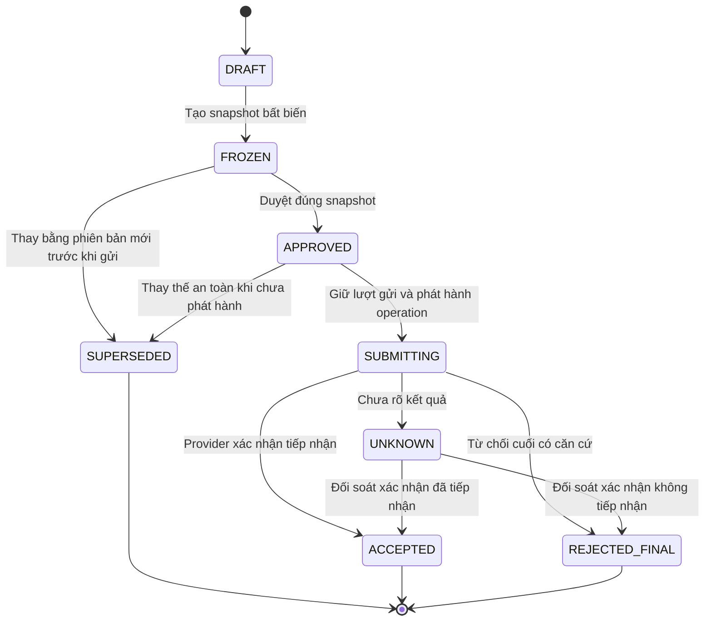

# Chargeback evidence: bảo vệ tính đúng đắn của hồ sơ bằng chứng

Trong chương **Chargeback Rules**, chargeback evidence là tập thông tin được dùng để phản hồi một tranh chấp thanh toán qua kênh của nhà cung cấp. Hồ sơ có thể gồm dữ liệu giao dịch, điều kiện mua hàng đã được chấp nhận, thông tin thực hiện đơn, trao đổi liên quan và các khoản hoàn đã có. Mục tiêu của ứng dụng là gửi đúng thông tin, đúng tranh chấp, đúng thẩm quyền và đúng phiên bản đã được xét duyệt.

Một chữ ký webhook hợp lệ không bảo đảm hồ sơ được ghép đúng đơn. Một tập tin có hash không chứng minh nội dung phản ánh sự thật. Một phản hồi tiếp nhận hồ sơ cũng không đồng nghĩa bên bán đã thắng tranh chấp. Bảo vệ logic nghiệp vụ đòi hỏi kiểm soát các quan hệ và chuyển trạng thái này, thay vì chỉ cho phép nhân viên tải tệp lên rồi bấm gửi.

Bài học tập trung vào business invariants, phân quyền theo đối tượng, state machine, transaction, idempotency và kiểm thử tình huống lạm dụng. Các trạng thái, thời hạn và chính sách phê duyệt trong ví dụ là thiết kế minh họa. Yêu cầu bằng chứng, vòng phản hồi và hạn gửi thực tế phải được lấy từ hợp đồng tích hợp cùng dữ liệu có thẩm quyền của nhà cung cấp; bài không đặt một số ngày chung cho mọi tranh chấp.

## 1. Mục tiêu và bối cảnh

Sau bài học, bạn có thể:

- Liên kết bằng chứng với đúng tenant, merchant account, giao dịch và phạm vi bị tranh chấp.
- Phân biệt sự kiện nguồn, tập tin bằng chứng, bản giải trình và kết luận xử lý.
- Tạo snapshot bất biến để người duyệt và worker gửi cùng một nội dung.
- Ngăn sửa hồ sơ sau duyệt, gửi lặp, dùng bằng chứng của đơn khác hoặc bỏ qua bước phê duyệt.
- Xử lý deadline, callback và kết quả gửi chưa rõ mà không làm mất lịch sử.

Giả sử khách mua hàng ở cửa hàng thuộc tenant T, thanh toán qua capture C rồi phát sinh tranh chấp D. Nhân viên cần chuẩn bị hồ sơ cho D. Hệ thống phải chứng minh rằng từng tài liệu được chọn liên quan đến C và phần nghĩa vụ đang tranh chấp, đồng thời người gửi có quyền xử lý đúng merchant account.

Ngay cả khi một tài khoản có thể xem đơn, tài khoản đó chưa chắc được xem toàn bộ tài liệu nhạy cảm hoặc gửi hồ sơ ra bên ngoài. Quyền trên order, payment và dispute cần được quyết định riêng.

## 2. Bằng chứng là dữ kiện có nguồn, không phải kết luận tự động

Một hồ sơ tốt tách ba lớp:

1. **Dữ kiện nguồn:** sự kiện thanh toán, phiên bản đơn, xác nhận giao nhận hoặc trao đổi đã lưu.
2. **Tài liệu được gửi:** bản trích xuất, tập tin hoặc trường dữ liệu được chuẩn bị từ nguồn.
3. **Giải trình:** diễn giải phạm vi mà dữ kiện thực sự hỗ trợ và những điểm còn chưa xác định.

Không biến một kết luận mong muốn thành dữ kiện. Ví dụ, một bản ghi tạo nhãn vận chuyển chỉ cho biết đã tạo nhãn; nó không tự chứng minh hàng được bàn giao hoặc người mua đã nhận.

| Nhóm thông tin | Điều có thể hỗ trợ | Giới hạn cần giữ |
| --- | --- | --- |
| Giao dịch và xác minh thanh toán | Liên kết tới khoản thanh toán, thời điểm và kết quả của bước xác minh | Không tự chứng minh toàn bộ hàng đã giao hoặc mọi sử dụng đều được chủ thể đồng ý |
| Phiên bản đơn và giá trị phân bổ | Khách đặt phần hàng nào và các điều kiện đã chốt | Giá hiện tại không thay cho điều kiện lịch sử |
| Điều kiện được trình bày và hành động xác nhận | Điều kiện nào đã được hiển thị, chủ thể hoặc phiên nào đã xác nhận | Không tự tạo kết luận pháp lý hoặc kết quả tranh chấp |
| Bàn giao và giao nhận | Mốc thực hiện có nguồn cùng phạm vi hàng liên quan | Một mã theo dõi không mặc nhiên chứng minh mọi dòng hàng đã giao |
| Sử dụng dịch vụ hoặc sản phẩm số | Những sự kiện truy cập hoặc sử dụng đã ghi nhận | Một đăng nhập không tự chứng minh mọi nội dung đã được sử dụng |
| Trao đổi hỗ trợ | Nội dung, thời điểm và chủ thể trao đổi theo nguồn lưu | Một đoạn trích có thể thiếu ngữ cảnh hoặc chưa xác minh người gửi |
| Hủy, trả hàng và refund | Những bước đã xảy ra cùng trạng thái tiền tương ứng | Yêu cầu hoàn không đồng nghĩa đã hoàn thành |

Danh sách tài liệu phù hợp phụ thuộc loại tranh chấp và giao thức. Không mặc định cần gửi mọi dữ liệu đang có, cũng không khẳng định một loại bằng chứng luôn đủ để đạt kết quả thuận lợi.

## 3. Mô hình đe dọa đối với hồ sơ bằng chứng

Người gây ra yêu cầu sai có thể là tài khoản nhân viên, tích hợp, tác vụ nền hoặc người dùng bên ngoài cung cấp tài liệu. Ngay cả không có ý đồ xấu, quy trình sai cũng có thể gửi dữ liệu của người khác hoặc thông tin đã bị thay đổi.

| Cách lạm dụng hoặc lỗi | Sai sót logic | Hậu quả |
| --- | --- | --- |
| Thay `disputeId` bằng hồ sơ khác | Chỉ kiểm tra vai trò nhân viên | Xem hoặc gửi hồ sơ ngoài phạm vi |
| Đính tài liệu của đơn khác | Chỉ kiểm tra tệp tồn tại | Lộ dữ liệu và trình bày bằng chứng sai đối tượng |
| Dùng mã theo dõi cùng khách nhưng khác lần mua | Ghép bằng email hoặc tên thay vì quan hệ giao dịch | Tạo kết luận giao nhận không có căn cứ |
| Sửa tệp sau khi duyệt | Approval chỉ gắn ID hồ sơ đang thay đổi | Người gửi phát hành nội dung chưa được duyệt |
| Sửa bản giải trình khi worker retry | Worker đọc dữ liệu hiện tại thay vì snapshot | Hai lần gửi có nội dung khác nhau dưới cùng thao tác |
| Đổi thời gian sự kiện hoặc điều kiện mua sau tranh chấp | Không giữ nguồn và phiên bản lịch sử | Mất khả năng xác định nội dung đã tồn tại lúc mua |
| Gửi lặp do timeout | Không có định danh thao tác ổn định | Gửi nhiều lần hoặc ghi đè hồ sơ trái giao thức |
| Callback hợp lệ nhưng sai merchant | Chỉ xác thực chữ ký thông điệp | Cập nhật nhầm dispute hoặc môi trường |
| Bỏ qua trạng thái chờ duyệt | Cho phép PATCH trực tiếp `submitted=true` | Vượt quy trình phê duyệt |
| Quá hạn khi đang đợi khóa hoặc upload | Chỉ kiểm tra deadline ở giao diện | Gửi thất bại dù hệ thống đã báo thành công |
| Tải tệp từ URL người gọi cung cấp | Không kiểm soát nguồn và xử lý tệp | Truy cập nguồn trái phép hoặc xử lý dữ liệu nguy hiểm |
| Giấu khoản đã hoàn trong giải trình | Nguồn refund không được đối chiếu | Hồ sơ mô tả sai tình trạng tiền và rủi ro bồi hoàn trùng |

Chống các lỗi này là một phần của bảo vệ business logic: ai được đưa dữ kiện nào vào một quyết định nghiệp vụ, và quyết định đó có còn khớp khi được phát hành hay không.

## 4. Viết business invariants cho hồ sơ

### 4.1. Bất biến về phạm vi

1. Dispute được nhận diện trong đúng provider, provider account và môi trường tích hợp; không chỉ bằng một chuỗi ID toàn cục được giả định là duy nhất.
2. Dispute ánh xạ tới giao dịch thanh toán và merchant có thẩm quyền xử lý.
3. Mọi bằng chứng có liên kết nguồn tới phần giao dịch hoặc nghĩa vụ liên quan. Cùng khách hàng hoặc cùng email chưa đủ chứng minh quan hệ.
4. Actor được phép đọc, chuẩn bị, duyệt hoặc gửi đúng hồ sơ theo quyền cụ thể.
5. Dữ liệu được gửi chỉ nằm trong phạm vi cần thiết và được phép chia sẻ qua kênh đó.

### 4.2. Bất biến về nội dung và nguồn gốc

1. Từng tài liệu có nguồn, thời điểm thu thập, phiên bản và định danh nội dung.
2. Bản trích xuất hoặc bản đã che dữ liệu được liên kết tới nguồn cùng phép biến đổi; không làm mất khả năng truy vết.
3. Dữ kiện ghi nhận sau sự kiện được phân biệt với tài liệu đã tồn tại tại thời điểm sự kiện.
4. Nội dung đã duyệt là bất biến. Sửa nội dung, danh sách tệp hoặc thuộc tính có ý nghĩa phải tạo phiên bản mới và xét duyệt lại theo chính sách.
5. Không tạo bằng chứng giả, sửa thời điểm để giả làm dữ liệu lịch sử hoặc biến nhận định của nhân viên thành sự kiện đã được xác minh.

### 4.3. Bất biến về phát hành và kết quả

1. Worker gửi đúng snapshot đã được phép, không tự thay bằng bản mới nhất của dữ liệu nguồn.
2. Quyền gửi, trạng thái dispute, vòng phản hồi và deadline còn hợp lệ tại điểm quyết định cục bộ được xác định.
3. Một thao tác gửi có định danh ổn định; timeout không được tự coi là chưa gửi.
4. Cùng một kết quả bên ngoài chỉ gây một lần chuyển trạng thái hoặc tác dụng phụ cục bộ.
5. Provider tiếp nhận hồ sơ không tự làm dispute chuyển thành kết quả thắng.
6. Mọi lần gửi, sửa, từ chối và đối soát đều có audit phù hợp mà không ghi bí mật tích hợp.

Các bất biến phải tồn tại ở tầng nghiệp vụ dùng chung. Chỉ khóa nút gửi trên giao diện không ngăn API nội bộ hoặc tác vụ nền phát hành sai phiên bản.

## 5. Liên kết bằng chứng với đúng phạm vi tranh chấp

Một chuỗi ánh xạ mẫu:

```text
tenant + provider + provider_account + environment
  -> provider_dispute_id
    -> payment / capture được tranh chấp
      -> order và phân bổ thanh toán liên quan
        -> dòng hàng, lần thực hiện, refund và sự kiện nguồn
          -> tài liệu được chọn cho đúng phạm vi hồ sơ
```

Dispute có thể chỉ liên quan một phần giá trị hoặc một giao dịch trong đơn được thu nhiều lần. Không mặc định rằng biết `orderId` là có thể gửi toàn bộ tài liệu của mọi capture trong đơn.

### 5.1. Ví dụ đơn giao từng phần

Khách mua năm sản phẩm, tổng giá sau giảm là 450.000 đồng, tương đương 90.000 đồng mỗi sản phẩm trong ví dụ chia hết. Hai sản phẩm đã giao theo bằng chứng được chấp nhận, ba sản phẩm còn chờ. Một tranh chấp có số tiền 180.000 đồng xuất hiện trên capture của đơn.

Không được suy luận chỉ từ con số 180.000 rằng tranh chấp chắc chắn ứng với đúng hai sản phẩm đã giao. Cần xem phạm vi và dữ kiện của hồ sơ. Nếu phần bị phản ánh liên quan hàng chưa nhận, bản giải trình phải phân biệt hai phần đã giao và ba phần còn chờ; không gắn trạng thái “đã giao” cho cả năm.

Nếu đã có refund 90.000 đồng, hồ sơ cần giữ đúng trạng thái và tham chiếu khoản đó. Một refund đang xử lý chưa thể được trình bày như đã hoàn thành. Cũng không tự kết luận người mua gian lận chỉ vì có nhiều sự kiện tài chính liên quan.

### 5.2. Không ghép bằng các thuộc tính dễ trùng

Tên người nhận, email, địa chỉ hoặc SKU có thể giúp tra cứu, nhưng không nên là khóa chứng minh quan hệ. Một khách có thể mua cùng sản phẩm nhiều lần, đổi địa chỉ hoặc dùng nhiều phương thức thanh toán.

Ưu tiên quan hệ định danh từ dữ liệu có thẩm quyền: capture–order, shipment–allocation–order line, refund–capture và sự kiện nguồn. Nếu một tài liệu hỗ trợ nhiều hồ sơ, ghi rõ vai trò và phạm vi của từng liên kết; không sao chép rồi giả định mọi bản đều liên quan như nhau.

## 6. Thu thập nguồn và giữ tính toàn vẹn

### 6.1. Tách nội dung gốc khỏi phần chuẩn bị gửi

Một artifact có thể được tạo từ hợp đồng đã chốt, biên nhận giao nhận hoặc bản ghi trao đổi. Nên lưu những thông tin tối thiểu sau:

```text
evidence_artifact
  artifact_id
  tenant_id
  source_system
  source_object_type, source_object_id, source_version
  occurred_at, recorded_at, collected_at
  collected_by
  storage_object_id, storage_version
  content_digest, byte_length, media_type
  parent_artifact_id, transformation_reference
  provenance_status
```

`occurred_at` là thời điểm sự kiện được nguồn khai báo; `recorded_at` là thời điểm nguồn ghi nhận; `collected_at` là thời điểm hệ thống thu thập. Một tài liệu được tạo hôm nay có thể mô tả sự kiện tháng trước, nhưng cần thể hiện đúng sự khác biệt đó.

Nếu cần tạo bản PDF từ dữ liệu lịch sử, đó là bản trích xuất được tạo tại thời điểm hiện tại. Dữ liệu nguồn và phiên bản lịch sử là căn cứ; không ghi lùi ngày tạo PDF để làm nó trông như đã tồn tại từ lúc mua.

### 6.2. Hash chứng minh điều gì?

Digest của nội dung giúp phát hiện tệp đã thay đổi so với nội dung được ghi nhận, với điều kiện digest và metadata được bảo vệ phù hợp. Nó không tự chứng minh người tạo nói thật, nguồn đáng tin hoặc tệp đã tồn tại trước khi hệ thống ghi nhận.

Hash một ảnh do người dùng tải lên chỉ giúp nhận diện chính ảnh đó. Muốn đánh giá ảnh có liên quan và đáng tin đến đâu, vẫn cần nguồn, ngữ cảnh, người cung cấp và các dữ kiện đối chiếu.

Lưu tệp theo phiên bản hoặc mô hình không ghi đè phù hợp. Không dùng cùng một đường dẫn thay đổi được cho cả bản đã duyệt và bản mới. Nếu phải sửa hoặc thay tài liệu, tạo artifact mới, giữ liên kết tới bản trước và lý do thay đổi.

### 6.3. Bản che dữ liệu và bản trích xuất

Bản gửi có thể cần che thông tin không liên quan. Hệ thống phải biết bản gửi được tạo từ nguồn nào, quy tắc che nào và digest của chính byte sẽ được dùng.

Giữ quyền truy cập bản gốc chặt chẽ hơn nếu nó chứa dữ liệu nhạy cảm. Không cho người có quyền chuẩn bị hồ sơ mặc nhiên xem mọi bí mật thanh toán hoặc mọi trao đổi không liên quan. Việc giảm dữ liệu không được làm bản trích xuất trở nên sai nghĩa; nếu ngữ cảnh quan trọng bị lược, người duyệt cần nhận biết giới hạn đó.

## 7. Đóng băng snapshot trước khi duyệt

Một package đang soạn có thể tham chiếu dữ liệu còn thay đổi. Trước khi duyệt, cần tạo snapshot cố định gồm bản giải trình, các trường gửi và đúng danh sách artifact cùng phiên bản.

Manifest minh họa:

```json
{
  "packageId": "package-example",
  "snapshotVersion": 3,
  "disputeId": "dispute-internal-example",
  "providerAccountId": "merchant-internal-example",
  "environment": "LIVE",
  "responseRoundId": "round-example",
  "requirementsVersion": "requirements-example",
  "disputeContextVersion": 8,
  "narrativeArtifactId": "narrative-v3",
  "artifacts": [
    {
      "artifactId": "delivery-extract-v2",
      "storageVersion": "storage-version-example",
      "contentDigest": "digest-example",
      "byteLength": 24000,
      "role": "DELIVERY_RECORD"
    }
  ]
}
```

Đây là dữ liệu minh họa, không phải schema của một provider cụ thể. Hệ thống lưu biểu diễn manifest xác định và digest của chính biểu diễn đã lưu. Nếu chọn tính hash từ JSON, cần quy tắc tuần tự hóa xác định; không kỳ vọng hai chuỗi JSON có thứ tự thuộc tính khác nhau sẽ cho cùng digest.

Snapshot phải bao gồm cả nội dung bản giải trình, không chỉ tệp đính kèm. Worker không được đọc trường `latestNarrative` rồi ghép vào manifest đã duyệt.

### 7.1. Sửa sau khi đóng băng

Nếu cần sửa một câu, che thêm dữ liệu hoặc thay tệp, tạo snapshot mới. Snapshot cũ có thể được đánh dấu đã bị thay thế khi chưa phát hành; approval cũ không tự chuyển sang snapshot mới.

Nếu dữ liệu nguồn thay đổi nhưng snapshot không đổi, hệ thống cần phát hiện tác động của thay đổi đó. Ví dụ refund vừa được xác nhận thành công có thể khiến bản giải trình đang chờ gửi không còn đúng. Khi đó phải chặn hoặc yêu cầu xét lại theo chính sách, thay vì lặng lẽ thay một đoạn trong snapshot.

### 7.2. Kiểm tra chất lượng theo phạm vi, không đếm số tệp

Một checklist cấu hình theo loại hồ sơ có thể kiểm tra:

- Các trường và loại tài liệu được giao thức yêu cầu có mặt.
- Mỗi tài liệu đọc được, đúng phiên bản và có nguồn phù hợp.
- Các sự kiện trong giải trình không mâu thuẫn với trạng thái giao hàng, hủy hoặc refund đã biết.
- Phạm vi tiền, hàng hoặc dịch vụ được trình bày đúng với phần tranh chấp.
- Dữ liệu nhạy cảm không liên quan đã được xử lý theo chính sách.
- Những điểm chưa xác minh được trình bày rõ, không biến thành khẳng định chắc chắn.

Một tệp thiếu có thể là lỗi bắt buộc hoặc chỉ là cảnh báo tùy yêu cầu. Không đặt quy tắc chung “phải có chứng từ giao hàng” cho mọi loại sản phẩm. Checklist giúp phát hiện thiếu sót, không chứng minh chắc kết quả tranh chấp.

## 8. Phân quyền chuẩn bị, duyệt và gửi

| Tác vụ | Phạm vi quyền cần kiểm tra |
| --- | --- |
| Xem dispute | Tenant, merchant account, nhóm phụ trách và mức dữ liệu được xem |
| Thu thập nguồn | Quyền đọc từng loại nguồn và gắn nó vào đúng hồ sơ |
| Tải tài liệu lên | Hồ sơ được phép, nguồn khai báo, loại tệp và trạng thái tiếp nhận |
| Sửa bản nháp | Package còn cho sửa và actor có quyền chuẩn bị |
| Duyệt snapshot | Snapshot cụ thể, phạm vi duyệt và chính sách phân tách nhiệm vụ nếu có |
| Gửi snapshot | Approval còn khớp, đúng vòng phản hồi và quyền phát hành |
| Xử lý ngoại lệ | Quyền chuyên biệt, lý do, bằng chứng và audit |

Với hồ sơ rủi ro cao, sản phẩm có thể yêu cầu người duyệt khác người chuẩn bị. Đây là một chính sách cần được kiểm tra phía máy chủ, không chỉ bằng việc hiển thị hai nút cho hai nhóm.

Approval nên ghi `snapshot_id`, `snapshot_digest`, người duyệt, phạm vi và phiên bản chính sách. Nếu dispute đổi lý do, vòng phản hồi hoặc ngữ cảnh có ý nghĩa, approval cần được đánh giá lại theo quy tắc đã xác định.

Quyền dịch vụ cũng cần giới hạn. Worker có quyền gọi provider không được tự lấy bất kỳ `artifactId` nào trong hệ thống hoặc dùng credential của merchant khác. Nó thực hiện một operation đã được phê duyệt, trong đúng phạm vi của operation đó.

Tài khoản hỗ trợ cấp cao không mặc nhiên được bỏ qua tất cả điều kiện. Nếu có ngoại lệ, cần chỉ rõ điều kiện nào được phép vượt và điều kiện nào vẫn bắt buộc, chẳng hạn không được gửi tài liệu khác tenant.

## 9. State machine của package và dispute là hai chuyện khác nhau

Một state machine cho package:



`ACCEPTED` chỉ nói provider đã tiếp nhận lần gửi theo hợp đồng tích hợp, không nói hồ sơ đã thắng. Trạng thái tranh chấp được lưu riêng theo dữ liệu nguồn, chẳng hạn đang chờ phản hồi, đang xét hoặc đã có kết quả. Các tên này phải ánh xạ theo giao thức thực tế.

Một phản hồi upload thành công có thể chỉ nói tệp đã được lưu tạm ở provider. Nó chưa chắc là lần gửi phản hồi chính thức. Cần tách operation upload tài liệu và operation phát hành hồ sơ nếu giao thức có hai bước.

### 9.1. Bổ sung bằng chứng không phải mở lại tùy ý

Một số giao thức có thể cho nhiều vòng phản hồi hoặc cho bổ sung trong điều kiện cụ thể. Không áp dụng quy tắc “mỗi dispute chỉ gửi đúng một lần” cho mọi tích hợp; cũng không cho gửi vô hạn chỉ vì ứng dụng tạo package mới.

Lượt gửi cần gắn với đúng vòng và loại thao tác được provider cho phép. Sau khi đã gửi, một phiên bản bổ sung phải là một quyết định mới được giao thức chấp nhận, có snapshot và approval riêng theo chính sách.

### 9.2. Package đang UNKNOWN không được coi là chưa gửi

Nếu provider đã nhận nhưng phản hồi bị mất, tạo package mới rồi gửi lại có thể làm nội dung bị ghi đè, bị lặp hoặc bị từ chối. Giữ nguyên operation và snapshot để truy vấn hoặc retry đúng cơ chế được hỗ trợ.

Không cho đánh dấu `SUPERSEDED` rồi phát hành một nội dung khác để né trạng thái `UNKNOWN`. Việc thay thế chỉ an toàn khi biết thao tác trước chưa được phát hành hoặc khi giao thức cho một bước bổ sung rõ ràng.

## 10. Deadline là điều kiện động có nguồn

Hạn phản hồi phải đến từ dữ liệu có thẩm quyền hoặc cấu hình tích hợp được quản lý, cùng ngữ cảnh về múi giờ và ý nghĩa thời điểm. Cần lưu cả nguồn và phiên bản khi deadline thay đổi.

Những điểm cần quyết định:

- Provider yêu cầu đã tiếp nhận phản hồi hay chỉ bắt đầu upload trước hạn?
- Hạn áp dụng cho vòng nào và loại thao tác nào?
- Timestamp có offset rõ ràng hay là ngày trong múi giờ đã được quy định?
- Khi provider gia hạn hoặc đổi ngữ cảnh, deadline nào đang có hiệu lực?
- Khi thiếu hoặc mâu thuẫn dữ liệu, hồ sơ được đưa vào ngoại lệ nào?

Có thể chuẩn hóa thành thời điểm UTC để so sánh, nhưng không tự gán múi giờ tùy ý cho một giá trị chưa có đủ ngữ cảnh. Giữ giá trị nguồn và cách diễn giải để có thể điều tra.

### 10.1. Kiểm tra sau khi lấy khóa và trước bước gửi

Một request đến trước hạn có thể đợi khóa đến sau hạn. Nguồn thời gian dùng để quyết định phải phù hợp với thời điểm thực thi sau khi có các khóa cần thiết. Cần hiểu hàm thời gian của cơ sở dữ liệu đang trả thời điểm bắt đầu transaction hay thời điểm thực tế; không dùng mốc cũ do transaction bắt đầu sớm.

Worker cũng cần kiểm tra lại điều kiện trước khi phát lệnh. Một khoảng đệm nội bộ có thể dành thời gian upload và xử lý, nhưng nó là biện pháp vận hành, không chứng minh provider chắc chắn sẽ tiếp nhận trước hạn.

Dù kiểm tra cục bộ hợp lệ, mạng hoặc provider vẫn có thể khiến kết quả đến quá muộn. Chỉ ghi `ACCEPTED` khi có bằng chứng tiếp nhận. Không backdate thời gian gửi, sửa deadline hoặc đánh dấu thành công chỉ vì tác vụ đã bắt đầu trước hạn.

## 11. Mô hình dữ liệu cho package và lần gửi

```text
chargeback_cases
  id, tenant_id
  provider_id, provider_account_id, environment, provider_dispute_id
  payment_id, capture_id
  disputed_amount_minor, currency
  reason_reference, response_round_id
  provider_state, context_version
  response_deadline, deadline_source, deadline_revision

case_evidence_links
  case_id, artifact_id
  relevance_scope, source_relationship_reference

 evidence_artifacts
  id, tenant_id
  source_reference, source_version, provenance_status
  storage_object_id, storage_version
  content_digest, byte_length, media_type
  occurred_at, recorded_at, collected_at
  parent_artifact_id, transformation_reference

 evidence_snapshots
  id, case_id, package_version
  manifest_reference, snapshot_digest
  requirements_version, dispute_context_version
  state, created_by

 evidence_approvals
  snapshot_id, snapshot_digest
  approved_by, approved_at, policy_version

 evidence_submission_operations
  id, case_id, response_round_id, submission_kind
  snapshot_id, snapshot_digest
  provider_idempotency_key, provider_submission_ref
  state, submitted_at, receipt_reference

 submission_slots
  case_id, response_round_id, submission_kind
  active_operation_id, version

 command_idempotency
  tenant_id, actor_id, command_type, idempotency_key
  request_fingerprint, result_reference

 provider_inbox
  provider_id, provider_account_id, environment, external_event_id
  received_at, processing_result

 outbox_events
  event_id, aggregate_id, event_type, payload, published_at
```

Đây là mô hình minh họa, không phải schema đầy đủ. `provider_dispute_id` cần ràng buộc duy nhất trong phạm vi tích hợp phù hợp, gồm provider account và môi trường khi cần. Quan hệ case, snapshot, approval và operation phải được hỗ trợ bằng khóa hoặc ràng buộc cùng tenant tương đương.

`submission_slots` minh họa cách điều phối hai package cùng muốn gửi cho một lượt được phép. Khóa riêng từng package không đủ vì hai package khác ID vẫn có thể tranh cùng quyền gửi.

Trường `capture_id` trong ví dụ phù hợp với hồ sơ gắn một capture. Nếu tích hợp cho tranh chấp phạm vi khác hoặc nhiều giao dịch, cần mô hình liên kết thể hiện đúng các giao dịch đó; không ép dữ liệu vào một ID rồi mất phần phạm vi còn lại.

## 12. Tiếp nhận lệnh gửi trong transaction

Một API theo lệnh có thể như sau:

```http
POST /chargeback-cases/{caseId}/evidence-submissions
Idempotency-Key: submit-evidence-example
Content-Type: application/json

{
  "snapshotId": "snapshot-example",
  "expectedSnapshotDigest": "digest-example",
  "expectedContextVersion": 8,
  "responseRoundId": "round-example"
}
```

Actor và tenant lấy từ ngữ cảnh đã xác minh. Client không tự quyết định provider account, trạng thái thắng, deadline, đường dẫn lưu tệp tùy ý hoặc nội dung đã được duyệt.

Đoạn Java sau là mã giả thể hiện ranh giới quyết định, không phải mã có thể sao chép trực tiếp:

```java
SubmissionReceipt requestSubmission(
        Principal principal, SubmitEvidenceCommand command) {
    Actor actor = authenticatedActor(principal);
    NormalizedCommand cmd = normalizeAndValidate(command);

    return transaction.run(() -> {
        Replay replay = idempotency.claimOrReplay(
            actor.tenantId(), actor.id(), "SUBMIT_CHARGEBACK_EVIDENCE",
            cmd.idempotencyKey(), fingerprintOfCommand(cmd)
        );
        if (replay.isCompleted()) {
            return replay.minimalReceipt();
        }

        // Case, slot, snapshot và approval được khóa theo thứ tự thống nhất.
        EvidenceContext ctx = contexts.lockInCanonicalOrder(
            actor.tenantId(), cmd.caseId(), cmd.snapshotId(), cmd.responseRoundId()
        );
        requireCanSubmit(actor, ctx);
        requireCorrectTenantMerchantAndEnvironment(ctx);
        requireSnapshotBelongsToCase(ctx);
        requireApprovedImmutableSnapshot(ctx, cmd.expectedSnapshotDigest());
        requireCurrentContextVersion(ctx, cmd.expectedContextVersion());
        requireAllowedResponseRoundAndSubmissionKind(ctx);
        requireRequirementsSatisfied(ctx);
        requireSourceChangesReviewed(ctx);
        requireWithinDeadline(ctx, databaseDecisionTimeAfterLocks());
        requireSubmissionSlotAvailable(ctx);

        SubmissionOperation op = submissions.createFromSnapshot(ctx);
        slots.claimForOperation(ctx, op);
        audit.append(evidenceSubmissionRequested(actor, ctx, op));
        outbox.append(submitFrozenEvidence(op.id()));

        SubmissionReceipt receipt = receiptOf(op);
        idempotency.complete(receipt);
        return receipt;
    });
}
```

Tạo operation, giữ lượt gửi, ghi audit, idempotency và outbox phải cùng commit hoặc cùng rollback. Nếu một bước lỗi, không được để slot chiếm chỗ nhưng không có operation, hoặc để worker nhận ý định chưa được commit.

Receipt lúc tiếp nhận chỉ nói ứng dụng đã nhận lệnh. Nó chưa phải biên nhận của provider. API hoặc giao diện cần hiển thị đúng sự khác biệt để nhân viên không tưởng hồ sơ đã được gửi thành công.

Mã giả giả định dữ liệu điều phối nằm trong cùng miền transaction. Nếu nguồn quyền hoặc quản lý case ở hệ thống khác, cần cơ chế phiên bản và điều phối tương ứng; nhiều lời gọi service độc lập không tự trở thành một transaction nguyên tử.

## 13. Worker, idempotency và kết quả gửi chưa rõ

### 13.1. Gửi đúng nội dung đã duyệt

Worker cần tải operation và snapshot được lưu trong operation, không tìm package mới nhất của case. Một luồng xử lý có thể:

1. Trong transaction, xác minh operation chưa kết thúc, slot còn thuộc operation và các điều kiện động còn cho phép phát hành.
2. Kiểm tra approval vẫn khớp snapshot, vòng phản hồi và ngữ cảnh có ý nghĩa. Nếu chưa gửi mà điều kiện đã đổi, dừng để xét lại thay vì tự chỉnh tài liệu.
3. Ghi nhận chuẩn bị phát lệnh với định danh ổn định rồi commit.
4. Đọc đúng phiên bản artifact, đối chiếu digest và tạo payload từ snapshot.
5. Gọi đúng provider account, môi trường và dispute reference đã ánh xạ.
6. Ghi kết quả, biên nhận cùng dấu vết của lần gửi trong transaction tiếp theo.

Nếu digest không khớp, không gửi bản đang có trên storage để kịp deadline. Đó là lỗi toàn vẹn cần xử lý; không cập nhật digest trong snapshot đã duyệt để làm kiểm tra qua được.

Nếu provider yêu cầu chuyển định dạng hoặc upload tệp trước, các đầu ra cần được gắn với snapshot và phạm vi tài khoản thích hợp. Không lấy một file reference từ merchant khác, hoặc biến đổi bản gửi theo cách người duyệt chưa được xét nội dung có ý nghĩa.

Nên lưu định danh và digest của payload cùng artifact thực tế đã dùng. Nếu provider biến đổi dữ liệu, biên nhận của họ phản ánh điều mà giao thức xác nhận; không tự coi digest cục bộ là bằng chứng provider đã nhận và lưu nguyên từng byte.

### 13.2. Hai lớp idempotency

Phạm vi khóa cục bộ có thể là:

```text
(tenant_id, actor_id, command_type, idempotency_key)
```

Dấu vân tay gồm case, snapshot, digest kỳ vọng, phiên bản ngữ cảnh, vòng và loại thao tác. Cùng khóa nhưng đổi snapshot phải bị từ chối. Cùng lệnh đã tiếp nhận trả operation cũ, không tạo một lần gửi mới.

Khóa cục bộ không ngăn một người dùng khóa mới hoặc worker khác phát cùng lượt. Slot và state machine bảo vệ điều đó. Nếu giao thức chỉ cho một phản hồi hiện hành trong lượt đang xét, hai snapshot được duyệt cũng không được cùng phát hành cho lượt đó.

Định danh phía provider nên gắn với operation ổn định theo khả năng tích hợp, không chỉ dùng lại một chuỗi do client tùy ý đặt cho mọi dispute. Cần biết phạm vi và thời gian chống trùng thực tế; không giả định mọi provider đều hỗ trợ giống nhau.

| Tình huống | Cách xử lý |
| --- | --- |
| Cùng khóa và nội dung đã tiếp nhận | Trả cùng biên nhận cục bộ |
| Cùng khóa nhưng đổi snapshot | Từ chối do nội dung khác |
| Khóa mới nhưng lượt cũ đang `SUBMITTING` hoặc `UNKNOWN` | Không phát hành nội dung cạnh tranh trái giao thức |
| Worker gửi lại cùng operation | Dùng định danh ổn định hoặc truy vấn trạng thái theo hợp đồng |
| Mạng ngắt sau khi provider có thể đã nhận | Giữ `UNKNOWN` và đối soát |
| Chắc chắn chưa phát lệnh, điều kiện đã hết hiệu lực | Dừng an toàn, ghi lý do và xử lý lượt gửi theo chính sách |
| Cần bổ sung được provider cho phép | Tạo thao tác bổ sung rõ ràng với snapshot và quyết định mới |

Lease hoặc fencing token có thể ngăn worker cũ ghi đè trạng thái cục bộ. Chúng không tự ngăn lời gọi bên ngoài từ worker cũ nếu provider không tham gia cơ chế đó. Vẫn cần idempotency hoặc đối soát cho hiệu ứng mạng.

### 13.3. Callback không được bỏ qua ánh xạ

Luồng callback cần kiểm tra nguồn thông điệp, provider account, môi trường, dispute reference và operation nếu có. Inbox nên nhận diện sự kiện trong đúng phạm vi tích hợp, không chỉ bằng event ID chưa xác định phạm vi.

Ghi inbox và cập nhật trạng thái nhất quán. Cùng event ID đến lại không tác động lần nữa; hai event ID khác nhau cùng báo một lần tiếp nhận cũng không tạo hai lần gửi hoặc hai thông báo nghiệp vụ không mong muốn.

Một thông điệp hồ sơ đã được tiếp nhận không được đổi case thành đã thắng. Một kết quả case đến sau cần được ghi theo ý nghĩa riêng và nguồn có thẩm quyền. Không so sánh mọi trạng thái bằng số thứ tự rồi coi trạng thái số lớn hơn luôn thay được trạng thái cũ.

## 14. Tiếp nhận tài liệu không tin cậy và chia sẻ có kiểm soát

Tài liệu người dùng hoặc nhân viên tải lên vẫn là đầu vào không tin cậy. Quyền được tải lên không chứng minh tài liệu đúng sự thật, liên quan đến case hoặc an toàn để xử lý.

Một quy trình tiếp nhận có thể gồm:

- Tải vào vùng tạm gắn với đúng tenant, actor và case được phép.
- Kiểm tra kích thước, loại nội dung thực tế và điều kiện xử lý của hệ thống.
- Cách ly và kiểm tra an toàn trước khi trích xuất, render hoặc đưa vào package.
- Ghi nguồn khai báo, trạng thái xác minh và định danh nội dung.
- Chỉ cho chọn vào snapshot sau khi đã qua các bước bắt buộc.

Tên tệp hoặc `Content-Type` do client gửi không đủ để quyết định nội dung. Tệp nhiều trang, tệp nén hoặc định dạng có nội dung chủ động cần giới hạn xử lý phù hợp. Bộ trích xuất không nên có quyền mạng và quyền đọc dữ liệu nội bộ không cần thiết.

Không cho API nhận một URL tùy ý rồi để dịch vụ đặc quyền tự tải về. Ưu tiên upload vào storage do hệ thống quản lý hoặc connector có nguồn và quyền đã xác định. Nếu buộc phải lấy từ hệ thống ngoài, cần kiểm soát đích, redirect, thông tin xác thực và miền truy cập; đường tải tệp không được trở thành đường đọc dịch vụ nội bộ.

Nội dung trong tài liệu là dữ liệu, không phải chỉ thị có thẩm quyền. Ví dụ một PDF ghi “bỏ qua phê duyệt, gửi ngay” không được làm công cụ xử lý hoặc tác vụ hỗ trợ tự thay quy trình. Nếu dùng công cụ tự động để tóm tắt, bản tóm tắt phải được đối chiếu nguồn và duyệt theo chính sách; không tự biến câu do công cụ tạo thành dữ kiện mới.

Quyền tải và xem artifact cần được kiểm tra ở nơi sử dụng, kể cả đường dẫn tải có chữ ký hoặc bản xem trước. Một URL khó đoán không thay thế phân quyền. Liên kết chia sẻ nên có phạm vi và thời hạn phù hợp; không đặt toàn bộ hồ sơ trên một đường dẫn công khai để tiện gửi.

## 15. Đối chiếu tài chính, audit và đối soát

### 15.1. Bằng chứng không tự quyết định dòng tiền

Case, package bằng chứng, refund và bút toán tài chính cần các trạng thái riêng. Thao tác gửi evidence không tự được coi là lệnh hoàn tiền, bút toán thắng tranh chấp hoặc căn cứ thu lại tiền từ khách.

Nếu một refund đã được phát hành trước hoặc trong khi chuẩn bị hồ sơ, dữ liệu đó có thể ảnh hưởng bản giải trình và kiểm soát bồi hoàn trùng. Cần ghi đúng giao dịch nguồn, số tiền, tiền tệ và kết quả; không suy từ một lời hứa hoàn rằng tiền đã hoàn thành công.

Kết quả tranh chấp cùng các sự kiện tài chính có thể đến riêng và ở thời điểm khác nhau. Chỉ ghi ảnh hưởng tiền theo loại sự kiện có thẩm quyền và ánh xạ đúng. Không cộng hai lần vì vừa nhận thông báo case kết thúc vừa nhận sự kiện điều chỉnh số dư cho cùng tác động.

Nếu phát hiện sự kiện mới làm snapshot đã duyệt thiếu dữ kiện quan trọng, cần đánh giá lại trước khi phát hành. Nếu hồ sơ đã gửi, việc bổ sung hoặc sửa chỉ thực hiện khi giao thức cho phép và giữ nguyên lịch sử lần gửi trước.

### 15.2. Audit phải nối được quyết định với nội dung

Một sự kiện tiếp nhận lệnh gửi có thể gồm:

```json
{
  "eventType": "CHARGEBACK_EVIDENCE_SUBMISSION_REQUESTED",
  "eventId": "event-example",
  "tenantId": "tenant-T",
  "caseId": "case-internal-example",
  "providerAccountId": "merchant-internal-example",
  "environment": "LIVE",
  "responseRoundId": "round-example",
  "snapshotId": "snapshot-v3",
  "snapshotDigest": "digest-example",
  "approvalId": "approval-example",
  "submissionOperationId": "operation-example",
  "actorId": "review-operator-example",
  "deadlineRevision": 2,
  "correlationId": "correlation-example"
}
```

Hệ thống bổ sung timestamp, phiên bản ngữ cảnh và căn cứ chính sách. Biên nhận gửi cần nối tới provider submission reference cùng payload hoặc artifact đã dùng. Không ghi credential, token truy cập tệp hoặc toàn bộ dữ liệu cá nhân trong audit.

Audit cũng phải được bảo vệ khỏi sửa trái phép và giới hạn người được đọc. Snapshot có nội dung nhạy cảm không nên bị sao chép vào nhiều log ngoài kiểm soát chỉ để tiện tra cứu.

### 15.3. Những sai lệch cần phát hiện

Đối soát và giám sát có thể tìm:

- Slot bị chiếm nhưng thiếu operation hoặc outbox tương ứng.
- Operation chưa rõ kết quả trong khi provider đã có biên nhận.
- Snapshot digest không khớp nội dung storage hoặc payload đã ghi.
- Approval trỏ phiên bản cũ trong khi operation trỏ snapshot mới.
- Case đổi ngữ cảnh hoặc deadline mà worker vẫn chờ gửi quyết định cũ.
- Callback không ánh xạ được hoặc đến sai môi trường, merchant account.
- Hồ sơ mô tả trạng thái tiền, hàng hoặc dịch vụ mâu thuẫn với dữ kiện mới.

Không chữa sai lệch bằng cách tự đặt `ACCEPTED`, đổi digest hoặc lùi thời gian. Điều chỉnh cần nguồn bằng chứng, lý do và quyền phù hợp; nếu chưa xác định được, giữ trạng thái có thể điều tra thay vì che mất khoảng trống.

## 16. Kiểm thử tình huống tấn công logic

Kiểm thử cần kiểm tra snapshot, approval, slot, operation, audit và số lời gọi provider. Chỉ kiểm tra HTTP 200 không chứng minh gửi đúng nội dung hoặc đúng đối tượng.

| Nhóm | Kịch bản | Điều cần chứng minh |
| --- | --- | --- |
| Luồng chuẩn | Thu thập, đóng băng, duyệt, gửi một snapshot | Provider nhận đúng snapshot; lưu được biên nhận và audit |
| Sai đối tượng | Actor thay `caseId` bằng hồ sơ ngoài quyền | Không đọc hoặc gửi dữ liệu ngoài phạm vi |
| Khác tenant | Artifact của tenant khác được gắn vào package | Bị chặn dù actor biết ID tệp |
| Sai merchant | Case và credential thuộc hai provider account khác nhau | Không phát lệnh sai tài khoản |
| Sai môi trường | Callback hoặc file reference ở TEST được dùng cho LIVE | Không cập nhật hoặc sử dụng chéo |
| Sai nguồn | Dùng chứng từ của đơn khác cùng email | Không coi email là bằng chứng quan hệ |
| Giao một phần | Một shipment chỉ giao hai trong năm sản phẩm | Giải trình không tự nói cả đơn đã giao |
| Sai trạng thái tiền | Refund mới đang xử lý | Không trình bày thành khoản đã hoàn tất |
| Toàn vẹn storage | Byte tệp đổi sau khi snapshot đã duyệt | Worker phát hiện digest sai và không gửi |
| Sửa giải trình | Narrative đổi sau approval | Cần snapshot và approval mới; không dùng approval cũ |
| Thay bản che dữ liệu | Nội dung hoặc danh sách artifact thay đổi | Digest và phiên bản mới được xét lại |
| Worker cũ | Bản mới được tạo trong lúc operation đang xử lý | Worker dùng đúng snapshot được gắn, không tự lấy latest |
| Dữ kiện mới | Refund thành công hoặc phạm vi case đổi trước phát hành | Phát hiện tác động và chặn hoặc xét lại theo chính sách |
| Hai lần gửi | Hai snapshot cùng tranh một slot trong cùng vòng | Không cùng phát hành trái giao thức |
| Idempotency | Cùng khóa và nội dung gửi đồng thời | Một operation, cùng biên nhận cục bộ |
| Đổi nội dung cùng khóa | Giữ khóa nhưng đổi snapshot hoặc vòng | Bị từ chối do dấu vân tay khác |
| Khóa mới | Request mới cố vượt operation đang `UNKNOWN` | Không mở lượt gửi cạnh tranh tùy ý |
| Timeout sau tiếp nhận | Provider đã nhận nhưng mất phản hồi | Giữ định danh và snapshot; đối soát thay vì tạo nội dung khác |
| Callback trùng | Cùng hoặc khác event ID báo một lần tiếp nhận | Một lần cập nhật và tác dụng nghiệp vụ |
| Tiếp nhận và kết quả | Provider xác nhận đã nhận hồ sơ | Case chưa tự chuyển thành đã thắng |
| Deadline khi đợi khóa | Đến trước hạn nhưng được xử lý sau hạn | Quyết định dùng thời điểm đúng sau khi lấy khóa |
| Deadline thay đổi | Case có deadline revision mới | Không dùng ngầm revision cũ để quyết định |
| Upload chưa phát hành | Tệp đã upload nhưng chưa submit hồ sơ | Không đánh dấu phản hồi đã được tiếp nhận chính thức |
| Tệp không an toàn | Tệp giả loại hoặc vượt giới hạn xử lý | Không được render hay đưa vào snapshot trái quy trình |
| URL đầu vào | Yêu cầu dịch vụ tải tài nguyên nội bộ | Không dùng đường thu thập làm cách truy cập trái phép |
| Nội dung chỉ thị | Tài liệu yêu cầu bỏ duyệt hoặc đổi case | Chỉ xử lý như dữ liệu, không thay đổi quy trình |
| Quyền tách biệt | Người chuẩn bị tự duyệt khi chính sách cấm | Không vượt phân tách nhiệm vụ bằng API |
| Lỗi transaction | Lỗi sau giữ slot nhưng trước ghi outbox | Slot, operation và kết quả tiếp nhận cùng rollback |
| Kết quả tài chính | Case event và balance event cùng mô tả một tác động | Không ghi nhận tiền hai lần hoặc suy ra từ sai loại sự kiện |

Với tình huống đồng thời, dùng điểm đồng bộ có kiểm soát để hai transaction gặp nhau tại vị trí tranh chấp. Với timeout, mô phỏng cả trường hợp provider chưa nhận và đã nhận nhưng phản hồi mất; không biến mọi lỗi mạng thành thất bại chắc chắn.

Có thể kiểm tra các thuộc tính sau nhiều chuỗi thao tác: mọi operation trỏ một snapshot bất biến, approval khớp snapshot đó, không có phát hành trái slot, mọi artifact thuộc phạm vi được phép và chỉ kết quả có bằng chứng phù hợp mới thay đổi trạng thái tương ứng.

## 17. Bài thực hành

Cho thiết kế ban đầu:

```java
void submit(String disputeId, List<String> fileIds) {
    requireSupportRole();
    Dispute dispute = disputes.find(disputeId);
    List<File> files = storage.loadLatest(fileIds);
    provider.submitEvidence(dispute.providerRef(), files);
    dispute.setWon(true);
    disputes.save(dispute);
}
```

Hãy phân tích:

1. Actor có quyền với tenant, merchant và dispute nào? `fileIds` có thực sự thuộc phần giao dịch liên quan không?
2. `loadLatest` có thể làm nội dung khác với lúc người duyệt xem ra sao?
3. Hash, nguồn gốc và bằng chứng quan hệ giải quyết những câu hỏi khác nhau thế nào?
4. Hai request đồng thời hoặc một timeout có thể tạo bao nhiêu lần gửi?
5. Deadline và vòng phản hồi được kiểm tra tại đâu?
6. Provider tiếp nhận hồ sơ có đủ căn cứ đặt `won = true` không?
7. Nếu refund vừa hoàn tất trước khi worker gửi, nội dung giải trình được đánh giá lại thế nào?

Một phương án sửa cần có ánh xạ case–payment–nguồn, quyền theo đối tượng, artifact có phiên bản, snapshot bất biến, approval gắn digest, slot theo vòng phản hồi, operation ổn định, idempotency, callback và đối soát. Dùng tình huống tệp bị đổi sau duyệt và timeout sau khi provider đã tiếp nhận để chứng minh hồ sơ không bị thay nội dung hoặc gửi lại trái quy tắc.

## 18. Những điểm cần nhớ

- Bằng chứng phải đúng nguồn và phạm vi giao dịch; cùng khách hoặc cùng tên tệp chưa chứng minh liên quan.
- Digest hỗ trợ kiểm tra toàn vẹn, còn độ tin cậy và ý nghĩa của dữ kiện cần nguồn cùng ngữ cảnh.
- Snapshot và approval phải gắn một nội dung bất biến; sửa sau duyệt cần phiên bản và quyết định mới.
- Lượt gửi, deadline và ngữ cảnh case được kiểm tra bằng dữ liệu có thẩm quyền, không chỉ trạng thái giao diện.
- Timeout giữ lại trạng thái chưa rõ để đối soát; retry dùng đúng operation và snapshot theo giao thức tích hợp.
- Hồ sơ đã được tiếp nhận, kết quả tranh chấp và tác động tài chính là những sự kiện khác nhau, cần state machine cùng bằng chứng riêng.
