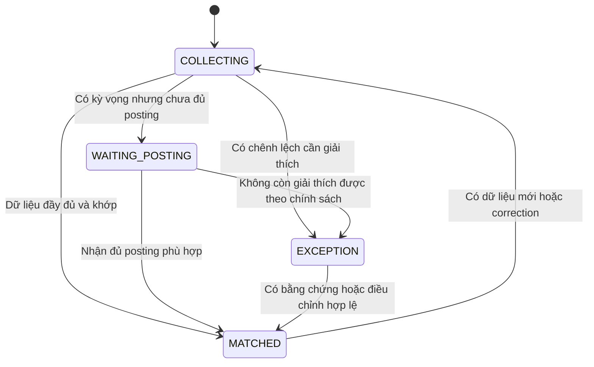

# Chargeback amount reconciliation — Đối soát số tiền chargeback

Một hồ sơ tranh chấp ghi 1.000.000 VND không đồng nghĩa tài khoản bên bán vừa bị trừ đúng 1.000.000 VND. Có thể một phần đã được refund, khoản tiền mới đang bị giữ, phí được ghi ở giao dịch riêng hoặc một phần tiền đã được trả lại sau khi tranh chấp kết thúc.

Trong chương **Chargeback Rules**, đối soát số tiền chargeback là quá trình liên kết hồ sơ tranh chấp với giao dịch gốc, các biến động tài chính thực tế và quy tắc kỳ vọng. Mục tiêu bảo mật logic là không để thông báo lặp, trạng thái đến sai thứ tự, sai phạm vi tài khoản hoặc phép tính bù trừ sai tạo ra khoản mất tiền không được giải thích hay quyền hoàn tiền không hợp lệ.

## 1. Mục tiêu và phạm vi

Sau bài học, bạn cần có khả năng:

- Phân biệt số tiền bị tranh chấp với số tiền đã bị ghi giảm, khoản giữ tiền và phí.
- Liên kết biến động chargeback với đúng payment/capture, account, tenant và tiền tệ.
- Đối soát refund và chargeback mà không bỏ qua dòng tiền thật hoặc trừ cùng một hiệu ứng hai lần.
- Thiết kế xử lý idempotent, transaction và phiên bản dữ liệu cho webhook, báo cáo và job đối soát.
- Kiểm thử tình huống dữ liệu trùng, thiếu, đến muộn, đảo thứ tự hoặc bị gán sai đối tượng.

Bài dùng các biến động tài chính đã được chuẩn hóa ở phía máy chủ. Ví dụ số tiền VND giả định cấu hình không có phần lẻ. Tên trạng thái, cơ chế giữ tiền, phí và cách ghi nhận hoàn trả phụ thuộc hợp đồng tích hợp; các ví dụ không phải quy tắc chung của mọi nhà cung cấp.

Các công thức là mô hình đối soát trong ứng dụng, không thay thế chính sách kế toán hoặc điều kiện xử lý tranh chấp của tổ chức.

## 2. Ba góc nhìn không được nhập làm một

### 2.1. Hồ sơ tranh chấp

Một hồ sơ có thể chứa:

- Payment hoặc capture bị tranh chấp.
- Số tiền và tiền tệ khách đang tranh chấp.
- Lý do, giai đoạn, trạng thái và các mốc xử lý.
- Tài liệu hoặc bằng chứng cần cung cấp.

Đây là góc nhìn về yêu cầu và tiến trình tranh chấp. Số tiền trên hồ sơ có thể thay đổi theo giai đoạn hoặc do cập nhật dữ liệu; nó không tự là một dòng tiền mới.

### 2.2. Biến động tài chính

Nhà cung cấp có thể ghi riêng:

- Khoản ghi giảm tiền gốc do chargeback.
- Khoản ghi tăng để hoàn trả hoặc điều chỉnh tiền gốc.
- Phí chargeback.
- Khoản hoàn phí nếu có.
- Khoản giữ hoặc giải phóng tiền thuộc cơ chế số dư của tích hợp.

Đối soát tiền thực tế cần dựa trên những biến động có định danh và ý nghĩa rõ ràng. Không lấy mỗi lần hồ sơ đổi trạng thái làm một lần ghi giảm tiền.

### 2.3. Số dư và payout

Số dư provider hoặc payout còn có capture, refund, phí xử lý, chuyển khoản, dự trữ và các điều chỉnh khác. Tổng payout thấp hơn doanh thu không tự chứng minh phần thiếu là chargeback.

Cần đối chiếu theo cùng account, loại số dư, tiền tệ và thời điểm chốt dữ liệu. Một bảng báo cáo về tiền khả dụng không thể được so trực tiếp với bảng chứa cả khoản đang chờ mà không giải thích cách chuyển giữa các nhóm.

| Dữ liệu | Trả lời câu hỏi | Không nên suy ra trực tiếp |
| --- | --- | --- |
| Disputed amount | Khách hoặc hồ sơ đang tranh chấp bao nhiêu? | Đã bị trừ đúng bấy nhiêu tiền |
| Principal debit | Tiền gốc đã được ghi giảm bao nhiêu? | Phí hoặc khoản giữ đã được bao gồm |
| Principal recovery | Tiền gốc đã được ghi tăng trở lại bao nhiêu? | Mọi phí cũng được trả lại |
| Hold/reserve | Phần tiền nào bị hạn chế sử dụng? | Đã có thêm một khoản mất tiền độc lập |
| Fee debit/credit | Phí thực tế bị thu hoặc hoàn là bao nhiêu? | Bằng số tiền tranh chấp |
| Case status | Quy trình đang ở giai đoạn nào? | Mọi biến động tài chính tương ứng đã được ghi sổ |

## 3. Ví dụ xuyên suốt: refund, chargeback và phí

Giả sử giao dịch gốc đã capture 1.000.000 VND và đã refund 200.000 VND. Sau đó xuất hiện hồ sơ tranh chấp có số tiền hiển thị là 1.000.000 VND.

Trong ví dụ này, dữ liệu có thẩm quyền từ tích hợp xác nhận:

| Biến động | Số tiền | Tác động |
| --- | ---: | --- |
| Capture gốc | 1.000.000 VND | Ghi tăng theo mô hình dòng tiền của ví dụ |
| Refund đã thực hiện | 200.000 VND | Ghi giảm riêng |
| Chargeback principal debit | 800.000 VND | Ghi giảm tiền gốc sau khi tích hợp đã xét refund |
| Chargeback fee | 50.000 VND | Ghi giảm phí riêng |
| Principal recovery sau kết quả có lợi | 800.000 VND | Ghi tăng lại tiền gốc |
| Fee recovery | 0 VND | Phí không được hoàn trong chính sách ví dụ |

Tác động ròng riêng chargeback:

```text
principalNetDebit = 800.000 - 800.000 = 0 VND
feeNetDebit       = 50.000 - 0        = 50.000 VND
chargebackNetDebit                    = 50.000 VND
```

Nếu chỉ xét các biến động đã liệt kê và bỏ qua những phí hoặc chuyển tiền khác:

```text
1.000.000 - 200.000 - 800.000 - 50.000 + 800.000
= 750.000 VND
```

Hai lỗi thường gặp:

1. Dùng disputed amount 1.000.000 thay principal debit thực tế 800.000, làm đối soát thiếu thêm 200.000.
2. Khi hồ sơ được đánh dấu có lợi cho bên bán, tự hoàn cả phí 50.000 dù không có bằng chứng phí được trả lại.

Một tích hợp khác có thể ghi giảm 1.000.000 rồi ghi tăng điều chỉnh 200.000 ở biến động riêng. Khi đó phải giữ cả hai biến động thực tế và liên kết khoản điều chỉnh, không sửa lịch sử thành một debit 800.000 mà làm mất dấu vết.

## 4. Ranh giới tin cậy và liên kết đối tượng

### 4.1. Dữ liệu do ai quyết định?

| Dữ liệu | Nguồn có thẩm quyền |
| --- | --- |
| Tenant và quyền người thao tác | Ngữ cảnh xác thực cùng chính sách ứng dụng |
| Payment/capture gốc | Liên kết thanh toán nội bộ đã xác lập |
| Provider account và môi trường | Cấu hình tích hợp và bản ghi giao dịch |
| Hồ sơ tranh chấp | Thông báo hoặc API provider đã được xác minh |
| Biến động tiền đã ghi nhận | Nguồn giao dịch tài chính/báo cáo có thẩm quyền theo tích hợp |
| Kỳ vọng phí, hoàn phí và thời điểm | Cấu hình chính sách có phiên bản cùng dữ kiện nguồn |
| Quyết định sửa sai hoặc hoàn thêm | Lệnh nghiệp vụ với quyền và phê duyệt phù hợp |

Một request từ giao diện không được tự đặt `reconciled = true`, tự khai khoản tiền đã được trả lại hoặc sửa merchant account để làm cho số khớp.

### 4.2. Khóa đối chiếu phải đủ phạm vi

Liên kết khái niệm:

```text
provider + providerAccount + environment
    → payment/capture reference
    → dispute reference và giai đoạn liên quan
    → financial posting reference
    → payment/capture nội bộ
    → tenant, order và phân bổ liên quan
```

Không nối dữ liệu chỉ bằng số tiền và ngày gần nhau. Hai đơn có thể cùng thanh toán 1.000.000 VND trong một ngày. ID giống nhau giữa hai account hoặc môi trường cũng không nhất thiết là cùng đối tượng.

Tenant có thể không xuất hiện trong bản ghi provider; nó cần được suy ra từ liên kết server-side. Metadata tùy ý do client đã cung cấp trước đó không tự trở thành bằng chứng chỉ vì xuất hiện trong webhook được ký.

Với nền tảng nhiều account kết nối, cần phân biệt account phát sinh biến động, bên chịu phí và tenant được phân bổ chi phí. Không mặc định tất cả phí ở tài khoản nền tảng đều thuộc tenant có một order ID trùng metadata.

### 4.3. Không biến URL trong payload thành nguồn xác nhận

Tra cứu bổ sung cần dùng endpoint, account và thông tin xác thực từ cấu hình tin cậy. Reference dùng để tra cứu phải được kiểm tra trong phạm vi thích hợp.

Không gọi một URL tùy ý trong file nhập hoặc payload để “xác minh số tiền”. Không cho người dùng tải CSV rồi coi mọi dòng trong đó là biến động tài chính có thẩm quyền.

## 5. Chuẩn hóa biến động trước khi đối soát

### 5.1. Tách loại biến động và quy ước dấu

Một mô hình chuẩn hóa có thể dùng các loại:

```text
PRINCIPAL_DEBIT
PRINCIPAL_RECOVERY
FEE_DEBIT
FEE_RECOVERY
HOLD_PLACED
HOLD_RELEASED
```

Với bốn loại đầu, lưu số tiền không âm và dùng loại biến động để xác định hướng tác động. Hoặc hệ thống có thể dùng số có dấu; điều quan trọng là quy ước phải nhất quán ở adapter, kho dữ liệu và công thức đối soát.

Không vừa lưu debit âm vừa trừ nó lần nữa trong phép tính. Không gộp phí vào principal ở một nguồn rồi cộng phí riêng từ nguồn khác.

### 5.2. Hold khác debit

Một khoản bị giữ có thể làm giảm tiền khả dụng nhưng chưa tương đương một khoản chargeback đã ghi giảm theo mô hình tài chính đã chọn.

Nếu hold sau đó chuyển thành debit, hệ thống cần mô hình cách giải phóng hoặc chuyển nhóm tương ứng. Không cộng hold và debit của cùng chuyển đổi như hai khoản mất tiền độc lập.

Nếu nhà cung cấp biểu diễn hold bằng giao dịch sổ số dư, cần chuẩn hóa theo đúng loại tài khoản/số dư và liên kết chuyển đổi. Việc loại hold khỏi công thức tác động tiền gốc không có nghĩa được bỏ qua ảnh hưởng của hold lên thanh khoản.

### 5.3. Snapshot lũy kế khác phát sinh

Một webhook có thể cho biết “tổng tiền đã bị trừ đến hiện tại là 800.000”. Hai event cùng chứa con số này không phải hai debit 800.000.

Nếu nguồn là snapshot, cần cập nhật projection có phiên bản hoặc suy ra thay đổi theo hợp đồng dữ liệu. Nếu nguồn là posting, cần định danh posting ổn định. Không trộn hai mô hình bằng phép cộng tất cả amount nhận được.

### 5.4. Mỗi biến động phải có dấu vết nguồn

Một bản ghi chuẩn hóa nên giữ:

```text
provider, provider_account_id, environment
source_financial_reference, source_component_reference
dispute_reference, payment_or_capture_reference
component_type, amount_minor, currency
posting_state, effective_at, observed_at
source_version hoặc dữ kiện phục vụ kiểm tra thay đổi
```

Nếu một giao dịch nguồn được tách thành principal và fee, mỗi phần chuẩn hóa cần định danh thành phần và phép kiểm tra tổng. Không hạch toán vừa toàn bộ giao dịch nguồn vừa từng phần của nó.

## 6. Các bất biến và công thức đối soát

### 6.1. Bảo toàn biến động đã xác nhận

Với cùng phạm vi account, tiền tệ và tập posting đã chốt:

```text
principalNetDebit =
    sum(PRINCIPAL_DEBIT) - sum(PRINCIPAL_RECOVERY)

feeNetDebit =
    sum(FEE_DEBIT) - sum(FEE_RECOVERY)

chargebackNetDebit = principalNetDebit + feeNetDebit
```

Khoản giữ được theo dõi riêng. Công thức không cộng các tiền tệ khác nhau.

Giá trị ròng trong một kỳ có thể âm nếu kỳ đó chỉ có khoản trả lại cho debit của kỳ trước. Không ép kết quả về 0 để làm báo cáo “hợp lệ”; cần giữ phạm vi thời gian và liên kết lịch sử.

### 6.2. Một posting không được áp dụng nhiều lần

```text
Cùng định danh biến động nguồn và thành phần
    → cùng một hiệu ứng chuẩn hóa có thẩm quyền
```

Event ID không đủ làm khóa vì một posting có thể được thông báo qua webhook, API và file đối soát. Ngược lại, hai posting ID thực sự khác nhau không được gộp chỉ vì số tiền giống nhau.

Nếu cùng định danh của một posting đã chốt xuất hiện với amount hoặc currency khác, cần kiểm tra theo hợp đồng nguồn. Không silently upsert làm mất lịch sử. Nguồn cho phép điều chỉnh phải được mô hình bằng version hoặc posting điều chỉnh có liên kết thích hợp.

### 6.3. Kỳ vọng khác thực tế

```text
difference(component, currency) =
    actualPosted(component, currency)
  - expectedPosted(component, currency)
```

Kỳ vọng cần có căn cứ: trạng thái/giai đoạn, phần refund đã được xét, chính sách phí, dữ liệu account và cut-off của lần đối soát. “Mong muốn số dư không âm” không phải căn cứ để sửa actual.

Phải so cả các thành phần gross. Hai debit và hai recovery bị ghi thừa cùng một lượng có thể làm số ròng vẫn bằng 0 nhưng vẫn là sai lệch cần phát hiện.

### 6.4. Không áp một trần sai lên mọi khoản chargeback

Tổng gồm principal và fee có thể lớn hơn số tiền capture. Chênh lệch quy đổi cũng có thể làm số theo tiền tệ settlement khác kỳ vọng đơn giản.

Bất biến về phân bổ hoặc giới hạn tiền gốc phải được định nghĩa đúng theo mô hình. Không dùng `chargebackTotal <= captured` làm lý do từ chối lưu một biến động có thật.

Nếu dữ liệu thực tế vượt điều dự kiến, ghi nhận trung thực và mở exception. Bảo vệ bất biến không đồng nghĩa xóa bằng chứng để số liệu khớp.

## 7. Refund và chargeback: đối chiếu giao nhau, không trừ máy móc

### 7.1. Cùng một phần hàng có thể xuất hiện ở cả hai quy trình

Khách có thể được refund một phần rồi tiếp tục tranh chấp giao dịch gốc. Hệ thống cần biết:

- Refund nào đã thực sự thành công.
- Nó liên quan phần giá trị nào của giao dịch.
- Nhà cung cấp đã xét refund đó trong principal debit chưa.
- Có posting điều chỉnh hoặc recovery riêng hay chưa.

Không chỉ tính:

```text
remaining = captured - refunded - disputedAmount
```

`disputedAmount` có thể chỉ là giá trị hồ sơ, không phải debit thực tế. Ngược lại, nếu refund và chargeback đều đã thật sự làm tiền ra ngoài, không được tự bỏ một khoản vì chúng “có vẻ cùng mục đích”.

### 7.2. Tách thực tế dòng tiền khỏi phần cần được sửa

Giả sử đã refund 200.000 VND, sau đó tài khoản vẫn bị debit chargeback 1.000.000 VND. Nếu cả hai biến động đều có thật, hệ thống phải ghi nhận cả hai.

Nếu chính sách và bằng chứng cho thấy khoản refund cần được xét để điều chỉnh tranh chấp, có thể kỳ vọng một khoản correction 200.000 VND. Khi correction chưa được ghi nhận, đó là khoản cần theo dõi, không phải tiền đã trở lại.

Khi correction xuất hiện, liên kết nó với debit/case thích hợp. Không sửa debit từ 1.000.000 thành 800.000 rồi vẫn giữ correction 200.000, vì sẽ làm giảm tác động hai lần.

### 7.3. Khả năng refund cần được kiểm tra lại

Một luồng refund mới có thể cần bị chặn hoặc đưa vào xem xét khi giao dịch đang bị tranh chấp, tùy chính sách. Không để một job thấy khách chưa nhận “refund thành công” rồi tự gửi thêm tiền trong khi đã có chargeback.

Khóa local trên capture giúp phối hợp các lệnh nội bộ, nhưng không ngăn được sự kiện tài chính bên ngoài phát sinh đồng thời. Cần xử lý kết quả đến muộn và đối soát những hiệu ứng đã thật sự xảy ra, thay vì hứa rằng transaction nội bộ loại bỏ được mọi chồng lấn.

## 8. State machine tranh chấp và trạng thái đối soát

### 8.1. Kết quả hồ sơ không phải bằng chứng posting

Có thể tách hai chiều trạng thái:

```text
Dispute workflow:
  đang mở / đang xử lý / có kết quả / có giai đoạn tiếp theo

Financial reconciliation:
  chưa đủ dữ liệu / đang chờ posting / khớp / có sai lệch
```

Tên cụ thể phải phản ánh tích hợp. Không mặc định mọi hồ sơ đã đóng đều không thể có giai đoạn tiếp theo hoặc biến động đến muộn.

| Quan sát | Điều không được tự động làm |
| --- | --- |
| Hồ sơ được mở | Ghi thêm debit nếu chưa có bằng chứng tài chính tương ứng |
| Tiền bị giữ | Cộng như một khoản principal debit độc lập |
| Kết quả có lợi cho bên bán | Tự tạo recovery hoặc hoàn phí chưa xảy ra |
| Kết quả bất lợi cho bên bán | Trừ lại principal đã bị debit trước đó |
| Hồ sơ đóng | Đánh dấu đối soát xong khi còn thiếu posting |
| Hồ sơ chuyển giai đoạn | Tạo thêm hiệu ứng tiền chỉ từ trạng thái giai đoạn |

Một trạng thái có thể làm thay đổi kỳ vọng: ví dụ sau kết quả có lợi, hệ thống theo dõi recovery dự kiến theo hợp đồng. Nó không thay thế actual posting.

### 8.2. Trạng thái đối soát có thể mở lại



MATCHED chỉ có nghĩa dữ liệu đã khớp trong phạm vi, version và cut-off của một lần kiểm tra. Không được dùng trạng thái đó để bỏ qua vĩnh viễn webhook mới.

Lịch sử lần đối soát cũ vẫn được giữ. Kết quả mới tham chiếu dữ kiện và chính sách mới thay vì ghi đè làm mất căn cứ của kết luận trước.

## 9. Luồng nhập liệu và đối soát an toàn

### 9.1. Các bước xử lý khái niệm

```text
1. Xác minh nguồn webhook, API hoặc báo cáo nhập.
2. Lưu observation/inbox bền vững với ngữ cảnh account và môi trường.
3. Chuẩn hóa loại dữ liệu: snapshot, posting, hold hoặc trạng thái hồ sơ.
4. Phân giải payment/capture và dispute theo liên kết có thẩm quyền.
5. Xác định canonical identity của biến động tài chính.
6. Trong transaction:
   - kiểm tra bản ghi đã tồn tại và nội dung có tương thích không;
   - ghi actual posting chưa được áp dụng;
   - cập nhật phân bổ/projection có phiên bản;
   - đánh dấu observation được xử lý và ghi outbox nếu cần.
7. Tạo reconciliation run với phạm vi và cut-off rõ ràng.
8. Tính kỳ vọng bằng dữ kiện cùng phiên bản chính sách.
9. So sánh từng thành phần và tiền tệ; phân loại chênh lệch.
10. Lưu kết quả, dữ kiện tham chiếu và hành động cần xử lý.
```

Không thực hiện cuộc gọi mạng dài trong transaction đang giữ khóa. Sau khi lấy dữ liệu bên ngoài, cần đọc lại các đối tượng nội bộ thích hợp dưới cơ chế kiểm soát đồng thời trước khi áp dụng.

### 9.2. Hợp nhất nguồn mà không nhân đôi posting

Cùng một balance transaction có thể xuất hiện trong webhook, API và báo cáo. Mỗi nguồn có ID observation riêng nhưng cần trỏ về cùng posting chuẩn hóa khi xác định được cùng hiệu ứng.

Nếu webhook chỉ có trạng thái hồ sơ mà chưa có định danh tài chính đủ rõ, có thể lưu nó như observation để tra cứu tiếp. Không vội ghi một debit giả theo event ID rồi nhập thêm debit thật từ báo cáo.

Không dùng “cùng số tiền, cùng ngày” làm thuật toán gộp tự động. Những trường hợp chưa đủ định danh cần được cách ly hoặc ghép bằng quy tắc có bằng chứng, kèm khả năng kiểm toán.

### 9.3. Ràng buộc chống trùng

Ví dụ chỉ mục, giả định các thành phần định danh bắt buộc đều không null:

```sql
CREATE UNIQUE INDEX uq_chargeback_source_component
ON normalized_chargeback_postings (
    provider,
    provider_account_id,
    environment,
    source_financial_reference,
    source_component_reference
);
```

Khi có xung đột, ứng dụng phải kiểm tra nội dung. Nếu cùng posting và cùng dữ liệu, đó có thể là delivery lặp. Nếu amount hoặc currency khác, không chỉ bỏ qua bằng ON CONFLICT DO NOTHING rồi coi là đã khớp.

Nếu nguồn cho phép version mới sửa dữ liệu, phải xử lý theo quy tắc version/correction của nguồn. Với posting đã xác định là bất biến, thay đổi nội dung là exception cần điều tra.

### 9.4. Phân bổ một biến động cho nhiều đối tượng

Một posting có thể chứa giá trị gộp cần phân bổ cho nhiều case hoặc order. Khi đó:

```text
Tổng amount đã phân bổ <= amount của posting

Nếu đã đánh dấu phân bổ hoàn tất:
  tổng amount đã phân bổ == amount của posting
```

Cần transaction hoặc cập nhật có điều kiện trên posting/phạm vi phân bổ chung để tránh hai worker cùng dùng toàn bộ số tiền.

Không gán nguyên posting 800.000 VND cho hai case rồi để mỗi case đều báo đã đối soát đủ 800.000. Các phần phân bổ phải có định danh và dấu vết, vẫn truy được về posting nguồn duy nhất.

### 9.5. Đủ số tiền chưa chắc đủ dữ liệu

Một lần import bị ngắt giữa các trang vẫn có thể tình cờ cho tổng ròng bằng kỳ vọng. Không được đánh dấu hoàn tất chỉ dựa vào tổng.

Reconciliation run cần biết các trang hoặc file đã được đọc đủ, account nào đã được bao phủ, phiên bản báo cáo, trạng thái pending/posted và mốc chốt dữ liệu. Nếu nguồn chưa đầy đủ, kết quả phải phản ánh giới hạn đó.

## 10. Tiền tệ, tỷ giá và cut-off

### 10.1. Đối soát theo từng tiền tệ

Giao dịch mua có thể mang tiền tệ A, còn phí hoặc settlement mang tiền tệ B. Số tiền tranh chấp theo tiền tệ giao dịch không được cộng thẳng vào khoản debit theo tiền tệ settlement.

Lưu ít nhất những thông tin thực sự có trong hợp đồng dữ liệu:

- Số tiền và tiền tệ gốc.
- Số tiền và tiền tệ ghi vào tài khoản.
- Dữ liệu chuyển đổi hoặc reference tỷ giá nếu có.
- Vai trò của từng số tiền: claim, principal, fee hay settlement.
- Thời điểm và định danh biến động nguồn.

Nếu chưa có cách nối hai loại tiền theo dữ liệu có thẩm quyền, giữ trạng thái cần đối soát thay vì lấy tỷ giá hiện tại để ép khớp.

### 10.2. Recovery có thể không cùng giá trị quy đổi ban đầu

Debit và recovery xảy ra vào hai thời điểm có thể có cách chuyển đổi khác nhau theo tích hợp. Chênh lệch theo tiền tệ settlement có thể là chênh lệch chuyển đổi cần giải thích, không tự là phí chargeback hoặc principal chưa trả đủ.

Không sửa amount lịch sử bằng tỷ giá mới. Không gộp mọi chênh lệch FX vào fee để làm bảng khớp nếu nguồn không hỗ trợ cách diễn giải đó.

### 10.3. Thời gian có nhiều ý nghĩa

Cần phân biệt:

```text
thời điểm nghiệp vụ xảy ra
thời điểm posting có hiệu lực
thời điểm nhà cung cấp ghi nhận
thời điểm ứng dụng quan sát
cut-off của reconciliation run
```

Một recovery được nhận hôm nay nhưng có hiệu lực ở kỳ trước cần được xử lý theo chính sách kỳ dữ liệu, kèm dấu vết. Không chỉ dùng thời điểm nhận webhook làm thời điểm tài chính.

Không hardcode “thắng hôm nay thì tiền phải về trong một ngày” nếu tích hợp không quy định như vậy. Khi còn trong khoảng chờ hợp lệ, ghi nhận pending expectation; khi không thể giải thích, mở exception theo chính sách đã cấu hình.

Nếu cho phép sai số làm tròn, nó phải được định nghĩa theo loại phép tính và đơn vị tiền. Không cho người dùng gửi tolerance tùy ý hoặc dùng tỷ lệ rộng để che một khoản trừ thêm.

## 11. Ví dụ Java: tổng hợp biến động đã chuẩn hóa

Đoạn mã sau tổng hợp bốn thành phần tiền đã ghi nhận cho một tiền tệ. Input phải là posting đã được xác minh, phân loại và chọn đúng phạm vi; không gồm hold, snapshot lũy kế hoặc event chỉ thông báo trạng thái.

```java
import java.util.HashSet;
import java.util.List;
import java.util.Objects;
import java.util.Set;

public final class ChargebackAmounts {
    public enum Component {
        PRINCIPAL_DEBIT, PRINCIPAL_RECOVERY,
        FEE_DEBIT, FEE_RECOVERY
    }

    public record Posting(
            String normalizedKey,
            String currency,
            Component component,
            long amountMinor) {

        public Posting {
            Objects.requireNonNull(normalizedKey);
            Objects.requireNonNull(currency);
            Objects.requireNonNull(component);
            if (normalizedKey.isBlank() || currency.isBlank()
                    || amountMinor <= 0) {
                throw new IllegalArgumentException("Invalid posting");
            }
        }
    }

    public record Totals(
            String currency,
            long principalDebits,
            long principalRecoveries,
            long feeDebits,
            long feeRecoveries) {

        public long principalNetDebit() {
            return Math.subtractExact(principalDebits, principalRecoveries);
        }

        public long feeNetDebit() {
            return Math.subtractExact(feeDebits, feeRecoveries);
        }

        public long totalNetDebit() {
            return Math.addExact(principalNetDebit(), feeNetDebit());
        }
    }

    public static Totals summarize(
            String currency, List<Posting> postings) {

        Objects.requireNonNull(currency);
        Objects.requireNonNull(postings);
        Set<String> seen = new HashSet<>();
        long principalDebits = 0;
        long principalRecoveries = 0;
        long feeDebits = 0;
        long feeRecoveries = 0;

        for (Posting posting : postings) {
            if (!currency.equals(posting.currency())) {
                throw new IllegalArgumentException("Currency mismatch");
            }
            if (!seen.add(posting.normalizedKey())) {
                throw new IllegalStateException("Duplicate posting input");
            }

            switch (posting.component()) {
                case PRINCIPAL_DEBIT ->
                    principalDebits = Math.addExact(
                            principalDebits, posting.amountMinor());
                case PRINCIPAL_RECOVERY ->
                    principalRecoveries = Math.addExact(
                            principalRecoveries, posting.amountMinor());
                case FEE_DEBIT ->
                    feeDebits = Math.addExact(
                            feeDebits, posting.amountMinor());
                case FEE_RECOVERY ->
                    feeRecoveries = Math.addExact(
                            feeRecoveries, posting.amountMinor());
            }
        }

        return new Totals(currency, principalDebits,
                principalRecoveries, feeDebits, feeRecoveries);
    }

    private ChargebackAmounts() {}
}
```

Các giới hạn cần hiểu:

- `normalizedKey` phải bao phủ scope nguồn và thành phần, không chỉ dùng event ID hoặc amount.
- Hàm chủ động báo lỗi nếu input lặp; pipeline nhập liệu phải xử lý duplicate và nội dung mâu thuẫn trước đó.
- Hai posting có định danh khác nhau vẫn được cộng, dù cùng amount. Nếu một posting là bất thường, phát hiện bằng đối soát với kỳ vọng, không tự xóa nó.
- Gross principal và fee được giữ riêng; không chỉ xuất ra tổng ròng.
- Giá trị ròng có thể âm trong một kỳ chỉ có recovery. Code không ép về 0.
- `Math.*Exact` phát hiện tràn kiểu số; giới hạn nghiệp vụ, độ đầy đủ dữ liệu và quyền truy cập vẫn cần kiểm tra riêng.

Đây là phép tổng hợp thuần, chưa kết luận MATCHED. Muốn kết luận cần so với kỳ vọng có nguồn, kiểm tra cut-off, phân bổ và dữ liệu còn đang chờ.

## 12. Phân loại chênh lệch trước khi quyết định sửa

Một khoản difference không tự cho biết nguyên nhân. Có thể phân loại:

| Nhóm | Ví dụ | Hướng xử lý |
| --- | --- | --- |
| Chưa đủ dữ liệu | Thiếu trang báo cáo hoặc posting chưa được lấy | Hoàn thiện dữ liệu, giữ kết quả chưa đầy đủ |
| Lệch thời điểm | Recovery đã dự kiến nhưng chưa posted | Theo dõi expectation và cut-off phù hợp |
| Sai liên kết | Debit đúng nhưng bị gán nhầm capture/account | Sửa phân bổ có kiểm soát, giữ posting nguồn |
| Trùng observation | Webhook và file nói cùng balance transaction | Liên kết về cùng posting chuẩn hóa |
| Trùng thực tế tài chính | Hai debit ID khác nhau cùng được ghi nhận ngoài dự kiến | Lưu cả hai, điều tra và theo dõi correction |
| Refund chưa được xét | Principal debit khác kỳ vọng vì refund giao nhau | Đối chiếu quan hệ và dữ kiện provider |
| Sai chính sách phí | Kỳ vọng phí được hoàn nhưng thực tế không có | Kiểm tra phiên bản chính sách, không tự sinh tiền |
| Sai tiền tệ hoặc FX | So số tiền gốc với số settlement | Đối soát theo currency và dữ kiện chuyển đổi |
| Nội dung nguồn mâu thuẫn | Cùng posting đã chốt nhưng amount thay đổi | Cách ly, tra cứu và xác định correction/version |
| Thiếu quyền hoặc dữ liệu giả | Người dùng nhập số recovery không có nguồn | Không áp dụng như actual, lưu dấu vết phù hợp |

### 12.1. Tổng ròng bằng nhau vẫn có thể sai

Giả sử kỳ vọng:

```text
Principal debit:       800.000
Principal recovery:    800.000
Fee debit:              50.000
Fee recovery:                0
Net debit:              50.000 VND
```

Thực tế lại là:

```text
Principal debit:     1.600.000
Principal recovery:  1.600.000
Fee debit:              50.000
Fee recovery:                0
Net debit:              50.000 VND
```

Chỉ so net sẽ báo khớp dù gross movement gấp đôi. Điều này có thể phản ánh dữ liệu nhập trùng hoặc những biến động có thật cần giải thích.

Cần so từng component, posting count/identity và liên kết nghiệp vụ. Số lượng posting khác nhau không tự là lỗi nếu có các phần hợp lệ; nó là dấu hiệu cần xét cùng dữ liệu nguồn.

### 12.2. Một payment có thể có nhiều case hoặc giai đoạn

Không dùng UNIQUE chỉ theo payment/capture ID để bảo đảm “chỉ một chargeback”. Mô hình có thể cần nhiều hồ sơ hoặc nhiều giai đoạn liên quan cùng giao dịch theo tích hợp.

Quan hệ case, cycle/giai đoạn và financial posting phải rõ. Một thông báo trạng thái giai đoạn mới không tự là debit mới, nhưng posting mới có thật cũng không được bỏ chỉ vì payment đã từng có chargeback.

### 12.3. Không sửa actual để khớp kỳ vọng

Nếu actual debit là 900.000 VND mà expected là 800.000 VND, không được cập nhật actual xuống 800.000 để đóng exception.

Có thể kỳ vọng sai, phân bổ sai hoặc ngoài hệ thống đã trừ thêm. Mỗi nguyên nhân có cách xử lý riêng. Sửa projection hay expectation cần version và căn cứ; ghi nhận một correction tài chính cần bằng chứng tương ứng.

## 13. Quyền sửa sai và hành động tiếp theo

### 13.1. Quyền xem khác quyền điều chỉnh

Có thể tách quyền:

- Xem case và dữ liệu trong tenant được phép.
- Nhập hoặc kích hoạt lấy dữ liệu từ nguồn đã cấu hình.
- Đề xuất sửa liên kết hoặc phân bổ.
- Duyệt điều chỉnh theo chính sách.
- Thực hiện lệnh tài chính hoặc giao tiếp với nhà cung cấp.
- Đánh dấu kết quả kiểm tra, kèm lý do và bằng chứng.

Người có quyền đọc báo cáo không mặc nhiên được thay số tiền hoặc merchant account. Người có quyền xử lý dispute không mặc nhiên được refund thêm cho khách.

Mọi đường ghi, gồm trang quản trị, batch, tác vụ nền và script vận hành, cần giữ cùng ranh giới về nguồn dữ liệu và bất biến.

### 13.2. Lệnh giải quyết exception phải cụ thể

Một hợp đồng lệnh có thể nhận:

```http
POST /reconciliation-exceptions/ex_701/resolutions
Content-Type: application/json

{
  "expectedExceptionVersion": 6,
  "resolutionType": "LINK_VERIFIED_POSTING",
  "postingId": "posting_901",
  "reason": "Bổ sung liên kết từ bản ghi đã được xác minh"
}
```

Backend kiểm tra quyền, trạng thái, tenant, phiên bản, số tiền chưa phân bổ và tính phù hợp của posting. Client chỉ đề xuất cách giải quyết; không tự xác nhận posting có thẩm quyền.

Nếu chỉ chấp nhận một chênh lệch theo chính sách mà không có tiền trở lại, trạng thái phải thể hiện đó là chênh lệch được chấp nhận hoặc đã giải thích. Không đặt nhãn “đã recover” khi không có recovery.

### 13.3. Đối soát không tự cấp quyền chuyển tiền

Một difference 200.000 VND không đủ để tự tạo refund 200.000 VND. Có thể khách đã nhận phần đó qua chargeback hoặc refund trước.

Nếu cần yêu cầu điều chỉnh từ provider, phải tạo một operation có định danh ổn định, quyền thực hiện và cơ chế chống lặp. Retry job đối soát không được gửi yêu cầu tài chính mới mỗi lần chạy.

Outbox giúp lưu ý định cùng transaction local; consumer và nơi nhận vẫn cần nhận diện cùng operation. Dữ liệu ngoài hệ thống không tự trở thành một phần của transaction cơ sở dữ liệu.

Tương tự, trạng thái MATCHED không tự mở lại đơn đã hủy, cấp lại hàng hoặc tạo khoản nợ mới cho khách. Những quyết định này thuộc quy trình nghiệp vụ riêng.

## 14. Kiểm thử tình huống tấn công logic

Kiểm thử cần quan sát actual posting, phân bổ, expectation, kết quả reconciliation và các hành động tiếp theo.

| Tình huống | Bất biến cần kiểm tra |
| --- | --- |
| Gửi hai lần cùng webhook chargeback | Không ghi hai actual posting cho cùng hiệu ứng |
| Webhook và báo cáo cùng chứa một balance transaction | Hai observation liên kết một posting chuẩn hóa |
| Hai posting ID khác nhau cùng amount | Không tự gộp; cả hai được đối soát theo căn cứ |
| Cùng posting ID đã chốt nhưng currency/amount khác | Không âm thầm bỏ qua hoặc ghi đè, tạo xử lý mâu thuẫn |
| Client sửa tenant, account hoặc payment reference | Không gán dữ liệu sang đối tượng ngoài phạm vi |
| Dữ liệu TEST được đưa vào luồng LIVE | Không ảnh hưởng nghĩa vụ hoặc báo cáo production |
| File do người dùng cung cấp tự khai recovery | Không trở thành actual có thẩm quyền chỉ vì đúng định dạng |
| Event mở hồ sơ chứa disputed amount | Không tự coi là principal debit đã posted |
| Hold chuyển sang debit | Không tính hai lần cùng chuyển đổi |
| Case được đánh dấu có lợi nhưng chưa có recovery | Giữ expectation chờ, không sinh credit giả |
| Case bất lợi sau khi principal đã bị trừ | Không trừ lần nữa chỉ do trạng thái |
| Refund đã được provider xét trong debit | Không trừ lại phần refund khỏi chargeback debit |
| Refund và debit đều thực sự xảy ra | Lưu cả hai, không xóa một khoản để làm khớp |
| Correction refund đến muộn | Liên kết correction và mở lại kết quả cần cập nhật |
| Debit và recovery trùng nhau làm net vẫn khớp | So gross và identity phát hiện bất thường |
| Fee không được hoàn dù principal đã trả lại | Không tự sinh fee recovery |
| Fee bằng tiền tệ settlement khác principal | Không cộng trực tiếp hai loại tiền |
| Recovery có giá trị quy đổi khác debit | Giữ dữ liệu lịch sử, phân loại chênh lệch theo nguồn |
| Import dừng giữa các trang nhưng tổng tình cờ khớp | Không đánh dấu run hoàn tất khi độ bao phủ chưa đủ |
| Hai worker cùng nhập hoặc phân bổ một posting | Một hiệu ứng, tổng phân bổ không vượt amount |
| Lỗi sau khi ghi posting nhưng trước khi cập nhật projection | Transaction local rollback hoặc khôi phục idempotent theo mô hình |
| Event cũ đến sau MATCHED | Không bị bỏ qua; kết quả mới có version và dữ kiện thích hợp |
| Một payment có nhiều case/giai đoạn hợp lệ | Không làm mất posting chỉ vì payment đã có hồ sơ cũ |
| Job chạy lại cùng exception | Không tạo lặp yêu cầu điều chỉnh hoặc refund |
| Người có quyền xem cố đóng exception bằng sửa amount | Quyền theo loại lệnh và dữ liệu được thực thi |

Để kiểm thử cạnh tranh, đặt điểm đồng bộ để hai luồng cùng tới bước ghi posting hoặc phân bổ. Sau khi kết thúc, kiểm tra dữ liệu đã commit, không chỉ mã HTTP hoặc log.

Một chuỗi kiểm thử có thể là:

```text
capture
→ refund một phần
→ mở dispute
→ hold
→ principal debit
→ báo cáo chứa lại debit đó
→ có kết quả có lợi
→ recovery đến muộn
→ fee vẫn còn
→ webhook cũ được phát lại
```

Kết quả phải giải thích được từng thành phần và không tự gộp hold, disputed amount, debit hay refund thành các khoản đồng nghĩa.

Kiểm thử số học nên bao gồm giá trị lớn, phép cộng có thể tràn, số tiền ròng âm của một kỳ chỉ có recovery và phân bổ làm tròn. Không dùng số thực dấu phẩy động để kiểm tra “gần bằng” thay cho quy tắc đơn vị tiền đã định nghĩa.

## 15. Đối chiếu cấp case và cấp tài khoản

Đối soát từng case có thể đúng nhưng tổng account vẫn lệch do thiếu posting chưa được gán. Ngược lại, tổng account khớp không chứng minh mọi case được phân bổ đúng: hai case có thể bị hoán đổi cùng số tiền.

Cần hai lớp kiểm tra bổ sung:

1. Theo case/capture: các component, refund giao nhau, expectation và liên kết.
2. Theo account/tiền tệ/nhóm số dư: tất cả biến động trong kỳ và phần chưa phân bổ.

Trong một sổ số dư nhất quán, công thức khái niệm là:

```text
closingBalance =
    openingBalance + sum(allPostedSignedMovements)
```

Phải dùng cùng account, currency, nhóm số dư và cut-off. `allPostedSignedMovements` gồm mọi loại biến động thuộc sổ đó, không chỉ chargeback. Payout hoặc chuyển nội bộ đã có trong tập biến động không được cộng/trừ thêm lần nữa từ báo cáo tổng hợp.

Không so net payout trực tiếp với tổng gross chargeback. Cần đi qua các thành phần và báo cáo có cùng ngữ nghĩa.

Dấu vết của một reconciliation run nên gồm:

- Provider account, môi trường, tiền tệ và phạm vi case.
- Cut-off, phiên bản nguồn, tình trạng đã lấy đủ dữ liệu.
- Danh sách hoặc tập tham chiếu posting được sử dụng.
- Phiên bản chính sách kỳ vọng và dữ kiện refund liên quan.
- Tổng gross từng component, tổng ròng và chênh lệch.
- Khoản chưa phân bổ, đang chờ hoặc được chấp nhận có lý do.
- Người hoặc tác vụ tạo, duyệt và giải quyết exception.

Log không nên chứa token truy cập, tài liệu tranh chấp nhạy cảm hoặc thông tin cá nhân không cần thiết. Bằng chứng nguồn cần được bảo vệ phù hợp với quyền truy cập và chính sách lưu giữ.

Cảnh báo hữu ích gồm posting chưa gán kéo dài, cùng source identity có nội dung mâu thuẫn, projection khác tổng actual hoặc case đã kết thúc nhưng kỳ vọng tài chính chưa được giải thích. Cảnh báo không tự cho phép bút toán sửa số hay thao tác chuyển tiền.

## 16. Tự kiểm tra thiết kế

Trước khi coi chargeback đã đối soát xong, cần trả lời:

1. Con số đang so là disputed amount, hold, principal, fee hay số settlement?
2. Actual posting lấy từ nguồn nào và đã liên kết đúng account, môi trường, payment/capture chưa?
3. Cùng một biến động xuất hiện qua nhiều nguồn được hợp nhất bằng định danh nào?
4. Refund đã được provider xét trong debit hay còn cần một correction riêng?
5. Gross từng component có khớp không, ngoài tổng ròng?
6. Tiền tệ và dữ kiện chuyển đổi có được giữ riêng, đúng lịch sử không?
7. Kỳ dữ liệu có đầy đủ và dùng cùng cut-off không?
8. Kết quả case đang làm thay đổi kỳ vọng hay đã có bằng chứng tiền thật?
9. Ai được sửa liên kết, chấp nhận chênh lệch hoặc tạo yêu cầu tài chính tiếp theo?
10. Khi có posting mới hoặc correction đến muộn, kết quả cũ được cập nhật và kiểm toán ra sao?

Đối soát chargeback đáng tin cậy phải giải thích được số tiền, nguồn và quan hệ của từng biến động. Khi hồ sơ tranh chấp, dòng tiền thực tế và kỳ vọng nghiệp vụ được giữ tách biệt nhưng liên kết chặt chẽ, callback lặp, dữ liệu trễ hoặc phép bù trừ sai sẽ không âm thầm biến thành khoản mất tiền hay quyền hoàn tiền ngoài chính sách.
