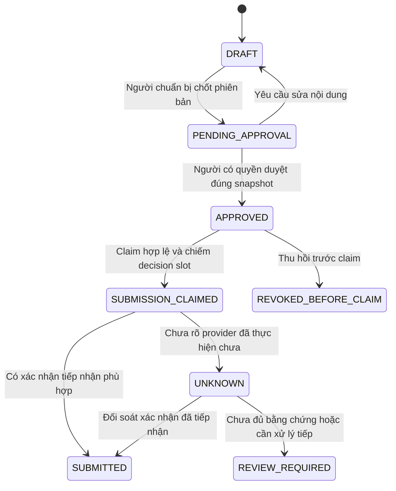

# Thẩm quyền phản hồi chargeback (Chargeback response authority)

Trong chương **Chargeback Rules**, phản hồi chargeback là một hành động nghiệp vụ có thẩm quyền: ứng dụng có thể gửi bằng chứng bảo vệ giao dịch hoặc gửi một quyết định khác mà quy trình tranh chấp cho phép, chẳng hạn chấp nhận trách nhiệm. Nếu chỉ kiểm tra người gọi đã đăng nhập hoặc có vai trò quản trị chung, hệ thống có thể cho nhân viên thao tác nhầm tài khoản nhận tiền, bỏ qua bước duyệt, gửi bằng chứng đã bị thay đổi hoặc thực hiện hai quyết định mâu thuẫn cho cùng hồ sơ.

Bài học sử dụng hệ thống bán hàng và nhà cung cấp thanh toán giả định. Tên trạng thái, vai trò, hành động và thời hạn là mô hình minh họa; khả năng phản hồi và ý nghĩa tài chính thực tế phải được ánh xạ theo hợp đồng tích hợp. Trọng tâm là bảo vệ business invariants bằng quyền theo đối tượng, state machine, phân tách nhiệm vụ, transaction, idempotency và kiểm thử lạm dụng logic.

## 1. Mục tiêu học tập

Sau bài học, bạn có thể:

- Phân biệt quyền xem tranh chấp, chuẩn bị bằng chứng, duyệt, gửi phản hồi và chấp nhận trách nhiệm.
- Ràng buộc thẩm quyền với tenant, tài khoản nhận tiền, payment gốc, hồ sơ và đợt phản hồi cụ thể.
- Thiết kế phê duyệt gắn với đúng hành động và phiên bản bằng chứng, không thể tái sử dụng tùy ý.
- Ngăn tự duyệt, gửi trực tiếp ngoài quy trình và hai quyết định mâu thuẫn chạy đồng thời.
- Xử lý thu hồi quyền, deadline, retry và timeout mà không giả định tác động bên ngoài đã biến mất.
- Xây dựng kiểm thử chứng minh ai đã được phép quyết định điều gì, trên hồ sơ nào và với nội dung nào.

## 2. Phản hồi không phải quyền tự quyết kết quả tranh chấp

Chargeback trong bài là một quy trình tranh chấp giao dịch được xử lý qua bên ngoài ứng dụng. Hệ thống nội bộ có thể chuẩn bị hồ sơ và thực hiện những hành động mà tích hợp cho phép; nó không tự có quyền tuyên bố bên bán thắng chỉ vì đã gửi phản hồi.

Phân biệt ba việc:

| Việc | Ý nghĩa | Nguồn thẩm quyền |
|---|---|---|
| Chuẩn bị nội dung | Chọn và diễn giải bằng chứng liên quan | Vai trò nội bộ được cấp quyền trên hồ sơ |
| Gửi hành động phản hồi | Gửi một quyết định hoặc bộ bằng chứng cụ thể | Phê duyệt nội bộ hợp lệ và khả năng tích hợp hiện tại |
| Xác nhận kết quả tranh chấp | Ghi nhận kết quả bên ngoài đã được xác minh | Bằng chứng provider phù hợp với hồ sơ và giai đoạn |

Không mở API cho client tự gửi `outcome = WON`, `chargebackRejected = true` hoặc `liability = 0` để kết thúc vụ việc. Các trường đó không phải kết luận đáng tin cậy của người gọi.

Tương tự, khách hàng có thể gửi khiếu nại trong ứng dụng, nhưng một yêu cầu như vậy không tự tạo thành hồ sơ chargeback chính thức ở provider. Cần phân biệt case chăm sóc khách hàng với case tranh chấp bên ngoài đã được xác thực và ánh xạ.

## 3. Thẩm quyền phải gắn với một đối tượng cụ thể

### 3.1. Chuỗi binding cần bảo vệ

```text
Tenant
  -> Merchant account
      -> Payment / capture gốc
          -> Provider dispute
              -> Response opportunity
                  -> Approved response command
```

Một binding giả định:

```text
tenantId                   tenant_1
merchantAccountId          merchant_12
provider                   PROVIDER_A
providerEnvironment        LIVE
paymentAttemptId           attempt_701
providerCaptureId          capture_ext_801
chargebackCaseId           case_901
providerDisputeId          dispute_ext_301
responseOpportunityId      opportunity_1
```

`responseOpportunityId` là định danh nội bộ cho một cơ hội phản hồi được hệ thống xác định từ vòng đời tích hợp. Không để client tự tăng `round = 2` để tạo thêm quyền phản hồi.

Không giả định mọi provider chỉ có đúng một lần gửi hoặc đều cho sửa phản hồi. Nếu tích hợp có nhiều giai đoạn, mỗi giai đoạn phải có quyền, trạng thái và binding tương ứng.

### 3.2. Có quyền với đơn chưa chắc có quyền với tranh chấp

Nhân viên hỗ trợ có thể xem order để trả lời khách nhưng không được quyền chấp nhận tổn thất hoặc gửi hồ sơ ra bên ngoài. Người mua có quyền với order của mình cũng không được đóng vai bên bán để gửi phản hồi chargeback.

Authorization cần trả lời:

```text
actor có quyền thực hiện action
trong tenant hiện tại
trên merchant account được phân công
đối với case cụ thể
ở giai đoạn hiện tại
với nội dung và tác động đã được duyệt
```

Một role rộng như `ADMIN` hoặc `PAYMENT_MANAGER` không diễn đạt đủ các giới hạn này.

### 3.3. Quyền kỹ thuật ở provider khác quyền nghiệp vụ

Một API key có thể đủ khả năng kỹ thuật để gửi phản hồi cho nhiều tài khoản. Điều đó không cho mọi người dùng backend quyền thao tác với các tài khoản đó.

Backend chọn cấu hình và credential từ binding đáng tin cậy. Không nhận `merchantAccountId`, `providerAccountHeader` hoặc khóa API do client tự chỉ định để quyết định nơi gửi.

Trong hệ thống nhiều tài khoản liên kết, quyền của tài khoản nền tảng không thay thế việc kiểm tra tenant và phạm vi phân công của actor. Những giới hạn không được provider biểu diễn trực tiếp vẫn phải được ứng dụng thực thi.

## 4. Ma trận quyền theo hành động

Một thiết kế minh họa có thể tách quyền như sau:

| Hành động | Quyền minh họa | Điều kiện bổ sung |
|---|---|---|
| Xem trạng thái case | `chargeback.case.read` | Đúng tenant, merchant và phạm vi công việc |
| Xem bằng chứng nhạy cảm | `chargeback.evidence.read` | Chỉ dữ liệu cần thiết cho case được phép |
| Tạo hoặc sửa bản nháp | `chargeback.response.prepare` | Giai đoạn còn cho chuẩn bị; nguồn bằng chứng hợp lệ |
| Đề nghị gửi hồ sơ bảo vệ giao dịch | `chargeback.defense.request` | Bản nháp đủ cấu trúc và đã chốt phiên bản |
| Duyệt hồ sơ bảo vệ giao dịch | `chargeback.defense.approve` | Đúng bản nháp, phạm vi duyệt và phân tách nhiệm vụ |
| Đề nghị chấp nhận trách nhiệm | `chargeback.liability.request` | Nêu quyết định và tác động theo policy |
| Duyệt chấp nhận trách nhiệm | `chargeback.liability.approve` | Quyền riêng, giới hạn và bước duyệt tương ứng |
| Gửi lệnh đã duyệt | `chargeback.response.execute` | Chỉ service hoặc actor thực thi được chỉ thị đã duyệt cụ thể |
| Xuất hồ sơ | `chargeback.evidence.export` | Phạm vi dữ liệu, mục đích và truy vết truy cập |

Tên quyền là ví dụ, không yêu cầu một sản phẩm phải dùng đúng các chuỗi đó. Điểm quan trọng là quyền chuẩn bị, duyệt và thực thi không bị gộp vô tình.

### 4.1. Chấp nhận trách nhiệm là hành động riêng

Trong mô hình bài học, `SUBMIT_DEFENSE` và `ACCEPT_LIABILITY` là hai quyết định khác nhau. Phê duyệt cho một hành động không được dùng để thực hiện hành động kia.

Nếu tích hợp có hành động khác như rút phản hồi hoặc cập nhật hồ sơ, hãy định nghĩa quyền và tác động riêng. Không nhận một trường `action` tùy ý rồi chỉ kiểm tra cùng một quyền `manageChargeback`.

### 4.2. Không mặc định chủ tenant được bỏ qua invariant

Tenant administrator có thể quản lý phân công hoặc người dùng nếu sản phẩm cho phép. Họ vẫn không được dùng approval cho case khác, sửa binding tiền gốc hoặc đặt kết quả provider theo ý muốn.

Nếu có quy trình khẩn cấp, nó phải có phạm vi, điều kiện và audit rõ ràng. Ngoại lệ nội bộ không tạo thêm khả năng phản hồi mà provider không hỗ trợ.

## 5. Business invariants cho phản hồi chargeback

| Invariant | Cơ chế bảo vệ điển hình |
|---|---|
| Chỉ actor đúng phạm vi được thao tác với case | Authorization theo tenant, merchant, case và action |
| Case luôn gắn với payment và tài khoản provider gốc | Binding nội bộ được quản lý, không cho đổi bằng request |
| Nội dung gửi đúng nội dung được duyệt | Snapshot bất biến và evidence manifest có version/digest |
| Người chuẩn bị không tự duyệt khi policy cấm | Kiểm tra danh tính người thực hiện và phân tách nhiệm vụ |
| Một approval chỉ áp dụng cho đúng hành động và cơ hội phản hồi | Binding approval với case, opportunity, action và phiên bản |
| Hai quyết định mâu thuẫn không được cùng chiếm quyền gửi | Decision slot và transition nguyên tử dùng chung |
| Retry không tạo một hành động bên ngoài mới ngoài ý định đã duyệt | Operation ID ổn định, idempotency và đối soát |
| Thu hồi quyền hoặc approval chặn tác động mới theo điểm quyết định đã chọn | Kiểm tra hiệu lực hiện tại và giao thức claim |
| Gửi phản hồi không tự kết luận kết quả tranh chấp | Tách trạng thái submission khỏi outcome provider |
| Mọi tác động quan trọng truy được tới quyền và bằng chứng | Audit, outbox, inbox và reference provider |

Các invariant áp dụng trên giao diện nhân viên, endpoint quản trị, worker, batch và công cụ vận hành. Một đường gọi nội bộ bỏ qua approval vẫn là lỗ hổng logic.

## 6. Bằng chứng phải đúng nguồn, đúng phạm vi và đúng phiên bản

### 6.1. Không để người chuẩn bị tự tạo sự thật có thẩm quyền

Một hồ sơ có thể chứa dữ liệu giao dịch, điều khoản được chấp nhận, xác nhận giao hàng hoặc lịch sử trao đổi phù hợp với tranh chấp. Nội dung cần phản ánh bằng chứng thực tế; quyền sửa bản nháp không cho phép sửa lịch sử giao dịch hoặc giả mạo chứng từ.

Nguồn bằng chứng cần được ghi rõ:

```text
evidenceId
sourceType
sourceRecordId
sourceVersion
collectedAt
contentDigest
classification
```

Phần diễn giải do nhân viên viết phải được phân biệt với dữ kiện được hệ thống xác minh. Không biến một ghi chú tự khai thành `deliveryVerified = true`.

### 6.2. Evidence manifest chốt chính xác nội dung được duyệt

Một bản nháp có thể gồm:

```text
draftId = draft_41
draftVersion = 7
action = SUBMIT_DEFENSE
caseId = case_901
responseOpportunityId = opportunity_1
evidenceManifest = [evidence_1@v3, evidence_2@v1, statement_5@v2]
manifestDigest = digest của nội dung và cấu trúc đã chuẩn hóa
```

Approval phải gắn với version 7 và manifest đó. Nếu ai sửa lời giải trình, thay file, thêm dữ liệu hoặc đổi cách che thông tin, đó là một phiên bản khác cần được xét duyệt theo policy.

Hash không tự chứng minh bằng chứng đúng sự thật. Nó giúp đối chiếu rằng nội dung gửi không bị đổi so với snapshot được duyệt. Vẫn cần provenance và quyền đọc/sử dụng dữ liệu nguồn.

### 6.3. Không đọc lại dữ liệu mutable khi chuẩn bị gửi

Một lỗi phổ biến là approver xem file A, nhưng worker sau đó đọc lại `latestEvidence` và gửi file B vừa được thay thế.

Lệnh đã duyệt phải tham chiếu snapshot hoặc object version bất biến, không phải đường dẫn “mới nhất”. Nếu storage cho phép ghi đè cùng khóa, cần versioning hoặc cơ chế khác giữ đúng nội dung đã chốt.

Worker kiểm tra reference và digest thích hợp trước khi gửi. Không tự thêm bằng chứng mới từ order hiện tại vào một lệnh đã được duyệt cho bản cũ.

### 6.4. Quyền gửi không đồng nghĩa quyền xuất mọi dữ liệu

Chỉ đưa dữ liệu cần cho mục đích phản hồi và được phép sử dụng. Không đính kèm toàn bộ hồ sơ khách hàng chỉ vì nhân viên có thể xem một phần order.

URL tải file có thể mang quyền truy cập. Nếu sử dụng URL có thời hạn, cần kiểm soát phạm vi, thời gian và đối tượng được nhận; audit hoặc outbox thông thường không nên phát tán các URL nhạy cảm đó.

## 7. Phân tách nhiệm vụ và phê duyệt

### 7.1. Chính sách minh họa hai người

Trong ví dụ, phản hồi cuối cần một người chuẩn bị và một người khác duyệt. Người duyệt phải có quyền cho đúng hành động, merchant và case.

```text
preparer.personId != approver.personId
approver có quyền approve(action, case)
approval tham chiếu đúng draftVersion và manifestDigest
```

Chỉ so hai session ID không chứng minh có hai người. Nếu tổ chức yêu cầu phân tách theo con người, cơ chế quản trị danh tính phải hỗ trợ nhận diện phù hợp; dùng một tài khoản phụ hoặc service account không tự đáp ứng yêu cầu độc lập.

Với thao tác thay mặt, ghi cả người thực hiện và chủ thể được đại diện. Không để delegation trở thành cách lách quy tắc không tự duyệt.

### 7.2. Approval cần được ràng buộc đủ chặt

Một bản ghi approval nên bao gồm:

```text
approvalId
tenantId, merchantAccountId, caseId
responseOpportunityId
action
draftId, draftVersion, evidenceManifestDigest
requestedFinancialEffect, nếu hành động có tác động được mô hình hóa
policyVersion
approvedByPersonId
approvedAt, expiresAt, revokedAt
relevantCaseVersion
```

Không nhận `approved = true`, `approvedBy` hoặc `approvalTime` từ body như kết luận có thẩm quyền. Actor và thời gian phê duyệt lấy từ luồng server đã xác thực.

Approval cho `SUBMIT_DEFENSE` ở opportunity 1 không được dùng để `ACCEPT_LIABILITY`, cho opportunity 2 hoặc cho case khác có cùng số tiền.

### 7.3. Thu hồi quyền sau phê duyệt

Policy phải định nghĩa approval còn hiệu lực thế nào khi người duyệt mất quyền. Ví dụ trong bài: approval bị thu hồi hoặc quyền duyệt không còn hiệu lực trước điểm claim thì không cho bắt đầu tác động mới.

Để thực thi quy tắc đó, cần kiểm tra grant/policy version hiện tại theo cơ chế có bảo đảm phù hợp. Một role được cache từ lúc tạo draft không đủ để chứng minh quyền tại lúc gửi.

Nếu hệ thống cần thu hồi có hiệu lực nguyên tử với claim, luồng đổi quyền/thu hồi và luồng claim phải dùng giao thức version hoặc đồng bộ tương ứng. Đọc hai hệ thống độc lập không tự tạo một quyết định nguyên tử.

Thu hồi quyền không đảo được một request đã được provider tiếp nhận. Tách tác động chưa claim, đã claim, có thể đã gửi và đã được xác nhận để xử lý đúng.

## 8. State machine nội bộ và trạng thái bên ngoài

### 8.1. Vòng đời phản hồi nội bộ



Sơ đồ là mô hình minh họa. Nếu provider từ chối chắc chắn hoặc cho phép gửi lại trong một trường hợp cụ thể, cần transition riêng với điều kiện rõ ràng; không tự đưa mọi lỗi về `DRAFT` để gửi một quyết định khác.

### 8.2. Không trộn submission với outcome

| Trạng thái nội bộ | Có thể kết luận | Chưa được kết luận |
|---|---|---|
| `APPROVED` | Nội bộ đã duyệt một lệnh cụ thể | Provider đã nhận lệnh |
| `SUBMISSION_CLAIMED` | Hệ thống đã chấp nhận quyền bắt đầu thực thi theo giao thức | Tác động bên ngoài chắc chắn thành công |
| `SUBMITTED` | Provider đã xác nhận mức tiếp nhận được tích hợp định nghĩa | Bên bán đã thắng tranh chấp |
| `UNKNOWN` | Kết quả tác động chưa rõ | Chưa gửi, được gửi lại bằng ý định mới hoặc được giải phóng mọi ràng buộc |

Kết quả như thắng, thua, đóng hoặc mở lại tranh chấp chỉ được cập nhật bằng luồng bằng chứng bên ngoài đã xác thực và chuyển trạng thái hợp lệ. Nếu tích hợp cho phép thay đổi giai đoạn hoặc mở lại, phải mô hình hóa; không bỏ mọi event mới chỉ vì local từng đánh dấu đóng.

## 9. Một decision slot cho các hành động mâu thuẫn

### 9.1. Race giữa bảo vệ giao dịch và chấp nhận trách nhiệm

Giả sử hai người đồng thời thao tác:

```text
T1 đọc case còn mở -> chuẩn bị SUBMIT_DEFENSE
T2 đọc case còn mở -> chuẩn bị ACCEPT_LIABILITY
T1 gửi bằng chứng
T2 gửi chấp nhận trách nhiệm
```

Hai quyền riêng lẻ đều có thể hợp lệ nhưng kết hợp tạo kết quả không phù hợp với chính sách. Vì vậy authorization theo request chưa đủ; cần invariant cho cả chuỗi.

### 9.2. Scope khóa không được tách theo action

Nếu chỉ tạo unique key `(caseId, action)`, cả hai hành động trên vẫn có thể cùng thắng vì action khác nhau.

Trong ví dụ, decision slot có scope:

```text
(tenantId, caseId, responseOpportunityId)
```

Slot chỉ cho một quyết định cuối được chấp nhận theo quy trình tại một thời điểm. Claim cần khóa hoặc ràng buộc dữ liệu ngăn các ý định mâu thuẫn cùng được thực thi.

Nếu cho thay quyết định trước khi gửi, phải có lệnh thu hồi/thay thế nguyên tử, làm mất hiệu lực approval cũ và tạo phê duyệt mới. Sau khi tác động có thể đã gửi, không giải phóng slot chỉ vì worker timeout.

### 9.3. Mọi writer phải tôn trọng cùng giao thức

Luồng gửi, thu hồi approval, cập nhật case từ provider và công cụ quản trị cần có quy tắc khóa/version tương thích. Một endpoint giữ khóa case không bảo vệ được nếu batch nội bộ gọi provider trực tiếp từ dữ liệu cũ.

Nếu phải khóa nhiều đối tượng, quy định thứ tự khóa nhất quán. Trong mô hình phân tán, dùng chỉ thị bền vững, trạng thái pending và đối soát; không giữ transaction database trong một cuộc gọi mạng dài.

## 10. Deadline và khả năng thực thi hiện tại

### 10.1. Đủ quyền không có nghĩa còn được phản hồi

Một approver đúng vai trò có thể gặp case đã hết hạn hoặc giai đoạn không còn cho hành động được yêu cầu. Quyền nội bộ và capability hiện tại của provider là hai điều kiện cùng phải đáp ứng.

Deadline phải lấy từ nguồn và quy tắc tích hợp được server tin cậy, lưu provenance cùng case. Không nhận `respondBy` hoặc `isStillOpen` từ client để kéo dài quyền gửi.

Xác định rõ thời điểm xét hạn: khi duyệt, claim hay trước gửi, cùng quy tắc tại đúng deadline. Phê duyệt trước hạn không tự bảo đảm worker gửi nhiều giờ sau vẫn hợp lệ.

### 10.2. Snapshot provider có thể lỗi thời

Giữa lần đọc trạng thái và lúc gửi, provider có thể đóng hồ sơ hoặc chuyển giai đoạn. Kiểm tra local giảm rủi ro nhưng không bảo đảm một trạng thái bên ngoài bất biến.

Nếu cần tra cứu lại, thực hiện theo kiến trúc thích hợp rồi kiểm tra version/binding trước claim. Provider từ chối do case đã đổi phải được ghi nhận và đưa vào luồng xử lý, không đánh dấu `SUBMITTED` để giữ trải nghiệm thành công.

Một khoảng đệm vận hành trước deadline có thể hỗ trợ xử lý độ trễ. Nó không tạo thêm quyền gửi sau hạn và không bảo đảm tuyệt đối thời điểm request tới bên ngoài.

### 10.3. Hết lease không tạo quyền quyết định mới

Worker A có thể đã gửi phản hồi nhưng chưa lưu kết quả. Lease hết không cho worker B gửi `ACCEPT_LIABILITY` như một ý định thay thế.

Giữ operation ID, decision slot và nội dung đã duyệt cho đến khi có kết luận theo tích hợp. Fencing token local chỉ có tác dụng tại nơi thực thi nếu nơi đó thực sự kiểm tra nó; nó không tự thu hồi request provider đã nhận.

## 11. Mã giả phê duyệt và lập chỉ thị gửi

Đoạn dưới mô tả một policy trong đó phê duyệt có thể tạo chỉ thị chờ service thực thi. Đây là mã giả, không phải Java có thể biên dịch trực tiếp.

```java
ApprovalReply approveResponse(
        AuthenticatedActor actor,
        CaseId caseId,
        ApproveResponseCommand command,
        String idempotencyKey) {

    validateAllowedFieldsAndLimits(command, idempotencyKey);

    return transactions.execute(() -> {
        ChargebackCase dispute = cases.lockByTenantAndId(actor.tenantId(), caseId)
                .orElseThrow(this::notFound);

        authorization.requireCanApproveAction(actor, dispute, command.action());

        RequestScope scope = scopeFor(actor, "APPROVE_CHARGEBACK_RESPONSE", idempotencyKey);
        Fingerprint fingerprint = fingerprintOf(caseId, command);
        StoredRequest previous = idempotency.find(scope);
        if (previous != null) {
            requireSameFingerprint(previous, fingerprint);
            return previous.originalReplyOrProcessingReply();
        }
        idempotency.claimWithUniqueConstraint(scope, fingerprint);

        ResponseDraft draft = drafts.lockForCase(dispute, command.draftId());
        draft.requireVersion(command.expectedDraftVersion());
        draft.requirePendingApproval();
        draft.requireAction(command.action());

        separationPolicy.requireIndependentApprover(actor, draft.preparedByPersonId());
        EvidenceManifest manifest = evidence.loadFrozenManifest(draft);
        evidencePolicy.requireAllowedForCase(actor, dispute, manifest);

        Instant decisionTime = databaseClock.currentDecisionTime();
        responsePolicy.requireMayApprove(dispute, draft, decisionTime);

        ApprovedResponse approved = approvals.createBoundSnapshot(
                actor, dispute, draft, manifest, decisionTime);

        SubmissionIntent intent = submissions.createApprovedIntentInDecisionSlot(
                dispute.responseOpportunityId(), approved);

        audit.recordApprovalAndIntent(actor, dispute, approved, intent);
        outbox.appendApprovedResponseReady(intent.id());

        ApprovalReply reply = approvedForExecution(approved.id(), intent.id());
        idempotency.complete(scope, reply);
        return reply;
    });
}
```

Những điều phải hiện thực rõ:

- Case được tải trong tenant đáng tin cậy, sau đó kiểm tra merchant, phân công và quyền theo hành động.
- Draft, evidence và approval đều phải thuộc đúng case; biết một ID không cấp quyền sử dụng.
- Việc tạo intent trong decision slot có ràng buộc nguyên tử. Nếu slot đã thuộc quyết định khác, không tiếp tục gửi.
- `ApprovedResponse` giữ action, case/opportunity, draft version, manifest và tác động được duyệt; không chỉ giữ một cờ `approved`.
- Idempotency, approval, intent, audit và outbox cùng commit hoặc rollback trong phạm vi database này.
- Unique conflict cần được xử lý theo database; nếu transaction đã lỗi thì rollback và đọc/retry trong transaction mới.
- Không gọi provider trong transaction này và không trả credential qua phản hồi.
- Replay vẫn cần quyền hiện tại trước khi trả dữ liệu đã lưu, nhưng không tạo một approval hoặc tác động mới.

Nhánh service claim sau đó phải kiểm tra riêng:

```text
service identity có quyền execute
intent đúng scope và chưa được claim/thực hiện theo giao thức
approval chưa bị thu hồi và còn hiệu lực theo policy
quyền của người duyệt còn phù hợp nếu policy yêu cầu tại claim
snapshot/evidence đúng bản được duyệt
case/opportunity vẫn cho phép hành động
deadline và điều kiện thực thi còn đáp ứng
decision slot thuộc chính intent này
```

Các kiểm tra này cần version hoặc khóa tương thích với những writer có thể thay đổi điều kiện. Tên hàm `requireApproved()` không tự tạo bảo đảm khi dữ liệu liên quan được sửa độc lập.

## 12. Worker thực thi chỉ thị đã được giới hạn

### 12.1. Worker không tự trở thành người quyết định

Outbox nên mang `submissionIntentId` và những reference cần thiết, không mang token người dùng hoặc credential provider dạng rõ.

Worker tải intent từ server, kiểm tra service identity và claim theo giao thức. Nội dung gửi được dựng từ approved snapshot, không từ body request mới hoặc draft mới nhất.

Một API nội bộ như `execute(caseId, arbitraryPayload)` có thể biến worker thành công cụ gửi thay cho bất kỳ ai biết endpoint. Ưu tiên `executeApprovedIntent(intentId)` với kiểm tra đầy đủ binding và state.

### 12.2. Credential không được chọn bằng tham số tùy ý

Worker xác định credential từ provider binding của case và cấu hình được quản lý. Không lấy credential route từ metadata event hoặc từ `merchantAccountId` chưa được đối chiếu.

Giới hạn quyền API và quyền truy cập console theo khả năng của provider. Nếu provider không biểu diễn hết policy nội bộ, giảm số chủ thể có đường truy cập trực tiếp và đối soát các tác động ngoài ứng dụng.

### 12.3. Tác động từ console bên ngoài cũng phải được ghi nhận

Ứng dụng không thể ngăn mọi thao tác mà một tài khoản có quyền trực tiếp trên provider thực hiện. Những quyền đó cần được quản trị riêng.

Nếu phát hiện phản hồi ngoài luồng local, vẫn ghi nhận bằng chứng thực tế với provenance phù hợp và mở review khi thiếu approved intent. Không giả tạo một approval nội bộ để hợp thức hóa lịch sử và không bỏ event chỉ vì không tìm thấy người duyệt.

## 13. Idempotency, timeout và phản hồi muộn

### 13.1. Hai lớp chống trùng

Idempotency API có thể dùng scope:

```text
(tenantId, actorId, operation, idempotencyKey)
```

Fingerprint cần chứa case, opportunity, action, draft/version và những dữ liệu làm thay đổi quyết định. Cùng key nhưng khác action hoặc bản bằng chứng phải bị từ chối do xung đột.

Lớp tác động nghiệp vụ dùng `submissionOperationId` ổn định cho intent đã duyệt. Client đổi key không được tạo thêm quyết định cho cùng slot. Hết thời gian lưu key HTTP không làm mất các ràng buộc nghiệp vụ đó.

### 13.2. Timeout không chứng minh chưa gửi

Nếu provider có thể đã nhận phản hồi nhưng HTTP timeout, giữ trạng thái `UNKNOWN` và operation ID cũ. Nếu provider hỗ trợ idempotency, retry theo đúng hợp đồng với cùng key và cùng nội dung.

Nếu không có cơ chế chống trùng hoặc tra cứu đủ tin cậy, không tự gửi lại một quyết định có thể đã thực hiện. Cần đối soát hoặc xử lý vận hành có quyền.

Không tự chuyển từ gửi bằng chứng sang chấp nhận trách nhiệm để “đóng case cho xong” khi kết quả gửi trước chưa rõ.

### 13.3. Callback ánh xạ về đúng intent

Thông điệp provider cần được xác thực theo tích hợp, có phạm vi provider, môi trường và tài khoản phù hợp. Ánh xạ tới dispute và operation đã biết bằng mapping nội bộ đáng tin cậy.

Metadata hỗ trợ tra cứu không thay binding. Event chưa ánh xạ phải được giữ để kiểm tra, không tự gán tenant hoặc case theo một trường tùy ý.

Callback trùng không tạo thêm approval hoặc submission. Callback cũ không ghi đè kết quả đã được xác nhận bằng quy tắc “đến sau luôn thắng”; cập nhật theo ngữ nghĩa vòng đời thực tế và đối soát khi mâu thuẫn.

## 14. Phối hợp với refund và trạng thái tài chính

Một case chargeback có thể liên quan tới refund đang xử lý hoặc khoản tiền đã được ghi nhận theo cách khác. Những luồng này cần nhìn thấy cùng binding và trạng thái tài chính phù hợp trước khi chấp nhận tác động mới.

Không mặc định rằng gửi bằng chứng là phải chặn mọi refund trong mọi tích hợp. Cũng không cho hoàn tiền tự động mà không xét tranh chấp đang mở. Chính sách phải định nghĩa tổ hợp hành động nào được phép và khi nào cần review để tránh tác động không mong muốn hoặc lợi ích kép ngoài dự kiến.

Nếu refund và quyết định tranh chấp cùng phụ thuộc một dữ liệu, chúng phải dùng giao thức khóa/version hoặc quy trình phối hợp tương thích. Audit cần nối case với refund operation và ledger liên quan.

Các tác động bên ngoài thực tế có thể xảy ra không như kế hoạch. Không áp một công thức giới hạn local rồi bỏ qua debit hoặc refund đã xảy ra để giữ số liệu đẹp. Ghi nhận sự thật, phân loại sai lệch và xử lý bằng quy trình có quyền.

Kết quả thắng tranh chấp không tự cho phép phát hàng lại, thu tiền thêm hoặc thay đổi mọi trạng thái order. Từng tác động tiếp theo phải có invariant và authorization của riêng nó.

## 15. Hợp đồng API và trải nghiệm phê duyệt

Một cách phân chia API minh họa:

```text
GET /chargeback-cases/{caseId}
  -> trạng thái và dữ liệu được phép xem

POST /chargeback-cases/{caseId}/response-drafts
  -> tạo draft trong phạm vi được phép

POST /chargeback-cases/{caseId}/response-drafts/{draftId}/review-requests
  -> chốt phiên bản và đề nghị duyệt

POST /chargeback-cases/{caseId}/response-approvals
  -> approver duyệt đúng action và snapshot

GET /chargeback-cases/{caseId}/submission-intents/{intentId}
  -> theo dõi tiến độ, không cấp quyền gửi tùy ý
```

Cấu trúc endpoint không tự tạo bảo mật. Mọi action vẫn cần kiểm tra tenant, merchant, case và quyền; không chỉ ẩn nút phê duyệt với người không có role.

Màn hình duyệt nên thể hiện:

- Case và payment liên quan với thông tin đủ phân biệt trong phạm vi được phép.
- Hành động cụ thể: gửi hồ sơ bảo vệ giao dịch hay chấp nhận trách nhiệm.
- Phiên bản nội dung, danh mục bằng chứng và tác động được biết theo tích hợp.
- Người chuẩn bị, điều kiện tách nhiệm vụ, deadline và hạn approval.
- Những điều còn chờ xác minh hoặc có xung đột với refund.

Không dùng một nút “Xác nhận” chung mà không cho approver thấy hành động nào sẽ được thực thi. Thông báo “đã duyệt” hoặc “provider đã tiếp nhận” cũng không được diễn đạt thành “đã thắng chargeback”.

Mã lỗi nghiệp vụ có thể phân biệt:

```text
CHARGEBACK_ACTION_FORBIDDEN
CHARGEBACK_SCOPE_MISMATCH
RESPONSE_DRAFT_VERSION_CONFLICT
INDEPENDENT_APPROVER_REQUIRED
RESPONSE_APPROVAL_REVOKED_OR_EXPIRED
RESPONSE_OPPORTUNITY_UNAVAILABLE
RESPONSE_DECISION_SLOT_CONFLICT
RESPONSE_SUBMISSION_UNRESOLVED
```

Phản hồi không được tiết lộ hồ sơ hoặc bằng chứng của tenant khác. ID khó đoán không thay thế authorization.

## 16. Audit và truy vết thẩm quyền

Một chuỗi audit cần giải thích ai đã chuẩn bị, ai đã duyệt, service nào gửi và bằng chứng nào chứng minh provider đã tiếp nhận.

Các trường hữu ích:

```text
tenantId, merchantAccountId, chargebackCaseId
provider, environment, providerDisputeId, providerCaptureId
responseOpportunityId, action
draftId, draftVersion, evidenceManifestDigest
preparerPersonId, approverPersonId, executingServiceIdentity
approvalId, policyVersion, authorizationDecisionRef
submissionIntentId, submissionOperationId
stateBefore, stateAfter, versionBefore, versionAfter
decisionTime, approvalExpiresAt, providerDeadlineAt
sourceEventId, evidenceRef, correlationId, reasonCode
```

Actor và quyền lấy từ nguồn đáng tin cậy. Free-text reason do người dùng khai không phải kết luận của hệ thống. Audit không chứa khóa API, token phiên hoặc dữ liệu bằng chứng nhạy cảm không cần thiết.

Approval, thay đổi state và outbox cùng transaction khi cùng phạm vi dữ liệu. Nếu intent rollback, không được có audit đã commit khẳng định đã phê duyệt thành công bằng một kênh độc lập thiếu ngữ nghĩa.

Với quyết định từ chối, thiết kế đường ghi phù hợp để audit không biến mất do transaction nghiệp vụ rollback. Giới hạn payload và quyền đọc audit để việc điều tra không tạo đường rò dữ liệu.

## 17. Kiểm thử các tình huống tấn công logic

### 17.1. Ma trận tình huống

| Tình huống | Cách thử | Điều cần chứng minh |
|---|---|---|
| Khách hàng đóng vai bên bán | Dùng quyền xem order để gọi phản hồi | Không được chuẩn bị/duyệt/gửi như merchant |
| Chéo tenant | Gửi caseId hoặc draftId tenant khác | Không đọc hoặc thay đổi hồ sơ ngoài phạm vi |
| Sai merchant account | Actor được phân công tài khoản A thao tác case B | Authorization đối chiếu tài khoản gốc |
| Giả mạo role | Body chứa `isAdmin`, `approved`, `approverId` | Không trở thành quyền hoặc phê duyệt có thẩm quyền |
| Chỉ có quyền chuẩn bị | Gọi trực tiếp endpoint gửi cuối | Không bỏ qua approval |
| Chỉ có quyền đọc | Thử lấy evidence/export hoặc duyệt | Không suy rộng quyền từ việc xem trạng thái |
| Tự duyệt | Người chuẩn bị dùng phiên khác để duyệt | Kiểm tra danh tính theo chính sách phân tách nhiệm vụ |
| Delegation lách tự duyệt | Cùng người thực hiện qua grant khác | Không coi thay session hoặc đại diện là độc lập một cách mặc định |
| Dùng sai approval | Approval của case/action/opportunity khác | Không được áp dụng ngoài binding |
| Sửa evidence sau duyệt | Thay file hoặc statement nhưng giữ draftId | Version/digest không khớp, không gửi nội dung mới |
| Đổi mục tiêu nhận tiền | Gửi merchantAccountId tùy chọn | Worker dùng credential route từ binding server |
| Thu hồi trước claim | Revoke approval hoặc quyền duyệt rồi chạy worker | Không bắt đầu tác động mới theo policy đã chọn |
| Thu hồi đua claim | Điều khiển lịch cập nhật version | Kết quả khớp điểm quyết định và giao thức thu hồi |
| Hết deadline | Giả giờ client hoặc dùng approval cũ | Không kéo dài khả năng phản hồi bằng dữ liệu client |
| Case đổi giai đoạn | Provider cập nhật sau lần đọc local | Không dùng snapshot lỗi thời để khẳng định gửi thành công |
| Hai quyết định đối nghịch | Defense và accept liability cùng chạy | Một decision slot, không cho cả hai cùng thực thi |
| Cùng key khác payload | Đổi action hoặc draftVersion | Xung đột idempotency, không diễn giải lại ý định |
| Key mới cùng opportunity | Tạo lại request để vượt slot | Không tạo thêm tác động ngoài policy |
| Worker có quyền kỹ thuật rộng | Gọi execute với payload tùy ý | Chỉ approved intent hợp lệ được thực thi |
| Provider timeout | Provider nhận rồi local mất phản hồi | Giữ unknown và operation ID, không đổi quyết định để gửi lại |
| Lease hết hạn | Worker cũ có thể tiếp tục sau restart | Không tự tạo ý định mới hoặc giải phóng slot |
| Callback trùng hoặc cũ | Replay và đảo thứ tự event | Không gửi trùng hoặc đặt outcome theo thứ tự HTTP |
| Kết quả do client khai | Gửi `WON`, `LOST`, `closed` | Không cập nhật kết quả bên ngoài từ request tùy ý |
| Refund chạy đồng thời | Refund và quyết định dispute cùng đọc state cũ | Thực thi đúng policy phối hợp và lưu đủ dấu vết |
| Thao tác trực tiếp ở provider | Có event thật nhưng không có local approval | Ghi nhận sự thật và review, không tạo approval giả |
| Rò bằng chứng | Dùng URL hoặc correlation ID của case khác | Không đọc/export dữ liệu ngoài quyền |

### 17.2. Kiểm thử race bằng điểm đồng bộ

Dùng barrier/latch để hai luồng tới bước chiếm slot; không chỉ thêm `sleep` rồi hy vọng race xuất hiện.

```text
Lịch A - SUBMIT_DEFENSE thắng:
  1. Luồng defense khóa case/opportunity và chiếm slot hợp lệ.
  2. Luồng accept liability phải chờ theo giao thức.
  3. Defense commit approved intent.
  4. Luồng accept đọc lại slot và không tạo intent đối nghịch.

Lịch B - Thu hồi trước claim:
  1. Luồng revoke thắng cập nhật version/approval.
  2. Worker claim đọc trạng thái mới hoặc cập nhật có điều kiện thất bại.
  3. Không phát request provider cho intent đã mất hiệu lực.

Lịch C - Claim trước thu hồi:
  1. Worker claim thành công theo policy và commit.
  2. Thu hồi không được giả định request chưa thể được gửi.
  3. Xử lý theo trạng thái thực thi và đối soát, không tuyên bố đã thu hồi bên ngoài.
```

Thêm provider giả lập có điểm dừng trước nhận lệnh, sau tiếp nhận và trước trả phản hồi. Restart worker, giao lặp outbox và cho callback tới muộn để kiểm tra khôi phục.

### 17.3. Assertion dựa trên invariant

Ngoài HTTP status, kiểm tra:

- Case, payment, merchant và tenant không bị gắn lại sai.
- Approval đúng person/action/draft/version/manifest và opportunity.
- Người chuẩn bị và người duyệt đáp ứng policy độc lập.
- Chỉ một intent phù hợp chiếm decision slot cho các hành động mâu thuẫn.
- Payload thực tế gửi provider đúng snapshot đã được duyệt.
- Operation ID và credential route đúng khi retry.
- Không cập nhật outcome từ một phê duyệt hoặc phản hồi client.
- Audit nối được người chuẩn bị, approver, service, provider evidence và kết quả áp dụng.
- Không có bằng chứng hoặc secret ngoài quyền trong response, event và log.

Đếm số HTTP call chưa đủ để kết luận tác động trùng: một retry đúng tích hợp có thể gọi nhiều lần với cùng operation ID. Cần kiểm tra số quyết định thực tế và hiệu lực của chúng ở provider giả lập.

## 18. Vận hành, cảnh báo và xử lý khẩn cấp

Theo dõi các tín hiệu:

- Nỗ lực truy cập case ngoài tenant hoặc merchant được giao.
- Nhiều lần tự duyệt, tái sử dụng approval hoặc thay evidence sát lúc gửi.
- Hai intent mâu thuẫn cạnh tranh cùng opportunity.
- Approved intent gần deadline nhưng chưa claim, hoặc operation unknown kéo dài.
- Tác động provider không có local command/approval tương ứng.
- Lỗi ánh xạ account, event chưa biết và thay đổi outcome chưa đối soát.
- Bất thường ở quyền console, credential hoặc export evidence.

Các tín hiệu hỗ trợ điều tra, không tự chứng minh người dùng có hành vi xấu. Có thể là nhầm phân công, lỗi tích hợp hoặc sự kiện đến muộn.

Quy trình khẩn cấp cần nêu ai được đọc bằng chứng, ai được thu hồi chỉ thị chưa gửi, ai được duyệt hành động thay thế và cách xác minh trạng thái provider. Không xử lý sự cố bằng cách sửa `approved = true`, đổi `caseId` hoặc đặt `SUBMITTED` trực tiếp trong database.

Nếu đã có tác động ngoài ý muốn, ghi nhận đúng sự thật và thực hiện quy trình khắc phục được hỗ trợ. Quyền quản trị local không tự đảo được quyết định đã được bên ngoài tiếp nhận.

## 19. Những ngộ nhận cần tránh

| Ngộ nhận | Cách hiểu đúng |
|---|---|
| Người xem được order thì được phản hồi chargeback | Quyền tranh chấp và vai trò merchant cần cấp riêng |
| Có API key là đủ thẩm quyền | Credential chỉ là khả năng kỹ thuật, còn policy nội bộ và scope đối tượng |
| Duyệt một case là duyệt mọi hành động | Approval phải gắn với action, opportunity và nội dung cụ thể |
| Hai session là hai người độc lập | Phân tách nhiệm vụ cần dựa trên danh tính mà policy yêu cầu |
| File vẫn cùng tên là cùng bằng chứng | Cần snapshot/version và đối chiếu nội dung được duyệt |
| Unique theo case và action chặn quyết định đối nghịch | Hai action khác nhau vẫn cần cạnh tranh cùng decision slot |
| Timeout nghĩa là chưa gửi | Provider có thể đã tiếp nhận, cần giữ operation và đối soát |
| Thu hồi role làm request đã gửi mất hiệu lực | Thu hồi chỉ kiểm soát tác động mới trong giới hạn giao thức |
| Gửi phản hồi thành công là đã thắng | Submission và outcome là hai vòng đời khác nhau |

## 20. Bài tập vận dụng

### Bài tập 1: Thiết kế ma trận thẩm quyền

Một nền tảng có hai tenant, mỗi tenant có nhiều merchant account. Nhân viên hỗ trợ chỉ được chuẩn bị hồ sơ; analyst duyệt defense trong tài khoản được giao; quyết định chấp nhận trách nhiệm cần một quyền tài chính riêng và người duyệt khác người chuẩn bị.

Hãy xác định các permission, phạm vi đối tượng và kiểm tra phân tách nhiệm vụ. Nêu quyền của service gửi lệnh và vì sao service đó không được tự duyệt.

Gợi ý: quyền ở tenant chưa diễn đạt đầy đủ quyền trên từng merchant account.

### Bài tập 2: Approval cũ, bằng chứng mới

Approver duyệt draft version 7. Sau đó người chuẩn bị thay một attachment ở cùng đường dẫn và sửa lời giải trình thành version 8. Worker tới lượt xử lý outbox của approval version 7.

Hãy mô tả snapshot, manifest, kiểm tra version/digest và hành vi worker. Nêu vì sao đọc `latestDraft` hoặc chỉ kiểm tra `approved = true` là không đủ.

Gợi ý: nội dung gửi phải đúng thứ đã được duyệt, không chỉ cùng draft ID.

### Bài tập 3: Hai quyết định và một timeout

Defense đã được claim và có thể đã tới provider nhưng local timeout. Một nhân viên khác muốn chấp nhận trách nhiệm để kết thúc case.

Hãy xác định trạng thái slot, operation ID cần giữ, quyền có thể cho phép điều tra và điều kiện trước một quyết định thay thế. Nêu hành vi khi callback defense báo tiếp nhận thành công tới muộn.

Gợi ý: có quyền approve hành động thứ hai không giải quyết sự không chắc chắn của tác động thứ nhất.

## 21. Checklist triển khai

- [ ] Case có binding đáng tin cậy tới tenant, merchant, payment/capture và provider dispute.
- [ ] Quyền xem, chuẩn bị, duyệt, thực thi, chấp nhận trách nhiệm và export được phân biệt.
- [ ] Actor và scope lấy từ nguồn xác thực, không từ cờ đặc quyền trong payload.
- [ ] Policy phân tách nhiệm vụ được kiểm tra theo danh tính phù hợp, kể cả delegation.
- [ ] Approval gắn đúng case, opportunity, action, draft version, manifest và tác động liên quan.
- [ ] Bằng chứng gửi ra là snapshot đã duyệt, có provenance và kiểm soát dữ liệu nhạy cảm.
- [ ] Các hành động mâu thuẫn cạnh tranh cùng decision slot bằng transaction/version thích hợp.
- [ ] Claim kiểm tra hiệu lực approval, quyền theo policy, deadline và trạng thái thực thi hiện tại.
- [ ] Worker chỉ thực thi approved intent, dùng credential route từ binding server.
- [ ] Retry giữ operation ID; timeout và lease hết hạn không tự tạo quyền gửi hành động khác.
- [ ] Event provider được xác thực, ánh xạ và dedup; submission không bị nhầm với outcome.
- [ ] Refund và tác động tài chính liên quan có policy phối hợp, không bỏ qua sự thật bên ngoài.
- [ ] Audit nối được người chuẩn bị, người duyệt, service thực thi và bằng chứng provider.
- [ ] Quyền provider console và tác động ngoài luồng local được quản trị, phát hiện và đối soát.
- [ ] Kiểm thử có chéo tenant, tự duyệt, sửa evidence, race, thu hồi quyền và kết quả chưa rõ.

Thẩm quyền phản hồi chargeback được bảo vệ khi hệ thống chứng minh được đúng chủ thể đã duyệt đúng hành động, trên đúng hồ sơ, với đúng nội dung và điều kiện thực thi. Quyền của một người, phê duyệt của một bước hoặc credential của một service không được tự mở rộng thành quyền quyết định mọi hành động và kết quả của tranh chấp.
