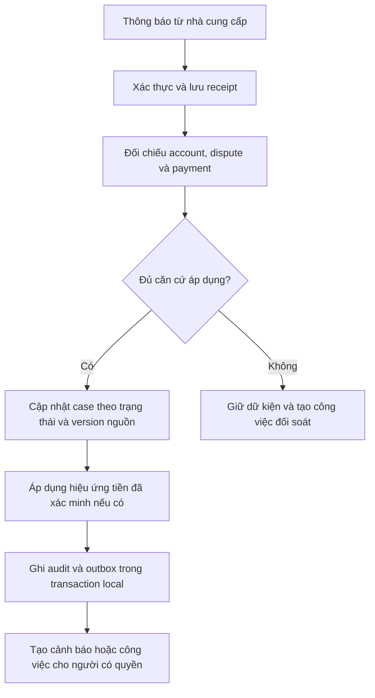

# Chargeback notification: tiếp nhận đúng nguồn, cập nhật đúng hồ sơ và cảnh báo đúng người

## 1. Thông báo chargeback là đầu vào cần được kiểm tra

Trong chương Chargeback Rules, **chargeback notification** là thông tin về một vụ việc tranh chấp hoặc chargeback do nguồn thanh toán gửi tới, và các cảnh báo mà hệ thống tạo ra để người có trách nhiệm xử lý. Hai chiều này cần được thiết kế riêng: nhận một webhook không đồng nghĩa đã áp dụng nghiệp vụ, còn gửi email không đồng nghĩa đã phản hồi vụ việc cho nhà cung cấp.

Một chargeback liên quan đến quy trình tranh chấp qua hệ thống thanh toán, khác với refund chủ động do người bán thực hiện. Nhà cung cấp có thể có nhiều loại thông báo, giai đoạn và tác động số dư khác nhau. Không coi mọi cảnh báo gian lận, yêu cầu thông tin hoặc dispute mới đều là một khoản mất tiền cuối cùng.

Ví dụ, một webhook báo hồ sơ đang cần phản hồi cho giao dịch 1.000.000 VND. Nếu hệ thống lập tức vừa ghi mất toàn bộ tiền, vừa hoàn thêm cho khách, vừa hủy đơn đã giao thì một thông báo đã kích hoạt nhiều hiệu ứng không có đủ căn cứ. Ngược lại, nếu chỉ ghi log mà không tạo công việc và theo dõi thời hạn, hồ sơ có thể không được xử lý kịp.

Mục tiêu bài học là bảo vệ luồng thông báo bằng business invariants, state machine, quyền theo đối tượng, transaction, idempotency và kiểm thử tình huống tấn công logic. Bài không giả định một bộ trạng thái, thời hạn hoặc cách tính phí chung cho mọi nhà cung cấp; adapter phải diễn giải theo hợp đồng tích hợp thực tế.

## 2. Những bất biến cần giữ

### 2.1. Đúng nguồn và đúng đối tượng

- Nguồn gửi được xác thực theo cơ chế của tài khoản tích hợp tương ứng.
- Provider account, môi trường, dispute và giao dịch nguồn được ánh xạ tới đúng tenant và phạm vi nghiệp vụ.
- Không dùng tenantId, orderId, người nhận email hoặc URL trong payload làm thẩm quyền truy cập tùy ý.
- Một người chỉ được xem hoặc xử lý hồ sơ, bằng chứng và cảnh báo trong phạm vi được phép.

### 2.2. Đúng ngữ nghĩa của quyết định

- Sự kiện nguồn được phân biệt với trạng thái case mà hệ thống chấp nhận.
- Trạng thái case được phân biệt với hiệu ứng tiền và với trạng thái giao hàng/order.
- Thông báo đến lặp không tạo thêm case, khoản ghi tiền hoặc công việc trùng cho cùng ý nghĩa nghiệp vụ.
- Sự kiện cũ không được ghi đè dữ kiện mới chỉ vì nó được giao đến sau.
- Đã gửi cảnh báo không đồng nghĩa đã nộp bằng chứng, đã được nguồn tiếp nhận hoặc đã giải quyết tranh chấp.

### 2.3. Đúng thời hạn và đúng hiệu ứng

- Hạn phản hồi lấy từ dữ kiện nguồn có thẩm quyền và được lưu cùng nguồn/revision; không tự đặt một số ngày cố định cho mọi case.
- Cảnh báo và công việc được tạo bền cùng quyết định local qua transaction/outbox phù hợp.
- Chỉ ghi hiệu ứng tiền khi có căn cứ tài chính đã được xác minh, không suy ra chỉ từ tên notification.
- Refund, giải phóng khoản giữ, khóa chức năng hoặc xử lý đơn hàng phải đi qua chính sách riêng, không được bỏ qua bước phê duyệt chỉ vì đã có webhook chargeback.

## 3. Tách ba vòng đời thường bị gộp nhầm

| Vòng đời | Trạng thái minh họa | Câu hỏi được trả lời |
|---|---|---|
| Tiếp nhận sự kiện | Received, verified, applied, quarantined, retryable | Thông báo đã được lưu và xử lý đến đâu? |
| Chargeback/dispute case | Open, action required, under review, outcome recorded | Hồ sơ cần hành động gì và nguồn đã kết luận gì? |
| Cảnh báo/công việc nội bộ | Planned, queued, accepted by channel, delivery unknown, acknowledged | Ai đã được cảnh báo, kênh đã nhận hay người phụ trách đã nhận việc? |

Các tên trạng thái chỉ mang tính minh họa. Chúng không phải ánh xạ bắt buộc cho mọi API thanh toán.



Một case có thể được mở mà chưa có hiệu ứng tiền được xác minh. Một hiệu ứng ghi nợ hoặc ghi có có thể đến qua dữ kiện khác với sự kiện thay đổi case. Một email có thể thất bại dù case đã được cập nhật đúng. Mô hình dữ liệu cần giữ được từng sự thật đó.

## 4. Xác thực thông báo ở ranh giới tích hợp

### 4.1. Kiểm tra theo hợp đồng nguồn, không tự nghĩ ra giao thức chữ ký

Webhook cần được kiểm tra bằng cơ chế được nhà cung cấp hỗ trợ: chữ ký trên đúng dữ liệu, danh tính kết nối hoặc cơ chế xác thực phù hợp. Nếu chữ ký dựa trên raw request body, việc parse rồi serialize JSON lại có thể thay đổi dãy byte và làm sai phép xác minh.

Khóa hoặc cấu hình xác minh phải thuộc đúng endpoint/account/môi trường. Không lấy một key identifier tùy ý từ payload rồi tải khóa từ một URL không được tin cậy. Việc chuyển khóa cần có quy trình và lưu tham chiếu xác minh cần thiết, không ghi secret vào audit.

Các giới hạn như kích thước body, kiểu nội dung và schema giúp kiểm soát đầu vào nhưng không thay thế xác thực nguồn. IP hoặc tên sự kiện trong payload cũng không tự là bằng chứng thẩm quyền.

### 4.2. Chống phát lại không thay thế deduplication nghiệp vụ

Nếu giao thức có timestamp được ký, kiểm tra độ mới theo chính timestamp và quy tắc của giao thức đó. Không dùng `sourceOccurredAt` của case như một giới hạn tùy ý để bỏ mọi thông báo cũ: một sự kiện nghiệp vụ có thể được gửi lại hợp lệ sau thời gian trễ.

Ngay cả một lần giao webhook hợp lệ cũng có thể lặp. Cần định danh sự kiện ở đúng phạm vi provider account/môi trường và cơ chế chống hiệu ứng trùng tại tầng nghiệp vụ.

Nếu cùng event ID nhưng nội dung hoặc fingerprint khác, không âm thầm ghi đè receipt cũ. Đây có thể là thay đổi nguồn theo hợp đồng cần đánh giá hoặc một xung đột bảo mật cần đối soát; không mặc định là duplicate vô hại.

### 4.3. Không tin metadata để mở rộng quyền

Metadata hoặc tham chiếu merchant có thể hỗ trợ liên kết, nhưng quan hệ account–payment–tenant phải được kiểm tra với dữ liệu đã tạo khi tích hợp. Một webhook được ký bởi account A không được sửa giao dịch của account B chỉ vì payload chứa ID của B.

Nếu cần truy vấn thêm dữ kiện, gọi API đã cấu hình cho account nguồn và ID được kiểm tra. Không truy cập một `callbackUrl`, `evidenceUrl` hoặc endpoint tùy ý từ payload để lấy “chi tiết hồ sơ”. Việc đó có thể tạo một đường truy cập mạng ngoài phạm vi dự kiến.

## 5. Lưu receipt bền trước khi xác nhận đã tiếp nhận

Endpoint webhook nên tách việc tiếp nhận khỏi công việc xử lý dài. Một hợp đồng tiếp nhận có thể là:

```text
Nhận body và metadata giao nhận
  → kiểm tra giới hạn đầu vào và xác thực nguồn
  → kiểm tra cấu trúc tối thiểu theo schema được hỗ trợ
  → insert hoặc nhận diện receipt đã có bằng unique phù hợp
  → commit dữ liệu tiếp nhận cần thiết
  → phản hồi đã tiếp nhận theo hợp đồng nhà cung cấp
  → worker xử lý receipt trong nền
```

Phản hồi thành công ở bước này có nghĩa hệ thống đã nhận trách nhiệm xử lý bền, không có nghĩa đã chấp nhận kết luận nghiệp vụ. Nếu không lưu được receipt hoặc ý định xử lý bền, không trả thành công như thể mọi thứ đã an toàn chỉ để giảm số lần provider gửi lại.

Thông báo đã xác thực nhưng chưa ánh xạ được payment cần trạng thái chờ/đối soát, tham chiếu điều tra và cảnh báo phù hợp. Không xóa nó như dữ liệu không quan trọng. Cũng không trả lỗi vô hạn cho một sự kiện đã giữ bền nhưng không thể tự sửa, nếu hợp đồng tích hợp cho phép tiếp nhận rồi xử lý ngoại lệ.

Raw payload có thể chứa dữ liệu nhạy cảm. Nếu cần lưu để đối chiếu, phải giới hạn quyền, thời hạn và phạm vi nội dung theo thiết kế. Audit thường chỉ cần receipt ID, thông tin xác minh và các trường nghiệp vụ đã chuẩn hóa; không sao chép toàn bộ webhook vào mọi log và message.

## 6. Chuẩn hóa và ánh xạ vào case nội bộ

### 6.1. Định danh theo đúng phạm vi

| Định danh | Phạm vi cần xét | Không được nhầm với |
|---|---|---|
| Provider event ID | Nhà cung cấp, account, môi trường theo hợp đồng | ID chargeback case hoặc hiệu ứng tiền |
| Provider dispute ID | Account/môi trường và đối tượng dispute | Order ID hoặc một case mới sau mỗi webhook |
| Provider payment/capture ID | Giao dịch nguồn thuộc account đã xác thực | ID do client tự khai để được truy cập |
| Financial effect ID | Dòng ghi nợ, ghi có hoặc phí được nguồn xác nhận | Amount của một notification trạng thái |
| Internal case ID | Case nội bộ gắn với mapping được kiểm tra | Quyền đọc case cho mọi người biết ID |

Một payment có thể liên quan nhiều sự kiện và có thể có nhiều vụ việc/phạm vi theo hợp đồng nguồn. Không đặt unique chỉ theo payment ID rồi mặc định mọi thông báo sau đều là bản sao của case đầu tiên.

Trong mô hình nền tảng hoặc marketplace, giao dịch nguồn còn có thể cần phân bổ tới đúng phần trách nhiệm của từng bên. Không thông báo toàn bộ dữ liệu của một payment cho mọi tenant có liên quan gián tiếp.

### 6.2. Envelope nội bộ sau xác thực

Ví dụ sau là dữ kiện đã chuẩn hóa bởi adapter, không phải schema webhook chung của một nhà cung cấp cụ thể. Những trường trong `verifiedSource` phải do lớp tích hợp đáng tin xây dựng, không phải cờ client tự khai.

```json
{
  "receiptId": "receipt-cb-71",
  "sourceEventId": "provider-event-901",
  "normalizedType": "DISPUTE_ACTION_REQUIRED",
  "verifiedSource": {
    "providerAccountId": "merchant-main",
    "environment": "production",
    "verificationReference": "verification-901"
  },
  "providerDisputeId": "dispute-28",
  "providerPaymentId": "payment-16",
  "sourceRevision": "revision-4",
  "disputedPrincipal": {
    "amountMinor": 400000,
    "currency": "VND"
  },
  "responseDueAt": "2026-11-30T08:00:00Z",
  "financialEffectReference": null,
  "sourceOccurredAt": "2026-11-22T03:00:00Z",
  "receivedAt": "2026-11-22T03:02:00Z"
}
```

Amount, revision và thời gian chỉ là dữ liệu minh họa. Có `disputedPrincipal` 400.000 VND và chưa có financial effect reference không có nghĩa hệ thống được tự ghi một khoản ghi nợ 400.000 VND. Nó cho biết phạm vi được nguồn báo về case, còn hiệu ứng tiền cần căn cứ tương ứng.

Không phải nguồn nào cũng có revision có thứ tự hoặc cùng cách biểu diễn deadline. Khi không có, adapter phải dùng khả năng truy vấn/đối soát và quy tắc chuyển trạng thái phù hợp; không tự so chuỗi revision hoặc timestamp để giả định đó là thứ tự chuẩn.

## 7. Áp dụng case, audit và outbox trong ranh giới nhất quán

Đoạn Java sau là mã mô tả các cổng nghiệp vụ, không phải một lớp có thể biên dịch độc lập. Ví dụ giả định receipt, case, các bản ghi hiệu ứng tiền local, restriction, audit và outbox cùng database. Các truy vấn mạng cần bổ sung dữ kiện nguồn phải nằm trong giao thức chuẩn bị riêng, không giữ transaction mở để chờ provider.

```java
ProcessResult processChargebackNotification(ReceiptId receiptId) {
    return transactions.required(() -> {
        var receipt = inbox.lockVerifiedReceipt(receiptId);
        if (receipt.hasFinalProcessingResult()) {
            return receipt.savedResult();
        }

        var mapping = mappings.resolveVerifiedPayment(receipt);
        if (!mapping.isResolved()) {
            var result = ProcessResult.needsReview("PAYMENT_MAPPING_REQUIRED");
            inbox.quarantine(receipt, result);
            outbox.appendMappingReviewAlert(receipt.referenceOnly());
            return result;
        }

        var dispute = disputes.lockOrCreateBySourceIdentity(
                mapping.tenantId(),
                receipt.verifiedProviderAccount(),
                receipt.providerDisputeId());

        var assessment = reconciliation.assess(dispute, mapping, receipt);
        if (assessment.needsManualReview()) {
            var result = ProcessResult.needsReview(assessment.reasonCode());
            inbox.quarantine(receipt, result);
            outbox.appendReconciliationTask(dispute.id(), receipt.id());
            return result;
        }

        var moneyDelta = financialEffects.applyVerifiedEffectsOnce(
                assessment.verifiedFinancialObservations());
        var caseChange = caseRules.planCurrentStateChange(dispute, assessment);
        if (caseChange.isApplicable()) {
            disputes.applyWithExpectedVersion(dispute, caseChange);
        }

        var restrictionChange = riskPolicies.recomputeRestrictions(
                dispute, assessment, moneyDelta);
        var audit = auditFactory.appliedObservation(
                receipt, dispute, caseChange, moneyDelta, restrictionChange);
        auditEntries.append(audit);

        var messages = notificationPolicies.planForCurrentCase(
                dispute, caseChange, moneyDelta, restrictionChange);
        outbox.appendUniqueMessages(messages);

        var result = ProcessResult.applied(dispute.id(), audit.eventId());
        inbox.markApplied(receipt, result);
        return result;
    });
}
```

Những điều kiện cần bảo đảm:

- `lockVerifiedReceipt` chỉ chọn dữ kiện đã đi qua xác thực; tên kiểu dữ liệu hoặc cờ `verified` không tự tạo ranh giới bảo mật.
- `lockOrCreateBySourceIdentity` có ràng buộc unique và xử lý cạnh tranh thật, không chỉ SELECT rồi INSERT mà không bảo vệ.
- Case được tạo/đọc trong phạm vi mapping đã kiểm tra; payload không tự chọn tenant.
- `applyWithExpectedVersion` kiểm tra cập nhật thành công và rollback khi xung đột. Mọi đường cập nhật case phải tuân theo cùng giao thức.
- Dữ kiện tài chính và trạng thái case được đánh giá riêng: một sự kiện cũ về case vẫn có thể mang tham chiếu tới một hiệu ứng tiền chưa được ghi nhận.
- `applyVerifiedEffectsOnce` dùng định danh hiệu ứng nguồn đúng phạm vi và không ghi tiền chỉ từ tên sự kiện hoặc amount của case.
- Nhánh quarantine giữ receipt và tạo công việc bền. Khi có thêm căn cứ, quy trình review có thể đưa receipt trở lại xử lý có kiểm soát; không sửa nguồn để giả vờ mapping ban đầu đã đúng.
- Lỗi ghi case, audit, restriction hoặc outbox trong phạm vi local đã chọn phải rollback lần áp dụng đó. Receipt đã lưu bền vẫn có thể được xử lý lại.

Nếu ledger hoặc risk service thuộc hệ thống khác, dùng sự kiện/giao thức phối hợp rõ ràng. Transaction local không bao trùm được các hiệu ứng ở dịch vụ độc lập.

## 8. Trạng thái chargeback không phải phép tính tiền

Giả sử capture gốc đã thu 1.000.000 VND và case có disputed principal 400.000 VND:

```text
Thông báo case cần phản hồi:
    cập nhật công việc và deadline theo nguồn
    chưa tự suy ra có dòng ghi nợ

Nguồn xác nhận balance effect ghi nợ 400.000 VND:
    ghi đúng hiệu ứng nguồn đó một lần

Thông báo case được kết luận bất lợi:
    cập nhật outcome của case
    không tự ghi nợ thêm 400.000 VND nếu đó vẫn là cùng hiệu ứng đã ghi
```

Nếu sau đó có ghi có, đảo khoản giữ hoặc phí liên quan, ghi từng hiệu ứng được nguồn xác nhận với định danh và tiền tệ riêng. Không mặc định kết luận thuận lợi luôn hoàn lại mọi khoản phí hoặc luôn tạo cùng một dòng tiền theo mọi hợp đồng.

Tương tự, không cộng trực tiếp amount tranh chấp theo tiền tệ giao dịch với phí hoặc dòng quyết toán theo tiền tệ khác. Cần lưu đơn vị, tiền tệ, loại hiệu ứng và quy tắc chuyển đổi nếu thực sự có chuyển đổi.

### Phối hợp với refund và các khoản giữ

Case mới có thể dẫn tới một restriction hoặc khoản giữ theo chính sách để ngăn xử lý tiền chồng lặp. Khoản giữ chính sách không phải dòng tiền đã mất. Khi có dữ kiện ghi nợ thực tế, phải chuyển hoặc tính lại phần giữ theo quy tắc không đếm trùng cùng một rủi ro hai lần.

Một refund đang xử lý cũng có thể đã hoặc sẽ hoàn tiền. Không tự hoàn thêm vì nhận chargeback notification, cũng không giải phóng refund reservation đang chưa rõ chỉ để số dư có vẻ hợp lý. Cần đối soát giao dịch gốc, các refund và hiệu ứng chargeback theo phạm vi liên quan.

Nếu hiệu ứng tiền thực tế đến mà mâu thuẫn với dự kiến local, giữ sự thật nguồn và tạo hồ sơ xử lý. Không bỏ giao dịch hoặc sửa capture gốc chỉ để ép một công thức số dư luôn đúng.

Lịch sử đã capture, đã giao hàng hoặc đã refund vẫn cần được giữ. Case mới không phải lý do đổi toàn bộ lịch sử order thành “chưa từng thanh toán” hoặc tự hủy một đơn đã hoàn tất.

## 9. Sự kiện lặp, đảo thứ tự và phiên xử lý tiếp theo

### 9.1. Nhiều lớp định danh, nhiều loại duplicate

| Hiện tượng | Cách xử lý |
|---|---|
| Cùng event ID và cùng nội dung trong phạm vi nguồn | Trả kết quả tiếp nhận/xử lý đã lưu, không tạo lại hiệu ứng |
| Hai event ID khác nhau nói về cùng case state | Lưu các quan sát cần thiết; chỉ thực hiện thay đổi hoặc cảnh báo mới khi có ý nghĩa |
| Hai thông báo cùng một financial effect | Ledger deduplicate theo định danh hiệu ứng, không chỉ theo event ID |
| Cùng ID nhưng nội dung xung đột | Giữ căn cứ và đưa vào đánh giá theo hợp đồng, không ghi đè yên lặng |
| Case cũ có vòng xử lý mới theo nguồn | Nhận diện đúng phase/revision/round nếu có, không mặc định mọi cập nhật sau đóng đều vô hiệu |

Unique theo event ID không ngăn hai message khác ID cùng tạo hai ticket hoặc hai dòng tiền cho một hiệu ứng. Ngược lại, unique theo payment ID có thể làm mất một case hợp lệ khác.

### 9.2. Không dùng thời điểm đến làm quyền ghi đè

Nếu provider hỗ trợ sequence/revision có thứ tự, kiểm tra trong đúng phạm vi đối tượng theo hợp đồng. Nếu không, có thể cần truy vấn trạng thái chuẩn, đối chiếu dữ kiện hiện có và áp dụng các chuyển trạng thái được phép.

Một notification cũ được giao lại sau kết luận mới có thể được lưu như quan sát nhưng không làm case quay về trạng thái cũ. Tuy nhiên, không được bỏ luôn mọi financial reference kèm theo chỉ vì nhánh cập nhật trạng thái bị coi là cũ.

Một case đóng rồi mở lại hoặc bước xử lý tiếp theo phải theo khả năng thật của nguồn. Không tự đặt “CLOSED là không bao giờ thay đổi nữa” cho mọi hệ thống, cũng không cho bất kỳ payload mới nào mở lại case mà không kiểm tra.

### 9.3. Nhiều worker cùng áp dụng

Khóa case hoặc optimistic locking bảo vệ quyết định local; unique bảo vệ receipt, source identity và financial effect. Worker thua xung đột phải đọc lại/đánh giá theo giao thức, không bỏ điều kiện version để cập nhật cho bằng được.

Tác động bên ngoài như tạo ticket hoặc gửi thông báo dùng outbox và định danh thông báo ổn định. Việc cùng một receipt được xử lý lại không được sinh thêm command hoàn tiền hoặc một công việc xử lý mới độc lập.

## 10. Deadline và nhắc việc là dữ liệu nghiệp vụ có version

Thông báo cần hành động phải lưu được hạn phản hồi từ nguồn, múi giờ/offset hoặc dạng thời gian gốc cần thiết, thời điểm chuẩn hóa, nguồn dữ liệu và revision. Không tính một hạn chung bằng `receivedAt + N ngày` nếu hợp đồng nguồn đã cung cấp một deadline có ý nghĩa khác.

Hệ thống có thể đặt mốc nội bộ sớm hơn để chuẩn bị:

```text
providerDueAt = hạn có thẩm quyền từ nguồn
internalReviewBy = providerDueAt − khoảng chuẩn bị theo chính sách
```

Mốc nội bộ không được ghi đè deadline nguồn hoặc làm người đọc hiểu rằng nhà cung cấp đã thay đổi hạn. Khi nguồn điều chỉnh deadline, lưu sự thay đổi, tính lại công việc và xem xét hủy/đổi các nhắc việc chưa gửi.

Một khóa chống lặp cho thông báo có thể gắn với:

```text
caseId + loại thông báo + deadlineRevision + reminderSlot + nhóm người nhận
```

`reminderSlot` phân biệt những lần nhắc được chính sách cho phép. Nếu chỉ dùng caseId, hệ thống có thể chặn mất mọi lần nhắc hợp lệ sau lần đầu. Nếu mỗi retry lại tạo ID mới, nó có thể gửi dồn vô hạn.

Trước khi phát một nhắc việc đã lên lịch, đọc lại case và deadline hiện hành. Case có thể đã được xử lý hoặc thời hạn đã đổi. Thông báo cũ đã gửi không thể được coi là tự thu hồi chỉ vì database local đổi state; cần lưu lịch sử và phát đính chính nếu chính sách yêu cầu.

Nếu sự kiện đến khi hạn đã gần hoặc đã qua, không âm thầm sửa recordedAt hoặc deadline để trông như còn thời gian. Tạo mức ưu tiên/ngoại lệ phù hợp và giữ rõ thời điểm nguồn báo, hệ thống nhận và bắt đầu xử lý.

## 11. Người nhận, nội dung và quyền truy cập cảnh báo

### 11.1. Chọn người nhận từ cấu hình có thẩm quyền

Người nhận nội bộ thường được xác định từ tenant, nhóm phụ trách, phân công case và chính sách escalation. Không lấy email hoặc danh sách webhook trong payload nguồn rồi tự gửi dữ liệu case tới đó.

Thông báo cho khách hàng, đối tác hoặc bên bán là một luồng khác với cảnh báo nội bộ. Loại thông tin được công bố, thời điểm và người có quyền nhận phải được chính sách xác định. Một notification cần phản hồi không tự cho phép tiết lộ toàn bộ lý do rủi ro hoặc bằng chứng của bên khác.

Nếu người phụ trách đổi quyền hoặc rời nhóm, việc phát lại thông báo hoặc mở liên kết vẫn cần kiểm tra quyền hiện tại. Một địa chỉ từng nằm trong danh sách nhận không mặc nhiên có quyền đọc dữ liệu mãi mãi.

### 11.2. Nội dung đủ hành động nhưng không chứa bí mật

Một cảnh báo nội bộ có thể gồm case reference, order/payment reference đã được giới hạn, trạng thái cần xử lý, deadline đã chuẩn hóa, mức ưu tiên và liên kết tới màn hình có xác thực.

Không cần đưa dữ liệu thẻ, token, raw webhook, toàn bộ bằng chứng hoặc URL công khai chứa thông tin nhạy cảm vào email/push. Liên kết mở case phải kiểm tra quyền tại ứng dụng; biết URL không thay thế authorization.

Reason code cần được ánh xạ thành nội dung phù hợp. Một ghi chú tự do từ khách hoặc nguồn không được chèn thành HTML hoặc mệnh lệnh cho người vận hành. Template nên tách dữ kiện nguồn, giải thích của hệ thống và hành động được phép.

### 11.3. Được cảnh báo không có nghĩa đã hoàn thành nghĩa vụ phản hồi

Các trạng thái cần phân biệt gồm đã lập thông báo, đã đưa vào queue, kênh đã nhận, chưa rõ kết quả gửi, người phụ trách đã nhận việc và nguồn đã xác nhận nhận phản hồi/bằng chứng.

Email provider chấp nhận message không chứng minh người nhận đã đọc. Người phụ trách nhấn “đã xem” cũng không chứng minh bằng chứng đã được nộp thành công. State machine của case phải dựa vào căn cứ thực sự của từng bước.

## 12. Retry và lỗi khi phát cảnh báo

Outbox giữ ý định cảnh báo cùng quyết định case local. Publisher có thể gửi thành công rồi dừng trước khi đánh dấu, nên bên nhận có thể thấy message lặp.

Với kênh hỗ trợ idempotency hoặc tạo ticket theo external reference duy nhất, dùng một notification/command ID bền cho cùng ý định. Với kênh không có bảo đảm tương đương, cần theo dõi kết quả gửi, mức độ chưa rõ và chính sách resend phù hợp; không khẳng định sẽ luôn giao đúng một lần chỉ vì local có khóa.

Backoff, ngân sách và giới hạn kênh giúp tránh bão cảnh báo. Retry cùng một ý định không đổi case, deadline hoặc recipient scope tùy tiện. Nếu nội dung nghiệp vụ thay đổi, tạo revision/notification mới theo quy tắc thay vì sửa lịch sử message đã gửi.

Nếu kênh ngừng lâu, công việc xử lý case vẫn phải tồn tại trong nguồn chuẩn. Có thể chuyển kênh hoặc escalation theo chính sách, giữ audit về quyết định đó. Không đánh dấu case đã được xử lý chỉ để đóng một lỗi gửi thông báo.

Việc publisher hoặc consumer lỗi không được dẫn tới tạo một refund mới, ghi lại khoản chargeback hoặc thay đổi kết quả case. Truyền cảnh báo và áp dụng hiệu ứng tài chính là các thao tác khác nhau.

## 13. Kiểm thử thông báo chargeback theo bất biến

| Tình huống | Thiết lập và hành động | Kết quả cần chứng minh |
|---|---|---|
| Luồng chuẩn | Sự kiện đã xác thực, mapping và dữ kiện hợp lệ | Case, audit và ý định cảnh báo được ghi nhất quán |
| Chữ ký sai | Sửa raw body, account hoặc dữ liệu xác thực | Không áp dụng case/tiền; có xử lý từ chối phù hợp |
| Giả tenant | Payload hợp lệ về cấu trúc nhưng tự khai tenant khác | Mapping từ nguồn/giao dịch chuẩn quyết định phạm vi |
| Sai môi trường/account | Reference giống nhau ở các scope khác nhau | Không trộn case, payment hoặc hiệu ứng tiền |
| Event lặp | Gửi lại cùng event nhiều lần | Không tạo thêm case, ledger effect hoặc ticket độc lập |
| Hai ID cùng hiệu ứng | Hai event khác nhau cùng nói về một financial effect | Hiệu ứng tiền chỉ ghi một lần theo định danh nguồn |
| Cùng ID khác body | Thay đổi payload nhưng giữ event ID | Không ghi đè receipt cũ, giữ căn cứ và báo xung đột |
| Mapping chưa có | Payment chưa được ánh xạ hoặc reference không hợp lệ | Receipt được giữ/chờ review; không áp sai order để cho qua |
| Sự kiện đảo thứ tự | Cần phản hồi cũ đến sau outcome mới | Không hạ trạng thái chỉ theo thứ tự đến; vẫn xét dữ kiện độc lập |
| Case có bước tiếp theo | Nguồn báo một round/revision mới hợp lệ | Xử lý đúng hợp đồng, không chặn chỉ vì local từng đóng case |
| Cảnh báo chưa có tiền | Notification chỉ thông báo action required | Không tự ghi nợ hoặc tạo refund từ amount case |
| Phí và tiền tệ | Dòng principal, phí hoặc settlement dùng ngữ nghĩa/tiền tệ khác | Không cộng trực tiếp hoặc trừ hai lần cùng hiệu ứng |
| Refund đang pending | Case đến khi refund chưa rõ kết quả | Không hoàn thêm hay giải phóng reservation thiếu căn cứ |
| Lỗi local giữa bước | Gây lỗi khi ghi audit/outbox sau cập nhật case | Transaction rollback nhất quán; receipt còn xử lý lại |
| Worker cạnh tranh | Hai worker xử lý cùng case/event đồng thời | Unique/lock/version giữ quyết định đúng, không phát sinh tác động trùng |
| Deadline đổi | Nguồn cập nhật hạn sau khi đã lên lịch nhắc | Mốc nguồn và revision rõ; nhắc chưa gửi được đánh giá lại |
| Sự kiện đến muộn | Nhận notification khi sát/quá hạn | Giữ đúng thời gian, có escalation/ngoại lệ, không sửa lịch sử |
| Người nhận độc hại | Payload chứa email hoặc URL của bên ngoài | Không dùng làm đích gửi hoặc endpoint truy vấn tùy ý |
| Thay quyền người nhận | Người từng phụ trách không còn quyền | Không truy cập được case/proof; recipient được xét theo chính sách hiện hành |
| Lỗi kênh thông báo | Gửi xong nhưng mất response hoặc publisher crash | Retry theo cùng ý định, không thay case/tiền để xử lý lỗi gửi |
| Ghi chú độc hại | Nội dung nguồn chứa HTML hoặc thông tin gây hiểu nhầm | Hiển thị an toàn, không biến thành chỉ thị hoặc bằng chứng đã xác minh |
| Export/tìm kiếm chéo | Dùng vai trò hỗ trợ tìm case tenant khác | Mọi đường đọc/export áp dụng quyền theo đối tượng |

Kiểm thử cần quan sát receipt, case, monetary records, restriction, audit, outbox và công việc/thông báo ở kênh giả lập; chỉ kiểm tra response webhook là chưa đủ.

Với race condition, dùng điểm đồng bộ để hai worker thật sự gặp nhau trong vùng cập nhật. Với mất response gửi cảnh báo, kênh giả lập cần thực sự nhận message trước khi gây timeout. Với deadline, dùng clock điều khiển được và kiểm tra cả dữ kiện nguồn lẫn mốc nội bộ.

## 14. Audit và cách lần theo một notification đáng ngờ

Audit nên liên kết provider account/môi trường, event/receipt, dispute, payment/capture, tenant, case version, financial effect nếu có, quyết định restriction và notification ID. Lưu nguồn xác minh, các mốc thời gian, deadline revision và lý do quarantine hoặc áp dụng.

Theo dõi receipt chưa xử lý, mapping lỗi, sự kiện xung đột, case sắp hết hạn chưa có người phụ trách, backlog outbox, kênh gửi lỗi và notification được gửi nhưng chưa có công việc xử lý tương ứng. Các chỉ số tiếp nhận HTTP thành công không cho biết hồ sơ đã được hành động đúng lúc hay chưa.

Khi điều tra, lần từ nguồn đã xác thực tới mapping giao dịch, quyết định case, hiệu ứng tiền độc lập và người nhận cảnh báo. Xác định bước nào đã commit, bước nào còn chờ, thông tin nào chỉ do nguồn báo và căn cứ nào đã được hệ thống chấp nhận. Một chargeback notification được xử lý đúng phải tạo ra chuỗi giải thích đó mà không trở thành lối tắt hoàn tiền, thay trạng thái hoặc tiết lộ dữ liệu ngoài quyền.
