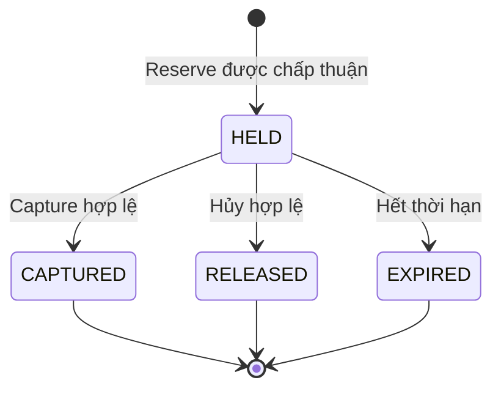

# Credit limit ownership — Quyền sở hữu và quyền sử dụng hạn mức tín dụng

## 1. Mục tiêu và phạm vi

Trong chương **Credit Rules** của module bảo mật logic nghiệp vụ, credit limit ownership là quy tắc xác định **hạn mức thuộc về chủ thể nào và ai được phép tác động đến hạn mức đó**. Kiểm tra số tiền còn khả dụng chỉ là một phần. Một giao dịch vẫn sai nếu số tiền hợp lệ nhưng hệ thống giữ chỗ trên hạn mức của khách hàng khác, hoàn trả về tài khoản khác hoặc cho nhân viên tự nâng hạn mức rồi sử dụng.

Bài học dùng hệ thống mua hàng trả chậm làm ví dụ. Nhà cung cấp cấp hạn mức cho khách hàng cá nhân hoặc doanh nghiệp; mỗi đơn hàng có thể giữ chỗ một phần hạn mức, sau đó ghi nhận dư nợ hoặc giải phóng giữ chỗ. Đây là mô hình kỹ thuật minh họa, không phải quy định pháp lý hay mô hình đầy đủ cho mọi sản phẩm tín dụng.

Sau bài học, bạn có thể:

- Phân biệt chủ sở hữu hạn mức, người thao tác, tenant và dịch vụ quản lý hạn mức.
- Viết bất biến ràng buộc đơn hàng, tài khoản hạn mức và khoản giữ chỗ với cùng chủ thể được phép.
- Thiết kế kiểm tra quyền theo đối tượng, chuyển trạng thái, transaction và idempotency.
- Phát hiện tình huống đổi ID, bỏ qua phê duyệt, chi vượt hạn mức do race condition và hoàn hạn mức trùng.
- Định nghĩa kiểm thử có thể quan sát được trên dữ liệu đã commit.

## 2. “Sở hữu” có nhiều lớp ý nghĩa

### 2.1. Phân biệt các chủ thể

| Thành phần | Ý nghĩa trong ví dụ | Không được suy ra tự động |
| --- | --- | --- |
| `tenant_id` | Phạm vi tổ chức hoặc khách thuê trong hệ thống | Cùng tenant không có nghĩa được dùng mọi hạn mức |
| `customer_id` | Khách hàng được cấp hạn mức, có thể là một doanh nghiệp | Không nhất thiết bằng ID người đăng nhập |
| `actor_id` | Người hoặc workload đang gửi lệnh | Có tài khoản đăng nhập không đồng nghĩa có quyền chi tiêu |
| `credit_account_id` | Tài khoản ghi nhận một hạn mức theo sản phẩm và tiền tệ | Biết ID không chứng minh quyền sở hữu |
| `reservation_id` | Khoản giữ chỗ cho một đơn hàng cụ thể | Không phải số tiền có thể chuyển sang tài khoản tùy ý |
| Credit service | Dịch vụ có thẩm quyền ghi trạng thái hạn mức | Có quyền kỹ thuật ghi dữ liệu không phải quyền nghiệp vụ vô điều kiện |

Ví dụ, Công ty A là `customer_id=C-A`. Nhân viên Lan có `actor_id=U-LAN` được mua hàng thay mặt Công ty A. Hạn mức vẫn thuộc Công ty A khi Lan nghỉ việc; thu hồi quyền của Lan không chuyển dư nợ hoặc hạn mức sang chủ thể khác.

Trong một hệ thống khác, đối tượng nhận cấp hạn mức có thể là hợp đồng tín dụng hoặc một nhóm công ty. Khi đó phải mô hình hóa chủ thể này rõ ràng. Không dùng email, tên hiển thị, chi nhánh hay quan hệ “cùng tập đoàn” để tự suy diễn quyền dùng chung.

### 2.2. Tách quyền đọc, sử dụng và quản trị

Một người có thể được xem hạn mức nhưng không được giữ chỗ. Một người được mua hàng cũng chưa chắc được nâng hạn mức. Với ví dụ doanh nghiệp:

| Thao tác | Điều kiện quyền điển hình |
| --- | --- |
| Xem số dư khả dụng | Có quyền đọc tài khoản hạn mức của khách hàng tương ứng |
| Giữ chỗ cho đơn hàng | Có quyền mua thay mặt chủ sở hữu; đơn hàng đủ điều kiện và thuộc cùng chủ thể |
| Ghi nhận dư nợ | Luồng thực hiện đơn hàng có quyền capture khoản giữ chỗ đã được chấp thuận |
| Giải phóng giữ chỗ | Luồng hủy/hết hạn hợp lệ, gắn với khoản giữ chỗ gốc |
| Ghi nhận thanh toán trả nợ | Dịch vụ thu tiền có bằng chứng thanh toán đã được xác thực và đối chiếu |
| Thay đổi hạn mức | Vai trò quản trị tín dụng, theo quy trình phê duyệt riêng |
| Đổi chủ sở hữu tài khoản | Không cung cấp bằng API sửa thông tin thông thường; cần quy trình chuyển giao được thiết kế riêng |

OWASP nhấn mạnh rằng ID đối tượng, kể cả UUID khó đoán, không thay thế kiểm tra quyền truy cập. Mỗi lần đọc hoặc sửa tài khoản hạn mức phải xác minh quan hệ giữa người gọi và đối tượng đó. [Nguồn: OWASP IDOR Prevention](https://cheatsheetseries.owasp.org/cheatsheets/Insecure_Direct_Object_Reference_Prevention_Cheat_Sheet.html).

## 3. Viết bất biến trước khi thiết kế endpoint

### 3.1. Bất biến về chủ sở hữu

Với một yêu cầu giữ chỗ, hệ thống phải bảo đảm:

```text
trusted_context.tenant_id = order.tenant_id = credit_account.tenant_id

authorized_customer_id = order.customer_id = credit_account.customer_id

reservation.credit_account_id = credit_account.id
reservation.order_id = order.id

order.currency = credit_account.currency = reservation.currency
```

`authorized_customer_id` là chủ thể mà actor đã được backend xác minh có quyền đại diện cho **thao tác đang thực hiện**. Đây không phải trường `customerId` được lấy nguyên từ request. Claim trong token cũng cần phù hợp với yêu cầu thu hồi quyền và độ mới của chính sách.

Sau khi tạo khoản giữ chỗ, quan hệ với tài khoản và đơn hàng gốc phải được giữ nguyên. Các lệnh capture, release, expire hoặc trả nợ phải tìm về đối tượng gốc, thay vì cho client chọn tài khoản nhận tác động.

Nếu sản phẩm có hạn mức dùng chung, thay đẳng thức chủ sở hữu đơn giản bằng quan hệ ủy quyền đã mô hình hóa, chẳng hạn `customer -> approved_credit_pool`. Không bỏ kiểm tra chỉ vì nhiều khách hàng thuộc cùng tenant.

### 3.2. Bất biến về số tiền

Với mô hình không cho phép vượt hạn mức:

```text
L = hạn mức được cấp
U = dư nợ đã ghi nhận, chưa được trả
R = tổng số tiền đang giữ chỗ
A = số tiền khả dụng = L - U - R

L >= 0; U >= 0; R >= 0
U + R <= L

reserve(x) chỉ được thực hiện khi x > 0 và x <= A
```

Ví dụ cùng đơn vị VND: `L=100.000.000`, `U=60.000.000`, `R=15.000.000`, nên `A=25.000.000`. Một đơn hàng 20.000.000 có thể giữ chỗ nếu các điều kiện quyền và trạng thái cũng hợp lệ. Một đơn hàng của khách hàng B không được dùng tài khoản này dù số tiền nhỏ hơn 25.000.000.

Tiền cần một biểu diễn chính xác. Ví dụ SQL bên dưới dùng số nguyên `BIGINT` theo đơn vị tiền nhỏ nhất đã thống nhất cho từng tiền tệ. Với VND trong ví dụ, một đơn vị lưu trữ là một đồng. Không dùng `double` hoặc cho client tự chọn hệ số quy đổi. Nếu nhận số thập phân, phải kiểm tra scale, miền giá trị và chuyển đổi chính xác trước khi cập nhật.

Giảm hạn mức thấp hơn mức đang sử dụng là một chính sách riêng. Có hai lựa chọn thiết kế khác nhau:

- Mô hình nghiêm ngặt của bài: từ chối cập nhật `L` nếu làm `U + R > L`.
- Sản phẩm cho phép tài khoản đang vượt hạn mức sau điều chỉnh: lưu trạng thái vượt hạn mức, cấm cấp thêm và định nghĩa lại bất biến tương ứng.

Không vừa cho phép lựa chọn thứ hai vừa giữ nguyên ràng buộc cơ sở dữ liệu của lựa chọn thứ nhất.

### 3.3. Bất biến về vòng đời và hiệu ứng

Mô hình tối giản của bài chỉ hỗ trợ giữ chỗ, capture và release **toàn bộ**:

| Lệnh | Trạng thái bắt buộc | Biến đổi số dư | Kết quả |
| --- | --- | --- | --- |
| Reserve `x` | Đơn hàng đủ điều kiện; tài khoản cho phép cấp mới | `R := R + x` | Tạo khoản giữ chỗ `HELD` |
| Capture | Khoản giữ chỗ `HELD`, chưa hết hạn; điều kiện thực hiện còn hợp lệ | `R := R - x`, `U := U + x` | `CAPTURED` |
| Release | Khoản giữ chỗ `HELD`; có căn cứ hủy hợp lệ | `R := R - x` | `RELEASED` |
| Expire | Khoản giữ chỗ `HELD`; đã đến hạn theo đồng hồ backend | `R := R - x` | `EXPIRED` |
| Repay | Có khoản nợ và sự kiện thanh toán hợp lệ | `U := U - p`, với `0 < p <= dư nợ được phân bổ` | Ghi bút toán trả nợ riêng |

Capture không làm tăng mức sử dụng tổng cộng `U + R`; nó chuyển giữ chỗ thành dư nợ. Trả tiền cho một khoản đã capture là nghiệp vụ trả nợ hoặc đảo bút toán có căn cứ, không phải chạy lại release trên khoản giữ chỗ cũ.



Ba trạng thái cuối không cho phép quay về `HELD` bằng cách sửa trường trạng thái. Một lần thử tài trợ lại cần quy trình và định danh nghiệp vụ mới được backend quản lý. Nếu cần capture một phần, hoàn tiền một phần hay nhiều đợt trả nợ, phải bổ sung số tiền còn lại và sổ ghi nhận từng hiệu ứng; không áp dụng nguyên xi bảng đơn giản này.

## 4. Một luồng tấn công đổi chủ thể

Giả sử API có thiết kế:

```http
POST /api/credit/reserve
Content-Type: application/json

{
  "customerId": "C-B",
  "creditAccountId": "LIMIT-B",
  "orderId": "ORDER-A",
  "amount": 20000000
}
```

Actor thuộc khách hàng A có thể thay `customerId` và `creditAccountId` bằng dữ liệu của B. Endpoint vẫn có thể sử dụng JWT hợp lệ, truy vấn tham số hóa và transaction, nhưng bị lạm dụng nếu chỉ kiểm tra tài khoản tồn tại và còn đủ tiền.

Sai lầm cốt lõi là để client quyết định quan hệ nghiệp vụ:

```java
// Ví dụ không an toàn: không ràng buộc actor, chủ sở hữu và đơn hàng.
CreditAccount account = repository.findById(request.creditAccountId());
if (account.availableMinor() >= request.amountMinor()) {
    repository.addReserved(account.id(), request.amountMinor());
}
```

Đổi ID sang UUID không sửa được điều này. Một ID hợp lệ có thể bị lộ qua log, liên kết được chia sẻ hoặc endpoint khác. Kiểm tra role chung `BUYER` cũng không trả lời câu hỏi BUYER này được mua thay mặt khách hàng nào.

Thiết kế đầu vào hẹp hơn:

```http
POST /api/orders/ORDER-A/credit-reservations
Idempotency-Key: reserve-order-a-attempt-1
Content-Type: application/json

{
  "creditAccountId": "LIMIT-A",
  "expectedOrderVersion": 7
}
```

ID trong ví dụ HTTP là ký hiệu dễ đọc; triển khai SQL bên dưới dùng UUID. `creditAccountId` vẫn chỉ là một lựa chọn do client đề nghị. Backend xác minh tài khoản, đơn hàng, chủ sở hữu và tiền tệ; số tiền lấy từ phiên bản đơn hàng đã được xác thực ở backend. `expectedOrderVersion` là điều kiện chống dùng báo giá cũ, không phải bằng chứng có quyền.

Không bind request trực tiếp vào entity tài khoản hạn mức. DTO cho phép đúng các trường cần thiết; hợp đồng API nên từ chối các trường không được hỗ trợ như `customerId`, `reserved`, `approvedLimit` hoặc `status`.

## 5. Nguồn dữ liệu tin cậy và điểm thực thi quyền

### 5.1. Lấy danh tính và phạm vi từ backend

Luồng xử lý cần thiết lập:

1. Actor được xác thực từ session, token đã kiểm tra hoặc workload identity.
2. Tenant đang hoạt động là tenant mà actor được phép truy cập. Header chọn tenant chỉ là đầu vào cần xác minh.
3. Quan hệ ủy quyền cho khách hàng còn hiệu lực và cho phép đúng hành động, chẳng hạn `CREDIT_RESERVE`.
4. Tài khoản hạn mức và đơn hàng thuộc chủ thể đã được phép.
5. Số tiền, tiền tệ và phiên bản giá đến từ trạng thái nghiệp vụ phía server.

Một mẫu truy vấn có phạm vi, sau khi đã xác minh quyền đại diện khách hàng:

```sql
SELECT tenant_id, id, customer_id, currency,
       limit_minor, used_minor, reserved_minor, state
FROM credit_account
WHERE tenant_id = :trusted_tenant_id
  AND id = :requested_credit_account_id
  AND customer_id = :authorized_customer_id
FOR UPDATE;
```

Các giá trị đều được bind bằng prepared statement. `requested_credit_account_id` có thể do client gửi; hai giá trị còn lại phải đến từ ngữ cảnh đã xác minh. Không tìm theo ID rồi sử dụng số dư trước khi kiểm tra chủ sở hữu.

Một hệ thống có thể trả cùng phản hồi công khai cho “không tồn tại” và “không được phép truy cập” để tránh lộ sự tồn tại của tài khoản. Log nội bộ vẫn phân biệt nguyên nhân theo chính sách quan sát dữ liệu.

### 5.2. Thu hồi quyền cũng có race condition

Nếu bước kiểm tra quyền chạy ngoài transaction, actor có thể bị thu hồi quyền giữa lúc kiểm tra và lúc giữ chỗ. Cần định nghĩa rõ thời điểm tuyến tính hóa quyền: lệnh nào đã được chấp thuận trước thu hồi có tiếp tục hợp lệ hay không?

Trong một thiết kế dùng chung cơ sở dữ liệu, có thể khóa bản ghi ủy quyền còn hiệu lực trước khi khóa tài khoản hạn mức; luồng thu hồi phải tranh chấp trên cùng bản ghi đó. Giữ thứ tự khóa nhất quán cho các luồng liên quan. Khóa tài khoản hạn mức riêng lẻ không tự khóa được bảng ủy quyền.

Nếu quyền được cung cấp từ dịch vụ khác, transaction cục bộ không tạo ra tính nguyên tử xuyên dịch vụ. Cần cơ chế được thiết kế rõ như phiên bản chính sách được chấp nhận tại điểm thực thi, authorization grant có phạm vi và thời hạn, hoặc giao thức phối hợp phù hợp. Tránh mô tả “kiểm tra lại quyền” như thể nó tự loại bỏ mọi cửa sổ cạnh tranh.

## 6. Mô hình lưu trữ minh họa

Đoạn DDL sau dùng PostgreSQL, tập trung vào ba bảng của bài. Bảng khách hàng, bảng đơn hàng và bảng quyền đã tồn tại trong hệ thống giả định. Khi triển khai, bổ sung các khóa ngoại tới những bảng đó theo khóa có tenant; đoạn rút gọn này chưa tự bảo đảm quan hệ chủ sở hữu giữa đơn hàng và tài khoản.

```sql
CREATE TABLE credit_account (
    tenant_id       UUID NOT NULL,
    id              UUID NOT NULL,
    customer_id     UUID NOT NULL,
    currency        CHAR(3) NOT NULL,
    state           TEXT NOT NULL
                    CHECK (state IN ('ACTIVE', 'SUSPENDED', 'CLOSED')),
    limit_minor     BIGINT NOT NULL CHECK (limit_minor >= 0),
    used_minor      BIGINT NOT NULL DEFAULT 0 CHECK (used_minor >= 0),
    reserved_minor  BIGINT NOT NULL DEFAULT 0 CHECK (reserved_minor >= 0),
    PRIMARY KEY (tenant_id, id),
    CHECK (used_minor <= limit_minor),
    CHECK (reserved_minor <= limit_minor - used_minor)
);

CREATE TABLE credit_reservation (
    tenant_id          UUID NOT NULL,
    id                 UUID NOT NULL,
    credit_account_id  UUID NOT NULL,
    order_id           UUID NOT NULL,
    amount_minor       BIGINT NOT NULL CHECK (amount_minor > 0),
    currency           CHAR(3) NOT NULL,
    state              TEXT NOT NULL
                       CHECK (state IN ('HELD', 'CAPTURED',
                                        'RELEASED', 'EXPIRED')),
    expires_at         TIMESTAMPTZ NOT NULL,
    PRIMARY KEY (tenant_id, id),
    UNIQUE (tenant_id, order_id),
    FOREIGN KEY (tenant_id, credit_account_id)
        REFERENCES credit_account (tenant_id, id)
);

CREATE TABLE credit_command (
    tenant_id          UUID NOT NULL,
    actor_id           UUID NOT NULL,
    operation          TEXT NOT NULL,
    idempotency_key    TEXT NOT NULL,
    credit_account_id  UUID NOT NULL,
    request_hash       TEXT NOT NULL,
    state              TEXT NOT NULL
                       CHECK (state IN ('WORKING', 'SUCCEEDED', 'DECLINED')),
    result             JSONB,
    PRIMARY KEY (tenant_id, actor_id, operation, idempotency_key),
    FOREIGN KEY (tenant_id, credit_account_id)
        REFERENCES credit_account (tenant_id, id),
    CHECK (
        (state = 'WORKING' AND result IS NULL)
        OR (state IN ('SUCCEEDED', 'DECLINED') AND result IS NOT NULL)
    )
);
```

Những quyết định đáng chú ý:

- Khóa ngoại ghép với `tenant_id` ngăn khoản giữ chỗ của tenant A trỏ tới tài khoản chỉ tồn tại ở tenant B.
- Khóa ngoại không thay thế quyền truy cập. Nó cũng chưa chứng minh đơn hàng và tài khoản cùng khách hàng hoặc tiền tệ; service phải kiểm tra các quan hệ này trong transaction.
- `UNIQUE (tenant_id, order_id)` mô hình hóa quy tắc một đơn hàng chỉ có một khoản giữ chỗ trong vòng đời đang xét, kể cả khi client đổi idempotency key hoặc đổi tài khoản. Muốn hỗ trợ nhiều lần thử, cần mô hình financing attempt và giới hạn số lần thử còn hiệu lực.
- Trạng thái `WORKING` chỉ tồn tại bên trong transaction đang xử lý. Service phải chuyển thành kết quả cuối trước commit. Ràng buộc trên chưa tự cấm commit một dòng `WORKING`.
- Quan hệ `customer_id` của tài khoản và liên kết gốc của khoản giữ chỗ không được sửa bằng endpoint CRUD phổ thông. Cần giới hạn đường ghi và quyền cơ sở dữ liệu phù hợp.

PostgreSQL hỗ trợ `NOT NULL`, `CHECK`, `UNIQUE` và khóa ngoại để bảo vệ các ràng buộc dữ liệu khác nhau. `CHECK` không phải công cụ kiểm tra tổng dữ liệu của những dòng khác; tổng giữ chỗ và số dư tổng hợp cần giao thức cập nhật nhất quán. [Nguồn: PostgreSQL 18 — Constraints](https://www.postgresql.org/docs/18/ddl-constraints.html).

## 7. Giữ chỗ an toàn trước yêu cầu đồng thời

### 7.1. Vì sao transaction đơn thuần chưa đủ?

Giả sử hạn mức còn 10 triệu đồng. Hai request cùng muốn giữ chỗ 7 triệu:

| Thời điểm | Request 1 | Request 2 |
| --- | --- | --- |
| T1 | Đọc khả dụng: 10 triệu | |
| T2 | | Đọc khả dụng: 10 triệu |
| T3 | Kết luận đủ tiền | Kết luận đủ tiền |
| T4 | Ghi giữ chỗ 7 triệu | Ghi giữ chỗ 7 triệu |

Nếu cập nhật theo phép cộng mà không có điều kiện bảo vệ, tổng giữ chỗ có thể thành 14 triệu. Nếu cùng ghi đè một giá trị tính sẵn từ dữ liệu cũ, tài khoản có thể chỉ hiện 7 triệu nhưng tồn tại hai khoản giữ chỗ tổng 14 triệu. Đây là hai kiểu hỏng khác nhau.

Trong thiết kế có `CHECK` nghiêm ngặt ở trên, một số cập nhật sai sẽ bị cơ sở dữ liệu từ chối. Tuy nhiên, service vẫn phải có cách xử lý cạnh tranh và trả kết quả nghiệp vụ phù hợp, thay vì dựa vào lỗi constraint làm luồng bình thường.

### 7.2. Khóa tài khoản và cập nhật có điều kiện

Luồng minh họa khóa tài khoản bằng truy vấn ở phần 5, xác minh và khóa đơn hàng, sau đó thực hiện:

```sql
UPDATE credit_account
SET reserved_minor = reserved_minor + :amount_minor
WHERE tenant_id = :trusted_tenant_id
  AND id = :authorized_credit_account_id
  AND customer_id = :authorized_customer_id
  AND currency = :server_order_currency
  AND state = 'ACTIVE'
  AND :amount_minor > 0
  AND :amount_minor <= limit_minor - used_minor - reserved_minor
RETURNING reserved_minor, used_minor, limit_minor;
```

`amount_minor` đã được kiểm tra miền giá trị và lấy từ đơn hàng server. Dạng so sánh bằng phép trừ tránh cộng số tiền đầu vào vào tổng để kiểm tra rồi gặp tràn số. Kết quả cập nhật phải đúng một dòng mới được tạo khoản giữ chỗ thành công.

`SELECT ... FOR UPDATE` giữ khóa dòng đến khi transaction kết thúc. Khi các luồng đều tuân thủ cùng giao thức, chúng không thể đồng thời quyết định trên số dư của cùng tài khoản như thể mỗi bên sở hữu toàn bộ phần còn lại. [Nguồn: PostgreSQL 18 — Explicit Locking](https://www.postgresql.org/docs/18/explicit-locking.html).

Với PostgreSQL ở mức `READ COMMITTED`, một `UPDATE` bị chờ do cập nhật cạnh tranh sẽ đánh giá lại điều kiện trên phiên bản dòng đã được cập nhật. Cơ chế này phù hợp cho phép cộng có điều kiện trên **cùng dòng tài khoản**; không suy rộng thành bảo đảm tự động cho mọi phép tổng hợp nhiều dòng. [Nguồn: PostgreSQL 18 — Transaction Isolation](https://www.postgresql.org/docs/18/transaction-iso.html).

Có thể dùng optimistic locking hoặc mức cô lập khác, nhưng phải xử lý conflict và retry đúng. Một annotation `@Transactional` không tự xác minh ownership, không tự chọn đúng dòng khóa và không tự tạo quy tắc idempotency.

### 7.3. Các bước phải commit cùng nhau

Trong cùng transaction cục bộ:

1. Xác minh và bảo vệ tính ổn định của quyền cần thiết theo chính sách thu hồi.
2. Khóa tài khoản và đơn hàng theo thứ tự nhất quán, rồi kiểm tra cùng chủ sở hữu.
3. Nhận hoặc đọc bản ghi lệnh idempotency.
4. Nếu là lệnh mới, kiểm tra điều kiện nghiệp vụ và tăng giữ chỗ bằng cập nhật có điều kiện.
5. Tạo `credit_reservation` và liên kết đơn hàng với khoản giữ chỗ đó.
6. Lưu kết quả lệnh, audit nghiệp vụ và outbox nếu cần phát sự kiện.
7. Commit trước khi phản hồi thành công cho client.

Nếu tạo reservation thất bại, phần tăng `reserved_minor` cũng phải rollback. Nếu client mất kết nối sau commit, retry phải đọc lại kết quả đã lưu, không tăng giữ chỗ lần nữa.

Không giữ khóa cơ sở dữ liệu trong lúc chờ gọi mạng sang dịch vụ khác. Nếu đơn hàng và hạn mức ở hai cơ sở dữ liệu, dùng giao thức đặt giữ chỗ có định danh ổn định và bước xác nhận/hủy rõ ràng; không giả định transaction của một service bao trùm cả hai.

## 8. Idempotency phải ràng buộc với ngữ nghĩa nghiệp vụ

### 8.1. Khóa nào xác định “cùng một yêu cầu”?

Ví dụ chọn phạm vi:

```text
idempotency_scope = (tenant_id, actor_id, operation, idempotency_key)

canonical_request = (
    trusted_tenant_id,
    actor_id,
    authorized_customer_id,
    operation,
    order_id,
    requested_credit_account_id,
    expected_order_version
)

request_hash = SHA-256(canonical_encode(canonical_request))
```

Encoding phải xác định, không phải nối chuỗi mơ hồ hoặc băm JSON tùy thứ tự field. Các tham số chọn tài nguyên phải nằm trong fingerprint; cùng key nhưng thay đơn hàng hay tài khoản phải bị từ chối.

Trong API minh họa, số tiền không phải đầu vào của client. Lệnh giữ chỗ gắn với phiên bản đơn hàng xác định; lưu thêm snapshot số tiền và tiền tệ đã được backend sử dụng. Khi phát lại lệnh, so sánh fingerprint của **yêu cầu ban đầu**, không tính lại từ số dư hiện tại hoặc phiên bản đơn hàng đã đổi sau thành công.

### 8.2. Quy tắc xử lý lệnh trùng

| Tình huống | Xử lý |
| --- | --- |
| Chưa có key trong phạm vi | Tạo lệnh và xử lý một lần |
| Đã có key, cùng fingerprint | Trả lại kết quả đã lưu nếu người gọi hiện tại vẫn có quyền đọc kết quả |
| Đã có key, khác fingerprint | Từ chối xung đột; không chạy yêu cầu mới |
| Hai request đồng thời cùng key | Dùng unique constraint để chỉ một transaction nhận lệnh |
| Cùng đơn hàng nhưng key mới | Quy tắc duy nhất theo đơn hàng tiếp tục ngăn giữ chỗ lần hai |
| Người khác đoán được key | Không được truy cập kết quả ngoài phạm vi actor/tenant và quyền đối tượng |

Có thể nhận lệnh bằng:

```sql
INSERT INTO credit_command (
    tenant_id, actor_id, operation, idempotency_key,
    credit_account_id, request_hash, state, result
) VALUES (
    :tenant_id, :actor_id, 'RESERVE', :key,
    :credit_account_id, :request_hash, 'WORKING', NULL
)
ON CONFLICT (tenant_id, actor_id, operation, idempotency_key)
DO NOTHING
RETURNING idempotency_key;
```

Nếu không nhận được dòng mới, đọc lệnh theo đúng phạm vi bằng một statement kế tiếp, kiểm tra fingerprint và quyền trước khi trả kết quả. Với transaction `READ COMMITTED` và mô hình chỉ commit kết quả cuối, lệnh trùng chờ transaction đang sở hữu key kết thúc; nếu transaction trước rollback thì lần thử mới có thể nhận lệnh. `ON CONFLICT` dựa vào ràng buộc duy nhất, không phải thao tác “kiểm tra tồn tại rồi insert” ở ứng dụng. [Nguồn: PostgreSQL 18 — INSERT](https://www.postgresql.org/docs/18/sql-insert.html), [Transaction Isolation](https://www.postgresql.org/docs/18/transaction-iso.html).

Nếu thiếu hạn mức là kết quả nghiệp vụ bình thường và muốn retry cùng key luôn nhận lại kết quả cũ, lưu `DECLINED` rồi commit. Ném exception làm rollback toàn bộ sẽ xóa cả kết quả từ chối; lúc đó hệ thống chưa có bảo đảm phát lại kết quả này. Lỗi kỹ thuật như mất kết nối cơ sở dữ liệu có thể rollback để retry an toàn.

Idempotency key không phải token ủy quyền, cũng không phải quy tắc duy nhất theo đơn hàng. Phạm vi theo actor trong ví dụ khiến hai actor có hai key độc lập; unique theo đơn hàng vẫn cần để ngăn hai người cùng giữ chỗ cho một đơn.

Định nghĩa thời hạn lưu key và cách ứng xử với retry quá hạn. Việc dọn bản ghi lệnh không được xóa dấu vết nghiệp vụ vốn ngăn cùng đơn hàng bị tài trợ hai lần.

## 9. Phác thảo service Java

Đây là mã giả theo phong cách Java, không phải lớp có thể chép vào chạy ngay. Các repository minh họa thể hiện hợp đồng khóa và kiểm tra; triển khai thực tế phải cung cấp SQL tương ứng.

```java
record ReserveRequest(UUID creditAccountId, long expectedOrderVersion) {}

record TrustedContext(UUID tenantId, UUID actorId) {}

// Toàn bộ thân hàm chạy trong một transaction cục bộ.
// ctx được tạo bởi tầng xác thực, không deserialize từ request body.
ReserveResult reserve(TrustedContext ctx, UUID orderId,
                      String idempotencyKey, ReserveRequest request) {
    validateKeyLengthAndFormat(idempotencyKey);

    // Với mô hình doanh nghiệp, khóa grant mà luồng thu hồi cũng khóa.
    CustomerGrant grant = grants.lockActiveGrantForOrder(
        ctx.tenantId(), ctx.actorId(), orderId, "CREDIT_RESERVE");

    // Hai lookup đều lọc tenant và chủ thể đã được cấp quyền.
    CreditAccount account = accounts.lockOwnedAccount(
        ctx.tenantId(), request.creditAccountId(), grant.customerId());
    Order order = orders.lockOwnedOrder(
        ctx.tenantId(), orderId, grant.customerId());

    String hash = canonicalRequestHash(
        ctx, grant.customerId(), "RESERVE", orderId,
        request.creditAccountId(), request.expectedOrderVersion());

    CommandClaim claim = commands.claimOrLoad(
        ctx, "RESERVE", idempotencyKey, account.id(), hash);
    if (!claim.isNew()) {
        requireSameRequestHash(claim.command(), hash);
        requireCanReadCommandResult(ctx, grant, claim.command());
        return claim.command().storedResult();
    }

    // Replay ở trên không yêu cầu đơn hàng quay về trạng thái trước reserve.
    // Các kiểm tra tiếp theo áp dụng cho lệnh thực thi mới.
    requireExpectedVersion(order, request.expectedOrderVersion());
    requireOrderReadyForCredit(order);
    requireOrderAndAccountSameCurrency(order, account);
    requireNoPriorReservation(order);

    long amountMinor = order.payableMinor();
    requirePositiveSupportedAmount(amountMinor);

    if (!accounts.tryReserveOwnedAccount(
            ctx.tenantId(), account.id(), grant.customerId(),
            order.currency(), amountMinor)) {
        ReserveResult declined = ReserveResult.declined("CREDIT_UNAVAILABLE");
        commands.completeDeclined(claim, declined);
        audit.recordDecline(ctx, account, order, declined);
        return declined; // Kết quả nghiệp vụ được commit.
    }

    Reservation reservation = reservations.insertHeld(
        ctx.tenantId(), account.id(), order.id(), amountMinor,
        order.currency(), serverChosenExpiry());
    orders.linkReservation(order, reservation);

    ReserveResult result = ReserveResult.accepted(reservation.id());
    commands.completeSucceeded(claim, result);
    audit.recordReserve(ctx, grant, account, order, reservation);
    outbox.appendCreditReserved(ctx.tenantId(), reservation);
    return result; // Tầng transaction commit trước khi HTTP trả thành công.
}
```

`lockActiveGrantForOrder` phải tìm quan hệ đại diện bằng dữ liệu phía server; không được tạo ra grant bằng cách tin `customerId` từ request. Mọi luồng xử lý liên quan cần cùng quy ước thứ tự khóa, ví dụ grant → account → order → reservation → command. Với capture/release, có thể đọc liên kết bất biến để biết account trước, nhưng phải khóa và kiểm tra lại đối tượng gốc trước khi ghi.

Việc lấy bản ghi lệnh trùng diễn ra sau kiểm tra quyền nhưng trước các điều kiện chỉ đúng khi thực thi lần đầu. Nếu kiểm tra “đơn hàng chưa có reservation” trước replay, retry sau thành công có thể bị từ chối nhầm.

Nếu `require...` ném lỗi hoặc insert vi phạm unique, toàn bộ transaction phải rollback, bao gồm tăng số dư và lệnh `WORKING`. Tầng ngoài chỉ ánh xạ lỗi hoặc retry sau khi transaction lỗi đã kết thúc; không tiếp tục ghi trong transaction đã bị PostgreSQL đánh dấu lỗi.

## 10. Capture, release và trả nợ phải bám đối tượng gốc

### 10.1. Không cho client chọn tài khoản được hoàn hạn mức

Endpoint dễ bị lạm dụng:

```http
POST /api/credit/release

{
  "reservationId": "HOLD-A",
  "creditAccountId": "LIMIT-B",
  "amount": 20000000
}
```

Thiết kế an toàn hơn chỉ nhận định danh khoản giữ chỗ và căn cứ lệnh, chẳng hạn:

```http
POST /api/credit-reservations/HOLD-A/release
Idempotency-Key: cancel-order-a

{
  "cancellationId": "CANCEL-A"
}
```

Backend xác minh `CANCEL-A` là sự kiện hủy hợp lệ của đúng đơn hàng, lấy account và số tiền từ khoản giữ chỗ gốc. Một `reason` tự khai hoặc quyền sở hữu hạn mức chưa đủ để cho phép giải phóng giữ chỗ của đơn đang được giao.

### 10.2. Chuyển trạng thái phải có điều kiện

Sau khi khóa account và reservation, câu lệnh release có thể nhận quyền chuyển trạng thái bằng:

```sql
UPDATE credit_reservation
SET state = 'RELEASED'
WHERE tenant_id = :trusted_tenant_id
  AND id = :authorized_reservation_id
  AND credit_account_id = :locked_original_account_id
  AND state = 'HELD'
RETURNING amount_minor, credit_account_id;
```

Chỉ khi cập nhật đúng một dòng mới giảm `reserved_minor` trên tài khoản gốc, với điều kiện số dư đủ và kết quả cũng phải đúng một dòng. Hai thay đổi ở cùng transaction. Nếu phần cập nhật account thất bại thì rollback cả chuyển trạng thái reservation; không commit trạng thái cuối với số dư chưa đổi.

Capture và expire áp dụng nguyên tắc tương tự. Capture phải kiểm tra `expires_at` bằng thời gian phía server tại điểm quyết định đã quy ước, kể cả khi job expire chưa chạy. Nếu capture và expire cùng tranh chấp, giao thức khóa và điều kiện trạng thái phải khiến chỉ một hiệu ứng được commit.

Trong ví dụ này, `SUSPENDED` ngăn reserve mới; không tự ngăn giải phóng giữ chỗ hoặc trả nợ. Chính sách capture một khoản giữ chỗ cũ cần được công bố riêng, nhất là khi đình chỉ vì gian lận. Không chỉ kiểm tra trạng thái tài khoản rồi bỏ qua quyền và trạng thái của reservation.

### 10.3. Sự kiện thanh toán không được tự tạo thêm khả dụng

Với callback thanh toán hoặc job thu nợ:

- Xác thực nguồn sự kiện; chữ ký hợp lệ vẫn chưa chứng minh sự kiện liên quan đến đúng khoản nợ.
- Ánh xạ từ payment/settlement đã được backend tạo tới khoản nợ và account gốc.
- Kiểm tra trạng thái tiền đã được chấp thuận ghi nhận, tiền tệ, số tiền và phân bổ trả nợ.
- Chặn cùng sự kiện được áp dụng nhiều lần bằng định danh bền vững, có phạm vi nguồn phát và tenant thích hợp.
- Ghi bút toán cùng cập nhật số dư trong một transaction; không giảm `U` chỉ vì client gửi “đã thanh toán”.

Nếu số tiền nhận lớn hơn dư nợ, phần dư cần quy tắc hạch toán riêng. Không làm `used_minor` âm để biến tiền dư thành hạn mức tín dụng mới.

## 11. Bảo vệ thay đổi hạn mức và quyền sở hữu

Quyền nâng hạn mức tạo khả năng phát sinh nghĩa vụ mới, nên cần tách khỏi quyền mua hàng. Một quy trình có thể là:

```text
DRAFT -> SUBMITTED -> APPROVED -> APPLIED
                  \-> REJECTED
```

Đề nghị thay đổi phải gắn với tài khoản, chủ sở hữu, tiền tệ, mức cũ hoặc phiên bản kỳ vọng, mức mới và căn cứ. Phê duyệt phải gắn với chính các dữ liệu đó. Nếu đổi tài khoản đích hoặc mức mới sau phê duyệt, quyết định cũ không được dùng để apply nội dung đã đổi.

Ví dụ chính sách doanh nghiệp yêu cầu người đề nghị khác người phê duyệt. Ràng buộc này phải kiểm tra ở backend bằng danh tính actor; không tin các trường `requestedBy` hoặc `approvedBy` từ client. Lệnh apply chỉ chấp nhận đề nghị đã phê duyệt và chưa áp dụng, đồng thời tranh chấp trên account với reserve đang chạy.

OWASP khuyến nghị thực thi ủy quyền giao dịch phía server, bảo vệ dữ liệu giao dịch đã được chấp thuận và kiểm soát thứ tự các bước. Các nguyên tắc này hỗ trợ thiết kế quy trình thay đổi hạn mức ở trên. [Nguồn: OWASP Transaction Authorization](https://cheatsheetseries.owasp.org/cheatsheets/Transaction_Authorization_Cheat_Sheet.html).

Đổi chủ sở hữu một tài khoản đang có dư nợ không nên là `PATCH customerId`. Cần xác định nghĩa vụ cũ thuộc ai, ai chấp thuận, khoản giữ chỗ nào còn hiệu lực và audit lưu quan hệ trước/sau ra sao. Một phương án dễ kiểm soát là tạo tài khoản mới và thực hiện luồng chuyển giao được phê duyệt, giữ nguyên lịch sử tài khoản cũ.

## 12. Tình huống kiểm thử tấn công logic

Chuẩn bị ít nhất hai tenant; trong một tenant có khách hàng A và B. Mỗi khách hàng có đơn hàng và hạn mức riêng. Có actor chỉ được đọc, actor được mua cho A, actor được mua cho cả A/B theo ủy quyền rõ ràng, và actor có quyền quản trị tín dụng.

| Tình huống | Kết quả phải quan sát được |
| --- | --- |
| Actor A đổi account sang của B trong cùng tenant | Bị từ chối; account, đơn hàng và reservation đều không đổi |
| Actor A gửi ID account ở tenant khác | Không truy cập được; không lộ số dư hay kết quả lệnh của tenant đó |
| Đơn hàng A ghép với account B mà actor được dùng cả hai | Bị từ chối do quan hệ đơn hàng–chủ sở hữu sai, trừ sản phẩm có pool được khai báo rõ |
| Actor chỉ được xem gọi reserve | Không tạo command thành công hay hiệu ứng số dư |
| Chèn `customerId`, `limitMinor`, `approvedBy`, `state` vào DTO | Không thể đổi dữ liệu được bảo vệ; endpoint minh họa từ chối trường ngoài hợp đồng |
| Truyền số tiền âm, cực lớn hoặc khác scale qua đường nhập hỗ trợ tiền | Bị từ chối trước cập nhật; không làm tăng khả dụng hoặc tràn số |
| Đổi đơn hàng sau khi có báo giá | Version cũ không tạo giữ chỗ theo giá mới hoặc giá client sửa |
| Hai reserve 7 triệu khi chỉ còn 10 triệu | Đúng một reserve thành công; tổng sử dụng không vượt 10 triệu |
| Cùng key và cùng request gửi đồng thời | Một hiệu ứng giữ chỗ; cùng kết quả nghiệp vụ sau commit |
| Cùng key nhưng đổi account, order hoặc expected version | Xung đột; không tác động tài nguyên mới |
| Cùng order nhưng hai key khác nhau | Tối đa một khoản giữ chỗ theo mô hình của bài |
| Server commit rồi mất phản hồi | Retry cùng key nhận kết quả cũ; số dư không đổi lần hai |
| Lỗi sau tăng số dư, trước insert reservation | Transaction rollback; không còn giữ chỗ “mồ côi” |
| Capture và release cùng một reservation | Chỉ một trạng thái cuối và một hiệu ứng số dư được commit |
| Capture sau thời hạn nhưng trước khi job expire chạy | Không capture được chỉ vì state vẫn đang là `HELD` |
| Callback trả nợ gửi lại nhiều lần | Tổng tiền trả nợ chỉ tăng một lần cho cùng sự kiện |
| Thu hồi grant đồng thời với reserve | Kết quả tuân thủ điểm quyết định đã công bố; không chấp nhận dựa trên quyền cũ ngoài chính sách |
| Actor tự phê duyệt đề nghị nâng hạn mức | Bị từ chối khi chính sách phân tách nhiệm vụ yêu cầu hai người |
| Đổi account đích sau phê duyệt nâng hạn mức | Không áp dụng phê duyệt cho dữ liệu đã thay đổi |

Kiểm thử đồng thời nên dùng hai transaction hoặc hai client thật với barrier để chúng tranh chấp đúng điểm; chạy tuần tự không chứng minh an toàn trước race condition. Sau khi tất cả transaction kết thúc, đối chiếu cả phản hồi lẫn dữ liệu:

```text
account.reserved_minor = SUM(amount_minor của reservation đang HELD)

account.used_minor = dư nợ theo các bút toán capture,
                    trả nợ và điều chỉnh hợp lệ của account

mọi reservation đều liên kết tới đúng tenant, account và order

không có credit_command WORKING bị commit trong mô hình đồng bộ này
```

Đối chiếu trên snapshot nhất quán hoặc khi hệ thống đã ổn định. So sánh các truy vấn ở những thời điểm khác nhau trong lúc có ghi đồng thời có thể tạo cảnh báo sai.

## 13. Audit, giám sát và đối soát

Một sự kiện nghiệp vụ nên ghi đủ để trả lời: **ai tác động, thay mặt ai, vào hạn mức nào, thông qua giao dịch gốc nào, và vì sao được phép?**

Các trường hữu ích gồm tenant, actor, customer chủ sở hữu, account, order, reservation, command, số tiền và tiền tệ, trạng thái trước/sau, loại quyền hoặc phiên bản chính sách, người phê duyệt nếu có, thời gian server và correlation ID.

Không ghi token xác thực, thông tin thanh toán nhạy cảm hoặc toàn bộ payload khi không cần. Hạn chế quyền đọc log vì định danh hạn mức và dư nợ cũng là dữ liệu nhạy cảm.

Audit của thay đổi đã commit nên đi cùng transaction hoặc được đưa vào outbox để phát tin cậy. Log chẩn đoán ghi trước commit không được xem là bằng chứng nghiệp vụ đã thành công. Giao sự kiện từ outbox có thể lặp, nên consumer vẫn cần deduplication.

Các tín hiệu đáng theo dõi:

- Nhiều lần chọn account ngoài phạm vi actor hoặc ghép order/account khác chủ thể.
- Nhiều xung đột fingerprint với cùng idempotency key.
- Cố capture/release ở trạng thái cuối hoặc sau hết hạn.
- Sai lệch giữa tổng khoản giữ chỗ, sổ dư nợ và số dư tổng hợp.
- Có lệnh `WORKING` đã commit, số dư âm hoặc reservation không có nguồn nghiệp vụ hợp lệ.

Job đối soát giúp phát hiện lỗi, nhưng không thay cơ chế chặn ghi sai tại thời điểm xử lý. Khi phát hiện sai lệch, cô lập luồng rủi ro, điều tra nguồn và sửa bằng bút toán có dấu vết; không tự tăng khả dụng theo một tổng tính lại chưa được kiểm chứng.

## 14. Checklist thiết kế

- [ ] Chủ thể được cấp hạn mức được mô hình hóa rõ, tách khỏi actor và tenant.
- [ ] Mỗi thao tác có quyền đối tượng riêng; grant đại diện được kiểm tra còn hiệu lực.
- [ ] Order, account và reservation được ràng buộc đúng chủ thể, tenant, tiền tệ và phiên bản nghiệp vụ.
- [ ] Backend quyết định số tiền và trạng thái; request không sửa ownership hay hạn mức bằng mass assignment.
- [ ] Kiểm tra khả dụng và cập nhật diễn ra theo giao thức cạnh tranh an toàn.
- [ ] Chuyển trạng thái reservation và hiệu ứng số dư commit hoặc rollback cùng nhau.
- [ ] Idempotency kiểm tra fingerprint và phạm vi truy cập; có thêm tính duy nhất theo giao dịch nghiệp vụ.
- [ ] Retry thành công trước đó không bị chạy lại hoặc từ chối chỉ vì trạng thái đã tiến triển.
- [ ] Release, capture và trả nợ luôn bám tài khoản và giao dịch gốc.
- [ ] Thay đổi hạn mức có quyền và phê duyệt phù hợp; apply không dùng dữ liệu đã bị thay sau phê duyệt.
- [ ] Kiểm thử gồm đổi ID, cạnh tranh, replay, lỗi giữa transaction và thu hồi quyền.
- [ ] Audit và đối soát có thể giải thích mỗi biến động của hạn mức.

Một hạn mức còn đủ tiền chỉ được sử dụng khi **đúng chủ thể, đúng quyền, đúng giao dịch gốc và đúng trạng thái**. Những điều kiện đó phải tiếp tục đúng tại điểm hệ thống ghi nhận hiệu ứng, kể cả khi có retry, callback trùng hoặc nhiều yêu cầu đồng thời.
