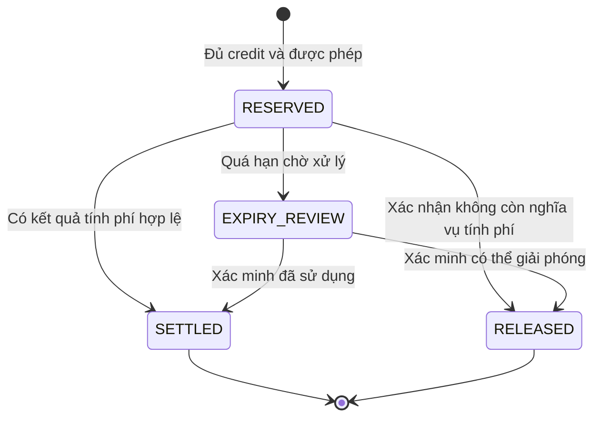

# Credit consumption — Tiêu thụ credit an toàn

## 1. Credit consumption là gì?

Trong một hệ thống dùng credit, **credit consumption** là quá trình ghi nhận và khấu trừ quyền sử dụng khi người dùng thực hiện một nghiệp vụ có tính phí: chạy tác vụ, gọi dịch vụ, tạo báo cáo, gửi thông báo hoặc sử dụng một tài nguyên giới hạn.

Credit trong bài này là đơn vị quyền sử dụng của ứng dụng, không mặc nhiên là tiền hoặc hạn mức vay. Dù quy đổi theo cách nào, tiêu thụ credit vẫn phải tuân thủ những quy tắc nghiệp vụ rõ ràng. Một API trả về `200 OK` không chứng minh hệ thống đã thu đúng credit; một phép trừ số học đúng cũng không chứng minh đã thu đúng người, đúng giá và đúng số lần.

Trong chương **Credit Rules** của module `SECURITY_APPLICATION_SECURITY_BUSINESS_LOGIC_SECURITY`, mục tiêu là bảo vệ cơ chế tiêu thụ credit khỏi lạm dụng logic. Những vấn đề trọng tâm gồm sửa giá từ phía client, bỏ qua bước kiểm tra, tiêu thụ credit của đối tượng khác, gửi yêu cầu trùng và khai thác xử lý đồng thời.

Sau bài học, bạn có thể:

- Phân biệt credit khả dụng, credit đang giữ chỗ và credit đã tiêu thụ.
- Diễn đạt các bất biến nghiệp vụ cho một lần tiêu thụ.
- Chọn giữa khấu trừ trực tiếp và giữ chỗ rồi quyết toán.
- Thiết kế quyền theo đối tượng, transaction và idempotency cho luồng tính phí.
- Xây dựng tình huống kiểm thử có khả năng phát hiện lỗ hổng logic.

## 2. Mô hình số dư và các bất biến cần bảo vệ

### 2.1. Ba đại lượng khác nhau

Một tài khoản credit có thể được biểu diễn bằng:

| Đại lượng | Ý nghĩa | Ví dụ |
|---|---|---|
| `available` | Credit còn được phép phân bổ cho yêu cầu mới | 70 |
| `reserved` | Credit đã dành cho công việc đang xử lý | 30 |
| `consumed` | Credit đã quyết toán là sử dụng thực tế | 100 |

Trong ví dụ, người dùng không thể tạo một tác vụ cần 80 credit vì chỉ còn 70 credit khả dụng, dù 30 credit giữ chỗ chưa được tiêu thụ chính thức.

Để dễ theo dõi, trước tiên giả sử một tài khoản được cấp đúng 200 credit, chưa có cấp thêm, hoàn credit, điều chỉnh hoặc hết hạn:

```text
available + reserved + consumed = 200
available >= 0
reserved >= 0
consumed >= 0
```

Đây là mô hình đơn giản phục vụ giải thích. Trong hệ thống có hoàn credit hoặc hết hạn, cần xác định `consumed` là số tiêu thụ gộp hay tiêu thụ ròng, đồng thời đưa các loại biến động vào phương trình đối soát. Không áp dụng phương trình đơn giản trên cho mọi sản phẩm.

Ví dụ, nếu dùng tiêu thụ gộp và hoàn credit bằng một bút toán cấp lại, phương trình có thể là:

```text
available + reserved
  = opening_balance
  + grants
  + credit_returns
  + signed_adjustments
  - gross_consumption
  - expirations
```

Mỗi biến phải có định nghĩa thống nhất. Không vừa giảm `gross_consumption` vừa tăng `credit_returns` cho cùng một lần hoàn, vì như vậy sẽ cộng lại credit hai lần.

### 2.2. Bất biến ở cấp nghiệp vụ

Các bất biến dưới đây quan trọng hơn tên bảng hoặc framework:

1. **Đúng chủ thể:** chỉ tài khoản được phép trả phí cho tài nguyên đó mới bị ghi nợ.
2. **Đúng giá:** số credit phải thu được tính từ quy tắc do máy chủ kiểm soát.
3. **Đủ credit:** một yêu cầu chỉ được chấp nhận khi còn đủ credit khả dụng, trừ khi sản phẩm có chính sách nợ rõ ràng.
4. **Một sự kiện tính phí có một hiệu lực tài chính:** retry không tạo thêm lần khấu trừ cho cùng sự kiện.
5. **Đúng trạng thái:** chỉ công việc hoặc reservation đang ở trạng thái hợp lệ mới được quyết toán, giải phóng hay hoàn credit.
6. **Nhất quán:** số dư, bút toán và trạng thái nghiệp vụ không thể được commit riêng rẽ khi chúng phải thay đổi cùng nhau.
7. **Có thể truy vết:** mỗi lần khấu trừ liên kết được với công việc, tài khoản, chính sách giá và căn cứ sử dụng.

Các bất biến này phải được thực thi tại dịch vụ hoặc tầng dữ liệu có thẩm quyền. Ẩn nút trên giao diện hoặc kiểm tra số dư bằng JavaScript không bảo vệ được chúng.

## 3. Mối đe dọa và ranh giới tin cậy

Giả sử ứng dụng cho phép chạy một tác vụ tạo báo cáo. Cách thiết kế nguy hiểm là để client gửi toàn bộ thông tin tính phí:

```http
POST /reports
Content-Type: application/json

{
  "projectId": "project-A",
  "payerAccountId": "credit-account-B",
  "quantity": 10,
  "unitCost": 0,
  "totalCredits": 0,
  "approved": true
}
```

Người gọi có thể sửa mọi trường trong request. Nếu backend tin `totalCredits`, họ có thể mua miễn phí. Nếu backend tin `payerAccountId`, họ có thể đẩy chi phí sang tài khoản khác. Nếu backend tin `approved`, họ có thể vượt qua quy trình phê duyệt.

API nên chỉ nhận dữ liệu đầu vào cần thiết của công việc, chẳng hạn:

```http
POST /projects/project-A/report-jobs
Idempotency-Key: create-report-7f0a
Content-Type: application/json

{
  "reportType": "SUMMARY",
  "quantity": 10
}
```

Máy chủ phải tự thực hiện các bước sau:

- Xác thực người gọi và xác định tenant từ ngữ cảnh đáng tin cậy.
- Kiểm tra người gọi có quyền tạo báo cáo trong `project-A`.
- Xác định tài khoản trả phí hợp lệ cho dự án và quyền sử dụng tài khoản đó.
- Kiểm tra phê duyệt trên dữ liệu lưu trong hệ thống nếu nghiệp vụ yêu cầu.
- Đọc chính sách giá áp dụng và tính credit cần giữ hoặc khấu trừ.
- Ghi nhận thay đổi theo transaction và chính sách chống trùng.

Một số sản phẩm cho phép người dùng chọn tài khoản thanh toán. Khi đó `payerAccountId` vẫn có thể là đầu vào, nhưng chỉ là lựa chọn cần kiểm tra quyền, không phải bằng chứng được phép ghi nợ.

| Dữ liệu | Mức độ tin cậy | Cách sử dụng an toàn |
|---|---|---|
| Số lượng do client nhập | Chưa đáng tin | Kiểm tra kiểu, giới hạn, quyền và tính chi phí phía máy chủ |
| Giá hoặc tổng credit do client nhập | Không phải nguồn giá có thẩm quyền | Bỏ qua hoặc từ chối nếu API không hỗ trợ các trường này |
| Mã tài nguyên trong URL | Chưa chứng minh quyền sở hữu | Kiểm tra tài nguyên thuộc tenant và người gọi có quyền |
| Usage do worker gửi | Cần xác thực nguồn và chống giả mạo | Đối chiếu với job, giới hạn và sự kiện tính phí |
| Idempotency key | Do client kiểm soát | Chỉ dùng để nhận diện retry trong phạm vi đã xác định |
| Chính sách giá đã được máy chủ chốt | Dữ liệu nghiệp vụ có thẩm quyền | Lưu phiên bản và căn cứ để kiểm toán |

Việc ước tính giá trên giao diện vẫn hữu ích cho trải nghiệm. Tuy nhiên, hiển thị giá và cho phép ghi nợ là hai trách nhiệm khác nhau.

## 4. Tính lượng credit phải tiêu thụ

### 4.1. Kiểm tra đầu vào trước khi tính phí

Một quy tắc đơn giản:

```text
requiredCredits = quantity × unitCost
```

vẫn có thể bị phá nếu thiếu giới hạn:

- `quantity = -10` làm phép trừ biến thành cộng credit.
- `quantity = 0` có thể mở đường chạy công việc có chi phí nền mà không bị thu phí.
- Giá trị quá lớn có thể làm tràn kiểu số.
- Số thập phân không được hỗ trợ có thể bị cắt hoặc làm tròn khác nhau giữa các tầng.
- Đơn vị không nhất quán, như giây so với phút, có thể làm sai chi phí nhiều lần.

Với credit nguyên, nên dùng kiểu số nguyên có giới hạn phù hợp và phép tính phát hiện tràn. Nếu sản phẩm cho phép credit lẻ, cần quy định độ chính xác và cách làm tròn bằng kiểu thập phân chính xác; tránh dùng số dấu phẩy động nhị phân làm nguồn tính phí.

Ví dụ Java minh họa cho một loại tác vụ chỉ nhận số lượng nguyên dương:

```java
record CreditCost(long quantity, long unitCost, long total) {}

CreditCost calculateCost(long quantity, long unitCost) {
    if (quantity < 1 || quantity > 10_000) {
        throw new IllegalArgumentException("INVALID_QUANTITY");
    }
    if (unitCost < 0) {
        throw new IllegalStateException("INVALID_PRICING_RULE");
    }

    long total = Math.multiplyExact(quantity, unitCost);
    return new CreditCost(quantity, unitCost, total);
}
```

`unitCost` trong ví dụ phải lấy từ chính sách giá của máy chủ. Khi phép nhân bị tràn, tầng xử lý lỗi phải từ chối thao tác và không tạo tác vụ. Giá bằng 0 chỉ hợp lệ nếu chính sách sản phẩm thực sự cho phép miễn phí; khi đó vẫn cần chống trùng và áp dụng hạn mức tài nguyên thích hợp.

### 4.2. Chốt giá tại thời điểm xác định

Nếu một job được giữ chỗ theo giá 5 credit/đơn vị nhưng quyết toán theo giá 8 credit/đơn vị sau khi bảng giá đổi, người dùng có thể bị thu vượt số đã chấp nhận.

Một chính sách dễ giải thích là lưu tại thời điểm chấp nhận job:

```text
pricing_version = "report-price-v3"
unit_cost = 5
credit_unit = "REPORT_CREDIT"
requested_quantity = 10
reserved_credits = 50
```

Khi quyết toán, dùng chính sách giá đã chốt và lượng sử dụng thực tế được xác minh. Nếu nghiệp vụ chọn giá tại thời điểm sử dụng, phải thiết kế riêng cơ chế thông báo, giữ chỗ và giới hạn để bảo đảm người dùng không bị thu vượt điều kiện đã chấp nhận.

Không cộng gộp các loại credit khác nhau chỉ vì cùng là số. Credit khuyến mại có thể bị giới hạn tính năng hoặc hết hạn trước credit mua. Quy tắc chọn nguồn credit phải rõ ràng, chẳng hạn dùng lô hợp lệ có hạn hết sớm nhất, đồng thời lưu dấu vết lượng đã lấy từ từng lô.

## 5. Hai cách tổ chức tiêu thụ credit

### 5.1. Khấu trừ trực tiếp trong transaction

Cách này phù hợp khi số credit biết trước và kết quả nghiệp vụ nằm trong cùng cơ sở dữ liệu, có thể commit cùng lúc với khấu trừ.

Ví dụ: mở khóa một tài liệu đã có sẵn với giá 20 credit. Một transaction có thể đồng thời tạo quyền truy cập, giảm credit và ghi bút toán. Nếu một bước thất bại, toàn bộ transaction rollback.

Nếu mở khóa đã tồn tại, cần trả về kết quả theo chính sách sản phẩm thay vì tiếp tục khấu trừ. Một ràng buộc duy nhất cho quyền truy cập có thể hỗ trợ ngăn hai request đồng thời mua cùng quyền hai lần.

### 5.2. Giữ chỗ rồi quyết toán

Cách này phù hợp với tác vụ dài, gọi nhà cung cấp bên ngoài hoặc chỉ biết lượng dùng thực tế sau khi hoàn tất.



Trong mô hình đơn giản này, một reservation chỉ được kết thúc một lần. Hoàn credit sau quyết toán là nghiệp vụ mới có tham chiếu đến lần quyết toán cũ, không phải chuyển ngược reservation về `RESERVED`.

Tên `EXPIRY_REVIEW` thể hiện một lựa chọn thiết kế: hết thời gian chờ chưa đủ chứng minh không có chi phí. Nếu worker đã sử dụng tài nguyên nhưng callback bị chậm, tự động giải phóng toàn bộ credit có thể tạo ra sử dụng miễn phí.

### 5.3. Ví dụ số dư

Tài khoản ban đầu có 100 credit. Job cần giữ tối đa 30 credit; khi hoàn tất chỉ dùng 24 credit.

| Mốc | `available` | `reserved` | `consumed` | Diễn giải |
|---|---:|---:|---:|---|
| Ban đầu | 100 | 0 | 0 | Chưa có công việc |
| Giữ chỗ | 70 | 30 | 0 | Dành 30 credit cho job |
| Quyết toán | 76 | 0 | 24 | Tiêu thụ 24 và trả lại 6 chưa dùng |

Nếu job được xác nhận chưa phát sinh phần sử dụng phải tính phí, giải phóng reservation sẽ đưa số dư về `100 / 0 / 0`. Nếu job thất bại nhưng đã phát sinh 12 credit được phép tính theo chính sách, có thể quyết toán 12 và trả lại 18.

Không nên suy ra số credit phải thu chỉ từ tên trạng thái kỹ thuật như `FAILED`. Trạng thái hoàn thành của job và nghĩa vụ tính phí cần được liên kết bằng quy tắc nghiệp vụ cụ thể.

## 6. Transaction và xử lý đồng thời

### 6.1. Lỗi kiểm tra rồi mới trừ

Đoạn xử lý sau có thể sai khi nhiều request chạy cùng lúc:

```text
balance = readAvailable(accountId)
if balance >= cost:
    runBusinessAction()
    writeAvailable(accountId, balance - cost)
```

Nếu số dư là 50 và hai request cùng cần 40, cả hai có thể đọc thấy 50 và đều được chấp nhận. Tùy cách cập nhật, hệ thống có thể tạo số dư âm hoặc chỉ ghi nhận một lần trừ trong khi đã cho dùng hai lần.

Khóa trong một tiến trình Java không đủ nếu dịch vụ chạy nhiều instance. Quyết định cấp credit phải được phối hợp tại nơi lưu trạng thái có thẩm quyền hoặc bằng một cơ chế phân bổ tương đương có bảo đảm rõ ràng.

### 6.2. Cập nhật có điều kiện

SQL sau minh họa ý tưởng giữ chỗ trên một hàng tài khoản:

```sql
BEGIN;

UPDATE credit_account
SET available = available - :amount,
    reserved  = reserved + :amount
WHERE tenant_id = :tenant_id
  AND id = :account_id
  AND status = 'ACTIVE'
  AND available >= :amount;

-- Ứng dụng bắt buộc kiểm tra số hàng cập nhật bằng 1.
-- Nếu không bằng 1: ROLLBACK, không tạo job được chấp nhận.

INSERT INTO credit_reservation (
    tenant_id, id, account_id, job_id, amount, status, pricing_version
) VALUES (
    :tenant_id, :reservation_id, :account_id, :job_id,
    :amount, 'RESERVED', :pricing_version
);

INSERT INTO credit_ledger (
    tenant_id, account_id, operation_id, entry_type,
    available_delta, reserved_delta, consumed_delta
) VALUES (
    :tenant_id, :account_id, :operation_id, 'RESERVE',
    -:amount, :amount, 0
);

-- Tạo bản ghi job, lưu kết quả idempotency và outbox nếu cần,
-- cũng trong transaction này.

COMMIT;
```

Đây là mã minh họa, chưa phải script triển khai. Nó giả định `amount` đã được kiểm tra hợp lệ, quyền ghi nợ đã được xác minh, tài khoản có khóa định danh duy nhất và cơ sở dữ liệu hỗ trợ transaction cùng cập nhật hàng có điều kiện. Cách khóa, mức cô lập và lỗi có thể retry cần được kiểm chứng trên hệ quản trị thực tế.

Các điểm bắt buộc của cách tiếp cận:

- Không coi `UPDATE` không lỗi là đã trừ thành công; phải kiểm tra số hàng bị tác động.
- Reservation, ledger, job và dữ liệu chống trùng phải commit cùng thay đổi số dư khi chúng nằm trong cùng cơ sở dữ liệu.
- Nếu có lỗi sau bước cập nhật số dư, phải rollback toàn bộ transaction.
- Ràng buộc dữ liệu như số dư không âm và khóa duy nhất là lớp bảo vệ bổ sung cho quy tắc trong ứng dụng.
- Nếu cần đọc nhiều dữ liệu rồi quyết định, phải chọn khóa hoặc mức cô lập phù hợp; bọc `SELECT` và `UPDATE` trong transaction một cách máy móc chưa đủ.

Kiểm tra quyền cũng có thể bị thay đổi đồng thời, chẳng hạn dự án bị chuyển tài khoản trả phí trong lúc request đang chạy. Nếu yêu cầu bảo mật đòi hỏi quyết định dựa trên quan hệ mới nhất, transaction phải bảo vệ hoặc kiểm tra lại phiên bản của quan hệ đó trước khi ghi nợ.

### 6.3. Quyết toán phải bảo vệ trạng thái reservation

Không thể chỉ cộng/trừ số dư mà bỏ qua trạng thái nguồn. Một thao tác quyết toán cần:

1. Xác thực nguồn báo usage và đối chiếu reservation với job, tenant, tài khoản.
2. Khóa reservation hoặc dùng cập nhật trạng thái có điều kiện để chỉ một thao tác có quyền kết thúc nó.
3. Xác minh `0 <= actualCost <= reservedAmount` trong mô hình không cho vượt giữ chỗ.
4. Giảm `reserved` theo toàn bộ số giữ chỗ, tăng `consumed` theo `actualCost`, trả phần dư vào `available`.
5. Ghi ledger, trạng thái kết thúc và kết quả xử lý trong cùng transaction.

Với `r = reservedAmount` và `c = actualCost`, biến động là:

```text
available_delta = r - c
reserved_delta  = -r
consumed_delta  = c
```

Nếu hai callback cùng quyết toán, chỉ một callback được chuyển trạng thái. Callback còn lại đọc kết quả đã lưu và không ghi thêm bút toán.

Nếu callback quyết toán chạy đua với yêu cầu hủy, cả hai phải tranh quyền thay đổi cùng trạng thái reservation bằng cơ chế nguyên tử. Thao tác thua phải kiểm tra kết quả hiện tại và áp dụng chính sách; không tiếp tục cộng lại credit dựa trên trạng thái đã đọc trước đó.

## 7. Idempotency: retry mà không bị trừ hai lần

### 7.1. Phạm vi của idempotency key

Một idempotency key nên có phạm vi xác định, chẳng hạn:

```text
(tenant_id, authenticated_subject_id, operation_type, idempotency_key)
```

Tùy sản phẩm, chủ thể trong phạm vi có thể là người dùng hoặc client dịch vụ đã xác thực. Điều quan trọng là tránh va chạm giữa tenant và giữa các loại thao tác, đồng thời không để key trở thành cách đọc kết quả của người khác.

Bản ghi chống trùng thường lưu:

```text
scope
idempotency_key
request_fingerprint
operation_id
status
result_reference
created_at
retention_until
```

Fingerprint phải được tính từ đầu vào nghiệp vụ đã chuẩn hóa, gồm các lựa chọn có ảnh hưởng đến kết quả như dự án, loại tác vụ và số lượng. Không nên băm nguyên chuỗi JSON rồi coi mọi khác biệt về thứ tự trường là yêu cầu khác.

### 7.2. Hành vi mong đợi

| Tình huống | Hành vi |
|---|---|
| Key mới, request hợp lệ | Thực hiện một thao tác và lưu kết quả |
| Cùng key, cùng nội dung, thao tác đã xong | Trả kết quả tương ứng đã lưu sau kiểm tra quyền |
| Cùng key, cùng nội dung, đang xử lý | Trả trạng thái đang xử lý hoặc tham chiếu thao tác |
| Cùng key, nội dung khác | Từ chối xung đột, không khấu trừ thêm |
| Key thuộc phạm vi tenant khác | Không truy cập hoặc tiết lộ kết quả của phạm vi đó |

Ví dụ `409 Conflict` có thể dùng cho trường hợp cùng key nhưng khác nội dung. Mã lỗi cụ thể là hợp đồng API; tính chất cần bảo đảm là không phát sinh hiệu lực mới khi một retry hợp lệ tới sau lần commit trước.

### 7.3. Khóa duy nhất mới bảo vệ được request đồng thời

Luồng `SELECT key -> không tồn tại -> INSERT key` vẫn có race condition. Cần ràng buộc duy nhất trong nơi lưu trữ có thẩm quyền hoặc cơ chế tương đương để chỉ một request chiếm được key.

Đối với nghiệp vụ nằm trong một cơ sở dữ liệu, một cách tổ chức là:

```text
BEGIN
  chiếm idempotency key bằng thao tác được bảo vệ bởi unique constraint
  kiểm tra quyền và điều kiện nghiệp vụ
  giữ hoặc khấu trừ credit
  ghi ledger và job
  lưu kết quả/tham chiếu kết quả cho key
COMMIT
```

Nếu request trùng chạm unique constraint, cách rollback, chờ và đọc kết quả phải được xử lý theo semantics của cơ sở dữ liệu. Không tiếp tục các câu lệnh còn lại trong một transaction đã lỗi.

Nếu ứng dụng commit một bản ghi `PROCESSING` trước rồi mới thực hiện nghiệp vụ, cần thêm cơ chế phục hồi cho trường hợp tiến trình chết giữa chừng. Một bản ghi `PROCESSING` tồn tại vĩnh viễn không phải thiết kế idempotency hoàn chỉnh.

### 7.4. Chống trùng theo nghiệp vụ, không chỉ theo key

Người gọi có thể gửi cùng một sự kiện tính phí với nhiều key khác nhau. Vì vậy, ngoài key của request, cần nhận diện **sự kiện nghiệp vụ cần tính phí**.

Ví dụ:

```text
UNIQUE (tenant_id, billable_event_id, charge_type)
```

`billable_event_id` phải liên kết đến sự kiện mà máy chủ kiểm soát và đã kiểm tra. Không coi một chuỗi tùy ý do client gửi là bằng chứng sự kiện tồn tại.

Với một job có nhiều phần sử dụng hợp lệ, mỗi phần cần mã sự kiện riêng, chẳng hạn mã đoạn hoặc khoảng sử dụng. Không đặt khóa duy nhất chỉ trên `job_id` nếu nghiệp vụ thực sự cho phép tính nhiều phần độc lập.

Việc tạo hai job mới có đầu vào giống hệt nhau có thể là hai lần mua hợp lệ. Không dùng hash nội dung báo cáo làm khóa chống trùng toàn cục nếu sản phẩm không quy định chỉ được mua một lần.

Thời gian lưu idempotency key phải bao phủ khoảng retry được cam kết. Sau khi xóa key, retry cũ có thể bị xem là yêu cầu mới; các ràng buộc sự kiện tính phí và dữ liệu kiểm toán cần có vòng đời phù hợp với nghiệp vụ, không phụ thuộc hoàn toàn vào cache ngắn hạn.

## 8. Tác vụ bên ngoài, outbox và usage đáng tin cậy

### 8.1. Khoảng trống giữa commit và gửi việc

Nếu ứng dụng gọi worker trước khi commit giữ chỗ, worker có thể chạy dù transaction bị rollback. Nếu commit xong nhưng chết trước khi gửi việc, người dùng bị giữ credit mà job không được chạy.

Một cách khắc phục khoảng trống này là ghi một sự kiện outbox cùng transaction với reservation và job:

```text
Transaction cơ sở dữ liệu:
  giữ credit
  tạo job
  ghi ledger
  ghi outbox JobAccepted
  lưu kết quả idempotency
  commit

Tiến trình phát sự kiện:
  đọc outbox đã commit
  gửi JobAccepted
  ghi nhận trạng thái phát
```

Outbox không làm việc giao nhận trở thành đúng một lần. Nếu tiến trình chết sau khi gửi nhưng trước khi đánh dấu, sự kiện có thể được gửi lại. Worker phải chống trùng theo `job_id` hoặc mã lệnh phù hợp; nếu gọi nhà cung cấp, cần sử dụng khả năng chống trùng của nhà cung cấp khi có.

Không giữ transaction khóa số dư trong suốt một lời gọi mạng dài. Hãy lưu ý định đã được chấp nhận rồi điều phối công việc qua trạng thái có thể phục hồi.

### 8.2. Usage event cần liên kết với công việc được chấp nhận

Một usage event có thể mang:

```json
{
  "eventId": "usage-event-812",
  "jobId": "job-420",
  "reservationId": "reservation-420",
  "meter": "REPORT_UNIT",
  "actualQuantity": 6,
  "executionId": "execution-91"
}
```

Backend không được chỉ nhìn thấy `reservationId` hợp lệ rồi quyết toán. Nó còn phải kiểm tra nguồn gửi được phép báo usage cho job đó, event chưa được xử lý, đơn vị đo đúng, số lượng hợp lệ và execution thuộc công việc được cấp quyền.

Trường `actualQuantity` do trình duyệt gửi không đủ làm căn cứ tính phí cho lượng tài nguyên do máy chủ thực hiện. Ngay cả thông điệp nội bộ cũng cần xác thực nguồn và kiểm tra quan hệ đối tượng.

Khi dùng inbox chống trùng sự kiện, việc đánh dấu event đã xử lý và cập nhật số dư phải có tính nguyên tử với nhau. Đánh dấu trước rồi lỗi khấu trừ sẽ bỏ sót thu phí; khấu trừ trước rồi lỗi đánh dấu có thể thu lặp.

### 8.3. Phân biệt usage cộng dồn và usage gia tăng

Nếu nguồn gửi tổng lượng dùng hiện tại là 10, rồi gửi lại 10, rồi gửi 13, không được cộng thành 33. Với meter cộng dồn đơn điệu và cùng một kỳ đo, hệ thống có thể lưu mốc đã chấp nhận và chỉ tính phần tăng `10`, `0`, `3`.

Nếu nguồn gửi từng phần gia tăng `10` và `3`, mỗi phần phải có mã sự kiện ổn định để chống trùng. Không áp dụng cách lấy số lớn nhất của meter cộng dồn cho meter gia tăng.

Sự kiện sửa sai, reset meter hoặc đổi kỳ cần hợp đồng riêng. Khi cùng `eventId` xuất hiện với nội dung khác, nên ghi nhận xung đột và ngăn tự động tính thêm; không tùy ý chọn thông điệp đến sau làm sự thật.

## 9. Vượt dự toán, hủy và hết hạn

### 9.1. Khi lượng dùng thực tế vượt giữ chỗ

Không âm thầm trừ phần vượt từ `available` mà bỏ qua chính sách đã cam kết. Có thể chọn một trong các cơ chế sau:

| Cơ chế | Cách thực hiện | Điều kiện cần bảo vệ |
|---|---|---|
| Giới hạn cứng | Worker dừng trước khi vượt lượng được cấp | Việc thực thi phải tôn trọng ngân sách đã cấp |
| Giữ chỗ bổ sung | Xin thêm credit trước khi chạy phần tiếp theo | Mỗi lần bổ sung có mã thao tác riêng và kiểm tra số dư nguyên tử |
| Hạn mức nợ | Cho phép vượt đến mức đã được cấp | Kiểm tra tổng nghĩa vụ với hạn mức và quyền dùng nợ |

Với dịch vụ chỉ báo usage sau khi tài nguyên đã dùng, chỉ kiểm tra số dư lúc nhận callback không thể ngăn phần dùng vượt. Cần giới hạn thực thi hoặc dự phòng ngân sách theo mức rủi ro sản phẩm chấp nhận.

Nếu usage đã vượt mà không được phép, không được cắt nhỏ số liệu để làm như chỉ dùng đúng reservation. Cần giữ bằng chứng usage, ngăn phát sinh thêm và đưa phần chênh lệch vào xử lý ngoại lệ theo chính sách.

### 9.2. Hủy không đồng nghĩa với hoàn toàn bộ

Người dùng có thể yêu cầu hủy trong lúc worker vẫn chạy. Nếu hệ thống lập tức giải phóng reservation nhưng không dừng worker, họ có thể vừa lấy lại credit vừa nhận kết quả.

Luồng hủy cần xác định:

- Điểm nào còn cho phép hủy trước khi phát sinh chi phí.
- Worker đã dừng hoặc còn có khả năng tạo thêm usage hay không.
- Phần sử dụng đã phát sinh được tính theo quy tắc nào.
- Kết quả có được phép công bố sau khi hủy hay không.
- Ai có quyền quyết định trạng thái cuối cùng khi callback và yêu cầu hủy đến đồng thời.

Không quyết toán từ callback đến muộn sau khi reservation đã `RELEASED` bằng cách bỏ qua state machine. Trường hợp đó cần được nhận diện, lưu bằng chứng và xử lý theo quy trình phục hồi hoặc điều chỉnh được cấp quyền.

### 9.3. Hết hạn reservation và hết hạn lô credit

Hai khái niệm này khác nhau:

- Reservation hết hạn là hết khoảng thời gian được giữ ngân sách cho một công việc.
- Lô credit hết hạn là quyền sử dụng của nguồn credit đó không còn hiệu lực theo chính sách.

Nếu credit khuyến mại đã hết hạn trong lúc job đang chạy, phần dư khi giải phóng không mặc nhiên trở thành credit mới với hạn dùng mới. Cần giữ nguồn gốc từng lô và áp dụng chính sách hết hạn khi hoàn lại. Nếu không, người dùng có thể liên tục giữ chỗ rồi hủy để kéo dài tuổi thọ credit.

## 10. Quyền theo đối tượng và quyền thao tác đặc biệt

Quyền gọi API không thay thế quyền trên tài khoản bị ghi nợ. Một người có vai trò `MEMBER` vẫn có thể chỉ được dùng credit trong một dự án cụ thể.

Ví dụ kiểm tra quyền cần trả lời được các câu hỏi:

```text
Người gọi thuộc tenant nào?
Người gọi có được thực hiện tác vụ trong dự án này không?
Dự án này được phép dùng tài khoản credit nào?
Người gọi có quyền tiêu thụ từ tài khoản đó không?
Tác vụ này có cần phê duyệt hoặc còn trong hạn mức cá nhân không?
```

Truy vấn theo `account_id` hoặc `reservation_id` phải kèm phạm vi tenant và quan hệ sở hữu phù hợp. Không suy ra quyền chỉ vì mã định danh khó đoán hoặc vì tài nguyên có thật.

Nếu vừa có số dư tổng vừa có hạn mức theo người dùng hoặc dự án, cần bảo vệ cả hai khi phân bổ. Hai request không được cùng vượt hạn mức cá nhân dù tổng tài khoản vẫn đủ. Khi khóa nhiều hàng, nên chọn thứ tự nhất quán và xử lý retry lỗi đồng thời có giới hạn.

Các thao tác hỗ trợ như miễn phí, hoàn credit, điều chỉnh số dư hoặc bỏ qua phê duyệt phải có quyền riêng. Không mở một cờ `skipCreditCheck` cho request công khai hoặc vô tình bind trường nội bộ từ JSON vào entity.

Với hoàn credit, cần liên kết đến lần thu gốc, giới hạn tổng hoàn không vượt phần được hoàn và chống trùng thao tác hoàn. Quyền quản trị không làm mất nhu cầu lưu lý do, chủ thể thực hiện và dấu vết kiểm toán.

## 11. Ledger, đối soát và quan sát vận hành

### 11.1. Ghi biến động thay vì chỉ lưu số dư cuối

Số dư hiện tại giúp xử lý nhanh nhưng không giải thích được vì sao tài khoản giảm 24 credit. Ledger ghi các biến động có thể truy vết:

| Loại bút toán | `available_delta` | `reserved_delta` | `consumed_delta` |
|---|---:|---:|---:|
| Cấp 100 credit | +100 | 0 | 0 |
| Giữ chỗ 30 | -30 | +30 | 0 |
| Quyết toán 24, trả dư 6 | +6 | -30 | +24 |

Các hàng trên là ba bước nối tiếp. Nếu giải phóng toàn bộ 30 thay vì quyết toán, bút toán kết thúc sẽ là `+30 / -30 / 0`, không ghi thêm cả hai kiểu kết thúc cho cùng reservation.

Mỗi bút toán nên liên kết được với tenant, tài khoản, operation, job hoặc billable event, reservation, loại biến động, đơn vị credit, chính sách giá và thời điểm. Khi phân bổ từ nhiều lô, lưu cả chi tiết nguồn credit.

Ledger đã ghi nhận nên được bảo vệ khỏi sửa tùy ý. Điều chỉnh dùng bút toán bù có lý do và tham chiếu, giúp giữ lại lịch sử. Trong thiết kế lưu cả ledger và số dư tổng hợp, hai phần phải cùng được cập nhật nguyên tử; nếu ledger là nguồn sự thật, cần cơ chế tính lại và phục hồi projection phù hợp.

### 11.2. Tín hiệu giúp phát hiện lạm dụng

Các tín hiệu đáng theo dõi gồm:

- Nhiều request cùng key nhưng khác fingerprint.
- Nhiều key khác nhau cố ghi cùng billable event.
- Nhiều yêu cầu tiêu thụ bị từ chối do thiếu credit.
- Job đã chạy nhưng không có reservation hoặc bút toán tương ứng.
- Reservation tồn tại lâu, nhiều lần giữ rồi hủy, hoặc giải phóng sau khi nguồn credit hết hạn.
- Usage vượt giữ chỗ, callback xung đột hoặc callback đến sau trạng thái kết thúc.
- Chênh lệch giữa số dư tổng hợp, tổng reservation còn hiệu lực và ledger.

Giới hạn tần suất có thể giảm spam, nhưng không thay thế transaction, kiểm tra quyền hoặc chống trùng. Một request sai logic vẫn có thể gây thiệt hại dù được gửi rất chậm.

Log cần chứa mã liên kết phục vụ điều tra nhưng tránh ghi token xác thực hoặc dữ liệu đầu vào nhạy cảm không cần thiết. Các endpoint tra cứu trạng thái, lịch sử tiêu thụ và kết quả idempotency cũng phải kiểm tra quyền theo đối tượng.

## 12. Các tình huống kiểm thử tấn công logic

Bảng dưới đây là thiết kế kiểm thử cho bài học, chưa phải kết quả kiểm thử của một hệ thống cụ thể. Kiểm tra cả response, số dư, ledger và trạng thái job; chỉ nhìn HTTP status có thể bỏ sót lỗi thu phí.

| Tình huống | Cách tạo điều kiện | Kết quả cần bảo đảm |
|---|---|---|
| Sửa giá | Gửi thêm `unitCost: 0` hoặc `totalCredits: 0` | Máy chủ bỏ qua hoặc từ chối trường; giá hợp lệ không đổi |
| Số lượng âm hoặc quá lớn | Gửi số âm, vượt giới hạn hoặc gây tràn | Không tạo job được chấp nhận, không đổi số dư |
| Đổi người trả phí | Thay account bằng tài khoản không được phép | Từ chối, không tạo bút toán bên tài khoản đích |
| Bỏ qua phê duyệt | Gọi API chạy trực tiếp khi chưa được duyệt | Không cấp việc hay giữ credit trái quy trình |
| Cạnh tranh số dư | Cho hai request cùng giữ 40 khi số dư là 50 | Chỉ một request thành công; cuối cùng `available=10`, `reserved=40` |
| Retry sau mất response | Commit thành công rồi mô phỏng mất kết nối | Gửi lại cùng key trả cùng operation, không giữ credit lần hai |
| Cùng key khác nội dung | Đổi quantity nhưng giữ key | Báo xung đột, không phát sinh lần tính phí mới |
| Trùng sự kiện, khác key | Gửi cùng billable event bằng hai key | Chỉ có một hiệu lực thu cho loại phí đó |
| Callback bị phát lại | Gửi cùng event nhiều lần, kể cả đồng thời | Một lần quyết toán và một bộ bút toán tương ứng |
| Hủy chạy đua quyết toán | Cho hai thao tác cùng tranh reservation | Chỉ một kết thúc hợp lệ; không vừa hoàn hết vừa ghi tiêu thụ |
| Lỗi giữa transaction | Gây lỗi sau cập nhật số dư, trước ghi ledger | Rollback toàn bộ thay đổi liên quan |
| Chết sau commit trước phát việc | Dừng tiến trình trước gửi outbox | Công việc được phục hồi qua outbox, không giữ credit thêm |
| Credit khuyến mại hết hạn | Giữ trước hạn, giải phóng sau hạn | Không gia hạn trái chính sách cho credit được trả lại |
| Usage vượt dự toán | Báo lượng dùng vượt reservation | Không âm thầm trừ vượt; áp dụng cơ chế đã công bố |

Kiểm thử cạnh tranh nên dùng điểm đồng bộ để các request thực sự chồng lấn tại bước quyết định; chạy hai request nối tiếp không kiểm chứng được race condition. Với transaction và ràng buộc cơ sở dữ liệu, cần kiểm thử tích hợp trên hệ quản trị và cấu hình gần môi trường triển khai thay vì chỉ mock repository.

Ngoài các ca cụ thể, có thể tạo chuỗi thao tác ngẫu nhiên như cấp credit, giữ chỗ, retry, quyết toán, hủy và hết hạn. Sau mỗi thao tác, kiểm tra các bất biến: số dư hợp lệ, mỗi reservation có tối đa một kết thúc, mỗi sự kiện tính phí không bị thu lặp và phương trình đối soát vẫn đúng theo mô hình đã chọn.

## 13. Bài tập áp dụng

Một dịch vụ tạo tài liệu có các quy tắc:

- Tài khoản ban đầu có 120 credit.
- Mỗi trang có giá 4 credit, chốt giá khi nhận job.
- Một job xin tạo tối đa 15 trang nên cần giữ 60 credit.
- Khi kết thúc, chỉ các trang được xác nhận thuộc diện tính phí mới tiêu thụ credit.
- Không cho phép nợ hoặc vượt reservation.

Hãy thiết kế dữ liệu và luồng xử lý cho các tình huống sau:

1. Hai job cùng được nhận khi số dư đủ. Sau đó một request retry lại với cùng key.
2. Job thứ nhất hoàn tất 12 trang; callback được gửi hai lần.
3. Job thứ hai nhận yêu cầu hủy trong lúc worker báo đã tạo 3 trang được phép tính phí.
4. Một callback khác báo 18 trang cho reservation 15 trang.
5. Người dùng đổi `projectId` sang dự án thuộc tenant khác nhưng giữ nguyên key.

Với tình huống 1, hai reservation tiêu thụ toàn bộ 120 credit khả dụng. Retry đúng key không được tạo reservation thứ ba. Sau khi job thứ nhất quyết toán 12 trang, số dư là:

```text
available = 12
reserved = 60
consumed = 48
```

Nếu chính sách và bằng chứng xác nhận job thứ hai chỉ phải trả 3 trang, quyết toán thêm 12 credit và giải phóng 48 credit còn lại sẽ đưa tài khoản về:

```text
available = 60
reserved = 0
consumed = 60
```

Kết quả này chỉ hợp lệ khi việc hủy đã ngăn phần sử dụng tiếp theo hoặc đã có xác nhận trạng thái cuối. Callback báo 18 trang phải được nhận diện là vượt ngân sách, không được tự động thu 72 credit hoặc che đi phần vượt. Yêu cầu sang tenant khác phải thất bại kiểm tra quyền; key không cấp quyền truy cập dự án hay kết quả cũ.

## 14. Tiêu chí hoàn thành thiết kế

Một luồng credit consumption có cơ sở an toàn khi giải thích được toàn bộ chuỗi:

```text
Ai được phép yêu cầu?
    -> Tài khoản nào được phép trả phí?
    -> Giá và lượng sử dụng nào có thẩm quyền?
    -> Điều kiện số dư nào phải đúng tại thời điểm phân bổ?
    -> Transaction nào bảo vệ các thay đổi liên quan?
    -> Retry và sự kiện trùng được nhận diện bằng gì?
    -> State machine nào chặn quyết toán hoặc hoàn sai thứ tự?
    -> Bằng chứng nào cho phép đối soát và phục hồi?
```

Các quyết định này phải thống nhất giữa API, worker, cơ sở dữ liệu và tác vụ phục hồi. Khi một điểm vào có thể bỏ qua cùng bất biến mà các điểm khác đang thực thi, cơ chế tiêu thụ credit vẫn có thể bị lạm dụng.
