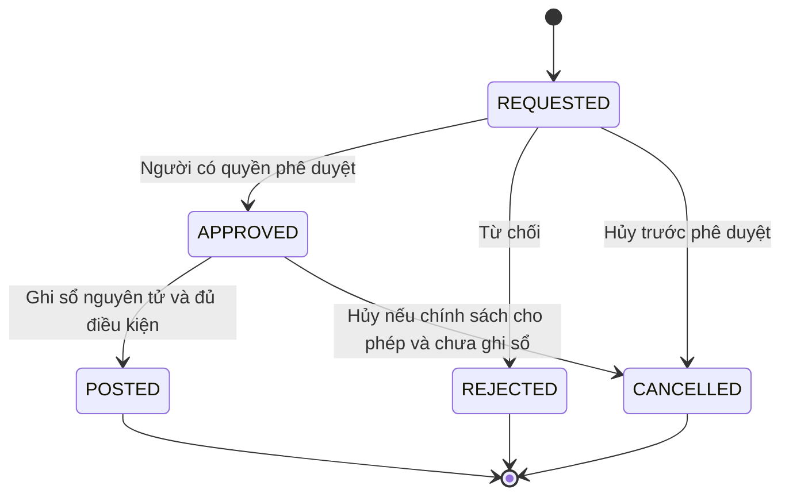

# Credit reversal: bảo vệ nghiệp vụ đảo khoản ghi có

## 1. Credit reversal là gì?

Trong chương **Credit Rules**, credit reversal là nghiệp vụ tạo bút toán bù để thu hồi toàn bộ hoặc một phần giá trị của một khoản ghi có đã có hiệu lực. Ví dụ, hệ thống đã cộng nhầm 1.000.000 VND vào ví khách hàng và cần thu hồi 250.000 VND. Khoản ghi có gốc vẫn tồn tại; một bản ghi đảo mới tham chiếu đến nó và giải thích vì sao số dư giảm.

Trong bài này, **credit** được hiểu là khoản cộng giá trị vào ví hoặc tài khoản nội bộ, không phải quyết định cấp hạn mức vay. Đây là mô hình học về bảo mật logic nghiệp vụ trong module `SECURITY_APPLICATION_SECURITY_BUSINESS_LOGIC_SECURITY`; các quy tắc cụ thể dưới đây là giả định được công bố cho hệ thống ví minh họa.

Một API chỉ kiểm tra người gọi đã đăng nhập và số tiền lớn hơn 0 vẫn có thể cho phép đảo khoản ghi có của người khác, thu hồi vượt khoản gốc, bỏ qua phê duyệt hoặc trừ tiền hai lần khi gửi lại yêu cầu. Bảo mật nghiệp vụ phải bảo vệ cả quan hệ giữa các đối tượng, trình tự xử lý và điều kiện tại thời điểm ghi sổ.

Sau bài học, bạn cần giải thích được:

- Vì sao đảo giao dịch cần giữ lịch sử và liên kết với khoản ghi có gốc.
- Các bất biến khi đảo toàn phần hoặc nhiều lần đảo một phần.
- Cách phối hợp quyền theo đối tượng, máy trạng thái, transaction và idempotency.
- Cách kiểm thử lạm dụng qua nhiều yêu cầu, nhiều người thao tác và nhiều thời điểm.

## 2. Xác định đúng nghiệp vụ trước khi thiết kế API

Các thao tác sau có thể cùng làm số dư thay đổi nhưng có ý nghĩa khác nhau:

| Thao tác | Tình huống | Quy tắc cần phân biệt |
| --- | --- | --- |
| Hủy khoản ghi có đang chờ | Lệnh cộng tiền chưa được ghi sổ | Chuyển trạng thái chờ sang hủy, chưa có giá trị đã ghi sổ để thu hồi |
| Đảo khoản ghi có đã ghi sổ | Cần bù cho khoản đã cộng nhầm | Tạo bút toán ngược chiều, liên kết khoản gốc, kiểm tra hạn mức đảo |
| Hoàn tiền cho người mua | Trả tiền từ một giao dịch mua | Theo quan hệ với giao dịch mua và chính sách hoàn tiền; không tự động đồng nghĩa với đảo khoản ghi có |
| Điều chỉnh số dư độc lập | Có căn cứ điều chỉnh riêng | Cần loại nghiệp vụ và quyền riêng; không dùng làm đường vòng để bỏ kiểm tra reversal |

Một khoản ghi có đang `PENDING` không được đưa vào cùng luồng với khoản đã `POSTED`. Nếu mọi trường hợp đều gọi một hàm `balance -= amount`, hệ thống sẽ mất khả năng giải thích tiền đến từ đâu và vì sao được phép lấy lại.

Tình huống xuyên suốt bài:

- Tài khoản A nhận khoản ghi có C trị giá 1.000.000 VND, đã `POSTED`.
- Tài khoản đã chi 400.000 VND, còn 600.000 VND khả dụng; ví dụ không có khoản giữ chỗ khác.
- Nhân viên có quyền đề nghị đảo 250.000 VND từ C và một người khác phê duyệt.
- Chính sách ví minh họa không cho số dư khả dụng âm. Nếu không đủ tiền, yêu cầu bị chặn ở bước ghi sổ và chuyển sang cách xử lý nghiệp vụ phù hợp.

Sau khi ghi sổ thành công, tổng đã đảo của C là 250.000 VND, phần còn được đảo theo khoản gốc là 750.000 VND, còn số dư khả dụng của A là 350.000 VND. **Phần còn được đảo của khoản gốc và số dư có thể thu hồi là hai đại lượng khác nhau.**

## 3. Các bất biến cần bảo vệ

Gọi:

- `C`: giá trị khoản ghi có gốc đã ghi sổ, tính theo đơn vị tiền nhỏ nhất mà hệ thống hỗ trợ.
- `R`: tổng số tiền của các reversal đã ghi sổ thành công và tham chiếu đến khoản gốc.
- `x`: giá trị dương của reversal đang xét.
- `A`: số dư khả dụng dùng được để thu hồi theo chính sách tài khoản.

Đối với luồng ghi sổ trực tiếp, không giữ trước hạn mức đảo, cần đồng thời có:

```text
C > 0
x > 0
0 <= R <= C
x <= C - R
x <= A                   # Chính sách ví minh họa không cho âm
currency(reversal) = currency(original_credit)
account(reversal) = account(original_credit)
tenant(reversal) = tenant(original_credit)
```

Ngoài điều kiện số học, còn có các bất biến về trạng thái và dấu vết:

1. Khoản gốc là khoản ghi có thuộc loại được phép đảo và đã `POSTED`.
2. Khoản gốc không bị sửa số tiền, đổi chủ sở hữu hoặc xóa để che việc đảo.
3. Mỗi reversal đã ghi sổ có đúng một hiệu lực kinh tế trong sổ cái.
4. Tổng `R`, bút toán đảo, số dư cập nhật và trạng thái reversal nhất quán sau mỗi transaction đã commit.
5. Người thực hiện có quyền đối với đúng tenant, tài khoản và khoản ghi có; có đủ phê duyệt cho đúng nội dung yêu cầu.
6. Gửi lại cùng một lệnh nghiệp vụ không tạo thêm hiệu lực kinh tế.

Bút toán đảo có thể biểu diễn bằng số có dấu `-x`, nhưng API nên nhận `x` dương và để máy chủ xác định chiều hạch toán. Không nhận giá trị âm rồi tự suy ra đó là đảo hay cộng bù, vì lỗi xử lý dấu có thể biến thao tác thu hồi thành cộng tiền.

Nếu dùng sổ kép, mỗi giao dịch đảo còn phải có các dòng đối ứng cân bằng theo quy ước kế toán đã chọn. Việc giảm số dư ví chỉ mô tả tác động lên tài khoản khách hàng; nó không thay thế các dòng đối ứng cần thiết trong sổ cái.

### 3.1. Đảo một phần nhiều lần

Với `C = 1.000.000`, nếu đã đảo 250.000 và 300.000 thì:

```text
R = 550.000
Phần còn được đảo = 450.000
```

Một yêu cầu mới 500.000 phải bị từ chối dù bản thân 500.000 nhỏ hơn khoản gốc. Kiểm tra `x <= C` chỉ chặn một lần đảo quá lớn, không chặn nhiều lần đảo vượt tổng.

Trong mô hình không hủy bút toán đã ghi sổ, trạng thái tổng hợp của khoản gốc có thể suy ra từ `R`:

| Điều kiện | Trạng thái tổng hợp |
| --- | --- |
| `R = 0` | Chưa đảo |
| `0 < R < C` | Đã đảo một phần |
| `R = C` | Đã đảo toàn phần |

Trạng thái tổng hợp này không thay thế trạng thái ghi sổ `POSTED` của khoản gốc. Khoản gốc vẫn là sự kiện đã xảy ra trong lịch sử.

### 3.2. Giữ trước hạn mức khi chờ xử lý

Nếu cho giữ trước số tiền đảo trong lúc chờ phê duyệt hoặc gửi sang hệ thống khác, cần thêm `H`, là tổng hạn mức đang giữ cho các yêu cầu chưa kết thúc:

```text
R + H <= C
Khi giữ thêm x: x <= C - R - H
Khi ghi sổ: chuyển phần giữ của yêu cầu từ H sang R
Khi từ chối hoặc hủy hợp lệ: giải phóng phần giữ đúng một lần
```

Giữ hạn mức đảo trên khoản gốc không tự động giữ số dư tài khoản. Nếu chính sách cũng cần giữ tiền, đó là một thay đổi riêng phải được cập nhật nguyên tử cùng các kiểm tra liên quan.

Bạn cũng có thể chọn không giữ trước hạn mức. Khi đó, được phê duyệt chưa bảo đảm chắc chắn sẽ ghi sổ được: hệ thống phải kiểm tra lại hạn mức và số dư khi thực thi. Không được vừa bỏ giữ chỗ vừa giả định phê duyệt đã bảo đảm tiền còn đủ.

## 4. Quyền theo đối tượng và sự toàn vẹn của phê duyệt

Có vai trò `FINANCE_OPERATOR` chưa đủ để đảo bất kỳ khoản nào tìm được qua ID. Máy chủ cần lần theo khoản gốc và kiểm tra phạm vi của người gọi.

| Chiều kiểm tra | Câu hỏi cần trả lời |
| --- | --- |
| Tenant | Khoản ghi có có thuộc tổ chức mà người gọi được phép thao tác không? |
| Tài khoản | Người gọi có được xử lý tài khoản này, loại ví này và trạng thái hiện tại này không? |
| Loại nghiệp vụ | Người gọi được đảo khoản loại này hay chỉ được xem lịch sử? |
| Giá trị | Số tiền có nằm trong hạn mức yêu cầu hoặc thực thi của người gọi không? |
| Phân tách nhiệm vụ | Người yêu cầu có đồng thời là người duyệt trong trường hợp bị cấm không? |
| Điều kiện phê duyệt | Phê duyệt có khớp khoản gốc, số tiền, lý do và phiên bản yêu cầu hiện tại không? |

Tenant lấy từ ngữ cảnh xác thực đã được kiểm chứng. Tài khoản, loại tiền và chiều hạch toán lấy từ khoản gốc. Không cho client gửi một `accountId` khác để chọn tài khoản bị trừ hoặc gửi `approvedBy` để tự nhận đã được duyệt.

Nếu chính sách yêu cầu người lập khác người duyệt, quy tắc đó phải được kiểm tra ở máy chủ. Ẩn nút “Duyệt” trên giao diện không ngăn được việc gọi thẳng endpoint.

Một phê duyệt phải gắn với nội dung bất biến của yêu cầu hoặc một phiên bản xác định. Phê duyệt cho việc đảo 250.000 VND từ C không hợp lệ cho việc đảo 750.000 VND từ D. Nếu sửa số tiền, nguồn gốc hoặc lý do ảnh hưởng đến chính sách, yêu cầu cần quay lại bước duyệt tương ứng.

Khi ghi sổ, kiểm tra lại điều kiện đang có hiệu lực: quyền thực thi, phiên bản phê duyệt, tình trạng tài khoản và quy tắc nghiệp vụ. Nếu chính sách được quản lý ngoài cơ sở dữ liệu của transaction, cần cơ chế phiên bản hoặc phối hợp thích hợp; chỉ khóa dòng tài khoản không làm cho thay đổi quyền ở dịch vụ khác trở nên nguyên tử.

## 5. Máy trạng thái của yêu cầu reversal

Một máy trạng thái tối giản cho hệ thống xử lý nội bộ có thể là:



Không có đường chuyển trực tiếp từ `REQUESTED` sang `POSTED` trong mô hình yêu cầu phê duyệt này. Nếu cho phép tự động duyệt với một số điều kiện, đó phải là nhánh chính sách được máy chủ đánh giá và lưu lại, không phải cờ `skipApproval=true` do client tự chọn.

`POSTED` là kết quả đã có hiệu lực. Không đổi ngược về `CANCELLED` để giả vờ giao dịch chưa xảy ra. Nếu cần sửa một reversal đã ghi sổ, thiết kế nghiệp vụ bù tiếp theo, có quyền và liên kết kiểm toán riêng. Bài này không coi việc tạo bút toán bù tiếp theo là quyền tự động mở lại hạn mức của khoản gốc.

Trong mô hình này, thiếu số dư khi thực thi làm yêu cầu vẫn chưa được ghi sổ; hệ thống trả lý do thất bại nghiệp vụ và lưu dấu vết phù hợp. Khi thử lại, phải đánh giá lại quyền, phê duyệt và điều kiện hiện tại. Không giả định mọi lỗi đều cho phép thử lại vô hạn.

Nếu hủy diễn ra đồng thời với thực thi, cần khóa hoặc so sánh phiên bản trên cùng bản ghi yêu cầu. Chỉ một chuyển trạng thái được commit. Kiểm tra trạng thái ở đầu request rồi ghi đè ở cuối không đủ để ngăn cuộc đua này.

## 6. Thiết kế hợp đồng API

Có thể tách endpoint tạo yêu cầu, endpoint phê duyệt và endpoint ghi sổ. Ví dụ hợp đồng của bước tạo yêu cầu:

```http
POST /credits/cr_801/reversal-requests
Authorization: Bearer <access-token>
Idempotency-Key: <client-generated-key>
Content-Type: application/json

{
  "amountMinor": "250000",
  "reasonCode": "DUPLICATE_CREDIT",
  "caseReference": "case_412"
}
```

Trong ví dụ VND của bài, `250000` biểu thị 250.000 VND. Dùng chuỗi số nguyên trong JSON giúp client tránh đi qua kiểu số dấu phẩy động không an toàn với số nguyên lớn. Máy chủ vẫn phải kiểm tra định dạng, giới hạn và chuyển sang kiểu số nguyên chính xác; không dùng `double` để tính tiền.

Client không được quyết định các trường sau:

```text
tenantId, accountId, currency, originalAmount,
reversedTotal, status, approvedBy, ledgerEntryId
```

Nếu các trường này xuất hiện, API phải từ chối hoặc xử lý theo hợp đồng rõ ràng, đồng thời tuyệt đối không dùng chúng để thay dữ liệu có thẩm quyền phía máy chủ. DTO giới hạn trường được ghi giúp tránh mass assignment vào đối tượng lưu trữ.

Response có thể trả `reversalRequestId`, trạng thái hiện tại và số tiền đã chuẩn hóa. Tạo thành công một yêu cầu `REQUESTED` chưa có nghĩa là đã thu hồi tiền. Client cần phân biệt kết quả tạo yêu cầu, phê duyệt và `POSTED`.

Đối với thao tác “đảo toàn bộ phần còn lại”, máy chủ phải tính `C - R` hoặc `C - R - H` theo mô hình đang dùng, trong vùng bảo vệ đồng thời. Giá trị “remaining” do client đọc trước đó có thể đã cũ. Nếu cần người duyệt chấp thuận chính xác số tiền, không tự tăng số tiền đã duyệt khi phần còn lại thay đổi; phải tạo hoặc duyệt lại yêu cầu với giá trị cụ thể.

## 7. Idempotency: xử lý gửi lại và xử lý trùng

Reversal cần ít nhất hai tầng bảo vệ có mục đích khác nhau.

### 7.1. Chống tạo trùng khi gửi lại cùng một lệnh

Client có thể gửi lại vì timeout sau khi server đã commit. Một bản ghi idempotency có thể gồm:

```text
scope = (tenant_id, principal_or_client_id, operation)
key
request_fingerprint
result_resource_id
result_state
```

Khóa duy nhất là `(scope, key)`. Fingerprint tính trên nội dung đã chuẩn hóa có ý nghĩa nghiệp vụ, gồm khoản gốc, số tiền và các trường liên quan đến chính sách; không phụ thuộc thứ tự khóa JSON.

- Cùng scope, cùng key, cùng fingerprint: trả tham chiếu hoặc kết quả của cùng yêu cầu, không tạo yêu cầu mới.
- Cùng scope, cùng key, khác fingerprint: trả xung đột; không lấy payload mới để sửa ý định cũ.
- Hai request cùng key đến đồng thời: unique constraint và transaction hoặc cơ chế nhận quyền xử lý tương đương phải ngăn cả hai cùng tạo hiệu lực.

Bản ghi idempotency và việc tạo yêu cầu cần có ranh giới nhất quán; không để một key được ghi nhận thành công trong khi đối tượng kết quả không tồn tại. Trước khi trả dữ liệu cho một lần gửi lại, vẫn xác thực và kiểm tra quyền truy cập kết quả. Idempotency không cấp quyền xem giao dịch của người khác.

### 7.2. Chống ghi sổ trùng cùng một reversal

Hai tab hoặc hai worker có thể cùng xử lý một `reversalRequestId`. Ngay cả khi mỗi lần gọi dùng một idempotency key mới, yêu cầu vẫn chỉ tạo được một giao dịch sổ cái.

```text
UNIQUE(reversal_id) trên giao dịch sổ cái đại diện cho reversal
```

Nếu sổ cái dùng nhiều dòng cho một giao dịch, đặt ràng buộc trên bản ghi giao dịch hoặc định danh hiệu lực kinh tế, không đặt `UNIQUE(reversal_id)` trên từng dòng đối ứng khiến một giao dịch không thể có nhiều dòng.

Khóa bản ghi yêu cầu và kiểm tra trạng thái cũng cần thiết để mọi cập nhật số dư, tổng đã đảo và kết quả đi theo cùng một lần thực thi.

### 7.3. Nhiều key khác nhau nhưng cùng ý định nghiệp vụ

Idempotency key không tự chứng minh hai yêu cầu khác key là hai ý định hợp lệ. Với nghiệp vụ cho phép nhiều lần đảo một phần, không thể chỉ đặt `UNIQUE(original_credit_id)` vì sẽ cấm cả lần đảo thứ hai hợp lệ.

Nếu biết một vụ việc chỉ được thu hồi một lần, cần thêm định danh vụ việc có thẩm quyền và ràng buộc duy nhất theo phạm vi phù hợp. Mã vụ việc do người gọi tự bịa và không được kiểm tra không chứng minh hai ý định khác nhau. Khi không có định danh nghiệp vụ như vậy, hạn mức tổng và luồng phê duyệt vẫn phải chặn lạm dụng; không tuyên bố idempotency đã xử lý mọi kiểu gửi trùng.

Thời gian lưu key phải phù hợp với cửa sổ gửi lại và đối soát. Sau khi cache hoặc bản ghi idempotency hết hạn, ràng buộc duy nhất trên hiệu lực của `reversal_id` vẫn phải được giữ để bảo vệ sổ cái.

## 8. Transaction và tranh chấp đồng thời

### 8.1. Hai reversal cùng vượt hạn mức còn lại

Giả sử C còn được đảo 400.000 VND. Hai yêu cầu khác nhau, mỗi yêu cầu đảo 300.000 VND, cùng đọc được phần còn lại là 400.000.

```text
T1 đọc remaining = 400.000
T2 đọc remaining = 400.000
T1 kiểm tra 300.000 <= 400.000: đạt
T2 kiểm tra 300.000 <= 400.000: đạt
T1 ghi sổ
T2 ghi sổ
Tổng tăng thêm 600.000: vi phạm bất biến
```

Một transaction thông thường không mặc nhiên ngăn tình huống này. Nếu dùng khóa dòng khoản gốc, T1 phải khóa trước khi đọc các giá trị quyết định; T2 chờ rồi đọc lại sau khi T1 commit. Một cách khác là cập nhật có điều kiện hoặc optimistic locking kèm thử lại toàn bộ kiểm tra trên phiên bản mới.

Ví dụ cập nhật có điều kiện cho bộ đếm `reversed_minor`:

```sql
UPDATE credit
SET reversed_minor = reversed_minor + :amount,
    version = version + 1
WHERE tenant_id = :tenant_id
  AND id = :credit_id
  AND posting_status = 'POSTED'
  AND :amount > 0
  AND reversed_minor <= amount_minor
  AND :amount <= amount_minor - reversed_minor;
```

Cần kiểm tra đúng một dòng được cập nhật. Câu SQL này chỉ bảo vệ hạn mức trên khoản gốc; nó phải nằm trong cùng transaction với kiểm tra số dư, quyền nghiệp vụ, tạo giao dịch sổ cái và chuyển trạng thái reversal. Nếu bước sau thất bại, việc tăng bộ đếm cũng phải rollback.

Đừng tính `SUM(reversal.amount)` rồi chèn bản ghi mới với giả định câu `SUM` đã ngăn giao dịch khác chèn thêm. Cần cơ chế kiểm soát đồng thời phù hợp với cơ sở dữ liệu: khóa bản ghi điều phối dùng chung, mức cô lập thích hợp hoặc cập nhật có điều kiện được thiết kế tương đương.

### 8.2. Reversal cạnh tranh với chi tiêu

Tài khoản có 300.000 VND khả dụng, đồng thời có lệnh chi 200.000 và reversal 200.000. Nếu mỗi luồng kiểm tra trước rồi cập nhật sau, cả hai có thể được chấp nhận và làm âm số dư.

Bảo vệ khoản gốc chưa đủ. Mọi đường ghi giảm số dư hoặc thay đổi khoản giữ chỗ phải cùng tuân thủ cơ chế bảo vệ tài khoản: khóa cùng bản ghi số dư, cập nhật số dư có điều kiện hoặc cơ chế tương đương bảo đảm bất biến. Một endpoint reversal đúng vẫn có thể bị phá bởi endpoint chi tiêu bỏ qua cơ chế đó.

Nếu `available = posted_balance - active_holds`, phép kiểm tra phải dùng cả hai giá trị nhất quán. Chỉ đọc `posted_balance` sẽ bỏ qua tiền đã được giữ cho các lệnh khác.

### 8.3. Ranh giới commit

Trong một cơ sở dữ liệu giao dịch, các thay đổi sau cần cùng commit hoặc cùng rollback:

1. Xác nhận yêu cầu còn được thực thi và phê duyệt vẫn khớp nội dung.
2. Giữ quyền cập nhật hạn mức đảo và số dư liên quan.
3. Ghi giao dịch sổ cái đảo, kèm các dòng đối ứng nếu áp dụng.
4. Cập nhật tổng đã đảo, số dư và trạng thái yêu cầu thành `POSTED`.
5. Lưu sự kiện chờ phát trong outbox nếu có tích hợp bất đồng bộ.

Khóa cần có thứ tự nhất quán giữa các luồng liên quan để giảm deadlock. Ví dụ ở phần sau dùng thứ tự yêu cầu reversal, khoản gốc, tài khoản; triển khai thực tế phải kiểm tra mọi đường xử lý có thể chạm các tài nguyên đó. Khi gặp deadlock hoặc xung đột phiên bản, thử lại cả transaction với kiểm tra mới, không tiếp tục bằng giá trị đã đọc trước đó.

## 9. Mã giả Java cho bước ghi sổ

Đoạn mã sau minh họa ranh giới an toàn cho mô hình **không giữ trước hạn mức**, số tiền đã được phê duyệt cố định và các thay đổi nằm trong cùng một cơ sở dữ liệu. Đây là mã giả, không phải lớp Java hoàn chỉnh có thể sao chép và chạy trực tiếp.

```java
@Transactional
public PostedReversal postReversal(Actor actor, UUID reversalId) {
    // tenantId đến từ ngữ cảnh xác thực, không lấy từ request body.
    var reversal = reversals.findForUpdate(actor.tenantId(), reversalId)
        .orElseThrow(NotFound::new);

    access.requireCanExecute(actor, reversal);

    if (reversal.status() == POSTED) {
        // Trả cùng hiệu lực kinh tế khi lệnh đã commit bị gửi lại.
        return postedResults.load(reversal.id());
    }

    require(reversal.status() == APPROVED, "INVALID_STATE");

    var credit = credits.findForUpdate(
        actor.tenantId(), reversal.originalCreditId()
    ).orElseThrow(NotFound::new);

    var account = accounts.findForUpdate(
        actor.tenantId(), credit.accountId()
    ).orElseThrow(NotFound::new);

    access.requireCanReverse(actor, credit, account);
    approvals.requireValidForCurrentVersion(reversal);
    policy.requireEligibleNow(credit, account, reversal);

    long amount = reversal.amountMinor();
    require(amount > 0, "INVALID_AMOUNT");
    require(credit.postingStatus() == POSTED, "CREDIT_NOT_POSTED");
    require(reversal.currency().equals(credit.currency()),
            "CURRENCY_MISMATCH");

    long alreadyReversed = credit.reversedMinor();
    require(alreadyReversed >= 0
            && alreadyReversed <= credit.amountMinor(),
            "INCONSISTENT_CREDIT_TOTAL");

    long remaining = Math.subtractExact(
        credit.amountMinor(), alreadyReversed
    );
    require(amount <= remaining, "EXCEEDS_REVERSIBLE_AMOUNT");
    require(amount <= account.availableMinor(), "INSUFFICIENT_FUNDS");

    var tx = ledger.postCreditReversal(
        reversal.id(), credit.id(), account.id(),
        amount, credit.currency()
    ); // UNIQUE trên reversalId của giao dịch sổ cái.

    credit.setReversedMinor(Math.addExact(alreadyReversed, amount));
    account.decreasePostedBalanceExact(amount);
    reversal.markPosted(tx.id());
    outbox.appendCreditReversalPosted(reversal.id(), tx.id());

    return PostedReversal.from(reversal, tx);
}
```

Những giả định làm đoạn mã có ý nghĩa:

- `findForUpdate` thực sự khóa các dòng dùng để quyết định, trên cùng transaction và kết nối phù hợp.
- Các hàm kiểm tra ném lỗi khiến toàn bộ transaction rollback khi điều kiện không đạt.
- Các truy vấn và liên kết cùng giới hạn tenant; không chỉ lọc tenant ở endpoint đầu tiên.
- Luồng chi tiêu, giữ chỗ và reversal đều bảo vệ cùng trạng thái số dư tài khoản.
- `availableMinor()` đã trừ các khoản giữ hợp lệ. Trong ví dụ, reversal trừ số dư ghi sổ và không thay đổi các khoản giữ đó.
- `ledger.postCreditReversal` chỉ ghi sổ cái; nó không tự trừ số dư lần nữa. Phải quy định rõ bên nào sở hữu cập nhật số dư để tránh giảm hai lần.
- Nội dung yêu cầu không được sửa sau phê duyệt; kiểm tra phiên bản xác nhận đúng nội dung đã duyệt.
- Sự kiện outbox không được gửi ra mạng bên trong transaction; một tiến trình khác đọc nó sau commit.

Ràng buộc cơ sở dữ liệu cho số tiền dương, tổng đã đảo hợp lệ và tính duy nhất là lớp phòng vệ bổ sung. Một `CHECK` trên một hàng không tự kiểm tra mọi quan hệ tổng hợp giữa nhiều bảng; không dùng nó thay thiết kế transaction.

## 10. Khi số dư không đủ hoặc giá trị không cùng bản chất

Không phải mọi hệ thống đều dùng chính sách từ chối khi thiếu số dư. Cần chọn chính sách phù hợp với sản phẩm, rồi biến nó thành quy tắc kiểm thử được:

| Chính sách | Hành vi | Điều cần bảo vệ |
| --- | --- | --- |
| Chặn khi thiếu số dư | Không ghi sổ reversal vượt số dư khả dụng | Không báo `POSTED` hoặc ghi một phần ngoài ý định đã duyệt |
| Chuyển sang quy trình xử lý riêng | Ghi nhận cần xem xét hoặc thu hồi bằng phương án khác | Không tạo thêm yêu cầu thu hồi chỉ vì client gửi lại |
| Cho phép phát sinh nghĩa vụ phải thu | Ghi theo mô hình công nợ hoặc số dư âm được thiết kế rõ | Quyền riêng, giới hạn riêng, hạch toán và hiển thị trạng thái đúng |
| Đảo một phần theo thỏa thuận | Tạo hoặc điều chỉnh yêu cầu với số tiền cụ thể | Không âm thầm đổi số tiền của yêu cầu đã duyệt |

Không tự động lấy `min(số tiền yêu cầu, số dư khả dụng)` nếu hợp đồng yêu cầu chính xác số tiền. Phản hồi “thành công” cho giá trị nhỏ hơn ý định có thể làm sai đối soát và khiến phía gọi tiếp tục gửi lại phần thiếu.

Cũng cần xác định tiền có thể thay thế lẫn nhau hay bị gắn với nguồn. Mô hình ví minh họa kiểm tra tổng số dư khả dụng, không truy dấu từng đơn vị tiền. Nếu tiền thưởng chỉ dùng cho một nhóm hàng, tiền có thời hạn hoặc khoản ghi có bị khóa theo nguồn, phải theo dõi lô hoặc quyền sử dụng tương ứng; tổng số dư dương không chứng minh nguồn đó còn có thể thu hồi.

Nếu có nhiều loại tiền hoặc đơn vị giá trị, không đảo bằng cách trừ một số bằng nhau ở hai đơn vị khác nhau. Chuyển đổi ngoại tệ, phí và thuế cần quy tắc riêng về tỷ giá, làm tròn và liên kết bút toán. Phạm vi bài này là đảo cùng loại tiền với khoản gốc.

## 11. Tích hợp hệ thống khác và kết quả chưa xác định

Transaction cơ sở dữ liệu cục bộ không bao trùm lời gọi sang nhà cung cấp ví hay dịch vụ sổ cái độc lập. Nếu bên ngoài đã trừ tiền nhưng mạng bị timeout, hệ thống đang ở trạng thái chưa biết kết quả, không có bằng chứng rằng thao tác thất bại.

Thiết kế bất đồng bộ có thể dùng trạng thái riêng như `EXECUTION_PENDING`, `OUTCOME_UNKNOWN` và `POSTED`, với các chuyển trạng thái tương ứng. Đây là phần mở rộng của máy trạng thái nội bộ ở trên, cần thiết kế cùng cơ chế giữ hạn mức và quyền sở hữu lần thực thi.

Các nguyên tắc cần giữ:

1. Commit ý định thực thi và outbox trong cùng transaction cục bộ.
2. Dùng định danh reversal ổn định làm khóa đối chiếu hoặc idempotency với bên ngoài nếu bên đó hỗ trợ.
3. Khi timeout, tra cứu hoặc đối soát theo định danh cũ; không tạo reversal mới để “thử lại”.
4. Kiểm tra nguồn gửi, chữ ký hoặc cơ chế xác thực của callback, và đối chiếu định danh, số tiền, loại tiền, tài khoản cùng trạng thái mong đợi.
5. Xử lý callback trùng và callback đến sai thứ tự mà không tạo hiệu lực mới hoặc kéo lùi trạng thái đã chốt.
6. Chỉ giải phóng khoản giữ khi có căn cứ rằng lần thực thi không thể ghi sổ thành công; không giải phóng chỉ vì hết thời gian chờ HTTP.

Outbox giúp lưu ý định và phát sự kiện bền vững ở phía cục bộ. Nó không tự bảo đảm bên nhận chỉ xử lý một lần; bên nhận vẫn phải chống trùng. Nếu bên ngoài không hỗ trợ khóa idempotency hoặc truy vấn trạng thái đáng tin cậy, cần đối soát trước khi tự động phát lại thao tác có hiệu lực kinh tế.

## 12. Tình huống tấn công logic và kiểm thử

Các kiểm thử sau kiểm tra hành vi nghiệp vụ, không chỉ mã HTTP. Sau mỗi trường hợp, cần đọc trạng thái yêu cầu, tổng đã đảo, số dư, giao dịch sổ cái và sự kiện liên quan.

| Tình huống | Cách thử | Kết quả cần chứng minh |
| --- | --- | --- |
| Đảo khoản của tenant khác | Đổi `creditId` hoặc `reversalId` sang đối tượng ngoài phạm vi | Không lộ dữ liệu ngoài quyền; không thay đổi số dư hoặc sổ cái |
| Tự chọn tài khoản bị trừ | Gửi thêm `accountId` của tài khoản khác | Máy chủ không dùng trường đó để đổi đích hạch toán |
| Giá trị không hợp lệ | Gửi 0, số âm, số thập phân hoặc số vượt giới hạn | Không tạo hiệu lực kinh tế; không bị đảo dấu hoặc tràn số |
| Đảo khoản chưa ghi sổ | Dùng khoản gốc `PENDING` hoặc đã hủy | Từ chối reversal; không giảm số dư |
| Nhiều lần đảo vượt tổng | Đảo 600.000 rồi đề nghị 500.000 từ khoản 1.000.000 | Lần sau bị chặn dù 500.000 nhỏ hơn khoản gốc |
| Gửi lại cùng key | Gửi cùng lệnh nhiều lần, kể cả đồng thời | Cùng một yêu cầu hoặc kết quả; một hiệu lực kinh tế |
| Tái dùng key với payload khác | Giữ key, đổi khoản gốc hoặc số tiền | Xung đột; không thay đổi ý định cũ |
| Đổi key khi ghi sổ lại | Gọi thực thi cùng `reversalId` với key mới | Không sinh giao dịch sổ cái thứ hai |
| Bỏ bước duyệt | Gọi thực thi khi yêu cầu còn `REQUESTED` | Không có chuyển trạng thái trái phép |
| Tự duyệt trái chính sách | Người tạo gọi endpoint phê duyệt | Bị chặn nếu quy định cần hai người khác nhau |
| Sửa sau phê duyệt | Đổi số tiền hoặc khoản gốc rồi thực thi | Phê duyệt cũ không hợp lệ cho nội dung mới |
| Hai reversal cạnh tranh | Còn 400.000, chạy đồng thời hai yêu cầu 300.000 | Chỉ tối đa một yêu cầu ghi sổ trong tình huống này |
| Chi tiêu và đảo cạnh tranh | Có 300.000, đồng thời chi 200.000 và đảo 200.000 | Tổng tác động không làm âm khả dụng theo chính sách |
| Lỗi trước commit | Gây lỗi sau khi ghi dòng sổ cái nhưng trước khi hoàn tất transaction | Mọi thay đổi nghiệp vụ rollback, không có trạng thái nửa vời |
| Mất phản hồi sau commit | Commit rồi ngắt kết nối trước khi trả HTTP | Gửi lại tìm được kết quả cũ, không trừ thêm tiền |
| Hủy cạnh tranh với thực thi | Gọi hủy và thực thi trên cùng yêu cầu | Chỉ một kết quả hợp lệ thắng; không vừa `CANCELLED` vừa có hiệu lực |
| Callback trùng hoặc giả | Phát lại thông báo hoặc đổi trường số tiền | Không ghi trùng; thông báo không hợp lệ không đổi trạng thái |

### 12.1. Kiểm thử đồng thời cần tạo được điểm tranh chấp

Gửi hai request nối tiếp chưa chứng minh được cơ chế chống race condition. Trong môi trường kiểm thử, dùng hai transaction hoặc hai kết nối độc lập và điểm đồng bộ để cả hai cùng cạnh tranh trên dữ liệu ban đầu. Thu thập kết quả cuối sau khi tất cả transaction kết thúc.

Với trường hợp C còn được đảo 400.000, hai yêu cầu đã duyệt đều là 300.000 và số dư đủ lớn:

```text
Số yêu cầu POSTED mới = 1
Tổng đã đảo tăng đúng 300.000
Số dư giảm đúng 300.000
Có đúng một giao dịch sổ cái reversal mới
Yêu cầu còn lại không mang trạng thái POSTED
```

Nếu triển khai tự thử lại khi xung đột, lần thử lại phải đọc phần còn lại là 100.000 rồi từ chối yêu cầu 300.000. Không dùng lại quyết định “đủ hạn mức” từ lần đọc trước.

### 12.2. Kiểm thử theo chuỗi hành động

Lạm dụng logic thường xuất hiện qua chuỗi thao tác hợp lệ riêng lẻ:

```text
Tạo yêu cầu → duyệt → sửa số tiền → thực thi
Tạo yêu cầu → duyệt → hủy đồng thời với thực thi
Đảo một phần → chi tiêu → đảo phần còn lại
Thực thi → timeout → gửi lại với cùng key
Thực thi → timeout → thử lại cùng reversalId với key mới
```

Có thể sinh nhiều chuỗi và kiểm tra bất biến sau mỗi lần commit: `0 <= R <= C`, không âm khả dụng theo chính sách, mỗi reversal có tối đa một hiệu lực kinh tế và mọi reversal `POSTED` đều có giao dịch sổ cái tương ứng. Đây là cách kiểm tra máy trạng thái và quan hệ giữa các thao tác, thay vì chỉ kiểm tra từng endpoint độc lập.

## 13. Audit, đối soát và tín hiệu lạm dụng

Dấu vết reversal cần trả lời: ai yêu cầu, ai duyệt, đảo khoản nào, số tiền bao nhiêu, vì sao được phép và hiệu lực cuối cùng là gì.

Thông tin nên gắn với định danh nghiệp vụ ổn định:

- Tenant, tài khoản và khoản ghi có gốc.
- Định danh yêu cầu reversal, phiên bản nội dung và giao dịch sổ cái tương ứng.
- Số tiền, loại tiền, mã lý do và tham chiếu hồ sơ có thẩm quyền nếu áp dụng.
- Người yêu cầu, người duyệt, người hoặc tiến trình thực thi cùng thời điểm tương ứng.
- Phiên bản chính sách được dùng để quyết định và kết quả kiểm tra quan trọng.
- Correlation ID hoặc định danh lệnh để đối chiếu gửi lại; không ghi access token hay dữ liệu bí mật vào log.

Trong luồng cục bộ, bằng chứng thay đổi thành công phải được lưu cùng transaction hoặc bằng cơ chế bền vững tương đương. Với yêu cầu bị từ chối và transaction rollback, nếu cần lưu dấu vết thì dùng đường ghi sự kiện bảo mật thích hợp; dòng audit nằm trong transaction đã rollback sẽ không còn tồn tại.

Đối soát có thể so sánh tổng các reversal đã ghi sổ với bộ đếm `reversed_minor`, kiểm tra sự tương ứng với giao dịch sổ cái và xác nhận số dư theo sổ. Nếu phát hiện chênh lệch, cần lưu bằng chứng và xử lý qua quy trình có thẩm quyền; không tự sửa bộ đếm rồi coi là hết sự cố.

Các tín hiệu đáng theo dõi gồm nhiều lần đảo sát phần còn lại, cùng người thao tác trên nhiều tài khoản không liên quan, tăng đột biến yêu cầu bị từ chối do vượt hạn mức, thay đổi payload dưới cùng key và nhiều thao tác bị chặn do thiếu quyền. Cảnh báo hỗ trợ phát hiện lạm dụng; nó không thay thế các bất biến phải được chặn ngay tại thời điểm ghi sổ.

## 14. Các cách triển khai dễ tạo lỗ hổng

| Cách làm | Vì sao nguy hiểm | Hướng sửa |
| --- | --- | --- |
| Xóa khoản ghi có gốc | Mất lịch sử và quan hệ nhân quả | Giữ khoản gốc, tạo bút toán bù có tham chiếu |
| Chỉ kiểm tra `amount <= originalAmount` | Nhiều lần đảo một phần có thể vượt tổng | Bảo vệ `amount <= C - R`, có tính khoản giữ nếu dùng |
| Chỉ khóa khoản ghi có | Không bảo vệ cuộc đua với chi tiêu | Phối hợp kiểm soát hạn mức và số dư |
| Chỉ chống trùng bằng bộ nhớ tiến trình | Mất tác dụng khi nhiều instance hoặc khởi động lại | Dữ liệu bền vững và ràng buộc duy nhất |
| Dùng idempotency thay cho quyền | Có key không chứng minh quyền đảo hoặc xem kết quả | Kiểm tra quyền theo đối tượng ở mỗi thao tác |
| Nhận trạng thái và người duyệt từ body | Cho phép mass assignment bỏ quy trình | Máy chủ sở hữu chuyển trạng thái và danh tính người duyệt |
| Báo thành công khi mới xếp hàng | Client hiểu nhầm đã thu hồi tiền | Trả trạng thái đúng, tách yêu cầu khỏi hiệu lực ghi sổ |
| Retry bằng ID mới khi bên ngoài timeout | Có thể thu hồi hai lần | Giữ định danh và xác minh kết quả chưa rõ |
| Trừ số dư và ghi sổ ở hai transaction độc lập | Một bên thành công, bên kia thất bại | Commit cùng ranh giới hoặc thiết kế quy trình phân tán |
| Cho mọi nhân viên hỗ trợ quyền điều chỉnh trực tiếp | Có đường vòng vượt luồng reversal | Giới hạn quyền và áp dụng quy trình tương ứng cho điều chỉnh |

## 15. Tự đánh giá thiết kế

Trước khi coi luồng reversal đã bảo vệ được quy tắc nghiệp vụ, hãy tự trả lời:

1. Nếu đổi ID sang khoản của tenant khác, chỗ nào ngăn tác động ngoài quyền?
2. Nếu hai yêu cầu hợp lệ khi đứng riêng, chỗ nào ngăn tổng đảo vượt khoản gốc khi chạy đồng thời?
3. Nếu tiền đã bị chi sau khi duyệt, lúc nào hệ thống đánh giá lại khả năng thu hồi?
4. Nếu server commit rồi mất phản hồi, lần gửi lại tìm cùng hiệu lực cũ bằng định danh nào?
5. Nếu đổi key, điều gì vẫn ngăn cùng reversal được ghi sổ lần hai?
6. Nếu sửa số tiền sau phê duyệt, bằng chứng nào làm phê duyệt cũ mất hiệu lực?
7. Nếu bên ngoài timeout, hệ thống phân biệt thất bại chắc chắn với kết quả chưa xác định như thế nào?
8. Nếu cần sửa reversal đã ghi sổ, quy trình nào giữ lịch sử thay vì xóa dấu vết?

Một luồng credit reversal an toàn gắn hiệu lực kinh tế với khoản ghi có gốc, một nội dung được phép thực hiện và một lần ghi sổ duy nhất cho mỗi reversal. Các bất biến chỉ bảo vệ được nghiệp vụ khi được kiểm tra và cập nhật trong ranh giới đồng thời phù hợp, kể cả lúc gửi lại, thiếu số dư, nhiều người thao tác hoặc lỗi giữa chừng.
