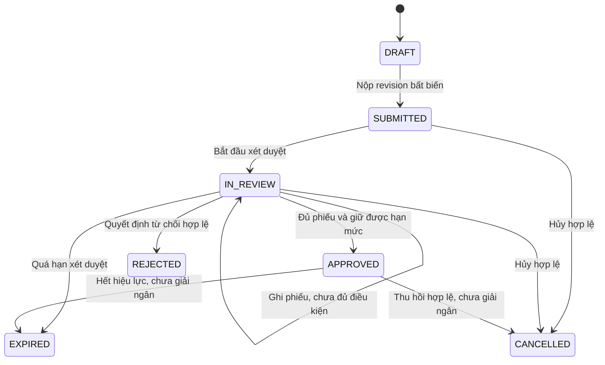

# Credit approval: bảo vệ quy trình phê duyệt tín dụng

## 1. Phê duyệt là một quyết định nghiệp vụ có điều kiện

Trong chương **Credit Rules** của module **SECURITY_APPLICATION_SECURITY_BUSINESS_LOGIC_SECURITY**, bài học này xem xét cách bảo vệ quy trình phê duyệt tín dụng khỏi lạm dụng logic. Trọng tâm là tính đúng đắn của hệ thống phần mềm: ai được quyết định, quyết định dựa trên dữ liệu nào, trạng thái nào cho phép quyết định và cách giữ các điều kiện đó khi có yêu cầu đồng thời hoặc gửi lại.

Một API `POST /credit-applications/{id}/approve` có thể xác thực người gọi và nhận JSON hợp lệ nhưng vẫn không an toàn. Người gọi có thể duyệt hồ sơ ngoài phạm vi quản lý, tự duyệt hồ sơ mình tạo, dùng quyết định đã lỗi thời hoặc chạy song song nhiều yêu cầu để vượt hạn mức.

Điểm cần bảo vệ không chỉ là trường `status = APPROVED`. Đó là quan hệ giữa **hồ sơ bất biến tại thời điểm xét duyệt, người có thẩm quyền, chính sách áp dụng, nguồn hạn mức và bằng chứng của quyết định**.

Các mức tiền, số người duyệt và điều kiện trong bài chỉ minh họa quy tắc của một sản phẩm giả định. Đây không phải tiêu chí đánh giá tín dụng hay quy định pháp lý để áp dụng cho một tổ chức thực tế.

Sau bài học, người học có thể:

- Biểu diễn quy trình phê duyệt bằng state machine và business invariants.
- Kiểm tra quyền trên từng hồ sơ và tách trách nhiệm lập, duyệt, giải ngân.
- Ràng buộc quyết định với đúng phiên bản dữ liệu và chính sách.
- Dùng transaction, khóa và idempotency để ngăn vượt hạn mức, duyệt trùng.
- Thiết kế kiểm thử tấn công vào trình tự, dữ liệu, quyền và thời điểm xử lý.

## 2. Tình huống: hai hồ sơ đều có vẻ hợp lệ

Giả sử khách hàng có hạn mức nội bộ `100.000.000 VND`, dư nợ đã sử dụng `30.000.000 VND` và chưa có khoản giữ chỗ. Hai hồ sơ A và B cùng xin `50.000.000 VND`.

Nếu từng yêu cầu chỉ đọc dữ liệu rồi kiểm tra độc lập:

```text
Yêu cầu A: còn 70 triệu → đủ cho 50 triệu → duyệt.
Yêu cầu B: còn 70 triệu → đủ cho 50 triệu → duyệt.
Kết quả: 30 + 50 + 50 = 130 triệu, vượt hạn mức 100 triệu.
```

Không có truy vấn SQL bị chèn mã và không có chữ ký token nào bị giả mạo. Lỗ hổng nằm ở việc một điều kiện nghiệp vụ được kiểm tra trên dữ liệu chưa được bảo vệ trước thay đổi đồng thời.

Một lỗi khác có thể xảy ra ngay cả khi chỉ có một người dùng:

1. Nhân viên xem hồ sơ xin `20.000.000 VND` ở phiên bản 7.
2. Một đường cập nhật khác sửa số tiền thành `80.000.000 VND`.
3. Nhân viên bấm duyệt trên màn hình cũ.
4. Backend duyệt hồ sơ hiện tại mà không kiểm tra phiên bản đã được xem.

Khi đó hệ thống ghi nhận sự đồng ý cho một nội dung mà người duyệt chưa thực sự xem. Vì vậy, kiểm soát đồng thời phải bao gồm cả **phiên bản hồ sơ** và **nguồn lực dùng chung giữa các hồ sơ**.

## 3. Xác định dữ liệu và ranh giới tin cậy

Một mô hình tối thiểu có thể gồm:

| Thành phần | Vai trò trong quyết định |
| --- | --- |
| `CreditApplication` | Hồ sơ, khách hàng, tổ chức, đơn vị phụ trách, trạng thái và phiên bản điều khiển đồng thời |
| `SubmittedRevision` | Bản nội dung đã nộp: số tiền, tiền tệ, kỳ hạn, sản phẩm, tài liệu và các điều khoản cần phê duyệt |
| `ApprovalPolicy` | Quy tắc thẩm quyền, điều kiện xét duyệt, số người duyệt và thời hạn hiệu lực |
| `ApprovalVote` | Ý kiến của một người duyệt trên một revision và ngữ cảnh chính sách cụ thể |
| `CreditLimit` | Hạn mức, dư nợ sử dụng và tổng giữ chỗ trong cùng phạm vi khách hàng, tiền tệ |
| `LimitReservation` | Phần hạn mức được giữ cho một quyết định đã hoàn tất phê duyệt |
| `Decision` | Kết quả cuối cùng và bằng chứng đi kèm |
| `IdempotencyRecord` | Dấu vết xử lý một lệnh để trả lại cùng kết quả khi gửi lại |
| `OutboxEvent` | Sự kiện được lưu cùng transaction để các hệ thống khác nhận sau commit |

Phải phân biệt `revision` với `version`:

- `revision` định danh nội dung nghiệp vụ đã nộp. Nội dung revision đã nộp phải bất biến.
- `version` thay đổi khi aggregate hồ sơ thay đổi, chẳng hạn nhận thêm phiếu duyệt hoặc chuyển trạng thái. Nó giúp phát hiện màn hình hay yêu cầu đã cũ.

Frontend có thể gửi `applicationId`, `expectedVersion`, `expectedRevision`, lựa chọn duyệt và khóa idempotency. Backend phải tự lấy số tiền, khách hàng, tổ chức, phạm vi xử lý và người lập từ dữ liệu có thẩm quyền.

Không nhận các giá trị như sau làm căn cứ quyết định:

```json
{
  "approvedAmount": 20000000,
  "isEligible": true,
  "requiredApprovals": 1,
  "approverRole": "SENIOR_APPROVER",
  "createdBy": "another-user"
}
```

Nếu nghiệp vụ cho phép phê duyệt một số tiền khác số tiền đề nghị, phải mô hình hóa rõ phần đề xuất và các điều khoản được duyệt. Những người duyệt tiếp theo phải cùng phê duyệt một bộ điều khoản bất biến; không được âm thầm sửa số tiền trong lúc gom chữ ký.

## 4. Viết invariants trước khi viết endpoint

Invariant là điều kiện hệ thống phải duy trì qua mọi đường thay đổi dữ liệu, gồm API công khai, công cụ quản trị, xử lý hàng loạt và tác vụ nền.

| Mã | Điều kiện cần giữ | Cách triển khai điển hình |
| --- | --- | --- |
| I1 | Chỉ trạng thái cho phép mới nhận phiếu duyệt | State machine và kiểm tra trong transaction |
| I2 | Người duyệt có quyền với đúng hồ sơ, sản phẩm, đơn vị và mức tiền | Kiểm tra quyền theo đối tượng bằng dữ liệu phía server |
| I3 | Người lập không tự duyệt; một người không được tính thành nhiều người duyệt | So sánh danh tính cá nhân chuẩn hóa, kiểm tra tách nhiệm vụ |
| I4 | Mỗi phiếu duyệt gắn với một revision và ngữ cảnh chính sách xác định | Bản nộp bất biến, lưu định danh và dấu vết đầu vào |
| I5 | Tổng dư nợ sử dụng và giữ chỗ không vượt hạn mức được kiểm soát | Khóa nguồn hạn mức chung và cập nhật nguyên tử |
| I6 | Mỗi revision chỉ có một quyết định cuối cùng | Khóa hồ sơ và unique constraint cho quyết định |
| I7 | Gửi lại cùng lệnh không tạo thêm phiếu, quyết định hay giữ chỗ | Idempotency kết hợp ràng buộc dữ liệu |
| I8 | Quyết định, giữ chỗ, audit và sự kiện tương ứng cùng tồn tại hoặc cùng rollback | Transaction và transactional outbox |
| I9 | Giải ngân chỉ tiêu thụ một phê duyệt còn hiệu lực và đúng điều khoản | Kiểm tra tại dịch vụ giải ngân, không chỉ tại giao diện duyệt |

Với mô hình đơn giản trong bài:

```text
available = limit - used - reserved

0 <= used
0 <= reserved
used + reserved <= limit

Khi phê duyệt cuối cùng số tiền X:
    reserved' = reserved + X
    used' = used

Khi giải ngân X từ khoản đã giữ:
    reserved' = reserved - X
    used' = used + X
```

Số tiền phải dùng kiểu số chính xác như số nguyên theo đơn vị nhỏ nhất hoặc kiểu thập phân với scale cố định. Cấm số âm, số không nếu sản phẩm không cho phép, tiền tệ không khớp và giá trị ngoài miền hỗ trợ. Không dùng `float` hoặc `double` cho phép tính hạn mức.

Nếu một hạn mức tổng bao phủ nhiều tiền tệ, sản phẩm hoặc pháp nhân, công thức trên chưa đủ. Hệ thống cần quy tắc quy đổi và phạm vi cộng gộp rõ ràng, đồng thời bảo vệ nguồn hạn mức tổng đó. Khóa theo từng loại tiền không tự ngăn được vượt hạn mức tổng đa tiền tệ.

## 5. Dùng state machine để chặn bỏ qua bước

Một quy trình minh họa:



Trong ví dụ này, `APPROVED` nghĩa là quyết định phê duyệt đã hoàn tất và có khoản giữ chỗ hiệu lực. Nó chưa có nghĩa tiền đã được giải ngân. Trạng thái của khoản giải ngân và vòng đời khoản vay nên được mô hình hóa riêng.

Mỗi mũi tên phải có điều kiện và người được thực hiện. Một endpoint tổng quát nhận `{"status":"APPROVED"}` thường làm mất ngữ nghĩa của lệnh và dễ bỏ qua kiểm tra. Nên dùng các lệnh rõ nghĩa như `submit`, `start-review`, `record-approval`, `reject`, `cancel`.

Những điểm cần chốt trong state machine:

- Không được duyệt trực tiếp từ `DRAFT`, `CANCELLED`, `REJECTED` hoặc `EXPIRED`.
- Trong thời gian xét duyệt, dữ liệu của revision đã nộp không được sửa tại chỗ.
- Muốn thay đổi điều khoản phải hủy hoặc kết thúc lượt xét duyệt cũ rồi tạo revision mới theo quy trình. Phiếu cũ không tự chuyển sang revision mới.
- Phiếu đầu tiên chưa đủ điều kiện chỉ giữ trạng thái `IN_REVIEW`; không phát sự kiện phê duyệt cuối cùng.
- Sau khi giải ngân, không được chuyển phê duyệt thành hủy để giải phóng hạn mức đã tiêu thụ. Phải xử lý theo vòng đời dư nợ tương ứng.

Nếu giải ngân và tác vụ hết hạn chạy cùng lúc, cả hai phải phối hợp trên cùng bản ghi phê duyệt hoặc reservation. Chỉ một bên được chuyển khoản giữ chỗ đang hoạt động thành đã tiêu thụ hoặc đã giải phóng.

## 6. Quyền duyệt phải gắn với đối tượng và trách nhiệm

### 6.1. Vai trò chỉ là một phần của điều kiện

`hasRole("CREDIT_APPROVER")` không đủ để quyết định một hồ sơ cụ thể. Một người có vai trò này vẫn có thể không được duyệt vì:

- Hồ sơ thuộc tổ chức, chi nhánh hoặc danh mục khách hàng khác.
- Sản phẩm nằm ngoài phạm vi được giao.
- Số tiền vượt mức thẩm quyền của người đó.
- Người đó chính là người lập hồ sơ hoặc thuộc quan hệ bị cấm tự phê duyệt.
- Quyền đã bị thu hồi hoặc ủy quyền đã hết hiệu lực.
- Hồ sơ cần một người duyệt thuộc cấp khác hoặc một bộ phận kiểm soát riêng.

Lấy `tenantId`, `branchId` và thông tin người lập từ bản ghi đã xác thực. Không dùng `tenantId` trong request body để xác lập quyền. Việc tìm hồ sơ trong đúng tenant nên là một phần của truy vấn và vẫn cần kiểm tra các điều kiện còn lại.

Danh sách công việc có thể giúp người dùng tìm hồ sơ nhưng không thay thế kiểm tra quyền khi ghi quyết định. Việc đoán được ID hoặc từng xem được hồ sơ không tạo ra quyền duyệt.

### 6.2. Maker-checker và nhiều người duyệt

Maker-checker yêu cầu người tạo hoặc chuẩn bị hồ sơ không được tự thực hiện phần kiểm tra độc lập. Với quy tắc cần hai người duyệt:

```text
makerPrincipal != approver1Principal
makerPrincipal != approver2Principal
approver1Principal != approver2Principal
```

Ở đây `principal` đại diện cho danh tính cá nhân ổn định. Nếu một người có hai tài khoản hoặc hai vai trò, hệ thống không được tính họ thành hai người độc lập. Cơ chế ủy quyền cũng phải lưu người thực hiện và người được đại diện; chính sách phải chỉ rõ các quan hệ nào không đáp ứng yêu cầu độc lập.

Không chỉ đếm `COUNT(votes) >= 2`. Cần kiểm tra từng phiếu còn hiệu lực, cùng revision, cùng ngữ cảnh quyết định, người duyệt khác nhau và đúng nhóm thẩm quyền được yêu cầu. Khi chính sách yêu cầu hai nhóm khác nhau, hai người trong cùng nhóm không thể thay thế nhau chỉ vì đủ số lượng.

Một quyền quản trị hệ thống rộng cũng không tự động là quyền phê duyệt nghiệp vụ. Nếu cần ngoại lệ, thiết kế lệnh ngoại lệ riêng, yêu cầu thẩm quyền và bằng chứng rõ ràng; không thêm cờ `skipApprovalChecks` vào endpoint thông thường.

## 7. Ràng buộc quyết định với dữ liệu đã được xem

Một phiếu duyệt có thể lưu các trường như:

```text
application_id, submitted_revision_id, decision_context_id
actor_id, human_principal_id, acting_for_id
outcome, reason_code, decided_at
policy_version, evidence_snapshot_id
```

`decision_context_id` định danh tập điều khoản và chính sách dùng để xét duyệt. Nếu cần lưu hash để phát hiện sai khác, phải xác định cách chuẩn hóa dữ liệu trước khi băm. Hash không thay thế bản dữ liệu gốc, quyền truy cập hay kiểm soát thay đổi.

Request ghi phiếu nên mang `expectedVersion` và `expectedRevision` do giao diện vừa đọc. Backend so sánh chúng với trạng thái đang bị khóa. Nếu không còn khớp, dừng lệnh và yêu cầu tải lại dữ liệu; không tự đổi yêu cầu thành duyệt phiên bản mới.

### 7.1. Chính sách nào có hiệu lực khi quyết định?

Phải quy định rõ chính sách được chốt tại lúc nộp hay phải theo phiên bản hiện hành khi duyệt. Một lựa chọn minh họa trong bài:

1. Mỗi lượt xét duyệt gắn với một phiên bản chính sách bất biến.
2. Một bản ghi điều khiển quyết định phiên bản đó còn được phép dùng để ra quyết định mới hay đã bị vô hiệu hóa.
3. Nếu thay đổi bắt buộc yêu cầu xét duyệt lại, hệ thống tạo ngữ cảnh mới và vô hiệu các phiếu cũ đối với lượt quyết định mới.

Việc lưu `policy_version` chỉ phục vụ truy vết nếu backend không thực sự thực thi nội dung của phiên bản đó. Cũng không được bỏ qua một chặn nghiệp vụ đang có hiệu lực chỉ vì hồ sơ đã dùng phiên bản cũ.

### 7.2. Kiểm tra phải có ranh giới nhất quán

TOCTOU xảy ra khi kiểm tra một điều kiện rồi sử dụng kết quả sau khi điều kiện đã thay đổi. Ví dụ: đọc khách hàng chưa bị khóa ở ngoài transaction, sau đó phê duyệt dù khách hàng vừa bị khóa trước lúc commit.

Đối với dữ liệu nội bộ cần bảo đảm đến thời điểm commit, đường duyệt và đường thay đổi dữ liệu đó phải phối hợp bằng khóa, kiểm tra phiên bản có tính nguyên tử hoặc mức cô lập thích hợp. Trong thiết kế dùng khóa, các bản ghi kiểm soát chính sách, quyền và điều kiện khách hàng được bảo vệ cùng các bản ghi ra quyết định; đường thu hồi quyền hay đặt chặn phải dùng giao thức khóa tương ứng.

Đọc lại dữ liệu nhiều lần nhưng không có cơ chế phối hợp vẫn có khe thời gian giữa lần đọc cuối và commit. Cần xác định điểm tuần tự hóa: một thao tác thu hồi quyền có hiệu lực trước thì phải chặn quyết định sau nó; nếu quyết định đã commit trước thì audit phải thể hiện đúng thứ tự đó.

Với dữ liệu từ dịch vụ bên ngoài, transaction cục bộ không thể giữ cho thế giới bên ngoài bất biến. Có thể thu thập trước một snapshot hoặc chứng thư có phiên bản và thời hạn rồi xác minh lại độ mới trong transaction. Nếu chính sách yêu cầu một bảo đảm mạnh hơn, phải có giao thức được dịch vụ nguồn hỗ trợ. Lỗi hoặc hết hạn bằng chứng không được tự biến thành kết quả đủ điều kiện.

## 8. Transaction: hoàn tất quyết định và giữ hạn mức cùng nhau

### 8.1. Khóa đúng nguồn lực dùng chung

Chỉ khóa hàng `CreditApplication` ngăn hai request cùng thay đổi một hồ sơ. Nó chưa ngăn hai hồ sơ khác nhau tiêu thụ cùng nguồn hạn mức.

Với hạn mức theo `(tenant_id, customer_id, currency)`, mọi thao tác làm thay đổi hạn mức, dư nợ hoặc giữ chỗ phải phối hợp trên cùng bản ghi hạn mức của phạm vi đó. Nếu một thao tác liên quan nhiều hạn mức, phải khóa đầy đủ theo thứ tự xác định.

Ví dụ thứ tự khóa chung cho các đường nghiệp vụ có giao nhau:

```text
Bản ghi kiểm soát chính sách/quyền/khách hàng
    → Hạn mức theo khóa đã sắp xếp
    → Hồ sơ theo ID đã sắp xếp
    → Phiếu và reservation liên quan
```

Đây là lựa chọn thiết kế minh họa; mọi đường duyệt, hủy, giải ngân, hết hạn và điều chỉnh hạn mức phải thống nhất thứ tự phù hợp. Có thể đọc trước định danh để xác định hàng cần khóa, nhưng sau khi khóa vẫn phải kiểm tra hồ sơ thuộc đúng nguồn hạn mức đó. Không đổi khách hàng hoặc tiền tệ của revision đã nộp.

### 8.2. Luồng xử lý minh họa

Đoạn sau là **mã giả Java**, mô tả ranh giới transaction và các điều kiện; các hàm là hợp đồng nghiệp vụ, không phải API thư viện có sẵn:

```java
DecisionResponse recordApproval(Actor actor, ApproveCommand command) {
    return transactions.required(() -> {
        // Chỉ một transaction được sở hữu khóa này trong phạm vi đã định.
        var key = idempotency.claimOrLock(
            actor.tenantId(), actor.id(), "RECORD_CREDIT_APPROVAL",
            command.idempotencyKey());
        key.requireSameFingerprint(fingerprint(command));

        // Vẫn kiểm tra quyền truy cập khi trả lại kết quả đã hoàn tất.
        if (key.isCompleted()) {
            authorization.requireReceiptAccess(actor, key.resourceId());
            return key.savedResponse();
        }

        var routing = applications.readRoutingInTenant(
            actor.tenantId(), command.applicationId());
        var context = controls.lockDecisionContext(actor, routing);
        var limit = limits.lock(routing.limitKey());
        var app = applications.lock(routing.applicationId());

        app.requireSameRouting(routing);
        app.requireState(IN_REVIEW);
        app.requireVersion(command.expectedVersion());
        app.requireRevision(command.expectedRevision());

        var revision = revisions.loadImmutable(app.submittedRevisionId());
        context.requireActiveAndFreshAtDecisionTime();
        authorization.requireCanApprove(actor, app, revision, context);
        segregation.requireIndependentHuman(actor, app);
        eligibility.requireSatisfied(revision, context);
        votes.requireNoVoteBySameHuman(app, context, actor.humanId());

        votes.insertApproval(app, context, actor);
        if (!approvalPlan.isSatisfied(app, context)) {
            app.incrementVersion();
            audit.appendVoteRecorded(app, actor, context);
            return key.complete(DecisionResponse.voteRecorded(app));
        }

        // Chỉ lần đủ điều kiện cuối cùng mới giữ hạn mức.
        limit.reserveOrThrow(revision.amount(), revision.currency());
        reservations.insertUniqueActive(app, revision);
        var decision = decisions.insertUniqueApproval(app, context);
        app.markApprovedAndIncrementVersion(decision.id());
        audit.appendApproved(app, actor, decision);
        outbox.appendApproved(decision);
        return key.complete(DecisionResponse.approved(app, decision));
    });
}
```

Các hợp đồng quan trọng của ví dụ:

- `claimOrLock` dùng unique constraint và cơ chế chờ hoặc khóa tương ứng. Kiểm tra khóa có tồn tại rồi mới chèn mà không có ràng buộc duy nhất vẫn bị race condition.
- `lockDecisionContext` phải bảo vệ các điều kiện nội bộ cần giữ nhất quán, không chỉ trả về dữ liệu đã đọc từ cache.
- `approvalPlan.isSatisfied` kiểm tra toàn bộ tổ hợp phiếu hợp lệ theo chính sách, gồm tính độc lập và ngữ cảnh, không chỉ đếm phiếu.
- `reserveOrThrow` kiểm tra và cập nhật nguồn hạn mức trong cùng transaction.
- Mọi ghi dữ liệu trong ví dụ dùng cùng transaction cục bộ. Nếu giữ hạn mức thất bại, phiếu vừa ghi trong lần gọi này cũng rollback.

Ví dụ chọn rollback cả phiếu cuối khi không giữ được hạn mức. Những phiếu đã commit từ trước vẫn tồn tại, nhưng hồ sơ tiếp tục `IN_REVIEW`. Nếu sản phẩm cần lưu sự đồng ý dù chưa có hạn mức, phải tạo trạng thái chờ riêng và cấm giải ngân từ trạng thái đó.

### 8.3. Cập nhật hạn mức có điều kiện

Một lớp bảo vệ có thể là câu lệnh SQL tương đương sau, chạy trong transaction đang xử lý quyết định:

```sql
UPDATE credit_limit
SET reserved = reserved + :amount,
    version = version + 1
WHERE tenant_id = :tenant_id
  AND customer_id = :customer_id
  AND currency = :currency
  AND :amount > 0
  AND limit_amount - used - reserved >= :amount;
```

Phải yêu cầu số hàng cập nhật bằng **1**. Nếu bằng 0, không tiếp tục tạo quyết định `APPROVED`; rollback hoặc trả lỗi nghiệp vụ theo hợp đồng. Câu lệnh này chưa thay thế các kiểm tra trạng thái, quyền, revision và tính duy nhất của quyết định.

Trong ví dụ hai hồ sơ xin 50 triệu, transaction đầu giữ 50 triệu, khiến phần còn lại thành 20 triệu. Transaction sau phải thấy kết quả đó và thất bại khi xin thêm 50 triệu. Chọn mức cô lập và cơ chế retry phù hợp với cơ sở dữ liệu; không giả định mọi cơ sở dữ liệu xử lý khóa và tranh chấp giống nhau.

### 8.4. Ràng buộc ở tầng dữ liệu

Một số ràng buộc hữu ích:

```text
Decision:
    UNIQUE(application_id, submitted_revision_id)

ApprovalVote:
    UNIQUE(application_id, submitted_revision_id,
           decision_context_id, human_principal_id)

LimitReservation:
    UNIQUE(decision_id)

IdempotencyRecord:
    UNIQUE(tenant_id, actor_id, operation, idempotency_key)
```

Các khóa trên giả định ID hồ sơ và ID quyết định duy nhất toàn hệ thống. Nếu ID chỉ duy nhất trong từng tenant, phải thêm `tenant_id` vào khóa và quan hệ tham chiếu tương ứng.

Thêm các check constraint cho miền số tiền, `used >= 0`, `reserved >= 0` và giới hạn tổng nếu mô hình dữ liệu cho phép. Không dùng check constraint trên một hàng để giả vờ bảo vệ tổng của nhiều hàng. Các bất biến liên quan nhiều hồ sơ vẫn cần transaction và nguồn lực đồng bộ dùng chung.

Nếu kiến trúc cho phép hạn mức giảm xuống dưới dư nợ hiện tại, phải có mô hình trạng thái vượt hạn mức riêng và quy tắc chặn cấp thêm. Không thể vừa cho phép hành vi đó vừa tuyên bố `used + reserved <= limit` luôn đúng.

## 9. Idempotency: gửi lại không tạo thêm quyết định

Mất phản hồi không có nghĩa thao tác thất bại. Server có thể commit xong nhưng kết nối bị ngắt trước khi client nhận kết quả.

Ví dụ request:

```http
POST /credit-applications/app-482/approval-votes
Idempotency-Key: 29be2fa3-917f-4d80-8d57-996e4be9c6d3
Content-Type: application/json

{
  "expectedVersion": 12,
  "expectedRevision": 3,
  "outcome": "APPROVE",
  "reasonCode": "CONDITIONS_MET"
}
```

Khóa được đặt trong phạm vi tenant, người gọi và loại lệnh. Fingerprint phải bao gồm ID hồ sơ, revision, version mong đợi và những trường ảnh hưởng đến ý nghĩa quyết định, được chuẩn hóa theo cách nhất quán.

| Tình huống | Hành vi cần có |
| --- | --- |
| Cùng khóa, cùng payload, lần trước đã commit | Sau kiểm tra quyền truy cập hiện tại, trả lại kết quả đã lưu |
| Cùng khóa, payload khác | Từ chối vì xung đột khóa; không thực hiện lệnh mới |
| Hai request cùng khóa đến đồng thời | Chỉ một request sở hữu lượt thực thi; request kia chờ hoặc nhận trạng thái đang xử lý theo hợp đồng |
| Lần trước rollback hoàn toàn | Không có hiệu ứng đã commit; có thể thử lại theo hợp đồng retry |
| Khóa khác nhưng cùng một người duyệt cùng revision | Ràng buộc phiếu và chính sách vẫn ngăn tính thêm phiếu |
| Khóa khác sau khi hồ sơ đã được duyệt | Kiểm tra trạng thái và unique decision ngăn tạo quyết định mới |

Tra cứu kết quả idempotent đã hoàn tất phải diễn ra trước kiểm tra version của một lệnh mới. Nếu đã commit rồi mà lần gửi lại vẫn kiểm tra version cũ trước, client có thể nhận xung đột dù thao tác ban đầu đã thành công.

Không coi khóa idempotency là quyền truy cập. Kẻ biết khóa vẫn phải được xác thực và có quyền xem biên nhận tương ứng. Nếu quyền đã bị thu hồi, hệ thống có thể từ chối trả nội dung; tính idempotent vẫn yêu cầu không thực hiện lại hiệu ứng nghiệp vụ.

Idempotency cũng không thay thế bảo vệ ở tầng dữ liệu. Bản ghi khóa có thể hết thời hạn lưu, nhưng quyết định và reservation không được tạo lại chỉ vì khóa cũ đã bị dọn. Cần quy tắc lưu trữ và xử lý retry lâu ngày phù hợp với vòng đời hồ sơ.

## 10. Phê duyệt, thông báo và giải ngân

### 10.1. Không phát sự kiện trước khi commit

Nếu gửi `CreditApproved` ra message broker trước khi transaction commit, bên nhận có thể bắt đầu giải ngân trong khi transaction sau đó rollback. Nếu commit rồi mới gửi mà không có outbox, tiến trình có thể chết giữa hai bước và mất sự kiện.

Transactional outbox lưu sự kiện cùng transaction với quyết định và giữ hạn mức. Worker gửi sự kiện sau commit, có thể gửi lại khi lỗi. Bên nhận phải khử trùng theo `eventId` hoặc định danh quyết định phù hợp; outbox không tự bảo đảm thông điệp chỉ được giao một lần.

Chỉ phát `CreditApproved` khi có quyết định cuối. Sự kiện về phiếu duyệt trung gian cần tên và hợp đồng riêng, tránh để bên nhận hiểu nhầm một phiếu là quyết định cuối cùng.

### 10.2. Giải ngân phải kiểm tra lại điều kiện của chính nó

Trước khi giải ngân, dịch vụ phải xác nhận:

- Quyết định đúng khách hàng, revision, số tiền, tiền tệ và điều khoản được phép.
- Phê duyệt chưa hết hạn, chưa bị thu hồi và không bị tiêu thụ quá phạm vi cho phép.
- Reservation đang hoạt động và thuộc đúng quyết định.
- Các điều kiện bắt buộc tại lúc giải ngân vẫn đáp ứng theo chính sách sản phẩm.

Với ví dụ giải ngân một lần toàn bộ, chuyển `reserved → used` và đánh dấu reservation đã tiêu thụ phải nguyên tử. Với giải ngân từng phần, cần theo dõi số tiền còn được rút và khử trùng từng lần rút; một cờ boolean `disbursed` là không đủ.

Nếu hạn mức và quyết định nằm ở hai dịch vụ hoặc hai cơ sở dữ liệu, không thể bao chúng trong transaction cục bộ như mã giả ở trên. Một hướng thiết kế là tạo reservation có token và thời hạn bằng lệnh idempotent, sau đó hoàn tất quyết định bằng giao thức phục hồi rõ ràng. Có thể cần trạng thái `PENDING_RESERVATION`; chỉ công bố `APPROVED` khi điều kiện cam kết đã được đáp ứng.

Khi timeout ở dịch vụ giữ hạn mức, phải tra cứu kết quả theo định danh lệnh thay vì mặc định rằng giữ chỗ chưa xảy ra. Cơ chế bù hoặc hết hạn reservation phải tránh giải phóng một khoản mà quyết định hoặc giải ngân đang sử dụng.

## 11. Các đường tấn công logic thường gặp

| Cách lạm dụng | Sai sót trong hệ thống | Kiểm soát cần có |
| --- | --- | --- |
| Đổi ID thành hồ sơ của chi nhánh khác | Chỉ kiểm tra vai trò chung | Quyền theo đối tượng và phạm vi dữ liệu |
| Gọi endpoint duyệt khi chưa nộp hồ sơ | Chỉ ẩn nút trên giao diện | Kiểm tra transition ở backend |
| Chèn `status`, `approvedAmount`, `requiredApprovals` vào payload | Mass assignment lên entity | DTO lệnh giới hạn trường và dữ liệu có thẩm quyền từ server |
| Duyệt hồ sơ do chính mình lập | So sánh thiếu người lập hoặc bỏ qua tài khoản phụ | Tách nhiệm vụ theo danh tính chuẩn hóa |
| Gửi hai phiếu bằng hai vai trò của cùng người | Đếm vai trò hoặc số hàng phiếu | Người duyệt độc lập và unique theo principal |
| Sửa số tiền sau khi người duyệt đã xem | Quyết định không gắn revision | Bản nộp bất biến và kiểm tra version |
| Chạy song song nhiều hồ sơ để vượt hạn mức | Mỗi hồ sơ tự kiểm tra phần còn lại | Khóa hoặc cập nhật nguyên tử trên hạn mức chung |
| Chia nhỏ yêu cầu để né cấp duyệt cao hơn | Chính sách chỉ xem từng hồ sơ | Nếu chính sách yêu cầu cộng gộp, kiểm tra cả nhóm nghĩa vụ liên quan |
| Gửi lại sau timeout để nhận nhiều giữ chỗ | Không khử trùng và thiếu unique constraint | Idempotency cùng ràng buộc quyết định, reservation |
| Hủy phê duyệt đồng thời với giải ngân | Hai đường cùng cho mình quyền dùng reservation | Chuyển trạng thái reservation có điều kiện và nguyên tử |
| Dùng công cụ quản trị để đổi trạng thái trực tiếp | Đường nội bộ bỏ qua service nghiệp vụ | Dùng chung lệnh nghiệp vụ và giới hạn quyền sửa dữ liệu |

Đối với hành vi chia nhỏ hồ sơ, không thể tự giả định mọi khoản của một khách hàng phải được cộng vào cùng một ngưỡng duyệt. Phải xác định quy tắc nhóm theo sản phẩm, nghĩa vụ, thời gian hoặc quan hệ liên quan từ chính sách thực tế, rồi bảo vệ phép cộng gộp tương ứng.

## 12. Kiểm thử theo hành vi tấn công

Kiểm thử cần xác nhận dữ liệu sau xử lý, không chỉ mã HTTP. Một response lỗi vẫn có thể đi kèm phiếu đã lưu hoặc giữ chỗ bị rò rỉ nếu ranh giới transaction sai.

### 12.1. Quyền, trình tự và tính toàn vẹn

| Kịch bản | Kết quả cần xác nhận |
| --- | --- |
| Người duyệt đúng vai trò nhưng sai tenant hoặc chi nhánh | Không ghi phiếu, quyết định hay reservation; không lộ dữ liệu ngoài quyền |
| Người lập duyệt qua tài khoản phụ cùng danh tính | Không được tính là người duyệt độc lập |
| Duyệt từ `DRAFT`, `CANCELLED`, `REJECTED` hoặc `EXPIRED` | Không chuyển trạng thái, không giữ hạn mức |
| Gửi thêm `approvedAmount` hoặc `requiredApprovals` | Không thay đổi điều khoản hay kế hoạch duyệt do server xác định |
| Duyệt với revision hoặc version đã cũ | Không tự duyệt dữ liệu mới; yêu cầu tải lại |
| Thay đổi chính sách làm mất hiệu lực ngữ cảnh cũ | Không sử dụng phiếu cũ để hoàn tất quyết định mới |
| Bằng chứng bắt buộc hết hạn hoặc không lấy được | Không mặc định đủ điều kiện |
| Chỉ có phiếu đầu trong kế hoạch hai người | Vẫn `IN_REVIEW`, không có quyết định hoặc sự kiện phê duyệt cuối |
| Hai người cùng nhóm trong khi cần hai nhóm khác nhau | Không đạt kế hoạch duyệt |

### 12.2. Đồng thời, retry và rollback

**Thử nghiệm hạn mức dùng chung:**

```text
Given:
    limit = 100, used = 30, reserved = 0
    A và B cùng nguồn hạn mức, mỗi hồ sơ xin 50
    Cả hai đều đủ điều kiện khác để hoàn tất phê duyệt

When:
    Hai transaction bắt đầu cạnh tranh tại bước giữ hạn mức

Then:
    Chỉ một hồ sơ được APPROVED
    used = 30, reserved = 50
    Chỉ một reservation mới và một quyết định phê duyệt cuối
    used + reserved <= limit
```

Dùng barrier hoặc cơ chế điều phối để ép hai transaction thực sự cạnh tranh; không dựa vào `sleep` ngẫu nhiên. Chạy trên cơ sở dữ liệu mục tiêu hoặc môi trường có ngữ nghĩa transaction tương ứng, vì mock repository không chứng minh được hành vi khóa.

Các trường hợp cần bổ sung:

- Hai request cùng khóa idempotency tạo đúng một hiệu ứng và trả cùng biên nhận đã commit theo hợp đồng.
- Cùng khóa nhưng đổi hồ sơ hoặc đổi nội dung trả xung đột, không ghi thêm dữ liệu.
- Hai khóa khác nhau từ cùng một người không tạo hai phiếu hợp lệ.
- Giả lập mất kết nối sau commit rồi gửi lại: trả kết quả cũ, không tăng `reserved` lần nữa.
- Gây lỗi sau khi giữ hạn mức nhưng trước khi ghi outbox: toàn bộ lần xử lý rollback, không còn reservation mồ côi.
- Hai người duyệt đồng thời cùng `expectedVersion`: một lệnh có thể nhận xung đột; sau khi tải lại và gửi một lệnh mới, hệ thống vẫn chỉ hoàn tất quyết định một lần.
- Thu hồi quyền hoặc đặt chặn khách hàng cạnh tranh với phê duyệt: kết quả tuân theo điểm tuần tự hóa đã thiết kế.
- Giải ngân cạnh tranh với hết hạn: reservation chỉ được tiêu thụ hoặc giải phóng một lần, không vừa chuyển thành dư nợ vừa hoàn trả khả dụng.
- Outbox gửi lại cùng sự kiện: bên nhận không giải ngân hay tạo nghĩa vụ hai lần.

Với mô hình phức tạp, có thể sinh chuỗi lệnh hợp lệ và bất hợp lệ như nộp, duyệt, duyệt lại, hủy, hết hạn, giải ngân. Sau mỗi chuỗi, đối chiếu invariant về số quyết định, tính hợp lệ của phiếu và phương trình hạn mức.

## 13. Audit và khả năng giải thích quyết định

Một quyết định phải có đủ bằng chứng để trả lời: ai thực hiện, trên hồ sơ nào, bản nội dung nào, theo chính sách nào, dựa trên bằng chứng gì và đã làm thay đổi hạn mức ra sao.

Audit nên ghi định danh quyết định, revision, ngữ cảnh, actor thực tế, danh tính chuẩn hóa, quan hệ ủy quyền nếu có, thời gian do server tạo, lý do, trạng thái trước/sau, reservation liên quan và correlation ID. Tránh đưa toàn bộ hồ sơ nhạy cảm hoặc token xác thực vào log vận hành.

Audit nghiệp vụ của thao tác thành công phải commit cùng quyết định. Sự kiện từ chối vì sai quyền hoặc điều kiện có thể cần kênh nhật ký bảo mật riêng để không biến mất cùng transaction rollback; kênh này không được tạo tác dụng phụ phê duyệt.

Giới hạn quyền sửa/xóa audit, theo dõi truy cập và áp dụng cơ chế lưu trữ phù hợp với yêu cầu hệ thống. Một dòng log ghi “approved” không chứng minh rằng quyết định đã thực sự commit.

Các tín hiệu vận hành hữu ích gồm số lần xung đột version, yêu cầu duyệt chéo phạm vi, tự duyệt bị chặn, tái sử dụng khóa với payload khác, reservation quá hạn và chênh lệch giữa tổng reservation chi tiết với bộ đếm hạn mức. Nếu đối soát phát hiện lệch, cần có quy trình khôi phục bằng lệnh có kiểm soát; không tự sửa `reserved = 0` để làm sạch cảnh báo.

## 14. Tự kiểm tra thiết kế

Trước khi coi luồng phê duyệt đã đủ an toàn, hãy trả lời được:

1. Endpoint đang thực thi một lệnh nghiệp vụ hay chỉ thay giá trị `status`?
2. Người duyệt có quyền với hồ sơ cụ thể và độc lập với người lập không?
3. Có chứng minh được người duyệt đã chấp thuận đúng revision và điều khoản không?
4. Khi có nhiều phiếu, tất cả có cùng ngữ cảnh còn hiệu lực và đáp ứng đúng tổ hợp thẩm quyền không?
5. Hai hồ sơ khác nhau có tranh chấp trên cùng nguồn hạn mức được bảo vệ không?
6. Nếu mất phản hồi sau commit, gửi lại có trả đúng kết quả mà không giữ thêm hạn mức không?
7. Nếu lỗi ở bất kỳ bước ghi nào, quyết định, reservation, audit và outbox có cùng rollback không?
8. Khi hủy, hết hạn và giải ngân chạy đồng thời, ai có quyền chuyển reservation và cơ chế nào bảo đảm chỉ một kết quả?

Một quy trình phê duyệt đáng tin cậy phải duy trì các điều kiện này trên mọi đường ghi dữ liệu. Giao diện xác nhận, xác thực đăng nhập và kiểm tra vai trò chỉ hỗ trợ một phần; tính đúng đắn cuối cùng nằm ở mô hình trạng thái, quyền theo đối tượng, dữ liệu bất biến và cơ chế commit nhất quán.
