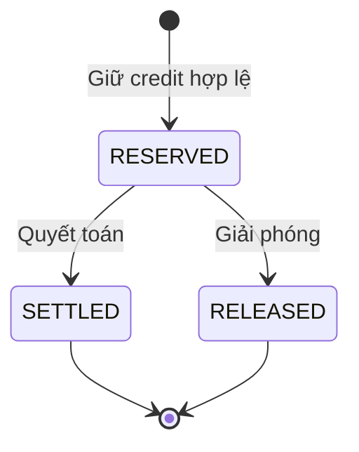

# Credit ledger audit — Kiểm toán sổ biến động credit

## 1. Vì sao cần kiểm toán credit ledger?

**Credit ledger** là sổ ghi các biến động quyền sử dụng của tài khoản: được cấp credit, giữ chỗ cho công việc, tiêu thụ, giải phóng, hoàn lại, hết hạn hoặc điều chỉnh. **Credit ledger audit** là quá trình kiểm tra xem các biến động đó có đầy đủ, nhất quán và hợp lệ theo quy tắc nghiệp vụ hay không.

Credit trong bài này là đơn vị quyền sử dụng của ứng dụng. Nó có thể dùng để chạy tác vụ, tạo báo cáo hoặc gọi một dịch vụ; không mặc nhiên là tiền hay hạn mức vay. Dù có quy đổi thành tiền hay không, credit vẫn là tài sản nghiệp vụ cần kiểm soát.

Trong chương **Credit Rules** của module `SECURITY_APPLICATION_SECURITY_BUSINESS_LOGIC_SECURITY`, kiểm toán ledger phục vụ việc phát hiện và điều tra lạm dụng logic: sửa giá, bỏ qua phê duyệt, ghi nợ tài khoản không có quyền, xử lý sai trạng thái và tạo nhiều hiệu lực từ một yêu cầu trùng.

Một tài khoản có số dư khớp với ledger chưa chắc đã đúng. Nếu hệ thống ghi nhận hai lần hoàn credit trái phép và đồng thời cộng số dư cả hai lần, phép đối soát số học vẫn khớp. Muốn phát hiện lỗi, phải kiểm tra thêm giới hạn hoàn, giao dịch gốc và quyền thực hiện.

Sau bài học, bạn có thể:

- Phân biệt kiểm tra số học với kiểm tra tính hợp lệ của nghiệp vụ.
- Xác định dữ liệu và bằng chứng cần lưu để kiểm toán một lần biến động.
- Thiết kế đối soát số dư, reservation, sự kiện tính phí và quyền theo đối tượng.
- Phát hiện các dấu hiệu thu trùng, hoàn vượt, sửa lịch sử hoặc thiếu bút toán.
- Xử lý sai lệch bằng quy trình có thể truy vết, không che mất nguyên nhân gốc.

## 2. Phân biệt ledger, số dư và audit log

| Thành phần | Trách nhiệm chính | Điều chưa thể tự chứng minh |
|---|---|---|
| Ledger | Ghi biến động credit có cấu trúc và tham chiếu nghiệp vụ | Biến động đó được cấp quyền hoặc áp dụng đúng giá |
| Số dư tổng hợp | Trả lời nhanh hiện còn bao nhiêu credit | Lịch sử tạo ra số dư và căn cứ của từng lần thay đổi |
| Reservation | Ghi ngân sách đang dành cho công việc | Công việc đã phát sinh bao nhiêu usage hợp lệ |
| Audit log bảo mật | Ghi ai yêu cầu, ai thực thi, quyết định quyền và lý do | Tính đầy đủ của bút toán và phép đối soát số dư |
| Usage/job record | Ghi công việc và lượng sử dụng | Credit đã được quyết toán đúng một lần hay chưa |

Ledger không nên chỉ là dòng log dạng văn bản như `user spent credits`. Dòng đó thiếu đơn vị, số lượng chính xác, tài khoản, mã thao tác và quan hệ với nghiệp vụ gốc.

Ngược lại, một bảng ledger có đủ số lượng nhưng không có thông tin người thực hiện, nguồn sự kiện hoặc phê duyệt sẽ hạn chế khả năng điều tra. Kiểm toán cần nối các loại bằng chứng qua mã định danh ổn định.

Điểm bắt đầu tốt là một câu hỏi cụ thể: **Vì sao tài khoản A giảm 24 credit lúc này, theo quyền nào, dựa trên giá và lượng dùng nào, và đã có lần xử lý nào khác cho cùng nghĩa vụ tính phí chưa?**

## 3. Chốt mô hình kế toán credit trước khi đối soát

### 3.1. Mô hình tối giản dùng trong bài

Bài học dùng hai số dư:

```text
available: credit còn có thể dùng cho yêu cầu mới
reserved:  credit đang dành cho công việc chưa kết thúc nghĩa vụ tính phí
```

Mỗi bút toán có hai biến động có dấu:

```text
delta_available
delta_reserved
```

Giả sử tài khoản bắt đầu từ 0 và mọi số dư đầu kỳ đều được ghi bằng bút toán mở sổ, số dư tái dựng là:

```text
reconstructed_available = SUM(delta_available)
reconstructed_reserved  = SUM(delta_reserved)
```

Nếu chỉ đối soát một kỳ, phải bắt đầu từ số dư mở kỳ đã được xác minh rồi cộng các bút toán trong kỳ. Không cộng riêng lịch sử tháng hiện tại và so với số dư tích lũy từ nhiều tháng.

### 3.2. Quy tắc biến động theo loại thao tác

Các ký hiệu `q`, `r`, `c`, `f`, `e` dưới đây đều không âm; các thao tác cần lượng dương phải kiểm tra thêm điều kiện đó.

| Thao tác | Điều kiện chính | `delta_available` | `delta_reserved` |
|---|---|---:|---:|
| `GRANT` | Có nguồn cấp hợp lệ, lượng `q > 0` | `+q` | `0` |
| `RESERVE` | Đủ số dư để giữ `r > 0` | `-r` | `+r` |
| `SETTLE` | Reservation được phép kết thúc, thu `0 <= c <= r` | `r - c` | `-r` |
| `RELEASE` | Được phép giải phóng toàn bộ phần giữ `r` | `+r` | `-r` |
| `REFUND` | Hoàn `f > 0` từ lần thu gốc còn được hoàn | `+f` | `0` |
| `EXPIRE` | Nguồn credit hợp lệ đã hết hạn, thu hồi `e > 0` | `-e` | `0` |
| `ADJUST` | Có lý do và quyền điều chỉnh tương ứng | Theo nghiệp vụ được duyệt | Theo nghiệp vụ được duyệt |

Đây là mô hình giữ chỗ rồi quyết toán toàn bộ reservation. Nếu sản phẩm quyết toán nhiều phần, bổ sung giữ chỗ hoặc chuyển credit giữa tài khoản, cần định nghĩa thêm loại thao tác và bất biến riêng. Không ép dữ liệu của mô hình khác vào bảng trên.

Ở thao tác `SETTLE`, `r` là số đang được giữ ngay trước khi kết thúc, không phải tùy ý lấy lại giá trị dự toán ban đầu nếu reservation đã được thay đổi hợp lệ.

### 3.3. Không cộng các đơn vị khác nhau

Mọi phép đối soát phải có ít nhất các chiều phù hợp:

```text
tenant_id + account_id + credit_unit
```

Nếu credit bị giới hạn theo lô, chương trình khuyến mại hoặc tính năng, phải kiểm tra cả các chiều đó. Một tài khoản có 50 credit chạy báo cáo và 50 credit gửi thông báo không đồng nghĩa có 100 credit dùng tùy ý cho mọi tác vụ.

Phép cộng toàn hệ thống có thể che sai lệch: tài khoản A bị trừ thừa 10, tài khoản B được cộng thừa 10 thì tổng vẫn không đổi. Kiểm toán phải bắt đầu từ đối tượng chịu tác động, sau đó mới tổng hợp.

### 3.4. Tiêu thụ gộp và tiêu thụ ròng

Trong mô hình này, lượng tiêu thụ gộp lấy từ các thao tác `SETTLE`; lượng hoàn lấy riêng từ `REFUND`. Tiêu thụ ròng có thể được tính là:

```text
net_consumption = gross_settled_credits - refunded_credits
```

Lần hoàn không xóa lần thu gốc. Không vừa giảm số tiêu thụ gộp vừa trừ lượng hoàn trong cùng báo cáo, vì như vậy sẽ tính hoàn hai lần. Chính sách báo cáo theo thời gian phát sinh hay thời gian ghi nhận cũng phải được công bố rõ.

## 4. Dữ liệu cần có để kiểm toán được một thao tác

### 4.1. Phân biệt operation với ledger entry

Một **operation** đại diện cho ý nghĩa nghiệp vụ, chẳng hạn quyết toán job J. Một operation có thể tạo nhiều **ledger entry** nếu phải phân bổ qua nhiều lô credit hoặc nhiều tài khoản.

Vì vậy, thấy hai hàng ledger có cùng `operation_id` chưa đủ kết luận thu trùng. Cần kiểm tra chúng là các dòng phân bổ hợp lệ hay hai lần tạo cùng một dòng.

Một mô hình tham khảo:

```text
credit_operation
  tenant_id
  operation_id
  operation_kind
  business_event_id
  original_operation_id
  reservation_id
  quantity
  credit_unit
  request_fingerprint
  actor_id
  executed_by
  authorization_ref
  approval_ref
  pricing_version
  usage_ref
  reason_code
  recorded_at
  effective_at

credit_ledger_entry
  tenant_id
  entry_id
  operation_id
  line_no
  account_id
  credit_unit
  source_lot_id
  account_version
  delta_available
  delta_reserved
```

Không phải trường nào cũng có giá trị cho mọi loại thao tác. Ví dụ `original_operation_id` cần cho hoàn credit, còn `pricing_version` hữu ích cho quyết toán. Các trường bắt buộc nên được xác định theo `operation_kind`, tránh một cấu trúc cho phép mọi tham chiếu quan trọng đều rỗng.

### 4.2. Bằng chứng và các ranh giới tin cậy

| Bằng chứng | Câu hỏi kiểm toán | Lưu ý |
|---|---|---|
| `actor_id`, `executed_by` | Ai khởi tạo và dịch vụ nào thực thi? | Worker xử lý thay người dùng cần giữ cả hai danh tính |
| `authorization_ref` | Quyết định quyền dựa trên quan hệ nào? | Không suy ra quyền lịch sử chỉ từ vai trò hiện tại |
| `approval_ref` | Bước phê duyệt bắt buộc đã hoàn thành chưa? | Phải gắn đúng đối tượng, lượng và phạm vi được duyệt |
| `pricing_version` | Quy tắc tính giá nào đã được chốt? | Chỉ lưu tên phiên bản là chưa đủ nếu nội dung phiên bản bị ghi đè |
| `usage_ref` | Lượng dùng dựa trên nguồn nào? | Nguồn usage cần được xác thực và lưu theo hợp đồng sự kiện |
| `original_operation_id` | Đang hoàn hoặc sửa sai lần nào? | Phải kiểm tra cùng tenant, tài khoản và đơn vị phù hợp |
| `request_fingerprint` | Retry có giữ cùng ý nghĩa nghiệp vụ không? | Không thay thế kiểm tra quyền hoặc chống trùng theo sự kiện |

Mã phê duyệt không chứng minh tính hợp lệ nếu người gọi tự tạo được nó hoặc tái sử dụng phê duyệt dành cho thao tác khác. Tương tự, một chuỗi `usage_ref` không có bằng chứng nguồn chỉ là một trường văn bản.

Không cần lưu token truy cập, mật khẩu hay toàn bộ payload nhạy cảm để có khả năng kiểm toán. Hãy lưu dữ liệu tối thiểu cần thiết, tham chiếu ổn định và áp dụng quyền truy cập cùng chính sách lưu giữ phù hợp.

### 4.3. Hai loại thời gian

- `recorded_at`: thời điểm hệ thống ghi nhận operation.
- `effective_at`: thời điểm nghiệp vụ được quy định là có hiệu lực.

Một callback đến muộn có thể được ghi hôm nay nhưng phản ánh usage hôm qua. Báo cáo cần phân biệt hai thời điểm này, đồng thời chỉ cho nguồn có thẩm quyền xác lập thời gian hiệu lực. Không để client tự lùi ngày nhằm hưởng giá hoặc credit đã hết hạn.

## 5. Năm lớp kiểm toán cần phối hợp

### 5.1. Tính hợp lệ của cấu trúc

Kiểm tra trường bắt buộc, kiểu số, đơn vị, tham chiếu và các quan hệ giữa tenant. Ví dụ:

- Entry phải trỏ đến operation tồn tại và thuộc cùng tenant.
- Tài khoản và lô credit phải đúng quan hệ sở hữu.
- Số lượng không âm hoặc phải dương theo loại thao tác.
- Phép tính không bị tràn và không dùng độ chính xác khác nhau giữa các tầng.
- Loại operation chỉ được có những dạng delta đã định nghĩa.

Nếu dùng khóa ngoại, quan hệ đa tenant cần được mô hình hóa sao cho không thể liên kết nhầm tenant chỉ vì mã đối tượng có tồn tại.

### 5.2. Tính nhất quán số học

Tái dựng số dư từ ledger và so với bảng số dư tổng hợp. Đồng thời kiểm tra các điều kiện như số dư không âm trong mô hình không cho nợ.

Chỉ kiểm tra số dư cuối là chưa đủ. Tài khoản có thể từng âm 50 credit, sau đó được cấp thêm 100 và trở lại dương. Nếu quy tắc cấm nợ, cần kiểm tra cả số dư sau từng lần biến động theo thứ tự được hệ thống bảo đảm.

### 5.3. Tính hợp lệ của state machine

Đối chiếu các thao tác với vòng đời reservation:



Trong mô hình kết thúc một lần này:

- Một reservation không được vừa `SETTLED` vừa `RELEASED`.
- Không quyết toán lần nữa sau khi đã kết thúc.
- Hoàn sau quyết toán là operation mới tham chiếu lần thu gốc.
- Tổng phần còn giữ phải khớp với số dư `reserved` theo tài khoản và đơn vị.

Nếu có trạng thái chờ xác minh hết hạn hoặc hủy, cần đưa chúng vào mô hình thực tế. Kiểm toán không nên tự suy rằng quá hạn thời gian đồng nghĩa được phép hoàn toàn bộ.

### 5.4. Tính hợp lệ của nghĩa vụ tính phí

Kiểm tra operation có căn cứ thật và lượng thu đúng quy tắc:

```text
credit cần thu
  = hàm giá đã chốt(lượng dùng hợp lệ, đơn vị, điều kiện sản phẩm)
```

Các câu hỏi cần trả lời:

- Job có được chấp nhận hợp lệ trước khi thực thi không?
- Usage có thuộc job và nguồn thực thi được phép không?
- Giá, làm tròn, ưu đãi và mức trần có đúng phiên bản đã chốt không?
- Có nhiều operation thu cho cùng một sự kiện tính phí không?
- Tổng hoàn có vượt lượng còn được hoàn từ giao dịch gốc không?

Kiểm tra này phát hiện các sai phạm mà số dư và ledger vẫn khớp hoàn toàn.

### 5.5. Quyền và trình tự phê duyệt

Kiểm tra quyền tại thời điểm thao tác được chấp nhận, theo chính sách của hệ thống. Cần đủ bằng chứng về tenant, dự án, tài khoản trả phí, hạn mức và phê duyệt khi liên quan.

Việc người dùng hiện là quản trị viên không chứng minh họ có quyền khi đã thực hiện thao tác trước đó. Ngược lại, việc họ hiện bị thu hồi quyền không tự động làm mọi giao dịch quá khứ trở thành trái phép.

Với thao tác dịch vụ, cần kiểm tra cả quyền của dịch vụ thực thi và căn cứ nghiệp vụ mà nó đang thay mặt xử lý. Tài khoản worker có quyền cập nhật nhiều tenant không có nghĩa mọi message worker nhận đều hợp lệ.

## 6. Ví dụ: số dư khớp nhưng hoàn credit vượt mức

Một tài khoản có chuỗi sau:

| Bước | Thao tác | `delta_available` | `delta_reserved` | `available` sau bước | `reserved` sau bước |
|---|---|---:|---:|---:|---:|
| 1 | Cấp 100 | +100 | 0 | 100 | 0 |
| 2 | Giữ 40 cho job J | -40 | +40 | 60 | 40 |
| 3 | Quyết toán J, thực thu 30 | +10 | -40 | 70 | 0 |
| 4 | Hoàn 20 từ lần thu J | +20 | 0 | 90 | 0 |
| 5 | Lại hoàn 20 từ lần thu J | +20 | 0 | 110 | 0 |

Nếu hai lần hoàn đều được ghi vào ledger và cập nhật số dư đúng như bảng, đối soát số học trả về 110 và không thấy chênh lệch. Số dư cũng không âm.

Nhưng lần thu gốc chỉ là 30, còn tổng hoàn đã là 40. Bất biến bị vi phạm:

```text
SUM(refund.quantity cho lần thu gốc) <= refundable_amount của lần thu gốc
```

Trong ví dụ giả định toàn bộ 30 credit được phép hoàn, lần hoàn thứ hai chỉ còn tối đa 10 credit có thể hoàn. Nếu hai request cùng hoàn 20 chạy đồng thời, việc mỗi request tự đọc thấy đã hoàn 0 rồi chấp nhận là một lỗi cạnh tranh.

Cách phòng ngừa cần bảo vệ nguyên tử lượng còn được hoàn, không chỉ thêm một truy vấn kiểm tra. Retry cùng idempotency key phải trả lại kết quả cũ; các key khác nhau vẫn phải tuân thủ giới hạn tổng hoàn.

Nếu muốn tặng thêm 10 credit để hỗ trợ khách hàng, đó phải là một operation cấp hoặc điều chỉnh có quyền và lý do riêng. Không gắn nó như một lần hoàn giả để làm sai lịch sử.

## 7. Thiết kế ràng buộc để giảm sai lệch từ nguồn

Audit giúp phát hiện vấn đề, còn các ràng buộc giúp ngăn vấn đề xảy ra. Những ràng buộc tham khảo gồm:

```text
UNIQUE (tenant_id, operation_id)
UNIQUE (tenant_id, operation_id, line_no)
UNIQUE (tenant_id, account_id, credit_unit, account_version)
UNIQUE (tenant_id, operation_kind, business_event_id)
```

Ràng buộc cuối chỉ phù hợp khi mỗi cặp loại operation và sự kiện nghiệp vụ thực sự có tối đa một operation. Nếu một job có nhiều lần usage hợp lệ, cần mã sự kiện cho từng phần; không dùng duy nhất `job_id` để cấm mọi lần thu tiếp theo.

`business_event_id` phải được kiểm tra với nguồn sự kiện thật. Người gọi tự thay một mã mới không được phép biến cùng một nghĩa vụ thành một lần thu hoặc hoàn mới.

Đối với số phiên bản tài khoản trong ví dụ, giả sử mỗi ledger entry của một tài khoản và đơn vị được cấp một phiên bản kế tiếp dưới cùng cơ chế khóa, và số dư lưu phiên bản cuối đã áp dụng. Nếu triển khai dùng một phiên bản cho cả operation nhiều dòng, cần định nghĩa khóa và cách phát lại tương ứng, không áp dụng nguyên xi ràng buộc trên.

Không coi ID tự tăng hoặc timestamp là thứ tự commit đáng tin cậy. ID có thể bị bỏ trống vì rollback, còn transaction lấy ID trước chưa chắc commit trước. Chỉ kiểm tra tính liên tục khi hệ thống thực sự cam kết một chuỗi phiên bản không có khoảng trống cho các thay đổi đã commit.

Các cập nhật số dư, reservation, ledger, operation và dữ liệu chống trùng liên quan phải cùng transaction khi nằm trong cùng cơ sở dữ liệu. Nếu không, audit sẽ liên tục tìm thấy các trạng thái trung gian đáng lẽ phải được ngăn ngay từ thiết kế.

## 8. Đối soát trên một lát cắt dữ liệu nhất quán

### 8.1. Tránh cảnh báo giả khi hệ thống đang ghi

Giả sử tác vụ audit đọc bảng số dư trước một lần quyết toán, rồi đọc ledger sau khi quyết toán đã commit. Nó có thể kết luận lệch dù transaction ứng dụng hoạt động đúng.

Đối soát các bảng trong một cơ sở dữ liệu nên dùng một snapshot nhất quán theo khả năng và cấu hình của hệ quản trị. Cần kiểm chứng cơ chế đọc thực tế; nhiều truy vấn `SELECT` nối tiếp không tự động bảo đảm cùng một lát cắt.

Nếu dữ liệu nằm ở nhiều hệ thống hoặc kho phân tích có độ trễ, phải định nghĩa điểm cắt và trạng thái chờ. Một lựa chọn là dùng mốc xử lý đã được nguồn công bố là hoàn tất, kết hợp khoảng chờ và kiểm tra lại các trường hợp có dữ liệu đến muộn.

Không dùng đơn thuần `MAX(id)` hoặc thời gian client gửi làm bằng chứng mọi transaction trước mốc đã commit. Với dữ liệu nhiều nguồn, phát hiện có thể cần mang trạng thái `PENDING_EVIDENCE` trước khi chuyển thành sai lệch xác nhận.

### 8.2. Truy vấn đối soát số dư minh họa

SQL sau giả định:

- `credit_balance` có một hàng cho mỗi tenant, tài khoản và đơn vị.
- Mọi entry trong `credit_ledger_entry` đều là dữ liệu đã commit, không phải bản nháp.
- Sổ bắt đầu từ 0; số dư mở sổ cũng có entry.
- Hai phần dữ liệu được đọc trong cùng snapshot nhất quán.

```sql
WITH reconstructed AS (
    SELECT tenant_id, account_id, credit_unit,
           SUM(delta_available) AS expected_available,
           SUM(delta_reserved) AS expected_reserved
    FROM credit_ledger_entry
    GROUP BY tenant_id, account_id, credit_unit
)
SELECT b.tenant_id, b.account_id, b.credit_unit,
       b.available, b.reserved,
       COALESCE(r.expected_available, 0) AS expected_available,
       COALESCE(r.expected_reserved, 0) AS expected_reserved
FROM credit_balance b
LEFT JOIN reconstructed r
  ON r.tenant_id = b.tenant_id
 AND r.account_id = b.account_id
 AND r.credit_unit = b.credit_unit
WHERE b.available <> COALESCE(r.expected_available, 0)
   OR b.reserved <> COALESCE(r.expected_reserved, 0);
```

Truy vấn này chỉ kiểm tra các tài khoản đã có hàng số dư. Cần kiểm tra chiều ngược lại để phát hiện ledger không có projection:

```sql
SELECT DISTINCT l.tenant_id, l.account_id, l.credit_unit
FROM credit_ledger_entry l
LEFT JOIN credit_balance b
  ON b.tenant_id = l.tenant_id
 AND b.account_id = l.account_id
 AND b.credit_unit = l.credit_unit
WHERE b.account_id IS NULL;
```

Kiểu dữ liệu của `SUM` và giới hạn tổng tích lũy phải phù hợp hệ quản trị. Có thể cần kiểu tổng rộng hơn kiểu lưu từng biến động. Các truy vấn là minh họa ý tưởng, không thay thế việc kiểm chứng trên schema và cơ sở dữ liệu cụ thể.

### 8.3. Kiểm tra thứ tự lịch sử

Khi đã có `account_version` với quy tắc thứ tự rõ ràng, có thể tính số dư chạy dọc lịch sử:

```sql
WITH replay AS (
    SELECT tenant_id, account_id, credit_unit, account_version,
           SUM(delta_available) OVER (
               PARTITION BY tenant_id, account_id, credit_unit
               ORDER BY account_version
               ROWS BETWEEN UNBOUNDED PRECEDING AND CURRENT ROW
           ) AS available_after,
           SUM(delta_reserved) OVER (
               PARTITION BY tenant_id, account_id, credit_unit
               ORDER BY account_version
               ROWS BETWEEN UNBOUNDED PRECEDING AND CURRENT ROW
           ) AS reserved_after
    FROM credit_ledger_entry
)
SELECT *
FROM replay
WHERE available_after < 0 OR reserved_after < 0;
```

Truy vấn giả định chính sách không cho nợ và mỗi phiên bản xác định đúng một bước có thứ tự. Nếu cho nợ có hạn mức, thay kiểm tra `available_after < 0` bằng điều kiện thực tế, sử dụng cả bằng chứng hạn mức áp dụng tại thời điểm đó.

## 9. Đối soát hai chiều với nghiệp vụ

### 9.1. Từ ledger sang nguồn

Với mỗi operation, kiểm tra có căn cứ hợp lệ:

- `GRANT` có sự kiện cấp hoặc quyết định cấp được phép.
- `RESERVE` có công việc đã được chấp nhận và tài khoản trả phí phù hợp.
- `SETTLE` có reservation, usage và chính sách giá tương ứng.
- `REFUND` có lần thu gốc, quyền hoàn và lượng còn được hoàn.
- `EXPIRE` có lô credit, thời hạn và phần có thể thu hồi hợp lệ.
- `ADJUST` có lý do, người thực hiện và phê duyệt nếu chính sách yêu cầu.

Nếu chỉ kiểm tra ledger trỏ đến một ID có tồn tại, vẫn có thể bỏ sót việc ID thuộc tenant khác, thuộc loại nghiệp vụ khác hoặc chưa được duyệt.

### 9.2. Từ nguồn sang ledger

Chiều ngược lại giúp tìm những việc đáng lẽ phải ghi credit nhưng chưa được ghi:

- Job đã dùng tài nguyên nhưng không có reservation hoặc lần thu phù hợp.
- Sự kiện cấp credit đã được chấp nhận nhưng chưa có bút toán cấp.
- Reservation đã kết thúc nhưng vẫn còn credit giữ chỗ.
- Refund đã báo thành công cho người dùng nhưng không có biến động tương ứng.
- Outbox hoặc inbox đánh dấu xử lý xong trong khi operation credit chưa tồn tại.

Không mặc định mọi job `FAILED` đều phải được giải phóng toàn bộ. Một job lỗi có thể đã phát sinh phần sử dụng được phép tính phí. Kiểm toán phải áp dụng hợp đồng tính phí, không chỉ so tên trạng thái kỹ thuật.

### 9.3. Thu trùng và hoàn vượt

Nhóm kiểm tra thu trùng nên chạy trên bảng operation theo khóa nghĩa vụ nghiệp vụ, tránh đếm các dòng phân bổ ledger thành nhiều lần thu:

```sql
SELECT tenant_id, operation_kind, business_event_id, COUNT(*) AS operation_count
FROM credit_operation
WHERE operation_kind = 'SETTLE'
GROUP BY tenant_id, operation_kind, business_event_id
HAVING COUNT(*) > 1;
```

Truy vấn giả định mỗi sự kiện quyết toán chỉ được có một operation. Nếu schema có bản nháp, bị từ chối hoặc hủy, cần lọc đúng trạng thái tạo hiệu lực. Ràng buộc duy nhất ở đường ghi nên ngăn trường hợp này; audit vẫn hữu ích để phát hiện dữ liệu cũ hoặc thao tác ngoài đường chuẩn.

Với hoàn credit, đối chiếu tổng lượng hoàn đã tạo hiệu lực theo `original_operation_id` với lượng được hoàn. Giới hạn này có thể nhỏ hơn số đã thu nếu sản phẩm có phần không được hoàn, nhưng phải có chính sách rõ ràng và bằng chứng tương ứng.

Không lọc trùng chỉ bằng số lượng và thời gian gần nhau. Hai lần mua hợp lệ có thể cùng giá và diễn ra sát nhau; một lần thu trùng có thể đến sau nhiều giờ qua message phát lại.

## 10. Bảo vệ lịch sử và giới hạn của cơ chế chống sửa

### 10.1. Ghi thêm, hạn chế sửa và xóa

Đối với ledger đã tạo hiệu lực, ứng dụng nên ghi thêm bút toán mới thay vì sửa số lượng cũ. Quyền ghi ledger cần được giới hạn vào đường thực thi có kiểm soát; tài khoản đọc báo cáo không cần quyền cập nhật số dư.

Các lớp bảo vệ có thể gồm:

- Phân quyền cơ sở dữ liệu để giảm khả năng cập nhật hoặc xóa ledger tùy tiện.
- Tách quyền thao tác nghiệp vụ thông thường với điều chỉnh đặc biệt.
- Ghi nhận hoạt động quản trị và thay đổi quyền.
- Lưu bản sao hoặc checkpoint được bảo vệ độc lập với đường ghi chính.
- Kiểm tra backup, khôi phục và tính đầy đủ của dữ liệu kiểm toán.

Chỉ đặt tên bảng là `immutable_ledger` không làm dữ liệu bất biến. Cần biết những chủ thể nào thực sự có khả năng thay đổi nó, bao gồm quản trị cơ sở dữ liệu và công cụ bảo trì.

### 10.2. Hash chain phát hiện được gì?

Một cơ chế phát hiện sửa đổi có thể liên kết các entry:

```text
entry_hash = H(previous_hash || canonical_entry_payload)
```

Payload chuẩn hóa cần bao gồm các trường có ý nghĩa: phạm vi tài khoản, đơn vị, phiên bản, operation, các delta và định danh liên quan. Cách mã hóa phải có quy tắc rõ ràng, không nối chuỗi mơ hồ giữa các trường.

Hash chain có thể hỗ trợ phát hiện nội dung bị đổi so với một checkpoint đáng tin. Nhưng nếu kẻ tấn công sửa được toàn bộ chuỗi và checkpoint trong cùng miền quyền, họ có thể tính lại các hash. Nếu xóa phần đuôi mà không có mốc độc lập, một chuỗi còn lại vẫn có thể tự kiểm tra hợp lệ.

Do đó, checkpoint cần có cơ chế bảo vệ và vị trí lưu phù hợp với mô hình đe dọa. Ngay cả khi toàn vẹn mật mã được bảo đảm, một lần hoàn trái quyền được ghi ngay từ đầu vẫn có thể có hash hoàn toàn đúng. Kiểm toán quyền và nghiệp vụ vẫn cần thiết.

### 10.3. Không áp đặt cân bằng bằng 0 cho mọi loại ledger

Trong mô hình hai delta ở bài này, giữ chỗ có tổng delta bằng 0, nhưng cấp credit làm tổng tăng và tiêu thụ làm tổng giảm. Không kết luận sổ sai chỉ vì tổng các delta toàn hệ thống khác 0.

Nếu chọn mô hình sổ kép, phải định nghĩa đầy đủ tài khoản đối ứng và quy tắc cân bằng cho mỗi nhóm bút toán. Không pha trộn quy tắc của sổ kép với ledger biến động tài khoản rồi dùng một phép cộng chung để kiểm toán cả hai.

## 11. Quy trình kiểm toán và xử lý sai lệch

### 11.1. Chạy audit có phạm vi và bằng chứng

Một lần audit nên ghi nhận:

```text
audit_run_id
rule_version
scope: tenant, tài khoản, đơn vị, kỳ hoặc phiên bản dữ liệu
snapshot_or_cutoff_ref
started_at, completed_at
rules_executed
findings
```

Mỗi finding cần chỉ rõ bất biến bị vi phạm, các đối tượng liên quan, giá trị kỳ vọng và quan sát, bằng chứng nguồn, mức độ tác động và trạng thái xử lý.

Các trạng thái tham khảo:

```text
PENDING_EVIDENCE -> CONFIRMED -> REMEDIATING -> RESOLVED
                 -> DISMISSED_WITH_REASON
```

Một finding không nên bị đánh dấu giải quyết chỉ vì tác vụ audit không còn thấy nó sau khi dữ liệu bị xóa. Cần liên kết đến kết quả điều tra và biện pháp sửa có thể kiểm chứng.

### 11.2. Ưu tiên theo tác động

| Loại phát hiện | Tác động có thể có | Hướng xử lý ban đầu |
|---|---|---|
| Thu từ tenant hoặc tài khoản không được phép | Vi phạm quyền theo đối tượng | Hạn chế đường thao tác liên quan, bảo toàn bằng chứng và điều tra phạm vi |
| Thu trùng hoặc hoàn vượt | Sai quyền lợi và số dư | Chặn tái diễn, xác định operation gốc và các retry |
| Projection lệch ledger | Quyết định dùng credit có thể sai | Xác định nguồn sự thật và nguyên nhân cập nhật không nhất quán |
| Reservation treo | Credit bị giữ không có kết quả rõ ràng | Xác minh tình trạng thực thi trước khi giải phóng |
| Thiếu bằng chứng phê duyệt | Chưa chứng minh thao tác hợp lệ | Tra cứu nguồn phê duyệt, không tự suy diễn từ số dư khớp |
| Dữ liệu nguồn đến muộn | Có thể là độ trễ thay vì sai nghiệp vụ | Giữ trạng thái chờ và kiểm tra lại theo thời hạn đã định |

Biện pháp hạn chế phải có phạm vi phù hợp. Không khóa mọi tài khoản chỉ vì một cảnh báo chưa xác minh, nhưng cũng không tiếp tục cho tiêu thụ từ số dư đã biết không đáng tin nếu có thể gây thêm sai lệch.

### 11.3. Phân biệt sửa projection và bù nghiệp vụ

Hai trường hợp cần cách xử lý khác nhau:

1. **Ledger đúng, projection sai:** tái dựng projection từ nguồn đã xác minh bằng cơ chế bảo trì có kiểm soát. Không tạo credit mới để làm số dư khớp, vì như vậy sẽ thay đổi quyền lợi nghiệp vụ lần nữa.
2. **Operation nghiệp vụ sai:** ghi operation bù hoặc điều chỉnh có tham chiếu đến lần sai, quyền thực hiện và lý do. Không sửa hoặc xóa lần thu gốc để che mất lịch sử.

Việc phục hồi projection cần phối hợp với các cập nhật đang chạy, chẳng hạn kiểm tra phiên bản và chuyển đổi nguyên tử. Tính tổng ledger rồi ghi đè số dư trong lúc request khác đang giữ credit có thể tự tạo ra một lỗi mất cập nhật mới.

Một bút toán bù phải có mã thao tác ổn định và chống trùng. Nếu công cụ sửa sai bị retry, tài khoản không được nhận hai lần bù. Sau khi sửa cần chạy lại đúng các quy tắc liên quan và lưu bằng chứng kết quả; lịch sử vi phạm ban đầu vẫn được giữ cùng trạng thái đã khắc phục.

### 11.4. Không tự động hoàn tiền chỉ từ một phép lệch

Nếu projection thấp hơn ledger 20 credit, chưa thể kết luận phải cấp thêm 20. Có thể ledger bị ghi thừa, dữ liệu đọc lệch snapshot hoặc operation nguồn chưa được xác minh.

Chỉ tự động sửa khi đã phân loại rõ lỗi, có nguồn sự thật đáng tin và cơ chế sửa được phép. Những trường hợp khác cần được đưa vào quy trình điều tra có trách nhiệm, tránh biến tác vụ audit thành một đường cấp credit trái quyền.

## 12. Tình huống kiểm thử tấn công logic

Các tình huống dưới đây là thiết kế kiểm thử cho bài học, không phải kết quả chạy trên một hệ thống cụ thể. Cần quan sát số dư, operation, ledger, reservation và bằng chứng quyền sau mỗi ca.

| Tình huống | Điều kiện tạo ra | Kiểm tra mong đợi |
|---|---|---|
| Retry cùng key | Commit hoàn tất rồi làm mất response | Một operation có hiệu lực, trả lại kết quả cũ |
| Cùng nghiệp vụ, khác key | Phát lại cùng sự kiện tính phí với key mới | Không thu thêm cho cùng nghĩa vụ |
| Hai lần hoàn đồng thời | Hai request cùng xin hoàn vượt phần còn lại | Tổng hoàn không vượt giới hạn; kiểm tra và ghi nhận nguyên tử |
| Nhiều dòng hợp lệ | Một operation phân bổ qua hai lô credit | Không báo thu trùng chỉ vì có hai entry |
| Sửa giá phía client | Gửi giá thấp hơn chính sách | Operation sử dụng giá có thẩm quyền; audit tái tính ra cùng kết quả |
| Đổi tenant qua tham chiếu | Refund trỏ lần thu của tenant khác | Từ chối và không tạo hiệu lực trên cả hai tài khoản |
| Bỏ qua phê duyệt | Gọi thẳng đường điều chỉnh hoặc cấp credit | Chặn tại đường ghi; audit nhận diện nếu có dữ liệu lịch sử vi phạm |
| Lỗi giữa các bước ghi | Gây lỗi sau cập nhật số dư, trước entry | Rollback toàn bộ trong cùng transaction |
| Hủy chạy đua quyết toán | Hai thao tác tranh một reservation | Chỉ một kết thúc hợp lệ, không vừa giải phóng toàn bộ vừa thu |
| Số dư cuối dương nhưng từng âm | Tạo chuỗi tiêu trước, cấp sau trong dữ liệu kiểm thử | Replay phát hiện vi phạm lịch sử trong mô hình không cho nợ |
| Sửa ledger lịch sử | Thay delta trong môi trường kiểm thử được phép | Cơ chế toàn vẹn và đối soát liên quan phát hiện thay đổi |
| Đọc lệch thời điểm | Cho audit đọc giữa hai snapshot khác nhau | Kiểm tra thiết kế snapshot để tránh kết luận sai |
| Usage đến muộn | Trì hoãn callback hoặc bản sao dữ liệu | Finding chờ bằng chứng rồi được phân loại lại đúng |
| Công cụ bù bị retry | Gửi lại cùng thao tác sửa sai | Chỉ một lần bù, có liên kết tới finding và operation gốc |

Ca cạnh tranh nên đồng bộ các request tại bước quyết định để chúng thật sự chồng lấn. Với ràng buộc và snapshot, kiểm thử tích hợp trên hệ quản trị thực tế có ý nghĩa hơn mock repository luôn trả về kết quả tuần tự.

Ngoài ca cố định, có thể tạo chuỗi cấp, giữ, quyết toán, hoàn, hết hạn và retry ngẫu nhiên rồi kiểm tra sau mỗi bước: số dư hợp lệ, quan hệ nguồn đúng tenant, giới hạn hoàn được giữ, mỗi sự kiện chỉ có hiệu lực theo hợp đồng và replay khớp projection.

## 13. Bài tập điều tra một sai lệch

Một tài khoản thuộc tenant T có dữ liệu:

```text
O1 GRANT:   delta_available = +200, delta_reserved = 0
O2 RESERVE: delta_available = -80,  delta_reserved = +80
O3 SETTLE:  delta_available = +20,  delta_reserved = -80
O4 REFUND:  delta_available = +30,  delta_reserved = 0
O5 REFUND:  delta_available = +40,  delta_reserved = 0

O3 thực thu 60 credit.
O4 và O5 đều tham chiếu O3.
Projection hiện tại: available = 210, reserved = 0.
```

Giả sử toàn bộ lần thu O3 được phép hoàn nhưng không có khoản hỗ trợ bổ sung, hãy trả lời:

1. Projection có khớp tổng ledger không?
2. Bất biến nghiệp vụ nào bị vi phạm?
3. Cần bằng chứng nào để biết lỗi do retry, cạnh tranh hay thao tác trái quyền?
4. Có nên xóa O5 hoặc trực tiếp sửa số dư thành 200 không?
5. Làm sao bảo đảm việc sửa sai không bị thực hiện hai lần?

Phép tính cho thấy ledger tái dựng đúng 210 credit, nên đối soát projection đơn thuần không phát hiện vấn đề. Tổng hoàn là 70, vượt lần thu 60 đúng 10 credit.

Cần kiểm tra mã sự kiện hoàn, phạm vi và fingerprint của idempotency key, quyền người thực hiện, thời điểm và phiên bản xử lý lượng còn được hoàn. Hai request dùng key khác nhau vẫn có thể cùng vi phạm giới hạn nếu cơ chế kiểm tra không nguyên tử.

Không xóa O5 hoặc chỉnh số dư tùy tiện. Sau khi xác minh, lựa chọn khắc phục phải theo chính sách và quyền được cấp, có operation điều chỉnh hoặc bù tham chiếu finding cùng các operation liên quan. Việc thu hồi phần cấp thừa cũng cần xử lý trường hợp credit đã được dùng hoặc đang giữ chỗ; không cưỡng ép số dư âm ngoài chính sách chỉ để đạt một con số đẹp.

Mã sửa sai ổn định, ràng buộc chống trùng và transaction bảo vệ các thay đổi giúp retry công cụ không gây hiệu lực lần hai. Finding chỉ được giải quyết khi có bằng chứng biện pháp sửa đúng và đường gây lỗi đã được xử lý theo phạm vi yêu cầu.

## 14. Các câu hỏi cần trả lời trước khi đưa audit vào vận hành

- Định nghĩa từng loại credit, delta và thao tác có thống nhất giữa ứng dụng, báo cáo và tác vụ audit không?
- Số dư mở sổ hoặc mở kỳ có bằng chứng và mốc dữ liệu rõ ràng không?
- Mỗi lần thu, hoàn, cấp và điều chỉnh có mã nghiệp vụ ổn định cùng nguồn hợp lệ không?
- Một operation nhiều dòng có được phân biệt với nhiều operation trùng không?
- Quyền và phê duyệt tại thời điểm thực hiện có thể truy vết không?
- Reservation, usage, giá và ledger có thể đối chiếu hai chiều không?
- Đối soát có đọc cùng snapshot hoặc dùng cơ chế xử lý độ trễ được định nghĩa không?
- Ledger có được bảo vệ khỏi sửa tùy tiện, và bằng chứng toàn vẹn có nằm ngoài cùng một miền quyền khi cần không?
- Findings có chủ thể xử lý, bằng chứng, trạng thái và lịch sử sửa sai không?
- Công cụ phục hồi có quyền phù hợp, chống trùng và phối hợp an toàn với request đang chạy không?

Credit ledger audit đáng tin cậy khi nó nối được con số với nghĩa vụ nghiệp vụ và quyền thực hiện. Số dư khớp là một điều kiện cần kiểm tra; việc cấp, tiêu thụ hoặc hoàn credit có đúng căn cứ, đúng đối tượng và đúng số lần mới quyết định lịch sử đó có hợp lệ hay không.
