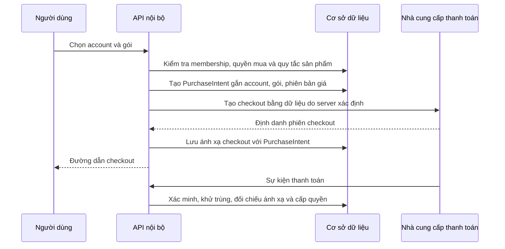
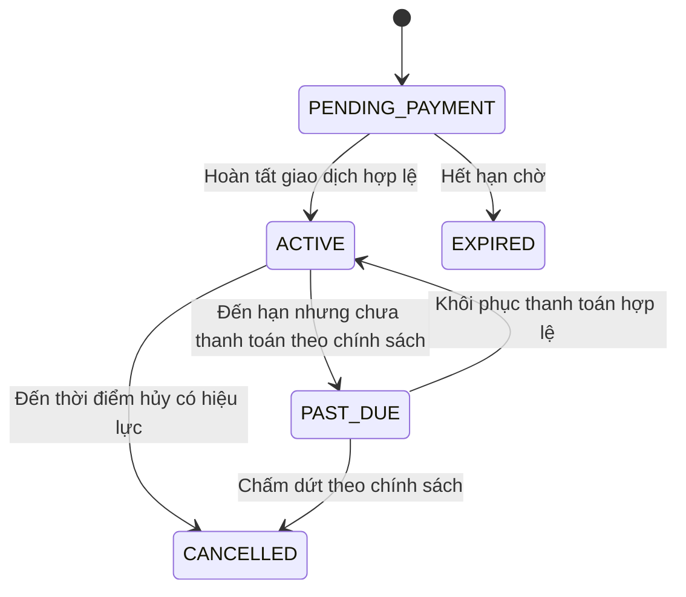

# Subscription ownership: bảo vệ quyền sở hữu thuê bao

## 1. Ai sở hữu thuê bao, ai trả tiền, ai được sử dụng?

Trong chương **Subscription Rules** của module **SECURITY_APPLICATION_SECURITY_BUSINESS_LOGIC_SECURITY**, bài học này tập trung vào quyền sở hữu thuê bao dưới góc nhìn bảo mật logic nghiệp vụ. Hệ thống phải ngăn việc chiếm thuê bao của tài khoản khác, tự gán quyền thanh toán, chuyển chủ không hợp lệ hoặc tiếp tục dùng quyền đã bị thu hồi.

Một thuê bao trả phí thường liên quan đến nhiều chủ thể:

- **Chủ sở hữu nghiệp vụ**: tài khoản cá nhân hoặc tổ chức mà thuê bao phục vụ.
- **Người quản trị**: người được phép thay đổi gói, số lượng chỗ ngồi, cách gia hạn hoặc cấu hình thanh toán.
- **Người thanh toán**: cá nhân hoặc tổ chức cung cấp phương thức trả tiền, có thể khác chủ sở hữu.
- **Người sử dụng**: thành viên nhận quyền dùng tính năng từ thuê bao.
- **Người tạo giao dịch**: người khởi tạo phiên mua hoặc gia hạn tại một thời điểm.

Các vai trò này có thể trùng nhau nhưng không được mặc định là một. Người biết mã thuê bao, nhận email hóa đơn hay trả tiền hộ không vì thế có quyền chuyển chủ, hủy dịch vụ hoặc đọc dữ liệu của tổ chức.

Ví dụ, công ty A mua 20 chỗ ngồi. Nhân viên Lan khởi tạo checkout bằng tài khoản công ty, còn bộ phận tài chính thanh toán. Thuê bao phải thuộc công ty A; việc Lan nghỉ việc không làm thuê bao tự chuyển thành tài sản của Lan hoặc mất chủ sở hữu.

Mục tiêu của bài là thiết kế các invariants, quyền theo đối tượng, state machine, transaction, idempotency và kiểm thử để bảo vệ quan hệ sở hữu này. Quy tắc thanh toán, thời gian ân hạn và chuyển nhượng dưới đây là lựa chọn minh họa của một sản phẩm, không phải quy tắc chung của mọi dịch vụ thuê bao.

## 2. Mô hình dữ liệu: sở hữu là một quan hệ được kiểm soát

Một cách mô hình hóa là dùng **Account** làm chủ thể nhận thuê bao. Account có thể đại diện cho cá nhân hoặc tổ chức. Trong hệ thống nhiều tenant, account thường nằm trong một tenant hoặc chính là ranh giới tenant; thiết kế phải xác định rõ quan hệ đó.

Ví dụ trong bài dùng mỗi account là một tenant nghiệp vụ:

```text
User ── Membership(role, status) ── Account
                                      │
                                      ├── Subscription
                                      │      ├── BillingCommand
                                      │      ├── Entitlement
                                      │      └── OwnershipHistory
                                      │
                                      └── BillingProfile
```

| Dữ liệu | Ý nghĩa bảo mật |
| --- | --- |
| `Account.id` | Chủ thể sở hữu ổn định, không phụ thuộc email hay người tạo |
| `Membership` | Quan hệ hiện tại giữa người dùng và account, gồm vai trò và trạng thái |
| `Subscription.owner_account_id` | Account duy nhất đang sở hữu thuê bao |
| `Subscription.created_by` | Người khởi tạo; chỉ là dấu vết lịch sử, không tự cấp quyền vĩnh viễn |
| `Subscription.ownership_version` | Phiên bản của quan hệ sở hữu, tăng khi chuyển chủ |
| `Subscription.version` | Phiên bản điều khiển đồng thời cho các thay đổi aggregate |
| `BillingProfile` | Ngữ cảnh thanh toán và tham chiếu khách hàng của nhà cung cấp |
| `ProviderMapping` | Ánh xạ ID bên ngoài sang thuê bao nội bộ, kèm môi trường và tài khoản nhà cung cấp |
| `Entitlement` | Quyền dùng dịch vụ được suy ra theo thuê bao, chủ sở hữu và chính sách |
| `OwnershipTransfer` | Yêu cầu chuyển chủ có người đề nghị, bên nhận, thời hạn và trạng thái |

`created_by`, địa chỉ email trên hóa đơn và `provider_customer_id` không được dùng thay `owner_account_id`. Chúng phục vụ những mục đích khác nhau và có thể thay đổi độc lập.

Với thuê bao cá nhân, vẫn có thể dùng personal account làm chủ thể sở hữu. Cách này giúp tránh phải đổi toàn bộ ý nghĩa trường sở hữu khi sau này hỗ trợ tổ chức hoặc nhiều người dùng.

### 2.1. Quan hệ dữ liệu cũng phải giữ đúng phạm vi

Một bảng phân bổ chỗ ngồi cần chứng minh người được cấp ghế thuộc đúng account của thuê bao. Nếu membership được định danh bằng `(account_id, user_id)`, có thể dùng khóa ngoại tổng hợp để giữ quan hệ này trong phạm vi account.

Khóa ngoại không tự kiểm tra được membership còn hoạt động hay vai trò hiện tại. Các điều kiện đó vẫn cần kiểm tra tại lệnh cấp ghế và tại thời điểm sử dụng quyền nếu chính sách yêu cầu.

Không đặt unique constraint chỉ trên `owner_account_id` nếu sản phẩm cho phép một account có nhiều thuê bao. Nếu quy tắc là một thuê bao đang hiệu lực cho mỗi account và mỗi sản phẩm, phải ràng buộc đúng tổ hợp cùng tập trạng thái được coi là đang hiệu lực. Trạng thái của nhà cung cấp và trạng thái nội bộ cần được ánh xạ rõ ràng trước khi thiết kế ràng buộc.

## 3. Các invariants cần bảo vệ

| Mã | Điều kiện nghiệp vụ | Nguy cơ khi bị phá vỡ |
| --- | --- | --- |
| O1 | Mỗi thuê bao có đúng một account sở hữu tại một thời điểm | Hai bên cùng kiểm soát hoặc thuê bao mất chủ |
| O2 | Mọi lệnh quản trị phải kiểm tra quyền trên account đang sở hữu thuê bao | IDOR/BOLA, sửa hoặc hủy thuê bao của người khác |
| O3 | Trường sở hữu chỉ đổi qua quy trình chuyển chủ được phép | Mass assignment hoặc tự nhận thuê bao |
| O4 | Quyền sử dụng chỉ được cấp cho đúng phạm vi và người nhận hợp lệ | Dùng gói trả phí của tenant khác |
| O5 | Thay đổi thành viên không làm đổi chủ sở hữu account của thuê bao | Người rời tổ chức mang theo quyền hoặc dịch vụ bị mất |
| O6 | Ánh xạ giao dịch thanh toán sang chủ thể nội bộ phải được tạo và kiểm chứng phía server | Chiếm giao dịch của người khác để nhận dịch vụ |
| O7 | Chuyển chủ không làm hai account đồng thời có quyền từ cùng một entitlement độc quyền | Nhân đôi dịch vụ hoặc rò rỉ dữ liệu |
| O8 | Lệnh gửi lại và sự kiện trùng không tạo thêm thuê bao, chuyển chủ hay cấp quyền lần nữa | Lặp hiệu ứng khi timeout hoặc retry |
| O9 | Mọi thay đổi quan trọng có trạng thái, phiên bản và audit phù hợp | Không xác định được ai đã thay đổi quyền |

Điều kiện cơ bản cho một lệnh quản trị có thể viết:

```text
canManage(actor, subscription, action) =
    actor đã được xác thực
    AND membership(actor, subscription.owner_account_id) đang hoạt động
    AND vai trò của membership cho phép action
    AND trạng thái thuê bao cho phép action
    AND không có chặn nghiệp vụ liên quan đến action
```

Một nhánh hỗ trợ nội bộ hoặc tài khoản dịch vụ cần chính sách riêng với phạm vi và bằng chứng cụ thể. Không thay biểu thức trên bằng `isAdmin || isOwner` nếu `isAdmin` chỉ là một vai trò rộng nhưng chưa quy định được quyền can thiệp vào account khách hàng.

## 4. Phân biệt quyền quản trị và quyền sử dụng

### 4.1. Ma trận quyền minh họa

| Hành động | Account owner | Billing admin | Member | Billing viewer |
| --- | --- | --- | --- | --- |
| Dùng tính năng theo ghế đã cấp | Theo entitlement | Theo entitlement | Theo entitlement | Theo entitlement |
| Xem thông tin gói trong phạm vi được phép | Có | Có | Giới hạn | Có |
| Xem hóa đơn | Có | Có | Không | Có |
| Đổi gói hoặc số ghế | Có | Có | Không | Không |
| Yêu cầu hủy gia hạn | Có | Có | Không | Không |
| Đề nghị chuyển thuê bao sang account khác | Có | Không | Không | Không |
| Chuyển vai trò account owner cho người khác trong cùng account | Theo quy trình quản trị account | Không | Không | Không |

Đây là một chính sách ví dụ. Sản phẩm có thể phân quyền khác, nhưng backend phải diễn đạt được từng hành động. Quyền xem hóa đơn không suy ra quyền thay đổi gói; quyền quản trị thanh toán cũng không tự suy ra quyền đọc mọi dữ liệu nghiệp vụ.

`Account owner` trong bảng là vai trò của một thành viên, còn `owner_account_id` là quan hệ sở hữu của thuê bao. Khi vai trò account owner được bàn giao từ Lan sang Minh trong cùng công ty, `owner_account_id` không đổi.

### 4.2. Kiểm tra đối tượng trong mọi đường truy cập

Các đường đọc và ghi đều phải có kiểm tra phạm vi:

```http
GET  /accounts/{accountId}/subscriptions/{subscriptionId}
POST /accounts/{accountId}/subscriptions/{subscriptionId}/cancel-renewal
POST /accounts/{accountId}/subscriptions/{subscriptionId}/change-plan
GET  /accounts/{accountId}/invoices/{invoiceId}/download
```

`accountId` trong URL chỉ là dữ liệu yêu cầu. Server phải kiểm tra người gọi là thành viên có quyền của account đó, đồng thời thuê bao hoặc hóa đơn thực sự thuộc phạm vi được phép.

Không chỉ bảo vệ endpoint chi tiết rồi để lộ cùng dữ liệu qua tìm kiếm, export, GraphQL node, URL tải file hoặc billing portal. Đường tạo phiên billing portal cũng phải lấy customer của đúng account từ ánh xạ nội bộ, không nhận tùy ý `provider_customer_id` từ client.

UUID khó đoán giúp giảm khả năng dò tìm nhưng không thay thế quyền theo đối tượng. Một ID có thể xuất hiện trong lịch sử trình duyệt, log, đường dẫn hỗ trợ hoặc lời mời chia sẻ.

## 5. Gắn chủ sở hữu đúng ngay từ khi tạo thuê bao

### 5.1. Luồng checkout an toàn



Account mua có thể được người dùng chọn, nhưng quyền mua cho account đó phải được xác minh. Server chọn gói, giá và customer từ dữ liệu đã kiểm soát; không tin các trường do client gửi như `ownerId`, `isPaid`, `planPrice` hoặc `entitlementLevel`.

Một `PurchaseIntent` nên ràng buộc ít nhất:

- Account nhận dịch vụ và người khởi tạo.
- Sản phẩm, gói, số ghế, tiền tệ và phiên bản giá theo quy tắc đã chọn.
- Định danh checkout bên ngoài và trạng thái xử lý nội bộ.
- Thời hạn hoặc điều kiện hoàn tất nếu chính sách yêu cầu.
- Khóa chống tạo trùng theo phạm vi nghiệp vụ.

Nếu lệnh tạo checkout bên ngoài timeout, tra cứu hoặc retry bằng định danh lệnh ổn định mà nhà cung cấp hỗ trợ. Không liên tục tạo các checkout không liên quan rồi hy vọng chỉ một giao dịch được thanh toán.

### 5.2. Không nhận thuê bao qua trang trả về

Trang `success?session_id=...` là một tín hiệu điều hướng, không phải bằng chứng sở hữu hoặc thanh toán. Người dùng có thể tự mở URL hoặc dán ID giao dịch của người khác.

Backend không được thực hiện logic như:

```text
Lấy session_id từ URL
→ tìm thấy đã thanh toán
→ gán subscription.owner = người đang đăng nhập
```

Phiên checkout phải được đối chiếu với `PurchaseIntent` đã gắn account từ trước. Đăng nhập bằng người dùng khác khi mở trang thành công không làm thay đổi chủ sở hữu đã xác định.

Email người trả tiền cũng không phải khóa nhận thuê bao. Email có thể được sửa, dùng chung, khác email đăng nhập hoặc được một bộ phận thanh toán hộ.

Nếu membership của người khởi tạo bị thu hồi trong lúc thanh toán, cần một quy tắc hoàn tất rõ ràng. Giao dịch không được tự chuyển sang account cá nhân của người đó. Tùy chính sách, có thể tiếp tục hoàn tất cho account đã ghi nhận hoặc đưa vào trạng thái chờ xử lý; quyền quản trị của người đã rời account vẫn phải bị thu hồi.

## 6. Thực thi lệnh quản trị ở backend

### 6.1. Tránh cập nhật entity trực tiếp từ payload

Đoạn mã sau minh họa một lỗi thiết kế:

```java
// Không an toàn: có entity không có nghĩa là có quyền trên entity.
var subscription = repository.findById(request.subscriptionId());
mapper.copyAllFields(request, subscription);
repository.save(subscription);
```

Nếu payload chứa `ownerAccountId`, `providerCustomerId`, `status` hoặc `paidThrough`, việc ánh xạ hàng loạt có thể cho phép người gọi tự chiếm quyền hoặc tự kích hoạt dịch vụ.

Nên dùng DTO cho một lệnh cụ thể. Ví dụ lệnh hủy gia hạn chỉ cần ID đối tượng, phiên bản mong đợi và khóa idempotency; nó không cần cho client đặt trạng thái thanh toán cuối cùng.

### 6.2. Mã giả Java cho lệnh hủy gia hạn

Đoạn dưới là **mã giả**, thể hiện thứ tự kiểm tra và ranh giới transaction. Các hàm mô tả hợp đồng ứng dụng, không phải API thư viện có sẵn:

```java
CancelReceipt requestCancelRenewal(Actor actor, CancelCommand command) {
    return transactions.required(() -> {
        var route = subscriptions.readRoute(command.subscriptionId());

        // Mọi đường sửa membership và chuyển chủ phải phối hợp cùng khóa.
        accounts.lockAuthorizationScope(route.ownerAccountId());
        var sub = subscriptions.lock(command.subscriptionId());
        sub.requireSameOwnerAs(route);

        var membership = memberships.requireActive(
            actor.userId(), sub.ownerAccountId());
        authorization.require(membership, CANCEL_RENEWAL);

        var key = idempotency.claimOrLock(
            sub.ownerAccountId(), actor.userId(), "CANCEL_RENEWAL",
            command.idempotencyKey());
        key.requireSameFingerprint(fingerprint(command));

        if (key.isCompleted()) {
            // Quyền hiện tại đã được xác minh trước khi trả biên nhận.
            return key.savedReceipt();
        }

        sub.requireVersion(command.expectedVersion());
        sub.requireNoPendingOwnershipTransfer();
        sub.requireCancellationAllowed();

        var billingCommand = billingCommands.createUniqueCancelRenewal(
            sub.id(), sub.ownershipVersion(), command.idempotencyKey());
        sub.markCancelRenewalRequested();
        sub.incrementVersion();
        audit.appendCancelRequested(actor, sub, billingCommand);
        outbox.appendBillingCommand(billingCommand);

        return key.complete(CancelReceipt.pending(billingCommand.id()));
    });
}
```

Các điều kiện đi kèm:

- `readRoute` không phải là kiểm tra quyền. Dữ liệu chỉ được trả cho người gọi sau khi đã xác minh phạm vi; phản hồi lỗi không nên tiết lộ đối tượng ngoài quyền.
- Khóa account trong ví dụ là giao thức đồng bộ cho quyền hiện tại. Đường thay đổi membership cũng phải lấy khóa tương ứng, nếu không việc khóa này không bảo đảm chống race với thu hồi quyền.
- Chuyển chủ cần khóa cả hai account theo thứ tự cố định rồi khóa thuê bao. Nếu route đã đổi sau lần đọc đầu, lệnh dừng hoặc chạy lại từ đầu; không tiếp tục dưới quyền của chủ cũ.
- `claimOrLock` phải dựa trên unique constraint và cơ chế xử lý request cạnh tranh, không chỉ kiểm tra tồn tại rồi chèn.
- Transaction chỉ ghi ý định hủy, audit và outbox. Việc nhà cung cấp đã hủy gia hạn chưa là trạng thái cần được xác nhận riêng.

Không giữ transaction mở để chờ một cuộc gọi mạng dài. Worker gửi lệnh sau commit, dùng định danh ổn định để retry và đối chiếu kết quả. Khi áp dụng phản hồi, phải kiểm tra lệnh, trạng thái và thế hệ sở hữu có còn phù hợp hay không.

Vì dữ liệu nội bộ và hệ thống thanh toán không cùng một transaction cục bộ, API phải phân biệt rõ `REQUESTED`, `CONFIRMED` và `FAILED` thay vì trả thành công cuối cùng ngay khi vừa tạo ý định.

## 7. Vòng đời thuê bao khác vòng đời quyền sở hữu

Một state machine thanh toán tối giản có thể là:



Đây là mô hình minh họa. Nhà cung cấp có thể có các trạng thái khác; backend cần một phép ánh xạ rõ ràng và không được cho client chọn tùy ý.

Quan hệ sở hữu vẫn tồn tại khi thuê bao `PAST_DUE`, `CANCELLED` hoặc `EXPIRED` để phục vụ quyền xem lịch sử và xử lý nghiệp vụ. Trạng thái bị hủy không có nghĩa thuê bao trở thành đối tượng chưa có chủ để bất kỳ ai nhận lại.

Tương tự, hủy gia hạn vào cuối kỳ khác với chấm dứt quyền dùng ngay lập tức. Hệ thống nên biểu diễn ý định hủy và thời điểm hiệu lực riêng, tránh vừa yêu cầu ngừng gia hạn đã vô tình cắt quyền của toàn bộ tổ chức.

### 7.1. Xóa người dùng và rời tổ chức

Khi một người rời account:

- Membership bị vô hiệu hóa nên quyền quản trị và quyền dùng của người đó phải chấm dứt theo chính sách thu hồi.
- Thuê bao vẫn thuộc account cũ; không đổi theo `created_by`.
- Ghế của người đó được thu hồi hoặc phân bổ lại qua lệnh có kiểm soát.
- Token, cache và phiên còn hiệu lực phải được xét trong cơ chế thu hồi quyền.

Nếu sản phẩm yêu cầu luôn có người quản trị account đang hoạt động, phải ngăn xóa hoặc hạ quyền người quản trị cuối cùng khi chưa có bàn giao hợp lệ. Hai lệnh cùng hạ quyền hai quản trị viên có thể khiến account mất người quản trị nếu chỉ kiểm tra số lượng trước transaction.

Xóa account là một quy trình khác, có thể liên quan thanh toán đang chờ, khoản sử dụng chưa chốt và chính sách lưu trữ. Không dùng cascade từ xóa người tạo để xóa thuê bao của cả tổ chức.

## 8. Chuyển chủ là quy trình nghiệp vụ riêng

### 8.1. Phân biệt hai loại bàn giao

**Bàn giao quản trị trong cùng account** đổi người có vai trò quản trị; thuê bao, dữ liệu và account sở hữu giữ nguyên.

**Chuyển thuê bao sang account khác** đổi chủ thể nhận dịch vụ và có thể liên quan nghĩa vụ thanh toán. Đây là thao tác khác với việc sửa một membership. Sản phẩm có thể không hỗ trợ nó; khi không hỗ trợ, backend phải từ chối thay vì để một endpoint cập nhật chung thực hiện hộ.

Nếu hỗ trợ, cần chốt rõ:

- Những thuê bao và sản phẩm nào được phép chuyển.
- Bên nào được đề nghị và ai bên nhận được chấp thuận.
- Thời điểm đổi quyền, điều kiện thanh toán và khả năng của nhà cung cấp.
- Dữ liệu nào đi theo dịch vụ, dữ liệu nào vẫn thuộc account nguồn.
- Cách xử lý lệnh thanh toán, thay đổi gói hoặc giải quyết tranh chấp đang dở.

### 8.2. State machine cho yêu cầu chuyển chủ

```text
REQUESTED → ACCEPTED → COMPLETED
    │           │
    ├→ REVOKED  ├→ EXPIRED
    └→ EXPIRED  └→ FAILED hoặc luồng phục hồi có kiểm soát
```

Một bản ghi chuyển chủ cần ràng buộc:

```text
transfer_id
subscription_id
source_account_id, target_account_id
expected_ownership_version
requested_by, accepted_by
status, expires_at
precondition_snapshot hoặc định danh bằng chứng liên quan
```

Email nhận lời mời chỉ là kênh liên lạc. Khi chấp thuận, phải xác thực người nhận và quyền của họ trên **đúng target account**. Không suy ra target account từ email hoặc để người giữ đường link tự chọn một account bất kỳ rồi nhận thuê bao.

Nếu dùng token mời, token phải khó đoán, có thời hạn và chỉ được tiêu thụ theo quy trình. Token không thay thế kiểm tra quyền hiện tại của bên nhận. Với quy trình yêu cầu hai bên độc lập, một người có vai trò ở cả hai account phải được xử lý theo chính sách tách nhiệm vụ đã xác định.

### 8.3. Điều kiện tại thời điểm hoàn tất

Trước khi commit thay đổi chủ sở hữu, cần kiểm tra lại:

1. Thuê bao vẫn thuộc source account và `ownership_version` còn đúng như yêu cầu chuyển.
2. Yêu cầu chưa hết hạn, chưa bị thu hồi và chưa hoàn tất.
3. Bằng chứng đồng ý của cả hai bên còn hợp lệ theo chính sách. Trong ví dụ này, quyền của người đề nghị và chấp thuận cũng được kiểm tra lại khi hoàn tất.
4. Không có lệnh thanh toán hoặc thay đổi dịch vụ chưa giải quyết mà có thể tác động sang chủ mới.
5. Các điều kiện thương mại và kỹ thuật bắt buộc cho chuyển chủ đã được đáp ứng.

Để đơn giản hóa, một sản phẩm có thể chặn các lệnh thay đổi gói, hủy và chuyển chủ khác trong thời gian chuyển đang chờ. Các quyền sử dụng hiện tại vẫn thuộc account nguồn cho đến thời điểm cắt chuyển đã xác định.

Trong transaction cắt chuyển nội bộ, khóa account nguồn và đích theo thứ tự ID, sau đó khóa thuê bao và yêu cầu chuyển. Thực hiện nguyên tử việc đổi `owner_account_id`, tăng `ownership_version`, chấm dứt hoặc tạo lại các phân bổ quyền cần thiết, ghi lịch sử và outbox.

Hai yêu cầu chuyển cùng một thuê bao sang hai account khác nhau phải cạnh tranh trên cùng aggregate; chỉ một yêu cầu có thể hoàn tất với phiên bản sở hữu dự kiến. Yêu cầu còn lại không được tự chuyển tiếp từ chủ mới sang đích thứ hai.

### 8.4. Không kéo theo mọi dữ liệu của account nguồn

Chuyển thuê bao không tự cấp quyền xem tài liệu, người dùng, hóa đơn hay lịch sử hoạt động của account nguồn. Các dữ liệu có chủ thể sở hữu riêng cần quy trình di chuyển và quyền truy cập riêng.

Ví dụ, hóa đơn đã phát hành cho công ty A vẫn có quan hệ lịch sử với A; sửa `owner_account_id` hiện tại không được khiến công ty B tự xem được toàn bộ hóa đơn cũ. Có thể lưu account chịu trách nhiệm tại thời điểm phát hành trên chứng từ, thay vì suy ngược quyền từ chủ hiện tại của thuê bao.

Nếu nhà cung cấp không hỗ trợ chuyển đối tượng thanh toán giữa các customer hoặc tài khoản tương ứng, một lần cập nhật database nội bộ không giải quyết được vấn đề. Cần luồng được hỗ trợ như đóng thuê bao cũ và tạo thuê bao mới, hoặc điều phối chuyển đổi theo khả năng thực tế. Không công bố hoàn tất trước khi các tiền điều kiện bên ngoài bắt buộc đã được xác nhận.

## 9. Quyền sử dụng phải theo chủ sở hữu hiện tại

Entitlement là kết quả của nhiều điều kiện, không chỉ là cờ `subscription.active`:

```text
canUseFeature(user, account, feature, now) =
    membership(user, account) đang hoạt động
    AND người dùng được phân bổ ghế nếu sản phẩm yêu cầu
    AND có entitlement hiệu lực cho account và feature
    AND entitlement phù hợp trạng thái, gói và khoảng thời gian được dùng
    AND entitlement thuộc đúng thế hệ sở hữu còn hiệu lực
```

Một sản phẩm có thể cho dùng trong thời gian ân hạn `PAST_DUE`; sản phẩm khác có thể hạn chế một phần. Quy tắc phải được thực thi nhất quán, không mặc định mọi `PAST_DUE` đều mất quyền hoặc đều được dùng vô thời hạn.

### 9.1. Cache và token có thể giữ quyền cũ

Nếu cache theo `userId` mà không có account và phiên bản liên quan, cùng một người thuộc hai tổ chức có thể dùng entitlement trả phí của A khi truy cập dữ liệu B.

Cache nên có phạm vi đủ chặt, chẳng hạn account, người dùng khi quyền phụ thuộc người dùng, feature và phiên bản quyền thích hợp. `ownership_version` hữu ích khi entitlement được suy ra từ một thuê bao có thể chuyển chủ. Với nhiều thuê bao đóng góp vào cùng account, cần phiên bản hoặc cơ chế vô hiệu hóa cho tập entitlement của account.

Một JWT còn hạn không chứng minh membership chưa bị thu hồi. Tùy yêu cầu, có thể kiểm tra phiên bản quyền hiện tại, dùng tra cứu trực tuyến cho thao tác quan trọng hoặc đặt thời hạn quyền ngắn kèm mức trễ thu hồi được chấp nhận rõ ràng.

Nếu phải bảo đảm không có khoảng thời gian hai bên cùng dùng quyền độc quyền sau chuyển chủ, chỉ phát sự kiện xóa cache là chưa đủ vì sự kiện có độ trễ. Điểm thực thi quyền phải kiểm tra thế hệ hiện tại hoặc dùng cơ chế thu hồi có bảo đảm tương đương. Khi nguồn quyền không truy cập được, không tự mặc định cho qua các thao tác cần bảo đảm đó.

### 9.2. Quyền đang dùng dở cũng cần quy tắc

Job chạy nền, tải file dài hoặc phiên sử dụng lâu có thể bắt đầu trước khi thu hồi quyền. Cần xác định thao tác nào kiểm tra lại khi thực thi, khi ghi kết quả hoặc khi giao kết quả cho người dùng.

Ví dụ, job export do thành viên vừa bị loại khỏi account tạo trước đó không nên tự gửi link dữ liệu account vào email cá nhân của người đó sau khi membership đã mất hiệu lực. Quyền tạo job và quyền nhận kết quả là hai thời điểm cần được xem xét.

## 10. Webhook đáng tin về nguồn gửi chưa đủ để đổi chủ

Xác minh chữ ký hoặc cơ chế xác thực tương đương giúp kiểm chứng sự kiện đến từ nguồn được chấp nhận. Nó không tự chứng minh thuê bao bên ngoài thuộc người dùng đang yêu cầu hoặc thuộc account được ghi trong một trường metadata tùy ý.

Khi nhận sự kiện, cần:

1. Xác thực nguồn gửi trên đúng nội dung yêu cầu theo giao thức của nhà cung cấp.
2. Xác nhận đúng môi trường và tài khoản nhà cung cấp; không trộn dữ liệu thử nghiệm với dữ liệu thật.
3. Khử trùng theo định danh sự kiện trong phạm vi nhà cung cấp phù hợp.
4. Tìm ánh xạ nội bộ đã được tạo qua luồng tin cậy.
5. Đối chiếu loại đối tượng, customer, sản phẩm và các điều kiện cần thiết với ý định giao dịch nội bộ.
6. Áp dụng trạng thái hợp lệ, có khả năng xử lý sự kiện đến trễ hoặc sai thứ tự.

Metadata do backend ghi có thể là dữ liệu đối chiếu hữu ích nếu toàn bộ đường sửa nó được kiểm soát. Không dùng metadata có nguồn từ client làm nguồn duy nhất để gán quyền. Sự kiện không tìm được ánh xạ nên được giữ để điều tra hoặc đối soát, không tự gắn vào account có email gần giống.

Khóa ánh xạ bên ngoài cần đủ phạm vi, chẳng hạn:

```text
(provider, provider_account, environment, external_subscription_id)
    → internal_subscription_id
```

Không giả định mọi ID bên ngoài đều duy nhất giữa môi trường thử nghiệm, môi trường thật và các tài khoản kết nối.

### 10.1. Sự kiện cũ sau chuyển chủ

Một sự kiện thanh toán đến sau lúc chuyển chủ không được ghi đè `owner_account_id` từ metadata cũ. Quan hệ sở hữu hiện tại phải được quản lý bằng quy trình nội bộ đã xác định.

Đối với trạng thái thanh toán, cần xác định sự kiện thuộc hợp đồng hoặc thế hệ thanh toán nào. Nếu quá trình chuyển tạo thuê bao bên ngoài mới, sự kiện của thuê bao cũ chỉ cập nhật phần lịch sử liên quan, không kích hoạt quyền cho thuê bao mới.

Nếu dùng cùng một đối tượng bên ngoài qua chuyển chủ, việc định tuyến sự kiện phải dựa trên ánh xạ và trạng thái chuyển đổi có thẩm quyền. Các thời điểm tài chính và thời điểm đổi chủ cần được diễn đạt rõ; không suy luận từ thứ tự nhận HTTP.

Khử trùng theo `eventId` chỉ loại bỏ cùng một sự kiện lặp lại. Nó chưa ngăn sự kiện cũ có ID khác làm lùi trạng thái. Có thể cần phiên bản đối tượng, truy vấn lại trạng thái có thẩm quyền hoặc quy tắc state machine phù hợp với giao thức thực tế; không coi timestamp nhận được là một bảo đảm thứ tự toàn cục.

## 11. Đồng thời và idempotency phải bảo vệ cả quan hệ sở hữu

### 11.1. Những cuộc đua cần nghĩ tới

| Hai thao tác cạnh tranh | Kết quả cần bảo vệ |
| --- | --- |
| Thu hồi membership và đổi gói | Không chấp nhận lệnh sau điểm thu hồi theo quy tắc tuần tự hóa |
| Chuyển chủ và hủy gia hạn | Không để lệnh của chủ cũ tác động ngoài phạm vi được phép sau chuyển |
| Hai yêu cầu chuyển chủ | Một thế hệ sở hữu chỉ có một kết quả chuyển hợp lệ |
| Hai lời mời cấp ghế cuối cùng | Không cấp vượt số ghế được phép |
| Hai người quản trị cùng rời account | Không mất người quản trị cuối nếu invariant yêu cầu |
| Checkout hoàn tất hai lần qua retry hoặc webhook | Không tạo hai quyền hoặc hai thuê bao trái quy tắc |

Khóa thuê bao không đủ cho mọi hàng trong bảng. Hạn mức ghế cần nguồn đếm hoặc tập phân bổ được bảo vệ; membership cần giao thức đồng bộ phù hợp; tính duy nhất theo account và sản phẩm cần ràng buộc trên đúng phạm vi.

### 11.2. Ràng buộc chống trùng

Ví dụ các ràng buộc có thể dùng:

```text
ProviderMapping:
    UNIQUE(provider, provider_account, environment, external_subscription_id)

WebhookInbox:
    UNIQUE(provider, provider_account, environment, event_id)

SeatAssignment:
    UNIQUE(subscription_id, user_id)

IdempotencyRecord:
    UNIQUE(account_id, actor_id, operation, idempotency_key)
```

Các ràng buộc này giả định ID thuê bao duy nhất toàn hệ thống. Nếu ID chỉ duy nhất trong account, phải đưa account vào khóa và khóa ngoại liên quan. Cần thêm cơ chế bảo vệ tổng số ghế; unique theo người dùng chưa ngăn được nhiều người khác nhau cùng vượt số ghế.

### 11.3. Phân biệt retry với lệnh mới

Fingerprint idempotency phải gồm thuê bao, hành động, các tham số nghiệp vụ và phiên bản mong đợi nếu đó là một phần của lệnh. Cùng khóa nhưng đổi target account hoặc đổi gói phải bị từ chối.

Gửi lại cùng khóa sau khi đã commit có thể trả lại biên nhận đã lưu, nhưng vẫn phải kiểm tra quyền truy cập hiện tại. Người đã rời account không được dùng khóa cũ để đọc dữ liệu thanh toán. Việc từ chối trả biên nhận không cho phép thực hiện lại hiệu ứng.

Khóa idempotency hết thời hạn lưu cũng không làm cho lệnh chuyển chủ cũ được phép chạy lại. Phiên bản sở hữu, trạng thái yêu cầu và ràng buộc dữ liệu phải tiếp tục ngăn chuyển lần hai.

Transactional outbox giúp không mất lệnh hoặc sự kiện sau commit, nhưng bên nhận vẫn phải xử lý trùng. Với lệnh gửi nhà cung cấp, cũng cần khóa retry ổn định hoặc cơ chế tra cứu kết quả để tránh tạo hiệu ứng thanh toán nhiều lần.

## 12. Các tình huống tấn công logic thường gặp

| Cách thử lạm dụng | Lỗi thiết kế bị khai thác | Kiểm soát cần có |
| --- | --- | --- |
| Đổi `subscriptionId` thành ID của account khác | Chỉ xác thực đăng nhập, không kiểm tra đối tượng | Truy vấn theo phạm vi và kiểm tra quyền hiện tại |
| Gửi `ownerAccountId` trong request đổi gói | Mass assignment | DTO theo lệnh, cấm sửa quan hệ sở hữu qua đường này |
| Dán checkout session của người khác vào trang thành công | Gán chủ theo phiên đăng nhập lúc callback | Ánh xạ PurchaseIntent bất biến về account nhận dịch vụ |
| Dùng email hóa đơn để nhận thuê bao | Đồng nhất email thanh toán với danh tính sở hữu | ID nội bộ ổn định và luồng xác minh riêng |
| Tạo billing portal bằng customer ID tùy ý | Tin ID bên ngoài do client chọn | Lấy customer từ ánh xạ nội bộ sau kiểm tra quyền |
| Thành viên thường tự nâng số ghế hoặc hủy dịch vụ | Gộp quyền sử dụng với quyền quản trị | Kiểm tra hành động và vai trò cụ thể |
| Người đã nghỉ việc dùng token cũ để đổi gói | Chỉ tin quyền trong token còn hạn | Thu hồi theo membership hoặc phiên bản quyền hiện tại |
| Chủ cũ gửi lệnh hủy đang chờ rồi chuyển chủ | Không ràng buộc lệnh với thế hệ sở hữu | Chặn hoặc giải quyết lệnh đang dở trước khi cắt chuyển |
| Gửi lại webhook cũ để kích hoạt lại quyền | Không khử trùng hoặc không bảo vệ chuyển trạng thái | Inbox, state machine và đối chiếu trạng thái nguồn |
| Chuyển thuê bao làm lộ hóa đơn hoặc dữ liệu cũ | Suy mọi quyền lịch sử từ chủ hiện tại | Quan hệ sở hữu và quyền truy cập riêng cho từng loại dữ liệu |
| Cache trả gói của account A khi đang làm việc ở B | Cache thiếu phạm vi tenant | Khóa cache và kiểm tra entitlement đúng account |

Thử đổi email, tạo account mới hoặc chuyển chủ để nhận lại dùng thử cũng là một dạng lạm dụng nếu chính sách cấm. Điều kiện dùng thử phải gắn với chủ thể đủ điều kiện theo quy tắc sản phẩm; không chỉ dựa vào một chuỗi email có thể thay đổi. Không tự mở rộng việc liên kết danh tính vượt quá phạm vi dữ liệu và chính sách được phép.

## 13. Kiểm thử quyền sở hữu bằng dữ liệu và hiệu ứng thực tế

### 13.1. Bộ dữ liệu kiểm thử tối thiểu

Tạo hai account A và B, thuê bao SA của A và SB của B. Có một owner của A, một billing admin của A, một member của A, một owner của B và một người thuộc cả hai account nhưng có vai trò khác nhau.

Người thuộc nhiều account là trường hợp quan trọng: hệ thống không được cộng gộp quyền owner ở A với đối tượng thuộc B khi người đó chỉ là member ở B.

### 13.2. Kiểm thử quyền, vòng đời và checkout

| Kịch bản | Kết quả cần xác nhận |
| --- | --- |
| Member của A dùng API đọc hoặc sửa SB | Không trả dữ liệu và không tạo thay đổi ngoài quyền |
| Billing viewer của A yêu cầu hủy SA | Không tạo billing command hoặc outbox hủy |
| Người có owner ở A nhưng chỉ member ở B sửa SB | Chỉ dùng quyền tại B; không cho phép nhờ vai trò ở A |
| Chèn `ownerAccountId` vào lệnh đổi gói | Trường không được dùng để đổi chủ; request bị xử lý theo hợp đồng DTO |
| Tải hóa đơn cũ của A sau khi thuê bao chuyển sang B | B không tự có quyền đọc hóa đơn lịch sử của A |
| Người tạo SA bị xóa hoặc rời A | SA vẫn thuộc A, người đó mất quyền theo chính sách |
| Mở lại success URL bằng người dùng khác | Không gán lại chủ và không cấp thêm entitlement |
| Callback dùng ID từ môi trường hoặc tài khoản nhà cung cấp khác | Không khớp ánh xạ, không tự cấp quyền |
| Webhook hợp lệ nhưng không có PurchaseIntent hoặc mapping tin cậy | Đưa vào xử lý đối soát, không tự nhận vào account theo email |
| Token cũ sau thu hồi membership | Không thực hiện được lệnh cần quyền hiện tại |

Kiểm tra cả response và dữ liệu: owner, version, billing command, entitlement, audit, inbox/outbox. Một mã lỗi không đủ chứng minh an toàn nếu hệ thống đã lưu lệnh đổi gói trước khi phát hiện sai quyền.

### 13.3. Kiểm thử race condition

Ví dụ hai yêu cầu chuyển chủ:

```text
Given:
    SA thuộc A, ownership_version = 4
    Có yêu cầu T1 từ A sang B
    Có yêu cầu T2 từ A sang C
    Cả hai được tạo dựa trên ownership_version = 4

When:
    Hai transaction cạnh tranh tại bước hoàn tất

Then:
    Chỉ một yêu cầu được COMPLETED
    SA có đúng một owner và ownership_version = 5
    Yêu cầu còn lại không tự áp dụng trên thế hệ sở hữu mới
    Entitlement độc quyền không đồng thời hoạt động cho cả B và C
```

Dùng barrier hoặc cơ chế điều phối transaction để tạo cạnh tranh thật; không chỉ gọi tuần tự hoặc dùng độ trễ ngẫu nhiên. Kiểm thử trên cơ sở dữ liệu có ngữ nghĩa transaction tương ứng với môi trường triển khai; mock repository không chứng minh được hành vi khóa.

Những cuộc đua cần kiểm tra thêm:

- Thu hồi membership cạnh tranh với đổi gói, theo thứ tự khóa và điểm tuần tự hóa đã chọn.
- Lệnh hủy gia hạn cạnh tranh với chuyển chủ: không có lệnh cũ vượt qua điều kiện chặn hoặc tác động sai thế hệ.
- Hai người cùng được cấp ghế cuối: không vượt số ghế.
- Hai người quản trị cuối cùng cùng rời account: invariant về người quản trị còn lại được giữ nếu sản phẩm yêu cầu.
- Đọc entitlement từ cache trong lúc chuyển chủ: đáp ứng mức trễ thu hồi đã cam kết; nếu yêu cầu tức thời thì có kiểm tra thế hệ tại điểm dùng quyền.

### 13.4. Retry, sự kiện và lỗi giữa chừng

- Gửi cùng lệnh với cùng khóa hai lần: một hiệu ứng, biên nhận nhất quán khi người gọi còn quyền.
- Gửi cùng khóa nhưng đổi thuê bao hoặc account đích: xung đột, không thực hiện lệnh mới.
- Giả lập mất phản hồi sau commit rồi retry: không tạo thêm chuyển chủ hoặc billing command.
- Gây lỗi sau cập nhật owner nhưng trước ghi outbox: transaction rollback cả owner, lịch sử và entitlement nội bộ liên quan.
- Gửi lại cùng webhook: không cấp thêm quyền hoặc xử lý thanh toán hai lần.
- Gửi hai sự kiện khác ID nhưng thứ tự cũ/mới đảo nhau: trạng thái không lùi trái quy tắc.
- Giả lập worker chết sau khi nhà cung cấp xử lý nhưng trước khi lưu kết quả: phục hồi bằng cùng định danh lệnh hoặc tra cứu, không mặc định gọi một lệnh mới.
- Gửi sự kiện thanh toán cũ sau chuyển chủ: không ghi đè owner và không cấp quyền cho sai account.

Với hệ thống có nhiều bước, có thể sinh chuỗi lệnh như mua, mời thành viên, cấp ghế, thu hồi quyền, hủy, chuyển chủ, retry và nhận webhook. Sau mỗi chuỗi, kiểm tra O1–O9 cùng các invariant về số ghế và trạng thái thanh toán mà sản phẩm đã chọn.

## 14. Audit và các câu hỏi tự kiểm tra

Audit nghiệp vụ nên đủ để giải thích một thay đổi: actor thực tế, account đang thao tác, subscription, hành động, owner trước/sau, `ownership_version`, `version`, transfer hoặc billing command liên quan, thời gian do server tạo và correlation ID.

Audit thay đổi thành công cần commit cùng dữ liệu nghiệp vụ. Nỗ lực truy cập chéo account hoặc sửa trường sở hữu bị chặn có thể được ghi qua kênh nhật ký bảo mật phù hợp; tránh để log chứa token lời mời, bí mật webhook, thông tin phương thức thanh toán hoặc toàn bộ hóa đơn.

Theo dõi các dấu hiệu như nhiều lần thử ID ngoài phạm vi, yêu cầu sửa owner qua endpoint thông thường, checkout không có ánh xạ, lệnh treo qua thời điểm chuyển chủ và entitlement không khớp owner hiện tại. Đối soát nên phát hiện thuê bao có nhiều mapping mâu thuẫn, quyền còn cấp cho account cũ hoặc lệnh bên ngoài chưa có kết quả nội bộ.

Trước khi coi thiết kế đã bảo vệ được quyền sở hữu, cần trả lời rõ:

1. Chủ sở hữu là account ổn định hay đang bị suy từ người tạo, người trả tiền hoặc email?
2. Mỗi lệnh có kiểm tra đúng đối tượng, quyền hiện tại và trạng thái không?
3. Những trường nào client không bao giờ được tự đặt?
4. Checkout, callback, portal và webhook có cùng dùng ánh xạ nội bộ đáng tin không?
5. Rời tổ chức hoặc đổi người quản trị có giữ thuê bao cho đúng account không?
6. Chuyển chủ có kiểm tra cả hai bên, phiên bản, lệnh đang dở và ranh giới dữ liệu lịch sử không?
7. Cache, token và job nền có tuân theo việc thu hồi hoặc chuyển quyền không?
8. Khi retry, nhận sự kiện trùng hoặc xử lý đồng thời, hệ thống có giữ được một owner và đúng phạm vi entitlement không?

Quyền sở hữu thuê bao là một quan hệ nghiệp vụ được duy trì qua toàn bộ vòng đời dịch vụ. Khi account sở hữu, quyền quản trị, nguồn thanh toán và quyền sử dụng được mô hình hóa rõ, hệ thống có cơ sở để kiểm tra từng hành động và ngăn việc chuyển quyền ngoài ý muốn.
