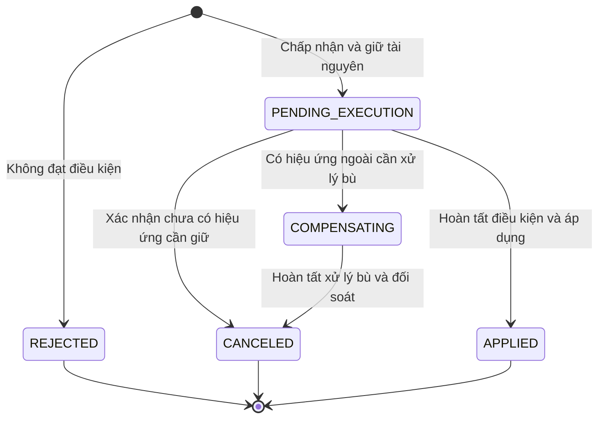

# Plan eligibility — Điều kiện đăng ký và chuyển đổi gói thuê bao

## 1. Mục tiêu và phạm vi

Trong chương **Subscription Rules** của module bảo mật logic nghiệp vụ, **plan eligibility** là tập điều kiện xác định một chủ thể có được thực hiện một hành động đối với một gói thuê bao hay không. Hành động có thể là đăng ký mới, bắt đầu dùng thử, nâng gói, hạ gói, gia hạn hoặc khôi phục thuê bao.

Một gói tồn tại trong cơ sở dữ liệu, xuất hiện trên trang giá hoặc được nhà cung cấp thanh toán chấp nhận chưa có nghĩa mọi khách hàng đều được sử dụng. Nếu backend chỉ nhận `planId` rồi tạo thuê bao, người gọi có thể chọn gói nội bộ, dùng lại ưu đãi dành cho khách hàng mới hoặc đi thẳng vào bước kích hoạt để bỏ qua phê duyệt.

Bài dùng một sản phẩm SaaS giả định để giải thích cách bảo vệ các quy tắc này. Các tên gói, ngưỡng số lượng và điều kiện bên dưới là chính sách minh họa, không phải yêu cầu chung của mọi sản phẩm hoặc quy định pháp lý.

Sau bài học, bạn có thể:

- Phân biệt quyền quản lý tài khoản thanh toán với điều kiện sử dụng gói.
- Mô hình hóa quy tắc theo chủ thể, hành động, phiên bản gói và thời điểm thực hiện.
- Chặn việc sửa tham số, dùng lại ưu đãi, sử dụng quyết định cũ và chạy nhiều yêu cầu đồng thời.
- Kết hợp transaction, idempotency và state machine khi việc thanh toán diễn ra bất đồng bộ.
- Định nghĩa kiểm thử dựa trên các bất biến nghiệp vụ và dữ liệu đã commit.

## 2. Ba câu hỏi cần trả lời độc lập

### 2.1. Actor có quyền thực hiện thao tác không?

**Authorization** trả lời: người hoặc workload đang gọi có quyền quản lý thuê bao của tài khoản thanh toán cụ thể này không?

Ví dụ, Bình là thành viên workspace A nhưng không có quyền `MANAGE_SUBSCRIPTION`. Workspace A đủ điều kiện dùng gói Team cũng không cho phép Bình tự tạo nghĩa vụ thanh toán. Ngược lại, quản trị viên thanh toán có quyền thao tác chưa chắc tài khoản của họ đủ điều kiện nhận một chương trình dùng thử mới.

| Khái niệm | Câu hỏi | Ví dụ kiểm tra |
| --- | --- | --- |
| Authentication | Ai đang gọi? | Session hoặc workload identity đã được xác thực |
| Authorization | Actor được làm gì trên tài khoản nào? | Có quyền quản lý billing account thuộc tenant đang hoạt động |
| Eligibility | Chủ thể có được thực hiện hành động với gói này lúc này không? | Đúng loại khách hàng, hợp đồng, số ghế và lịch sử dùng thử |
| Settlement | Điều kiện thanh toán của giao dịch đã được đáp ứng chưa? | Khoản thanh toán hoặc điều khoản công nợ được xác nhận |
| Entitlement | Tính năng nào thực sự đang được cấp? | Quyền tính năng sinh từ thuê bao đã được áp dụng hợp lệ |

OWASP khuyến nghị kiểm tra quyền trên mọi request và áp dụng nguyên tắc từ chối mặc định. Với thuê bao, kiểm tra đó phải gắn với đúng tenant, billing account và hành động, không chỉ với role chung như `ADMIN`. [Nguồn: OWASP Authorization](https://cheatsheetseries.owasp.org/cheatsheets/Authorization_Cheat_Sheet.html).

### 2.2. Chủ thể nào nhận quyền lợi và nghĩa vụ?

Cần tách ít nhất các định danh:

```text
actor_id           = người hoặc dịch vụ thao tác
tenant_id          = phạm vi tenant đã được backend xác minh
billing_account_id = tài khoản chịu nghĩa vụ thanh toán
benefit_subject_id = chủ thể được dùng để tính quyền lợi một lần
subscription_id    = thuê bao đang có hiệu lực
product_family     = nhóm sản phẩm có quy tắc thuê bao riêng
```

Các định danh phải được quản lý riêng: một công ty có thể có nhiều người quản trị; đổi người quản trị không tạo ra khách hàng mới. Một actor có thể quản lý nhiều công ty; việc actor đã dùng thử cho công ty A không tự chứng minh công ty B đã dùng thử.

`benefit_subject_id` cần được backend ánh xạ từ đối tượng mà chính sách thật sự muốn giới hạn. Không mặc định dùng email, cookie hoặc ID người đăng nhập. Trong ví dụ SQL của bài, ưu đãi được giới hạn theo **chủ thể hưởng lợi trong một tenant và một nhóm quyền lợi**. Thiết kế đó không tự ngăn việc một chủ thể lập nhiều tenant; nếu chính sách cần giới hạn xuyên tenant, phải có dịch vụ nhận diện chủ thể và sổ quyền lợi với phạm vi tương ứng.

### 2.3. Điều kiện áp dụng cho hành động nào?

Không dùng duy nhất một hàm `isEligible(customer, plan)` cho mọi thao tác:

```text
evaluate(subject, action, target_plan_revision, context, decision_time)

Các action ví dụ:
NEW_SUBSCRIPTION, START_TRIAL, UPGRADE, DOWNGRADE, RENEW, REACTIVATE
```

Một gói đã đóng đăng ký mới có thể tiếp tục cho khách hàng hiện hữu gia hạn theo hợp đồng. Một ưu đãi chỉ dành cho lần mua đầu không tự xuất hiện lại khi khách hàng hủy rồi đăng ký lại. Việc hạ gói còn phải xét dữ liệu hoặc mức sử dụng hiện tại, thay vì chỉ xét điều kiện đăng ký mới của gói đích.

## 3. Từ yêu cầu sản phẩm đến bảng điều kiện rõ ràng

Giả sử sản phẩm có ba gói:

| Gói minh họa | Hành động | Điều kiện nghiệp vụ |
| --- | --- | --- |
| Starter | Đăng ký mới | Billing account đang hoạt động; gói đang mở cho kênh đăng ký tương ứng |
| Team | Đăng ký mới hoặc nâng gói | Khách hàng doanh nghiệp đã được xác minh; số ghế từ 1 đến 50; không có khoản nợ thuộc diện chặn mua mới theo chính sách |
| Enterprise Contract | Đăng ký hoặc nâng gói | Hợp đồng còn hiệu lực, đúng billing account, phạm vi sản phẩm và phiên bản được phê duyệt |
| Team Trial | Bắt đầu dùng thử | Đạt các điều kiện riêng của chương trình; chưa dùng quyền lợi `TEAM_TRIAL`; không có yêu cầu đang giữ quyền lợi đó |
| Legacy Team | Gia hạn | Có thuê bao cũ thuộc diện được tiếp tục; không mở cho người mua mới |

Đây là các điều kiện có quan hệ **AND** trừ khi đặc tả nói rõ nhánh thay thế. Không tự đổi thành OR, chẳng hạn “đã xác minh doanh nghiệp **hoặc** đã cung cấp thẻ thanh toán”.

Mỗi quy tắc cần ghi nguồn dữ liệu và cách xử lý thiếu dữ liệu:

| Dữ kiện | Nguồn có thẩm quyền | Khi thiếu hoặc lỗi |
| --- | --- | --- |
| Tenant và quyền quản lý billing account | Ngữ cảnh xác thực và quan hệ ủy quyền phía server | Từ chối thao tác ngoài phạm vi |
| Loại khách hàng và trạng thái xác minh | Hồ sơ đã được hệ thống xác minh | Yêu cầu hoàn thiện hồ sơ hoặc chuyển xét duyệt |
| Trạng thái bán, phiên bản gói và kênh mua | Catalog phía server | Không dùng phiên bản hoặc kênh chưa biết |
| Hợp đồng hoặc phê duyệt riêng | Bản ghi được phê duyệt, có phạm vi và thời hạn | Không coi dữ liệu client tự khai là phê duyệt |
| Lịch sử dùng thử | Sổ quyền lợi bền vững | Không suy ra chưa dùng chỉ vì truy vấn lỗi |
| Số ghế và mức sử dụng liên quan | Nguồn quản lý thành viên hoặc usage có thẩm quyền | Chưa đủ dữ kiện thì chưa áp dụng thay đổi làm vượt giới hạn |
| Nợ hoặc trạng thái hạn chế mua mới | Hệ thống billing có thẩm quyền | Trả kết quả tạm chưa thể quyết định theo chính sách |

Nếu sản phẩm giới hạn theo khu vực, phải định nghĩa thuộc tính khu vực nào có ý nghĩa và được xác minh ra sao. IP, locale trình duyệt hoặc trường `country` tự nhập không mặc nhiên là bằng chứng đủ tin cậy. Bài không đặt ra quy tắc pháp lý theo khu vực; đây là yêu cầu xác định nguồn dữ liệu cho chính sách sản phẩm.

## 4. Những bất biến cần bảo vệ

### 4.1. Bất biến về phạm vi và dữ liệu

```text
trusted_tenant = billing_account.tenant = subscription.tenant

actor có quyền action trên billing_account ở thời điểm được quy ước

operation.billing_account = billing_account được phép quản lý
operation.target_plan_revision = phiên bản gói đã được server chấp thuận

giá, tiền tệ, kỳ hạn và quyền lợi phải khớp phiên bản giao dịch đã chốt
```

Các ID từ request chỉ là đề nghị lựa chọn. Không được cho client tự đặt `eligible=true`, `isNewCustomer=true`, `approved=true`, `trialConsumed=false` hoặc trạng thái thuê bao cuối.

### 4.2. Bất biến về số lần hưởng lợi và cạnh tranh

Trong mô hình một thuê bao cho mỗi nhóm sản phẩm:

```text
mỗi (tenant, billing_account, product_family):
    tối đa một thuê bao hiện hành theo chính sách
    tối đa một yêu cầu thay đổi đang chiếm slot xử lý

mỗi (tenant, benefit_subject, benefit_group):
    tối đa một trial claim ở trạng thái RESERVED hoặc CONSUMED
```

Quy tắc số thuê bao là lựa chọn của mô hình minh họa. Sản phẩm hỗ trợ nhiều thuê bao song song phải định nghĩa phạm vi khác, chẳng hạn theo workspace hoặc hợp đồng; không ép quy tắc một thuê bao khi nghiệp vụ cho phép nhiều.

`benefit_group` là định danh quyền lợi ổn định, ví dụ `TEAM_TRIAL`. Không dùng riêng `plan_revision` làm khóa chống nhận lại, vì phát hành revision mới có thể vô tình cho mọi khách hàng dùng thử lại. Một chiến dịch cho phép hưởng quyền lợi mới cần nhóm quyền lợi mới được phê duyệt có chủ ý.

### 4.3. Bất biến về hiệu ứng

```text
APPLIED => có quyết định eligibility hợp lệ theo chính sách thực thi
           và đủ điều kiện thanh toán/công nợ/dùng thử tương ứng

nhận request hoặc tạo checkout != cấp entitlement

retry cùng một lệnh != một quyền lợi hoặc nghĩa vụ thanh toán mới
```

Gói miễn phí hoặc dùng thử có thể không cần thu tiền. Khi đó nhánh chính sách phải chỉ rõ vì sao được cấp quyền; không dùng điều kiện “số tiền bằng 0” làm bằng chứng tổng quát để bỏ mọi kiểm tra.

## 5. Tình huống tấn công và thiết kế endpoint

### 5.1. Gói bị ẩn vẫn có thể bị chọn bằng API

Thiết kế dễ bị lạm dụng:

```http
POST /api/subscriptions
Content-Type: application/json

{
  "billingAccountId": "BILL-A",
  "planId": "ENTERPRISE_INTERNAL",
  "price": 0,
  "eligible": true,
  "trialDays": 365
}
```

Nếu backend tin các trường này, người gọi có thể nhận gói không dành cho họ hoặc kéo dài dùng thử. Kiểm tra `planId` có tồn tại chỉ xác nhận cú pháp lựa chọn; chưa chứng minh quyền mua hoặc điều kiện tham gia.

Mẫu không an toàn:

```java
Plan plan = catalog.findById(request.planId());
Subscription subscription = subscriptions.create(
    request.billingAccountId(), plan.id(), request.price());
entitlements.enable(subscription);
```

Ngoài thiếu quyền đối tượng, đoạn này còn gộp “tạo yêu cầu” với “cấp quyền” và không bảo vệ lịch sử dùng thử.

### 5.2. Hợp đồng đầu vào hẹp hơn

Một API có thể nhận:

```http
POST /api/billing-accounts/BILL-A/subscription-changes
Idempotency-Key: team-upgrade-attempt-1
Content-Type: application/json

{
  "action": "UPGRADE",
  "targetPlanRevision": "TEAM-2026-01",
  "seats": 12,
  "billingInterval": "MONTHLY",
  "expectedSubscriptionVersion": 8,
  "quoteId": "QUOTE-A"
}
```

Các định danh trong HTTP là ký hiệu dễ đọc; triển khai có thể dùng UUID. Backend phải:

1. Xác minh actor có quyền thực hiện `UPGRADE` trên `BILL-A` trong tenant tin cậy.
2. Kiểm tra gói đích và kỳ thanh toán là lựa chọn hợp lệ cho chủ thể, hành động và kênh đang dùng.
3. Tìm quote thuộc đúng billing account, còn hạn, khớp số ghế, phiên bản gói và điều khoản được chấp thuận.
4. Kiểm tra trạng thái thuê bao và các điều kiện nghiệp vụ còn liên quan.
5. Nhận lệnh bằng idempotency và điều phối một operation có trạng thái rõ ràng.

Không bind request vào entity nội bộ. Hợp đồng API nên từ chối trường ngoài danh sách cho phép như `approved`, `price`, `status` hoặc `trialEnd`. Nếu có use case cho phép nhập một giá trị nhạy cảm, nó cần quyền và luồng xác minh riêng.

Mọi đường ghi như REST, GraphQL, mobile, import, job và cổng hỗ trợ phải đi qua cùng điểm thực thi quy tắc. Giấu nút trên giao diện hoặc chặn riêng một controller không bảo vệ các đường còn lại.

OWASP mô tả lỗ hổng logic nghiệp vụ có thể xuất hiện khi người dùng bỏ bước hoặc gọi sai thứ tự dù từng request hợp lệ về mặt kỹ thuật. Các điều kiện và chuyển trạng thái phải được thực thi phía server. [Nguồn: OWASP Business Logic Security](https://cheatsheetseries.owasp.org/cheatsheets/Business_Logic_Security_Cheat_Sheet.html).

## 6. Thiết kế kết quả eligibility có thể giải thích được

### 6.1. Không chỉ trả boolean

Một mô hình hữu ích:

```java
enum EligibilityOutcome {
    ALLOW, DENY, REVIEW, UNAVAILABLE
}

record EligibilityDecision(
    EligibilityOutcome outcome,
    String reasonCode,
    String policyVersion,
    String planRevision,
    Instant evaluatedAt,
    Instant validUntil,
    Map<String, Long> factVersions
) {}
```

Các trạng thái có ý nghĩa khác nhau:

| Kết quả | Ý nghĩa | Ứng xử |
| --- | --- | --- |
| `ALLOW` | Đủ điều kiện theo dữ kiện, hành động và phiên bản đã đánh giá | Tiếp tục đúng luồng thực thi; chưa tự cấp entitlement |
| `DENY` | Có dữ kiện xác nhận không đạt quy tắc | Trả mã lý do phù hợp; không phát sinh nghĩa vụ mới |
| `REVIEW` | Cần xét duyệt hoặc bổ sung bằng chứng | Tạo hoặc liên kết quy trình xét duyệt; không coi là được phép |
| `UNAVAILABLE` | Chưa thể đánh giá đáng tin cậy do lỗi hoặc thiếu dữ liệu kỹ thuật | Cho thử lại hoặc xử lý theo chính sách an toàn đã định nghĩa |

Không viết `catch (Exception) { return ALLOW; }`. Cũng không lưu mọi lỗi dịch vụ phụ thuộc như một kết luận khách hàng không đủ điều kiện vĩnh viễn. Với việc mua hoặc cấp quyền mới, bài chọn chưa tạo hiệu ứng khi dữ kiện quan trọng chưa xác định.

Có thể trả mã công khai như `PLAN_NOT_AVAILABLE` hoặc `VERIFICATION_REQUIRED`, trong khi audit nội bộ lưu chi tiết kiểm tra. Tránh để endpoint eligibility trở thành công cụ dò hợp đồng, trạng thái nợ hoặc quyền lợi của tài khoản khác.

### 6.2. Quy tắc nên độc lập với việc đọc dữ liệu

Một evaluator có thể nhận snapshot đã được xây dựng từ nguồn có thẩm quyền:

```java
EligibilityDecision evaluate(EligibilityInput in, Instant now) {
    if (!in.requiredFactsAvailable()) {
        return unavailable("FACTS_UNAVAILABLE", in, now);
    }
    if (!in.planSupportsActionAndChannel()) {
        return deny("PLAN_ACTION_NOT_AVAILABLE", in, now);
    }
    if (in.requiresVerifiedBusiness() && !in.businessVerified()) {
        return review("BUSINESS_VERIFICATION_REQUIRED", in, now);
    }
    if (in.seats() < in.minSeats() || in.seats() > in.maxSeats()) {
        return deny("SEAT_COUNT_NOT_ALLOWED", in, now);
    }
    if (in.requiresContract() && !in.hasMatchingValidContract(now)) {
        return deny("CONTRACT_REQUIRED", in, now);
    }
    if (in.isTrialAction() && in.trialBenefitUnavailable()) {
        return deny("TRIAL_NOT_AVAILABLE", in, now);
    }
    if (!in.currentStateAllowsAction()) {
        return deny("SUBSCRIPTION_STATE_NOT_ALLOWED", in, now);
    }
    return allow(in, now);
}
```

Đây là mã giả cho một bộ quy tắc minh họa. `planSupportsActionAndChannel`, trạng thái hợp đồng và lịch sử trial không lấy nguyên từ boolean do client gửi. Thứ tự mã lý do và những thông tin được tiết lộ cần được quyết định có chủ ý.

Evaluator thuần giúp kiểm thử ranh giới và giải thích kết quả. Tuy nhiên, một kết quả `ALLOW` tính trên snapshot không tự loại bỏ race condition lúc ghi dữ liệu. Bảo đảm đó thuộc giao thức thực thi ở phần sau.

## 7. Quyết định cũ, quote và thời điểm thực thi

### 7.1. Preview là gợi ý, không phải giấy phép vô thời hạn

Một endpoint `GET /available-plans` hoặc `POST /eligibility-preview` có thể giúp giao diện hiển thị lựa chọn. Nhưng giữa lúc preview và lúc đăng ký:

- Quyền quản lý billing account có thể bị thu hồi.
- Một quản trị viên khác có thể đổi thuê bao hoặc dùng quyền lợi trial.
- Quote, hợp đồng hay lời mời mua gói có thể hết hạn.
- Số ghế có thể tăng, khiến thao tác hạ gói không còn hợp lệ.
- Gói có thể đóng bán hoặc bị thu hồi do sự cố.

Không nhận `eligible=true` từ preview rồi bỏ toàn bộ kiểm tra khi mutate. Quyết định lưu trên server hoặc token đã ký cũng phải ràng buộc tenant, billing account, hành động, phiên bản gói, tham số quan trọng và thời hạn. Chữ ký bảo vệ tính toàn vẹn; không bảo đảm quyết định còn phù hợp với trạng thái hiện tại hay chỉ được dùng một lần.

### 7.2. Tách dữ kiện được chốt khỏi điều kiện phải kiểm tra lại

| Loại dữ kiện | Cách xử lý minh họa |
| --- | --- |
| Giá và điều khoản trong quote được cam kết đến một thời hạn | Lưu snapshot và áp dụng trong đúng phạm vi cam kết |
| Quyền actor tại thời điểm chấp nhận lệnh | Kiểm tra theo chính sách thu hồi; không giả định token cũ luôn đủ |
| Trial chưa được giữ hoặc tiêu thụ | Kiểm tra và giữ quyền lợi bằng thao tác nguyên tử |
| Số ghế hoặc usage chi phối downgrade | Kiểm tra lại tại thời điểm hạ gói có hiệu lực; ngăn tăng vượt mức nếu cần |
| Thu hồi khẩn cấp gói hoặc hạn chế an toàn của tài khoản | Có kiểm tra tại điểm thực thi theo quy tắc được công bố |
| Quyền tiếp tục của khách hàng legacy | Dựa trên hợp đồng hoặc lịch sử được lưu, không dựa vào cờ tùy ý từ request |

Đừng kiểm tra lại mọi thứ theo catalog mới mà vô tình thay đổi giá đã cam kết. Cũng đừng đóng băng mọi thứ trong quote rồi bỏ qua lệnh thu hồi bắt buộc. Thiết kế phải nêu rõ dữ kiện nào là cam kết và dữ kiện nào còn là điều kiện thực thi.

Trong ví dụ này, operation được chấp nhận cùng snapshot có phiên bản. Worker sau đó chỉ áp dụng khi cam kết còn hiệu lực và các điều kiện bắt buộc tại thời điểm thực thi vẫn đạt. Nếu đã có hiệu ứng bên nhà cung cấp nhưng không thể cấp gói, operation phải đi vào xử lý bù hoặc đối soát, thay vì tự đánh dấu thành công.

OWASP khuyến nghị bảo vệ dữ liệu giao dịch đã được chấp thuận và kiểm soát các bước thực hiện. Với thuê bao, thay gói đích hoặc số ghế sau phê duyệt phải làm mất hiệu lực quyết định cũ nếu các trường đó nằm trong phạm vi được phê duyệt. [Nguồn: OWASP Transaction Authorization](https://cheatsheetseries.owasp.org/cheatsheets/Transaction_Authorization_Cheat_Sheet.html).

## 8. Chặn tranh chấp bằng transaction và ràng buộc dữ liệu

### 8.1. Một slot điều phối cho mỗi tài khoản và nhóm sản phẩm

Giả sử hai quản trị viên đồng thời nâng gói và bắt đầu trial. Nếu cả hai cùng đọc “chưa có yêu cầu đang xử lý” rồi tạo operation, hệ thống có thể tạo hai thuê bao hoặc hai nghĩa vụ thanh toán.

Một cách thiết kế là có sẵn dòng `subscription_slot` cho mỗi `(tenant, billing_account, product_family)`. Khóa dòng đó khi đánh giá trạng thái và nhận operation. Không chỉ khóa kết quả truy vấn “thuê bao đang hoạt động”, vì lúc chưa có thuê bao thì không có dòng nào để khóa.

```sql
SELECT tenant_id, billing_account_id, product_family,
       current_subscription_id, active_change_id, version
FROM subscription_slot
WHERE tenant_id = :trusted_tenant_id
  AND billing_account_id = :authorized_billing_account_id
  AND product_family = :server_product_family
FOR UPDATE;
```

Dòng slot được tạo bằng quy trình có unique key khi khởi tạo billing account hoặc bằng insert chống trùng rồi truy vấn lại. Tất cả đường tạo, đổi, hủy và áp dụng thuê bao phải tuân thủ cùng giao thức. Nếu điều kiện eligibility phụ thuộc bảng khác, cần bảo vệ các dữ kiện tương ứng bằng khóa, phiên bản hoặc cơ chế chấp thuận được thiết kế rõ.

PostgreSQL giữ khóa dòng `FOR UPDATE` đến khi transaction kết thúc và làm các thao tác khóa/ghi xung đột chờ nhau. Cần thống nhất thứ tự khóa, xử lý deadlock và tránh giữ transaction mở trong lúc gọi mạng. [Nguồn: PostgreSQL 18 — Explicit Locking](https://www.postgresql.org/docs/18/explicit-locking.html).

### 8.2. Schema rút gọn cho slot, operation và trial

DDL sau minh họa phần điều phối, không phải schema hoàn chỉnh cho billing. Bảng billing account, catalog, subscription, command, audit và outbox được giả định đã có. Khi triển khai cần bổ sung khóa ngoại theo tenant tới những bảng này và ràng buộc các liên kết còn thiếu.

```sql
CREATE TABLE subscription_slot (
    tenant_id                UUID NOT NULL,
    billing_account_id       UUID NOT NULL,
    product_family           TEXT NOT NULL,
    current_subscription_id  UUID,
    active_change_id         UUID,
    version                  BIGINT NOT NULL DEFAULT 0 CHECK (version >= 0),
    PRIMARY KEY (tenant_id, billing_account_id, product_family)
);

CREATE TABLE subscription_change (
    tenant_id           UUID NOT NULL,
    id                  UUID NOT NULL,
    billing_account_id  UUID NOT NULL,
    product_family      TEXT NOT NULL,
    actor_id            UUID NOT NULL,
    action              TEXT NOT NULL,
    plan_revision       TEXT NOT NULL,
    seats               INTEGER NOT NULL CHECK (seats > 0),
    decision_snapshot   JSONB NOT NULL,
    state               TEXT NOT NULL CHECK (state IN (
                            'PENDING_EXECUTION', 'APPLIED', 'REJECTED',
                            'COMPENSATING', 'CANCELED')),
    PRIMARY KEY (tenant_id, id),
    FOREIGN KEY (tenant_id, billing_account_id, product_family)
        REFERENCES subscription_slot (
            tenant_id, billing_account_id, product_family)
);

CREATE TABLE trial_claim (
    tenant_id           UUID NOT NULL,
    id                  UUID NOT NULL,
    benefit_subject_id  UUID NOT NULL,
    benefit_group       TEXT NOT NULL,
    change_id           UUID NOT NULL,
    state               TEXT NOT NULL CHECK (state IN (
                            'RESERVED', 'CONSUMED', 'RELEASED')),
    PRIMARY KEY (tenant_id, id),
    UNIQUE (tenant_id, change_id, benefit_group),
    FOREIGN KEY (tenant_id, change_id)
        REFERENCES subscription_change (tenant_id, id)
);

CREATE UNIQUE INDEX uq_trial_benefit_live
ON trial_claim (tenant_id, benefit_subject_id, benefit_group)
WHERE state IN ('RESERVED', 'CONSUMED');
```

Partial unique index cho phép giữ lịch sử các lần `RELEASED`, đồng thời chỉ có tối đa một claim đang giữ hoặc đã tiêu thụ quyền lợi. `CONSUMED` được giữ lại sau khi trial kết thúc hoặc thuê bao bị hủy; không đổi sang `RELEASED` để làm khách hàng thành “mới”.

`CHECK` trên từng dòng không chứng minh trial đã được cấp đúng điều kiện hoặc account có quyền chọn gói. Các quan hệ liên bảng và quyết định theo chính sách vẫn cần điểm thực thi nghiệp vụ. PostgreSQL cung cấp những loại constraint khác nhau; không dùng `CHECK` để giả lập bảo đảm tổng hợp từ các dòng khác. [Nguồn: PostgreSQL 18 — Constraints](https://www.postgresql.org/docs/18/ddl-constraints.html).

### 8.3. Giữ trial trong cùng transaction nhận operation

Sau khi có operation chưa commit, có thể nhận quyền lợi bằng:

```sql
INSERT INTO trial_claim (
    tenant_id, id, benefit_subject_id, benefit_group, change_id, state
) VALUES (
    :trusted_tenant_id, :new_claim_id, :server_benefit_subject_id,
    :server_benefit_group, :change_id, 'RESERVED'
)
ON CONFLICT (tenant_id, benefit_subject_id, benefit_group)
WHERE state IN ('RESERVED', 'CONSUMED')
DO NOTHING
RETURNING id;
```

Nếu không nhận được dòng mới thì không được tiếp tục tạo trial. Operation có thể được ghi `REJECTED` và command trả kết quả từ chối, với điều kiện không commit slot hay outbox tạo hiệu ứng của một yêu cầu bị từ chối.

Khi thực sự cấp trial và entitlement, đổi `RESERVED -> CONSUMED` cùng transaction áp dụng. Chỉ được đổi `RESERVED -> RELEASED` khi đã xác nhận quyền lợi chưa được cấp và không còn hiệu ứng đang có thể hoàn tất bên ngoài. Timeout gọi nhà cung cấp không đủ chứng minh điều đó.

Việc đổi chủ thể hưởng lợi, hợp nhất tài khoản hoặc xóa rồi tạo lại khách hàng cần luồng có thẩm quyền. Nếu mỗi lần tạo lại đều nhận một `benefit_subject_id` mới mà không đối chiếu lịch sử, unique index vẫn đúng về kỹ thuật nhưng chính sách “mỗi chủ thể một lần” đã bị vượt qua.

## 9. Idempotency và phác thảo service Java

### 9.1. Tách chống request trùng khỏi chống hưởng lợi trùng

Một thiết kế command có thể dùng khóa:

```text
command_scope = (tenant_id, billing_account_id, action, idempotency_key)

request_hash = hash(canonical_encode(
    tenant_id, billing_account_id, action,
    target_plan_revision, seats, billing_interval,
    expected_subscription_version, quote_id
))
```

Phạm vi trên dùng billing account để hai quản trị viên có thể nhận ra cùng một lệnh nếu họ sử dụng cùng key và cùng tham số. Actor khởi tạo vẫn được ghi vào audit. Bất kỳ actor nào đọc lại kết quả đều phải có quyền hiện tại trên account và dữ liệu lệnh đó.

- Cùng phạm vi, key và fingerprint: trả kết quả tiếp nhận đã lưu, không tạo operation mới.
- Cùng phạm vi và key nhưng khác fingerprint: từ chối xung đột.
- Khác key: là lệnh khác; vẫn bị giới hạn bởi slot, trạng thái thuê bao và sổ trial.
- Cùng lệnh ở outbox bị giao nhiều lần: worker dùng định danh operation ổn định để chống tạo hiệu ứng bên ngoài lần nữa.

Fingerprint dựa trên yêu cầu ban đầu đã chuẩn hóa, không dựa trên số ghế hiện tại hoặc trạng thái thuê bao sau khi lệnh đã được áp dụng. Kết quả replay có thể là biên nhận `operationId`; trạng thái hiện tại được đọc qua endpoint riêng. Không cần thay đổi biên nhận cũ mỗi lần operation tiến triển.

Command cần unique constraint theo phạm vi, fingerprint và kết quả lưu bền vững. Dữ liệu tạm “đang xử lý” trong transaction tiếp nhận phải được hoàn tất trước commit hoặc có cơ chế phục hồi rõ ràng nếu thiết kế cho phép lưu nó lâu dài.

### 9.2. Luồng tiếp nhận trong một transaction

Đoạn dưới là mã giả Java. Nó tập trung vào thứ tự kiểm tra và điểm commit, chưa triển khai repository hoặc mọi nhánh nghiệp vụ:

```java
ChangeReceipt requestChange(TrustedContext ctx, UUID billingAccountId,
                            String key, ChangeRequest req) {
    // Toàn bộ hàm chạy trong transaction cục bộ.
    validateRequestShapeAndKey(req, key);

    BillingGrant grant = authorization.lockGrantForAction(
        ctx, billingAccountId, req.action());
    BillingAccount account = accounts.lockScoped(ctx.tenantId(), billingAccountId);
    SubscriptionSlot slot = slots.lockForUpdate(
        ctx.tenantId(), account.id(), serverProductFamily(req));

    String fingerprint = canonicalRequestHash(ctx.tenantId(), account.id(), req);
    CommandClaim command = commands.claimOrLoad(
        ctx.tenantId(), account.id(), req.action(), key, fingerprint, ctx.actorId());
    if (!command.isNew()) {
        requireSameFingerprint(command, fingerprint);
        requireCanReadReceipt(ctx, grant, command);
        return command.storedReceipt();
    }

    // Chỉ kiểm tra điều kiện thực thi lần đầu sau khi đã xử lý replay.
    requireExpectedVersion(slot, req.expectedSubscriptionVersion());
    requireNoActiveChange(slot);

    EligibilityInput facts = factsLoader.loadForAcceptedAction(
        ctx, account, slot, req); // Nguồn server; dữ kiện có phiên bản.
    EligibilityDecision decision = evaluator.evaluate(facts, clock.instant());

    if (decision.outcome() == EligibilityOutcome.UNAVAILABLE) {
        throw new RetryableEligibilityFailure(); // Rollback, cho phép thử lại.
    }
    if (decision.outcome() != EligibilityOutcome.ALLOW) {
        ChangeReceipt denied = receiptForDeniedOrReview(decision);
        commands.complete(command, denied);
        audit.recordDecision(ctx, account, req, decision);
        return denied; // Commit kết quả quyết định, không tạo hiệu ứng gói.
    }

    SubscriptionChange change = changes.insertPending(
        ctx, account, req, decision, facts.committedTermsSnapshot());

    if (req.action() == Action.START_TRIAL) {
        boolean claimed = trials.tryReserve(
            ctx.tenantId(), facts.benefitSubjectId(),
            facts.benefitGroup(), change.id());
        if (!claimed) {
            changes.reject(change, "TRIAL_NOT_AVAILABLE");
            ChangeReceipt denied = ChangeReceipt.denied("TRIAL_NOT_AVAILABLE");
            commands.complete(command, denied);
            audit.recordTrialConflict(ctx, account, change);
            return denied;
        }
    }

    slots.attachChangeAndAdvanceVersion(slot, change);
    outbox.enqueueExecuteChange(change.id(), ctx.tenantId());
    ChangeReceipt accepted = ChangeReceipt.accepted(change.id());
    commands.complete(command, accepted);
    audit.recordAcceptedChange(ctx, account, grant, change);
    return accepted; // Commit rồi mới trả biên nhận cho client.
}
```

`factsLoader` không tự tạo bảo đảm nhất quán chỉ vì nằm trong transaction. Dữ kiện thay đổi cần khóa hoặc kiểm tra phiên bản tương ứng. Ví dụ, nếu quyền quản trị có thể bị thu hồi đồng thời, luồng thu hồi phải phối hợp với bản ghi grant mà luồng tiếp nhận khóa, hoặc phải có quy tắc chấp nhận phiên bản quyền rõ ràng.

Replay được xử lý trước điều kiện “chưa có thay đổi đang chạy” và so sánh version hiện hành. Nếu làm ngược lại, retry của chính lệnh đã thành công có thể bị từ chối vì lệnh trước đã chiếm slot hoặc tăng version.

Mọi lỗi kỹ thuật sau khi tạo operation hoặc giữ trial phải rollback toàn bộ transaction tiếp nhận, gồm command, slot, claim và outbox. Các kết quả nghiệp vụ muốn phát lại ổn định thì lưu và commit có chủ ý. Không bắt lỗi unique rồi tiếp tục ghi trong một transaction PostgreSQL đã bị lỗi; ánh xạ hoặc retry ở bên ngoài transaction đó.

## 10. State machine cho thực thi bất đồng bộ

### 10.1. Trạng thái operation khác trạng thái thuê bao

Một operation thay đổi gói có thể có vòng đời:



`PENDING_EXECUTION` không cho phép truy cập tính năng mới chỉ vì client đã nhận HTTP thành công. Một trial có thể được áp dụng mà không cần nhà cung cấp thanh toán; một gói trả tiền hoặc theo hợp đồng phải đi theo điều kiện riêng đã được ghi nhận.

Nếu kết quả gọi ngoài chưa rõ vì timeout, giữ trạng thái chờ và đối soát. Không tự coi đó là thất bại chắc chắn rồi mở slot cho một lệnh khác tạo thêm thuê bao. `COMPENSATING` dùng khi đã xác định có hiệu ứng cần bù, chẳng hạn đã tạo nghĩa vụ bên ngoài nhưng không thể áp dụng gói đúng điều kiện.

### 10.2. Worker và nhà cung cấp thanh toán

Một worker xử lý operation nên:

1. Nhận quyền xử lý theo cơ chế lease hoặc hàng đợi; có thể bị giao lại.
2. Đọc snapshot giao dịch và kiểm tra điều kiện thực thi bắt buộc, không dùng lại boolean từ trình duyệt.
3. Gọi nhà cung cấp bằng tham số server và idempotency key ổn định gắn với operation, trong phạm vi và thời hạn mà nhà cung cấp hỗ trợ.
4. Lưu liên kết định danh nhà cung cấp với operation, tenant và billing account.
5. Nhận bằng chứng đủ điều kiện áp dụng, rồi mở transaction ngắn để khóa slot và operation, kiểm tra lại trạng thái và áp dụng một lần.
6. Cập nhật thuê bao, entitlement, trial claim nếu có, trạng thái operation và giải phóng slot trong cùng transaction cục bộ.

Không giữ khóa cơ sở dữ liệu trong suốt lời gọi mạng. Lease giảm xử lý trùng nhưng không phải bảo đảm duy nhất; worker cũ có thể tiếp tục sau khi lease hết hạn. Thao tác cuối cần điều kiện trạng thái hoặc version để worker cũ không ghi đè operation đã kết thúc.

Ví dụ cụ thể, Stripe API v1 hỗ trợ idempotency key và kiểm tra tham số khi dùng lại key; key có thể bị dọn sau thời hạn được tài liệu nêu. Vì vậy, ứng dụng vẫn cần sổ operation của mình và quy trình đối soát khi retry vượt cửa sổ bảo đảm của nhà cung cấp. [Nguồn: Stripe — Idempotent requests](https://docs.stripe.com/api/idempotent_requests).

### 10.3. Webhook không thay thế eligibility

Webhook thanh toán hợp lệ chỉ cung cấp bằng chứng về một đối tượng hoặc sự kiện bên ngoài. Nó chưa chứng minh billing account được phép sử dụng bất kỳ gói nào do client lựa chọn.

Receiver và consumer cần:

- Xác thực sự kiện theo cơ chế của nhà cung cấp, đúng môi trường và tài khoản tích hợp.
- Lưu inbox bền vững hoặc áp dụng transactionally trước khi xác nhận tiếp nhận; không ACK rồi bỏ mất việc xử lý.
- Ánh xạ đối tượng thanh toán tới operation đã được backend tạo; không tin metadata do một đường client không kiểm soát được ghi vào.
- Chống xử lý lại cùng sự kiện, đồng thời chặn áp dụng cùng hiệu ứng nghiệp vụ qua các event khác nhau.
- Không để sự kiện cũ làm sống lại một operation đã hủy hoặc ghi đè trạng thái mới.

Stripe nêu rõ webhook có thể lặp và không bảo đảm thứ tự phát đến. Event ID giúp nhận diện lần giao trùng; không nên dùng riêng timestamp tạo event để suy ra thứ tự đầy đủ. Khi cần, truy xuất trạng thái có thẩm quyền và đối soát đối tượng liên quan. [Nguồn: Stripe — Webhooks](https://docs.stripe.com/webhooks).

## 11. Đổi gói, gia hạn và ngoại lệ cần chính sách riêng

### 11.1. Downgrade không chỉ là đổi `plan_id`

Giả sử gói hiện tại cho 30 ghế, gói đích cho tối đa 10 ghế, trong khi đang có 18 thành viên tính phí. Cần quyết định rõ:

- Từ chối cho đến khi usage giảm về mức cho phép.
- Hoặc lên lịch hạ gói và yêu cầu xử lý phần vượt trước thời điểm có hiệu lực.
- Hoặc có chế độ hạn chế được thiết kế rõ cho phần vượt; không âm thầm xóa dữ liệu hay chọn ngẫu nhiên thành viên bị mất quyền.

Nếu lên lịch, điều kiện đủ hôm nay không chứng minh đủ ở cuối kỳ. Luồng tăng thành viên và luồng áp dụng downgrade phải phối hợp trên cùng quota hoặc phiên bản. Một lần đếm thành viên không khóa trong lúc luồng khác vẫn thêm người có thể làm điều kiện vượt qua ngay sau khi kiểm tra.

Schema operation ở bài tập trung vào tiếp nhận và thực thi thay đổi. Lịch thay đổi cuối kỳ cần bản ghi lịch, thời điểm có hiệu lực, chính sách hủy và kiểm tra lại phù hợp; không giả định các trường minh họa đã bao phủ đủ chức năng đó.

### 11.2. Gia hạn và khôi phục khác đăng ký mới

`RENEW` của thuê bao legacy có thể dùng quyền tiếp tục theo hợp đồng, trong khi `NEW_SUBSCRIPTION` vào cùng gói bị từ chối. `REACTIVATE` sau hủy có thể giữ lịch sử đã dùng trial và có điều kiện xử lý nợ riêng.

Phải xác định hủy rồi đăng ký lại có được giữ giá cũ không, gói nào còn được khôi phục và ai có quyền cho ngoại lệ. Không đặt lại lịch sử hưởng lợi chỉ vì bản ghi subscription mới có ID khác.

### 11.3. Override phải là một đối tượng được kiểm soát

Tránh một field `force=true` hoặc nhánh `if (isAdmin) return ALLOW`. Nếu cần ngoại lệ cho gói Enterprise, tạo phê duyệt có:

```text
billing_account + action + plan_revision + phạm vi số ghế/kỳ hạn
người đề nghị + người phê duyệt + căn cứ
thời hạn + số lần sử dụng + trạng thái thu hồi
```

Điểm thực thi phải kiểm tra ngoại lệ khớp đúng yêu cầu. Nếu chính sách yêu cầu hai người độc lập, người đề nghị không được tự phê duyệt. Sửa gói, số ghế hoặc account ngoài phạm vi đã duyệt phải cần quyết định mới.

Cổng hỗ trợ, migration và job nội bộ cũng cần danh tính dịch vụ, quyền hẹp và audit. Đường gọi “nội bộ” không tự chứng minh yêu cầu có quyền bỏ qua eligibility.

## 12. Tình huống kiểm thử tấn công logic

Chuẩn bị tenant A/B; mỗi tenant có billing account riêng. Trong tenant A có hai chủ thể hưởng lợi, actor chỉ đọc, actor quản trị billing, tài khoản đã dùng trial, tài khoản legacy và hợp đồng có/không có hiệu lực.

| Tình huống | Kết quả phải quan sát được |
| --- | --- |
| Actor chỉ đọc gọi đăng ký hoặc đổi gói | Từ chối; không tạo nghĩa vụ thanh toán hoặc entitlement |
| Quản trị account A thay path sang account B ngoài quyền | Không truy cập được; không lộ quyết định hoặc receipt của B |
| Gọi trực tiếp gói nội bộ không có trong giao diện | Backend từ chối theo đối tượng, hành động và kênh |
| Chèn `eligible`, `price`, `trialDays`, `approved` | Không làm thay đổi điều kiện hoặc quyền lợi; API minh họa từ chối field ngoài hợp đồng |
| Dùng quote của account khác hoặc sửa số ghế sau quote | Không áp dụng quote vào yêu cầu không khớp |
| Dùng quote hết hạn hoặc quyết định cũ sau thu hồi bắt buộc | Không cấp gói dựa trên quyết định không còn được chấp nhận |
| Chọn revision mới để nhận lại cùng chương trình trial | Bị sổ quyền lợi theo benefit group chặn |
| Hai request trial đồng thời, cùng hoặc khác key | Tối đa một claim đang giữ/đã tiêu thụ; tối đa một trial được cấp |
| Hai billing account cùng benefit subject nhận cùng trial | Bị unique theo chủ thể hưởng lợi trong phạm vi chính sách chặn |
| Hủy trial rồi đăng ký lại | Claim `CONSUMED` vẫn tồn tại; không nhận lại quyền lợi |
| Tạo lại tài khoản để đổi benefit subject | Luồng nhận diện và liên kết lịch sử phải phù hợp chính sách; không chỉ kiểm tra email mới |
| Cùng key, cùng payload sau mất phản hồi | Nhận lại biên nhận cũ; không tạo operation mới |
| Cùng key nhưng đổi gói hoặc số ghế | Xung đột fingerprint; không áp dụng tham số mới |
| Hai quản trị viên đồng thời nâng và hạ gói | Chỉ một operation chiếm slot; version và kết quả còn nhất quán |
| Preview ALLOW rồi nguồn dữ kiện quan trọng mất kết nối | Không biến lỗi thành ALLOW hoặc lời từ chối vĩnh viễn sai |
| Lỗi giữa giữ trial và ghi outbox | Toàn bộ transaction rollback; không còn claim mồ côi của thao tác chưa tiếp nhận |
| Nhà cung cấp tạo thành công nhưng worker timeout | Retry/đối soát tìm lại hiệu ứng cũ; không tùy ý mở lệnh mới |
| Webhook trùng hoặc đến sai thứ tự | Không cấp entitlement lần hai hay khôi phục trạng thái đã kết thúc |
| Thanh toán thành công cho operation không còn được áp dụng | Không tự cấp gói; xử lý bù/đối soát theo chính sách |
| Hạ gói khi số ghế vượt giới hạn, hoặc thêm ghế đồng thời | Không commit trạng thái vi phạm quy tắc usage của gói đích |
| Khách hàng mới gọi renew vào gói legacy | Không lợi dụng action để nhận quyền của khách hàng cũ |
| Nhân viên hỗ trợ dùng override sai account hoặc quá hạn | Bị từ chối và có audit phù hợp |

Với kiểm thử đồng thời, dùng hai transaction hoặc client thật và barrier tại điểm tranh chấp. Gửi request tuần tự không chứng minh unique claim, slot hoặc version hoạt động đúng trước race condition.

Các kiểm tra sau khi operation ổn định nên đối chiếu:

```text
không có entitlement mới chỉ do operation còn PENDING_EXECUTION

mọi operation APPLIED có snapshot quyết định và điều kiện áp dụng hợp lệ

mỗi slot chỉ trỏ đến thuê bao và change đúng tenant/account/product family

không có hai claim RESERVED hoặc CONSUMED cho cùng phạm vi quyền lợi

mọi trial đã cấp có claim CONSUMED và không bị xóa lịch sử khi hủy

một operation tạo tối đa hiệu ứng bên ngoài theo quy tắc được định nghĩa

mọi receipt replay trỏ lại lệnh ban đầu, không đổi tham số đã chấp nhận
```

Đối chiếu trên snapshot nhất quán hoặc khi các luồng liên quan đã ổn định; đọc các bảng ở những thời điểm khác nhau trong lúc còn ghi có thể tạo nhận định sai.

## 13. Audit, cache và quan sát lạm dụng

Audit nên trả lời được: ai yêu cầu, thay mặt chủ thể nào, chọn gói nào, theo chính sách nào, dựa vào dữ kiện phiên bản nào và hiệu ứng cuối là gì?

Các trường hữu ích gồm tenant, actor, billing account, benefit subject, action, plan revision, policy version, decision ID, reason code, quote ID, fact versions, operation ID, subscription ID và liên kết nhà cung cấp. Với override, lưu cả phê duyệt và phạm vi đã sử dụng.

Không ghi bí mật xác thực, dữ liệu thanh toán nhạy cảm hoặc nguyên bản hồ sơ xác minh khi không cần. Phản hồi công khai và audit nội bộ có thể có mức chi tiết khác nhau theo quyền truy cập.

Nếu cache eligibility, khóa cache phải xét đúng chủ thể, hành động, phiên bản gói và các tham số ảnh hưởng quyết định. Một cache theo `planId` có thể đem quyết định của khách hàng A áp cho B. TTL chỉ giới hạn độ cũ; không thay kiểm tra quyền, claim nguyên tử hoặc version tại điểm ghi.

Theo dõi các tín hiệu như:

- Thử nhiều plan ID nội bộ hoặc account ID ngoài quyền.
- Lặp lại trial qua nhiều gói, người quản trị hoặc billing account liên quan.
- Nhiều xung đột fingerprint hay version trên cùng account.
- Operation chờ lâu, claim `RESERVED` không có tiến triển hoặc hiệu ứng ngoài chưa đối soát.
- Entitlement không khớp thuê bao đã áp dụng hoặc thao tác hỗ trợ dùng ngoại lệ bất thường.

Rate limit và phát hiện gian lận giúp giảm tốc độ lạm dụng; chúng không thay ràng buộc ngăn cấp sai ngay từ lần đầu. Job đối soát giúp phát hiện chênh lệch giữa provider, subscription và entitlement, nhưng sửa dữ liệu cần bút toán hoặc chuyển trạng thái có căn cứ, không đặt lại lịch sử trial để “làm sạch”.

## 14. Checklist thiết kế

- [ ] Quyền actor, chủ thể chịu phí và chủ thể hưởng lợi được phân biệt rõ.
- [ ] Eligibility được định nghĩa theo action và phiên bản gói, không chỉ theo `planId`.
- [ ] Các điều kiện có nguồn dữ liệu có thẩm quyền và cách xử lý thiếu dữ kiện.
- [ ] Backend quyết định giá, kỳ hạn, số ngày trial và quyền lợi trong phạm vi chính sách.
- [ ] Preview, quote và phê duyệt ràng buộc đúng account, tham số, phiên bản và thời hạn.
- [ ] Chính sách phân biệt dữ kiện được cam kết với điều kiện phải kiểm tra lại.
- [ ] Một slot hoặc cơ chế tương đương bảo vệ trạng thái thuê bao trước cạnh tranh.
- [ ] Quyền lợi một lần có sổ bền vững, phạm vi đúng chủ thể và nhận claim nguyên tử.
- [ ] Idempotency bảo vệ replay; quy tắc slot và trial vẫn chặn lạm dụng qua key mới.
- [ ] Tiếp nhận yêu cầu, thanh toán và cấp entitlement là các bước có chuyển trạng thái rõ.
- [ ] Retry worker và webhook trùng không tạo hiệu ứng lần hai hoặc ghi đè trạng thái mới.
- [ ] Downgrade, renew, reactivate và ngoại lệ có quy tắc riêng được thực thi trên mọi đường ghi.
- [ ] Kiểm thử bao phủ đổi ID, bỏ bước, dùng quyết định cũ, race condition và lỗi từng phần.
- [ ] Audit và đối soát có thể giải thích vì sao mỗi gói đã được áp dụng.

Plan eligibility được bảo vệ khi hệ thống xác minh **đúng chủ thể, đúng hành động, đúng gói và đúng thời điểm**, rồi giữ những điều kiện cần thiết xuyên suốt quá trình tạo hiệu ứng. Một nút đăng ký bị ẩn, một boolean ALLOW hoặc một khoản thanh toán thành công đều cần được đặt trong luồng nghiệp vụ đó.
