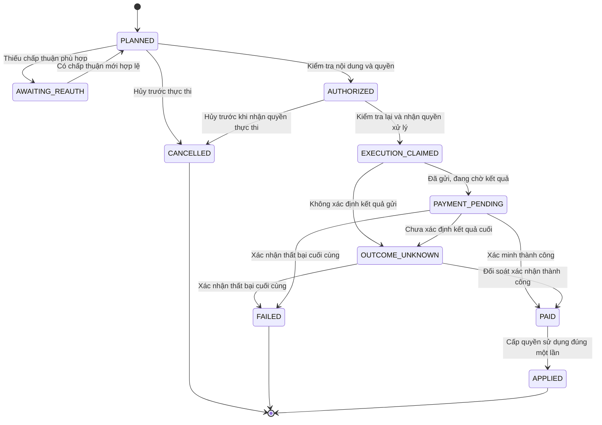

# Renewal authorization: kiểm soát quyền gia hạn đăng ký

## 1. Gia hạn cần một căn cứ cho phép rõ ràng

Trong chương **Subscription Rules**, renewal authorization là việc xác định một lần gia hạn đăng ký có được phép thực hiện hay không, do ai yêu cầu, cho kỳ nào và theo điều kiện thương mại nào. Quyết định này phải được đưa ra trước khi phát sinh hiệu lực như thu tiền hoặc cấp thêm thời gian sử dụng.

Một đăng ký đang hoạt động không tự chứng minh rằng hệ thống được phép thu tiền cho kỳ kế tiếp. Tương tự, có thẻ đã lưu, có token thanh toán hoặc có một worker chạy đúng lịch cũng chưa đủ để kết luận một lần gia hạn được cho phép.

Bài học thuộc module `SECURITY_APPLICATION_SECURITY_BUSINESS_LOGIC_SECURITY`, tập trung bảo vệ quy tắc nghiệp vụ khỏi việc bỏ bước xác nhận, sửa giá, dùng sai quyền hoặc gửi yêu cầu trùng. Các điều kiện dưới đây là mô hình sản phẩm minh họa, không phải mô tả quy tắc bắt buộc của mọi dịch vụ đăng ký.

Sau bài học, bạn cần phân biệt và phối hợp được bốn lớp quyết định:

1. **Quyền thao tác:** người dùng hoặc tiến trình có được tác động đến đúng đăng ký không?
2. **Căn cứ thương mại:** người có thẩm quyền đã đồng ý gia hạn theo gói, giá, kỳ hạn và phạm vi nào?
3. **Quyền sử dụng phương tiện thanh toán:** phương tiện đó có được dùng cho đúng bên trả tiền và mục đích không?
4. **Điều kiện thực thi hiện tại:** lần gia hạn này còn hợp lệ khi xét hủy đăng ký, thay đổi chính sách, thử lại và trạng thái kỳ đã xử lý không?

Thanh toán thành công là bằng chứng về một kết quả thu tiền. Nó không thay thế toàn bộ các kiểm tra trên và không tự cho phép mở lại một đăng ký đã hết quyền gia hạn.

## 2. Tình huống xuyên suốt và phạm vi mô hình

Giả sử một dịch vụ quản lý đăng ký theo tổ chức có dữ liệu sau:

| Thuộc tính | Giá trị minh họa |
| --- | --- |
| Tenant | Tổ chức A |
| Đăng ký | `sub_801`, gói Pro |
| Kỳ hiện tại | Từ đầu ngày 01/12/2026 đến đầu ngày 01/01/2027 |
| Múi giờ chốt kỳ | `Asia/Ho_Chi_Minh` |
| Kỳ cần gia hạn | Từ đầu ngày 01/01/2027 đến đầu ngày 01/02/2027 |
| Giá kỳ mới | 300.000 VND, giả định không có phí hoặc thuế bổ sung |
| Bên trả tiền | Tài khoản thanh toán của tổ chức A |
| Căn cứ tự động gia hạn | Một bản chấp thuận còn hiệu lực, tham chiếu phiên bản điều khoản cụ thể |

Hệ thống chốt các mốc kỳ thành thời điểm xác định, chẳng hạn lưu timestamp UTC và giữ quy tắc múi giờ đã dùng. Không cộng tùy tiện 30 ngày để thay cho một tháng lịch nếu hợp đồng dùng tháng lịch.

Mô hình của bài có các giả định:

- Tự động gia hạn chỉ áp dụng cho đăng ký đủ điều kiện và có chấp thuận hợp lệ.
- Mỗi kỳ có một định danh ổn định; nhiều lần gửi lại cùng kỳ không tạo nhiều lần cấp quyền sử dụng.
- Một lần gia hạn trả phí cần kết quả thanh toán được xác minh trước khi cấp kỳ mới. Nếu sản phẩm có thời gian ân hạn, quyền dùng tạm phải được mô hình hóa riêng.
- Hủy trước khi lần thực thi được nhận quyền xử lý sẽ chặn kỳ đó. Khi lần thực thi đã bắt đầu và kết quả thanh toán chưa rõ, hệ thống phải trả trạng thái đang xử lý và xử lý hủy theo chính sách được công bố; không hứa đã chắc chắn ngăn một khoản thu đang diễn ra.

Ví dụ, người dùng đồng ý tự động gia hạn Pro với giá 300.000 VND không có nghĩa là worker được tự đổi sang gói Enterprise 2.000.000 VND. Một điều chỉnh giá chỉ được thực hiện tự động nếu nằm trong phạm vi chấp thuận và quy tắc sản phẩm đã xác định; nếu không, phải yêu cầu xác nhận phù hợp trước khi thu tiền.

## 3. Các khái niệm dễ bị trộn lẫn

| Khái niệm | Nó chứng minh điều gì? | Nó chưa chứng minh điều gì? |
| --- | --- | --- |
| Đăng nhập thành công | Có danh tính được xác thực | Có quyền gia hạn đăng ký đang được chỉ định |
| Vai trò quản trị tổ chức | Có một tập quyền trong tổ chức | Luôn được dùng mọi phương tiện thanh toán hoặc bỏ qua điều kiện thương mại |
| `ACTIVE` | Đăng ký đang ở trạng thái hoạt động | Được tự động thu tiền kỳ tiếp theo |
| `autoRenew = true` | Có cấu hình mong muốn tự gia hạn | Còn tồn tại căn cứ chấp thuận hợp lệ cho kỳ, giá và bên trả tiền hiện tại |
| Token thanh toán | Có tham chiếu kỹ thuật đến phương tiện thanh toán | Được phép sử dụng token cho đối tượng hoặc mục đích bất kỳ |
| Worker có service token | Tiến trình được gọi chức năng được cấp quyền | Được tự tạo chấp thuận thay người có thẩm quyền |
| Thanh toán thành công | Một lần thu tiền có kết quả thành công đã được xác minh | Số tiền đúng, kỳ đúng và quyền cấp dịch vụ đúng nếu chưa đối chiếu |

Trong hệ thống tổ chức, bản chấp thuận có thể thuộc thẩm quyền của tổ chức và tiếp tục có hiệu lực khi nhân viên đã thiết lập nó rời tổ chức, nếu đó là chính sách đã chọn. Ngược lại, quyền thao tác thủ công của nhân viên phải được đánh giá theo tư cách hiện tại. Không dùng một session cá nhân đã hết hiệu lực làm căn cứ chạy tác vụ định kỳ, cũng không mặc định việc nhân viên rời tổ chức tự động hủy mọi cam kết của tổ chức.

## 4. Mô hình dữ liệu giúp kiểm tra đúng đối tượng

Một mô hình tối thiểu có thể tách các đối tượng sau:

| Đối tượng | Dữ liệu quan trọng | Mục đích |
| --- | --- | --- |
| `Subscription` | Tenant, chủ thể sử dụng, gói, mốc kỳ, trạng thái, phiên bản | Xác định đối tượng được gia hạn và trạng thái hiện tại |
| `RenewalConsent` | Người hoặc tổ chức chấp thuận, phạm vi, điều khoản, phiên bản, thời điểm hiệu lực và thu hồi | Lưu căn cứ cho phép gia hạn |
| `BillingAccount` | Tenant, bên trả tiền, quyền ủy nhiệm | Xác định chủ thể chịu khoản thu |
| `PaymentMethodReference` | Bên sở hữu, token nhà cung cấp, trạng thái và phạm vi sử dụng | Tránh dùng sai phương tiện thanh toán |
| `RenewalCycle` | Đăng ký, đầu kỳ, cuối kỳ, giá trị phải trả, consent version, trạng thái | Đại diện cho một kỳ cần xử lý |
| `PaymentAttempt` | Cycle, định danh lệnh bên ngoài, số tiền, loại tiền, trạng thái | Theo dõi một lần thực thi thanh toán |
| `EntitlementGrant` | Cycle nguồn, phạm vi quyền, thời gian hiệu lực | Chống cấp thêm quyền sử dụng nhiều lần |

Các mối liên kết phải được kiểm tra, không chỉ kiểm tra từng bản ghi tồn tại:

```text
subscription.tenant_id = renewal_cycle.tenant_id
renewal_cycle.subscription_id = subscription.id
consent.subscription_id = subscription.id
billing_account là bên trả tiền được phép cho subscription
payment_method được phép dùng bởi billing_account
payment_attempt.cycle_id = renewal_cycle.id
entitlement_grant.source_cycle_id = renewal_cycle.id
```

Có thể có thanh toán hộ hoặc ủy nhiệm giữa các chủ thể. Khi đó phải biểu diễn bằng quan hệ ủy nhiệm rõ ràng; không bỏ toàn bộ kiểm tra sở hữu vì một sản phẩm có hỗ trợ thanh toán hộ.

Bản chấp thuận cần lưu được nội dung đã được chấp thuận hoặc tham chiếu đến một phiên bản bất biến. Một cờ boolean không đủ để giải thích người dùng đã đồng ý giá nào, gói nào, kỳ nào hay phạm vi tự động điều chỉnh nào.

## 5. Các bất biến của renewal authorization

Với một kỳ `K` thuộc đăng ký `S`, quyết định được phép bắt đầu thu tiền có thể mô tả bằng các điều kiện đồng thời:

```text
Đúng tenant và đúng quan hệ sở hữu hoặc ủy nhiệm
AND S đủ điều kiện gia hạn tại thời điểm thực thi
AND K là kỳ hợp lệ theo lịch và chính sách của S
AND K chưa được hoàn tất hoặc bị hủy có hiệu lực
AND căn cứ chấp thuận còn hiệu lực và bao phủ nội dung K
AND giá, loại tiền, gói và thời hạn lấy từ nguồn máy chủ có thẩm quyền
AND bên trả tiền và phương tiện thanh toán được phép sử dụng
AND chưa có lần thu tiền khác đang có khả năng thành công cho cùng K
```

Các bất biến sau cần đúng qua mọi transaction và lần gửi lại:

1. Không tạo kỳ mới chỉ vì client thay idempotency key.
2. Một kỳ không được tự động chuyển thành một kỳ dài hơn hoặc gói đắt hơn ngoài phạm vi đã cho phép.
3. Hủy hoặc thu hồi chấp thuận có hiệu lực phải chặn việc bắt đầu những lần thu mới thuộc phạm vi bị chặn.
4. Không tạo thêm lần thu khi kết quả lần trước còn chưa xác định.
5. Mỗi kỳ đã được cấp quyền có tối đa một bản ghi hiệu lực nghiệp vụ tương ứng theo mô hình đã chọn.
6. Khoản thu thành công được đối chiếu đúng bên nhận tiền, kỳ, số tiền và loại tiền trước khi áp dụng.
7. Kết quả gửi lại, callback trùng hoặc worker chạy lại không kéo dài thời gian sử dụng lần nữa.

Cơ sở dữ liệu cục bộ có thể ngăn hệ thống tự tạo nhiều lệnh hoặc áp dụng nhiều lần. Bảo đảm không thu trùng ở nhà cung cấp còn cần cơ chế idempotency, truy vấn trạng thái và đối soát tương ứng của nhà cung cấp; một unique constraint cục bộ không kiểm soát được mọi hiệu lực bên ngoài.

## 6. Quyền thủ công, tự động và quyền của nhân viên vận hành

### 6.1. Gia hạn thủ công

Với lệnh do người dùng gửi, máy chủ phải kiểm tra người đó có quyền trên đúng đăng ký trong tenant hiện tại. Không lấy `tenantId`, `ownerId` hoặc một vai trò tự khai trong request body làm nguồn thẩm quyền.

Lựa chọn “thanh toán cho kỳ này” cũng không mặc nhiên là “bật tự động gia hạn cho các kỳ sau”. Hai ý định có phạm vi khác nhau và phải có trạng thái, nội dung xác nhận tương ứng.

Nếu cho người dùng chuyển phương tiện thanh toán khi gia hạn, phải kiểm tra phương tiện mới thuộc bên trả tiền hợp lệ hoặc có ủy nhiệm phù hợp. Biết một token không phải là được quyền dùng nó.

### 6.2. Tác vụ tự động

Worker chỉ được thực thi một quyền đã tồn tại theo chính sách; worker không tự tạo ra sự đồng ý. Một job đã được xếp lịch từ hôm trước phải đọc lại trạng thái trước khi bắt đầu thu tiền hôm nay.

Ví dụ, tại lúc xếp hàng, `autoRenew = true`, nhưng sau đó người dùng đã tắt tự động gia hạn. Payload cũ trong hàng đợi không được dùng để ghi đè lựa chọn mới hoặc bỏ qua việc kiểm tra phiên bản.

Service account nên có phạm vi chức năng và tenant phù hợp. Việc nó được đọc nhiều đăng ký để lập lịch không đồng nghĩa nó được bỏ qua quy tắc về bên trả tiền hoặc giá của từng đăng ký.

### 6.3. Nhân viên vận hành và ngoại lệ

Quyền hỗ trợ khách hàng không tự cho phép đánh dấu đã thanh toán hoặc gia hạn miễn phí. Nếu sản phẩm có quyền cấp thêm ngày, bỏ phí hoặc xử lý đặc biệt, cần loại thao tác, giới hạn, lý do và bằng chứng phê duyệt tương ứng.

Không thêm cờ `force=true` vào API gia hạn thông thường để bỏ mọi kiểm tra. Một ngoại lệ có thẩm quyền vẫn phải ghi rõ điều kiện nào được thay thế và ai cho phép; các kiểm tra tenant, đúng đối tượng và chống thực thi trùng vẫn phải giữ.

## 7. Giá và thời hạn phải nằm trong phạm vi đã được phép

Máy chủ cần xây một ảnh chụp điều kiện cho kỳ, chẳng hạn:

```text
subscription_id
cycle_start, cycle_end
plan_id, plan_version
pricing_version
amount_minor, currency
billing_account_id
payment_method_reference_id
consent_id, consent_version
policy_version
```

Ảnh chụp này giúp chứng minh đã quyết định trên nội dung nào. Nó không có nghĩa là mọi giá trị đều được phép cũ mãi: trước khi nhận quyền thực thi, phải xác định ảnh chụp còn phù hợp với các điều kiện đang có hiệu lực hay cần lập lại hoặc yêu cầu xác nhận mới.

Ví dụ:

- Giá được chấp thuận là 300.000 VND, giá mới thành 450.000 VND và vượt phạm vi đồng ý: không tự lấy giá mới để thu.
- Client gửi `amountMinor = 1` cho kỳ giá 300.000 VND: không dùng giá của client.
- Coupon chỉ hợp lệ cho kỳ đầu: không tiếp tục áp dụng vì payload gia hạn cũ chứa mã coupon.
- Có 10 seat nhưng hợp đồng đã chốt 25 seat cho kỳ mới: cần đối chiếu số lượng và phạm vi đồng ý, không chỉ kiểm tra đơn giá.
- Người dùng đổi gói giữa kỳ: phải có quy tắc xác định gói nào áp dụng tại ranh giới gia hạn; không để thứ tự job ngẫu nhiên quyết định giá.

Số tiền dùng kiểu số nguyên theo đơn vị tiền hệ thống hỗ trợ hoặc kiểu thập phân chính xác với quy tắc làm tròn rõ ràng. Kiểm tra miền giá trị và phép tính tràn số; không dùng số dấu phẩy động để so sánh số tiền đã thanh toán với số tiền phải trả.

Mốc kỳ được máy chủ tính theo lịch đã thống nhất. Khi gặp callback trễ, không đổi kỳ thành “một tháng kể từ lúc nhận callback” nếu ý định ban đầu là một kỳ lịch cố định.

## 8. Máy trạng thái và cuộc đua với lệnh hủy

Có thể tách trạng thái đăng ký khỏi trạng thái một lần gia hạn. `ACTIVE`, `CANCEL_AT_PERIOD_END`, `EXPIRED` mô tả vòng đời đăng ký; `PLANNED`, `PAYMENT_PENDING`, `APPLIED` mô tả tiến trình của một kỳ.

Máy trạng thái minh họa cho kỳ:



`AUTHORIZED` chỉ ghi nhận kiểm tra đã đạt ở một thời điểm; bước sang `EXECUTION_CLAIMED` vẫn phải kiểm tra lại điều kiện có thể thay đổi. Một thao tác gia hạn thủ công có thể đi theo cùng máy trạng thái nhưng căn cứ chấp thuận là xác nhận cụ thể của người có quyền thay vì chấp thuận tự động.

Sơ đồ này giản lược một kỳ có một lần thu. Nếu sản phẩm cho thử lại sau một thất bại cuối cùng, cần mô hình `PaymentAttempt` riêng dưới cùng cycle, với điều kiện tạo lần thử mới rõ ràng. Không chuyển lỗi chưa rõ thành thất bại cuối cùng để tạo thêm lệnh thu.

### 8.1. Điểm phân xử giữa hủy và bắt đầu thực thi

Một chính sách có thể dùng transaction nhận quyền xử lý làm điểm phân xử:

- Nếu lệnh hủy commit trước khi cycle được `EXECUTION_CLAIMED`, không tạo ý định thu cho kỳ đó.
- Nếu nhận quyền xử lý commit trước, hệ thống báo kỳ đang xử lý; yêu cầu hủy phải nói rõ hiệu lực đối với kỳ hiện tại và các kỳ sau.

Cả hai luồng phải khóa hoặc kiểm soát phiên bản trên cùng dữ liệu điều phối. Chỉ kiểm tra `autoRenew` ở worker rồi gọi mạng sau đó không tạo được ranh giới nhất quán.

Điểm nhận quyền xử lý không có nghĩa tiền đã bị thu. Nó xác định rằng hệ thống đã bắt đầu một lần thực thi mà việc hủy ngay có thể cần phối hợp với bên ngoài. Nếu sản phẩm cam kết vẫn có thể ngăn lần thu sau điểm này, phải thiết kế thêm cơ chế hủy hoặc xác minh với nhà cung cấp trước khi xác nhận lời hứa đó.

### 8.2. Tắt tự động gia hạn không được làm mất dấu một khoản thu

Nếu người dùng tắt tự động gia hạn trong lúc kết quả thanh toán đang chưa rõ, hệ thống phải ngăn các lần thu mới theo hiệu lực đã xác định, đồng thời tiếp tục đối soát lần đang diễn ra. Không xóa cycle, bỏ qua callback hoặc đổi nó thành `CANCELLED` khi chưa biết có bị thu tiền hay không.

Trong chính sách minh họa, hủy sau khi đã nhận quyền xử lý có thể áp dụng từ kỳ sau, nên thành công của kỳ đang xử lý vẫn được áp dụng nếu đúng điều kiện đã chốt. Nếu chính sách yêu cầu hủy kỳ hiện tại và hoàn tiền khi khoản thu đã xảy ra, đó là luồng xử lý riêng có trạng thái và bằng chứng, không phải sửa lịch sử thanh toán thành thất bại.

## 9. Định danh kỳ, idempotency và thử lại thanh toán

### 9.1. Kỳ gia hạn phải có định danh ổn định

Client có thể gửi lại cùng yêu cầu với cùng key hoặc key mới; scheduler cũng có thể quét cùng đăng ký nhiều lần. Vì vậy, ngoài idempotency của HTTP, cần ràng buộc duy nhất cho một kỳ nghiệp vụ.

Ví dụ, với hợp đồng không có nhiều kỳ song song:

```text
UNIQUE(tenant_id, subscription_id, period_start)
```

`period_start` do máy chủ tính theo lịch của đăng ký. `period_end` và các điều kiện của kỳ được lưu và đối chiếu; thay đổi thời hạn phải đi theo nghiệp vụ thích hợp, không tạo một cycle mới chồng lên cùng đầu kỳ để tránh ràng buộc.

Đừng đưa `consent_version`, `worker_run_id` hoặc idempotency key vào thành phần làm một kỳ trở nên duy nhất. Nếu mỗi lần đổi chấp thuận hoặc mỗi lần chạy job lại tạo một cycle mới cho cùng kỳ, kẻ lạm dụng có thể đi vòng cơ chế chống trùng.

Với hợp đồng có nhiều thành phần độc lập, phải định nghĩa khóa nghiệp vụ tương ứng, chẳng hạn thêm định danh thành phần hợp đồng. Điểm cần giữ là định danh phản ánh nghĩa vụ thực tế, không phải một giá trị tùy ý đổi được khi gửi lại.

### 9.2. Idempotency của lệnh từ client

Khóa idempotency có thể được lưu trong phạm vi:

```text
(tenant_id, principal_or_client_id, operation, idempotency_key)
```

Máy chủ gắn nó với fingerprint của nội dung có ý nghĩa và định danh cycle hoặc lệnh đã tạo:

- Cùng key và cùng nội dung: trả cùng tài nguyên hoặc kết quả, không tạo ý định mới.
- Cùng key nhưng đổi đăng ký, kỳ hoặc phương tiện thanh toán: trả xung đột theo hợp đồng.
- Khác key nhưng cùng kỳ: ràng buộc nghiệp vụ vẫn dẫn về cùng cycle, không tạo kỳ thanh toán thứ hai.

Việc lưu key và tạo tài nguyên kết quả phải nhất quán. Khi trả lại kết quả cũ, vẫn xác thực và kiểm tra quyền hiện tại; một key không cấp quyền xem thông tin thanh toán của tổ chức khác.

### 9.3. Idempotency với nhà cung cấp

Mỗi `PaymentAttempt` có định danh lệnh ổn định đã được lưu trước khi gửi ra ngoài. Khi bị timeout hoặc worker chạy lại, dùng lại định danh của chính lần thử đó theo hợp đồng của nhà cung cấp.

```text
Cycle K
  └── Attempt A1: merchant_reference cố định
        ├── Gửi lần đầu
        ├── Gửi lại cùng ý định nếu nhà cung cấp bảo đảm idempotency
        └── Tra cứu hoặc đối soát theo cùng định danh
```

Không tạo A2 chỉ vì chưa nhận được response của A1. Khi A1 còn có thể thành công, A2 có thể tạo một khoản thu thứ hai cho cùng kỳ.

Nếu nhà cung cấp xác nhận A1 đã thất bại cuối cùng và không thể thành công về sau, sản phẩm có thể cho phép A2. Trước A2 phải kiểm tra lại quyền, hiệu lực chấp thuận, việc hủy, giới hạn thử lại và số tiền kỳ hiện tại. Không tự đổi phương tiện, số tiền hoặc điều kiện ngoài phạm vi cho phép.

Một lần từ chối tạm thời không phải lúc nào cũng là bằng chứng về thất bại cuối cùng; trạng thái và mã lỗi phải được hiểu theo hợp đồng tích hợp. Nếu key bên ngoài hết thời gian bảo đảm chống trùng, không mặc định gửi lại vẫn an toàn; cần truy vấn hoặc đối soát trước khi phát sinh thêm hiệu lực.

### 9.4. Cấp quyền sử dụng chỉ một lần

Một ràng buộc điển hình là:

```text
UNIQUE(source_cycle_id) trên bản ghi cấp quyền cho kỳ
```

Nếu một kỳ sinh nhiều quyền con, dùng bản ghi áp dụng kỳ duy nhất ở cấp cha hoặc ràng buộc trên từng loại quyền phù hợp. Không đặt unique khiến một kỳ hợp lệ không thể có nhiều quyền con, cũng không để mỗi callback tự tạo cả một bộ quyền mới.

Không dùng cách sau cho mỗi callback thành công:

```text
subscription.current_period_end += 1 tháng
```

Callback trùng sẽ cộng thêm một tháng nữa. Thay vào đó, áp dụng đúng `cycle_start` và `cycle_end` đã chốt, kèm một dấu áp dụng duy nhất trong cùng transaction. Với mô hình các kỳ liền nhau của bài, còn cần kiểm tra đầu kỳ mới khớp ranh giới kỳ đã có. Nếu có khoảng trống hoặc chồng lấn, xử lý theo chính sách rõ ràng, không tự sửa bằng cách lấy giá trị ngày lớn hơn.

## 10. Transaction nhận quyền thực thi và outbox

Các thao tác sau cần nằm trong cùng một quyết định cục bộ nhất quán:

1. Đọc và bảo vệ đăng ký cùng cycle đang xử lý.
2. Kiểm tra quyền người gọi hoặc quyền tiến trình đối với đúng đối tượng.
3. Kiểm tra thời điểm được phép chạy, trạng thái hủy, phiên bản điều kiện và căn cứ chấp thuận.
4. Kiểm tra bên trả tiền, phương tiện thanh toán và các lần thử đã tồn tại.
5. Chuyển cycle sang trạng thái nhận quyền thực thi, tạo attempt và ghi outbox chứa ý định thu tiền.

Thời điểm được phép chạy lấy từ đồng hồ máy chủ và lịch đã lưu, không từ `clientNow` hoặc một cờ `isDue` trong request. Một scheduler chạy sớm không được tự bỏ quy tắc chốt kỳ; nếu sản phẩm cho thu trước ngày bắt đầu kỳ thì cửa sổ đó phải được mô hình hóa.

Mã giả Java dưới đây minh họa cách tách quyết định cục bộ khỏi gọi mạng. Nó giả định các dữ liệu điều phối và chính sách được lưu hoặc được kiểm chứng theo phiên bản trong cùng ranh giới nhất quán. Đây không phải mã triển khai đầy đủ.

```java
@Transactional
public RenewalReceipt claimRenewal(
        Actor actor, UUID subscriptionId, Instant cycleStart) {

    var sub = subscriptions.findForUpdate(
        actor.tenantId(), subscriptionId
    ).orElseThrow(NotFound::new);

    access.requireCanInitiateRenewal(actor, sub);

    // Đầu kỳ phải khớp lịch máy chủ; client không tự chọn kỳ tùy ý.
    schedule.requireKnownCycleStart(sub, cycleStart);
    var cycle = cycles.findOrCreateForUpdate(sub, cycleStart);
    // UNIQUE(tenantId, subscriptionId, periodStart).

    if (cycle.hasClaimedPendingPaidOrAppliedExecution()) {
        return RenewalReceipt.forExisting(cycle);
    }

    require(!cycle.isCancelled(), "CYCLE_CANCELLED");
    policy.requireEligibleNow(sub, cycle, clock.instant());

    var consent = consents.findEffectiveForUpdate(sub.id())
        .orElseThrow(ReauthorizationRequired::new);
    var terms = pricing.resolveAuthoritativeTerms(sub, cycle);

    // Không âm thầm thay số tiền hoặc gói ngoài nội dung đã cho phép.
    consent.requireCovers(terms, cycle);
    cycle.requireTermsConsistentOrRequireReauthorization(terms);

    var payer = billing.requireAuthorizedPayerForUpdate(sub);
    var method = payments.requireUsableMethodForUpdate(payer, consent);
    consent.requirePaymentScope(payer, method);

    require(!attempts.hasUnresolvedOrSuccessfulAttempt(cycle.id()),
            "EXISTING_PAYMENT_ATTEMPT");

    var attempt = attempts.create(
        cycle.id(), terms.amountMinor(), terms.currency(),
        payer.id(), method.id(), consent.id(), consent.version()
    ); // Tạo merchantReference ổn định và lưu trước khi gọi mạng.

    cycle.claimExecution(attempt.id(), consent.version(), terms);
    outbox.appendChargeRequested(attempt.id());

    return RenewalReceipt.pending(cycle, attempt);
}
```

Các giả định cần được thực hiện trong hệ thống thật:

- Các hàm `ForUpdate` thật sự khóa trạng thái cần bảo vệ; không chỉ mang tên như vậy.
- Cả luồng hủy, sửa điều kiện và nhận quyền xử lý dùng cùng quy tắc khóa hoặc so sánh phiên bản. Khóa một dòng không tự bảo vệ thay đổi độc lập ở dịch vụ khác.
- `findOrCreateForUpdate` xử lý xung đột unique khi hai worker cùng tạo cycle; nó không chỉ là “SELECT rồi INSERT” thiếu bảo vệ.
- Hàm kiểm tra đủ điều kiện giới hạn trạng thái nguồn. Ví dụ này không dùng gia hạn để tự khôi phục một đăng ký `EXPIRED` hoặc thay đổi một trial chưa có chấp thuận thu tiền; các trường hợp đó cần luồng tương ứng.
- Khi cùng thao tác nhiều đối tượng, mọi luồng liên quan tuân theo thứ tự khóa nhất quán. Deadlock hoặc xung đột phiên bản được thử lại toàn bộ với dữ liệu mới.
- Không có lời gọi thu tiền trong transaction cơ sở dữ liệu này. Outbox chỉ được gửi sau commit.
- Consumer của outbox xử lý lại cùng attempt, không tạo attempt mới cho mỗi lần nhận thông điệp.
- Việc retry một attempt đã xác nhận thất bại dùng quy trình riêng có kiểm tra lại; không đi vòng bằng cách đổi kỳ.

Nếu transaction rollback, không tồn tại ý định thu đã commit để worker thực thi. Nếu commit nhưng process chết trước khi gửi, outbox còn đó để phục hồi. Nếu gửi thành công rồi process chết trước khi lưu kết quả, hệ thống phải dùng định danh attempt để truy vấn hoặc nhận lại kết quả, không suy ra rằng chưa thu tiền.

## 11. Xác minh thanh toán và áp dụng kỳ

### 11.1. Callback là dữ liệu bên ngoài

Không cho client gọi một endpoint với `paymentStatus = SUCCESS` để tự mở khóa kỳ mới. Callback hoặc sự kiện tích hợp phải được xác minh theo cơ chế của nhà cung cấp; khi cần, đối chiếu lại bằng truy vấn server-to-server.

Sau khi xác minh nguồn gửi, vẫn cần đối chiếu ý nghĩa nghiệp vụ:

| Trường cần đối chiếu | Rủi ro nếu bỏ qua |
| --- | --- |
| Định danh merchant hoặc bên nhận tiền | Dùng một giao dịch thuộc tài khoản nhận tiền khác |
| Định danh giao dịch và attempt | Gắn một khoản thu cho nhiều cycle |
| Số tiền và loại tiền | Dùng giao dịch giá thấp hoặc sai đơn vị để mở gói đắt hơn |
| Bên trả tiền và tham chiếu đã chốt | Gán kết quả của đối tượng khác cho đăng ký hiện tại |
| Trạng thái có đủ điều kiện áp dụng | Nhầm đang xử lý hoặc mới được chấp thuận thanh toán với kết quả hoàn tất cần thiết |
| Cycle và phiên bản nội dung | Áp dụng khoản thu cũ vào kỳ hoặc gói mới |

Chỉ đối chiếu các thuộc tính thực sự được nhà cung cấp cam kết trả về hoặc có thể xác minh. Nếu không thể kiểm chứng một quan hệ cần thiết, cần thiết kế thêm tham chiếu hoặc bước đối soát; không tự tin vào một trường do phía gọi tự gắn vào.

### 11.2. Transaction áp dụng kết quả

Với một khoản thu thành công hợp lệ, transaction cục bộ có thể:

1. Khóa hoặc kiểm soát phiên bản trên đăng ký, cycle và attempt theo thứ tự đã thống nhất.
2. Ghi nhận định danh giao dịch bên ngoài với ràng buộc duy nhất trong phạm vi nhà cung cấp và merchant thích hợp.
3. Chuyển attempt và cycle sang kết quả thành công nếu chuyển trạng thái hợp lệ.
4. Tạo dấu áp dụng hoặc `EntitlementGrant` duy nhất cho cycle.
5. Cập nhật ranh giới kỳ theo lịch đã chốt và lưu sự kiện outbox để thông báo.

Nếu dấu áp dụng đã tồn tại, trả lại kết quả cũ. Không thực hiện phép cộng ngày lần nữa.

Nếu nghiệp vụ thu tiền và cấp quyền thuộc hai dịch vụ, một transaction không bao trùm cả hai. Dịch vụ cấp quyền cần chống trùng theo cycle hoặc định danh sự kiện nghiệp vụ, còn phía thanh toán cần trạng thái bền vững để tiếp tục gửi đến khi được xử lý. Không đánh dấu đã áp dụng chỉ vì đã phát một thông điệp chưa có bằng chứng xử lý.

### 11.3. Sự kiện đến trễ hoặc sai thứ tự

Một sự kiện `PENDING` cũ không được kéo lùi kết quả đã xác minh `PAID`. Sự kiện thất bại không chắc chắn không được ghi đè thành công đã có bằng chứng. Nếu nhận hai kết quả cuối mâu thuẫn hoặc một giao dịch không khớp, lưu dữ liệu và đối soát thay vì chọn theo thời điểm nhận gần nhất.

Sau khi khoản thu của một lần thực thi đã được cho phép thành công, việc chấp thuận cho các lần thu tương lai bị thu hồi không phải lý do để bỏ qua khoản thu đó. Cần giải quyết nghĩa vụ hiện có theo chính sách hủy, cấp dịch vụ hoặc hoàn tiền tương ứng. Xác minh kết quả cũ không đồng nghĩa được tạo thêm lệnh thu mới.

Nếu bị thu trùng bên ngoài dù hệ thống chỉ muốn một lần, ghi nhận khoản bất thường và xử lý bù có kiểm soát. Không cấp thêm tháng để che đi sự cố và không xóa bằng chứng của khoản thu thứ hai.

## 12. Hợp đồng API tránh cho client tự cấp quyền

Một API gia hạn thủ công có thể nhận ý định và phiên bản điều kiện đã được hiển thị:

```http
POST /subscriptions/sub_801/renewal-requests
Authorization: Bearer <access-token>
Idempotency-Key: <client-generated-key>
Content-Type: application/json

{
  "quoteId": "quote_412",
  "expectedSubscriptionVersion": 18,
  "paymentMethodReferenceId": "pm_207"
}
```

Máy chủ kiểm tra quote còn hiệu lực, thuộc đúng đăng ký và người có quyền, rồi đối chiếu giá, kỳ, bên trả tiền và phương tiện thanh toán. `quoteId` không phải chứng cứ xác nhận nếu người gọi chưa có hành động chấp thuận theo hợp đồng sản phẩm; endpoint này phải có ý nghĩa rõ ràng là yêu cầu thực hiện nội dung đã hiển thị.

Các trường sau không được dùng làm nguồn thẩm quyền từ client:

```text
isAuthorized, paymentStatus, approvedBy, tenantId,
renewedUntil, consentVersionToTrust, totalPaid, forceRenewal
```

Nếu client gửi chúng, API xử lý theo hợp đồng giới hạn trường được phép ghi và không gán thẳng vào entity. Đặc biệt, `renewedUntil` phải do máy chủ tính từ cycle hợp lệ; không nhận một ngày bất kỳ rồi lưu làm quyền sử dụng mới.

Một response chờ xử lý có thể là:

```json
{
  "renewalCycleId": "cycle_901",
  "status": "PAYMENT_PENDING",
  "periodStart": "2026-12-31T17:00:00Z",
  "periodEnd": "2027-01-31T17:00:00Z",
  "amountMinor": "300000",
  "currency": "VND"
}
```

Hai mốc UTC này tương ứng đầu ngày 01/01/2027 và 01/02/2027 theo múi giờ của ví dụ. Response chỉ nói hệ thống đang xử lý; client không được coi đó là bằng chứng đã gia hạn thành công. Trạng thái quyền sử dụng phải lấy từ nguồn máy chủ có thẩm quyền.

Cập nhật tự động gia hạn và hủy cần endpoint có ngữ nghĩa riêng. Bật lại tự động gia hạn phải có hành động đủ thẩm quyền và căn cứ chấp thuận còn phù hợp; không để một request gia hạn cũ đến trễ tự bật lại cờ đã bị tắt.

## 13. Kiểm thử các tình huống lạm dụng logic

Sau mỗi kiểm thử, đọc cycle, attempt, trạng thái chấp thuận, lệnh thu đã phát, dấu áp dụng và mốc quyền sử dụng. Chỉ kiểm tra mã HTTP sẽ bỏ sót trường hợp API trả lỗi nhưng đã có hiệu lực bên ngoài.

| Tình huống | Cách tạo tình huống | Kết quả cần chứng minh |
| --- | --- | --- |
| Sai tenant | Đổi `subscriptionId` sang tổ chức khác | Không lộ dữ liệu hoặc tạo ý định gia hạn ngoài quyền |
| Sai người trả tiền | Chọn phương tiện của bên khác không có ủy nhiệm | Không phát lệnh thu |
| Chỉ có thẻ đã lưu | Tự gia hạn khi không có chấp thuận phù hợp | Bị chặn hoặc yêu cầu xác nhận mới |
| Bỏ xác nhận | Gửi `isAuthorized=true` hoặc gọi thẳng endpoint nội bộ | Không thay thế được căn cứ chấp thuận |
| Giá ngoài phạm vi | Giá từ 300.000 lên 450.000 ngoài điều kiện cho phép | Không tự thu theo giá mới |
| Sửa quote hoặc kỳ | Dùng quote của đăng ký khác, quote hết hạn hoặc ngày do client bịa | Không tạo cycle trái lịch hoặc dùng điều kiện sai |
| Đã tắt tự động gia hạn | Để job cũ chạy sau khi lệnh tắt đã commit | Job không bắt đầu lần thu mới bị chặn bởi hiệu lực hủy |
| Hai worker cùng kỳ | Đồng thời nhận xử lý cùng đăng ký và đầu kỳ | Một cycle và một quyền thực thi hợp lệ cho kỳ |
| Đổi idempotency key | Gửi nhiều key cho cùng kỳ | Không tạo nhiều cycle hoặc nhiều lần thu đang còn khả năng thành công |
| Timeout sau khi gửi | Nhà cung cấp đã nhận nhưng response bị mất | Không tạo attempt mới khi kết quả cũ chưa rõ |
| Callback trùng | Gửi lại cùng bằng chứng thành công nhiều lần | Một dấu áp dụng, mốc kết thúc không tăng lặp |
| Callback sai tiền | Thành công với số tiền hoặc loại tiền khác | Không cấp quyền như thể đã trả đúng |
| Callback sai thứ tự | Thành công rồi nhận thông báo chờ cũ | Không kéo lùi trạng thái đã chốt |
| Hủy cạnh tranh với claim | Đồng bộ hai transaction tại điểm quyết định | Kết quả tuân theo điểm phân xử và phản hồi đúng hiệu lực hủy |
| Mất quyền thao tác | Người dùng bị gỡ quyền rồi gửi lại lệnh thủ công | Không thực hiện thao tác mới dựa vào session hoặc quote cũ |
| Lỗi khi cấp quyền | Thanh toán thành công nhưng transaction áp dụng rollback | Giữ bằng chứng thanh toán, có thể áp dụng lại đúng một lần |
| Gia hạn chạy sớm | Scheduler gọi trước cửa sổ được phép | Không bỏ kiểm tra thời gian vì là tác vụ hệ thống |
| Bật lại ngoài ý muốn | Request cũ đến sau khi đã tắt tự động gia hạn | Không tự tái lập chấp thuận hoặc bật lại cấu hình |

### 13.1. Kiểm thử đồng thời phải có điểm tranh chấp thật

Hai request nối tiếp không đủ chứng minh cơ chế chống race condition. Dùng hai transaction hoặc kết nối độc lập, có điểm đồng bộ để hai luồng cùng cạnh tranh trên trạng thái ban đầu.

Với hai worker cùng gia hạn một kỳ, cần kiểm tra:

```text
Số cycle của cùng khóa nghiệp vụ = 1
Số attempt đang có khả năng thành công cho kỳ <= 1
Số ý định thu độc lập = 1
Số lần áp dụng quyền sử dụng <= 1
Mốc kỳ sau áp dụng = cycle_end đã chốt
```

Outbox có thể phát lại cùng thông điệp, nên số lần truyền mạng không nhất thiết bằng một. Cần chứng minh các lần phát lại dùng cùng định danh và không tạo hiệu lực kinh tế mới, thay vì chỉ đếm số lần hàm gửi được gọi.

Với hủy và claim, chạy được cả hai thứ tự commit. Nếu hủy thắng, không có ý định thu cho kỳ bị chặn. Nếu claim thắng, phản hồi hủy phải thể hiện lần hiện tại đang xử lý và hiệu lực tiếp theo, đồng thời không tạo thêm lần thu mới sau hiệu lực thu hồi.

### 13.2. Kiểm thử theo chuỗi hành động

Các chuỗi sau giúp phát hiện lỗi mà kiểm thử từng endpoint riêng lẻ khó thấy:

```text
Chấp thuận → xếp lịch → tắt tự động gia hạn → worker chạy
Lấy quote → đổi giá → xác nhận quote cũ
Claim → gửi thanh toán → timeout → worker khởi động lại
Thanh toán thành công → callback trùng → callback cũ đến trễ
Thu hồi chấp thuận → gửi lại request bật cũ
Thất bại cuối cùng → đổi phương tiện → thử lại trong cùng cycle
Hủy cạnh tranh với claim → callback thành công đến trễ
```

Có thể sinh các chuỗi và kiểm tra bất biến sau mỗi bước đã commit: không gia hạn ngoài quyền, không tạo nhiều nghĩa vụ cho cùng kỳ, không thử thu mới khi còn kết quả chưa rõ và không áp dụng một kỳ nhiều lần.

## 14. Audit, đối soát và phát hiện lạm dụng

Dấu vết cần giải thích được vì sao một lần gia hạn được phép, không chỉ ghi rằng “job chạy thành công”. Những dữ liệu quan trọng gồm:

- Tenant, đăng ký, cycle và khoảng thời gian được gia hạn.
- Người hoặc tiến trình khởi tạo; danh tính có thẩm quyền chấp thuận và phạm vi ủy nhiệm.
- Consent ID, phiên bản điều khoản, giá, gói, chính sách và điều kiện đã chốt.
- Bên trả tiền và tham chiếu phương tiện; không ghi bí mật thanh toán hoặc token truy cập vào log.
- Thời điểm nhận quyền thực thi, thời điểm yêu cầu hủy và hiệu lực hủy được xác nhận.
- Attempt ID, định danh đối chiếu bên ngoài, kết quả xác minh và dấu áp dụng quyền sử dụng.

Bằng chứng của thay đổi thành công phải được lưu bền vững cùng ranh giới thích hợp. Nếu cần lưu một quyết định bị từ chối, lưu qua cơ chế sự kiện bảo mật phù hợp; một dòng audit nằm trong transaction đã rollback sẽ không còn tồn tại.

Đối soát cần phát hiện ít nhất: đã thu nhưng chưa cấp quyền, đã cấp quyền nhưng chưa có căn cứ thu hoặc miễn phí hợp lệ, nhiều khoản thu cho cùng kỳ, số tiền không khớp và cycle chưa rõ kết quả quá lâu. Xử lý các chênh lệch qua quy trình có thẩm quyền, giữ nguyên bằng chứng gốc.

Tín hiệu lạm dụng có thể là nhiều yêu cầu đổi key cho cùng kỳ, lặp lại việc chọn phương tiện không thuộc quyền, liên tục thử gia hạn ngoài cửa sổ, hoặc nhân viên vận hành dùng ngoại lệ trên nhiều tổ chức. Cảnh báo hỗ trợ phát hiện; kiểm tra quyền và bất biến vẫn phải chặn ngay trong luồng thực thi.

## 15. Tự đánh giá thiết kế

1. Hệ thống chứng minh quyền gia hạn bằng dữ liệu nào ngoài `ACTIVE` và `autoRenew=true`?
2. Bản chấp thuận có bao phủ đúng gói, số tiền, kỳ, bên trả tiền và phương tiện hiện tại không?
3. Job cũ có thể vượt một lệnh hủy mới không, và đâu là điểm phân xử giữa hai luồng?
4. Nếu client đổi key hoặc scheduler chạy lại, điều gì vẫn giữ cùng một định danh kỳ?
5. Nếu nhà cung cấp timeout, điều gì ngăn tạo một lần thu mới khi lần cũ còn có thể thành công?
6. Callback được đối chiếu những gì trước khi cấp quyền, và callback trùng bị chặn ở đâu?
7. Hệ thống áp dụng mốc kỳ đã chốt hay cộng thêm thời gian mỗi lần nhận thông báo?
8. Khi chấp thuận bị thu hồi, hệ thống ngăn các lần thu mới và xử lý kết quả cũ khác nhau như thế nào?

Renewal authorization an toàn gắn một kỳ gia hạn với đúng chủ thể, căn cứ chấp thuận và điều kiện thực thi. Quyền thao tác, thanh toán và quyền sử dụng cần có quan hệ kiểm chứng được, cùng cơ chế chống trùng và phục hồi để vẫn đúng khi hủy, thử lại, callback đến trễ hoặc nhiều worker hoạt động đồng thời.
