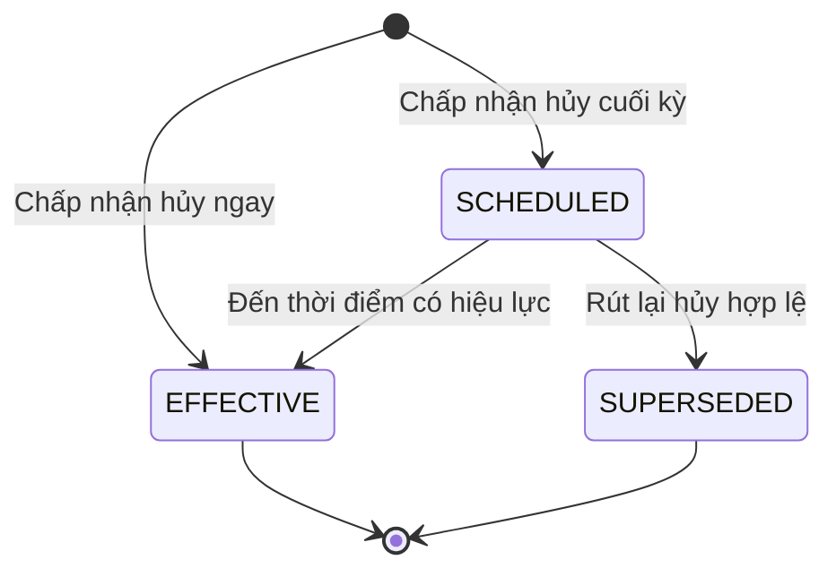

# Cancellation timing — Thời điểm hủy thuê bao và các bất biến bảo mật

## 1. Vì sao thời điểm hủy là vấn đề bảo mật nghiệp vụ?

**Cancellation timing** là tập hợp quy tắc xác định khi nào yêu cầu hủy thuê bao được chấp nhận, khi nào ngừng gia hạn, khi nào quyền sử dụng kết thúc và những nghĩa vụ tính phí nào vẫn còn hiệu lực.

Một nút “Hủy thuê bao” có thể khởi động nhiều thay đổi khác nhau. Người dùng được phép hủy không đồng nghĩa họ được phép chọn tùy ý ngày kết thúc, xóa hóa đơn đã phát sinh hoặc nhận lại toàn bộ phí. Nếu backend gom mọi thay đổi vào một cờ `canceled`, hệ thống rất dễ thu phí sai hoặc cấp quyền sử dụng ngoài chính sách.

Trong chương **Subscription Rules** của module `SECURITY_APPLICATION_SECURITY_BUSINESS_LOGIC_SECURITY`, bài học tập trung bảo vệ quy tắc hủy khỏi các cách lạm dụng như sửa mốc thời gian, bỏ qua phê duyệt, hủy thuê bao của người khác, gửi yêu cầu trùng và khai thác cuộc đua giữa hủy với gia hạn.

Các chính sách trong bài là ví dụ thiết kế sản phẩm, không phải quy định chung bắt buộc cho mọi dịch vụ. Trước khi triển khai, đội phát triển cần chốt chính sách cụ thể để API, worker, hệ thống thu phí và quyền truy cập cùng thực thi một ý nghĩa.

Sau bài học, bạn có thể:

- Phân biệt yêu cầu hủy, việc hủy có hiệu lực, quyền truy cập và nghĩa vụ thanh toán.
- Mô tả chính xác ranh giới kỳ và điều kiện chấp nhận hủy.
- Thiết kế transaction, idempotency và state machine cho luồng hủy.
- Xử lý sự kiện trùng, sự kiện đến muộn và kết quả thu phí chưa xác định.
- Kiểm thử các cuộc đua thời gian có khả năng phá vỡ bất biến nghiệp vụ.

## 2. Tách những thời điểm có ý nghĩa khác nhau

### 2.1. Các mốc cần định nghĩa

| Mốc | Ý nghĩa | Nguồn có thẩm quyền |
|---|---|---|
| `received_at` | Hệ thống tiếp nhận request | Thành phần tiếp nhận đáng tin cậy |
| `accepted_at` | Quyết định hủy được chấp nhận và lưu thành công | Dịch vụ điều phối theo quy tắc transaction |
| `current_period_start` | Bắt đầu kỳ hiện tại | Dữ liệu kỳ thuê bao đã được xác lập |
| `current_period_end` | Kết thúc kỳ hiện tại | Dữ liệu kỳ thuê bao đã được xác lập |
| `cancellation_cutoff_at` | Mốc giới hạn để chặn lần gia hạn được chỉ định | Chính sách áp dụng cho kỳ đó |
| `cancel_effective_at` | Thời điểm việc hủy có hiệu lực theo chính sách | Máy chủ tính từ trạng thái và chính sách |
| `access_end_at` | Mốc kết thúc quyền truy cập được cấp | Dịch vụ quản lý quyền sử dụng |
| `renewal_decision_at` | Thời điểm xác lập quyết định gia hạn | Dịch vụ điều phối gia hạn |
| `provider_confirmed_at` | Thời điểm xác nhận trạng thái bên cung cấp thu phí | Kết quả hoặc sự kiện đã được xác minh |

Không nhất thiết phải có tất cả các cột này trong cùng một bảng. Điều cần thiết là phân biệt được ý nghĩa và truy vết được các mốc liên quan.

Thời điểm người dùng nhấn nút trên trình duyệt không phải mốc đáng tin cậy để quyết định hoàn phí hay áp dụng giá. Client có thể chỉnh đồng hồ hoặc gửi lại request cũ với timestamp tùy ý.

### 2.2. Hủy ngay và hủy cuối kỳ

| Chế độ | Ngừng gia hạn | Quyền truy cập | Phí và hóa đơn |
|---|---|---|---|
| `IMMEDIATE` | Dừng các lần gia hạn tương lai theo trạng thái đã xác nhận | Kết thúc tại mốc máy chủ chấp nhận hoặc mốc chính sách chỉ định | Xử lý riêng theo nghĩa vụ đã phát sinh và quy tắc hoàn |
| `END_OF_PERIOD` | Chặn lần gia hạn tại ranh giới đã được chấp nhận | Giữ quyền đến cuối kỳ hợp lệ | Không tự động xóa phí của kỳ hiện tại |

Hủy ngay không tự chứng minh người dùng được hoàn toàn bộ tiền. Hủy cuối kỳ cũng không cho phép kéo dài quyền truy cập thêm một kỳ chỉ vì worker kết thúc chạy chậm.

Trong một số sản phẩm, người dùng chỉ có một trong hai lựa chọn. API phải kiểm tra chế độ được phép, không nhận một giá trị bất kỳ rồi coi đó là quyết định chính sách.

### 2.3. Khoảng thời gian nửa mở

Một kỳ có thể được biểu diễn bằng khoảng:

```text
[period_start, period_end)
```

Trong mô hình này, quyền của kỳ có hiệu lực khi:

```text
period_start <= server_now < access_end_at
```

Ví dụ kỳ giả lập bắt đầu `2026-12-01T00:00:00Z`, kết thúc `2027-01-01T00:00:00Z`. Với hủy cuối kỳ, quyền của kỳ đó hết tại đúng mốc kết thúc, không phải sau khi cron chạy xong. Mốc `2027-01-01T00:00:00Z` tương ứng 07:00 ngày 01/01/2027 theo giờ Việt Nam.

Quy tắc `<` hay `<=` tại cutoff phải được chốt rõ. Bài học dùng `accepted_at < cancellation_cutoff_at` cho ví dụ chặn gia hạn trước hạn; request tại đúng cutoff không thuộc nhóm được chấp nhận trước hạn.

## 3. Chốt chính sách trước khi viết luồng xử lý

Một hợp đồng hủy cần trả lời tối thiểu:

1. Chế độ hủy nào được hỗ trợ cho từng gói hoặc trạng thái thuê bao?
2. Request phải được tiếp nhận hay phải được chấp nhận trước cutoff?
3. Cutoff nằm ở cuối kỳ hay sớm hơn, và người dùng được thông báo bằng cách nào?
4. Những khoản phí nào đã được xác lập trước khi hủy?
5. Khi nào quyền truy cập kết thúc, có thời gian ân hạn hay không?
6. Hủy đã lên lịch có thể rút lại không, trước mốc nào và bởi ai?
7. Hủy liên quan đến nhà cung cấp bên ngoài được xem là hoàn tất ở bước nào?
8. Nếu có hoàn phí, công thức, giới hạn và quyền phê duyệt là gì?

Để theo dõi các ví dụ kỹ thuật tiếp theo, giả sử sản phẩm chọn chính sách:

```text
- Hỗ trợ hủy ngay và hủy cuối kỳ.
- Hủy cuối kỳ được chấp nhận trước period_end sẽ chặn lần gia hạn đó.
- cancellation_cutoff_at = current_period_end.
- Quyết định chấp nhận lấy thời gian máy chủ trong vùng xử lý được đồng bộ.
- Không tạo nghĩa vụ thu cho kỳ kế tiếp trước cutoff trong mô hình này.
- Hủy không tự động hoàn phí hoặc xóa nghĩa vụ của kỳ đã được xác lập.
- Việc rút lại hủy cuối kỳ chỉ được phép trước khi hủy có hiệu lực.
```

Nếu dịch vụ tạo nghĩa vụ thu sớm hơn cuối kỳ, chính sách và cách điều phối phải thay đổi tương ứng. Không vừa cam kết “hủy trước cuối kỳ sẽ không bị gia hạn” vừa để một tiến trình thu không thể hủy chạy từ trước mốc đó.

Trường hợp sản phẩm cam kết tính theo `received_at` cần thiết kế đường tiếp nhận bền vững và cơ chế bảo đảm yêu cầu đã nhận trước hạn được xét trước khi chốt gia hạn. Lưu một timestamp nhận request rồi vẫn cho scheduler bỏ qua hàng đợi chưa xử lý không thực hiện được cam kết ấy.

Chính sách theo `accepted_at` cũng cần vận hành công bằng: tránh giữ khóa lâu hoặc trì hoãn xử lý khiến yêu cầu hợp lệ bị đẩy qua cutoff. Giao diện nên hiển thị thời điểm máy chủ xác nhận cùng kết quả cụ thể, thay vì coi thao tác nhấn nút là bằng chứng đã hủy thành công.

## 4. Những bất biến cần bảo vệ

### 4.1. Đúng đối tượng và đúng quyền

- Chỉ chủ thể được phép mới được hủy thuê bao thuộc tenant và tài khoản tương ứng.
- Người dùng được hủy thuê bao không mặc nhiên được cấp quyền hoàn phí hoặc bỏ qua nghĩa vụ thanh toán.
- Thao tác quản trị thay người dùng phải lưu cả người yêu cầu, người thực thi và lý do.
- Nếu có phê duyệt bắt buộc, quyết định hủy phải tham chiếu phê duyệt đúng đối tượng và đúng phạm vi.

Mã thuê bao khó đoán không thay thế kiểm tra quyền theo đối tượng. Mọi endpoint hủy, rút lại hủy, tra cứu kết quả và xem lịch sử đều phải thực thi cùng phạm vi truy cập.

### 4.2. Đúng thời gian và trạng thái

- Client không được tự đặt ngày kết thúc hoặc sửa kỳ đang áp dụng.
- Hủy cuối kỳ được chấp nhận đúng hạn phải chặn nghĩa vụ gia hạn mà chính sách đã cam kết chặn.
- Hủy cuối kỳ không làm mất quyền đã được cấp trước mốc kết thúc.
- Hủy đã có hiệu lực không bị đảo ngược bởi callback cũ hoặc timer lỗi thời.
- Quyền truy cập không tồn tại quá mốc hợp lệ chỉ vì trạng thái lưu còn là `ACTIVE`.

### 4.3. Một ý định không tạo nhiều hiệu lực

- Retry không tạo nhiều yêu cầu hủy có hiệu lực, nhiều lần hoàn hoặc nhiều lần thu hồi quyền.
- Một kỳ gia hạn chỉ có các nghĩa vụ tính phí được mô hình cho phép.
- Rút lại hủy rồi hủy lại là những quyết định mới có phiên bản rõ ràng; không tái sử dụng timer cũ một cách mù quáng.

### 4.4. Phân biệt không gia hạn với không còn nợ

```text
renewal_disabled != all_invoices_void
cancellation_accepted != refund_completed
access_ended != external_charge_failed
```

Các quan hệ này ngăn việc biến một yêu cầu hủy hợp lệ thành đường bỏ qua thanh toán. Ngược lại, không dùng một hóa đơn còn mở làm lý do tự động tiếp tục gia hạn trái với quyết định hủy đã được chấp nhận.

## 5. Mô hình trạng thái và dữ liệu

### 5.1. Không gom mọi khía cạnh vào một cờ

Một mô hình tham khảo tách các phần:

```text
subscription
  tenant_id, subscription_id
  service_status: ACTIVE | SUSPENDED | ENDED
  renewal_enabled
  current_term_id
  current_period_start, current_period_end
  cancellation_cutoff_at
  cancel_effective_at
  access_end_at
  cancellation_generation
  version

cancellation_request
  cancellation_id, subscription_id, tenant_id
  mode, target_term_id, generation
  status: SCHEDULED | EFFECTIVE | SUPERSEDED | REJECTED
  received_at, accepted_at, effective_at
  policy_version, actor_id, reason_code

billing_obligation
  obligation_id, subscription_id, term_id
  status, amount, charge_reference
```

Nếu cần xác nhận bên ngoài, bổ sung trạng thái yêu cầu như `PENDING_EXTERNAL` với ý nghĩa rõ ràng. Không hiển thị đã dừng thu phí bên ngoài khi hệ thống mới chỉ ghi ý định cục bộ.

`service_status = SUSPENDED` có thể liên quan đến chặn truy cập hoặc sự cố thanh toán; tự nó không nói rằng thuê bao đã hủy. Tương tự, `renewal_enabled = false` vẫn có thể đi cùng quyền truy cập còn hiệu lực đến cuối kỳ.

### 5.2. Vòng đời ý định hủy



Trong mô hình này, việc đăng ký lại sau khi đã kết thúc là một nghiệp vụ mới. Không dùng một callback “kích hoạt” cũ để tự chuyển yêu cầu hủy đã có hiệu lực về trạng thái chưa hủy.

### 5.3. Phiên bản quyết định để vô hiệu hóa công việc cũ

Giả sử:

```text
generation 8: lên lịch hủy cuối kỳ
generation 9: rút lại hủy
generation 10: lên lịch hủy mới
```

Timer của generation 8 không còn quyền thay đổi kết quả của generation 10. Message hoặc tác vụ trì hoãn nên mang `subscription_id`, `target_term_id` và `generation`; trước khi ghi thay đổi phải so khớp với quyết định hiện hành.

Không chỉ kiểm tra “thuê bao đang có một yêu cầu hủy”, vì yêu cầu hiện tại có thể khác mốc thời gian và khác kỳ so với timer cũ.

## 6. API hủy và dữ liệu không được tin từ client

Một request tham khảo:

```http
POST /subscriptions/sub-420/cancellations
Idempotency-Key: cancel-sub-420-91
Content-Type: application/json

{
  "mode": "END_OF_PERIOD",
  "expectedTermId": "term-2026-12",
  "reasonCode": "NO_LONGER_NEEDED"
}
```

Máy chủ tự xác định tenant, quyền trên thuê bao, kỳ hiện hành, chính sách, cutoff và thời điểm có hiệu lực. `expectedTermId` thể hiện kỳ người dùng đang thao tác, không phải bằng chứng kỳ đó hợp lệ.

Các trường sau không được coi là quyết định có thẩm quyền từ request công khai:

```json
{
  "acceptedAt": "2026-12-31T23:59:00Z",
  "effectiveAt": "2026-12-01T00:00:00Z",
  "periodEnd": "2028-01-01T00:00:00Z",
  "refundAmount": 999999,
  "invoiceStatus": "VOID",
  "skipApproval": true
}
```

Sửa `effectiveAt` lùi về đầu kỳ có thể bị dùng để xin hoàn cho phần đã sử dụng. Sửa `periodEnd` về tương lai có thể kéo dài quyền. Gửi `skipApproval` có thể vượt quy trình nếu backend bind trực tiếp JSON vào entity nội bộ.

Một kết quả hủy cuối kỳ cần giúp người dùng hiểu hành vi đã được xác nhận:

```json
{
  "cancellationId": "cancel-812",
  "status": "SCHEDULED",
  "mode": "END_OF_PERIOD",
  "targetTermId": "term-2026-12",
  "acceptedAt": "2026-12-20T03:00:00Z",
  "effectiveAt": "2027-01-01T00:00:00Z",
  "accessEndsAt": "2027-01-01T00:00:00Z",
  "renewalEnabled": false
}
```

Nếu tác vụ còn chờ nhà cung cấp, response phải thể hiện phần đang chờ theo hợp đồng API. Idempotency key không cấp quyền xem kết quả của người khác và cũng không chứng minh nhà cung cấp đã xác nhận hủy.

## 7. Transaction giữa hủy và gia hạn

### 7.1. Lỗi kiểm tra rồi hành động riêng rẽ

Hai luồng dưới đây có thể chạy xen kẽ:

```text
Luồng hủy:
  đọc renewal_enabled = true
  quyết định hủy
  cập nhật renewal_enabled = false

Luồng gia hạn:
  đọc renewal_enabled = true
  tạo nghĩa vụ thu kỳ mới
  gửi lệnh thu phí
```

Nếu cả hai đọc trạng thái cũ, hệ thống có thể vừa báo đã chặn gia hạn vừa tạo lần thu mà chính sách nói phải chặn. Một kiểm tra ở giao diện hoặc một khóa chỉ có hiệu lực trong một tiến trình không giải quyết cuộc đua khi có nhiều instance.

### 7.2. Cùng một điểm phân xử có thẩm quyền

Luồng hủy và luồng tạo nghĩa vụ gia hạn phải bảo vệ cùng trạng thái bằng cơ chế phối hợp phù hợp, chẳng hạn khóa hàng hoặc cập nhật có điều kiện theo phiên bản trong cơ sở dữ liệu.

Mã giả cho hủy cuối kỳ trong chính sách ví dụ:

```text
authenticate caller
validate request structure

BEGIN
  lock subscription in caller's authorized tenant
  verify object permission

  find idempotency record in the authorized scope
  if same key and different fingerprint:
      reject conflict
  if same key and same fingerprint:
      return stored result after ending transaction

  obtain authoritative time after entering the protected decision section
  ensure current term and due boundary are resolved consistently
  validate expectedTermId and applicable policy

  if same cancellation intent is already scheduled:
      store mapping from new key to existing result
  else:
      verify now < cancellation_cutoff_at
      disable renewal for the target boundary
      set effectiveAt and accessEndsAt from the accepted term
      advance generation and version
      write cancellation history and audit evidence
      write outbox command if external coordination is needed
      store idempotency result
COMMIT

return committed result
```

Lần lấy thời gian trong vùng được bảo vệ là mốc quyết định logic; chỉ trở thành bằng chứng chấp nhận nếu transaction commit. Nó không nhất thiết bằng thời điểm response đến trình duyệt. Cần chọn nguồn thời gian có semantics phù hợp, không giả định mọi hàm thời gian cơ sở dữ liệu đều trả thời gian mới nhất sau khi chờ khóa.

Khi đã đến ranh giới kỳ, không tiếp tục lấy `period_end` cũ để hứa chặn một lần gia hạn có thể đã được xác lập. Dịch vụ phải giải quyết trạng thái đến hạn theo cơ chế điều phối trước, sau đó áp dụng chính sách cho kỳ đúng. Nếu ngữ cảnh request đã cũ, trả trạng thái hoặc xung đột rõ ràng; không âm thầm đổi ý định sang một kỳ khác mà người dùng không biết.

### 7.3. Phía gia hạn phải tham gia cùng quy tắc

Luồng gia hạn cần khóa hoặc kiểm tra cùng phiên bản thuê bao, xác minh kỳ đến hạn và quyết định hủy hiện hành trước khi tạo nghĩa vụ kỳ tiếp theo. Nghĩa vụ và lệnh outbox liên quan phải được ghi nguyên tử theo mô hình dữ liệu.

Trong chính sách ví dụ, scheduler không tạo nghĩa vụ thu kỳ tiếp theo trước cutoff. Nếu hủy được chấp nhận trước cutoff, scheduler phải quan sát quyết định đó và không tạo nghĩa vụ bị chặn.

Nếu gia hạn đã được xác lập hợp lệ rồi mới có yêu cầu hủy, phải xử lý hủy theo trạng thái mới và chính sách tương ứng. Không xóa lịch sử nghĩa vụ hoặc giả mạo thời điểm chấp nhận để làm như yêu cầu đã đến trước hạn.

Không giữ transaction khóa thuê bao trong suốt một lời gọi mạng tới nhà cung cấp. Ghi quyết định bền vững trước, rồi xử lý tác dụng bên ngoài bằng cơ chế có thể retry và đối soát.

## 8. Idempotency cho yêu cầu hủy

### 8.1. Phạm vi và nội dung của key

Một phạm vi tham khảo:

```text
(tenant_id, authenticated_subject_id, operation_type, idempotency_key)
```

Fingerprint được tính từ dữ liệu nghiệp vụ đã chuẩn hóa, bao gồm thuê bao, chế độ hủy, kỳ đích và các lựa chọn có ảnh hưởng đến quyết định. Cùng key nhưng đổi `END_OF_PERIOD` thành `IMMEDIATE` phải được coi là xung đột, không phải một retry tương đương.

Ràng buộc duy nhất hoặc cơ chế tương đương tại nơi lưu có thẩm quyền phải ngăn hai request đồng thời cùng chiếm key. Luồng `SELECT thấy chưa có -> INSERT` không có bảo vệ vẫn có race condition.

### 8.2. Retry sau ranh giới kỳ

Giả sử hủy đã được chấp nhận ngày 20/12, response bị mất. Client gửi lại đúng key vào ngày 02/01, khi kỳ đích đã kết thúc.

Sau kiểm tra quyền và so khớp fingerprint, hệ thống cần trả kết quả hoặc tham chiếu của thao tác gốc. Không áp dụng lại hủy vào kỳ hiện tại, không tạo hoàn phí lần nữa và không từ chối chỉ vì `expectedTermId` trong retry giờ đã cũ.

Điều này giải thích thứ tự trong mã giả: tra cứu thao tác đã được xử lý trước khi áp dụng các điều kiện thời gian dành cho một yêu cầu mới. Việc truy xuất kết quả vẫn phải kiểm tra quyền hiện tại; key không trở thành đường vượt quyền sau khi người gọi bị thu hồi truy cập.

### 8.3. Khác key nhưng cùng ý định

Người dùng có thể nhấn hủy hai lần hoặc hai thiết bị gửi hai key khác nhau. Nếu thuê bao đã có đúng ý định hủy đó, API có thể trả cùng kết quả đang lên lịch thay vì tạo thêm một tác dụng nghiệp vụ.

Đối với thao tác phát sinh kèm theo, như hoàn phí, cần khóa nghiệp vụ riêng theo nghĩa vụ được hoàn và sự kiện hoàn. Idempotency của endpoint hủy không đủ để ngăn một worker hoàn lại nhiều lần bằng các message khác key.

Không đặt ràng buộc “mỗi thuê bao chỉ được hủy một lần trong đời”. Người dùng có thể rút lại hủy hợp lệ rồi yêu cầu hủy mới. Hãy nhận diện quyết định bằng thế hệ, kỳ và loại thao tác theo mô hình sản phẩm.

Thời gian lưu key phải phù hợp khoảng retry đã cam kết. Nếu key hết hạn, lịch sử yêu cầu hủy và khóa nghiệp vụ vẫn cần đủ để request cũ không tạo hiệu lực ngoài chính sách.

## 9. Phối hợp với nhà cung cấp và sự kiện bất đồng bộ

### 9.1. Transaction cục bộ không bao trùm cuộc gọi mạng

Một transaction không thể tự rollback việc nhà cung cấp đã thu phí thành công. Vì vậy cần tách:

```text
Quyết định cục bộ được commit
    -> Lệnh bên ngoài được phát
    -> Nhà cung cấp xử lý
    -> Kết quả được xác minh
    -> Trạng thái cục bộ được đối soát
```

Outbox có thể bảo đảm quyết định và ý định gửi lệnh được lưu cùng transaction. Nó không bảo đảm message được giao đúng một lần. Consumer cần chống trùng, và lệnh tới nhà cung cấp nên dùng mã thao tác ổn định nếu giao thức bên ngoài hỗ trợ.

Nếu nhà cung cấp là nơi có thẩm quyền quyết định lịch thu, trạng thái cục bộ `renewal_enabled = false` chưa chứng minh lịch thu bên ngoài đã bị tắt. Hệ thống cần quy trình xác nhận và phục hồi; giao diện phải phân biệt yêu cầu đã nhận với kết quả đã được xác nhận khi sự khác biệt này ảnh hưởng cam kết.

### 9.2. Lệnh gia hạn đã nằm trong hàng đợi

Một worker có thể giữ message gia hạn được tạo trước quyết định hủy. Trước khi thực thi, nó phải đối chiếu kỳ, phiên bản hoặc generation và trạng thái của nghĩa vụ liên quan.

Tuy nhiên, chỉ “kiểm tra lại cờ hủy rồi gọi API thu” vẫn có khoảng đua: yêu cầu hủy có thể được chấp nhận giữa lần kiểm tra và cuộc gọi mạng. Cần định nghĩa điểm mà nghĩa vụ hoặc lệnh thu được xem là đã xác lập, và để hủy tham gia cùng cơ chế phân xử trước điểm đó.

Một cách tổ chức là lưu trạng thái dispatch có điều kiện trong vùng xử lý được đồng bộ. Sau điểm xác lập, nếu lệnh đã có thể ra ngoài, hệ thống phải xem nó là đang xử lý hoặc chưa rõ kết quả, rồi áp dụng chính sách hủy/hoàn riêng. Không hứa rằng cờ cục bộ có thể thu hồi mọi request mạng đã được phát.

Trong mô hình nhà cung cấp tự động gia hạn độc lập, cần hiểu và kiểm chứng các bảo đảm của giao thức tích hợp. Không suy ra bảo đảm từ việc một API nội bộ đã trả thành công.

### 9.3. Timeout thu phí không có nghĩa là chưa thu

Khi lệnh thu bị timeout, có ít nhất hai khả năng:

- Nhà cung cấp chưa thực hiện.
- Nhà cung cấp đã thực hiện nhưng response bị mất.

Không tạo một lệnh thu mới với mã khác để “thử lại cho chắc”, và không lập tức báo đã hoàn toàn bộ chỉ vì client vừa yêu cầu hủy. Dùng mã thao tác ban đầu, truy vấn hoặc chờ kết quả có thẩm quyền, sau đó quyết định theo chính sách.

Hủy có thể ngăn gia hạn tương lai trong khi một nghĩa vụ hiện tại vẫn ở trạng thái chưa xác định. Cần trình bày rõ kết quả cho người dùng và giữ mã liên kết để điều tra.

### 9.4. Sự kiện có thể trùng và đến sai thứ tự

Ví dụ:

```text
1. Một sự kiện kích hoạt cũ được tạo.
2. Hệ thống chấp nhận hủy.
3. Sự kiện kích hoạt cũ mới được giao đến.
```

Nếu consumer cập nhật `ACTIVE` chỉ vì message đến sau, nó sẽ làm sống lại thuê bao đã hủy.

Consumer cần:

- Xác thực nguồn sự kiện và kiểm tra tenant, thuê bao, kỳ hoặc nghĩa vụ tương ứng.
- Chống phát lại theo mã sự kiện ổn định.
- Kiểm tra chuyển trạng thái và thế hệ quyết định liên quan.
- Dùng phiên bản nguồn khi nguồn thực sự bảo đảm thứ tự theo đối tượng.
- Nếu không đủ thông tin xác định thứ tự, đối soát với trạng thái có thẩm quyền thay vì đoán theo thời gian nhận.

Chữ ký hợp lệ chứng minh thông điệp đến từ nguồn có khóa tương ứng, không tự chứng minh nó còn mới hoặc được phép đảo ngược quyết định hiện hành. Mã sự kiện duy nhất cũng không mặc nhiên là số thứ tự.

## 10. Quyền truy cập tại thời điểm hủy

### 10.1. Không dựa riêng vào worker kết thúc

Worker có thể chậm vì hàng đợi, sự cố hoặc retry. Nếu kiểm tra truy cập chỉ nhìn `service_status = ACTIVE`, người dùng có thể tiếp tục dùng sau `access_end_at` trước khi worker cập nhật trạng thái.

Quyết định quyền cần xét cả trạng thái và khoảng hiệu lực:

```text
authorized_for_resource
AND service_state_allows_access
AND entitlement_start_at <= authoritative_now
AND authoritative_now < access_end_at
```

Đây là biểu thức minh họa. Trường hợp quyền không có hạn hoặc nhiều quyền chồng lấn cần được mô hình hóa rõ, không gán tùy ý một giá trị vô hạn để vượt quy tắc.

Hủy cuối kỳ cần giữ quyền trước mốc kết thúc. Thu hồi ngay token hoặc chặn mọi request từ ngày người dùng lên lịch hủy có thể làm mất phần quyền đã được cấp.

### 10.2. Token và cache cũng mang ràng buộc thời gian

Nếu token chứa quyền thuê bao và còn hiệu lực nhiều ngày, hủy ngay có thể không được phản ánh kịp. Các lựa chọn thiết kế gồm kiểm tra trạng thái trực tuyến, phiên bản quyền có thể thu hồi hoặc token ngắn hạn kết hợp kiểm tra phù hợp.

Với quyền cuối kỳ, thời hạn token cấp theo thuê bao cần được giới hạn bởi mốc quyền tương ứng. Tuy nhiên, giới hạn thời hạn token theo cuối kỳ chưa giải quyết hủy ngay diễn ra trước đó; cần cơ chế bổ sung nếu sản phẩm cam kết thu hồi sớm hơn.

Nếu dùng cache, phải xác định độ trễ thu hồi tối đa và cơ chế vô hiệu hóa. Một cam kết “ngừng ngay” không thể được thực thi bằng cache quyền cũ mà không kiểm soát thời gian tồn tại của nó.

### 10.3. Công việc đã bắt đầu trước thời điểm hủy

Một báo cáo bắt đầu trước `access_end_at` nhưng hoàn thành sau đó cần quy tắc riêng:

- Có cho phép hoàn tất phần đã được cấp quyền không?
- Có cho phép bắt đầu công việc mới sau mốc hủy không?
- Kết quả được tải xuống đến khi nào?
- Usage đã phát sinh được tính phí theo điều kiện nào?

Không mặc định hủy phải xóa dữ liệu, dừng mọi tác vụ và hoàn toàn bộ phí cùng lúc. Những hành vi này có thể liên quan nhưng cần các quyết định và quyền thực thi cụ thể.

## 11. Rút lại hủy, đổi gói và hoàn phí

### 11.1. Rút lại hủy không tạo thêm một kỳ miễn phí

Trong chính sách ví dụ, rút lại hủy cuối kỳ trước khi có hiệu lực chỉ bật lại ý định gia hạn cho ranh giới còn hợp lệ. Nó không tự đẩy `period_end` thêm một tháng và không cấp lại ưu đãi dùng thử.

Luồng này cũng cần quyền theo đối tượng, idempotency, kiểm tra trạng thái và tăng generation. Nếu yêu cầu rút lại chạy đua với timer kết thúc, chỉ một chuyển trạng thái được thắng theo cơ chế phân xử đã chọn.

Sau khi hủy có hiệu lực, tái đăng ký hoặc khôi phục cần một nghiệp vụ rõ ràng. Không để endpoint rút lại hủy tự mở lại gói cũ miễn phí chỉ vì lịch sử từng có một yêu cầu hủy.

### 11.2. Đổi gói không được ghi đè quyết định hủy

Một thao tác nâng hoặc hạ gói đồng thời với hủy có thể làm mất `renewal_enabled = false` nếu backend ghi lại toàn bộ entity từ một snapshot cũ.

Cần xác định các quan hệ:

- Gói mới có áp dụng trong kỳ đang tồn tại hay chỉ từ kỳ tiếp theo?
- Đổi gói có được phép rút lại hủy hay cần một quyết định riêng?
- Quyền truy cập và giá tại phần kỳ còn lại thuộc phiên bản nào?
- Nếu kỳ tiếp theo đã bị hủy, thay đổi gói dự kiến có còn ý nghĩa không?

Kiểm tra phiên bản hoặc khóa cùng trạng thái thuê bao giúp phát hiện xung đột. Không tự bật gia hạn chỉ vì người dùng cập nhật một trường khác.

### 11.3. Hoàn phí là nghiệp vụ có giới hạn riêng

Nếu chính sách cho hoàn theo thời gian chưa sử dụng, cần chốt mốc tính, độ chính xác, cách làm tròn, phần phí được hoàn và căn cứ thanh toán. Không dùng `effectiveAt` do client tự gửi để tính phần chưa dùng.

Mỗi lần hoàn phải tham chiếu khoản thu gốc, có quyền tương ứng, mã thao tác chống trùng và giới hạn tổng hoàn. Việc hủy được gọi nhiều lần hoặc đổi qua lại giữa các chế độ không được cấp thêm quyền hoàn.

Không suy ra kỳ tháng luôn dài đúng 30 ngày để tính phần đã dùng. Sử dụng khoảng kỳ thực tế và quy tắc sản phẩm. Việc biểu diễn theo lịch địa phương cần cân nhắc múi giờ và các thay đổi giờ địa phương ở nơi có áp dụng, thay vì cộng số giây cố định một cách tùy ý.

## 12. Kiểm toán và phục hồi khi mốc thời gian không khớp

Một lịch sử hữu ích cần liên kết được:

```text
subscription_id + tenant_id + target_term_id
cancellation_id + mode + generation
received_at + accepted_at + effective_at
cutoff_at + policy_version
actor_id + authorization/approval reference
previous_version + resulting_version
idempotency operation reference
billing obligation + external command/event reference
```

Không cần ghi token bí mật hoặc dữ liệu thanh toán nhạy cảm để có khả năng truy vết. Các endpoint đọc lịch sử cũng phải kiểm tra quyền theo đối tượng.

Các dấu hiệu nên đối soát gồm:

- Có nghĩa vụ gia hạn bị chính sách cấm sau khi đã chấp nhận hủy cho ranh giới đó.
- Thuê bao đã hủy nhưng hệ thống ngoài vẫn để gia hạn hoạt động.
- Quyền truy cập kéo dài qua mốc kết thúc mà không có quyền mới hợp lệ.
- Hủy cuối kỳ lại làm mất quyền trước hạn.
- Timer cũ tác động sau một lần rút lại hủy hoặc đăng ký mới.
- Nhiều khoản hoàn cùng tham chiếu một khoản thu và vượt giới hạn.
- Trạng thái chưa rõ kết quả tồn tại quá thời gian phục hồi đã quy định.

Khi đối soát nhiều nguồn, cần xét độ trễ và mốc quan sát. Một message chưa được giao có thể cần trạng thái chờ bằng chứng, nhưng không được để chờ vô thời hạn mà không có chủ thể xử lý.

Nếu phải bù quyền hoặc hoàn phí do lỗi, lưu thao tác bù có lý do và tham chiếu đến sự cố. Không sửa `accepted_at` hoặc xóa lịch sử thu phí để làm như cuộc đua chưa từng xảy ra. Công cụ phục hồi cũng cần idempotency và kiểm tra quyền để retry không gây bù lặp.

## 13. Các tình huống kiểm thử tấn công logic

Bảng dưới đây là thiết kế kiểm thử cho bài học, chưa phải kết quả chạy trên một hệ thống cụ thể. Các kết quả dựa trên chính sách ví dụ: cutoff bằng cuối kỳ, hủy được chấp nhận trước cutoff chặn lần gia hạn đó và không tự động hoàn phí.

| Tình huống | Cách tạo điều kiện | Kết quả cần bảo đảm |
|---|---|---|
| Hủy tài nguyên của người khác | Thay mã thuê bao hoặc tenant | Từ chối; không đổi lịch thu hay quyền của đối tượng đích |
| Sửa mốc thời gian | Gửi `acceptedAt`, `effectiveAt`, `periodEnd` tùy ý | Không dùng chúng làm quyết định chính sách |
| Bỏ qua phê duyệt | Gửi cờ nội bộ hoặc gọi trực tiếp đường quản trị | Không chấp nhận thao tác thiếu quyền/phê duyệt |
| Hủy trước cutoff | Cố định thời gian quyết định nhỏ hơn cutoff | Không tạo nghĩa vụ gia hạn bị chặn; giữ quyền đến cuối kỳ |
| Hủy tại đúng cutoff | Đặt thời gian quyết định bằng cutoff | Xử lý theo quy tắc ranh giới; không backdate để coi là trước hạn |
| Request chờ khóa qua cutoff | Nhận trước hạn nhưng chỉ quyết định sau hạn | Áp dụng đúng cam kết theo `accepted_at` hoặc đường tiếp nhận bền vững đã chọn |
| Hủy chạy đua gia hạn | Đồng bộ hai luồng tại bước quyết định | Chỉ có kết quả nhất quán với thứ tự phân xử và chính sách |
| Retry sau mất response | Commit hủy rồi ngắt response | Cùng key trả thao tác gốc, không lặp tác dụng |
| Retry sau khi đổi kỳ | Gửi lại key cũ khi kỳ mới đã xuất hiện | Không hủy thêm kỳ mới hoặc hoàn thêm |
| Cùng key khác mode | Đổi cuối kỳ thành ngay nhưng giữ key | Báo xung đột, không âm thầm đổi ý định |
| Khác key, cùng ý định | Gửi đồng thời hai yêu cầu hủy tương đương | Không nhân đôi hiệu lực hoặc khoản hoàn |
| Rút lại rồi hủy mới | Cho timer generation cũ chạy sau generation mới | Timer cũ không tác động vào quyết định mới |
| Callback kích hoạt đến muộn | Giao sự kiện cũ sau khi hủy có hiệu lực | Không tự mở lại quyền hoặc gia hạn |
| Timeout lệnh thu | Nhà cung cấp xử lý nhưng làm mất response | Giữ trạng thái chưa rõ, đối soát bằng mã gốc, không thu mới tùy ý |
| Worker kết thúc bị trễ | Dừng worker qua `access_end_at` | Kiểm tra quyền vẫn chặn đúng hạn |
| Cache hoặc token cũ | Dùng quyền đã cấp trước khi hủy ngay | Thu hồi theo bảo đảm đã thiết kế và kiểm chứng độ trễ |
| Đổi gói đồng thời với hủy | Hai luồng cùng dùng phiên bản cũ | Không mất quyết định hủy; xung đột được xử lý rõ |
| Hoàn phí bị phát lại | Phát lại message hoàn sau hủy | Tổng hoàn không vượt giới hạn và không có hiệu lực lặp |

Kiểm thử thời gian nên dùng nguồn đồng hồ có thể điều khiển, thay vì chờ đến nửa đêm hoặc dùng `sleep` để hy vọng chạm ranh giới. Kiểm thử cạnh tranh cần điểm đồng bộ để các luồng thật sự chồng lấn tại quyết định, không chỉ gọi API nối tiếp.

Với transaction, khóa và ràng buộc duy nhất, cần kiểm thử tích hợp trên hệ quản trị thực tế. Với hệ thống bên ngoài, mô phỏng được trường hợp đã xử lý nhưng mất response, sự kiện trùng, đến muộn và sai thứ tự. Sau mỗi ca, kiểm tra cả response, trạng thái thuê bao, quyền truy cập, nghĩa vụ thu, lịch sử hủy và các tác dụng phụ.

## 14. Bài tập áp dụng và tiêu chí thiết kế

Một thuê bao có kỳ từ `2026-12-01T00:00:00Z` đến `2027-01-01T00:00:00Z`, đang bật gia hạn. Chính sách áp dụng đúng các giả định ở mục 3.

Xét độc lập các tình huống:

1. Hủy cuối kỳ được chấp nhận lúc `2026-12-31T23:59:59Z`; worker gia hạn chạy lúc `2027-01-01T00:00:01Z`.
2. Request được nhận trước cuối kỳ nhưng chờ khóa, chỉ được xét lúc `2027-01-01T00:00:01Z`.
3. Hủy đã được chấp nhận ngày 20/12; client retry cùng key vào ngày 02/01.
4. Hủy generation 4 được rút lại bằng generation 5; một timer generation 4 được giao sau đó.
5. Nhà cung cấp đã thực hiện lệnh thu, ứng dụng gặp timeout rồi nhận yêu cầu hủy ngay.

Với tình huống 1, quyết định hủy phải chặn nghĩa vụ gia hạn tại ranh giới đã chỉ định, còn quyền kỳ cũ kết thúc đúng `2027-01-01T00:00:00Z` dù worker chạy muộn.

Với tình huống 2, chính sách ví dụ dùng mốc chấp nhận nên không được tự coi thời gian nhận là mốc chấp nhận trước hạn. Dịch vụ cần giải quyết ranh giới kỳ rồi trả kết quả theo trạng thái đúng, đồng thời điều tra nếu thời gian chờ khóa phản ánh lỗi vận hành. Nếu sản phẩm cam kết tính theo thời gian nhận, phải dùng thiết kế tiếp nhận và phân xử khác như đã nêu ở mục 3.

Với tình huống 3, retry trả kết quả hoặc tham chiếu của thao tác ngày 20/12 sau khi kiểm tra quyền, không tạo một yêu cầu hủy cho kỳ khác. Với tình huống 4, timer cũ trở thành thao tác không còn hiệu lực và không được kết thúc thuê bao dựa trên quyết định đã bị rút lại.

Với tình huống 5, hủy ngay không chứng minh lệnh thu đã thất bại. Phải xác minh nghĩa vụ và kết quả bằng mã thao tác gốc rồi xử lý quyền truy cập, gia hạn tương lai và khả năng hoàn theo từng quy tắc riêng.

Một thiết kế có thể được đánh giá bằng chuỗi câu hỏi:

```text
Ai được phép hủy đối tượng này?
    -> Hủy theo chế độ nào và chính sách phiên bản nào?
    -> Mốc thời gian nào quyết định tính đúng hạn?
    -> Kỳ hoặc nghĩa vụ nào thực sự bị chặn?
    -> Hủy và gia hạn được phân xử ở đâu?
    -> Retry, timer và callback cũ được nhận diện bằng gì?
    -> Quyền truy cập hết hiệu lực bằng cơ chế nào?
    -> Kết quả bên ngoài chưa rõ được phục hồi ra sao?
```

Các câu trả lời phải nhất quán giữa API, cơ sở dữ liệu, scheduler, hệ thống thu phí và nơi kiểm tra quyền. Khi một đường vào có thể thay đổi mốc thời gian hoặc trạng thái mà bỏ qua cùng quy tắc, luồng hủy vẫn có thể bị lạm dụng dù giao diện đã hiển thị thành công.
