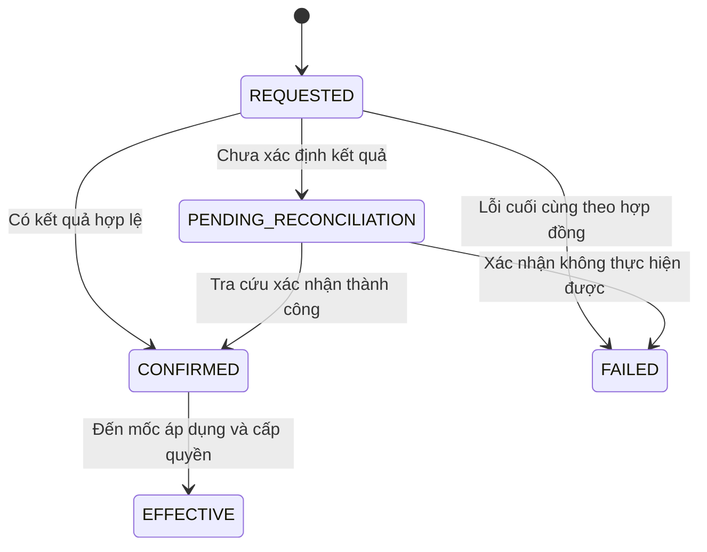
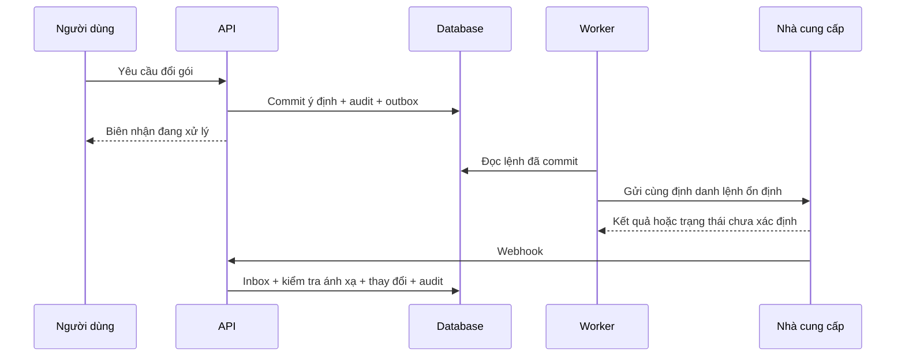

# Subscription audit: truy vết và kiểm chứng quy tắc thuê bao

## 1. Audit phải giải thích được thay đổi nghiệp vụ

Trong chương **Subscription Rules** của module **SECURITY_APPLICATION_SECURITY_BUSINESS_LOGIC_SECURITY**, audit thuê bao được xem là cơ chế ghi lại bằng chứng và kiểm chứng việc thực thi quy tắc nghiệp vụ. Mục tiêu là phát hiện những hành vi như tự nâng gói, thay đổi sai quyền, nhận ưu đãi nhiều lần, hủy nhưng vẫn được dùng hoặc gửi lại yêu cầu để tạo thêm hiệu ứng.

Một dòng log như `Subscription updated successfully` không đủ để điều tra. Nó không cho biết ai có quyền thực hiện, thuê bao thuộc account nào, điều khoản trước và sau ra sao, thay đổi đã commit hay chưa và dịch vụ thực tế có được cấp đúng không.

Audit tốt phải giúp trả lời:

- Ai thực sự thực hiện, có đang đại diện cho ai không?
- Hành động tác động lên thuê bao, account và kỳ dịch vụ nào?
- Quy tắc nào cho phép hoặc từ chối hành động?
- Giá, gói, số ghế, trạng thái và quyền sử dụng thay đổi như thế nào?
- Kết quả mới là yêu cầu được tiếp nhận, đã được xác nhận hay đã có hiệu lực?
- Có giao dịch thanh toán, sự kiện bên ngoài hoặc thao tác quản trị nào liên quan?
- Khi yêu cầu bị gửi lại hoặc xử lý đồng thời, có phát sinh hiệu ứng trùng không?

Audit không tự ngăn được mọi lỗ hổng. Kiểm tra quyền theo đối tượng, state machine, transaction và idempotency vẫn phải chặn hành vi sai tại nơi thực thi. Audit cung cấp bằng chứng cho quyết định đó và giúp phát hiện những sai lệch còn lọt qua.

## 2. Phân biệt audit nghiệp vụ với các nguồn quan sát khác

| Nguồn dữ liệu | Câu hỏi chính | Giới hạn |
| --- | --- | --- |
| Access log HTTP | Ai gọi URL nào, nhận mã phản hồi gì? | Một mã 200 không chứng minh dịch vụ đã có hiệu lực đúng |
| Application log | Chương trình đã chạy đến đâu, gặp lỗi gì? | Có thể bị lấy mẫu, đổi định dạng hoặc thiếu ngữ nghĩa nghiệp vụ |
| Security event | Có dấu hiệu sai quyền, giả mạo hoặc dò tìm không? | Một nỗ lực bị chặn không phải thay đổi thuê bao thành công |
| Business audit | Quyết định nào được thực hiện, trên dữ liệu nào, vì sao? | Chỉ đáng tin trong phạm vi nguồn ghi và cơ chế bảo vệ của nó |
| Payment record | Thanh toán, hoàn tiền hoặc nghĩa vụ thu đã ở trạng thái nào? | Không tự chứng minh entitlement nội bộ đang đúng |
| Entitlement record | Account hoặc người dùng hiện được dùng gì? | Không giải thích đầy đủ vì sao quyền đã được cấp |

Đối với điều tra, cần liên kết các nguồn bằng định danh ổn định như `subscription_id`, `command_id`, `provider_event_id` và `correlation_id`. Không nên nối bằng email hoặc một đoạn message tự do.

Ví dụ, endpoint đổi gói trả `202 Accepted` là hợp lệ nếu hệ thống mới tạo một lệnh chờ nhà cung cấp xử lý. Audit phải ghi nhận `plan_change_requested`, không ghi `plan_changed` rồi để người vận hành hiểu rằng gói mới đã hoạt động.

Audit cũng không mặc nhiên là event sourcing. Một hệ thống chỉ lưu các thay đổi quan trọng có thể không đủ dữ liệu để dựng lại toàn bộ aggregate. Muốn hỗ trợ tái dựng trạng thái, phải thiết kế sự kiện đầy đủ, schema, mốc khởi đầu và quy tắc diễn giải tương ứng.

## 3. Xác định invariants cần được kiểm chứng

Trước khi chọn trường log, hãy xác định điều kiện nghiệp vụ cần bảo vệ và bằng chứng cần có để kiểm chứng nó.

| Mã | Invariant minh họa | Bằng chứng cần liên kết |
| --- | --- | --- |
| A1 | Mọi thay đổi quan trọng đã commit đều có audit bền vững | Phiên bản aggregate, lệnh, sự kiện audit trong cùng transaction |
| A2 | Actor có quyền trên đúng account tại thời điểm quyết định | Actor, account, hành động, kết quả kiểm tra quyền và tham chiếu ngữ cảnh quyền |
| A3 | Gói và giá được chọn theo dữ liệu có thẩm quyền | Gói trước/sau, phiên bản giá, số lượng, tiền tệ, chính sách áp dụng |
| A4 | Retry không tạo thêm hiệu ứng nghiệp vụ | Định danh lệnh, khóa khử trùng, biên nhận và kết quả đã commit |
| A5 | Entitlement phù hợp điều khoản, trạng thái và thời gian hiệu lực | Quyết định cấp/thu hồi, khoảng hiệu lực và thế hệ sở hữu |
| A6 | Sự kiện bên ngoài chỉ tác động đúng thuê bao và đúng ngữ cảnh | Ánh xạ nhà cung cấp, môi trường, account nguồn và ID đối tượng |
| A7 | Chuyển chủ, hủy và hoàn tiền không bỏ qua điều kiện liên quan | Trạng thái trước/sau, phiên bản, lý do, phê duyệt ngoại lệ nếu có |
| A8 | Chỉnh sửa khắc phục không xóa dấu vết quyết định cũ | Sự kiện điều chỉnh mới tham chiếu sự kiện hoặc finding ban đầu |

Phải phân biệt **quy tắc sản phẩm** với **quy tắc ghi audit**. Ví dụ, sản phẩm có thể cho dùng trong thời gian ân hạn hoặc cho vượt số ghế tạm thời. Khi đó audit cần ghi đúng ngoại lệ và thời hạn, không áp một kết luận cứng rằng mọi trường hợp chưa thu được tiền hoặc vượt ghế đều là tấn công.

Tương tự, một thuê bao miễn phí có thể hợp lệ. Điều cần kiểm chứng là entitlement có căn cứ được phép như thanh toán, trial, hợp đồng hoặc ưu đãi được phê duyệt, thay vì mặc định mọi dịch vụ hoạt động đều cần một giao dịch thu tiền ngay lập tức.

## 4. Ghi đúng giai đoạn và thời điểm của một thay đổi

### 4.1. Yêu cầu, xác nhận và hiệu lực là ba việc khác nhau

| Sự kiện | Điều đã được chứng minh | Điều chưa thể kết luận |
| --- | --- | --- |
| `subscription.plan_change_requested` | Lệnh đổi gói đã được tiếp nhận và lưu | Nhà cung cấp đã chấp nhận hoặc gói mới đã có hiệu lực |
| `subscription.plan_change_confirmed` | Kết quả đổi gói đã được xác nhận theo giao thức | Quyền dùng bắt đầu ngay nếu lịch hiệu lực là tương lai |
| `subscription.entitlement_activated` | Quyền đã được cấp từ mốc hiệu lực xác định | Đã thu tiền nếu sản phẩm cho trả sau hoặc dùng thử |
| `subscription.cancel_renewal_requested` | Có ý định ngừng gia hạn | Quyền dùng hiện tại đã hết |
| `subscription.renewal_disabled` | Cấu hình gia hạn đã được xác nhận là tắt | Kỳ dịch vụ đang trả phí đã kết thúc |
| `subscription.entitlement_expired` | Quyền dùng theo khoảng hiệu lực đó đã hết | Tất cả dữ liệu thuê bao phải bị xóa |

Tên sự kiện nên diễn đạt một sự thật đã xảy ra. Không dùng cùng một tên `subscription.updated` cho mọi giai đoạn rồi buộc người điều tra đoán từ payload.

Một quy trình đổi gói có thể biểu diễn:



Timeout không đủ để kết luận thao tác bên ngoài thất bại. Hệ thống có thể cần trạng thái chưa xác định và tra cứu bằng cùng định danh lệnh, thay vì tạo ngay một giao dịch thay thế.

### 4.2. Các mốc thời gian cần tách biệt

- `recorded_at`: thời gian server lưu sự kiện audit.
- `source_occurred_at`: thời gian nguồn bên ngoài thông báo sự kiện đã xảy ra, nếu có.
- `effective_at`: mốc thay đổi điều khoản hoặc quyền bắt đầu có hiệu lực.
- `received_at`: thời gian hệ thống nhận thông điệp bên ngoài, nếu cần đo độ trễ.

Sự kiện nhận ngày hôm nay có thể mô tả thanh toán xảy ra trước đó, còn thay đổi gói chỉ có hiệu lực ở kỳ tiếp theo. Dùng một trường `timestamp` cho tất cả sẽ gây nhầm lẫn khi đối soát.

Nên lưu mốc thời gian với múi giờ xác định, thường là UTC, và chuyển đổi khi hiển thị. Không dùng thời gian do client gửi để sắp thứ tự quyết định nội bộ. Timestamp từ nhà cung cấp cũng chưa chắc tạo ra thứ tự toàn cục giữa các loại đối tượng khác nhau.

## 5. Thiết kế một sự kiện audit có cấu trúc

Ví dụ sau dùng dữ liệu giả định. Sự kiện ghi việc **tiếp nhận lệnh đổi gói vào kỳ tiếp theo**, chưa ghi gói mới đã được kích hoạt:

```json
{
  "event_id": "aud-8421",
  "schema_version": 1,
  "event_type": "subscription.plan_change_requested",
  "subscription_id": "sub-182",
  "account_id_at_event": "acc-company-a",
  "ownership_version": 3,
  "aggregate_sequence": 58,
  "aggregate_version_before": 41,
  "aggregate_version_after": 42,
  "command_id": "cmd-914",
  "correlation_id": "corr-511",
  "actor": {
    "kind": "USER",
    "subject_id": "usr-73",
    "acting_for_id": null
  },
  "authorization": {
    "action": "CHANGE_SUBSCRIPTION_PLAN",
    "result": "ALLOWED",
    "membership_id": "mem-618",
    "membership_version": 9
  },
  "policy_ref": "subscription-policy-v12",
  "reason_code": "ACCOUNT_ADMIN_REQUEST",
  "outcome": "ACCEPTED",
  "before": {
    "confirmed_plan": "BASIC",
    "requested_plan": null
  },
  "after": {
    "confirmed_plan": "BASIC",
    "requested_plan": "PRO"
  },
  "terms": {
    "price_version": "price-pro-v4",
    "currency": "VND",
    "quantity": 10,
    "unit_amount_minor": 100000
  },
  "recorded_at": "2026-01-10T09:00:00Z",
  "effective_at": "2026-02-01T00:00:00Z"
}
```

Các điểm cần chú ý:

- Actor lấy từ ngữ cảnh xác thực do backend kiểm chứng. Không tin `actorId` hoặc `X-User-Id` tùy ý do client gửi.
- Với hỗ trợ nội bộ thực hiện thay khách hàng, lưu người thực hiện thực tế và chủ thể được đại diện. Không ghi đè actor thành khách hàng để che mất người thao tác.
- `account_id_at_event` giữ phạm vi tại thời điểm sự kiện. Nó không được âm thầm đổi theo chủ sở hữu hiện tại.
- `before` và `after` chỉ chứa các trường cần giải thích hành động; không sao chép toàn bộ entity.
- `policy_ref`, `price_version` và tham chiếu quyền phải trỏ tới thông tin lịch sử được quản lý phù hợp. Một ID trỏ tới dữ liệu có thể bị ghi đè sẽ không đủ cho điều tra sau này.
- Số tiền dùng kiểu chính xác với đơn vị nhỏ nhất theo tiền tệ hoặc decimal có scale quy định; không dùng số thực nhị phân để tính giá.
- Các điều khoản trong ví dụ chưa bao gồm thuế, chiết khấu hay cách tính phần kỳ. Nếu chúng ảnh hưởng quyết định, phải lưu giá trị hoặc tham chiếu snapshot cần thiết.

Đặt `schema_version` cho phép người đọc và công cụ phân tích diễn giải đúng sự kiện cũ. Khi đổi schema, giữ quy tắc tương thích hoặc bộ chuyển đổi rõ ràng; không sửa lịch sử chỉ để trông giống schema mới.

## 6. Transaction: audit thành công phải đi cùng thay đổi đã commit

### 6.1. Lỗi ghi log ở sai ranh giới

Hai mẫu lỗi thường gặp:

```text
Ghi audit "đã nâng gói"
→ cập nhật thuê bao
→ transaction rollback
Kết quả: audit kể một thay đổi không tồn tại.
```

```text
Commit thay đổi thuê bao
→ gửi log ra hệ thống bên ngoài
→ tiến trình chết hoặc mạng lỗi
Kết quả: thay đổi quan trọng không có bằng chứng audit bắt buộc.
```

Đối với thay đổi cục bộ, một thiết kế phù hợp là ghi dữ liệu nghiệp vụ, audit và outbox trong cùng transaction. Outbox chuyển sự kiện sau commit tới kho phân tích hoặc worker thực hiện công việc bên ngoài.

### 6.2. Mã giả Java

Đoạn sau là **mã giả**, mô tả hợp đồng cần giữ; các hàm không phải API của một thư viện cụ thể:

```java
PlanChangeReceipt requestPlanChange(Actor actor, ChangePlan command) {
    return transactions.required(() -> {
        // Bao gồm quyền trên đúng account và cơ chế phối hợp thu hồi quyền.
        var sub = subscriptions.lockAndAuthorize(
            actor, command.subscriptionId(), CHANGE_PLAN);

        var key = idempotency.claimOrLock(
            sub.ownerAccountId(), actor.id(), "CHANGE_PLAN",
            command.idempotencyKey());
        key.requireSameFingerprint(fingerprint(command));
        if (key.isCompleted()) {
            return key.savedReceipt();
        }

        sub.requireVersion(command.expectedVersion());
        sub.requirePlanChangeAllowed();
        var terms = pricing.resolveAuthoritativeTerms(sub, command.planId());
        var decision = policy.evaluatePlanChange(actor, sub, terms);
        decision.requireAllowed();

        var before = auditSnapshot.ofPlanChangeFields(sub);
        var billingCommand = billingCommands.createPlanChange(sub, terms);
        sub.requestPlanChange(terms, billingCommand.id());
        sub.incrementVersion();

        var event = auditEvents.planChangeRequested(
            actor, sub, before, terms, decision, billingCommand.id());
        auditRepository.appendMandatory(event);
        outbox.appendBillingCommand(billingCommand);
        outbox.appendAuditExport(event.id());

        return key.complete(PlanChangeReceipt.pending(billingCommand.id()));
    });
}
```

Các hợp đồng quan trọng:

- Mọi ghi trong ví dụ dùng cùng transaction và nguồn dữ liệu có hỗ trợ transaction tương ứng.
- `lockAndAuthorize` phải kiểm tra membership hiện tại, account sở hữu và hành động. Nếu cần chống race với thu hồi quyền, đường thu hồi phải phối hợp bằng cùng giao thức khóa hoặc phiên bản nguyên tử.
- `claimOrLock` phải có unique constraint và xử lý cạnh tranh. Kiểm tra tồn tại rồi chèn mà không có ràng buộc là chưa đủ.
- `appendMandatory` thất bại thì toàn bộ thay đổi cục bộ rollback. Không bắt lỗi rồi bỏ qua audit của hành động bắt buộc truy vết.
- Nếu giữ thứ tự audit theo thuê bao, cấp `aggregate_sequence` bằng bộ đếm được bảo vệ trong transaction hoặc cơ chế tương đương.
- Khóa idempotency và receipt được commit cùng hiệu ứng; retry sau mất phản hồi trả kết quả cũ mà không tạo thêm sự kiện thay đổi nghiệp vụ.

Hệ thống xuất audit bên ngoài có thể tạm ngừng mà transaction vẫn thành công nếu audit bắt buộc đã được lưu bền vững tại chỗ và outbox đã commit. Cần cảnh báo backlog và giới hạn dung lượng thích hợp. Không cần biến mọi lần kho phân tích lỗi thành thất bại nghiệp vụ khi bằng chứng cục bộ vẫn an toàn.

Outbox có thể cập nhật trạng thái giao nhận. Bản sự kiện audit nên giữ nội dung bất biến; lưu tiến độ xuất hoặc số lần gửi ở bảng giao nhận riêng thay vì sửa lại sự kiện lịch sử.

### 6.3. Yêu cầu bị từ chối không nằm trong transaction thành công

Nếu ghi một security event rồi ném exception khiến cùng transaction rollback, dấu vết từ chối cũng mất. Những nỗ lực sai quyền hoặc vi phạm quy tắc cần kênh ghi riêng phù hợp, chẳng hạn transaction độc lập hoặc luồng security event bền vững theo thiết kế.

Sự kiện từ chối phải nói rõ `DENIED` hoặc `FAILED`, không dùng tên sự kiện thành công. Chỉ ghi dữ liệu cần thiết; với ID không thuộc quyền người gọi, tránh đưa chi tiết thuê bao vào phản hồi hoặc nhật ký mà người đó có thể truy cập.

Khi chống spam log, phân biệt các nỗ lực lặp có thể tổng hợp với bằng chứng thay đổi quan trọng đã commit. Không lấy mẫu hoặc âm thầm bỏ audit bắt buộc chỉ vì có quá nhiều request tấn công.

## 7. Audit xuyên qua worker, thanh toán và webhook

Một thay đổi thuê bao thường đi qua nhiều hệ thống. Không thể giả định transaction của database nội bộ bao được cả nhà cung cấp thanh toán.



Mỗi chặng cần phân biệt `command_id` nội bộ, khóa retry bên ngoài, ID đối tượng nhà cung cấp và ID sự kiện. Chúng có liên quan nhưng không phải cùng một định danh.

### 7.1. Webhook hợp lệ về nguồn chưa đủ về nghiệp vụ

Sau khi xác thực nguồn gửi, cần đối chiếu đúng môi trường, tài khoản nhà cung cấp và ánh xạ thuê bao. Không để metadata do client kiểm soát tự quyết định account nhận dịch vụ.

Audit nên lưu kết quả kiểm chứng, tham chiếu inbox, loại sự kiện, ID bên ngoài và quyết định áp dụng hoặc bỏ qua. Không lưu bí mật ký, token xác thực hay toàn bộ payload thanh toán vào log thông thường.

Nếu cần giữ payload gốc cho điều tra, dùng kho bằng chứng có phân quyền, thời hạn lưu và chính sách dữ liệu riêng; audit chỉ chứa tham chiếu và thông tin kiểm tra cần thiết.

### 7.2. Trùng và sai thứ tự là hai vấn đề khác nhau

Một inbox có ràng buộc duy nhất theo `(provider, provider_account, environment, event_id)` giúp chống xử lý lại cùng sự kiện. Việc đánh dấu đã xử lý, cập nhật trạng thái cục bộ và ghi audit tương ứng cần nguyên tử hoặc có giao thức phục hồi rõ ràng.

Sự kiện cũ có ID khác vẫn có thể đến sau sự kiện mới. Vì vậy cần state machine, phiên bản nguồn nếu giao thức hỗ trợ hoặc tra cứu lại trạng thái có thẩm quyền. Không cập nhật mù theo thứ tự nhận request.

Nếu bỏ qua vì trùng, không tạo thêm sự kiện nghiệp vụ như thể đổi gói lần nữa. Có thể ghi dấu vết giao nhận hoặc tăng bộ đếm riêng. Nếu bỏ qua vì sự kiện cũ, nên lưu lý do có cấu trúc như `STALE_SOURCE_STATE`, gắn với trạng thái đã dùng để quyết định.

### 7.3. Lệnh cũ sau khi chuyển chủ

Một lệnh hủy hoặc đổi gói được tạo trước chuyển chủ có thể hoàn tất sau đó. Audit phải liên kết lệnh với account và `ownership_version` lúc tạo, đồng thời cho biết ngữ cảnh lúc áp dụng kết quả.

Phiên bản không khớp phải được đưa qua quy tắc xử lý rõ ràng; audit không thể thay thế việc chặn hoặc điều phối lệnh sai thế hệ. Cũng không được sửa sự kiện cũ sang account mới để làm cho chuỗi nhìn có vẻ nhất quán.

## 8. Dùng audit để đối soát invariants

Đối soát cần so sánh các nguồn trạng thái có thẩm quyền và các bằng chứng liên quan. Chỉ đếm sự kiện trong kho log chưa đủ vì sự kiện có thể đến trễ, còn trạng thái hiện tại đã thay đổi.

| Dấu hiệu cần kiểm tra | Nguồn đối chiếu | Cách diễn giải |
| --- | --- | --- |
| Entitlement hoạt động nhưng không có căn cứ cấp quyền hợp lệ | Entitlement, hợp đồng, trial, thanh toán, quyết định ưu đãi | Có thể tự cấp quyền hoặc thiếu dữ liệu chuyển đổi |
| Quyền dùng còn sau mốc chấm dứt | Lịch hiệu lực, trạng thái chấm dứt, entitlement | Phải loại trừ thời gian ân hạn hoặc ngoại lệ hợp lệ |
| Giá áp dụng không khớp phiên bản giá được phép | Snapshot điều khoản, catalog lịch sử, ưu đãi | Có thể sửa giá hoặc áp sai chính sách |
| Nhiều hiệu ứng cho cùng một lệnh | Command, idempotency receipt, thay đổi nghiệp vụ | Có thể retry tạo trùng |
| Thay đổi phiên bản nghiệp vụ nhưng thiếu audit bắt buộc | Dữ liệu nguồn, lịch sử lệnh, audit cục bộ | Có thể có đường ghi bỏ qua service hoặc lỗi triển khai |
| Nhà cung cấp xác nhận nhưng nội bộ vẫn treo | API nguồn, inbox, command, audit xác nhận | Có thể mất webhook hoặc worker chưa phục hồi |
| Entitlement còn ở account cũ sau chuyển chủ | Ownership history, phiên bản hiện tại, entitlement | Có thể rò rỉ quyền hoặc cache chưa thu hồi |
| Số ghế vượt phạm vi được cho phép | Phân bổ ghế, điều khoản, chính sách vượt tạm | Phải kiểm tra đúng quy tắc sản phẩm |

### 8.1. Đối soát theo cửa sổ nhất quán

Một truy vấn đọc bảng thuê bao lúc 10:00:00 và đọc audit lúc 10:00:05 có thể thấy hai trạng thái khác nhau dù hệ thống không lỗi. Nếu đọc trên replica hoặc kho phân tích, độ trễ còn có thể lớn hơn.

Cần chọn snapshot nhất quán, watermark hoặc cửa sổ trễ phù hợp. Finding nên ghi mốc quan sát và phiên bản đã so sánh. Một sai lệch thoáng qua chưa đủ kết luận gian lận; sai lệch kéo dài sau giới hạn xử lý đã cam kết đáng được ưu tiên hơn.

### 8.2. Lưu finding, không sửa lịch sử để xóa dấu vết

Một finding nên có loại vi phạm, các ID liên quan, phiên bản quan sát, bằng chứng, thời điểm phát hiện, mức ưu tiên và trạng thái xử lý.

Nếu cần sửa, thực hiện qua lệnh nghiệp vụ có quyền và idempotency. Sự kiện khắc phục mới tham chiếu finding và quyết định cũ. Không sửa giá trị `before`, xóa sự kiện bất lợi hoặc tự đánh dấu đã thu tiền để làm đối soát hết báo lỗi.

Audit chỉ phát hiện được những sai lệch có đủ nguồn đối chiếu. Nếu một đường ghi trái phép thay đổi cả dữ liệu lẫn lịch sử trong cùng miền quyền mà không để dấu vết độc lập, đối soát nội bộ có thể không phát hiện được. Điều đó dẫn đến yêu cầu bảo vệ tính toàn vẹn của bằng chứng.

## 9. Quyền xem audit cũng là quyền theo đối tượng

Audit có thể chứa dữ liệu nhạy cảm về khách hàng, giá thương lượng, người quản trị và lịch sử thanh toán. Endpoint đọc hoặc export audit cần được bảo vệ như các tài nguyên nghiệp vụ khác.

Một chính sách minh họa:

- Thành viên thường chỉ xem thông tin hoạt động được sản phẩm cho phép, không mặc định đọc toàn bộ audit thanh toán.
- Billing admin xem các thay đổi thuộc account trong phạm vi nhiệm vụ.
- Nhân sự hỗ trợ dùng quyền giới hạn, có lý do truy cập và dấu vết actor thực tế.
- Nhóm điều tra được truy cập rộng hơn theo chính sách riêng, gồm export và truy cập bằng chứng gốc.

Không lấy `accountId` trong query làm điều kiện bảo mật duy nhất. Backend phải đối chiếu membership và phạm vi sự kiện. Tìm kiếm, phân trang, tải file export và link đính kèm cũng cần cùng chính sách.

### 9.1. Audit lịch sử sau chuyển chủ

Chủ hiện tại của thuê bao không tự có quyền xem mọi sự kiện của chủ cũ. Một số sự kiện liên quan hóa đơn, người dùng hoặc điều khoản riêng vẫn thuộc phạm vi lịch sử của account nguồn.

Nên xác định quyền theo `account_id_at_event`, loại thông tin và quy tắc chia sẻ được phép. Một màn hình lịch sử tổng hợp cho bên nhận có thể chỉ hiển thị phần bàn giao cần thiết; không vô tình mở toàn bộ hồ sơ account cũ bằng cách join mọi audit với `subscription.owner_account_id` hiện tại.

### 9.2. Tối thiểu hóa dữ liệu và kiểm soát đầu vào log

Không ghi mật khẩu, session token, khóa API, bí mật webhook, số thẻ đầy đủ hoặc dữ liệu cá nhân không cần cho mục đích audit. Lý do dạng văn bản tự do cần giới hạn độ dài và được hiển thị an toàn.

Dùng trường có cấu trúc và mã lý do thay vì nối chuỗi chứa đầu vào người dùng. Ký tự xuống dòng hoặc nội dung HTML trong tên account không được làm giả một bản ghi khác hoặc chạy mã trên màn hình audit. Các giá trị như `actor`, `outcome`, phiên bản và thời gian quyết định phải do server xác định.

Thời hạn lưu và cách ẩn danh cần theo mục đích và yêu cầu thực tế của hệ thống. Không mặc định lưu mọi dữ liệu cá nhân vô thời hạn chỉ vì gọi đó là audit.

## 10. Bảo vệ tính toàn vẹn và tính đầy đủ của bằng chứng

### 10.1. Append-only cần được thực thi bằng quyền

Một giao diện không có nút sửa chưa tạo ra nhật ký bất biến. Cần giới hạn quyền của tài khoản ứng dụng: luồng ghi audit chỉ được thêm bản ghi theo thiết kế, còn quyền sửa/xóa hoặc thực hiện bảo trì phải được tách biệt và kiểm soát.

Có thể kết hợp kho lưu riêng, snapshot, cơ chế lưu trữ chống sửa theo thời hạn và bản sao độc lập tùy mức bảo đảm cần thiết. Những thao tác quản trị kho audit cũng cần được quan sát qua miền quyền phù hợp.

Nếu ứng dụng có thể vừa sửa thuê bao vừa tự xóa mọi bằng chứng mà không để dấu vết ngoài hệ thống, audit chưa chống được đối thủ đã chiếm quyền ứng dụng ở mức đó.

### 10.2. Hash chain chỉ là một lớp phát hiện sửa đổi

Một chuỗi hash có thể được mô tả:

```text
event_hash[n] = H(previous_hash || canonical_event[n])
```

Cần quy định serialization chuẩn hóa, trường nào được băm và cách kiểm tra. Hash giúp phát hiện thay đổi khi có mốc tin cậy để đối chiếu, nhưng người sửa được toàn bộ chuỗi cũng có thể tính lại chuỗi mới.

Muốn tăng khả năng phát hiện, có thể neo mốc kiểm chứng ở nơi độc lập hoặc dùng cơ chế xác thực phù hợp với quản lý khóa tách biệt. Chỉ lưu hash ngay cạnh bản ghi trong cùng database không tự chứng minh bản ghi đúng hoặc chưa từng bị thay thế.

Hash cũng không chứng minh nội dung đầu vào là sự thật. Một actor giả được tin nhầm từ request rồi đưa vào chuỗi vẫn là một sự kiện sai được bảo vệ bằng hash.

### 10.3. Số thứ tự không tự chứng minh đủ mọi sự kiện

Trong thiết kế dùng bộ đếm transaction theo thuê bao, `aggregate_sequence` giúp sắp thứ tự các sự kiện audit cục bộ và phát hiện một số khoảng thiếu. Khi dùng sequence toàn cục của database, khoảng nhảy có thể xuất hiện do rollback hoặc cấp phát; không được coi mọi gap là xóa log.

Ngay cả chuỗi liên tục cũng không phát hiện chắc chắn việc xóa phần cuối nếu không có mốc độc lập về phần cuối đã tồn tại. Cần đối chiếu với phiên bản nghiệp vụ, command, watermark xuất dữ liệu hoặc checkpoint được bảo vệ phù hợp.

Nên kiểm chứng cả ba mặt: nội dung có bị sửa không, sự kiện có bị thiếu không và nguồn ghi có đủ thẩm quyền để khẳng định sự thật đó không.

## 11. Kiểm thử audit ở ranh giới transaction và quyền

### 11.1. Các ca kiểm thử cốt lõi

| Kịch bản | Điều cần xác nhận |
| --- | --- |
| Đổi gói hợp lệ | Audit đúng actor, account, điều khoản, phiên bản và giai đoạn kết quả |
| Người ngoài account đổi gói | Không có thay đổi nghiệp vụ; có security event theo thiết kế và không lộ dữ liệu |
| Client gửi actor hoặc outcome giả | Giá trị không được dùng làm bằng chứng quyết định |
| Ghi audit bắt buộc bị lỗi | Thay đổi cục bộ, command và outbox rollback cùng nhau |
| Lỗi sau append audit nhưng trước commit | Không tồn tại audit thành công của thay đổi đã rollback |
| Kho phân tích ngoài hệ thống ngừng hoạt động | Audit cục bộ và outbox vẫn bền vững; có backlog và khả năng phục hồi |
| Hỗ trợ nội bộ thực hiện thay khách hàng | Lưu actor thực tế và chủ thể đại diện, không che actor |
| Chuyển chủ rồi đọc lịch sử | Không mở dữ liệu account cũ cho chủ mới ngoài phần được phép |
| Ghi tên hoặc lý do chứa newline/HTML | Không giả bản ghi và không thực thi mã khi hiển thị |

Không chỉ assert rằng hàm logger được gọi. Hãy kiểm tra dữ liệu đã commit và quan hệ giữa thuê bao, command, audit, inbox/outbox. Đối với transaction và khóa, dùng cơ sở dữ liệu có ngữ nghĩa phù hợp với môi trường triển khai thay vì chỉ mock repository.

### 11.2. Retry và đồng thời

Ví dụ kiểm thử mất phản hồi sau commit:

```text
Given:
    Thuê bao đang ở version 41
    Người gọi có quyền đổi gói
    Lệnh có idempotency key K

When:
    Lần đầu commit yêu cầu đổi gói và audit, nhưng phản hồi bị mất
    Client gửi lại cùng lệnh với K

Then:
    Chỉ một billing command được tạo
    Chỉ một sự kiện nghiệp vụ plan_change_requested được tạo
    Version chỉ tăng cho một lần thay đổi đó
    Biên nhận trả lại tham chiếu cùng command
```

Có thể có hai access log hoặc hai dấu vết giao nhận; chúng không được bị hiểu thành hai thay đổi nghiệp vụ.

Các ca bổ sung:

- Cùng khóa nhưng đổi gói hoặc số lượng: xung đột, không có hiệu ứng mới.
- Hai lệnh khác nhau cùng `expectedVersion`: kết quả phù hợp chính sách đồng thời, không mất audit hoặc ghi sai `before`.
- Hai thao tác được tuần tự hóa trên cùng thuê bao: số thứ tự audit và phiên bản thể hiện đúng thứ tự commit theo thiết kế.
- Thu hồi quyền cạnh tranh với lệnh đổi gói: audit không khẳng định dùng một quyền đã mất trước điểm tuần tự hóa.
- Worker chết sau tác động bên ngoài nhưng trước lưu kết quả: khôi phục bằng định danh ổn định, không tạo giao dịch mới tùy tiện.
- Webhook lặp và webhook cũ khác ID: không nhân đôi hiệu ứng hoặc làm lùi trạng thái trái quy tắc.

Để kiểm tra race condition, dùng barrier hoặc điều phối transaction vào đúng điểm cạnh tranh. Một bài kiểm thử chạy tuần tự hoặc dùng `sleep` ngẫu nhiên không chứng minh cơ chế đồng bộ hoạt động.

### 11.3. Kiểm thử khả năng phát hiện

Tạo sai lệch có kiểm soát trong môi trường kiểm thử: thiếu audit của một mutation, entitlement sai account, command đã xác nhận nhưng quyền chưa cấp hoặc giá lệch phiên bản. Kiểm tra đối soát có tạo finding với đủ bằng chứng và mốc quan sát không.

Nếu dùng chuỗi hash hoặc checkpoint, thử sửa, xóa giữa chuỗi và xóa phần cuối. Kết quả kiểm thử cần phản ánh đúng giới hạn: cơ chế nào phát hiện được tình huống nào, cơ chế nào cần mốc độc lập. Không tuyên bố chống sửa toàn diện chỉ vì kiểm thử đổi một ký tự đã thất bại khi xác minh.

## 12. Dùng audit trong vận hành và phát hiện lạm dụng

Một số tín hiệu đáng theo dõi:

- Nhiều lần cố sửa thuê bao ngoài phạm vi account.
- Thay đổi gói hoặc số lượng liên tục để lợi dụng quy tắc tính phần kỳ.
- Tạo nhiều account, đổi chủ hoặc đổi danh tính để lặp ưu đãi trái chính sách.
- Hủy và kích hoạt lại nhanh nhưng entitlement không bị điều chỉnh đúng.
- Thao tác quản trị bỏ qua giá hoặc điều kiện bắt buộc với tần suất bất thường.
- Nhiều xung đột idempotency có payload khác nhau.
- Backlog outbox, inbox chưa xử lý hoặc command treo vượt thời gian mong đợi.
- Sai lệch kéo dài giữa trạng thái nhà cung cấp và entitlement nội bộ.

Đây là tín hiệu điều tra, không phải bằng chứng tự động rằng một người gian lận. Ngưỡng cảnh báo cần gắn với hành vi sản phẩm và bối cảnh; một đợt thay gói hàng loạt hợp lệ có thể giống mẫu tăng đột biến.

Phải giám sát cả sức khỏe của đường audit: tốc độ ghi, lỗi append, độ trễ xuất, dung lượng còn lại và kiểm chứng checkpoint nếu có. Hệ thống có nhiều log nhưng âm thầm mất toàn bộ audit của một loại thao tác vẫn có khoảng mù quan trọng.

Nếu audit bắt buộc không thể ghi bền vững, đường thay đổi liên quan cần xử lý theo chính sách đã thiết kế, thường là từ chối hoặc trì hoãn thay đổi đó. Không mở cờ bỏ qua audit một cách âm thầm để giảm lỗi vận hành.

Truy cập và export audit cũng cần được quan sát, nhất là export số lượng lớn hoặc truy cập chéo nhiều account. Dữ liệu điều tra có thể trở thành mục tiêu thu thập của kẻ tấn công.

## 13. Ví dụ điều tra: yêu cầu đổi gói bị hiểu thành kết quả

Giả sử account A phản ánh rằng đã bị tính phí gói PRO nhưng vẫn chỉ dùng BASIC. Chuỗi quan sát ban đầu:

| Mốc | Sự kiện hoặc bằng chứng |
| --- | --- |
| T1 | `plan_change_requested`, command C1, version 41 → 42, gói xác nhận vẫn BASIC |
| T2 | Worker gửi C1 cho nhà cung cấp với khóa retry ổn định |
| T3 | Cuộc gọi timeout; nội bộ chuyển C1 sang chờ đối soát |
| T4 | Khách hàng retry cùng khóa; nhận lại biên nhận C1 |
| T5 | Nhà cung cấp có kết quả xác nhận, nhưng webhook đang chờ xử lý |
| T6 | Đối soát phát hiện kết quả nguồn chưa được áp dụng sau cửa sổ trễ cho phép |

Điều tra cần liên kết C1 với ánh xạ thuê bao bên ngoài, kết quả thanh toán thực tế, lịch hiệu lực và trạng thái inbox. Không thể kết luận từ dòng HTTP thành công ở T1 rằng gói PRO đã được kích hoạt.

Nếu xác nhận điều khoản đã phải có hiệu lực, hệ thống xử lý thông điệp hoặc lệnh phục hồi theo quy trình idempotent, ghi `plan_change_confirmed` và sự kiện entitlement phù hợp. Sự kiện khắc phục tham chiếu finding và C1; không sửa sự kiện T1 thành `EFFECTIVE`.

Nếu nhà cung cấp chưa thực hiện, không tự cấp PRO chỉ để làm lịch sử trông nhất quán. Nếu đã thu hai lần, cần luồng xử lý thanh toán trùng và hoàn tiền theo chính sách, với audit riêng cho từng quyết định. Audit giúp phân biệt lỗi giao nhận, lỗi cấp quyền, lỗi thu tiền và hành vi lạm dụng thay vì gom chúng thành một lỗi “subscription update”.

## 14. Tự kiểm tra thiết kế audit thuê bao

Trước khi coi luồng đã có khả năng truy vết, cần trả lời rõ:

1. Mọi thay đổi quan trọng, kể cả qua quản trị, batch và worker, có dùng chung cơ chế audit bắt buộc không?
2. Audit có phân biệt yêu cầu, xác nhận và hiệu lực, cùng các mốc thời gian tương ứng không?
3. Actor, account, quyền và điều khoản có đến từ dữ liệu do server kiểm chứng không?
4. Thay đổi cục bộ, audit và outbox có cùng commit hoặc rollback không?
5. Nỗ lực bị từ chối có được ghi mà không biến thành sự kiện thành công hoặc mất do rollback không?
6. Retry, webhook trùng và sự kiện sai thứ tự có giữ đúng số hiệu ứng và lịch sử không?
7. Có đối soát giữa dữ liệu nghiệp vụ, thanh toán và entitlement với cửa sổ nhất quán rõ ràng không?
8. Quyền xem và export audit có giữ ranh giới account, kể cả sau chuyển chủ không?
9. Có thể phát hiện sửa hoặc thiếu bằng chứng trong phạm vi bảo đảm đã công bố không?
10. Thao tác khắc phục có tạo bằng chứng mới thay vì viết lại quá khứ không?

Audit thuê bao có giá trị khi mỗi quyết định quan trọng gắn được với người thực hiện, dữ liệu, chính sách và kết quả đã thực sự xảy ra. Kết hợp bằng chứng đó với kiểm soát nghiệp vụ tại thời điểm xử lý và đối soát độc lập giúp phát hiện sớm những sai lệch mà một dòng log thành công không thể giải thích.
