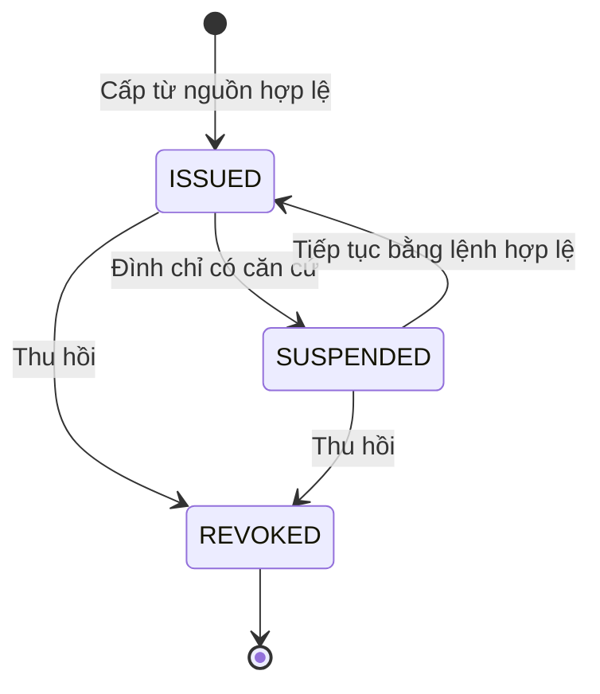

# Entitlement grant — Cấp quyền sử dụng tính năng từ căn cứ nghiệp vụ hợp lệ

## 1. Mục tiêu và phạm vi

Trong chương **Entitlement Rules** của module bảo mật logic nghiệp vụ, **entitlement grant** là việc cấp cho một chủ thể quyền sử dụng một tính năng hoặc quyền lợi, dựa trên căn cứ nghiệp vụ được hệ thống chấp nhận. Căn cứ có thể là một kỳ thuê bao có hiệu lực, hợp đồng, chương trình dùng thử hoặc ngoại lệ đã được phê duyệt.

Một grant an toàn cần trả lời được: **cấp cho ai, tính năng nào, trong phạm vi nào, từ khi nào đến khi nào, dựa vào nguồn nào và do thẩm quyền nào thực hiện?** Nếu thiếu những ràng buộc đó, một request hợp lệ về cú pháp có thể tạo quyền cho sai workspace, cấp thêm tính năng ngoài gói hoặc kéo dài thời hạn bằng cách gửi lại sự kiện.

Bài dùng sản phẩm SaaS giả định: workspace mua quyền `REPORT_EXPORT` để xuất báo cáo nâng cao. Schema và quy tắc minh họa tập trung vào entitlement dạng bật/tắt; quyền theo số ghế hoặc số lượt được phân biệt khi cần, nhưng không được coi là đã được triển khai đầy đủ trong schema này.

Sau bài học, bạn có thể:

- Phân biệt grant, quyền đang có hiệu lực, role người dùng và feature flag.
- Xác định nguồn có thẩm quyền cấp entitlement và bảo vệ quan hệ giữa nguồn với chủ thể nhận quyền.
- Thiết kế bất biến, state machine, transaction và idempotency để chống cấp sai hoặc cấp trùng.
- Xử lý thời hạn, nhiều nguồn cấp, sự kiện đến muộn và việc thu hồi quyền.
- Kiểm thử tình huống đổi ID, bỏ qua phê duyệt, replay và race condition.

## 2. Grant không đồng nghĩa với mọi quyền truy cập

### 2.1. Bốn khái niệm cần tách biệt

| Khái niệm | Câu hỏi nó trả lời | Ví dụ |
| --- | --- | --- |
| Entitlement grant | Có căn cứ nào cấp tính năng cho chủ thể này? | Hợp đồng H cấp `REPORT_EXPORT` cho workspace A trong một năm |
| Effective entitlement | Ở thời điểm hiện tại, tính năng có đang được phép sử dụng không? | Grant còn hạn, nguồn chưa bị đình chỉ và workspace không bị chặn |
| Authorization của actor | Người gọi có được thao tác trên dữ liệu hoặc đối tượng đó không? | Lan được xuất báo cáo của workspace A, nhưng không được đọc báo cáo B |
| Feature flag | Tính năng có được triển khai hoặc mở trong ngữ cảnh vận hành này không? | Chức năng xuất báo cáo đang được mở cho khu vực triển khai tương ứng |

Workspace có entitlement không có nghĩa mọi thành viên đều được xuất mọi báo cáo. Actor có role quản trị cũng không tự tạo ra quyền lợi thương mại mà workspace chưa được cấp. Feature flag dùng để rollout tính năng không phải bằng chứng khách hàng đã mua tính năng đó.

Một điều kiện thực thi minh họa:

```text
can_export(actor, report, now) =
    actor được phép EXPORT đúng report
    AND report thuộc đúng workspace/tenant
    AND workspace có effective entitlement REPORT_EXPORT tại now
    AND các điều kiện vận hành bắt buộc đều đạt
```

Không thay AND bằng OR, chẳng hạn cho phép thao tác chỉ vì actor là admin hoặc feature flag đang bật.

OWASP khuyến nghị từ chối mặc định và kiểm tra quyền trên mọi request. Đối với entitlement, kiểm tra quyền dữ liệu của actor vẫn phải được thực hiện ở điểm sử dụng tính năng, ngoài việc xác định quyền lợi của workspace. [Nguồn: OWASP Authorization](https://cheatsheetseries.owasp.org/cheatsheets/Authorization_Cheat_Sheet.html).

### 2.2. Chủ thể nhận quyền có thể khác người thanh toán và người thao tác

```text
actor_id           = người hoặc workload thực hiện hành động
billing_account_id = tài khoản chịu nghĩa vụ thanh toán
workspace_id       = chủ thể nhận entitlement trong ví dụ
source_id          = căn cứ nghiệp vụ được phép cấp quyền
feature_key        = định danh tính năng ổn định
```

Một tài khoản thanh toán có thể mua cho nhiều workspace, nhưng quan hệ phân bổ phải được backend quản lý. Biết ID của một hóa đơn hoặc quản lý billing account chưa chắc được quyền gán mọi dòng mua hàng sang workspace tùy ý.

Trong hệ thống cấp quyền theo cá nhân, chủ thể có thể là user hoặc tài khoản tổ chức. Khi đó cần mô hình đúng loại chủ thể và phạm vi. Không lấy `actor_id` làm chủ thể nhận quyền chỉ vì đó là người bấm nút mua.

## 3. Căn cứ nào được phép tạo grant?

### 3.1. Định nghĩa nguồn cấp có thẩm quyền

| Loại nguồn | Bằng chứng nghiệp vụ cần có | Đầu vào chưa đủ để cấp quyền |
| --- | --- | --- |
| Mua hàng hoặc thuê bao | Giao dịch đã đạt điều kiện áp dụng; đúng khách hàng, sản phẩm và kỳ quyền lợi | Redirect thành công từ trình duyệt hoặc field `paid=true` |
| Dùng thử | Quyết định trial hợp lệ và quyền lợi một lần đã được giữ/tiêu thụ đúng chính sách | Cookie chưa từng dùng hoặc email mới |
| Hợp đồng | Hợp đồng hoặc phụ lục có hiệu lực, đúng chủ thể và phạm vi tính năng | Số hợp đồng tự khai trong request |
| Cấp thủ công | Phê duyệt còn hiệu lực, đúng chủ thể, tính năng, thời hạn và thẩm quyền | Một chuỗi `reason` hoặc cờ `force=true` |
| Chương trình khuyến mại | Quy tắc chiến dịch, điều kiện tham gia và lịch sử hưởng lợi hợp lệ | Mã ưu đãi tồn tại nhưng chưa xác minh quyền nhận |

Không bắt buộc mọi grant đều có thanh toán tiền mặt. Một hợp đồng công nợ hoặc trial có thể là nguồn hợp lệ. Chính sách phải xác định bằng chứng nào đủ cho từng loại nguồn, thay vì dùng một boolean `isPaid` cho mọi trường hợp.

Trong bài, hệ thống chuẩn hóa các bằng chứng này thành `grant_source`: nguồn nội bộ có định danh ổn định, chủ thể đích, trạng thái, phiên bản, khoảng hiệu lực và snapshot ánh xạ tính năng. Chỉ dịch vụ có thẩm quyền cho từng loại nguồn mới được tạo hoặc xác nhận bản ghi đó. Việc đổi tên một payload thành `grant_source` không tự làm nó đáng tin cậy.

### 3.2. Tách quyền kỹ thuật khỏi quyền cấp nghiệp vụ

Một workload có kết nối cơ sở dữ liệu không nên được tự cấp mọi tính năng cho mọi tenant. Điểm cấp quyền cần kiểm tra ít nhất:

- Danh tính service hoặc nhân viên đang yêu cầu.
- Loại nguồn, tenant và hành động mà danh tính đó được phép xử lý.
- Nguồn cấp đã được xác minh và chưa bị thu hồi hoặc thay thế ngoài chính sách.
- Quan hệ nguồn–chủ thể nhận quyền và danh sách tính năng được nguồn cho phép.
- Phạm vi thời gian, số lượng hoặc giới hạn khác của quyền lợi.

Ví dụ, worker trial được cấp tính năng trial đã cấu hình; nó không được dùng một `sourceId` của hợp đồng Enterprise để cấp quyền vĩnh viễn. Nhân viên hỗ trợ có thể tạo đề nghị ngoại lệ nhưng chưa chắc có quyền phê duyệt hoặc áp dụng chính đề nghị đó.

Mã nguồn phải tính lại những giá trị nhạy cảm từ dữ liệu phía server và thực thi đúng quy trình. OWASP mô tả đây là yêu cầu cốt lõi để tránh lạm dụng luồng nghiệp vụ, ngay cả khi request được xác thực và không chứa lỗi injection. [Nguồn: OWASP Business Logic Security](https://cheatsheetseries.owasp.org/cheatsheets/Business_Logic_Security_Cheat_Sheet.html).

## 4. Các bất biến của thao tác cấp quyền

### 4.1. Đúng tenant, chủ thể và nguồn

Với mô hình nguồn chỉ cấp cho một workspace:

```text
trusted_tenant = grant_source.tenant = entitlement_grant.tenant

trusted_workspace = grant_source.workspace = entitlement_grant.workspace

grant.feature_key thuộc tập tính năng của đúng source_item

grant.valid_from >= source.valid_from

grant.valid_until <= source.valid_until
    khi source có thời điểm kết thúc hữu hạn
```

Nếu nguồn không có ngày kết thúc, việc cấp quyền vô thời hạn vẫn phải được chính sách cho phép rõ ràng. Không biến giá trị thiếu thành quyền vĩnh viễn theo mặc định.

Khoảng hiệu lực dùng quy ước nửa mở `[valid_from, valid_until)`: có quyền tại thời điểm bắt đầu, hết quyền đúng thời điểm kết thúc. Mốc thời gian được xác định ở backend và lưu dưới dạng có múi giờ; không lấy đồng hồ trình duyệt làm căn cứ.

Một grace period, nếu có, phải được mô hình hóa trong quyền nguồn hoặc chính sách đã chấp thuận. Không tự cộng thêm vài ngày vào mọi grant sau khi nguồn hết hạn.

### 4.2. Một hiệu ứng cho một quyền lợi gốc

Khóa nghiệp vụ minh họa:

```text
(tenant_id, source_id, source_item_key, feature_key)
```

Trong thiết kế này, `source_id` đã cố định workspace; `source_item_key` là dòng quyền lợi ổn định trong nguồn. Cùng dòng nguồn và tính năng chỉ tạo một grant, bất kể client đổi idempotency key hoặc cùng sự kiện được giao nhiều lần.

Không đưa `event_id` của từng lần thông báo hoặc `policy_version` vào khóa duy nhất nếu chúng làm cùng quyền lợi gốc trở thành nhiều grant mới. Phiên bản chính sách cần được lưu để giải thích quyết định, nhưng một lần phát hành policy không tự cho phép phát lại mọi quyền lợi.

Nguồn định kỳ cần định danh kỳ quyền lợi rõ ràng. Ví dụ, một kỳ thuê bao mới có thể là nguồn mới được backend tạo từ kỳ thanh toán tương ứng. Một phương án khác là gia hạn grant hiện có bằng lệnh sửa đổi có phiên bản. Đây là hai thiết kế có ngữ nghĩa riêng; retry cấp quyền ban đầu không được âm thầm trở thành lệnh gia hạn.

### 4.3. Dữ liệu grant không tự thay đổi theo lần retry

```text
retry cùng một lệnh -> cùng biên nhận, không thêm grant

cùng khóa nghiệp vụ, cùng điều khoản -> đã được cấp trước đó

cùng khóa nghiệp vụ, khác điều khoản -> xung đột hoặc cần lệnh sửa đổi

replay sau thu hồi -> không chuyển grant về trạng thái được cấp
```

Một lỗi phổ biến là đặt `valid_until = now + 14 ngày` mỗi lần nhận lại sự kiện trial. Người gọi có thể kéo dài dùng thử dù hệ thống chỉ có một dòng grant. Thời hạn phải đến từ kỳ quyền lợi đã xác định hoặc từ lệnh gia hạn có thẩm quyền.

## 5. Bản ghi được cấp và quyền đang có hiệu lực

### 5.1. Trạng thái lưu trữ tối giản

Bài dùng ba trạng thái bền vững:

| Trạng thái grant | Ý nghĩa |
| --- | --- |
| `ISSUED` | Đã cấp theo căn cứ hợp lệ; còn phải xét thời gian, nguồn và chủ thể |
| `SUSPENDED` | Đang tạm đình chỉ; chỉ được tiếp tục qua lệnh có thẩm quyền |
| `REVOKED` | Đã thu hồi dứt điểm grant này; retry không được khôi phục |



Trong mô hình này, “chưa đến hạn”, “đang có hiệu lực” và “đã hết hạn” là kết quả tính theo thời gian, không cần chờ job sửa state. Grant `ISSUED` có `valid_until` đã qua không còn cho phép sử dụng tính năng dù job dọn dữ liệu chưa chạy.

Tiếp tục một grant `SUSPENDED` phải kiểm tra lại nguồn, thời hạn và phiên bản. `REVOKED` là trạng thái cuối; nếu nghiệp vụ thực sự cấp lại thì cần căn cứ mới hoặc quy trình tái cấp được mô hình hóa rõ, không gọi lại endpoint cấp cũ.

### 5.2. Công thức quyền có hiệu lực

Với entitlement boolean của một workspace:

```text
usable(grant, time) =
    grant.state == ISSUED
    AND grant.valid_from <= time
    AND (grant.valid_until là vô hạn OR time < grant.valid_until)
    AND nguồn của grant đang được chấp thuận
    AND thời gian vẫn thuộc phạm vi quyền của nguồn

has_feature(workspace, feature, time) =
    workspace không bị chặn
    AND tồn tại ít nhất một grant usable cho feature
```

Nếu hệ thống còn có lệnh cấm theo tính năng hoặc chính sách an toàn khác, thứ tự ưu tiên phải được công bố; không tự dùng quy tắc “allow thắng tất cả”. Ví dụ minh họa áp dụng chặn toàn workspace trước khi xét các grant.

### 5.3. Nhiều nguồn hợp lệ không phải là cấp trùng

Workspace A có hai nguồn cấp `REPORT_EXPORT`:

```text
G1: thuê bao Team, hiệu lực đến cuối tháng
G2: hợp đồng bổ sung, hiệu lực đến cuối năm
```

Thu hồi G1 không làm mất tính năng nếu G2 vẫn hợp lệ. Vì vậy, không xử lý mọi sự kiện hủy thuê bao bằng lệnh toàn cục `feature_enabled=false`. Phải kết thúc đúng nguồn hoặc grant rồi tính lại quyền từ các nguồn còn lại.

Với quyền định lượng, cần quy tắc kết hợp riêng. Hai gói cơ bản không nhất thiết cộng số ghế; add-on có thể được cộng theo chính sách, còn hai nguồn thay thế có thể dùng mức lớn nhất. Schema boolean của bài chưa bảo vệ việc tiêu thụ quota hay cấp từng seat; các thao tác đó còn cần phép giữ và trừ nguyên tử.

## 6. Thiết kế API để người gọi không tự tạo căn cứ

### 6.1. Endpoint dễ bị lạm dụng

```http
POST /api/entitlements/grant
Content-Type: application/json

{
  "workspaceId": "WORKSPACE-B",
  "featureKey": "REPORT_EXPORT",
  "paid": true,
  "expiresAt": null,
  "approvedBy": "ADMIN"
}
```

Ngay cả khi người gọi đã đăng nhập, những dữ liệu này không chứng minh workspace B có quyền nhận tính năng. `approvedBy` do client gửi không phải phê duyệt; `expiresAt=null` không tự chứng minh quyền vĩnh viễn.

Ví dụ không an toàn:

```java
if (request.paid() || currentUser.isAdmin()) {
    grants.save(request.workspaceId(), request.featureKey(), request.expiresAt());
}
```

Đoạn này trộn quyền quản trị của actor với căn cứ thương mại, tin dữ liệu client và cho phép lựa chọn chủ thể ngoài phạm vi.

### 6.2. Cấp quyền từ nguồn đã xác nhận

Một lệnh nội bộ hẹp hơn:

```http
POST /internal/grant-sources/SOURCE-A/entitlement-issuances
Idempotency-Key: issue-source-a-v3
Content-Type: application/json

{
  "expectedSourceVersion": 3
}
```

Service xác thực workload, tìm nguồn trong tenant mà workload được xử lý, rồi lấy workspace, source item, feature và thời hạn từ dữ liệu server. Chuỗi `/internal` trong URL không phải cơ chế bảo mật; route vẫn cần xác thực và kiểm tra thẩm quyền.

Trong ví dụ này, endpoint cấp quyền tạo tập grant được nguồn cho phép, thay vì nhận danh sách tính năng tùy ý. Nếu nghiệp vụ cần chọn một phần quyền lợi, lựa chọn đó cũng phải được đối chiếu với nguồn và giới hạn còn lại.

Cấp thủ công nên bắt đầu từ đề nghị ngoại lệ chứa workspace, tập tính năng, phạm vi thời gian và căn cứ. Luồng phê duyệt phải ràng buộc chính dữ liệu đó. Thay workspace hoặc kéo dài thời hạn sau phê duyệt không được dùng lại phê duyệt cũ.

## 7. Schema minh họa cho nguồn và grant

DDL sau dùng PostgreSQL. Nó chỉ mô hình hóa entitlement boolean cho workspace. Các bảng danh tính, membership, catalog, command, audit và outbox được giả định đã tồn tại; khi triển khai cần nối khóa ngoại và giới hạn quyền ghi phù hợp.

```sql
CREATE TABLE entitlement_subject (
    tenant_id            UUID NOT NULL,
    workspace_id         UUID NOT NULL,
    state                TEXT NOT NULL CHECK (state IN ('ENABLED', 'BLOCKED')),
    entitlement_version  BIGINT NOT NULL DEFAULT 0
                         CHECK (entitlement_version >= 0),
    PRIMARY KEY (tenant_id, workspace_id)
);

CREATE TABLE grant_source (
    tenant_id          UUID NOT NULL,
    id                 UUID NOT NULL,
    workspace_id       UUID NOT NULL,
    kind               TEXT NOT NULL CHECK (kind IN (
                           'PURCHASE', 'TRIAL', 'CONTRACT', 'MANUAL')),
    source_ref         TEXT NOT NULL,
    version            BIGINT NOT NULL CHECK (version > 0),
    state              TEXT NOT NULL CHECK (state IN (
                           'CONFIRMED', 'SUSPENDED', 'ENDED')),
    mapping_revision   TEXT NOT NULL,
    feature_snapshot   JSONB NOT NULL,
    valid_from         TIMESTAMPTZ NOT NULL,
    valid_until        TIMESTAMPTZ,
    PRIMARY KEY (tenant_id, id),
    UNIQUE (tenant_id, kind, source_ref),
    UNIQUE (tenant_id, id, workspace_id),
    FOREIGN KEY (tenant_id, workspace_id)
        REFERENCES entitlement_subject (tenant_id, workspace_id),
    CHECK (valid_until IS NULL OR valid_until > valid_from)
);

CREATE TABLE entitlement_grant (
    tenant_id               UUID NOT NULL,
    id                      UUID NOT NULL,
    workspace_id            UUID NOT NULL,
    source_id               UUID NOT NULL,
    source_item_key         TEXT NOT NULL,
    feature_key             TEXT NOT NULL,
    state                   TEXT NOT NULL CHECK (state IN (
                                'ISSUED', 'SUSPENDED', 'REVOKED')),
    valid_from              TIMESTAMPTZ NOT NULL,
    valid_until             TIMESTAMPTZ,
    source_version_at_issue BIGINT NOT NULL
                            CHECK (source_version_at_issue > 0),
    mapping_revision        TEXT NOT NULL,
    issue_fingerprint       TEXT NOT NULL,
    issued_by               TEXT NOT NULL,
    version                 BIGINT NOT NULL DEFAULT 1 CHECK (version > 0),
    PRIMARY KEY (tenant_id, id),
    UNIQUE (tenant_id, source_id, source_item_key, feature_key),
    FOREIGN KEY (tenant_id, source_id, workspace_id)
        REFERENCES grant_source (tenant_id, id, workspace_id),
    CHECK (valid_until IS NULL OR valid_until > valid_from)
);
```

Những điểm bảo vệ và giới hạn:

- Khóa ngoại ghép ràng buộc grant với đúng tenant, nguồn và workspace của nguồn. Đổi workspace trên grant không thể trỏ sang workspace khác của cùng nguồn.
- Unique theo `kind, source_ref` giúp một căn cứ gốc không bị nhập thành nhiều nguồn chỉ do hệ thống nhận lại thông báo. `source_ref` phải định danh quyền lợi gốc trong phạm vi đúng môi trường và tài khoản tích hợp.
- Unique trên grant áp dụng cho cả bản ghi đã thu hồi. Không dùng partial index chỉ dành cho grant đang có hiệu lực nếu mục tiêu là ngăn replay khôi phục quyền đã bị thu hồi.
- JSON `feature_snapshot` cần schema và kiểm tra nghiệp vụ; kiểu JSONB không tự chứng minh nội dung được catalog cho phép.
- Quan hệ feature–source item, giới hạn thời gian giữa nguồn và grant, cùng thẩm quyền người cấp vẫn phải được điểm thực thi kiểm tra. DDL này chưa tự bảo đảm chúng.
- Workspace đích của một nguồn và định danh quyền lợi gốc không được sửa bằng CRUD thông thường. Chuyển quyền sang workspace khác cần luồng phân bổ hoặc chuyển giao riêng.

PostgreSQL cung cấp `NOT NULL`, `UNIQUE`, `CHECK` và khóa ngoại cho những loại ràng buộc khác nhau. `CHECK` không bảo đảm điều kiện phụ thuộc dữ liệu ở các dòng khác; không dùng nó thay cho giao thức cập nhật nguồn và grant nhất quán. [Nguồn: PostgreSQL 18 — Constraints](https://www.postgresql.org/docs/18/ddl-constraints.html).

## 8. Transaction và idempotency khi cấp quyền

### 8.1. Hai lớp chống trùng

**Idempotency theo lệnh** giúp retry cùng yêu cầu trả lại cùng biên nhận. Ví dụ:

```text
command_scope = (tenant_id, issuer_id, operation, idempotency_key)

request_hash = hash(canonical_encode(
    tenant_id, source_id, expected_source_version, operation
))
```

Actor hoặc workload được xác thực lại trước khi đọc biên nhận. Cùng key nhưng đổi nguồn hoặc phiên bản kỳ vọng phải bị từ chối xung đột. Fingerprint của lệnh dựa trên yêu cầu ban đầu, không được tính lại từ trạng thái hiện tại của nguồn sau khi lệnh trước đã hoàn tất.

**Tính duy nhất theo quyền lợi** dùng khóa nghiệp vụ trên grant. Nó tiếp tục ngăn cấp trùng khi người gọi đổi key, đổi worker hoặc khi hai event khác ID mô tả cùng quyền lợi.

Tương tự, inbox chống nhận lại cùng event chỉ là một lớp. Inbox không thay unique của grant hoặc sự ổn định của nguồn gốc quyền lợi.

### 8.2. Khóa chủ thể và nguồn trước khi quyết định

Giả sử một transaction cấp quyền chạy đồng thời với transaction thu hồi nguồn. Nếu kiểm tra nguồn ở ngoài transaction, luồng cấp có thể dựa trên dữ liệu cũ rồi ghi một grant mới sau thu hồi.

Một quy ước trong cùng cơ sở dữ liệu:

```text
khóa quyền issuer nếu chính sách cần phối hợp thu hồi thẩm quyền
-> khóa entitlement_subject
-> khóa grant_source
-> nhận/đọc command và ghi grant theo thứ tự ổn định
```

Các luồng sửa nguồn, đình chỉ, thu hồi và cấp quyền đều phải theo giao thức tương thích. Khóa subject cũng tạo điểm phối hợp cho projection và các thao tác sử dụng quyền cần nguyên tử.

```sql
SELECT tenant_id, workspace_id, state, entitlement_version
FROM entitlement_subject
WHERE tenant_id = :trusted_tenant_id
  AND workspace_id = :server_workspace_id
FOR UPDATE;

SELECT id, workspace_id, version, state,
       mapping_revision, feature_snapshot, valid_from, valid_until
FROM grant_source
WHERE tenant_id = :trusted_tenant_id
  AND id = :source_id
  AND workspace_id = :server_workspace_id
FOR UPDATE;
```

Nếu nguồn chưa tồn tại, không được coi truy vấn không trả dòng là đã khóa được “không gian nguồn”. Tạo nguồn cần unique key ổn định hoặc dòng điều phối thích hợp. Tương tự, chỉ khóa grant hiện hữu không bảo vệ trường hợp grant chưa được tạo.

PostgreSQL giữ khóa dòng `FOR UPDATE` đến cuối transaction và khiến các thao tác ghi hoặc khóa xung đột phải chờ. Cần thống nhất thứ tự khóa, xử lý deadlock và tránh chờ dịch vụ mạng khi đang giữ khóa. [Nguồn: PostgreSQL 18 — Explicit Locking](https://www.postgresql.org/docs/18/explicit-locking.html).

### 8.3. Insert không đồng nghĩa tự động cho phép ghi đè

Sau khi đã kiểm tra nguồn và tạo các candidate từ snapshot phía server:

```sql
INSERT INTO entitlement_grant (
    tenant_id, id, workspace_id, source_id, source_item_key,
    feature_key, state, valid_from, valid_until,
    source_version_at_issue, mapping_revision, issue_fingerprint, issued_by
) VALUES (
    :tenant_id, :grant_id, :workspace_id, :source_id, :source_item_key,
    :feature_key, 'ISSUED', :valid_from, :valid_until,
    :source_version, :mapping_revision, :issue_fingerprint, :issuer_id
)
ON CONFLICT (tenant_id, source_id, source_item_key, feature_key)
DO NOTHING
RETURNING id;
```

Nếu không nhận được dòng mới, đọc grant theo cùng khóa nghiệp vụ và so sánh điều khoản cấp gốc. Cùng fingerprint là quyền lợi đã được cấp; không cập nhật `state='ISSUED'`, không đặt lại ngày hết hạn. Khác fingerprint cần báo xung đột hoặc đi qua lệnh sửa đổi có thẩm quyền.

`issue_fingerprint` bao gồm chủ thể, source item, feature, khoảng hiệu lực và snapshot điều khoản cấp. Nó phản ánh điều khoản **lúc cấp**, không phải state hiện tại của grant. Vì vậy, grant đã bị thu hồi vẫn có thể được nhận diện là đã cấp trước đây mà không được khôi phục.

PostgreSQL `ON CONFLICT` xử lý xung đột dựa trên ràng buộc duy nhất. `DO NOTHING` chỉ bỏ thao tác insert bị trùng; ứng dụng vẫn phải quyết định bản ghi cũ có đúng ngữ nghĩa yêu cầu hay không. [Nguồn: PostgreSQL 18 — INSERT](https://www.postgresql.org/docs/18/sql-insert.html).

### 8.4. Những gì phải commit cùng nhau

Trong transaction cấp quyền cục bộ:

1. Xác minh thẩm quyền và phạm vi issuer.
2. Khóa subject và nguồn; xác minh phiên bản, trạng thái và căn cứ.
3. Nhận lệnh idempotency hoặc trả biên nhận cũ đã được phép đọc.
4. Tạo đúng tập grant từ nguồn và kiểm tra toàn bộ xung đột.
5. Nếu có thay đổi, tăng `entitlement_version` của subject.
6. Lưu kết quả command, audit nghiệp vụ và outbox nếu có consumer bên ngoài.
7. Commit trước khi phản hồi thành công.

Nếu một nguồn cấp nhiều tính năng như một gói nguyên tử, lỗi ở tính năng cuối phải rollback cả tập, thay vì trả thành công khi chỉ cấp một phần. Nếu sản phẩm chủ ý cho phép cấp một phần, cần operation và trạng thái tiến triển riêng để thể hiện điều đó.

Không phát sự kiện ra broker trước commit rồi hy vọng transaction sẽ thành công. Outbox giúp đồng bộ việc ghi grant và lịch phát sự kiện; consumer vẫn cần xử lý giao trùng.

## 9. Phác thảo service Java

Đây là mã giả Java, minh họa hợp đồng repository và thứ tự kiểm tra; không phải lớp có thể chép vào chạy ngay. Ví dụ giả định nguồn đã được xác minh và lưu trong cùng cơ sở dữ liệu với grant.

```java
record IssueRequest(long expectedSourceVersion) {}

IssueReceipt issue(TrustedIssuer ctx, UUID sourceId,
                   String key, IssueRequest request) {
    // Toàn bộ thân hàm chạy trong một transaction cục bộ.
    validateKeyAndVersion(key, request.expectedSourceVersion());

    // Chỉ đọc thông tin định tuyến bất biến trong phạm vi issuer.
    SourceRoute route = sources.lookupAuthorizedRoute(ctx, sourceId);
    IssuerPermission permission = authority.lockIssuePermission(ctx, route);
    Subject subject = subjects.lockScoped(ctx.tenantId(), route.workspaceId());
    GrantSource source = sources.lockScoped(
        ctx.tenantId(), sourceId, subject.workspaceId());

    String requestHash = canonicalRequestHash(
        ctx.tenantId(), sourceId, request.expectedSourceVersion(), "ISSUE");
    CommandClaim command = commands.claimOrLoad(ctx, key, requestHash);
    if (!command.isNew()) {
        requireSameRequestHash(command, requestHash);
        requireCanReadReceipt(ctx, permission, command);
        return command.storedReceipt();
    }

    // Những điều kiện sau áp dụng cho việc thực thi một lệnh mới.
    requireSubjectAllowsNewGrants(subject);
    requireExpectedSourceVersion(source, request.expectedSourceVersion());
    requireConfirmedSource(source);
    requireIssuerCanIssueSourceKind(permission, source.kind());

    List<GrantCandidate> candidates = policy.deriveFromTrustedSnapshot(source);
    requireCandidatesMatchSourceSubjectAndBounds(candidates, source);
    requireFeatureMappingsAllowed(candidates, source.mappingRevision());

    List<UUID> issuedIds = new ArrayList<>();
    boolean changed = false;
    for (GrantCandidate candidate : stableOrder(candidates)) {
        InsertOutcome outcome = grants.insertOrLoadByBusinessKey(candidate, ctx);
        if (!outcome.inserted()) {
            requireSameOriginalIssueTerms(outcome.existing(), candidate);
            // Không sửa state, scope hoặc thời hạn của grant hiện hữu.
        }
        issuedIds.add(outcome.grantId());
        changed |= outcome.inserted();
    }

    if (changed) {
        long version = subjects.advanceEntitlementVersion(subject);
        outbox.appendEntitlementsChanged(subject, version);
    }
    IssueReceipt receipt = IssueReceipt.recorded(issuedIds);
    commands.complete(command, receipt);
    audit.recordIssuance(ctx, permission, source, receipt, changed);
    return receipt; // Commit rồi mới gửi biên nhận ra ngoài.
}
```

Biên nhận nói những grant nào đã được ghi nhận, không bảo đảm chúng vẫn đang có hiệu lực ở mọi thời điểm sau đó. Retry sau thu hồi có thể nhận biên nhận lịch sử cũ; việc sử dụng tính năng phải kiểm tra effective entitlement hiện tại.

Xử lý replay trước các điều kiện chỉ đúng ở lần thực thi đầu giúp tránh từ chối nhầm lệnh đã hoàn tất sau khi nguồn thay đổi. Tuy nhiên, quyền được đọc biên nhận vẫn cần kiểm tra theo chính sách hiện tại.

`deriveFromTrustedSnapshot` không được đi gọi mạng trong transaction đang giữ khóa. Snapshot cần được chuẩn hóa từ nguồn có thẩm quyền ở bước trước, hoặc việc lấy dữ kiện ngoài phải dùng giao thức kiểm tra phiên bản và đối soát được thiết kế riêng.

Một lệnh sửa thời hạn, tiếp tục sau đình chỉ hoặc thay ánh xạ tính năng phải có loại operation, kiểm tra phiên bản và điều khoản riêng. Không giấu những thay đổi đó trong `insertOrLoadByBusinessKey`.

## 10. Thực thi quyền tại điểm sử dụng tính năng

### 10.1. Tính quyền từ nguồn hiện tại

Một truy vấn boolean tham khảo:

```sql
SELECT EXISTS (
    SELECT 1
    FROM entitlement_subject s
    JOIN entitlement_grant g
      ON g.tenant_id = s.tenant_id
     AND g.workspace_id = s.workspace_id
    JOIN grant_source src
      ON src.tenant_id = g.tenant_id
     AND src.id = g.source_id
     AND src.workspace_id = g.workspace_id
    WHERE s.tenant_id = :trusted_tenant_id
      AND s.workspace_id = :authorized_workspace_id
      AND s.state = 'ENABLED'
      AND g.feature_key = :server_required_feature
      AND g.state = 'ISSUED'
      AND g.valid_from <= :decision_time
      AND (g.valid_until IS NULL OR :decision_time < g.valid_until)
      AND src.state = 'CONFIRMED'
      AND src.valid_from <= :decision_time
      AND (src.valid_until IS NULL OR :decision_time < src.valid_until)
) AS entitled;
```

`authorized_workspace_id` đến từ đối tượng đã được kiểm tra quyền, không phải workspace bất kỳ trong body. `server_required_feature` là tính năng mà thao tác thực sự yêu cầu; client không được thay bằng một tính năng miễn phí để vượt kiểm tra.

`decision_time` phải đến từ đồng hồ backend được lựa chọn nhất quán. Với PostgreSQL, cần chú ý hàm thời gian theo transaction có thể phản ánh đầu transaction; thao tác nhạy cảm chạy lâu nên có thời điểm kiểm tra phù hợp tại điểm quyết định, thay vì mặc nhiên dùng thời gian cũ.

Truy vấn này không thay kiểm tra role, membership hoặc quyền đối với bản báo cáo. Nó cũng chưa khóa các dòng để tạo tính nguyên tử giữa kiểm tra và một hiệu ứng ghi tiếp theo.

### 10.2. Kiểm tra rồi sử dụng cũng có thể bị tranh chấp

Nếu thao tác xuất báo cáo được xếp hàng, quyền hợp lệ khi tạo job có thể đã bị thu hồi khi job chạy hoặc khi người dùng tải kết quả.

Cần quy định điểm quyết định:

- Job có được tiếp tục nếu được nhận trước thu hồi hay phải dừng?
- Kết quả đã tạo có được công bố hoặc tải xuống sau thu hồi không?
- Hết hạn trong lúc xử lý được giải quyết ra sao?

Với một hiệu ứng ghi trong cùng cơ sở dữ liệu, có thể khóa subject trước khi kiểm tra và giữ khóa đến khi ghi. Luồng thu hồi cũng phải tranh chấp trên subject đó để tạo thứ tự chấp nhận rõ ràng. Chỉ đặt `@Transactional` quanh hai thao tác nhưng không phối hợp khóa chưa tự tạo bảo đảm này.

Với job chạy lâu, nên kiểm tra lại quyền actor, nguồn, thời gian và phiên bản cần thiết trước bước công bố hoặc tải kết quả theo chính sách. Chỉ so sánh `entitlement_version` là chưa đủ: quyền có thể hết hạn theo thời gian mà không có transaction nào tăng version.

Một URL tải trực tiếp đã ký có thể tiếp tục dùng đến khi URL hết hạn nếu hạ tầng không hỗ trợ thu hồi. Muốn thu hồi nhanh hơn cần thiết kế điểm kiểm tra tải, token hoặc cơ chế hạ tầng tương ứng; không thể hứa thu hồi tức thời chỉ bằng việc sửa một dòng grant.

## 11. Sự kiện, projection và thu hồi quyền

### 11.1. Không để sự kiện cũ cấp lại quyền

Giả sử trình tự nghiệp vụ:

```text
Nguồn được xác nhận -> grant được cấp -> nguồn kết thúc -> grant hết hiệu lực
```

Sau đó, một thông báo “đã xác nhận” cũ được giao lại. Consumer không được tạo nguồn mới với ID ngẫu nhiên, đặt lại nguồn `CONFIRMED` hoặc upsert grant về `ISSUED` mà bỏ qua trạng thái hiện hành.

Cần hai lớp bảo vệ:

1. Inbox nhận diện lần giao trùng trong đúng phạm vi provider account và môi trường.
2. Nguồn gốc quyền lợi, phiên bản và chuyển trạng thái ngăn hiệu ứng nghiệp vụ trùng hoặc đi lùi.

Nếu nguồn cung cấp có revision đáng tin cậy, áp dụng theo quy tắc revision của nguồn đó. Event ID hoặc thời gian tạo event không mặc nhiên là một sequence đầy đủ. Nếu provider không có revision phù hợp, cần đọc trạng thái có thẩm quyền, tuần tự hóa/đối soát theo đối tượng và công bố giới hạn nhất quán; transaction cục bộ không tạo được thứ tự hoàn hảo cho hệ thống bên ngoài.

Stripe là một ví dụ thực tế: webhook có thể được giao trùng và không bảo đảm thứ tự đến. Ứng dụng cần xác thực nguồn sự kiện, nhận diện event trùng và tránh phụ thuộc vào thứ tự mạng để quyết định quyền. [Nguồn: Stripe — Webhooks](https://docs.stripe.com/webhooks).

### 11.2. Projection phục vụ đọc không nên là một boolean thiếu nguồn

Một projection `effective_entitlement` có thể giúp đọc nhanh, nhưng cần lưu hoặc truy vết được grant và nguồn đóng góp. Khi G1 bị thu hồi, phải tính lại từ các nguồn còn lại thay vì lật tắt toàn tính năng.

Trong một thiết kế tính projection cùng cơ sở dữ liệu, có thể cập nhật grant, projection và version trong cùng transaction. Nếu projection được cập nhật bất đồng bộ, phải chấp nhận và giới hạn độ trễ, đồng thời có cách kiểm tra nguồn tin cậy hơn cho thao tác cần thu hồi nhanh.

Tài liệu Stripe Entitlements minh họa ánh xạ sản phẩm sang tính năng, thông báo thay đổi entitlement và truy xuất danh sách entitlement hiện tại để provisioning trong ứng dụng. Khi tích hợp, vẫn cần ánh xạ customer ngoài hệ thống tới đúng chủ thể nội bộ. Tài liệu cũng nêu summary webhook chỉ chứa tối đa 10 entitlement; danh sách dài hơn cần được lấy đầy đủ qua phân trang. [Nguồn: Stripe — Entitlements](https://docs.stripe.com/billing/entitlements?dashboard-or-api=api).

Không coi một trang dữ liệu thiếu mục là bằng chứng quyền đó đã bị thu hồi. Chỉ đối chiếu phần vắng mặt sau khi biết đã nhận đủ tập dữ liệu theo ngữ nghĩa snapshot của provider. Nếu dữ liệu có thể thay đổi trong lúc phân trang và API không cung cấp snapshot nhất quán, cần xử lý sự không chắc chắn và đối soát lại thay vì hứa kết quả tức thời tuyệt đối.

### 11.3. Cache phải giới hạn cả độ cũ và thời gian hiệu lực

Cache quyền cần khóa đúng tenant, chủ thể và feature. Nếu cache còn chứa quyết định theo actor hoặc scope dữ liệu, những chiều đó cũng phải được ràng buộc phù hợp.

Một TTL cố định 15 phút có thể cho phép dùng quyền đã hết hạn hoặc đã thu hồi trong khoảng đó. Cần thiết kế:

- Thời hạn cache không vượt mốc thay đổi thời gian tiếp theo có ảnh hưởng, gồm ngày bắt đầu hoặc kết thúc grant/nguồn.
- Invalidation hoặc version cho thay đổi chủ động như revoke, suspend hoặc block.
- Quy tắc đọc nguồn chính hoặc kiểm tra mới cho thao tác cần bảo đảm thu hồi chặt hơn.
- Cách xử lý cache/service lỗi; không tự trả `true` vì timeout.

Version chỉ hữu ích nếu việc kiểm tra độ mới của version cũng đáng tin cậy. Đọc grant cũ và version cũ từ cùng replica đang trễ không chứng minh quyền chưa bị thu hồi. Thời hạn token ngắn giúp giới hạn cửa sổ cũ, nhưng không tạo thu hồi tức thời cho token đã phát.

## 12. Sửa đổi, ngoại lệ và tình huống nhiều nguồn

### 12.1. Gia hạn phải có căn cứ mới hoặc lệnh sửa có phiên bản

Một lệnh gia hạn cần xác minh nguồn cho phép thời gian mới, quyền người thực hiện và `expectedGrantVersion`. Việc tăng `valid_until` không được xuất phát từ số ngày client yêu cầu hoặc thời gian hiện tại của lần retry.

Khi catalog thay đổi, grant đã cấp có thể giữ điều khoản cũ hoặc chuyển sang điều khoản mới theo chính sách. Cần lưu mapping revision và triển khai migration được phê duyệt; không âm thầm suy ra mọi khách hàng cũ có tính năng mới chỉ vì mapping hiện tại rộng hơn.

### 12.2. Hủy hoặc hoàn tiền phải tác động đúng quyền lợi

Hoàn một add-on không nhất thiết hủy gói cơ bản. Hủy một nguồn không đồng nghĩa xóa mọi grant của chủ thể. Luồng xử lý phải tìm lại đúng nguồn gốc và tính lại effective entitlement theo chính sách.

Nếu nguồn bị thu hẹp thời gian hoặc đình chỉ, việc đọc quyền phải phản ánh thay đổi theo bảo đảm nhất quán đã định nghĩa. Không chỉ sửa hóa đơn hoặc subscription mà quên cập nhật trạng thái nguồn quyền đang được hệ thống sử dụng.

Giữ lịch sử grant đã thu hồi phục vụ giải thích, chống replay và đối soát. Xóa dòng để “làm sạch” có thể khiến một thông báo cũ tạo lại quyền lợi như lần đầu.

### 12.3. Cấp thủ công cần giới hạn rõ

Một đề nghị thủ công có thể gồm:

```text
workspace + feature allowlist + valid_from + valid_until
người đề nghị + người phê duyệt + căn cứ
thời hạn phê duyệt + số lần áp dụng + phiên bản dữ liệu được duyệt
```

Nếu chính sách yêu cầu phân tách nhiệm vụ, backend phải bảo đảm người đề nghị khác người phê duyệt. Lệnh áp dụng xác minh danh tính thật từ session, không dùng `approvedBy` trong request. Feature wildcard hoặc quyền không hết hạn cần thẩm quyền riêng nếu sản phẩm cho phép.

Quyền truy cập hệ thống hỗ trợ không nên kéo theo quyền cấp không giới hạn. Migration và job phục hồi cũng cần nguồn, version và audit; một script nội bộ có thể vi phạm bất biến giống endpoint công khai.

## 13. Kiểm thử tình huống tấn công logic

Chuẩn bị hai tenant, mỗi tenant có ít nhất hai workspace. Tạo nguồn đã xác nhận, nguồn chờ xử lý, nguồn hết hạn, nguồn đã đình chỉ; có workspace nhận cùng feature từ hai nguồn khác nhau. Chuẩn bị actor người dùng, quản trị workspace, nhân viên hỗ trợ và workload có phạm vi cấp khác nhau.

| Tình huống | Kết quả phải quan sát được |
| --- | --- |
| Actor đổi workspace hoặc source ID ngoài phạm vi | Từ chối; không tạo grant và không lộ dữ liệu nguồn ngoài quyền |
| Nguồn của tenant A ghép grant sang tenant B | Không commit được quan hệ sai tenant |
| Nguồn gắn workspace A nhưng request chọn B trong cùng tenant | Không cấp quyền cho B |
| Worker trial chọn nguồn hợp đồng hoặc tính năng ngoài allowlist | Từ chối theo thẩm quyền và mapping |
| Chèn `paid`, `approvedBy`, `state`, `validUntil=null` | Không tạo căn cứ hay quyền lợi từ field tự khai |
| Áp dụng đề nghị thủ công chưa được duyệt hoặc đã đổi nội dung | Không tạo grant |
| Cấp quyền trước khi nguồn đạt điều kiện nghiệp vụ | Không cấp chỉ vì checkout hoặc operation đã được tạo |
| Cùng command/key/payload gửi nhiều lần | Một hiệu ứng và cùng biên nhận đã lưu |
| Cùng key nhưng đổi source hoặc expected version | Xung đột; không thực hiện yêu cầu mới |
| Cùng quyền lợi nhưng đổi key hoặc đổi event ID | Unique theo nguồn–dòng–feature tiếp tục ngăn cấp trùng |
| Cùng khóa nghiệp vụ nhưng khác thời hạn hoặc điều khoản | Báo xung đột hoặc yêu cầu lệnh sửa đổi; không âm thầm ghi đè |
| Replay trial nhiều ngày liên tiếp | Ngày hết hạn không trượt theo thời điểm retry |
| Replay sau khi grant bị thu hồi | Grant không chuyển lại `ISSUED`; biên nhận lịch sử không cấp quyền hiện tại |
| Cấp và thu hồi nguồn đồng thời | Trạng thái cuối tuân thủ thứ tự quyết định; không còn quyền khả dụng từ nguồn đã kết thúc |
| Cấp gói có nhiều feature rồi lỗi ở feature cuối | Rollback cả tập trong mô hình cấp nguyên tử |
| Hết hạn đúng `valid_until` nhưng job chưa chạy | Không sử dụng được tính năng tại hoặc sau mốc kết thúc |
| Thu hồi G1 trong khi G2 vẫn cấp cùng feature | Feature vẫn khả dụng nhờ G2 nếu các điều kiện khác đạt |
| Thu hồi nguồn cuối hoặc block workspace | Không tiếp tục dùng feature qua projection/cache ngoài cửa sổ đã cam kết |
| Người không có quyền đọc báo cáo dùng workspace có entitlement | Bị kiểm tra quyền dữ liệu chặn |
| Feature flag bật nhưng không có grant hợp lệ | Không được dùng tính năng có yêu cầu entitlement |
| Job bắt đầu trước thu hồi, công bố kết quả sau thu hồi | Tuân thủ chính sách kiểm tra tại điểm công bố/tải đã định nghĩa |
| Webhook cũ đến sau sự kiện kết thúc nguồn | Không đi lùi trạng thái hoặc khôi phục grant |
| Snapshot thiếu trang phân trang | Không thu hồi các quyền chỉ vì không nằm trong trang đã tải |
| Cache hoặc nguồn dữ kiện lỗi | Không tự cấp quyền; lỗi được xử lý theo chính sách và có thể quan sát |

Kiểm thử race condition cần hai transaction hoặc client chạy thật và barrier tại điểm tranh chấp. Chạy tuần tự hai lần không chứng minh cơ chế khóa hoặc unique hoạt động đúng trong tình huống cạnh tranh.

Sau khi các transaction kết thúc, đối chiếu trên snapshot nhất quán:

```text
không có hai grant cùng khóa nghiệp vụ

mọi grant liên kết đúng tenant, workspace và nguồn

mọi grant được cấp có bằng chứng về mapping và điều khoản tại thời điểm cấp

mọi quyền đang được cho phép có ít nhất một nguồn/grant còn hợp lệ
    và không bị chính sách chặn áp dụng

replay không thay state, scope hoặc thời hạn của grant cũ

projection và cache hội tụ theo version/thời gian đã công bố
```

## 14. Audit, đối soát và checklist thiết kế

Audit nên cho biết tenant, workspace, issuer, loại nguồn, source ref, source item, feature, khoảng hiệu lực, source version, mapping revision, grant ID, command ID và trạng thái trước/sau. Với ngoại lệ, lưu liên kết đề nghị và phê duyệt.

Audit nghiệp vụ của thay đổi đã commit nên đi cùng transaction hoặc outbox phù hợp. Log chẩn đoán trước commit không phải bằng chứng grant đã được cấp thành công. Hạn chế quyền đọc audit và không ghi token, bí mật tích hợp hoặc toàn bộ hồ sơ nhạy cảm khi không cần.

Đối soát nên phát hiện grant sai nguồn, grant có điều khoản vượt nguồn lúc cấp, nguồn đã kết thúc nhưng projection vẫn cho phép, quyền chỉ tồn tại trong cache hoặc những lần cấp thủ công vượt phạm vi. Phân biệt grant đang lưu lịch sử với grant đang có hiệu lực để tránh báo nhầm mọi bản ghi hết hạn là lỗi.

Khi sửa sai lệch, dùng luồng có căn cứ và dấu vết. Không xóa toàn bộ grant rồi nhập lại từ một snapshot chưa đầy đủ; thao tác đó có thể làm mất bằng chứng thu hồi hoặc mở đường cho replay.

- [ ] Chủ thể nhận quyền được phân biệt với actor và billing account.
- [ ] Mỗi grant có nguồn có thẩm quyền, source item và phạm vi thời gian rõ ràng.
- [ ] Mọi đường cấp quyền kiểm tra issuer, tenant, chủ thể đích và allowlist tính năng.
- [ ] Giá trị nhạy cảm lấy từ server; request không tự xác nhận thanh toán hoặc phê duyệt.
- [ ] Unique theo quyền lợi gốc bảo vệ cả grant đã thu hồi.
- [ ] Idempotency kiểm tra fingerprint, nhưng không thay quy tắc duy nhất nghiệp vụ.
- [ ] Retry không kéo dài thời hạn hoặc khôi phục trạng thái đã thu hồi.
- [ ] Grant, version, audit và outbox commit hoặc rollback nhất quán.
- [ ] Điểm sử dụng xét đồng thời quyền actor và effective entitlement.
- [ ] Hết hạn được kiểm tra theo thời gian, không phụ thuộc job dọn dữ liệu.
- [ ] Nhiều nguồn và quyền định lượng có quy tắc kết hợp được định nghĩa rõ.
- [ ] Webhook, projection, cache và job dài có giới hạn độ trễ/thu hồi rõ ràng.
- [ ] Cấp thủ công, gia hạn và migration dùng operation có thẩm quyền riêng.
- [ ] Kiểm thử bao gồm đổi ID, replay, bỏ bước, cạnh tranh và lỗi giữa transaction.

Một entitlement grant được bảo vệ khi **đúng nguồn, đúng chủ thể, đúng tính năng, đúng phạm vi và đúng thời hạn**. Hệ thống phải giữ được những điều kiện đó từ lúc cấp đến lúc sử dụng, đồng thời giải thích được mỗi lần quyền bắt đầu, thay đổi hoặc chấm dứt.
