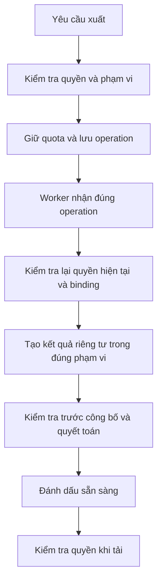

# Entitlement scope: giới hạn phạm vi quyền được cấp

## 1. Có entitlement chưa đủ để được làm mọi việc

Trong chương **Entitlement Rules**, entitlement scope là phạm vi áp dụng của một quyền được hệ thống cấp cho khách hàng, người dùng hoặc một chủ thể khác. Phạm vi đó trả lời: **ai được dùng năng lực nào, trên tài nguyên nào, trong bối cảnh và giới hạn nào**.

Ví dụ, một tổ chức đã mua tính năng xuất báo cáo không có nghĩa mọi thành viên của tổ chức được xuất mọi dự án. Một người được cấp tính năng cho dự án P1 cũng không tự có quyền dùng nó trên dự án P2 hoặc trong tenant khác.

Bài học thuộc module `SECURITY_APPLICATION_SECURITY_BUSINESS_LOGIC_SECURITY`, tập trung bảo vệ quy tắc nghiệp vụ khỏi thao tác sai quyền, sửa tham số, bỏ bước xác nhận và gửi yêu cầu trùng. Các mô hình và chính sách dưới đây là giả định cho sản phẩm minh họa, giúp chuyển một lời hứa cấp quyền thành điều kiện có thể thực thi và kiểm thử.

Sau bài học, bạn cần:

- Mô tả entitlement bằng nhiều chiều phạm vi thay vì một cờ `isPremium`.
- Phân biệt entitlement với quyền theo vai trò và quyền trên đối tượng.
- Tránh ghép các mảnh quyền không tương thích để tạo ra quyền rộng hơn.
- Bảo vệ phạm vi ở API, truy vấn dữ liệu, tác vụ nền, quota và khi thu hồi quyền.
- Kiểm thử được các tình huống vượt phạm vi trong cùng tenant và giữa các tenant.

## 2. Phân biệt những lớp quyết định khác nhau

Một yêu cầu thường đi qua nhiều lớp điều kiện:

| Lớp | Câu hỏi | Ví dụ |
| --- | --- | --- |
| Xác thực | Người gọi là ai và thông tin xác thực còn hợp lệ không? | Người dùng U17 đã đăng nhập |
| Thành viên hoặc ủy nhiệm | Người gọi có được hành động trong tenant và thay mặt chủ thể này không? | U17 vẫn là thành viên của tổ chức A |
| Quyền trên đối tượng | Người gọi có được thực hiện hành động trên tài nguyên cụ thể không? | U17 có quyền đọc dữ liệu dự án P1 |
| Entitlement | Chủ thể đã được cấp năng lực sản phẩm nào và trong phạm vi nào? | Giấy phép cho phép xuất báo cáo ở P1 |
| Ràng buộc nghiệp vụ | Thời hạn, quota và trạng thái còn cho phép không? | Quyền chưa hết hạn, còn đủ ngân sách xuất dữ liệu |

Trong mô hình của bài, yêu cầu được phép khi **tất cả các lớp bắt buộc đều đạt**. Một vai trò quản trị không tự tạo ra giấy phép sản phẩm, và một giấy phép sản phẩm không tự cho quyền đọc dữ liệu ngoài phạm vi.

Không đồng nhất entitlement với các khái niệm gần nghĩa:

- **Feature flag** quyết định cách triển khai hoặc hiển thị tính năng. Bật flag không thay thế kiểm tra quyền phía máy chủ.
- **OAuth scope** hoặc claim trong token mô tả một phạm vi truy cập được cơ chế token công nhận. Nó không mặc nhiên là nguồn dữ liệu hiện tại về giấy phép, quota hoặc tư cách thành viên.
- **Trạng thái đăng ký** cho biết vòng đời hợp đồng. Một đăng ký `ACTIVE` chưa diễn tả đủ tính năng, tài nguyên và người được hưởng quyền.
- **Ẩn nút trên giao diện** giúp trải nghiệm phù hợp nhưng không ngăn gọi trực tiếp endpoint.

Entitlement có thể đến từ hợp đồng trả phí, trial, khuyến mại, cấp đặc biệt hoặc một quy trình có thẩm quyền khác. Điều cần bảo vệ là nguồn cấp hợp lệ và phạm vi của quyền, không chỉ kiểm tra đã thanh toán hay chưa.

## 3. Tình huống xuyên suốt

Giả sử một nền tảng phân tích dữ liệu có hai tenant A và B. Trong tenant A, người dùng U17 được đọc cả P1 và P2, nhưng entitlement xuất dữ liệu chỉ được cấp cho P1.

| Thành phần | Giá trị minh họa |
| --- | --- |
| Chủ thể gọi | U17, đang là thành viên của tenant A |
| Tính năng | `REPORT_EXPORT` |
| Hành động | `EXPORT_CSV` |
| Phạm vi tài nguyên | Dự án P1 và các báo cáo hiện thuộc P1 |
| Người hưởng quyền | U17 theo một phân bổ giấy phép còn hiệu lực |
| Thời hạn | Từ đầu ngày 01/12/2026 đến trước đầu ngày 01/01/2027 |
| Múi giờ xác định mốc kỳ | `Asia/Ho_Chi_Minh` |
| Quota | 1.000 dòng mỗi kỳ quota cho phân bổ này |
| Nguồn cấp | Hợp đồng và phiên bản cấp quyền đã được ghi nhận |

Các kết quả mong đợi:

- U17 xuất một báo cáo hợp lệ thuộc P1: có thể được phép nếu các điều kiện khác còn đạt.
- U17 đổi `projectId` thành P2: bị chặn, dù U17 có quyền đọc P2.
- U17 đổi sang một dự án thuộc tenant B: bị chặn bởi ranh giới tenant và quyền theo đối tượng.
- U17 gửi `subjectId` của người khác có giấy phép rộng hơn: không được dùng danh tính đó nếu thiếu ủy nhiệm hợp lệ.
- U17 gửi lại cùng lệnh xuất: không tạo nhiều lần trừ quota cho cùng một hiệu lực nghiệp vụ.

Trong ví dụ, quota tính trên số dòng được chấp nhận để xuất. Cách đếm cụ thể phải được sản phẩm định nghĩa; không dùng một con số do client tự báo để quyết định mức tiêu thụ.

## 4. Các chiều của entitlement scope

Có thể biểu diễn một grant bằng cấu trúc khái niệm:

```text
Grant = {
  tenant,
  beneficiary,
  feature,
  allowed_actions,
  resource_scope,
  valid_interval,
  context_constraints,
  quota_policy,
  source,
  status,
  version
}
```

Mỗi chiều cần ngữ nghĩa rõ ràng:

| Chiều phạm vi | Câu hỏi cần trả lời | Lỗi thường gặp |
| --- | --- | --- |
| Tenant | Quyền thuộc tổ chức nào? | Chỉ tìm theo `grantId`, bỏ điều kiện tenant |
| Chủ thể hưởng quyền | Cấp cho người, nhóm, tổ chức hay service account nào? | Dùng giấy phép của người khác vì biết ID |
| Tính năng và hành động | Được xem, tạo, xuất hay quản trị? | Có quyền xem báo cáo nhưng được phép xuất toàn bộ dữ liệu |
| Tài nguyên | Một đối tượng, một dự án hay toàn tenant? | `scopeId` rỗng bị hiểu thành mọi tài nguyên |
| Thời gian | Bắt đầu khi nào, kết thúc khi nào? | Dùng token cũ sau khi quyền hết hạn |
| Bối cảnh | Có giới hạn môi trường, kênh hoặc loại sử dụng không? | Dùng quyền sandbox để thực thi trên production |
| Hạn mức | Được dùng bao nhiêu và trong cửa sổ nào? | Đổi request key để có một ngân sách mới |
| Nguồn và trạng thái | Quyền do đâu cấp, còn hiệu lực không? | Giữ quyền từ nguồn đã bị thu hồi |

Không phải sản phẩm nào cũng cần mọi chiều. Tuy nhiên, chiều nào không áp dụng cũng cần có biểu diễn và mặc định được xác định, thay vì để giá trị thiếu vô tình mở rộng quyền.

### 4.1. Không biến giá trị thiếu thành quyền toàn cục

Một cách biểu diễn phạm vi tài nguyên là:

```text
RESOURCE: một đối tượng xác định
PROJECT: một dự án và tập con được chính sách quy định
TENANT_ALL: toàn bộ tài nguyên phù hợp trong một tenant
```

`TENANT_ALL` phải là lựa chọn tường minh do luồng cấp quyền có thẩm quyền tạo ra. Không dùng `resource_id = null` với nghĩa “có thể là chưa cấu hình hoặc có thể là toàn tenant”. Nếu phạm vi không đọc được, không khớp hoặc thiếu dữ liệu bắt buộc, quyết định phải từ chối theo chính sách đã chọn.

### 4.2. Phạm vi động và tập tài nguyên cố định

“Các báo cáo hiện thuộc P1” là một phạm vi động: báo cáo mới trong P1 có thể được bao phủ, còn báo cáo đã chuyển đi thì không. “Danh sách báo cáo R1, R2” là tập cố định.

Hai cách này khác nhau khi thêm mới hoặc di chuyển tài nguyên. Hệ thống phải ghi nhận đang dùng cách nào. Không lưu tên hiển thị của dự án làm ranh giới quyền; tên có thể đổi hoặc trùng. Dùng định danh và quan hệ tài nguyên có thẩm quyền.

## 5. Quy tắc kết hợp quyền và lỗi ghép phạm vi

Trong một chính sách đơn giản, quyết định có thể viết:

```text
ALLOW = mandatory_conditions
        AND exists grant g:
            active(g)
            AND subject_matches(g, caller)
            AND feature_matches(g, requested_feature)
            AND action_matches(g, requested_action)
            AND resource_matches(g, target)
            AND time_matches(g, server_time)
            AND context_matches(g, execution_context)
```

`mandatory_conditions` bao gồm ranh giới tenant, tư cách thành viên, quyền đối tượng và các điều kiện chặn chung. Trong mô hình này, một điều kiện chặn chung như tài khoản bị đình chỉ không bị bỏ qua chỉ vì tìm được một grant khác.

### 5.1. Các chiều của cùng một grant phải được kiểm tra cùng nhau

Giả sử U17 có hai grant:

| Grant | Hành động | Phạm vi |
| --- | --- | --- |
| G1 | `EXPORT_CSV` | P1 |
| G2 | `VIEW_REPORT` | P2 |

Được phép là hợp của hai tập quyền hoàn chỉnh: xuất ở P1 hoặc xem ở P2. Không được lấy hành động từ G1 và tài nguyên từ G2 để suy ra quyền xuất ở P2.

Một phép kiểm tra sai thường có dạng:

```text
Có grant nào cho EXPORT_CSV không? Có.
Có grant nào bao phủ P2 không? Có.
Vậy được xuất P2.                 # Sai: hai điều kiện lấy từ hai grant khác nhau.
```

Lỗi này thường xuất hiện khi dịch vụ gộp riêng danh sách `features` và danh sách `resources`, rồi làm mất quan hệ giữa chúng.

### 5.2. Một số lớp quyền được kết hợp có chủ đích

Không phải mọi điều kiện đều bắt buộc nằm trong một hàng grant. Ví dụ, thiết kế sản phẩm có thể cấp tính năng xuất cho toàn tổ chức, rồi dùng quyền đối tượng để xác định những dự án mà từng người được xuất. Đó là phép kết hợp hợp lệ nếu chính sách quy định rõ:

```text
Entitlement tính năng cho tenant A
AND tư cách hưởng entitlement của U17
AND quyền EXPORT trên P1 của U17
```

Điểm cần tránh là ghép tùy tiện các mảnh entitlement không cùng ngữ nghĩa. Mô hình dữ liệu và bộ đánh giá phải giữ được phép kết hợp nào được chủ động cho phép.

### 5.3. Nhiều nguồn cấp không mặc nhiên cộng quota

Hai grant cùng bao phủ một hành động có thể đến từ một trial và một hợp đồng trả phí. Cần quy định chọn nguồn, ưu tiên nguồn, có được gộp ngân sách hay không và nguồn nào bị trừ trước.

Nếu chọn một grant để thực thi, lưu định danh đó vào lệnh và sử dụng đúng ngân sách của nó. Không kiểm tra quota ở G1 nhưng trừ ở G2, cũng không chọn một grant mới cho mỗi lần gửi lại để lách hạn mức.

Nếu cho phép pooling, phải giới hạn tập nguồn được gộp theo đúng tenant, tính năng, thời hạn, đơn vị và chính sách. Không cộng quota của tenant khác hoặc các kỳ khác chỉ vì cùng có tên tính năng.

## 6. Cấp quyền, kế thừa và ủy nhiệm phải giữ được giới hạn

### 6.1. Không cho client tự mở rộng grant

Endpoint cấp hoặc sửa quyền phải xác định người cấp có thẩm quyền tạo đúng loại grant và đúng phạm vi đó. Quyền sử dụng một tính năng không tự cho phép cấp lại quyền cho người khác.

Client không được tự quyết định các trường có thẩm quyền như:

```text
tenant_id, issuer_id, source_contract_id, source_status,
quota_used, entitlement_version_to_trust, is_global
```

Nếu API cho chọn beneficiary, tài nguyên hoặc thời hạn, máy chủ vẫn phải kiểm tra chúng nằm trong phạm vi người cấp được quản lý. Không gán thẳng request body vào entity grant.

### 6.2. Quyền theo nhóm phụ thuộc vào tư cách thành viên

Nếu grant cấp cho nhóm Analytics, người dùng được hưởng thông qua nhóm phải còn tư cách thành viên phù hợp tại thời điểm được yêu cầu bởi chính sách. Một lần tham gia nhóm trong quá khứ không mặc nhiên tạo giấy phép cá nhân vĩnh viễn.

Cần phân biệt rõ cấp trực tiếp và hưởng theo nhóm. Khi bị gỡ khỏi nhóm, quyền phát sinh từ nhóm chấm dứt theo chính sách, còn một grant trực tiếp độc lập có thể vẫn hợp lệ. Thu hồi một nguồn không tự xóa mọi nguồn khác trừ khi đó là quy tắc đã xác định.

Nếu quyền gắn với seat, việc gán hoặc thu hồi seat là dữ liệu ảnh hưởng đến quyết định. Hai người đồng thời nhận seat cuối cùng không được cùng vượt số lượng giấy phép nhờ một phép đếm thiếu bảo vệ đồng thời.

### 6.3. Ủy nhiệm chỉ làm hẹp quyền theo mô hình của bài

Một grant con được ủy nhiệm cần nằm trong giới hạn grant cha:

```text
actions(child) ⊆ actions(parent)
resources(child) ⊆ resources(parent)
valid_interval(child) ⊆ valid_interval(parent)
context(child) không rộng hơn context(parent)
```

Ngân sách ủy nhiệm cũng cần mô hình riêng. Nếu cha chỉ còn 100 lượt, tạo mười grant con có 100 lượt độc lập sẽ biến thành 1.000 lượt nếu không có ngân sách cha hoặc cơ chế phân bổ được bảo vệ.

Khi quyền cha bị thu hồi hoặc bị thu hẹp, grant con không được tiếp tục hoạt động như một quyền độc lập vượt cha nếu sản phẩm dùng mô hình kế thừa động. Cần kiểm tra chuỗi nguồn cấp hoặc dùng một cơ chế cập nhật có bằng chứng và độ trễ được xác định.

Không tin `onBehalfOf` từ client để đổi chủ thể hưởng quyền. Người gọi, chủ thể được đại diện và quan hệ ủy nhiệm là ba đối tượng cần được kiểm chứng.

## 7. Kiểm tra phạm vi ở API và truy vấn dữ liệu

### 7.1. Đối tượng mục tiêu phải lấy từ nguồn có thẩm quyền

Một endpoint xuất báo cáo có thể nhận `reportId`, nhưng tenant và dự án thực tế của báo cáo phải được tra từ dữ liệu máy chủ. Không kiểm tra entitlement trên `projectId` client gửi rồi xuất một `reportId` thuộc dự án khác.

Ví dụ luồng đúng:

```text
Xác thực người gọi
→ xác định tenant được phép sử dụng trong yêu cầu
→ tải báo cáo có giới hạn tenant
→ lấy dự án thực tế của báo cáo
→ kiểm tra quyền đối tượng và entitlement trên chính dự án đó
→ chọn và xuất đúng tập dữ liệu được phép
```

Một tham số tenant trong URL hoặc header có thể là lựa chọn ngữ cảnh, nhưng chỉ được dùng sau khi xác minh người gọi có quyền trong ngữ cảnh đó. Nó không phải nguồn tự cấp quyền.

### 7.2. Kiểm tra một lần rồi truy vấn rộng là chưa đủ

Đoạn mã khái niệm sau có lỗi:

```java
requireCanExport(actor, projectId);
return reports.findAllByUserSuppliedFilter(filter);
```

Nếu `filter` có thể chọn tenant hoặc dự án khác, dữ liệu đầu ra không còn bị ràng buộc bởi đối tượng đã kiểm tra.

Truy vấn cần được xây từ phạm vi đã được xác nhận ở máy chủ:

```text
tenant_id = authorized_tenant
AND project_id IN authorized_project_set
AND các điều kiện lọc nghiệp vụ được phép
```

Nếu một lệnh chỉ được cấp cho một dự án, không mở rộng thành tập mọi dự án người dùng nhìn thấy. Quyền xem nhiều tài nguyên chưa chắc đi cùng entitlement xuất nhiều tài nguyên.

### 7.3. Danh sách, tổng số và hành động hàng loạt

Phạm vi phải áp dụng cho cả dữ liệu chính, số lượng kết quả, thông tin tổng hợp và endpoint tải file. Một danh sách đã lọc đúng nhưng trả `totalCount` toàn tenant vẫn có thể làm lộ thông tin ngoài phạm vi.

Với yêu cầu hàng loạt, phải kiểm tra từng đối tượng hoặc dùng truy vấn chứng minh toàn bộ tập nằm trong phạm vi. Quy định rõ hành vi toàn bộ hoặc không gì cả, hay trả kết quả từng phần; không dùng quyền của phần tử đầu tiên cho mọi phần tử phía sau.

Cursor phân trang và đường dẫn tải kết quả cần gắn với truy vấn, phạm vi và cơ chế xác thực phù hợp. Một cursor có chữ ký chỉ chống sửa nội dung; nếu server không kiểm tra người dùng hiện tại và hiệu lực quyền, nó vẫn có thể bị dùng lại ngoài dự kiến.

## 8. Thời hạn, thay đổi phạm vi và độ mới của quyết định

### 8.1. Dùng khoảng thời gian có biên rõ ràng

Một quy ước dễ kiểm thử là khoảng nửa mở:

```text
valid_from <= server_now < valid_until
```

Tại đúng `valid_until`, grant đã hết hiệu lực. Mốc thời gian lấy từ đồng hồ máy chủ, được so sánh bằng các thời điểm nhất quán. Client không được gửi một `now` cũ để tiếp tục hưởng quyền.

Nếu sản phẩm có grant không hết hạn, dùng trạng thái thời hạn tường minh. Đừng để một ngày hết hạn bị thiếu do lỗi dữ liệu biến thành quyền vĩnh viễn ngoài chủ ý.

Thời hạn của giấy phép, kỳ quota, thời hạn phiên đăng nhập và tuổi của một token có thể khác nhau. Một token còn hạn không tự kéo dài grant đã hết hạn; một kỳ quota mới cũng không tự khôi phục grant đã bị thu hồi.

### 8.2. Phạm vi thay đổi giữa kiểm tra và thực thi

Giả sử tại T1, báo cáo R1 thuộc P1 nên kiểm tra đạt. Tại T2, báo cáo chuyển sang P2. Tại T3, hệ thống xuất R1 dựa trên kết quả cũ.

Nếu chính sách đánh giá theo vị trí hiện tại, đây là lỗi kiểm tra ở một thời điểm nhưng dùng dữ liệu ở thời điểm khác. Cần bảo vệ quan hệ tài nguyên bằng transaction, khóa, phiên bản hoặc cơ chế ảnh chụp có ngữ nghĩa rõ ràng.

Tương tự, grant có thể bị thu hẹp, người dùng bị gỡ khỏi nhóm hoặc seat bị thu hồi sau khi giao diện đã hiển thị nút xuất. Quyết định phía giao diện không có hiệu lực thay cho quyết định máy chủ lúc tạo lệnh.

### 8.3. Token và cache cần có giới hạn độ cũ

Một cache key chỉ gồm `userId` và `feature` là quá rộng nếu quyết định còn phụ thuộc tenant, tài nguyên, hành động, phiên bản grant và bối cảnh. Nó có thể tái dùng kết quả cho một đối tượng khác.

Có thể cache dữ liệu cấp quyền hoặc kết quả quyết định với những thành phần và quy tắc vô hiệu hóa thích hợp. Cần xác định:

- Quyết định có thể cũ tối đa bao lâu đối với từng loại thao tác?
- Thay đổi grant, nhóm, seat hoặc tài nguyên làm mất hiệu lực những cache nào?
- Có dùng phiên bản chính sách hoặc một authorization epoch để nhận biết thay đổi không?
- Nếu không xác minh được độ mới cần thiết, thao tác được chặn hay được chấp nhận theo một chính sách giới hạn cụ thể?

TTL ngắn chỉ giới hạn độ cũ, không tạo thu hồi tức thì. Gửi một sự kiện xóa cache cũng chưa chứng minh mọi instance đã nhận. Nếu nghiệp vụ yêu cầu chặn ngay sau một điểm commit, đường thực thi phải có cách kiểm chứng phiên bản hiện tại hoặc dùng nguồn quyết định đáp ứng yêu cầu đó.

JWT có chữ ký chứng minh nội dung do bên phát hành ký và chưa bị sửa. Nó không tự chứng minh nội dung về entitlement vẫn hiện hành. Nếu chọn dùng capability có hạn cho phép thực thi độc lập, cần chấp nhận và công bố ngữ nghĩa thu hồi tương ứng; không đồng thời hứa kiểm tra quyền hiện tại mà chỉ dựa vào token cũ.

## 9. Transaction, quota và idempotency phải giữ cùng phạm vi

### 9.1. Kiểm tra đúng grant rồi mới giữ ngân sách đúng chỗ

Trong ví dụ U17 còn 300 dòng quota, hai yêu cầu đồng thời muốn xuất 200 dòng mỗi yêu cầu. Cả hai có thể cùng đọc số còn lại là 300 và cùng được chấp nhận nếu kiểm tra và cập nhật tách rời.

Cần một ranh giới nguyên tử cho việc xác nhận phạm vi và giữ ngân sách. Ví dụ, bộ đếm quota có thể được bảo vệ bằng khóa hoặc cập nhật có điều kiện:

```text
used + reserved + requested <= limit
```

Ngân sách phải gắn với đúng định danh đã chọn, chẳng hạn grant hoặc pool hợp lệ, tính năng, cửa sổ thời gian và đơn vị tính. Không tạo một hàng quota mới theo `requestId` để mỗi request đều bắt đầu với hạn mức đầy đủ.

Nếu có cả giới hạn của người dùng và giới hạn toàn tenant, cả hai đều phải được thỏa mãn. Giữ ngân sách cá nhân không được làm vượt ngân sách tổng; cập nhật các ngân sách liên quan cần cùng transaction hoặc cơ chế phối hợp tương đương.

### 9.2. Giữ trước và quyết toán

Với tác vụ xuất bất đồng bộ, có thể giữ một số dòng tối đa trước khi chạy rồi quyết toán theo số thực tế:

```text
Khi nhận lệnh: reserved += row_limit
Khi thành công: reserved -= row_limit; used += actual_rows
Điều kiện: 0 <= actual_rows <= row_limit
Khi hủy hoặc thất bại chắc chắn: giải phóng phần giữ đúng một lần
```

Worker phải thực thi giới hạn đầu ra tương ứng. Nếu giữ 100 dòng nhưng sau đó xuất 1.000 dòng vì dữ liệu tăng lên, phép giữ quota không còn bảo vệ được nghiệp vụ. Có thể dùng tập dữ liệu đã chốt hoặc truy vấn có giới hạn cứng, với quy tắc đếm nhất quán.

Một reservation hết hạn không tự chứng minh worker cũ đã dừng. Trước khi giải phóng để cấp lại ngân sách, cần vô hiệu hóa quyền hoàn tất của lần thực thi cũ, chẳng hạn bằng thế hệ xử lý và kiểm tra phiên bản khi công bố kết quả. Nếu không, worker cũ và worker mới đều có thể dùng cùng phần quota.

### 9.3. Gửi lại không được đổi phạm vi hoặc trừ quota lần nữa

Một lệnh bền vững nên gắn với fingerprint gồm các dữ liệu có ý nghĩa:

```text
tenant, actor hoặc chủ thể được đại diện,
action, target_resource, normalized_filter, row_limit
```

Máy chủ lưu idempotency key trong phạm vi tenant, chủ thể và loại thao tác phù hợp:

- Cùng key, cùng nội dung: tìm về cùng lệnh và reservation, không giữ thêm quota.
- Cùng key, khác tài nguyên, bộ lọc hoặc giới hạn dòng: trả xung đột, không sửa ý định cũ.
- Khác key: có thể là lệnh mới nhưng vẫn dùng cùng ngân sách nghiệp vụ, không được cấp quota mới ngoài chính sách.

Khi trả lại kết quả cũ, kiểm tra quyền truy cập hiện tại theo ngữ nghĩa sản phẩm. Việc một lệnh từng được phép không tự cho người đã bị thu hồi quyền tải lại dữ liệu mãi mãi.

## 10. Mã giả Java: nhận lệnh xuất trong phạm vi được phép

Đoạn mã sau minh họa việc nhận lệnh, chọn grant và giữ quota trong một cơ sở dữ liệu. Nó dùng một khóa điều phối theo tenant để làm rõ ranh giới nhất quán; đây là cách đơn giản phục vụ giải thích, có thể gây tranh chấp lớn trong hệ thống thật.

Tất cả thay đổi ảnh hưởng đến quyết định trong mô hình này, gồm grant, thành viên, seat và quan hệ tài nguyên, phải tuân thủ cùng giao thức điều phối. Nếu một dịch vụ khác cập nhật độc lập, cần cơ chế phiên bản hoặc phối hợp khác; tên hàm có chữ `lock` không tự bảo đảm nhất quán phân tán.

```java
@Transactional
public ExportReceipt requestExport(
        Actor actor,
        UUID reportId,
        ExportFilter inputFilter,
        int rowLimit,
        String idempotencyKey) {

    // tenant đến từ ngữ cảnh đã xác thực và được phép sử dụng.
    scopeGuard.lockTenant(actor.tenantId());

    var report = reports.findInTenant(actor.tenantId(), reportId)
        .orElseThrow(NotFound::new);

    var filter = filters.normalizeAndValidate(inputFilter);
    require(rowLimit > 0 && rowLimit <= policy.maxRowsPerExport(),
            "INVALID_ROW_LIMIT");

    var decision = authorization.requireCurrentDecision(
        actor,
        REPORT_EXPORT,
        EXPORT_CSV,
        report,
        executionContext.fromTrustedServerState()
    );
    // Bao gồm quyền đối tượng, tư cách hưởng và một grant khớp đầy đủ.

    var fingerprint = fingerprints.forExport(
        actor, report, filter, rowLimit
    );

    var prior = operations.findByIdempotencyKeyForUpdate(
        actor.tenantId(), actor.subjectId(), "EXPORT", idempotencyKey
    );

    if (prior.isPresent()) {
        prior.get().requireSameFingerprint(fingerprint);
        access.requireCanReadOperation(actor, prior.get());
        return ExportReceipt.from(prior.get());
    }

    var binding = decision.toScopeBinding(
        report.id(), report.projectId(), filter, rowLimit
    );
    var operation = operations.createPending(
        actor, binding, fingerprint, idempotencyKey
    );

    quotas.reserveForUpdate(
        decision.budgetId(), decision.quotaWindow(),
        operation.id(), rowLimit
    );

    outbox.appendExportRequested(operation.id());
    return ExportReceipt.pending(operation);
}
```

Các điểm cần hiện thực trong mã thật:

- `requireCurrentDecision` không được lấy tenant, nhóm, quyền đối tượng hoặc grant trực tiếp từ request body.
- `decision` giữ được quan hệ giữa hành động và phạm vi của grant đã chọn; không chỉ trả một cờ `true`.
- Quota và operation được commit cùng nhau. Nếu không giữ được quota, operation và outbox cũng rollback.
- Có unique constraint cho phạm vi idempotency và cho reservation của cùng operation. Việc kiểm tra trước không thay thế ràng buộc chống tạo trùng đồng thời.
- `scopeBinding` ghi nhận tài nguyên, bộ lọc, giới hạn và các phiên bản cần thiết; nó không phải một giấy phép vô thời hạn cho worker.
- Mọi truy vấn và liên kết tiếp theo vẫn giữ tenant. Một lần lọc tenant ở đầu không bảo vệ một truy vấn khác chỉ dùng ID bên ngoài.
- Đây mới là tiếp nhận lệnh, chưa phải đã tạo hoặc công bố file. Những bước sau phải giữ ràng buộc ở phần tiếp theo.

Trong hệ thống có lưu lượng lớn, có thể thay khóa tenant bằng khóa hẹp hơn, optimistic locking hoặc một dịch vụ quyết định có giao thức phiên bản. Dù chọn cách nào, cần chứng minh cùng các bất biến, thay vì chỉ bỏ khóa để giảm thời gian chờ.

## 11. Tác vụ nền và tải kết quả phải giữ nguyên ranh giới quyền

Một luồng xuất có thể đi qua nhiều bước:



Trong mô hình của bài, entitlement phải còn phù hợp khi worker bắt đầu, khi công bố kết quả và khi người dùng tải. Sản phẩm khác có thể bảo lưu một số lệnh đã được chấp nhận trước lúc hết hạn, nhưng phải định nghĩa rõ ngoại lệ đó; không để việc xếp hàng vô tình trở thành quyền vĩnh viễn.

### 11.1. Worker lấy ý định từ operation bền vững

Thông điệp hàng đợi nên tham chiếu đến operation. Worker đọc lại các dữ liệu đã được chốt ở máy chủ thay vì tin một payload có `tenantId`, `isPremium`, `projectIds` và `approved=true`.

Các lần phát lại cùng thông điệp không được sinh operation hoặc reservation mới. Worker cần nhận quyền xử lý theo trạng thái và thế hệ hợp lệ, đồng thời giữ được định danh của cùng một ý định.

Nếu report đã chuyển dự án, grant đã bị thu hồi hoặc người dùng không còn được hưởng qua nhóm, kiểm tra lại phải phát hiện theo chính sách hiện hành. Không đổi đích sang một tài nguyên khác để “giúp” lệnh tiếp tục chạy.

### 11.2. Kiểm tra đầu vào chưa bảo vệ toàn bộ quá trình tạo file

Khi tác vụ quét dữ liệu lâu, phạm vi có thể thay đổi giữa lúc bắt đầu và kết thúc. Một cách xử lý là tạo dữ liệu trong vùng lưu trữ riêng tư, ràng buộc truy vấn với binding đã xác nhận, rồi kiểm tra phiên bản và quyền hiện tại trước khi công bố.

Nếu thay đổi làm kết quả không còn hợp lệ, hủy hoặc tạo lại theo quyết định mới; không công bố file đã chứa dữ liệu ngoài phạm vi chỉ vì kiểm tra đầu tiên từng đạt. Quy trình công bố phải được phối hợp với thao tác thu hồi để có điểm phân xử rõ ràng, không phải “đọc quyền rồi cập nhật READY” mà không bảo vệ khoảng giữa.

Việc ghi file vào kho đối tượng không nằm trong transaction cơ sở dữ liệu cục bộ. Vì vậy, file trung gian cần ở trạng thái riêng tư; chỉ cho tải qua trạng thái công bố có thẩm quyền và cơ chế kiểm tra phù hợp. Khi database rollback, một file trung gian còn tồn tại không được tự trở thành đường dẫn tải công khai.

### 11.3. Đường dẫn tải cũng là một đường truy cập dữ liệu

Một endpoint kiểm tra quyền đúng nhưng trả URL công khai dài hạn sẽ tạo đường vòng quanh kiểm tra lần sau. Nếu dùng URL có chữ ký, phải hiểu thời hạn và khả năng thu hồi của cơ chế lưu trữ.

Nếu chính sách yêu cầu kiểm tra quyền hiện tại cho mỗi lần tải, có thể dùng một cổng tải thực hiện kiểm tra và kiểm soát việc truy cập đối tượng riêng tư. Một URL tải trực tiếp có hiệu lực độc lập không tự đáp ứng lời hứa đó chỉ vì URL được tạo sau một lần kiểm tra đúng.

Quyền đã thu hồi không thể làm người dùng quên dữ liệu họ đã tải trước đó. Phạm vi bảo đảm của hệ thống là ngăn những hành vi và lần truy cập tiếp theo theo điểm thực thi đã định nghĩa.

## 12. Vòng đời grant và cách thu hẹp quyền

Máy trạng thái cấp quyền có thể gồm `PENDING`, `ACTIVE`, `SUSPENDED`, `EXPIRED`, `REVOKED`. Chỉ trạng thái được chính sách cho phép mới tham gia quyết định cho phép.

Những chuyển đổi cần phân biệt:

| Thay đổi | Hành vi cần xác định |
| --- | --- |
| Gia hạn thời gian | Có căn cứ cấp tiếp và phiên bản mới; không tự khôi phục mọi nguồn đã bị thu hồi |
| Thu hẹp từ toàn tenant xuống P1 | Quyền trên tài nguyên khác chấm dứt theo thời điểm hiệu lực và chính sách lệnh đang chạy |
| Gỡ U17 khỏi nhóm | Quyền thông qua nhóm dừng; grant trực tiếp độc lập được đánh giá riêng |
| Thu hồi seat | Không tiếp tục sử dụng seat cũ qua token hoặc cache cũ ngoài độ trễ cho phép |
| Chuyển báo cáo khỏi P1 | Quyền theo phạm vi động phải đánh giá lại quan hệ hiện tại |
| Đình chỉ nguồn cấp | Các grant phụ thuộc nguồn được đánh giá theo quy tắc phụ thuộc đã định nghĩa |
| Cấp lại sau thu hồi | Có hành động có thẩm quyền và dấu vết mới; không do một request cũ tự kích hoạt |

Lưu nguồn, phiên bản và thời điểm hiệu lực giúp giải thích vì sao một quyết định trước đây được cho phép nhưng quyết định hiện tại bị từ chối. Không sửa lịch sử cấp quyền để làm như người dùng chưa từng được cấp hoặc luôn được cấp rộng hơn.

Nếu một người có nhiều grant hợp lệ, thu hồi một grant không nhất thiết làm mất toàn bộ khả năng sử dụng. Bộ đánh giá phải tính lại theo chính sách kết hợp, đồng thời vẫn tôn trọng các điều kiện chặn chung. Tránh cả hai cực: giữ quyền đã hết căn cứ hoặc xóa nhầm quyền độc lập vẫn còn hợp lệ.

## 13. Kiểm thử tình huống vượt phạm vi

Kiểm thử phải quan sát cả quyết định và hiệu lực: dữ liệu trả về, operation, reservation, số quota đã dùng, file đã công bố và khả năng tải. Mã HTTP từ chối chưa đủ nếu file vẫn được tạo hoặc dữ liệu vẫn rò rỉ qua một endpoint khác.

| Tình huống | Cách thử | Kết quả cần chứng minh |
| --- | --- | --- |
| Sai tenant | Đổi ID sang tài nguyên của tenant B | Không đọc dữ liệu, giữ quota hoặc tạo lệnh ngoài quyền |
| Sai chủ thể hưởng | Gửi `subjectId` của người có grant rộng hơn | Không đổi danh tính hưởng quyền nếu thiếu ủy nhiệm |
| Sai dự án | Có entitlement P1 nhưng yêu cầu xuất P2 | Bị chặn dù có quyền xem P2 |
| Sai hành động | Có `VIEW_REPORT`, gọi `EXPORT_CSV` | Không suy ra quyền xuất từ quyền xem |
| Ghép hai grant | G1 cho xuất P1, G2 cho xem P2 | Không cho xuất P2 bằng cách ghép các chiều |
| Thiếu phạm vi | Grant thiếu định danh tài nguyên bắt buộc | Không mặc định thành toàn tenant |
| Sai môi trường | Dùng grant sandbox trên production | Không mở rộng bối cảnh sử dụng |
| Đúng biên hết hạn | Gọi trước, đúng và sau `valid_until` | Kết quả theo khoảng thời gian đã định nghĩa |
| Nguồn bị thu hồi | Giữ token cũ rồi dùng sau thời điểm chặn | Không vượt giới hạn độ cũ mà chính sách cho phép |
| Gỡ khỏi nhóm | Tạo lệnh rồi gỡ tư cách hưởng qua nhóm | Xử lý tại các điểm thực thi theo chính sách đã định nghĩa |
| Di chuyển tài nguyên | Kiểm tra R1 ở P1 rồi chuyển sang P2 trước thực thi | Không dùng quan hệ cũ để xuất ngoài phạm vi |
| Chèn bộ lọc rộng | Kiểm tra P1 nhưng filter chọn mọi dự án | Truy vấn chỉ lấy dữ liệu trong phạm vi được cấp |
| Batch trộn phạm vi | Gửi chung ID thuộc P1, P2 và tenant B | Không lấy quyền phần tử đầu để cho phép cả lô |
| Gửi lại cùng key | Phát lại cùng nội dung nhiều lần | Cùng operation, không giữ hoặc trừ quota thêm |
| Đổi payload giữ key | Đổi report hoặc giới hạn dòng dưới key cũ | Xung đột, không sửa ý định cũ |
| Quota đồng thời | Còn 300 dòng, hai lệnh mỗi lệnh 200 dòng | Không đồng thời giữ tổng 400 dòng |
| Reservation hết hạn | Worker cũ tiếp tục sau khi ngân sách được cấp lại | Worker cũ không còn quyền công bố hoặc quyết toán |
| Tải qua đường vòng | Dùng lại URL hoặc gọi thẳng kho file | Không vượt cơ chế truy cập và thời hạn đã cam kết |
| Endpoint tổng số | Yêu cầu danh sách trong phạm vi hẹp | Count và tổng hợp không làm lộ dữ liệu ngoài quyền |
| Gửi lại thao tác cấp quyền cũ | Thu hồi grant rồi phát lại request đã xử lý | Không tự khôi phục quyền vì thiếu chống trùng và kiểm tra trạng thái |

### 13.1. Kiểm thử đồng thời với dữ liệu nghiệp vụ

Hai request nối tiếp không chứng minh được cơ chế kiểm soát tranh chấp. Dùng hai transaction hoặc kết nối độc lập và điểm đồng bộ để cùng cạnh tranh trên trạng thái ban đầu.

Trong trường hợp quota còn 300 dòng và hai lệnh mới đều giữ 200 dòng:

```text
Số reservation mới được chấp nhận <= 1
Tổng used + reserved <= limit
Không có operation thực thi hợp lệ mà thiếu reservation tương ứng
Gửi lại lệnh đã nhận không làm tăng reserved lần nữa
```

Với thu hồi quyền cạnh tranh công bố file, cần chạy cả hai thứ tự commit. Nếu thu hồi thắng theo điểm phân xử đã định nghĩa, file không được công bố dựa trên quyền cũ. Nếu công bố thắng, việc tải tiếp vẫn phải theo quy tắc quyền hiện tại của mô hình.

### 13.2. Kiểm thử theo chuỗi và thuộc tính

Các chuỗi hữu ích gồm:

```text
Cấp P1 → tạo lệnh → thu hẹp quyền → worker chạy
Cấp theo nhóm → tạo lệnh → rời nhóm → tải kết quả
Kiểm tra báo cáo P1 → chuyển báo cáo sang P2 → công bố
Giữ quota → worker bị ngắt → hết hạn giữ → worker cũ chạy lại
Gửi cùng key → đổi tài nguyên → gửi lại
Thu hồi grant cha → dùng grant con
```

Có thể kiểm tra những thuộc tính chung trong mô hình không có ngoại lệ mở rộng quyền:

- Thu hẹp tài nguyên của cùng grant không làm tập hành vi được phép rộng hơn.
- Rút ngắn thời hạn không làm xuất hiện một quyền mới sau thời điểm kết thúc.
- Thêm một grant xem P2 không làm grant xuất P1 mở rộng sang P2.
- Gửi lại cùng lệnh không tạo thêm hiệu lực hoặc ngân sách.
- Mọi file công bố đều có binding hợp lệ và dấu quyết toán đúng một lần.

Các thuộc tính này cần gắn với chính sách cụ thể, nhất là khi có nhiều nguồn cấp hoặc pooling. Không dùng một kỳ vọng đơn giản như “thu hồi một grant là mất mọi quyền” nếu người dùng vẫn còn một nguồn độc lập hợp lệ.

## 14. Audit và giải thích quyết định

Một quyết định cần có bằng chứng đủ để trả lời vì sao yêu cầu được cho phép hoặc bị chặn:

- Actor, chủ thể hưởng hoặc được đại diện và tenant thực tế.
- Hành động, tính năng, tài nguyên và quan hệ dự án đã được kiểm tra.
- Grant hoặc tập nguồn hợp lệ được dùng, phiên bản và thời điểm đánh giá.
- Nguồn cấp, tư cách nhóm hoặc seat và các điều kiện chặn liên quan.
- Budget, cửa sổ quota, reservation, operation và kết quả quyết toán.
- Thời điểm thu hồi hoặc đổi phạm vi, thế hệ worker và thời điểm công bố nếu có.

Mã lý do như `TENANT_MISMATCH`, `NO_MATCHING_SCOPE`, `EXPIRED_GRANT` hoặc `QUOTA_EXCEEDED` giúp quan sát và kiểm thử. Thông tin chi tiết nội bộ không nhất thiết được trả nguyên vẹn cho người gọi; tránh tiết lộ tài nguyên ngoài quyền qua thông báo lỗi.

Dấu vết thay đổi thành công phải được lưu bền vững theo ranh giới thích hợp. Nếu quyết định từ chối dẫn đến rollback, một dòng audit trong cùng transaction cũng rollback; sự kiện từ chối cần đường lưu phù hợp nếu có yêu cầu theo dõi.

Các tín hiệu đáng chú ý gồm nhiều lần đổi ID trong cùng tính năng, liên tục thử phạm vi toàn tenant, dùng token cũ sau thu hồi, đổi key để tạo thêm lệnh hoặc nhiều lỗi quota trong thời gian ngắn. Giám sát hỗ trợ phát hiện lạm dụng; kiểm tra phạm vi vẫn phải chặn trực tiếp trước hiệu lực được bảo vệ.

## 15. Tự đánh giá thiết kế

1. Entitlement đang được biểu diễn bằng một cờ hay giữ được quan hệ giữa chủ thể, hành động và tài nguyên?
2. Có chỗ nào ghép tính năng từ grant này với tài nguyên của grant khác không?
3. Nếu một tham số phạm vi bị thiếu, hệ thống từ chối hay vô tình cho phép toàn bộ?
4. Dự án và tenant của tài nguyên được tra từ đâu, và truy vấn đầu ra có giữ cùng phạm vi không?
5. Quyền theo nhóm, seat và ủy nhiệm thay đổi thì quyết định hiện tại được cập nhật như thế nào?
6. Khi tác vụ nền chạy sau lúc hết hạn hoặc thu hồi, điểm nào kiểm tra lại và ngăn công bố?
7. Cache, token và URL tải có đáp ứng đúng ngữ nghĩa thu hồi mà sản phẩm cam kết không?
8. Quota, idempotency và kết quả có cùng gắn với một operation và phạm vi bất biến không?

Entitlement scope biến một quyền được cấp thành ranh giới thực thi cụ thể. Bảo vệ ranh giới đó đòi hỏi giữ nguyên quan hệ giữa các chiều quyền, áp dụng chúng vào đúng dữ liệu và kiểm chứng lại ở những điểm có thể tạo hiệu lực, kể cả khi có thay đổi phạm vi, gửi lại hoặc xử lý bất đồng bộ.
