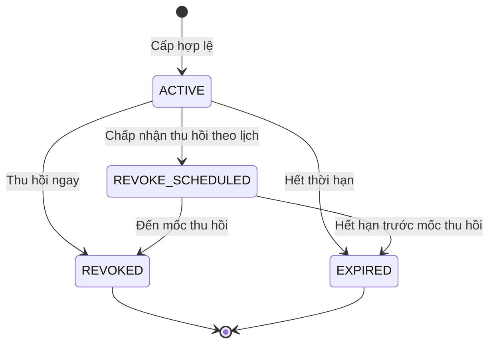

# Entitlement revocation — Thu hồi quyền sử dụng theo nghiệp vụ

## 1. Entitlement revocation là gì?

**Entitlement** là quyền sử dụng một tính năng, tài nguyên hoặc hạn mức được cấp theo một căn cứ nghiệp vụ: gói thuê bao, giao dịch mua, chương trình dùng thử, tư cách thành viên hoặc quyết định cấp quyền thủ công. **Entitlement revocation** là việc làm mất hiệu lực của một quyền đã cấp, theo phạm vi và thời điểm được chính sách cho phép.

Ví dụ, gói Pro cho phép xuất báo cáo. Khi gói kết thúc hoặc bị thu hồi hợp lệ, người dùng không được tạo báo cáo mới bằng quyền của gói đó. Nhưng nếu họ còn một quyền xuất báo cáo độc lập do hợp đồng doanh nghiệp cấp, việc thu hồi quyền từ gói Pro chưa chắc làm mất toàn bộ khả năng xuất báo cáo.

Trong chương **Entitlement Rules** của module `SECURITY_APPLICATION_SECURITY_BUSINESS_LOGIC_SECURITY`, thu hồi quyền được xem là một bài toán bảo vệ bất biến nghiệp vụ. Các nguy cơ chính gồm thu hồi sai đối tượng, bỏ qua phê duyệt, tiếp tục dùng quyền qua token hoặc cache cũ, phát lại sự kiện cấp quyền và gửi thao tác trùng gây tác dụng phụ nhiều lần.

Thu hồi quyền cũng không đồng nghĩa với đăng xuất, xóa tài khoản, ngừng thu phí hoặc hoàn tiền. Những hành vi này có thể được điều phối cùng nhau, nhưng mỗi hành vi cần căn cứ, phạm vi và quy tắc riêng.

Sau bài học, bạn có thể:

- Phân biệt nguồn cấp quyền với quyền sử dụng hiệu lực tại thời điểm truy cập.
- Xác định bất biến về đối tượng, thời gian, trạng thái và tính chống trùng.
- Thiết kế thu hồi quyền có transaction, idempotency và lịch sử kiểm toán.
- Hiểu giới hạn của token, cache và sự kiện bất đồng bộ khi cần thu hồi nhanh.
- Kiểm thử các tình huống tấn công logic trước, trong và sau khi thu hồi.

## 2. Phân biệt grant với quyền hiệu lực

### 2.1. Một tính năng có thể được cấp từ nhiều nguồn

Một **grant** là một lần cấp quyền có định danh, phạm vi, nguồn và thời hạn riêng. Một người dùng có thể có nhiều grant cho cùng một tính năng:

| Grant | Nguồn | Tính năng | Phạm vi | Hạn dùng |
|---|---|---|---|---|
| G1 | Thuê bao Pro | `REPORT_EXPORT` | Dự án P trong tenant T | Đến 01/01/2027 |
| G2 | Quyết định hỗ trợ | `REPORT_EXPORT` | Dự án P trong tenant T | Đến 03/01/2027 |
| G3 | Hợp đồng doanh nghiệp | `REPORT_EXPORT` | Dự án Q trong tenant T | Theo hợp đồng |

Nếu G1 bị thu hồi, G2 có thể vẫn cho phép xuất báo cáo trong P nếu đó là nguồn độc lập hợp lệ. G3 không cho phép xuất báo cáo trong P chỉ vì cùng tenant và cùng tên tính năng.

Với mô hình các grant được phép kết hợp theo quan hệ “hoặc”, quyền hiệu lực có thể được diễn đạt:

```text
ALLOW khi:
  chủ thể được phép truy cập đối tượng
  AND không có lệnh cấm ưu tiên áp dụng
  AND tồn tại grant còn hiệu lực, đúng nguồn và đúng phạm vi
```

Một số sản phẩm yêu cầu nhiều điều kiện đồng thời, như vừa có gói phù hợp vừa có giấy phép theo chỗ ngồi. Khi đó không được dùng phép “hoặc” đơn giản cho mọi nguồn. Quy tắc kết hợp phải là một phần của chính sách.

### 2.2. Thu hồi một nguồn khác với cấm toàn bộ

Hai quyết định sau có ý nghĩa khác nhau:

```text
Thu hồi G1 vì gói thuê bao kết thúc.
Cấm REPORT_EXPORT của chủ thể U trong tenant T vì sự cố bảo mật.
```

Quyết định đầu chỉ vô hiệu hóa căn cứ G1. Quyết định sau có thể cần một lệnh cấm có ưu tiên cao hơn các grant còn lại, nếu chính sách cho phép. Không tự mở rộng một yêu cầu thu hồi nguồn thành cấm mọi tính năng của người dùng.

Ngược lại, nếu mục đích là khóa khẩn cấp toàn bộ quyền xuất dữ liệu, chỉ thu hồi một grant trong khi vẫn còn nguồn khác có thể không đạt yêu cầu. API và giao diện quản trị cần biểu đạt rõ phạm vi quyết định.

### 2.3. Vai trò và phiên đăng nhập chưa đủ

Một người có vai trò `ADMIN` có thể quản lý dự án nhưng không được sử dụng tính năng chỉ có trong gói trả phí. Một người đã đăng nhập hợp lệ vẫn có thể bị thu hồi entitlement.

Do đó, kiểm tra quyền theo vai trò, quyền theo đối tượng và entitlement cần phối hợp. Xác thực thành công không chứng minh quyền sử dụng sản phẩm còn hiệu lực.

## 3. Các bất biến cần bảo vệ

### 3.1. Đúng đối tượng, nguồn và phạm vi

- Chỉ chủ thể được cấp quyền thu hồi mới được tác động đến grant hoặc phạm vi tương ứng.
- Grant bị thu hồi phải thuộc đúng tenant, chủ thể, tài nguyên và nguồn nghiệp vụ.
- Thu hồi một grant không được vô hiệu hóa nhầm grant mới hoặc grant độc lập khác.
- Lệnh cấm rộng chỉ được tạo bằng thao tác có quyền và chính sách tương ứng.
- Yêu cầu cần phê duyệt không được bỏ qua bằng cờ do client gửi.

### 3.2. Đúng thời gian và trạng thái

- Grant không được cấp quyền sau thời điểm thu hồi có hiệu lực.
- Thu hồi đã lên lịch không được làm mất quyền sớm hơn chính sách.
- Worker chậm không được kéo dài quyền qua mốc đã xác lập.
- Sự kiện cấp quyền cũ không được làm sống lại grant đã thu hồi.
- Việc cấp lại hợp lệ phải có định danh hoặc thế hệ mới và bằng chứng mới.

### 3.3. Một thao tác có một hiệu lực nghiệp vụ

- Retry không tạo thêm lần thu hồi hoặc lặp các tác dụng phụ như hoàn phí hay gửi lệnh bên ngoài.
- Hai request đồng thời không được cùng chuyển một grant từ trạng thái đã kết thúc sang các kết quả mâu thuẫn.
- Thay đổi trạng thái, lịch sử thu hồi và dữ liệu phát sự kiện phải được ghi nhất quán.

### 3.4. “Ngay lập tức” cần một bảo đảm thực thi cụ thể

Trong một transaction cục bộ, có thể quy định mọi thao tác được phân xử sau khi thu hồi commit phải đọc trạng thái mới. Trong hệ thống phân tán, các cache, token và phiên kết nối có thể còn giữ quyết định cũ.

Vì vậy cần xác định **độ trễ thu hồi tối đa** theo từng đường truy cập. Ví dụ, thao tác nhạy cảm có thể phải kiểm tra trực tuyến tại điểm thực thi, còn một chức năng ít rủi ro có thể chấp nhận độ trễ được giới hạn rõ.

Không cam kết ngừng quyền ngay trên mọi dịch vụ chỉ từ việc một hàng cơ sở dữ liệu đã chuyển sang `REVOKED`. Cần kiểm chứng cả những nơi đang thực sự cho phép người dùng làm việc.

## 4. Mối đe dọa và dữ liệu không đáng tin cậy

Một request nguy hiểm nếu backend tin toàn bộ nội dung có thể là:

```json
{
  "grantId": "grant-of-another-tenant",
  "subjectId": "someone-else",
  "revokeAllFeatures": true,
  "effectiveAt": "2026-01-01T00:00:00Z",
  "approved": true,
  "refundAmount": 999999
}
```

Các trường này có thể dẫn đến thu hồi sai người, mở rộng phạm vi, lùi ngày để xin hoàn hoặc vượt phê duyệt. Việc gọi endpoint quản trị cũng chưa đủ: máy chủ vẫn phải kiểm tra người gọi có quyền quản trị đúng tenant và đúng loại quyền hay không.

| Tình huống | Lạm dụng có thể xảy ra | Quy tắc cần bảo vệ |
|---|---|---|
| Đổi `grantId` | Thu hồi quyền của đối tượng khác | Kiểm tra quyền theo đối tượng và tenant |
| Tự chọn `effectiveAt` | Lùi ngày hoặc trì hoãn thu hồi ngoài chính sách | Máy chủ xác lập thời gian theo quyền và chính sách |
| Đổi cờ phạm vi | Thu hồi toàn tài khoản thay vì một nguồn | Chỉ cho phép phạm vi đã được cấp quyền |
| Gửi lại sự kiện cấp quyền | Khôi phục quyền đã bị thu hồi | Kiểm tra trạng thái, phiên bản và định danh grant |
| Dùng token cũ | Tiếp tục gọi API sau thu hồi | Cơ chế kiểm tra độ mới của quyền tại nơi thực thi |
| Giữ kết nối lâu | Dùng quyền qua phiên đã mở | Chính sách kiểm tra lại hoặc kết thúc phiên |
| Thu hồi rồi cấp lại liên tục | Tái nhận hạn mức hoặc ưu đãi | Tách quyền truy cập khỏi quy tắc cấp lợi ích |

Thu hồi entitlement không được tự động đặt lại số lần dùng thử hoặc xóa nghĩa vụ đã phát sinh. Nếu các hành vi đó được gắn vào cùng luồng mà không có bất biến riêng, người dùng có thể lợi dụng chu kỳ cấp–thu hồi để nhận lợi ích nhiều lần.

## 5. Mô hình dữ liệu và state machine

### 5.1. Dữ liệu của grant và quyết định thu hồi

Một mô hình tham khảo:

```text
entitlement_grant
  tenant_id, grant_id
  subject_id, feature_code, resource_scope
  source_type, source_id, source_generation
  state: ACTIVE | REVOKE_SCHEDULED | REVOKED | EXPIRED
  valid_from, valid_until
  revocation_effective_at
  version

revocation_operation
  tenant_id, operation_id, grant_id
  expected_source_generation
  mode, effective_at, policy_version
  actor_id, executed_by
  authorization_ref, approval_ref, reason_code
  accepted_at, resulting_version

outbox_event
  event_id, aggregate_id, aggregate_version
  event_type, payload
```

`resource_scope` phải có cấu trúc và ý nghĩa rõ ràng, chẳng hạn một dự án cụ thể hoặc tập tài nguyên theo chính sách. Không coi một chuỗi tự do do client gửi là phạm vi đã được kiểm tra.

Đối với lệnh cấm ưu tiên, có thể dùng cấu trúc chính sách riêng thay vì giả làm một grant âm. Quan trọng là định nghĩa được phạm vi, hiệu lực, ưu tiên và quyền tạo hoặc gỡ lệnh cấm.

### 5.2. Trạng thái kết thúc không được hồi sinh bởi sự kiện cũ



Đây là mô hình không rút lại lịch thu hồi. Nếu sản phẩm cho phép rút lại, phải bổ sung thao tác và chuyển trạng thái có kiểm soát, tăng phiên bản để vô hiệu hóa timer cũ. Không tự thêm đường quay lại `ACTIVE` chỉ vì nhận một message cấp quyền.

Grant đã kết thúc được giữ để kiểm toán. Cấp lại bằng grant mới hoặc thế hệ mới theo thiết kế, với nguồn hợp lệ và thời hạn được tính lại đúng chính sách.

### 5.3. Thời gian hiệu lực độc lập với tốc độ worker

Nếu đã lên lịch thu hồi lúc `2027-01-01T00:00:00Z`, quyết định quyền phải chặn từ mốc đó dù worker cập nhật trạng thái lúc 00:05. Cột `revocation_effective_at` có ý nghĩa thực thi, không chỉ là thông tin để hiển thị.

Tương tự, `valid_until` đã qua thì grant không còn cho phép truy cập dù trạng thái còn là `ACTIVE`. Mô hình thường dùng khoảng nửa mở:

```text
valid_from <= now < valid_until
now < revocation_effective_at, nếu đã có mốc thu hồi
```

Thời gian do nguồn máy chủ có thẩm quyền cung cấp. Không dùng giờ trình duyệt để quyết định grant còn hiệu lực.

## 6. Quyết định quyền tại nơi thực thi

### 6.1. Kiểm tra thời gian chỉ là một phần của authorization

Ví dụ Java sau chỉ minh họa kiểm tra trạng thái và thời gian của một grant:

```java
enum GrantState {
    ACTIVE, REVOKE_SCHEDULED, REVOKED, EXPIRED
}

record Grant(
    GrantState state,
    java.time.Instant validFrom,
    java.time.Instant validUntil,
    java.time.Instant revocationEffectiveAt
) {}

boolean isGrantEffective(Grant grant, java.time.Instant now) {
    if (grant.state() != GrantState.ACTIVE
            && grant.state() != GrantState.REVOKE_SCHEDULED) {
        return false;
    }
    if (now.isBefore(grant.validFrom())) {
        return false;
    }
    if (grant.validUntil() != null
            && !now.isBefore(grant.validUntil())) {
        return false;
    }
    if (grant.revocationEffectiveAt() != null
            && !now.isBefore(grant.revocationEffectiveAt())) {
        return false;
    }
    return true;
}
```

Ví dụ giả định dữ liệu đã hợp lệ, như `validFrom` không rỗng và `REVOKE_SCHEDULED` phải có thời điểm thu hồi. Trường `validUntil = null` chỉ hợp lệ nếu chính sách thực sự hỗ trợ quyền không có hạn.

Hàm này chưa kiểm tra tenant, chủ thể, tính năng, tài nguyên, nguồn cấp hay lệnh cấm. Không dùng nó riêng lẻ làm quyết định cho phép một request.

### 6.2. Kiểm tra toàn bộ ngữ cảnh nghiệp vụ

Một luồng quyết định đầy đủ hơn:

```text
authenticate caller
resolve tenant and requested resource
verify caller's permission on the resource
check applicable deny/restriction policy
load eligible grants in the correct scope
verify source conditions and time validity
combine grants according to product policy
authorize the specific operation
```

Nguồn cấp có thể kèm điều kiện, chẳng hạn người dùng còn là thành viên của tổ chức hoặc còn được gán một giấy phép. Thu hồi tư cách thành viên phải ảnh hưởng đến quyền suy ra từ tư cách đó, không chỉ những grant gắn trực tiếp với user.

Nếu dịch vụ kiểm tra nguồn và grant từ nhiều bản sao có độ trễ khác nhau, cần quy tắc độ mới phù hợp. Một biểu thức đúng trên giấy vẫn có thể cho phép sai nếu dữ liệu đầu vào không còn phản ánh quyết định thu hồi.

### 6.3. Kiểm tra ở backend, trên mọi đường vào liên quan

Ẩn nút tải xuống hoặc xóa menu không ngăn người dùng gọi thẳng API. Cùng quyền cần được thực thi ở endpoint thường, API batch, luồng GraphQL nếu có, worker xử lý thay người dùng và các đường truy cập tài nguyên khác.

Điểm thực thi cuối cùng cần biết thao tác nào đang được cấp quyền. Một gateway chỉ kiểm tra “đã đăng nhập” không thể thay backend quyết định được phép xuất dữ liệu của dự án nào.

## 7. Transaction và idempotency cho thao tác thu hồi

### 7.1. API phải thu hồi một mục tiêu rõ ràng

Ví dụ request:

```http
POST /entitlement-grants/grant-420/revocations
Idempotency-Key: revoke-grant-420-91
Content-Type: application/json

{
  "mode": "IMMEDIATE",
  "expectedVersion": 7,
  "reasonCode": "SOURCE_TERMINATED"
}
```

Máy chủ xác định tenant, quyền trên grant, nguồn, trạng thái và thời điểm hiệu lực. Nếu có chế độ lên lịch, chỉ những lựa chọn ngày giờ mà chính sách và quyền người gọi cho phép mới được chấp nhận.

Không tự chuyển request thu hồi `grant-420` thành thu hồi mọi grant của tài khoản. Endpoint cho phạm vi rộng hơn phải có hợp đồng và quyền tương ứng.

### 7.2. Lưu trạng thái và bằng chứng nguyên tử

Mã giả cho nguồn dữ liệu nằm trong cùng một cơ sở dữ liệu:

```text
BEGIN
  lock target grant in authorized tenant
  verify object permission and required approval

  resolve idempotency key in authorized scope
  if key exists with another fingerprint:
      reject conflict
  if key exists with same fingerprint:
      return original operation reference

  validate target grant, source generation and expected version
  determine allowed mode and effective time on server

  if the equivalent revocation already has effect:
      link the request key to the existing result
  else:
      update grant state, effective time and version
      write immutable revocation operation and audit evidence
      advance entitlement epoch if the design uses one
      write outbox event
      store idempotency result
COMMIT
```

Ràng buộc duy nhất tại nơi lưu có thẩm quyền phải ngăn hai request đồng thời cùng sử dụng một key. Kiểm tra số phiên bản hoặc khóa hàng phải thực sự bảo vệ chuyển trạng thái, không chỉ xuất hiện như một trường không được kiểm tra.

Nếu một bước ghi lỗi, các thay đổi liên quan phải rollback. Không được cập nhật grant trước rồi mới cố gắng ghi lịch sử ở transaction khác, vì lỗi ở bước sau sẽ làm mất bằng chứng hoặc thông báo cần thiết.

### 7.3. Retry không áp dụng lại vào quyền mới

Fingerprint cần bao gồm mục tiêu, chế độ và các lựa chọn có ảnh hưởng đến nghiệp vụ. Cùng key nhưng đổi grant hoặc ngày thu hồi là xung đột.

Nếu retry đến sau khi grant mới đã được cấp, kết quả vẫn phải gắn với thao tác gốc, không chuyển sang thu hồi grant mới. Tra cứu kết quả cũ cần diễn ra trước các kiểm tra dành cho yêu cầu mới, nhưng vẫn sau kiểm tra quyền truy cập kết quả.

Với key khác nhưng cùng mục tiêu đã thu hồi, có thể trả trạng thái hiện hành mà không tạo lại tác dụng phụ. Các công việc phụ như hoàn tiền hoặc ngừng dịch vụ bên ngoài vẫn cần khóa chống trùng theo nghiệp vụ riêng.

## 8. Token, cache và độ mới của quyền

### 8.1. Token hợp lệ về mật mã vẫn có thể mang quyền cũ

Một token có chữ ký hợp lệ, đúng người dùng và chưa hết hạn có thể chứa entitlement đã bị thu hồi sau lúc token được cấp. Kiểm tra chữ ký không tự phát hiện sự thay đổi đó.

Nếu backend tin một claim như `features: ["REPORT_EXPORT"]` đến khi token hết hạn, thời gian sống của token trở thành một phần của độ trễ thu hồi. Hủy phiên ở máy chủ cũng không có tác dụng với nơi xác thực token hoàn toàn độc lập nếu nơi đó không kiểm tra thông tin thu hồi.

Các hướng thiết kế có thể gồm:

| Cơ chế | Cách hỗ trợ thu hồi | Giới hạn cần tính |
|---|---|---|
| Kiểm tra quyền trực tuyến | Đọc trạng thái có thẩm quyền tại điểm sử dụng | Độ sẵn sàng, độ trễ và tính nhất quán của nguồn đọc |
| Token sống ngắn | Giới hạn thời gian tiếp tục dùng claim cũ | Không bảo đảm thu hồi trước thời điểm token hết hạn |
| Phiên bản quyền hoặc epoch | So phiên bản trong token với phiên bản hiện hành | Giá trị hiện hành phải đủ mới và được bảo vệ |
| Danh sách thu hồi | Từ chối token hoặc grant đã bị đánh dấu | Phân phối, lưu giữ và tra cứu danh sách phải đáng tin |
| Sự kiện vô hiệu hóa cache | Đẩy thay đổi tới nơi đang giữ quyết định | Có thể trễ hoặc mất, cần cơ chế bắt kịp và giới hạn thời gian |

Không có cơ chế nào chỉ cần được đặt tên là đã tạo ra bảo đảm. Phải xem đường truy cập thực tế có thực hiện nó hay không.

### 8.2. Epoch không tự giải quyết tính nhất quán

Ví dụ, token được cấp với `entitlement_epoch = 12`. Khi thu hồi, nguồn có thẩm quyền tăng epoch thành 13. Nếu backend đọc được 13, nó có thể từ chối quyết định cũ hoặc yêu cầu đánh giá lại.

Nhưng nếu backend lấy “epoch hiện hành” từ cache vẫn là 12, phép so sánh vẫn cho qua. Cần quy định độ mới của nơi đọc epoch, cách xử lý lỗi và cơ chế cập nhật.

Phạm vi epoch cũng quan trọng:

- Epoch theo toàn tài khoản có thể làm mọi token của tài khoản phải đánh giá lại khi một grant thay đổi.
- Epoch theo tenant hoặc nhóm tính năng có thể giảm phạm vi ảnh hưởng nhưng phức tạp hơn.
- Phiên bản theo grant phù hợp khi quyết định truy cập biết chính xác các grant đã dùng.

Token mới cũng không được cấp tiếp từ một bản sao quyền cũ mà không kiểm soát độ mới. Nếu quá trình làm mới liên tục gia hạn claim đã thu hồi, token sống ngắn vẫn có thể kéo dài quyền ngoài dự kiến.

### 8.3. Cache phải có đúng khóa và thời hạn

Khóa cache quyết định quyền cần bao phủ các chiều ảnh hưởng, chẳng hạn tenant, chủ thể, tính năng, phạm vi tài nguyên và phiên bản chính sách liên quan. Cache chỉ theo `user_id` có thể vô tình dùng quyền của tenant này cho tenant khác.

Thời hạn cache không nên vượt các mốc hiệu lực đã biết như `valid_until` hoặc `revocation_effective_at`. Dù cache chưa hết TTL, điểm thực thi vẫn có thể cần so thời gian hiện tại với mốc đã lưu.

Sự kiện xóa cache là đường cập nhật nhanh, nhưng không nên là bảo vệ duy nhất nếu sản phẩm cam kết độ trễ thu hồi hữu hạn. Cần thời hạn tối đa, đồng bộ lại hoặc kiểm tra phiên bản đủ mới để trường hợp mất sự kiện không giữ quyền vĩnh viễn.

Không mặc định độ trễ tối đa bằng một TTL đơn lẻ. Hãy kiểm tra toàn bộ đường có thể trả `ALLOW`: cache nhiều tầng, độ trễ bản sao, chu kỳ làm mới, token, phiên dài và cơ chế gia hạn quyết định. Một phiên không kiểm tra lại có thể làm mất mọi giới hạn thời gian mà cache API đang có.

### 8.4. Khi dịch vụ quyền không truy cập được

Với thao tác nhạy cảm, không có bằng chứng quyền đủ mới thường cần từ chối hoặc trì hoãn thay vì tự cho phép. Nếu sản phẩm chấp nhận dùng quyết định cũ cho một nhóm chức năng, phải xác định phạm vi và thời gian tối đa rõ ràng.

Không âm thầm biến lỗi tra cứu quyền thành `ALLOW`. Cũng không phục vụ một quyết định quá cũ rồi gia hạn TTL như thể vừa kiểm tra nguồn thành công.

## 9. Phân phối thu hồi bằng sự kiện

### 9.1. Outbox và consumer chống trùng

Sự kiện thu hồi có thể mang:

```json
{
  "eventId": "event-812",
  "tenantId": "tenant-T",
  "grantId": "grant-420",
  "sourceGeneration": 3,
  "grantVersion": 8,
  "eventType": "ENTITLEMENT_REVOKED",
  "effectiveAt": "2027-01-01T00:00:00Z"
}
```

Grant, lịch sử và outbox được ghi cùng transaction giúp tránh trường hợp thu hồi đã commit nhưng ý định phát sự kiện bị mất do tiến trình chết. Việc phát vẫn có thể lặp, nên consumer cần chống trùng theo mã sự kiện hoặc áp dụng trạng thái có điều kiện tương đương.

Nếu dùng inbox để đánh dấu sự kiện đã xử lý, việc cập nhật projection cục bộ và đánh dấu inbox cần nguyên tử khi cùng cơ sở dữ liệu. Không đánh dấu xong trước rồi lỗi cập nhật quyền, vì retry có thể bị bỏ qua.

### 9.2. Đến sau không có nghĩa là mới hơn

Giả sử consumer nhận:

```text
version 8: thu hồi grant G
version 7: cấp hoặc cập nhật grant G, được giao đến muộn
```

Consumer không được áp dụng version 7 để hồi sinh G. Cần dùng phiên bản theo đối tượng mà nguồn thực sự bảo đảm, không sắp thứ tự chỉ bằng thời gian nhận message.

Nếu nguồn không cung cấp thứ tự đáng tin, consumer cần đối soát lại trạng thái có thẩm quyền hoặc dùng hợp đồng sự kiện đủ rõ để không đảo ngược trạng thái kết thúc. Mã sự kiện duy nhất hỗ trợ chống phát lại, nhưng không tự cung cấp thứ tự.

### 9.3. Sự kiện thu hồi cũ không được xóa quyền mới

Giả sử G1 từ lần mua cũ bị thu hồi, sau đó người dùng mua lại hợp lệ và nhận G2. Một consumer nhận sự kiện G1 đến muộn mà chỉ thực hiện:

```text
DELETE all feature access for user U
```

có thể xóa nhầm cả quyền từ G2 hoặc từ nguồn hỗ trợ khác.

Projection nên giữ nguồn gốc grant để xóa hoặc đánh dấu đúng phần đóng góp. Khi quyền hiệu lực được lưu như một giá trị tổng hợp, cần tính lại từ các nguồn còn hợp lệ theo chính sách, không mặc định mọi sự kiện thu hồi đều có nghĩa là tổng quyền bằng không.

Sự kiện từ nguồn bên ngoài cũng phải được xác thực và liên kết đúng tenant, chủ thể, nguồn và thế hệ. Một chữ ký hợp lệ không chứng minh sự kiện cũ còn được phép tác động vào grant mới.

### 9.4. Xác nhận lan truyền là trạng thái vận hành riêng

Nguồn có thẩm quyền có thể đã thu hồi trong khi một dịch vụ ngoài chưa xác nhận. Cần phân biệt quyết định nghiệp vụ đã commit với trạng thái thực thi hoặc xác nhận ở các hệ thống phụ thuộc.

Có thể theo dõi điểm đã xử lý, consumer chậm và lỗi đồng bộ để biết độ trễ thực tế. Không đổi grant về `ACTIVE` chỉ vì gửi thông báo thu hồi thất bại; giữ quyết định đúng và phục hồi phần phân phối.

## 10. Thu hồi khi thao tác đang diễn ra

### 10.1. Chọn điểm phân xử rõ ràng

Một request có thể kiểm tra quyền trước khi thu hồi rồi chỉ ghi dữ liệu sau khi thu hồi đã commit. Đây là khoảng cách giữa lúc kiểm tra và lúc sử dụng quyết định.

Sản phẩm cần xác định một trong các quy tắc, theo loại thao tác:

- Thao tác đã được chấp nhận trước điểm thu hồi được phép hoàn tất.
- Phải còn quyền tại thời điểm commit thay đổi quan trọng.
- Với công việc dài, phải còn quyền tại các checkpoint hoặc trước từng phần có tác dụng không thể đảo ngược.

Không có một quy tắc chung đúng cho mọi hoạt động. Điều cần tránh là mỗi dịch vụ tự chọn một ý nghĩa khác nhau mà không có chủ đích.

### 10.2. Kiểm tra lại chưa đủ nếu vẫn còn khoảng đua

Với dữ liệu và quyền trong cùng cơ sở dữ liệu, có thể phối hợp bằng transaction, khóa hàng hoặc phiên bản được kiểm tra theo một giao thức đồng bộ chung. Thu hồi và thao tác sử dụng quyền phải tham gia cùng cơ chế phân xử.

Chỉ đọc lại `grant.state` rồi thực hiện một câu lệnh khác không được bảo vệ vẫn có thể bị xen kẽ bởi thu hồi. Cần chứng minh thao tác commit trước hay sau thu hồi theo thứ tự mà thiết kế bảo đảm.

Nếu việc thực thi ở một hệ thống ngoài, transaction cục bộ không tự rollback được tác dụng đã xảy ra. Có thể cần lệnh công việc có định danh, ngân sách hoặc giấy phép thực thi có hạn, xác minh tại nơi nhận, checkpoint và cơ chế dừng hoặc bù phù hợp.

Một lần gọi mạng đã ra ngoài không được coi là đã bị thu hồi chỉ vì cờ trong hệ thống chính vừa đổi. Phải quản lý trạng thái đang chạy và kết quả chưa rõ theo hợp đồng của công việc.

### 10.3. Worker, kết nối dài và tải dữ liệu

| Đường sử dụng | Nguy cơ sau thu hồi | Cách tổ chức cần xem xét |
|---|---|---|
| Job còn nằm trong hàng đợi | Chạy bằng quyết định quyền cũ | Kiểm tra grant, thế hệ và trạng thái khi nhận việc |
| Job đang chạy | Tiếp tục xử lý hoặc công bố kết quả | Checkpoint, hủy hợp tác và quy tắc cho phần đã chấp nhận |
| WebSocket hoặc luồng dữ liệu | Phiên mở trước vẫn nhận dữ liệu mới | Kiểm tra lại, đóng phiên hoặc dừng phân phối theo phạm vi |
| URL tải có chữ ký | Link đã cấp vẫn dùng được đến hết hạn | Thời hạn ngắn, kiểm tra trực tuyến hoặc cơ chế thu hồi phù hợp |
| API batch | Một quyết định đầu batch bao phủ quá nhiều việc | Chốt phạm vi và kiểm tra tại điểm cần thiết theo chính sách |

Đường tải đi thẳng đến kho lưu trữ có thể không qua API entitlement nữa. Nếu link không hỗ trợ thu hồi trước hạn, phải tính thời gian còn dùng được của link vào bảo đảm thực tế, hoặc thay thiết kế phân phối cho tài nguyên nhạy cảm.

Thu hồi quyền truy cập tương lai không thể tự xóa các bản sao dữ liệu người dùng đã tải về. Cần phân biệt kiểm soát truy cập hệ thống với những nghĩa vụ và biện pháp quản lý bản sao bên ngoài.

## 11. Cấp lại, điều chỉnh phạm vi và lợi ích đi kèm

### 11.1. Cấp lại cần căn cứ mới hoặc căn cứ đã được xác minh

Sau khi thu hồi, không khôi phục grant chỉ vì một job retry lại bước cấp quyền. Cấp lại hợp lệ cần kiểm tra nguồn còn hiệu lực, quyền của người thực hiện và chính sách hiện hành.

Một lựa chọn dễ truy vết là tạo grant mới có tham chiếu đến quyết định cấp lại. Nếu dùng chung định danh qua nhiều thế hệ, mọi thao tác và sự kiện phải mang đúng thế hệ để thu hồi cũ không tác động vào lần cấp mới.

Không xóa lịch sử thu hồi để làm như quyền luôn tồn tại. Lịch sử cần giải thích được khoảng nào bị thu hồi, khi nào được cấp lại và dựa trên căn cứ gì.

### 11.2. Thu hẹp phạm vi khác với xóa mọi quyền

Khi hạ gói hoặc bỏ một tài nguyên, chỉ những tính năng và phạm vi liên quan cần bị thay đổi. Cách triển khai có thể là kết thúc grant cũ rồi cấp tập grant mới, hoặc cập nhật theo mô hình có phiên bản và lịch sử rõ ràng.

Không dùng một phép cập nhật toàn bộ entity từ dữ liệu cũ làm mất một lệnh thu hồi mới. Các luồng cấp, đổi phạm vi và thu hồi phải cùng bảo vệ phiên bản hoặc trạng thái nguồn theo giao thức đã chọn.

### 11.3. Không tự tái cấp hạn mức và ưu đãi

Entitlement cho phép sử dụng tính năng khác với số dư credit, hạn mức theo kỳ hoặc quyền nhận khuyến mại. Thu hồi rồi cấp lại tính năng không mặc nhiên được đặt lại tất cả các lợi ích đó.

Ví dụ, nếu dùng thử chỉ được nhận một lần theo chính sách, việc cấp lại quyền xuất báo cáo không được tự tạo thêm một kỳ dùng thử. Nếu quyền kết thúc nhưng còn một khoản phí hợp lệ chưa xử lý, thu hồi không xóa nghĩa vụ ấy.

## 12. Kiểm toán và đối soát kết quả thu hồi

Một operation cần truy vết được mục tiêu, nguồn, phạm vi, lý do, chủ thể khởi tạo, dịch vụ thực thi, chính sách, phê duyệt nếu có, thời điểm hiệu lực và phiên bản kết quả.

Quyết định truy cập quan trọng nên có mã liên kết giúp giải thích vì sao được cho phép hoặc bị từ chối. Không cần ghi mọi dữ liệu nhạy cảm; cần đủ căn cứ về grant, lệnh cấm, phiên bản và độ mới của dữ liệu khi điều tra.

Các kiểm tra đối soát hữu ích gồm:

- Nguồn cấp đã chấm dứt nhưng grant liên quan vẫn được dùng ngoài chính sách.
- Grant đã bị thu hồi nhưng projection cục bộ còn cho phép quá thời gian cam kết.
- Sự kiện cũ làm giảm phiên bản hoặc hồi sinh trạng thái đã kết thúc.
- Grant mới bị mất quyền do consumer áp dụng một lệnh thu hồi nguồn cũ quá rộng.
- Truy cập thành công sau mốc thu hồi mà không có grant độc lập hợp lệ khác.
- Thao tác thu hồi thiếu quyền, thiếu phê duyệt hoặc tham chiếu sai tenant.
- Dịch vụ phụ thuộc chậm xác nhận, mất sự kiện hoặc không thể bắt kịp trạng thái nguồn.

Một truy cập thành công sau khi G1 bị thu hồi không tự chứng minh lỗi nếu G2 vẫn cho phép đúng phạm vi. Audit phải xem căn cứ thực sự của quyết định, không chỉ tìm theo tên tính năng.

Ngược lại, số lượng sự kiện thu hồi đã phát không chứng minh mọi nơi thực thi đã ngừng quyền. Cần đo độ trễ từ mốc hiệu lực đến điểm cuối cùng còn chấp nhận quyết định cũ, theo từng đường truy cập liên quan.

Nếu phát hiện sai lệch, xác định nguồn sự thật và phạm vi trước khi sửa. Projection lỗi có thể được dựng lại từ nguồn hợp lệ; grant bị thu hồi nhầm cần thao tác cấp lại được phép. Công cụ phục hồi phải có chống trùng và lịch sử, tránh biến sửa sai thành đường cấp quyền không kiểm soát.

## 13. Các tình huống kiểm thử tấn công logic

Các tình huống dưới đây là thiết kế kiểm thử cho bài học, chưa phải kết quả chạy trên một hệ thống cụ thể. Kiểm tra cả response, trạng thái nguồn, projection, token, cache, công việc và lịch sử kiểm toán.

| Tình huống | Cách tạo điều kiện | Kết quả cần bảo đảm |
|---|---|---|
| Đổi grant của tenant khác | Gửi mã mục tiêu không thuộc phạm vi người gọi | Từ chối, không thay đổi đối tượng đích |
| Mở rộng phạm vi qua request | Gửi cờ thu hồi mọi tính năng hoặc mọi user | Không vượt phạm vi được cấp quyền |
| Bỏ qua phê duyệt | Gửi `approved: true` hoặc gọi thẳng API nội bộ lộ ra | Không chấp nhận thiếu bằng chứng phê duyệt hợp lệ |
| Lùi ngày thu hồi | Gửi thời gian quá khứ để tác động quyền lợi | Áp dụng đúng chính sách thời gian của máy chủ |
| Retry cùng key | Commit xong nhưng làm mất response | Trả thao tác gốc, không lặp tác dụng phụ |
| Cùng key khác mục tiêu | Đổi grant hoặc chế độ | Xung đột, không tạo hiệu lực mới |
| Hai request thu hồi đồng thời | Cho hai luồng cùng đọc trạng thái cũ | Một chuyển trạng thái hợp lệ và kết quả nhất quán |
| Thu hồi G1 còn G2 | Hai grant độc lập cho cùng tài nguyên | Chỉ mất đóng góp G1; quyền còn lại theo đúng chính sách |
| Lệnh cấm ưu tiên | G2 còn hiệu lực nhưng có lệnh cấm đúng phạm vi | Quyết định từ chối theo thứ tự ưu tiên đã định |
| Sự kiện cấp cũ đến muộn | Giao version cũ sau sự kiện thu hồi | Không hồi sinh grant đã kết thúc |
| Thu hồi cũ đến sau cấp lại | G1 bị thu hồi, G2 được cấp rồi phát lại sự kiện G1 | Không xóa hoặc thu hồi nhầm G2 |
| Token còn hạn | Dùng token phát hành trước thu hồi | Bị chặn trong bảo đảm thời gian của đường truy cập |
| Cache và epoch cũ | Trì hoãn cập nhật ở nơi kiểm tra quyền | Không kéo dài quyền vượt giới hạn đã cam kết |
| Làm mới token từ dữ liệu cũ | Liên tục xin token mới sau thu hồi | Không gia hạn quyền cũ vô thời hạn |
| Worker lịch bị dừng | Cho thời gian qua `revocation_effective_at` | Quyết định quyền chặn đúng mốc dù trạng thái chưa được dọn |
| Job hoặc phiên dài | Thu hồi khi job đang chạy hoặc kết nối đang mở | Dừng hoặc hoàn tất theo chính sách đã định, không tự cấp việc mới |
| Nguồn quyền không truy cập được | Giả lập timeout tra cứu | Không tự cho phép ngoài quy tắc dùng dữ liệu cũ đã định |
| Lỗi giữa transaction | Gây lỗi sau đổi grant, trước ghi outbox | Rollback toàn bộ phần thay đổi cần nguyên tử |

Kiểm thử ranh giới thời gian nên dùng đồng hồ có thể điều khiển và kiểm tra ngay trước, đúng tại, ngay sau mốc hiệu lực. Kiểm thử cạnh tranh cần điểm đồng bộ để các luồng thật sự chồng lấn tại bước quyết định.

Đối với khóa, transaction và ràng buộc, cần kiểm thử tích hợp trên hệ quản trị thực tế. Đối với hệ thống phân tán, phải mô phỏng được mất sự kiện, phát lại, sai thứ tự, cache cũ và khởi động lại consumer; chỉ kiểm tra hàm đổi trạng thái trong bộ nhớ không chứng minh được bảo đảm thu hồi.

## 14. Bài tập áp dụng và tiêu chí thiết kế

Một người dùng U trong tenant T có:

```text
G1: REPORT_EXPORT, dự án P, nguồn thuê bao S, generation 3
G2: REPORT_EXPORT, dự án P, nguồn hỗ trợ M, còn hạn độc lập
G3: REPORT_EXPORT, dự án Q, nguồn hợp đồng C

G1 được thu hồi hiệu lực từ 2027-01-01T00:00:00Z.
```

Giả sử các grant được kết hợp theo quan hệ “hoặc” và không có điều kiện bổ sung, hãy phân tích:

1. U gọi xuất báo cáo P ngay sau khi G1 bị thu hồi.
2. Một lệnh cấm bảo mật cho `REPORT_EXPORT` của U trong P có hiệu lực, ưu tiên hơn grant.
3. Consumer nhận sự kiện cấp G1 phiên bản cũ sau sự kiện thu hồi.
4. Người dùng nhận G4 từ lần mua mới, rồi sự kiện thu hồi G1 được phát lại.
5. API đã xóa cache nhưng URL tải đã cấp trước đó vẫn còn hiệu lực.

Ở tình huống 1, G2 vẫn có thể cho phép truy cập P; G3 chỉ liên quan đến Q. Audit cần ghi nhận căn cứ G2, không kết luận thu hồi G1 thất bại chỉ vì API trả thành công.

Ở tình huống 2, lệnh cấm đúng phạm vi phải chặn P dù G2 còn hiệu lực. Nó không tự cấm Q nếu phạm vi quyết định chỉ là P.

Ở tình huống 3 và 4, trạng thái, phiên bản và định danh nguồn phải ngăn hồi sinh G1 hoặc vô hiệu hóa nhầm G4. Retry của thao tác cũ vẫn gắn với grant cũ.

Ở tình huống 5, xóa cache API không thu hồi được một đường tải độc lập không kiểm tra lại entitlement. Nếu link tiếp tục dùng được trong thời gian chính sách không cho phép, cần thay thời hạn hoặc kiến trúc phân phối, không chỉ thêm một sự kiện xóa cache nữa.

Một thiết kế thu hồi có thể được đánh giá bằng chuỗi câu hỏi:

```text
Ai được phép thu hồi đối tượng này?
    -> Đang thu hồi grant, nguồn hay tạo lệnh cấm phạm vi nào?
    -> Thời điểm có hiệu lực và thứ tự trạng thái được xác lập ở đâu?
    -> Những grant độc lập nào vẫn còn được phép áp dụng?
    -> Retry và sự kiện cũ được nhận diện bằng gì?
    -> Mọi nơi thực thi đọc trạng thái đủ mới bằng cách nào?
    -> Công việc đang chạy và đường tải đã cấp xử lý ra sao?
    -> Bằng chứng nào chứng minh độ trễ và kết quả thực tế?
```

Thu hồi quyền chỉ đạt mục tiêu khi quyết định đúng ở nguồn được thực thi đúng phạm vi tại nơi sử dụng tài nguyên. Trạng thái dữ liệu, chính sách kết hợp grant, token, cache, worker và lịch sử kiểm toán phải cùng bảo vệ các bất biến đó.
