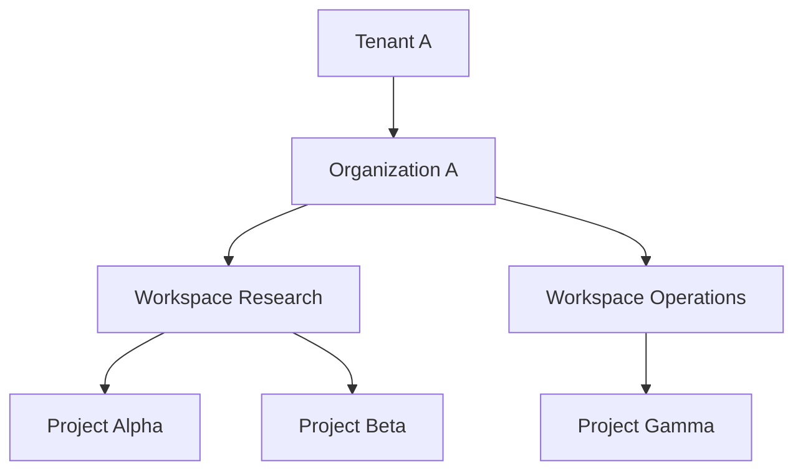
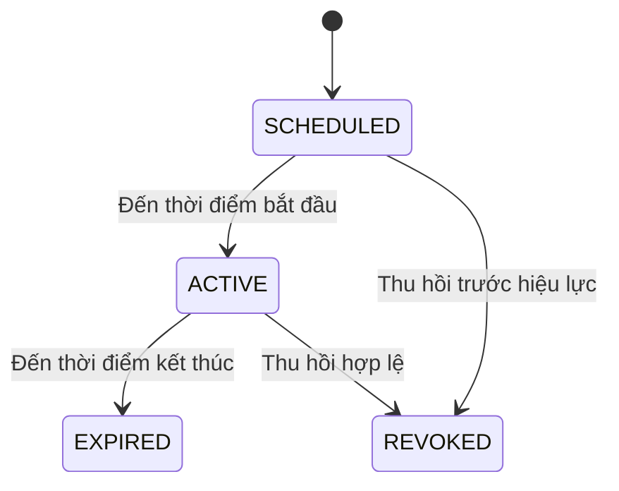

# Entitlement inheritance: kế thừa quyền sử dụng mà không mở rộng sai quyền

## 1. Kế thừa entitlement giải quyết vấn đề gì?

Trong chương **Entitlement Rules** của module **SECURITY_APPLICATION_SECURITY_BUSINESS_LOGIC_SECURITY**, bài học này xem xét cách quyền sử dụng được kế thừa qua tổ chức, workspace, project hoặc tài nguyên. Trọng tâm là bảo vệ quy tắc nghiệp vụ khi cấp quyền, thu hồi quyền, thay đổi cấu trúc và thực thi các yêu cầu đồng thời.

Entitlement thể hiện quyền được dùng một tính năng, năng lực hoặc mức dịch vụ theo các điều kiện cụ thể. Ví dụ, một tổ chức mua tính năng xuất báo cáo; các workspace bên trong được phép sử dụng tính năng đó mà không cần tạo từng quyền độc lập bằng tay.

Kế thừa làm giảm công việc quản trị nhưng tạo ra nhiều câu hỏi bảo mật:

- Quyền của cha có áp dụng cho mọi con và mọi loại tính năng không?
- Quyền dùng tính năng có đồng thời cho phép đọc mọi dữ liệu bên dưới không?
- Một nhánh bị hạn chế có thể tự cấp quyền trực tiếp để vượt hạn chế không?
- Khi nguồn quyền hết hạn hoặc bị thu hồi, các quyền suy ra có mất hiệu lực đúng lúc không?
- Khi chuyển tài nguyên sang nhánh khác, quyền cũ có còn được giữ lại qua cache hoặc job nền không?
- Nhiều tài nguyên cùng kế thừa một quota có đang dùng chung một ngân sách hay vô tình nhận mỗi nơi một bản sao?

Một lỗ hổng điển hình là sao chép `canExport = true` từ tổ chức xuống từng project rồi coi các bản sao là quyền độc lập. Khi tổ chức bị thu hồi tính năng, những bản sao chưa được cập nhật vẫn cho phép xuất dữ liệu.

Kế thừa an toàn phải giữ được **nguồn quyền, đường áp dụng, điều kiện và thời hạn**. Nó không chỉ là việc sao chép một cờ boolean xuống các bản ghi con.

## 2. Phân biệt entitlement, membership và quyền trên đối tượng

Ba lớp kiểm tra thường cùng xuất hiện nhưng có ý nghĩa khác nhau:

| Lớp kiểm tra | Câu hỏi cần trả lời | Ví dụ |
| --- | --- | --- |
| Membership | Người gọi có quan hệ hợp lệ với tenant hoặc tổ chức không? | Người dùng đang là thành viên của công ty A |
| Quyền trên đối tượng | Người gọi có được thực hiện hành động trên tài nguyên này không? | Được đọc project P và xuất dữ liệu của P |
| Entitlement | Phạm vi đang thao tác có được dùng tính năng theo điều khoản sản phẩm không? | Project P được dùng tính năng xuất PDF từ gói của tổ chức |

Điều kiện cho một hành động có thể là:

```text
canExport(actor, project) =
    membership đang hợp lệ trong tenant của project
    AND quyền EXPORT trên đúng project được cho phép
    AND entitlement EXPORT_PDF có hiệu lực tại project
    AND các giới hạn và điều kiện của hành động được đáp ứng
```

Một entitlement cấp ở tổ chức không làm mọi thành viên trở thành quản trị viên. Người được dùng tính năng cũng không tự được sửa nguồn quyền, chuyển gói hoặc cấp tính năng cho tenant khác.

Tương tự, vai trò `PROJECT_ADMIN` có thể cho phép cấu hình project nhưng không mặc nhiên cho phép bật một tính năng trả phí chưa có căn cứ cấp quyền. Kế thừa entitlement và kế thừa vai trò phải được mô hình hóa, kiểm thử riêng dù chúng cùng tham gia một quyết định cuối.

## 3. Chọn mô hình kế thừa và quy tắc kết hợp rõ ràng

### 3.1. Mô hình cây trong bài

Ví dụ sử dụng cây tài nguyên trong một tenant:



Mỗi node có một cha trong cùng tenant, trừ gốc. Quan hệ cha lấy từ dữ liệu có thẩm quyền phía server; `parentId` trong request không được dùng để chứng minh quyền mà không kiểm tra.

Một grant nên có các thuộc tính như nguồn, node áp dụng, feature, chủ thể được hưởng nếu có, trạng thái, thời hạn, cờ cho phép kế thừa và các giới hạn. Không phải feature nào cũng được kế thừa: quyền sử dụng báo cáo có thể đi xuống project, trong khi một dịch vụ chỉ mua cho một workspace cụ thể có thể không được chuyển tiếp.

### 3.2. Chính sách minh họa: hợp các nguồn cho phép, chặn bằng deny áp dụng

Không có một quy tắc kết hợp allow/deny đúng cho mọi sản phẩm. Bài này chọn chính sách sau để phân tích:

1. Mặc định từ chối nếu không tìm được nguồn quyền hợp lệ.
2. Grant ở node cha chỉ áp dụng xuống con nếu feature và mọi cạnh đi qua cho phép kế thừa.
3. Một deny áp dụng cho chủ thể và feature trên đường từ gốc đến tài nguyên sẽ chặn hành động, kể cả khi tài nguyên có grant trực tiếp.
4. Khi không có deny áp dụng, chỉ cần một nguồn grant hợp lệ để đủ điều kiện entitlement dạng boolean.
5. Các giới hạn bắt buộc của phạm vi vẫn ràng buộc mọi nguồn grant; không tự loại chúng khi có grant trực tiếp ở con.

Một ranh giới `inheritance_blocked` trong mô hình này chỉ chặn truyền **allow** từ phía trên. Nó không xóa các deny bắt buộc áp dụng xuống nhánh. Nếu sản phẩm cần loại ranh giới khác, phải đặt tên và ngữ nghĩa riêng.

```text
effectiveEntitlement(subject, resource, feature) =
    cùng ranh giới tenant hợp lệ
    AND không có deny áp dụng trên đường tổ tiên
    AND tồn tại grant hợp lệ đến được resource
```

`subject` phải khớp điều kiện của grant. Grant cấp riêng cho một người không được biến thành grant cho mọi người trong node chỉ vì node đó có con.

### 3.3. Những trường hợp phải phân biệt

| Tình huống | Kết quả theo chính sách của bài |
| --- | --- |
| Cha có allow kế thừa, con không có hạn chế | Con có thể nhận entitlement |
| Cha có allow nhưng grant không cho kế thừa | Con không nhận quyền từ grant đó |
| Cha có allow, giữa đường có ranh giới chặn allow | Quyền từ cha không đi qua ranh giới |
| Có deny áp dụng ở cha, con tự thêm allow | Vẫn bị chặn |
| Nguồn G bị thu hồi nhưng còn nguồn H độc lập và hợp lệ | Có thể tiếp tục được phép nhờ H |
| Không xác định được đường cha do dữ liệu lỗi | Không suy đoán allow từ phần đường đã đọc được |

Thu hồi một nguồn grant không đồng nghĩa đặt một deny toàn cục. Nếu nghiệp vụ muốn cấm tuyệt đối một feature cho cả nhánh, cần một quy tắc cấm có phạm vi rõ ràng thay vì chỉ xóa một trong nhiều nguồn cấp.

## 4. Kế thừa điều kiện phải giữ giới hạn của nguồn

### 4.1. Thời hạn hiệu lực là giao các khoảng

Giả sử grant nguồn có hiệu lực từ ngày 1 đến ngày 30, còn điều kiện của project chỉ cho dùng từ ngày 5 đến ngày 20. Quyền suy ra không thể có thời hạn dài hơn một trong hai điều kiện.

Với các khoảng nửa mở `[valid_from, valid_until)`:

```text
effective_from  = max(các mốc bắt đầu áp dụng)
effective_until = min(các mốc kết thúc áp dụng)

Có hiệu lực khi:
    effective_from <= now < effective_until
```

Nếu `effective_from >= effective_until`, giao là rỗng và không cấp quyền. Mốc kết thúc không bao gồm chính thời điểm kết thúc, giúp tránh hai kỳ chồng lên nhau tại biên.

Chọn thời gian do server hoặc nguồn thời gian đáng tin của hệ thống xác định. Không cho client gửi `now` để kéo dài trial. Nếu có điều kiện phụ thuộc thời gian ở dịch vụ khác, cần quy định độ mới và giới hạn sai lệch được chấp nhận.

### 4.2. Ràng buộc phạm vi là điều kiện đồng thời

Ví dụ nguồn cho phép xuất dữ liệu trong khu vực X, còn project chỉ cho xuất tập dữ liệu đã được phân loại Y. Quyền hiệu lực phải thỏa cả hai điều kiện. Không lấy một phép hợp khiến dữ liệu thuộc X hoặc Y đều được xuất.

Các điều kiện như chỉ đọc, loại tài nguyên, môi trường hoặc nhóm người dùng cũng cần quy tắc kết hợp cụ thể. Khi engine không hiểu một điều kiện bắt buộc của phiên bản chính sách mới, không được bỏ qua điều kiện đó rồi cho phép phần còn lại.

### 4.3. Quota không tự nhân theo số node con

Giả sử tổ chức có 1.000 lượt xuất mỗi tháng, workspace W có giới hạn 300 lượt và project P có giới hạn 100 lượt. Một lượt xuất tại P phải đáp ứng cả ngân sách tổ chức, workspace và project.

```text
Khả năng tiêu thụ thêm tại P bị giới hạn bởi:
    ngân sách còn lại của tổ chức
    AND ngân sách còn lại của W
    AND ngân sách còn lại của P
```

Không được sao chép quota 1.000 thành một ngân sách độc lập cho từng project. Nếu có 10 project, thao tác đó vô tình biến 1.000 lượt thành 10.000 lượt.

Cũng không tự cộng quota của nhiều nguồn grant. Hai nguồn cùng cho phép feature boolean không chứng minh hai ngân sách được phép gộp. Sản phẩm cần xác định nguồn nào dùng chung pool, nguồn nào độc lập, có được cộng dồn hay không và thứ tự tiêu thụ ra sao.

## 5. Giữ nguồn gốc của quyền suy ra

Một bản ghi suy ra hoặc một kết quả đánh giá có thể lưu thông tin như sau:

```json
{
  "tenant_id": "tenant-a",
  "resource_id": "project-alpha",
  "feature": "EXPORT_PDF",
  "source_grant_id": "grant-org-41",
  "source_grant_version": 7,
  "source_node_id": "organization-a",
  "inheritance_path": [
    "organization-a",
    "workspace-research",
    "project-alpha"
  ],
  "hierarchy_epoch": 12,
  "policy_version": "entitlement-policy-v3",
  "valid_until": "2026-02-01T00:00:00Z",
  "quota_pool_id": "org-export-pool"
}
```

Đây là ví dụ dữ liệu giải thích nguồn quyền, không phải một token mà client được tự tạo để nhận quyền. Nếu kết quả được chuyển qua dịch vụ khác, bên nhận phải có cơ chế xác thực, kiểm tra phạm vi, phiên bản và độ mới phù hợp.

### 5.1. Bản materialize không phải nguồn quyền độc lập

Để tăng tốc, hệ thống có thể tính trước entitlement ở các node con. Bản tính trước phải giữ liên kết tới nguồn và phiên bản cần thiết. Không cho công cụ quản trị sửa nó thành `DIRECT_GRANT` để thoát phụ thuộc vào grant cha.

Việc xóa một bản suy ra chỉ là thay đổi dữ liệu dẫn xuất. Nếu nguồn vẫn cho phép, lần tính tiếp theo có thể tạo lại. Muốn cấm một nhánh, phải dùng quy tắc deny hoặc thay đổi cấu hình kế thừa theo chính sách.

Ngược lại, khi nguồn không còn hợp lệ, việc bản suy ra vẫn tồn tại trong database không có nghĩa entitlement vẫn được phép. Điểm thực thi phải biết bản đó còn khớp nguồn quyền hiện tại hay không.

### 5.2. Kế thừa quyền dùng không phải quyền cấp tiếp

Một người được hưởng feature từ tổ chức không tự có quyền tạo grant mới hoặc chia sẻ feature sang tổ chức khác. Nếu hỗ trợ ủy quyền cấp tiếp, phải kiểm tra riêng:

- Actor có quyền ủy quyền đối với nguồn đó.
- Phạm vi đích nằm trong phạm vi được phép.
- Thời hạn và điều kiện mới không rộng hơn nguồn.
- Quyền cấp tiếp có tiếp tục được chuyển giao hay không.
- Thu hồi nguồn có làm mất hiệu lực các grant phụ thuộc đúng như chính sách không.

Với một grant phụ thuộc, không được đặt ngày kết thúc muộn hơn nguồn rồi coi phần thời gian dư là quyền độc lập. Cấp quyền độc lập mới phải có căn cứ nghiệp vụ và thẩm quyền riêng.

## 6. Thu hồi và hết hạn phải tác động đúng chuỗi phụ thuộc

Một vòng đời đơn giản của grant nguồn:



Không nên chỉ dựa vào tác vụ nền chuyển `ACTIVE` sang `EXPIRED` để chặn sử dụng. Nếu worker chậm, điều kiện thời gian tại điểm đánh giá vẫn phải làm quyền hết hiệu lực đúng mốc đã quy định.

Khi thu hồi một grant:

1. Cập nhật nguồn có thẩm quyền trong transaction và tăng phiên bản hoặc epoch thích hợp.
2. Ghi audit và outbox cùng thay đổi nguồn.
3. Làm cho điểm thực thi nhận biết nguồn đã mất hiệu lực theo mức nhất quán yêu cầu.
4. Cập nhật hoặc dọn các bản materialize và cache bằng quy trình có thể retry.

Nếu có hàng triệu node con, không nhất thiết cập nhật toàn bộ trong một transaction dài. Có thể thu hồi nguồn trước và dùng cổng kiểm tra nguồn hoặc epoch để chặn ngay, trong khi dữ liệu dẫn xuất được dọn sau.

Việc này chỉ đạt bảo đảm thu hồi tức thời khi điểm thực thi thực sự kiểm tra trạng thái hoặc thế hệ hiện tại. Một hàng `REVOKED` trong database không tự vô hiệu hóa một token ngoại tuyến còn hạn hoặc cache allow không được kiểm tra lại.

### 6.1. Phân biệt ba thay đổi

| Thay đổi | Ý nghĩa |
| --- | --- |
| Thu hồi grant G | Không được tiếp tục dựa vào nguồn G |
| Thêm deny áp dụng cho feature F tại nhánh N | Chặn F trong phạm vi của deny theo chính sách kết hợp |
| Xóa membership của người U | U không còn được thao tác nhờ quan hệ thành viên đã mất |

Ba thay đổi có thể tạo cùng kết quả từ chối cho một request nhưng không tương đương về phạm vi. Thu hồi quá rộng có thể làm mất quyền hợp lệ từ nguồn khác; thu hồi quá hẹp có thể vẫn để người bị cấm dùng một đường cấp khác.

### 6.2. Không hồi sinh nguồn cũ khi nhận sự kiện trễ

Consumer nhận `grant_activated(version=7)` sau `grant_revoked(version=8)` không được chuyển nguồn trở lại active chỉ vì thông điệp đến sau.

Cần kiểm tra phiên bản nguồn hoặc quy tắc state machine tương ứng. Giữ thông tin thu hồi hoặc mốc phiên bản đủ lâu theo giao thức xử lý lại; không xóa sạch mọi dấu vết rồi coi sự kiện cũ là nguồn mới. Nếu cấp lại quyền, nên dùng grant mới hoặc một vòng đời được định danh rõ, không tái sử dụng mơ hồ ID của nguồn đã kết thúc.

## 7. Đổi cấu trúc cây là thay đổi bảo mật

### 7.1. Reparent làm thay đổi cả quyền lẫn giới hạn

Giả sử Project Alpha chuyển từ workspace Research sang Operations. Sau chuyển, nó có thể:

- Mất nguồn grant chỉ có ở Research.
- Nhận nguồn grant hoặc deny từ Operations.
- Chịu quota và các ràng buộc mới.
- Làm các bản suy ra theo đường cũ không còn hợp lệ.

Không được chỉ đổi `parent_id` rồi để quyền cũ tồn tại vô thời hạn. Cũng không được cho actor tự chọn một cha giàu entitlement để mở khóa tính năng khi họ không có quyền di chuyển tài nguyên.

Lệnh chuyển cần kiểm tra quyền với tài nguyên, vị trí nguồn và đích, cùng các quy tắc sản phẩm liên quan. Backend phải kiểm tra tenant của cả ba đối tượng. Trong mô hình của bài, chuyển trực tiếp qua tenant khác bị từ chối; nếu sản phẩm hỗ trợ di chuyển liên tenant, đó là một quy trình riêng có ranh giới dữ liệu và đồng ý của các bên.

### 7.2. Ngăn chu trình và race condition

Trước khi đặt A làm con của B, phải chứng minh B không nằm trong cây con của A. Nhưng kiểm tra riêng lẻ chưa đủ khi hai lệnh đồng thời đưa A vào B và B vào A.

Một thiết kế đơn giản là dùng bản ghi kiểm soát topology theo tenant:

```text
Lệnh thay đổi cấu trúc:
    Khóa ghi topology của tenant
    → đọc lại đường và kiểm tra quyền, chu trình, độ sâu
    → cập nhật quan hệ cha
    → tăng hierarchy_epoch
    → ghi audit và outbox
    → commit
```

Các thao tác cần bảo đảm đường kế thừa không đổi đến commit phải phối hợp với cổng này, chẳng hạn lấy khóa đọc trong transaction thích hợp. Phải chọn và kiểm chứng cơ chế tương ứng với cơ sở dữ liệu thực tế; một biến khóa trong tiến trình không đồng bộ được nhiều instance.

Nếu dùng thuật toán khác như khóa tập node hoặc optimistic validation, cần chứng minh nó ngăn được cả chu trình do cạnh tranh và việc quyết định dựa trên đường đã cũ.

### 7.3. Khi có nhiều cha

Nếu mô hình là DAG thay vì cây, cần xác định một grant áp dụng theo đường nào, deny có chặn mọi đường đến đích hay chỉ một đường và các quota được khử trùng ra sao. Đi theo một đường khác không được vô tình né một lệnh cấm bắt buộc.

Không tự mở rộng thuật toán cây bằng cách lặp qua mọi cha rồi OR toàn bộ kết quả. Cần giữ nguồn gốc từng đường, phát hiện chu trình, giới hạn độ sâu và xử lý nguồn lặp. Một pool được gặp qua hai đường vẫn có thể chỉ là một ngân sách duy nhất.

Khi vượt giới hạn duyệt đồ thị hoặc gặp cấu trúc không hợp lệ, trả lỗi quyết định hoặc từ chối theo chính sách; không trả allow từ tập kết quả mới tính được một phần.

## 8. Đánh giá quyền tại điểm thực thi

### 8.1. Không đánh giá bằng dữ liệu phân cấp do client cung cấp

Request có thể chứa ID tài nguyên đích và lựa chọn nghiệp vụ, nhưng các trường sau không phải bằng chứng:

```json
{
  "resourceId": "project-alpha",
  "parentId": "organization-with-pro-plan",
  "inheritedFeatures": ["EXPORT_PDF"],
  "ignoreParentDeny": true,
  "quotaRemaining": 100000
}
```

Backend phải lấy tenant, đường tổ tiên, nguồn grant và bộ đếm quota từ các nguồn có thẩm quyền. Việc giao diện ẩn một nút không bảo vệ endpoint khi người dùng tự gửi HTTP request.

### 8.2. Mã giả Java cho quyết định có giải thích

Đoạn sau là **mã giả**, mô tả hợp đồng của engine; các hàm không phải API thư viện cụ thể:

```java
EntitlementDecision evaluate(
        Actor actor, ResourceId resourceId, Feature feature, Instant now) {
    var resource = resources.loadAuthoritative(resourceId);
    membership.requireActive(actor, resource.tenantId());
    objectAuthorization.requireAction(actor, resource, feature.requiredAction());

    // Snapshot phải nhất quán theo giao thức phiên bản/khóa đã chọn.
    var context = entitlementContexts.loadConsistent(resource, actor, now);
    context.requireValidTopology();
    context.requireSupportedPolicy();

    if (context.hasApplicableDeny(feature)) {
        return EntitlementDecision.denied("APPLICABLE_DENY", context.versions());
    }

    var candidates = context.grantsFor(feature).stream()
        .filter(g -> g.matchesSubject(actor))
        .filter(g -> g.isActiveAt(now))
        .filter(g -> context.canReachTargetWithInheritance(g))
        .filter(g -> context.conditionsSatisfied(g, actor, resource))
        .toList();

    if (candidates.isEmpty()) {
        return EntitlementDecision.denied("NO_VALID_SOURCE", context.versions());
    }

    // Nếu có quota, chọn nguồn và pool theo chính sách, không tự cộng tất cả.
    var proof = context.selectAndBuildProof(candidates, feature);
    return EntitlementDecision.allowed(proof);
}
```

`EntitlementDecision` nên chứa lý do, nguồn được chọn, thời hạn và các phiên bản phụ thuộc. Thông tin này giúp giải thích và kiểm tra lại; nó không tự biến thành quyền dùng vĩnh viễn.

`now` trong ví dụ là thời gian do tầng server đáng tin cung cấp. API công khai không được cho client điều khiển tham số này.

### 8.3. Quyết định đúng lúc kiểm tra chưa chắc đúng lúc sử dụng

Nếu kiểm tra allow rồi chờ lâu trước khi ghi dữ liệu, nguồn có thể đã bị thu hồi hoặc tài nguyên đã chuyển nhánh. Đây là TOCTOU giữa kiểm tra entitlement và hành động sử dụng.

Với thao tác cần bảo đảm đến commit, transaction phải giữ các điều kiện bằng khóa thích hợp hoặc kiểm tra phiên bản nguyên tử phối hợp với đường thay đổi. Chỉ so sánh phiên bản rồi ghi trong hai bước không được bảo vệ vẫn có khe thời gian.

Với job dài, cần quy định quyền được chốt tại thời điểm nào và những điểm nào phải kiểm tra lại. Ví dụ, có thể yêu cầu kiểm tra khi nhận job, khi bắt đầu đọc dữ liệu và khi giao file kết quả. Không mặc định job đã vào hàng đợi sẽ được chạy mãi dù membership hoặc nguồn quyền đã bị thu hồi.

## 9. Quota kế thừa cần transaction và idempotency

Giả sử tổ chức chỉ còn 1 lượt xuất. Hai project cùng thừa hưởng pool đó và cùng nhận request xuất một lượt.

```text
Project A đọc remaining = 1 → cho phép.
Project B đọc remaining = 1 → cho phép.
Cả hai cùng chạy → tổ chức dùng 2 lượt dù chỉ còn 1.
```

Khóa riêng project không giải quyết được tranh chấp trên pool tổ chức. Mọi lệnh tiêu thụ phải phối hợp tại cùng bộ đếm ngân sách có thẩm quyền.

Một luồng minh họa:

```text
BEGIN
    Xác minh actor, tài nguyên và ngữ cảnh kế thừa hiện tại.
    Sở hữu khóa idempotency của lệnh theo phạm vi nghiệp vụ.
    Nếu lệnh đã hoàn tất và actor còn quyền xem, trả biên nhận cũ.

    Khóa các pool và bộ đếm bắt buộc theo thứ tự cố định.
    Kiểm tra lại nguồn, đường, thời hạn và điều kiện cần giữ đến commit.
    Kiểm tra từng giới hạn còn đủ cho lượng cần giữ.
    Tạo reservation duy nhất cho lệnh.
    Giữ lượng tương ứng trong mọi bộ đếm bắt buộc.
    Ghi audit và outbox của job.
    Lưu biên nhận.
COMMIT
```

Đây là mô tả nghiệp vụ; cách sắp thứ tự khóa giữa cổng quyền, topology, pool và bản ghi lệnh phải được thống nhất cho các đường có giao nhau để hạn chế deadlock. Không triển khai mỗi endpoint theo một thứ tự tùy ý.

Nếu root pool đã giữ 1 lượt và bộ đếm project thất bại, toàn bộ lần giữ phải rollback. Khi hoàn tất job, chuyển reservation sang đã tiêu thụ; khi hủy hợp lệ, giải phóng đúng một lần theo chính sách tính lượt.

Một reservation cần lưu pool đã chọn, kỳ quota, số lượng, command và phiên bản nguồn liên quan. Không đổi sang một pool khác trong lần retry rồi để cả hai pool bị trừ.

Nếu các bộ đếm ở nhiều dịch vụ, transaction cục bộ không bảo đảm nguyên tử xuyên tất cả. Cần giao thức reservation có định danh ổn định, trạng thái đang chờ và phục hồi rõ ràng; chỉ bắt đầu hiệu ứng không thể thu hồi khi điều kiện cam kết đã được đáp ứng.

Đối với chuyển project sang nhánh khác, phải quy định lượt đã tiêu thụ hoặc đang giữ thuộc kỳ và pool nào. Không tự hoàn trả lịch sử ở nguồn rồi cho tiêu thụ lại toàn bộ ở đích nếu chính sách không cho phép.

## 10. Cache và cập nhật bất đồng bộ phải giữ đúng mức bảo đảm

### 10.1. Khóa cache cần đủ ngữ cảnh

Cache theo `(userId, feature)` có thể trả quyền của tenant A khi cùng người đó đang thao tác ở tenant B. Cache chỉ theo `(tenantId, feature)` cũng có thể bỏ qua deny tại workspace hoặc quyền riêng của người dùng.

Tùy nội dung được cache, khóa và bằng chứng cần có tenant, tài nguyên hoặc phạm vi, subject khi phụ thuộc subject, feature, chính sách và phiên bản liên quan. Một kết quả allow thường phụ thuộc ít nhất vào nguồn grant, cấu trúc cây và các điều kiện chặn.

TTL không được kéo dài hiệu lực qua `valid_until` của nguồn. Tuy nhiên, TTL ngắn vẫn không bảo đảm thu hồi ngay trước khi TTL hết.

### 10.2. Epoch chỉ hữu ích khi được kiểm tra

Có thể tăng `hierarchy_epoch`, `grant_epoch` hoặc phiên bản quyền khi thay đổi. Nhưng nếu request chỉ đọc kết quả cache cũ mà không đối chiếu epoch hiện tại, trường phiên bản trong cache không giúp chặn quyền cũ.

Với thao tác nhạy cảm cần thu hồi tức thời, điểm thực thi phải kiểm tra nguồn hoặc cổng phiên bản hiện tại bằng cơ chế nhất quán phù hợp. Nếu không truy cập được cổng đó, không tự cho phép dựa trên một allow chưa chứng minh còn hợp lệ.

Với thao tác chấp nhận độ trễ hữu hạn, có thể dùng TTL, sự kiện vô hiệu hóa và giới hạn thời hạn token. Phải nêu rõ mức trễ được phép và xử lý outage tương ứng, thay vì gọi đó là thu hồi tức thời.

### 10.3. Consumer phải xử lý lặp và sai thứ tự

- Khử trùng theo định danh sự kiện trong phạm vi nguồn thích hợp.
- Chỉ áp dụng phiên bản mới hơn theo quy tắc của từng nguồn, không dùng một timestamp chung để suy ra mọi thứ tự.
- Không để sự kiện cấp quyền cũ ghi đè trạng thái thu hồi mới.
- Khi mất chuỗi hoặc gặp phiên bản không hiểu, đối soát từ nguồn có thẩm quyền thay vì đoán allow.
- Giữ bản materialize là dữ liệu dẫn xuất có thể xây dựng lại theo snapshot và watermark rõ ràng.

Transactional outbox giúp không mất sự kiện sau thay đổi nguồn nhưng không làm mọi consumer cập nhật đồng thời. Thiết kế bảo mật phải xét cả khoảng trễ giữa commit và cập nhật dữ liệu dẫn xuất.

## 11. Những cách lạm dụng logic thường gặp

| Cách lạm dụng | Sai sót bị khai thác | Kiểm soát cần có |
| --- | --- | --- |
| Gửi `parentId` của tổ chức có gói cao hơn | Tin quan hệ phân cấp từ client | Dùng topology có thẩm quyền và kiểm tra quyền chuyển |
| Tạo grant ở con để vượt deny của cha | Quy tắc kết hợp không rõ | Thực thi deny bắt buộc theo phạm vi đã xác định |
| Dùng quyền của tenant A trên tài nguyên B | Thiếu ranh giới tenant hoặc cache sai khóa | Kiểm tra đối tượng, tenant và ngữ cảnh cache |
| Sửa bản suy ra thành grant trực tiếp | Nhầm materialize với nguồn quyền | Tách mô hình, hạn chế đường ghi và giữ provenance |
| Kéo dài ngày hết hạn của quyền con | Không giữ điều kiện nguồn | Giao thời hạn và kiểm tra giới hạn khi cấp tiếp |
| Chia quota thành nhiều project để nhân ngân sách | Mỗi con nhận một pool sao chép | Dùng nguồn ngân sách chung và transaction |
| Gửi lại lệnh để giữ thêm lượt | Thiếu idempotency và unique reservation | Khử trùng lệnh và bảo vệ dữ liệu |
| Đổi nhánh liên tục để dùng quyền hoặc quota cũ | Không quản lý epoch và pool đang dùng | Kiểm tra chuyển nhánh, phiên bản và chính sách quota |
| Gửi sự kiện kích hoạt cũ sau thu hồi | Consumer áp dụng theo thứ tự nhận | Phiên bản nguồn, dấu vết thu hồi và đối soát |
| Tạo chu trình để làm engine lỗi rồi dùng fallback allow | Topology không được bảo vệ | Ngăn chu trình, giới hạn duyệt và từ chối khi không quyết định được |
| Dùng role quản trị project để tự bật gói trả phí | Gộp quyền quản trị với entitlement | Tách quyền thao tác và căn cứ cấp dịch vụ |

Các đường quản trị, import, batch và API nội bộ cũng phải giữ invariants này. Chặn request công khai nhưng cho phép công cụ hỗ trợ sửa tự do `parent_id`, trạng thái nguồn hoặc quota vẫn tạo đường bỏ qua quy tắc.

## 12. Kiểm thử theo invariants và tình huống cạnh tranh

### 12.1. Bộ dữ liệu kiểm thử

Tạo hai tenant A và B. Trong A có hai workspace, mỗi workspace có project. Tạo một grant kế thừa từ tổ chức, một grant trực tiếp ở project, một deny ở workspace và một người dùng thuộc cả A lẫn B với vai trò khác nhau.

Trường hợp nhiều tenant và nhiều nguồn giúp phát hiện lỗi OR quyền quá rộng hoặc thu hồi quá mức. Không chỉ kiểm thử một cây toàn allow.

### 12.2. Ma trận đánh giá quyền

| Kịch bản | Kết quả cần xác nhận |
| --- | --- |
| Grant tổ chức hợp lệ, đường cho kế thừa, actor đủ quyền đối tượng | Được phép với nguồn và đường giải thích được |
| Grant nguồn không cho kế thừa | Node con không nhận quyền từ nguồn đó |
| Có ranh giới chặn allow giữa nguồn và đích | Không dùng nguồn phía trên ranh giới |
| Có deny áp dụng ở workspace, project có allow trực tiếp | Bị chặn theo chính sách của bài |
| Nguồn G bị thu hồi, H độc lập vẫn hợp lệ | Chỉ dựa vào H, không dùng proof của G |
| Grant hợp lệ nhưng actor không được xuất project | Không cho xuất chỉ nhờ entitlement |
| Grant riêng cho một người, người khác cùng node gọi API | Không lan quyền sang sai subject |
| Thời điểm đúng `valid_until` | Không còn quyền từ khoảng đã kết thúc |
| Giao thời hạn rỗng | Không cấp entitlement |
| ID đích thuộc tenant khác | Không suy quyền từ tenant đang chọn trên giao diện |
| Policy có điều kiện bắt buộc không được engine hỗ trợ | Không bỏ qua điều kiện để cho phép |

Kiểm tra response cùng dữ liệu thực tế và hiệu ứng: job có được tạo không, quota có bị giữ không, proof có nguồn nào và audit có đúng lý do không. Một lỗi HTTP không đủ chứng minh an toàn nếu job đã được đưa vào outbox trước đó.

### 12.3. Thử nghiệm quota dùng chung

```text
Given:
    Root pool còn 1 lượt
    Project A và B đều dùng root pool đó
    Mỗi lệnh cần giữ 1 lượt và có khóa idempotency riêng

When:
    Hai transaction cạnh tranh tại bước giữ ngân sách

Then:
    Chỉ một lệnh giữ được lượt
    Tổng reserved không vượt ngân sách
    Chỉ job có reservation hợp lệ được phép bắt đầu
```

Dùng barrier hoặc cơ chế điều phối để tạo cạnh tranh thực sự. Chạy trên cơ sở dữ liệu có ngữ nghĩa khóa tương ứng với môi trường triển khai; mock repository không chứng minh được hành vi transaction.

Các ca đồng thời và phục hồi khác:

- Thu hồi nguồn cạnh tranh với hành động sử dụng: kết quả tuân theo điểm tuần tự hóa đã thiết kế.
- Đổi nhánh cạnh tranh với đánh giá quyền: không ghép grant ở đường cũ với giới hạn ở đường mới.
- Hai lệnh reparent tạo chu trình nếu chạy độc lập: cơ chế đồng bộ phải chặn ít nhất một lệnh.
- Retry cùng lệnh sau mất phản hồi: cùng biên nhận, một reservation và một job nghiệp vụ.
- Cùng khóa nhưng đổi tài nguyên hoặc số lượng: xung đột, không có hiệu ứng mới.
- Gây lỗi sau giữ root pool nhưng trước giữ project pool: rollback toàn bộ lần giữ.
- Nhận sự kiện kích hoạt cũ sau sự kiện thu hồi mới: không hồi sinh nguồn.
- Cache vẫn chứa allow sau đổi epoch: thao tác yêu cầu kiểm tra tức thời phải bị chặn khi proof cũ không còn hợp lệ.
- Job được tạo trước thu hồi nhưng chạy sau thu hồi: đáp ứng đúng quy tắc kiểm tra lại đã công bố.

### 12.4. Thuộc tính hữu ích để kiểm thử sinh dữ liệu

Với chính sách của bài, có thể kiểm tra các thuộc tính sau trên nhiều cây và chuỗi thao tác:

- Bỏ một nguồn allow không làm phát sinh một nguồn allow mới.
- Thêm deny áp dụng không làm một hành động đang bị chặn trở thành được phép.
- Quyền phụ thuộc không có thời hạn rộng hơn nguồn mà nó dựa vào.
- Không có quyết định hợp lệ dựa trên đường vượt ranh giới tenant.
- Mọi entitlement suy ra giải thích được nguồn và đường áp dụng.
- Tổng tiêu thụ và giữ chỗ tuân theo từng pool bắt buộc.

Đây là thuộc tính của mô hình đã chọn. Nếu sản phẩm dùng quy tắc ưu tiên hoặc ngoại lệ khác, cần sửa thuộc tính theo chính sách chính thức thay vì coi mọi engine đều phải có cùng ngữ nghĩa.

## 13. Audit và giải thích quyết định kế thừa

Khi bị từ chối, người dùng cần một thông báo phù hợp; nhóm vận hành cần thông tin đủ sâu để phân biệt thiếu gói, thiếu quyền đối tượng, nguồn hết hạn, deny ở nhánh hoặc quota đã cạn.

Audit thay đổi quan trọng nên ghi actor thực tế, tenant, node nguồn/đích, grant, phiên bản trước/sau, `hierarchy_epoch`, chính sách, thời hạn, lý do và correlation ID. Với quota, ghi command, reservation, pool và kỳ ngân sách liên quan.

Đối với giải thích quyết định, có thể dùng mã như:

```text
NO_VALID_SOURCE
SOURCE_EXPIRED
SOURCE_REVOKED
APPLICABLE_DENY
INHERITANCE_BLOCKED
SUBJECT_NOT_ELIGIBLE
STALE_HIERARCHY_CONTEXT
SHARED_QUOTA_EXHAUSTED
```

Không trả toàn bộ cấu trúc tổ chức, hợp đồng hoặc grant của người khác cho client chỉ để giải thích một lỗi. Nội dung chi tiết cần quyền xem phù hợp và tránh ghi token hay dữ liệu nhạy cảm không cần thiết.

Audit của thao tác đã commit nên được ghi cùng transaction với thay đổi. Các nỗ lực sai quyền hoặc cấu trúc lỗi có thể cần kênh security event riêng để không biến mất do rollback của transaction nghiệp vụ.

Đối soát có thể tìm các bản suy ra không còn nguồn, đường kế thừa sai epoch, quyền còn cấp qua ranh giới bị chặn, reservation sai pool hoặc node thuộc sai tenant. Bản materialize bị lệch cần được sửa từ nguồn có thẩm quyền; không sửa nguồn để hợp thức hóa một cache sai.

## 14. Tự kiểm tra thiết kế

Trước khi đưa kế thừa entitlement vào sử dụng, cần trả lời rõ:

1. Cấu trúc là cây hay DAG, ranh giới tenant nằm ở đâu và ai được đổi cha?
2. Feature nào được kế thừa, ranh giới nào chặn allow và deny có phạm vi ra sao?
3. Entitlement có đang bị nhầm thành quyền đọc dữ liệu hoặc quyền quản trị không?
4. Mỗi kết quả allow có giải thích được nguồn, đường, subject, thời hạn và điều kiện không?
5. Thu hồi một nguồn có tác động đúng các quyền phụ thuộc mà không xóa nhầm nguồn độc lập không?
6. Grant con có giữ giới hạn của nguồn hay có thể tự kéo dài, mở rộng hoặc cấp tiếp sai quyền?
7. Quota là pool chung hay ngân sách riêng, và transaction có bảo vệ đúng nguồn dùng chung không?
8. Đổi nhánh, thu hồi và sử dụng đồng thời có điểm tuần tự hóa rõ ràng không?
9. Cache, token và consumer có thực thi đúng mức trễ thu hồi được chấp nhận không?
10. Retry, lỗi giữa chừng và sự kiện cũ có thể nhân quyền hoặc hồi sinh nguồn đã kết thúc không?

Kế thừa entitlement an toàn giữ nguyên các ràng buộc của nguồn trong khi cho phép quyền được áp dụng xuống đúng phạm vi. Nguồn có thẩm quyền, quy tắc kết hợp rõ ràng và cơ chế thực thi nhất quán giúp hệ thống tránh biến một tiện ích quản trị thành đường mở rộng quyền ngoài ý muốn.
