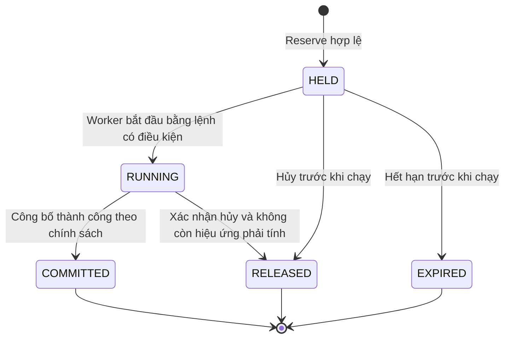

# Quota ownership — Xác định đúng chủ thể sở hữu và chịu tiêu thụ quota

## 1. Mục tiêu và phạm vi

Trong chương **Quota Management** của module bảo mật logic nghiệp vụ, **quota ownership** là quy tắc xác định phần ngân sách tài nguyên thuộc về chủ thể nào và thao tác nào được phép tiêu thụ, giữ chỗ hoặc hoàn lại ngân sách đó.

Một bộ đếm không âm và không vượt giới hạn vẫn có thể sai nếu request của workspace A tiêu quota của workspace B. Tương tự, một lần hoàn quota có thể làm sai nghiệp vụ nếu trả vào kỳ mới, trả cho người đang thao tác thay vì chủ thể ban đầu, hoặc hoàn lại nhiều lần cho cùng một công việc.

Bài dùng dịch vụ xuất báo cáo làm ví dụ: mỗi workspace có một số lượt xuất trong tháng. Backend nhận công việc, giữ chỗ quota, chạy bất đồng bộ rồi ghi nhận lượt tiêu thụ khi công bố kết quả thành công. Các ngưỡng và chính sách dưới đây là ví dụ kỹ thuật; sản phẩm thực tế cần xác định đơn vị tính phí và thời điểm tính quota của mình.

Sau bài học, bạn có thể:

- Phân biệt chủ thể sở hữu quota, người thao tác, đối tượng được xử lý và tài khoản thanh toán.
- Viết bất biến gắn operation với đúng tenant, owner, metric và kỳ quota.
- Bảo vệ reserve, commit và release bằng transaction, kiểm tra quyền đối tượng và idempotency.
- Xử lý retry qua ranh giới kỳ, job hết hạn và quota dùng chung theo tổ chức.
- Kiểm thử tình huống đổi ID, thao tác trùng, cạnh tranh và hoàn quota sai chủ thể.

## 2. Quota thuộc về ai?

### 2.1. Tách các loại danh tính

| Thành phần | Ý nghĩa trong ví dụ | Không được tự suy ra |
| --- | --- | --- |
| `tenant_id` | Phạm vi khách thuê đã được backend xác minh | Cùng tenant không có nghĩa dùng được quota của mọi workspace |
| `workspace_id` | Chủ thể được cấp quota xuất báo cáo | Không nhất thiết bằng người gửi request hoặc tài khoản trả tiền |
| `actor_id` | Người hoặc workload thực hiện lệnh | Actor mới không tự tạo ngân sách mới |
| `billing_account_id` | Tài khoản chịu nghĩa vụ thanh toán | Có thể cấp ngân sách cho nhiều chủ thể theo quy tắc riêng |
| `report_id` | Đối tượng dữ liệu được xuất | Đọc được báo cáo chưa chắc có quyền xuất hoặc chọn nguồn quota |
| `quota_bucket_id` | Ngân sách của một chủ thể, metric và kỳ cụ thể | Biết ID không chứng minh quyền sử dụng |
| `operation_id` | Công việc nghiệp vụ đã được backend nhận | Không phải một request HTTP hoặc một lần worker chạy |

Ví dụ, Lan và Bình cùng xuất báo cáo cho workspace A. Nếu chính sách cấp 1.000 lượt mỗi tháng cho workspace A, hai người dùng chung 1.000 lượt đó. Đổi API key, đăng nhập bằng tài khoản khác hoặc tạo thêm worker không làm workspace có thêm 1.000 lượt.

Ngược lại, nếu hợp đồng quy định quota cá nhân, backend cần mô hình owner là người dùng và xử lý ủy quyền tương ứng. Không chọn owner theo cấu trúc token thuận tiện nhất mà bỏ qua đối tượng thật sự nhận ngân sách.

### 2.2. Quota, entitlement, rate limit và concurrency limit

| Cơ chế | Câu hỏi chính | Ví dụ |
| --- | --- | --- |
| Entitlement | Có được sử dụng tính năng không? | Workspace đã được cấp tính năng xuất báo cáo nâng cao |
| Quota tích lũy theo kỳ | Được tiêu thụ bao nhiêu trong kỳ? | 1.000 lượt xuất mỗi tháng |
| Rate limit | Được gửi nhanh đến mức nào? | Một số request trong một khoảng thời gian ngắn |
| Concurrency limit | Được chạy bao nhiêu tác vụ đồng thời? | Tối đa 3 job đang chạy cho workspace |
| Giới hạn mỗi thao tác | Một công việc được phép lớn đến đâu? | Tối đa số dòng, dung lượng hoặc thời gian xử lý đã quy định |

Có entitlement chưa có nghĩa còn quota. Còn quota tháng chưa có nghĩa được chạy hàng nghìn job cùng lúc. Rate limit theo IP cũng không thay thế quota dùng chung của workspace, vì actor có thể đổi IP hoặc dùng nhiều token.

OWASP API4 mô tả việc thiếu hoặc đặt sai giới hạn tài nguyên có thể gây cạn tài nguyên và tăng chi phí vận hành, gồm cả chi phí dịch vụ tích hợp tính theo lượt. Quota cần đi cùng giới hạn kích thước, thời gian và tốc độ phù hợp với tài nguyên thực sự được bảo vệ. [Nguồn: OWASP API4 — Unrestricted Resource Consumption](https://api-security.owasp.org/editions/2023/en/0xa4-unrestricted-resource-consumption/).

## 3. Khóa nghiệp vụ của một ngân sách quota

Một bucket quota cần được xác định bằng các chiều có ý nghĩa:

```text
quota_scope = (
    trusted_tenant,
    owner_type,
    owner_id,
    metric_key,
    accounting_period
)
```

Ví dụ:

```text
Tenant: T-A
Owner: WORKSPACE / W-A
Metric: REPORT_EXPORT
Unit: EXPORT
Period: [2026-11-01T00:00:00Z, 2026-12-01T00:00:00Z)
Limit: 1000
```

Những lựa chọn phải được quyết định rõ:

- **Owner:** quota theo tổ chức, workspace, người dùng hay một pool dùng chung?
- **Metric:** lượt xuất, số trang, byte, token hay thời gian tính toán?
- **Đơn vị:** một request batch là một lượt hay tính theo số phần tử xử lý?
- **Kỳ:** tháng lịch, chu kỳ hợp đồng, cửa sổ trượt hay ngân sách không có kỳ?
- **Thời điểm tính:** nhận việc, bắt đầu thực thi, hoàn tất hay công bố kết quả?
- **Hoàn quota:** thất bại hoặc hủy ở bước nào được trả lại, và trả về đâu?

Trong bài, bucket theo tháng lịch UTC; kỳ là khoảng nửa mở `[start, end)`. Operation được gán kỳ tại thời điểm được chấp nhận giữ chỗ lần đầu. Công việc hoàn tất sang tháng sau vẫn hạch toán vào bucket đã giữ chỗ.

Đây là chính sách minh họa. Nếu sản phẩm tính theo thời điểm hoàn tất hoặc yêu cầu chạy trong kỳ, cần giao thức khác cho reservation chuyển kỳ hoặc không còn hợp lệ. Không trộn nhiều cách tính mà không ghi rõ điều kiện.

Thay múi giờ hiển thị không được tạo thêm bucket. Nếu hợp đồng dùng múi giờ địa phương, backend phải xác định lịch kỳ và ranh giới theo chính sách có phiên bản; client không được chọn `periodStart` hoặc tự dịch ngày để nhận ngân sách mới.

## 4. Bất biến cần bảo vệ

### 4.1. Đúng đối tượng và đúng owner

Với chính sách báo cáo tiêu quota của workspace sở hữu báo cáo:

```text
trusted_context.tenant = report.tenant = operation.tenant = quota_bucket.tenant

report.workspace = authorized_workspace = operation.workspace

reservation.workspace = operation.workspace = quota_bucket.workspace

reservation.metric = quota_bucket.metric = server_required_metric

reservation.operation_id = operation.id
```

Các quan hệ này phải được backend kiểm tra. Field `workspaceId` hoặc `quotaOwnerId` do client gửi không phải bằng chứng owner được phép chịu khoản tiêu thụ.

Nếu một tổ chức trả quota thay workspace theo pool dùng chung, thay đẳng thức owner bằng quan hệ phân bổ hoặc tài trợ đã được phê duyệt. Không bỏ kiểm tra chỉ vì hai workspace cùng tổ chức.

OWASP lưu ý rằng dùng ID khó đoán, kể cả UUID, không thay kiểm tra quyền theo đối tượng. Mỗi thao tác với bucket, reservation hoặc operation cần được giới hạn trong phạm vi người gọi được phép truy cập. [Nguồn: OWASP IDOR Prevention](https://cheatsheetseries.owasp.org/cheatsheets/Insecure_Direct_Object_Reference_Prevention_Cheat_Sheet.html).

### 4.2. Đúng số lượng

Với quota cứng, không cho phép vượt giới hạn:

```text
L = tổng quota được cấp trong bucket
U = đơn vị đã tiêu thụ và ghi nhận
R = đơn vị đang giữ chỗ
A = phần còn khả dụng = L - U - R

L >= 0; U >= 0; R >= 0
U + R <= L

reserve(q) chỉ được phép khi q > 0 và q <= A
```

Giả sử `L=1000`, `U=910`, `R=70`, nên `A=20`. Một request giữ 15 lượt có thể được chấp nhận nếu các điều kiện khác đạt. Một request của workspace B không được dùng bucket này dù chỉ cần một lượt.

Đơn vị quota trong ví dụ dùng số nguyên không âm. Backend phải kiểm tra miền giá trị, phép nhân cho batch và nguy cơ tràn số. Nếu hệ thống đo thời lượng hoặc dung lượng, cần thống nhất đơn vị nguyên và cách làm tròn; không dùng số thực thiếu quy tắc rồi để client khai chi phí tùy ý.

### 4.3. Đúng hiệu ứng và đúng lịch sử

```text
mỗi (operation, metric) có tối đa một reservation trong mô hình này

một reservation chỉ có một kết quả hạch toán cuối

commit hoặc release luôn tác động bucket gốc

retry không đổi owner, metric, số lượng hoặc kỳ của reservation
```

Đọc số dư khả dụng từ cache không đủ để chấp thuận tiêu thụ. Đó chỉ là thông tin hiển thị hoặc dự đoán nếu cache chưa có bảo đảm đồng bộ phù hợp.

## 5. Thiết kế API và mô hình tấn công

### 5.1. Không cho người gọi chọn nạn nhân chịu quota

Endpoint dễ bị lạm dụng:

```http
POST /api/reports/export
Content-Type: application/json

{
  "reportId": "REPORT-A",
  "quotaBucketId": "BUCKET-B",
  "quotaOwnerId": "WORKSPACE-B",
  "units": 0,
  "period": "2026-12"
}
```

Ngay cả khi actor được phép đọc `REPORT-A`, backend vẫn có thể bị lạm dụng nếu trừ vào bucket B hoặc tin `units=0`. Actor cũng có thể gửi nhiều phần tử trong một batch nhưng khai số lượng thấp hơn chi phí nghiệp vụ.

Ví dụ không an toàn:

```java
QuotaBucket bucket = buckets.findById(request.quotaBucketId());
if (bucket.remaining() >= request.units()) {
    buckets.addUsed(bucket.id(), request.units());
    exportService.start(request.reportId());
}
```

Lỗi không chỉ nằm ở thao tác đọc rồi ghi. Đoạn code còn không ràng buộc report, owner, metric và kỳ; việc xuất có thể thất bại sau khi trừ quota hoặc thành công nhiều lần trong khi bộ đếm chỉ đổi một lần.

### 5.2. Đầu vào hẹp và tính owner từ dữ liệu server

Một API phù hợp hơn:

```http
POST /api/workspaces/WORKSPACE-A/reports/REPORT-A/export-operations
Idempotency-Key: export-report-a-attempt-1
Content-Type: application/json

{
  "format": "CSV",
  "expectedReportVersion": 12
}
```

Backend xác minh actor được xuất báo cáo trong đúng workspace, kiểm tra entitlement, xác định metric, tính đơn vị và chọn bucket hiện hành từ chính sách. Các ID HTTP là ký hiệu minh họa; triển khai có thể dùng UUID.

Với một file xuất, chi phí ví dụ là một đơn vị `EXPORT`. Nếu API hỗ trợ batch, backend tính chi phí từ tập công việc đã được xác thực và cố định, hoặc giữ trước mức tối đa đã chấp thuận rồi quyết toán theo mô hình được thiết kế riêng. Không tự coi một request HTTP luôn bằng một đơn vị nghiệp vụ.

DTO không bind trực tiếp vào entity quota. Hợp đồng API nên từ chối trường ngoài danh sách như `ownerId`, `limit`, `used`, `units`, `periodStart` hoặc `skipQuota`, trừ khi có use case và quyền riêng được mô hình hóa rõ.

Quyền xem số dư, tiêu quota, điều chỉnh limit và chuyển ngân sách là các quyền khác nhau. Có quyền quản trị workspace không mặc nhiên được sửa `used=0` hoặc mượn quota của workspace khác.

## 6. State machine cho giữ chỗ và tiêu thụ

### 6.1. Phân biệt giữ trước khi chạy và công việc đã bắt đầu

Bài dùng các trạng thái reservation:

| Trạng thái | Ý nghĩa | Có nằm trong `R` không? |
| --- | --- | --- |
| `HELD` | Đã giữ quota, chưa bắt đầu công việc | Có |
| `RUNNING` | Worker đã được phép bắt đầu công việc | Có |
| `COMMITTED` | Công việc đã đạt điểm tính tiêu thụ | Không; đã chuyển vào `U` |
| `RELEASED` | Đã hủy giữ chỗ theo điều kiện cho phép | Không |
| `EXPIRED` | Giữ chỗ chưa chạy hết hạn và đã được hoàn về bucket | Không |



Chỉ `HELD` được expire tự động theo hạn chờ trong mô hình này. Reservation `RUNNING` không được hoàn chỉ vì worker mất heartbeat hoặc quá hạn lease: tác vụ có thể vẫn chạy và tạo kết quả. Khi chưa biết kết quả, giữ trạng thái chờ xử lý hoặc đối soát cho đến khi có căn cứ hạch toán.

Luồng chuyển `HELD -> RUNNING` phải tranh chấp với expire bằng khóa hoặc cập nhật có điều kiện, kiểm tra thời gian backend. Worker không được bắt đầu sau khi reservation đã bị hoàn.

### 6.2. Biến đổi số dư

Với một số lượng cố định `q` đã giữ:

| Lệnh | Biến đổi bucket | Điều kiện quan trọng |
| --- | --- | --- |
| Reserve | `R := R + q` | Đúng owner, còn trong kỳ nhận mới và đủ quota |
| Start | Không đổi `U`, `R` | Reservation `HELD` còn hạn; job chưa bị hủy |
| Commit | `R := R - q`, `U := U + q` | Reservation `RUNNING`, đã đạt điểm tính tiêu thụ |
| Release | `R := R - q` | Chỉ một lần; có căn cứ công việc không bị tính tiêu thụ |
| Expire | `R := R - q` | Chỉ `HELD`; hạn chờ đã đến và worker chưa được nhận chạy |

Commit không làm tăng tổng `U + R`; nó chuyển phần giữ chỗ thành tiêu thụ. Một operation đã `COMMITTED` không được chạy release để tạo thêm khả dụng. Nếu sản phẩm có hoàn quota sau tiêu thụ, cần bút toán điều chỉnh riêng gắn với operation gốc và được chống trùng.

Mô hình cố định này chưa thực hiện quyết toán từng phần. Nếu giữ 100 đơn vị rồi dùng 60, cần biểu diễn số lượng giữ, tiêu thụ và hoàn còn lại với bất biến riêng; không chỉ đổi state và quên 40 đơn vị.

## 7. Schema minh họa bảo vệ owner và kỳ quota

DDL sau dùng PostgreSQL cho quota workspace. Giả định bảng `workspace` đã có khóa duy nhất `(tenant_id, id)` và bảng `export_operation` đã có khóa duy nhất `(tenant_id, id, workspace_id)`. Các bảng command, audit và outbox không được trình bày đầy đủ ở đây.

```sql
CREATE TABLE quota_bucket (
    tenant_id       UUID NOT NULL,
    id              UUID NOT NULL,
    workspace_id    UUID NOT NULL,
    metric_key      TEXT NOT NULL,
    unit_key        TEXT NOT NULL,
    period_start    TIMESTAMPTZ NOT NULL,
    period_end      TIMESTAMPTZ NOT NULL,
    state           TEXT NOT NULL CHECK (state IN ('OPEN', 'FROZEN', 'CLOSED')),
    policy_revision TEXT NOT NULL,
    limit_units     BIGINT NOT NULL CHECK (limit_units >= 0),
    used_units      BIGINT NOT NULL DEFAULT 0 CHECK (used_units >= 0),
    reserved_units  BIGINT NOT NULL DEFAULT 0 CHECK (reserved_units >= 0),
    version         BIGINT NOT NULL DEFAULT 0 CHECK (version >= 0),
    PRIMARY KEY (tenant_id, id),
    UNIQUE (tenant_id, workspace_id, metric_key, period_start),
    UNIQUE (tenant_id, id, workspace_id, metric_key),
    FOREIGN KEY (tenant_id, workspace_id)
        REFERENCES workspace (tenant_id, id),
    CHECK (period_end > period_start),
    CHECK (used_units <= limit_units),
    CHECK (reserved_units <= limit_units - used_units)
);

CREATE TABLE quota_reservation (
    tenant_id       UUID NOT NULL,
    id              UUID NOT NULL,
    bucket_id       UUID NOT NULL,
    workspace_id    UUID NOT NULL,
    metric_key      TEXT NOT NULL,
    operation_id    UUID NOT NULL,
    units           BIGINT NOT NULL CHECK (units > 0),
    state           TEXT NOT NULL CHECK (state IN (
                        'HELD', 'RUNNING', 'COMMITTED', 'RELEASED', 'EXPIRED')),
    hold_expires_at TIMESTAMPTZ NOT NULL,
    version         BIGINT NOT NULL DEFAULT 1 CHECK (version > 0),
    PRIMARY KEY (tenant_id, id),
    UNIQUE (tenant_id, operation_id, metric_key),
    FOREIGN KEY (tenant_id, bucket_id, workspace_id, metric_key)
        REFERENCES quota_bucket (tenant_id, id, workspace_id, metric_key),
    FOREIGN KEY (tenant_id, operation_id, workspace_id)
        REFERENCES export_operation (tenant_id, id, workspace_id)
);
```

Những ràng buộc có ý nghĩa:

- Reservation chỉ trỏ tới bucket và operation cùng tenant/workspace theo khóa ngoại ghép.
- Metric trên reservation khớp bucket; client không được dùng ngân sách của metric khác.
- Unique theo operation và metric không chứa kỳ. Retry một operation vào tháng mới không tạo reservation thứ hai cho cùng metric.
- Khóa duy nhất của bucket không tự ngăn mọi cặp khoảng kỳ chồng lấn. Bộ tạo lịch có thẩm quyền phải xác định ranh giới chuẩn; nếu cho khoảng tùy ý, cần ràng buộc chống chồng lấn thích hợp.
- `unit_key`, owner, metric và khoảng kỳ của bucket không được sửa tự do sau khi có sử dụng. Thay đơn vị hoặc tái phân loại cần migration có kiểm soát.
- `CHECK` bảo vệ bộ đếm trên một dòng, nhưng không chứng minh chúng bằng tổng reservation. Tất cả đường ghi phải dùng cùng giao thức hạch toán.

PostgreSQL cung cấp `CHECK`, `UNIQUE` và khóa ngoại để bảo vệ những ràng buộc khác nhau. Không dùng `CHECK` để giả lập phép tổng hợp phụ thuộc các dòng reservation khác; tính nhất quán tổng hợp cần transaction và giao thức cập nhật phù hợp. [Nguồn: PostgreSQL 18 — Constraints](https://www.postgresql.org/docs/18/ddl-constraints.html).

## 8. Reserve nguyên tử và kiểm tra quyền trong transaction

### 8.1. Vì sao đọc rồi trừ có thể vượt quota?

Bucket còn 5 lượt, hai request cùng giữ 4 lượt. Nếu cả hai cùng đọc `A=5` rồi quyết định riêng, hệ thống có thể nhận tổng 8 lượt. Với cách ghi đè bộ đếm từ snapshot cũ, bucket thậm chí chỉ hiển thị 4 lượt giữ dù đã tạo hai reservation.

Ràng buộc `U + R <= L` có thể chặn một số cập nhật sai, nhưng service vẫn phải có giao thức cạnh tranh và trả kết quả nghiệp vụ đúng. Không coi lỗi constraint là cách duy nhất điều phối quota.

### 8.2. Tìm bucket trong đúng phạm vi

Sau khi đã xác minh quyền đối với workspace và report:

```sql
SELECT id, workspace_id, metric_key, unit_key,
       period_start, period_end, state,
       limit_units, used_units, reserved_units, version
FROM quota_bucket
WHERE tenant_id = :trusted_tenant_id
  AND workspace_id = :authorized_workspace_id
  AND metric_key = :server_metric_key
  AND period_start = :server_period_start
FOR UPDATE;
```

Tenant, workspace được phép, metric và kỳ được backend quyết định. Không tìm bucket toàn hệ thống theo ID do client gửi rồi sử dụng số dư trước khi kiểm tra owner.

Nếu bucket chưa có, cần tạo bằng unique key ổn định rồi lấy lại dòng thích hợp. Một truy vấn không trả dòng không tạo ra khóa cho bucket chưa tồn tại.

Với chính sách thu hồi quyền cần nhất quán chặt, việc kiểm tra membership hoặc quyền export cũng phải phối hợp với luồng thu hồi bằng khóa hoặc phiên bản phù hợp. Khóa bucket riêng lẻ không tự khóa được quan hệ quyền trong bảng khác.

### 8.3. Cập nhật có điều kiện và tạo reservation cùng transaction

Sau khi khóa, xác định thời điểm chấp nhận theo đồng hồ backend và kiểm tra lại bucket vẫn là kỳ phù hợp. Nếu chờ khóa qua ranh giới kỳ, cần giải quyết lại kỳ theo chính sách trước khi chấp nhận operation mới.

```sql
UPDATE quota_bucket
SET reserved_units = reserved_units + :units,
    version = version + 1
WHERE tenant_id = :trusted_tenant_id
  AND id = :server_bucket_id
  AND workspace_id = :authorized_workspace_id
  AND metric_key = :server_metric_key
  AND unit_key = :server_unit_key
  AND state = 'OPEN'
  AND period_start <= :admission_time
  AND :admission_time < period_end
  AND :units > 0
  AND :units <= limit_units - used_units - reserved_units
RETURNING id, version;
```

Số lượng đã được tính từ công việc phía server và kiểm tra miền giá trị. Cách so sánh bằng phép trừ tránh phải cộng số lượng đầu vào vào tổng chỉ để kiểm tra rồi gặp tràn số. Chỉ khi cập nhật đúng một dòng mới được coi là reserve thành công.

PostgreSQL giữ khóa dòng `FOR UPDATE` đến cuối transaction, khiến các thao tác khóa hoặc ghi xung đột phải chờ. Các luồng liên quan phải thống nhất thứ tự khóa; nếu có deadlock thì retry toàn transaction phù hợp, không tiếp tục trong transaction đã lỗi. [Nguồn: PostgreSQL 18 — Explicit Locking](https://www.postgresql.org/docs/18/explicit-locking.html).

Ở mức `READ COMMITTED`, PostgreSQL đánh giá lại điều kiện của `UPDATE` khi phải áp dụng lên phiên bản dòng vừa được transaction cạnh tranh cập nhật. Điều này hữu ích cho phép cập nhật có điều kiện trên cùng dòng bucket, nhưng không tự bảo vệ mọi kiểm tra tổng hợp nhiều dòng. [Nguồn: PostgreSQL 18 — Transaction Isolation](https://www.postgresql.org/docs/18/transaction-iso.html).

Tăng `reserved_units`, tạo operation, insert reservation, lưu kết quả command và ghi outbox phải commit hoặc rollback nhất quán. Nếu insert reservation thất bại, không được để phần giữ quota tồn tại mà không có operation liên quan.

## 9. Idempotency và phác thảo service Java

### 9.1. Khóa lệnh không được mất hiệu lực chỉ vì đổi tháng

Ví dụ phạm vi idempotency:

```text
command_scope = (tenant_id, workspace_id, action, idempotency_key)

request_hash = hash(canonical_encode(
    tenant_id, workspace_id, report_id,
    expected_report_version, format, action
))
```

Không đưa “tháng hiện tại” vào phạm vi lệnh nếu retry cùng operation cần được nhận diện xuyên ranh giới kỳ. Fingerprint dựa trên yêu cầu đã chuẩn hóa; không tính lại từ số dư hoặc policy hiện tại sau khi operation đã được nhận.

| Tình huống | Xử lý |
| --- | --- |
| Cùng key và fingerprint | Trả lại biên nhận đã lưu nếu actor còn được đọc |
| Cùng key, đổi report hoặc tham số | Từ chối xung đột |
| Key mới tạo một công việc mới hợp lệ | Vẫn phải reserve trong quota của đúng owner |
| Worker nhận lại cùng operation | Tìm reservation gốc; không reserve thêm |
| Retry lệnh đã nhận sau ngày đổi kỳ | Trả lại operation và bucket cũ; không tạo lượt mới |

Cùng một report có thể được xuất nhiều lần hợp lệ. Không áp đặt unique theo `report_id` nếu nghiệp vụ cho phép như vậy. Đối tượng chống hạch toán trùng trong ví dụ là **operation**, còn yêu cầu có phải cùng operation hay không được xác định bằng hợp đồng idempotency và định danh nghiệp vụ.

Command cần unique constraint theo phạm vi và lưu biên nhận bền vững. Nếu dọn key, dấu vết operation và reservation vẫn cần đủ để không hạch toán lại công việc đã nhận. Key không phải token ủy quyền; người đoán được key không được đọc operation ngoài phạm vi.

### 9.2. Luồng tiếp nhận minh họa

Đây là mã giả Java, chưa triển khai repository, cơ chế khóa quyền hoặc mọi loại lỗi:

```java
ExportReceipt requestExport(TrustedContext ctx, UUID workspaceId,
                            UUID reportId, String key, ExportRequest req) {
    // Toàn bộ thân hàm chạy trong một transaction cục bộ.
    validateRequestAndKey(req, key);
    ExportScope scope = authorization.lockAuthorizedExportScope(
        ctx, workspaceId, reportId);

    String hash = canonicalRequestHash(scope, reportId, req);
    CommandClaim command = commands.claimOrLoad(
        scope.tenantId(), scope.workspaceId(), "EXPORT", key, hash);
    if (!command.isNew()) {
        requireSameRequestHash(command, hash);
        requireCanReadReceipt(ctx, scope, command);
        return command.storedReceipt();
    }

    ReportSnapshot report = reports.lockScopedSnapshot(scope, reportId);
    requireExpectedReportVersion(report, req.expectedReportVersion());
    requireExportEntitlement(scope);
    WorkSpec work = workPolicy.deriveFromServerSnapshot(report, req.format());
    long units = workPolicy.fixedQuotaUnits(work);
    requirePositiveSupportedUnits(units);

    // Hợp đồng: chọn kỳ server, khóa bucket và kiểm tra lại thời gian.
    // Nếu đã sang kỳ khác trong lúc chờ, rollback/retry ở tầng ngoài.
    LockedQuota quota = buckets.resolveAndLockForAdmission(
        scope, "REPORT_EXPORT", "EXPORT", clock);

    if (!buckets.tryReserveOwned(quota, units)) {
        ExportReceipt declined = ExportReceipt.declined("QUOTA_UNAVAILABLE");
        commands.complete(command, declined);
        audit.recordQuotaDecline(ctx, scope, quota, units);
        return declined; // Commit kết quả nghiệp vụ nếu muốn replay ổn định.
    }

    ExportOperation op = operations.insertAccepted(
        scope, work, quota.admissionTime(), quota.policyRevision());
    QuotaReservation reservation = reservations.insertHeld(
        scope, quota.bucketId(), "REPORT_EXPORT", op.id(), units,
        holdPolicy.expiryFor(op));
    operations.linkReservation(op, reservation);
    outbox.enqueueExport(op);

    ExportReceipt accepted = ExportReceipt.accepted(op.id());
    commands.complete(command, accepted);
    audit.recordQuotaReservation(ctx, scope, quota, reservation);
    return accepted; // Commit trước khi HTTP trả biên nhận thành công.
}
```

Thứ tự replay đứng trước việc chọn kỳ hiện tại và các điều kiện chỉ áp dụng cho lần tiếp nhận mới. Nhờ vậy, retry sau đổi kỳ hoặc sau khi report thay đổi không làm chính lệnh đã được chấp nhận trở thành một công việc khác.

Các helper có hợp đồng an toàn cần được triển khai thật: `lockAuthorizedExportScope` không được tạo owner từ body; `fixedQuotaUnits` không được tin `units` do client khai; `resolveAndLockForAdmission` không được chọn bucket từ tham số kỳ tùy ý.

Với kết quả thiếu quota muốn phát lại ổn định, lưu biên nhận từ chối rồi commit. Nếu dùng exception làm rollback cả command, hệ thống chưa lưu kết quả từ chối đó. Lỗi kỹ thuật có thể rollback để retry; không để command tạm xử lý bị commit mà không có cơ chế phục hồi.

## 10. Commit, release và expire phải bám reservation gốc

### 10.1. Không cho chọn bucket nhận hoàn

Endpoint dễ gây sai ownership:

```http
POST /api/quota/release

{
  "reservationId": "HOLD-A",
  "refundBucketId": "BUCKET-B",
  "units": 100
}
```

Luồng đúng hơn nhận operation hoặc reservation và căn cứ hủy; backend tìm bucket, owner, metric và số lượng từ bản ghi gốc. Một người đang quản trị cả A và B cũng không được tùy ý hoàn quota của A sang B.

Quyền sở hữu reservation chưa đủ để tùy ý hoàn. Nếu job đã công bố kết quả thành công, request `cancel=true` hoặc một dòng reason không làm kết quả tiêu thụ biến mất.

### 10.2. Chuyển trạng thái bằng điều kiện

Sau khi xác minh actor hoặc service được thực hiện hủy, khóa bucket và reservation theo thứ tự nhất quán. Ví dụ hủy giữ chỗ chưa chạy:

```sql
UPDATE quota_reservation
SET state = 'RELEASED', version = version + 1
WHERE tenant_id = :trusted_tenant_id
  AND id = :authorized_reservation_id
  AND bucket_id = :locked_original_bucket_id
  AND workspace_id = :authorized_workspace_id
  AND state = 'HELD'
RETURNING units, bucket_id;
```

Chỉ khi nhận đúng một dòng mới giảm `reserved_units` trên bucket gốc. Cập nhật bucket phải kiểm tra số dư đủ và cũng tác động đúng một dòng. Hai thay đổi ở cùng transaction; lỗi ở một bên rollback cả hai.

Không áp điều kiện `bucket.state='OPEN'` cho mọi quyết toán. Bucket đã đóng tiếp nhận mới vẫn có thể cần commit hoặc release reservation được nhận từ trước, theo chính sách của bài.

Start, commit và expire cần kiểm tra tương ứng:

- Start chỉ nhận `HELD` còn hạn; worker và expire phải tranh chấp trên cùng trạng thái.
- Commit chỉ nhận `RUNNING` và bằng chứng đạt điểm tính tiêu thụ; cập nhật `R` và `U` cùng transaction với trạng thái nghiệp vụ nội bộ phù hợp.
- Expire chỉ nhận `HELD` đã đến hạn; không hoàn `RUNNING` chỉ vì mất heartbeat.
- Hủy sau khi bắt đầu phải chứng minh tác vụ không còn có thể công bố hoặc tạo hiệu ứng cần tính quota.

Nếu xuất file sang storage ngoài cơ sở dữ liệu, transaction cục bộ không bao trùm việc ghi file. Có thể tạo kết quả tạm bằng khóa operation ổn định rồi thực hiện bước công bố có điều kiện; job bị hủy không được tự công bố file sau khi quota đã hoàn. Lease của worker cần đi cùng điều kiện trạng thái hoặc fencing phù hợp để worker cũ không tạo hiệu ứng trái phép.

### 10.3. Đổi owner của dữ liệu không đổi lịch sử quota

Nếu báo cáo được chuyển từ workspace A sang B khi job đang chạy, reservation đã nhận vẫn gắn với A trong mô hình này. Commit hoặc release phải tìm từ reservation gốc, không suy ra owner bằng cách đọc lại owner hiện tại của report.

Tuy vậy, quyền đọc dữ liệu và công bố kết quả sau chuyển giao vẫn phải theo chính sách hiện tại. Giữ nguyên owner hạch toán không cho phép bỏ qua quyền truy cập dữ liệu. Nếu muốn chuyển nghĩa vụ quota, cần luồng chuyển giao riêng, xác minh hai phía và tránh việc hoàn ở A nhưng công việc vẫn tạo hiệu ứng không bị tính ở B.

## 11. Ranh giới kỳ, thay đổi limit và quota dùng chung

### 11.1. Tạo kỳ mới thay vì xóa dấu vết kỳ cũ

Với quota theo kỳ của bài:

```text
Tháng 11: bucket Q-NOV có U=900, R=20
Tháng 12: tạo bucket Q-DEC từ quyền cấp hợp lệ của tháng 12

Job đã giữ ở Q-NOV hoàn tất trong tháng 12:
    commit vào Q-NOV

Job mới được nhận trong tháng 12:
    reserve ở Q-DEC
```

Không chạy `used=0, reserved=0` trên cùng dòng bucket trong lúc còn job. Nếu làm vậy, release từ job cũ có thể làm bộ đếm âm; commit có thể tính sang kỳ mới hoặc làm mất phần đã giữ.

`CLOSED` ngăn reserve mới, không có nghĩa xóa bucket hay cấm mọi quyết toán cũ. Tiếp tục lưu lịch sử và xử lý các reservation gốc cho đến khi có kết quả cuối. Rollover phần chưa dùng, nếu sản phẩm hỗ trợ, phải là giao dịch cấp/chuyển ngân sách có giới hạn và chống trùng; không tự cộng cả phần đang giữ vào kỳ mới.

### 11.2. Điều chỉnh limit không phải quyền sửa usage

Nâng quota cần nguồn hợp lệ như gói mới, add-on hoặc ngoại lệ được phê duyệt. Callback giao lại không được cộng limit thêm lần nữa; cần định danh cấp ngân sách ổn định.

Trong schema quota cứng, giảm `L` chỉ được phép nếu không làm `U + R > L`. Nếu sản phẩm cho phép hạ limit xuống dưới mức đang dùng, phải đổi mô hình để biểu diễn trạng thái vượt hạn và chặn tiêu thụ mới; không giữ nguyên `CHECK` của mô hình nghiêm ngặt rồi cho rằng hai chính sách tương thích.

Các quyền `VIEW_QUOTA`, `CONSUME_QUOTA`, `ADJUST_LIMIT` và `TRANSFER_BUDGET` nên được phân biệt theo đối tượng. Không cung cấp endpoint phổ thông để tự đặt lại `used` hay sửa owner của bucket đã có lịch sử.

### 11.3. Quota cha–con phải bảo vệ tổng ngân sách

Giả sử tổ chức có 1.000 lượt dùng chung, gồm nhiều workspace. Nếu sao chép limit 1.000 vào từng workspace rồi chỉ kiểm tra quota con, tạo thêm workspace sẽ nhân ngân sách.

Hai cách thiết kế điển hình:

- **Kiểm tra trực tiếp ngân sách cha và con:** giữ cả hai mức cần thiết trước khi nhận job. Nếu cùng cơ sở dữ liệu, dùng transaction và thứ tự khóa nhất quán cho toàn tập bucket; một mức không đủ thì không nhận công việc.
- **Phân bổ ngân sách con từ quỹ cha:** khoản cấp cho workspace phải có nguồn backing ở cha; tổng phần đã phân bổ không vượt ngân sách được phép. Hoàn hoặc tái phân bổ có định danh và đối soát riêng.

Không vừa cho quota con dùng đầy đủ ngân sách được sao chép, vừa để các workspace khác tiếp tục dùng toàn bộ quỹ cha như chưa phân bổ. Chi tiết số dư cha phụ thuộc mô hình phân bổ, nhưng không được tồn tại nhiều bản sao độc lập của cùng ngân sách.

Nếu ngân sách nằm ở nhiều service hoặc vùng, cần cơ chế điều phối hoặc cấp hạn mức cục bộ được backing rõ ràng. Mỗi instance có một counter riêng với toàn bộ limit không tạo quota toàn cục. Khi kết nối đến nguồn quota có thẩm quyền lỗi, không tự cho phép không giới hạn; nếu cần hoạt động dự phòng, dùng ngân sách đã được cấp trước với giới hạn được công bố.

## 12. Rủi ro lạm dụng ngoài phép trừ bộ đếm

### 12.1. Hoàn quota có thể bị dùng để chạy miễn phí

Nếu sản phẩm chỉ tính lượt xuất thành công, kẻ lạm dụng có thể liên tục tạo job tốn CPU rồi hủy trước khi công bố để được hoàn quota. Bộ đếm tháng vẫn đúng nhưng chi phí vận hành tăng.

Cần thêm giới hạn lượt thử, giới hạn đồng thời, timeout, dung lượng tối đa và chính sách tính tài nguyên phù hợp. Không nhất thiết mọi lỗi đều bị tính quota thương mại, nhưng việc hoàn quyền lợi thương mại không có nghĩa mọi ngân sách tài nguyên khác cũng được hoàn.

Tương tự, preview hoặc dry run không được bí mật tạo ra kết quả tương đương chức năng trả phí mà không qua kiểm soát. Phải định nghĩa rõ giới hạn và đầu ra của mỗi đường thực thi.

### 12.2. Metering và callback cần gắn với công việc gốc

Một event `usage=1` từ client không chứng minh một đơn vị đã được tiêu thụ hợp lệ. Usage từ service cần xác thực workload, ánh xạ tới operation và reservation gốc, kiểm tra trạng thái, đơn vị và sự trùng lặp.

Với metering chỉ ghi sau thực thi, nhiều job có thể cùng vượt giới hạn trước khi event đến. Nếu cam kết là quota cứng, cần admission/reservation trước hiệu ứng hoặc cơ chế phân bổ ngân sách bảo đảm tương đương. Đối soát muộn không tự ngăn việc vượt quota đã xảy ra.

### 12.3. Cache và read replica không phải nguồn admission mặc định

Cache số dư hữu ích cho giao diện nhưng có thể cũ sau reserve hoặc release. Replica trễ cũng có thể cho thấy quota chưa được dùng. Điểm admission phải đọc/ghi theo cơ chế có bảo đảm cạnh tranh phù hợp; việc hiển thị “còn 10 lượt” không phải lời hứa request tiếp theo chắc chắn thành công.

Nếu dùng kho dữ liệu hoặc script nguyên tử khác thay PostgreSQL, vẫn cần giải quyết ownership, idempotency, độ bền, failover và tác động nhiều bucket. Một phép tăng nguyên tử trên một key không tự cung cấp transaction cho cả quota, operation và hiệu ứng bên ngoài.

## 13. Tình huống kiểm thử tấn công logic

Chuẩn bị tenant A/B; mỗi tenant có nhiều workspace. Trong tenant A có actor quản lý một workspace, actor quản lý cả hai và actor chỉ được xem. Tạo bucket gần hết, bucket đã đóng, job `HELD`, job `RUNNING` và job đã `COMMITTED`.

| Tình huống | Kết quả phải quan sát được |
| --- | --- |
| Actor A chọn bucket của workspace B trong cùng tenant | Không tiêu hoặc làm lộ quota ngoài phạm vi |
| Dùng report A nhưng yêu cầu trừ quota B dù actor quản lý cả hai | Không đổi owner nếu không có chính sách tài trợ/chuyển giao rõ |
| Dùng ID bucket hoặc reservation ở tenant khác | Không truy cập và không làm thay đổi dữ liệu tenant đó |
| Đổi API key hoặc actor trong cùng workspace | Vẫn dùng chung ngân sách workspace theo chính sách |
| Chèn `units=0`, số âm, giá trị cực lớn hoặc `skipQuota=true` | Không được dùng dữ liệu tự khai để bỏ qua chi phí; số học không tràn |
| Gửi batch lớn nhưng khai một đơn vị | Backend tính theo quy tắc batch từ công việc đã xác thực |
| Hai request giữ 4 khi chỉ còn 5 | Chỉ một request thành công; tổng sử dụng/giữ không vượt limit |
| Cùng key và payload gửi đồng thời | Một operation và một reservation cho metric tương ứng |
| Cùng key nhưng đổi report hoặc format | Xung đột; không dùng biên nhận cho tham số mới |
| Worker nhận lại cùng operation nhiều lần | Không reserve hoặc commit thêm lần nữa |
| Retry lệnh đã nhận qua ranh giới tháng | Vẫn trỏ operation và bucket gốc |
| Chờ khóa đến kỳ mới khi nhận việc mới | Chọn lại kỳ theo chính sách; không dùng mốc client hoặc snapshot thời gian cũ |
| Lỗi sau tăng `R`, trước insert reservation | Rollback; không để giữ quota mồ côi |
| Release gửi lặp hoặc đổi bucket nhận hoàn | Chỉ hoàn một lần về bucket gốc |
| Start và expire cùng một `HELD` | Chỉ một chuyển trạng thái thắng; job không chạy với quota đã hoàn |
| Worker mất lease khi reservation `RUNNING` | Không tự hoàn chỉ vì timeout; xử lý kết quả chưa rõ theo quy trình |
| Cancel sau công bố thành công | Không dùng release để tạo thêm quota từ operation đã commit |
| Job được nhận tháng cũ hoàn tất tháng mới | Hạch toán đúng bucket gốc, kể cả bucket đã đóng tiếp nhận |
| Chuyển report sang workspace khác trong lúc chạy | Không đổi owner hạch toán ngầm; quyền dữ liệu được kiểm tra riêng |
| Giảm limit đồng thời với reserve | Tuân thủ mô hình quota cứng; không commit `U + R > L` |
| Nhận lại event cấp add-on | Không tăng quota thêm lần nữa |
| Tạo thêm workspace dưới quota tổ chức | Không nhân bản ngân sách chung |
| Cache báo còn quota sau khi nguồn chính hết | Không chấp nhận dựa vào cache cũ |
| Tạo rồi hủy nhiều job tốn tài nguyên | Có kiểm soát lượt thử/tài nguyên phù hợp dù quota thành công được hoàn |

Kiểm thử đồng thời cần hai transaction hoặc client thật, có barrier ở điểm tranh chấp. Gửi hai request tuần tự không chứng minh an toàn trước race condition.

Sau khi các transaction kết thúc, đối chiếu trên snapshot nhất quán:

```text
bucket.reserved_units = SUM(units của reservation HELD hoặc RUNNING)

bucket.used_units = tổng tiêu thụ COMMITTED
                    cùng các điều chỉnh hợp lệ nếu mô hình có hỗ trợ

mọi reservation khớp tenant, workspace, metric của bucket và operation

mỗi operation/metric chỉ có một reservation trong mô hình này

không có commit và release cuối cùng cùng tác động một reservation

các bucket kỳ cũ vẫn giải thích được công việc và hiệu ứng phát sinh muộn
```

## 14. Audit, đối soát và checklist thiết kế

Audit cần trả lời: **ai tiêu quota thay mặt ai, vì công việc nào, thuộc metric và kỳ nào, giữ bao nhiêu, cuối cùng tiêu hay hoàn bao nhiêu?**

Các trường hữu ích gồm tenant, actor/service, owner, report, operation, bucket, reservation, metric, đơn vị, kỳ, policy revision, command ID, số lượng và trạng thái trước/sau. Với điều chỉnh limit hoặc chuyển ngân sách, lưu căn cứ, người phê duyệt và nguồn cấp tương ứng.

Audit của biến động đã commit nên được ghi trong transaction hoặc outbox phù hợp. Không coi log trước commit là bằng chứng quota đã bị tiêu. Hạn chế quyền đọc log vì số dư và mô hình sử dụng có thể là dữ liệu nhạy cảm.

Theo dõi các tín hiệu như thử bucket ngoài owner, nhiều xung đột idempotency, nhiều lần hoàn/hủy, reservation `RUNNING` kéo dài không có kết quả, bộ đếm không khớp sổ reservation hoặc nhiều workspace cùng vượt tổng quỹ cha.

Đối soát giúp phát hiện sai lệch, nhưng không thay admission nguyên tử. Khi sửa, cần căn cứ và dấu vết; không tự đặt `used=0` hoặc hoàn toàn bộ giữ chỗ chỉ để dashboard đẹp hơn. Tính lại số dư cũng cần snapshot nhất quán và cơ chế phối hợp với các luồng đang ghi.

- [ ] Owner của quota được xác định từ hợp đồng nghiệp vụ và dữ liệu server.
- [ ] Tenant, owner, metric, đơn vị và kỳ là các chiều được ràng buộc rõ.
- [ ] Quyền xem, tiêu, điều chỉnh và chuyển quota được kiểm tra riêng.
- [ ] Quyền đối tượng và entitlement được kiểm tra trước khi nhận công việc.
- [ ] Số lượng được backend tính từ workload đã xác thực, có kiểm tra miền số học.
- [ ] Reserve và tạo operation/reservation commit hoặc rollback cùng nhau.
- [ ] Một operation giữ nguyên bucket, owner và kỳ qua retry hoặc worker chạy lại.
- [ ] Start, commit, release và expire có chuyển trạng thái có điều kiện.
- [ ] Reservation đang chạy không bị hoàn chỉ vì lease/heartbeat hết hạn.
- [ ] Công việc đã commit không được hoàn bằng đường release của giữ chỗ.
- [ ] Kỳ mới không xóa lịch sử hoặc số dư giữ chỗ của kỳ cũ.
- [ ] Quota cha–con và ngân sách phân tán không nhân bản phần được phép tiêu.
- [ ] Cache, rate limit và job đối soát không bị dùng thay bảo đảm quota cứng.
- [ ] Kiểm thử gồm đổi owner, cạnh tranh, replay, ranh giới kỳ và lỗi từng phần.

Quota ownership được bảo vệ khi mỗi đơn vị tài nguyên luôn truy vết được tới **đúng chủ thể, đúng metric, đúng kỳ và đúng operation gốc**. Các quy tắc đó phải tiếp tục đúng khi công việc chạy đồng thời, bị gửi lại, bị hủy hoặc hoàn tất sau khi bối cảnh xung quanh đã thay đổi.
