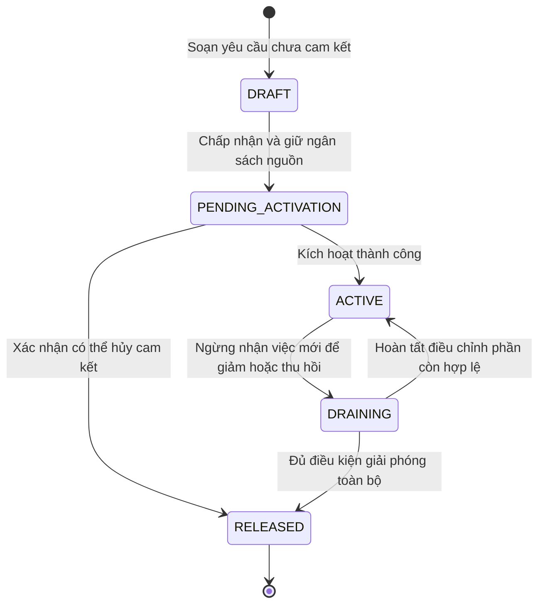

# Quota allocation — Phân bổ hạn mức an toàn

## 1. Quota allocation là gì?

**Quota allocation** là quá trình phân bổ một phần hạn mức từ nguồn có thẩm quyền cho đối tượng được phép sử dụng: tenant, nhóm, dự án, người dùng hoặc workload. Nó quyết định ai được dùng tối đa bao nhiêu tài nguyên, trong phạm vi và khoảng thời gian nào.

Ví dụ, một tổ chức được dùng tối đa 1.000 lượt tạo báo cáo trong tháng. Quản trị viên phân bổ 300 lượt cho dự án A, 400 lượt cho dự án B và giữ 300 lượt chưa phân bổ. Việc một người có quyền tạo báo cáo không đồng nghĩa họ có quyền tăng phần của dự án mình hoặc cấp thêm 1.000 lượt cho dự án mới.

Trong chương **Quota Management** của module `SECURITY_APPLICATION_SECURITY_BUSINESS_LOGIC_SECURITY`, bài học tập trung bảo vệ quy tắc phân bổ khỏi lạm dụng logic: sửa hạn mức, tự nhận nguồn quota, vượt quyền theo đối tượng, bỏ qua phê duyệt, gửi yêu cầu trùng và khai thác xử lý đồng thời để cấp vượt ngân sách.

Phân bổ quota khác với tiêu thụ quota. Phân bổ dành ngân sách cho một đối tượng; tiêu thụ ghi nhận việc sử dụng trong ngân sách đó. Hai quá trình liên quan chặt chẽ nhưng cần có bất biến riêng, đặc biệt khi giảm hoặc thu hồi phần đã phân bổ.

Sau bài học, bạn có thể:

- Chọn mô hình phân bổ phù hợp với loại tài nguyên và chính sách sản phẩm.
- Diễn đạt bất biến giữa quota nguồn, quota đã phân bổ và lượng đã dùng hoặc giữ chỗ.
- Thiết kế quyền, transaction và idempotency cho thao tác cấp hoặc thay đổi hạn mức.
- Xử lý chuyển quota, thay kỳ và phân bổ qua nhiều dịch vụ.
- Kiểm thử các tình huống cấp trùng, cấp vượt hoặc thu hồi sai phần đang được sử dụng.

## 2. Chốt loại quota và đơn vị trước khi phân bổ

### 2.1. Không phải quota nào cũng hoạt động giống nhau

| Loại quota | Đại lượng được giới hạn | Ý nghĩa khi công việc kết thúc |
|---|---|---|
| Quota tích lũy theo kỳ | Tổng lượt hoặc tổng lượng được dùng trong kỳ | Phần đã dùng thường không tự quay lại |
| Quota đồng thời | Số tác vụ hoặc tài nguyên đang hoạt động | Slot có thể được trả khi xác nhận tài nguyên đã dừng |
| Quota dung lượng | Tổng dung lượng đang chiếm dụng | Có thể giải phóng theo kết quả xóa hoặc giảm dung lượng thực tế |
| Quota tốc độ | Lượng yêu cầu trong một cửa sổ hoặc theo tốc độ cấp phép | Phụ thuộc mô hình cửa sổ hoặc cơ chế điều tiết đã chọn |

Ví dụ, hoàn tất một báo cáo đã tính vào quota tháng không làm số lượt đã dùng trở về 0. Ngược lại, kết thúc một tác vụ có thể trả lại slot đồng thời nếu hệ thống xác nhận nó không còn chạy.

Không lấy cơ chế “hết hạn thì trả lại” của slot đồng thời áp dụng trực tiếp cho lượt sử dụng tích lũy. Làm vậy có thể cho phép tái dùng phần quota đã tiêu thụ.

### 2.2. Khóa định danh đầy đủ của ngân sách

Một nguồn quota thường được xác định bởi các chiều như:

```text
tenant_id + pool_id + quota_unit + period_id
```

Đối tượng nhận quota còn có loại và định danh, ví dụ `PROJECT / project-A`. Các chiều cụ thể phụ thuộc sản phẩm, nhưng không được bỏ qua thông tin có ảnh hưởng đến quyền dùng ngân sách.

Không cộng 100 lượt báo cáo với 100 GB lưu trữ thành 200 đơn vị tài nguyên chung. Cũng không lấy quota chưa dùng của tenant khác hoặc kỳ trước làm ngân sách khả dụng nếu chính sách không cho phép chuyển.

Client có thể yêu cầu một đối tượng đích, nhưng máy chủ phải xác minh đối tượng thuộc đúng tenant và đủ điều kiện nhận phần quota đó. `period_id` hoặc tên gói trong JSON không phải bằng chứng nguồn quota có tồn tại.

## 3. Hai mô hình thường bị nhầm lẫn

### 3.1. Phân bổ cứng: ngân sách được dành riêng

Với **phân bổ cứng**, mỗi phần được cấp sẽ chiếm một phần ngân sách nguồn. Nếu chưa thu hồi hoặc giảm hợp lệ, phần đó không thể cấp tiếp cho đối tượng khác.

Ví dụ:

```text
Nguồn: 1.000 lượt / kỳ
Dự án A: 300
Dự án B: 400
Chưa phân bổ: 300
```

Các phần A và B được bảo đảm theo ngân sách đã dành riêng, trong các điều kiện còn lại của sản phẩm. Việc A chưa dùng lượt nào không tự cho phép B dùng phần của A.

### 3.2. Trần dùng chung: giới hạn con không phải phần được giữ riêng

Một mô hình khác cho phép A có trần 700, B có trần 700 nhưng cả tổ chức chỉ được dùng tổng cộng 1.000. Tổng trần con là 1.400 không tự chứng minh cấp vượt, vì các trần không phải hai khoản ngân sách đã dành riêng.

Trong mô hình này, mỗi lần chấp nhận sử dụng phải bảo vệ cả trần con và tổng của nguồn dùng chung. Hai request không được cùng vượt tổng 1.000 chỉ vì mỗi dự án vẫn dưới 700.

| Câu hỏi | Phân bổ cứng | Trần dùng chung |
|---|---|---|
| Phần con có chiếm ngân sách nguồn ngay khi cấp? | Có | Không nhất thiết |
| Tổng phần con có được vượt nguồn? | Không, theo bất biến cứng | Có thể, nếu chính sách cho phép |
| Đối tượng con có được bảo đảm toàn bộ phần đã cấp? | Theo ngân sách đã dành | Không mặc nhiên |
| Khi sử dụng cần bảo vệ gì? | Ngân sách con và điều kiện liên quan | Cả tổng nguồn dùng chung và trần con |

Không dùng phép kiểm tra của mô hình này rồi quảng bá bảo đảm của mô hình kia. Các ví dụ tiếp theo dùng phân bổ cứng cho quota lượt tích lũy theo kỳ, trừ khi có ghi rõ khác.

## 4. Bất biến của mô hình phân bổ cứng

### 4.1. Quan hệ giữa nguồn và các phần con

Giả sử nguồn không cho sử dụng trực tiếp mà chỉ cấp cho các phần con:

```text
pool_limit = unallocated + SUM(committed_allocation_amount)
unallocated >= 0
committed_allocation_amount >= 0
```

`committed_allocation_amount` bao gồm các phần đã cam kết chiếm ngân sách, kể cả đang chờ kích hoạt hoặc đang thu hồi nhưng chưa đủ điều kiện trả lại. Không chỉ cộng các phần có nhãn `ACTIVE` rồi quên ngân sách đang được giữ cho công việc điều phối.

Nếu nguồn cho sử dụng trực tiếp hoặc có khoản giữ riêng khác, phải đưa những khoản đó vào phương trình. Bỏ qua một đường sử dụng làm tổng số nhìn có vẻ hợp lệ trong khi tài nguyên thực tế đã được hứa nhiều lần.

### 4.2. Quan hệ bên trong một phần con ở cấp lá

Với quota tích lũy theo kỳ:

```text
allocated = used + reserved + available_to_use
used >= 0
reserved >= 0
available_to_use >= 0
```

- `allocated`: tổng ngân sách đã dành cho đối tượng trong kỳ.
- `used`: lượng đã tiêu thụ theo quy tắc sản phẩm.
- `reserved`: lượng đã dành cho công việc được chấp nhận nhưng chưa quyết toán.
- `available_to_use`: lượng còn có thể nhận công việc mới.

Ví dụ A được cấp 300, đã dùng 120 và đang giữ chỗ 30 thì còn 150 có thể dùng. Nếu muốn giảm phần A, hạn mức mới không được nhỏ hơn 150 trong mô hình không cho vượt hoặc nợ quota.

Phần có thể thu hồi ngay tối đa là:

```text
maximum_reclaim = allocated - used - reserved
```

Chỉ “chưa dùng” không đủ làm căn cứ thu hồi, vì phần `reserved` cũng đã được cam kết cho công việc khác.

### 4.3. Không đếm cùng một nghĩa vụ hai lần

Nếu nguồn 1.000 đã dành 300 cho A và 400 cho B, phần chưa phân bổ vẫn là 300 dù A đã dùng 120. Không tính:

```text
unallocated = 1.000 - 300 - 400 - 120
```

Lượng đã dùng 120 đã nằm trong phần 300 của A. Trừ thêm sẽ đếm trùng và làm sai ngân sách.

Ngược lại, cũng không cộng lại 120 vào nguồn chỉ vì công việc đã hoàn tất. Với quota tích lũy, phần đã dùng tiếp tục thuộc nghĩa vụ của kỳ, không phải lượng rảnh để tái phân bổ.

### 4.4. Phân bổ nhiều cấp

Với cây tổ chức → nhóm → dự án, mỗi cấp phải bảo vệ ngân sách với các con trực tiếp. Không cộng mọi hàng ở mọi độ sâu vào một tổng, vì phần của dự án có thể đã nằm trong phần của nhóm.

Nếu một nút trung gian chỉ phân bổ xuống dưới, điều kiện giảm ngân sách của nó còn phải xét các cam kết dành cho con. Không chỉ nhìn lượng sử dụng tổng hợp, vì con có thể chưa dùng nhưng vẫn đang có quyền nhận công việc trong phần được cấp.

Quy tắc cho phần con ở cấp lá và quy tắc cho nút trung gian cần được định nghĩa riêng khi schema hỗ trợ nhiều cấp.

## 5. Quyền cấp quota và ranh giới phê duyệt

### 5.1. Quyền sử dụng không đồng nghĩa với quyền phân bổ

Một thành viên có thể được dùng quota của dự án nhưng không được tăng hạn mức dự án. Một quản trị viên dự án có thể phân bổ trong dự án của mình nhưng không được lấy ngân sách từ nhóm khác.

Kiểm tra quyền cần xác định:

```text
Ai đang yêu cầu?
Nguồn quota nào nằm trong phạm vi được quản lý?
Đối tượng nhận có thuộc nguồn và tenant hợp lệ không?
Người gọi có được cấp loại quota và lượng này không?
Thay đổi có vượt ngưỡng cần phê duyệt không?
```

Các đường quản trị, import, API nội bộ, tác vụ định kỳ và công cụ hỗ trợ đều phải tuân thủ các bất biến. Một nhãn “internal” không thay thế xác thực dịch vụ hoặc quyền trên đối tượng.

### 5.2. Không tin hạn mức và phê duyệt từ client

Các trường nguy hiểm nếu backend nhận trực tiếp làm quyết định:

```json
{
  "poolLimit": 999999999,
  "plan": "ENTERPRISE",
  "approved": true,
  "skipQuotaCheck": true,
  "tenantId": "another-tenant"
}
```

Máy chủ lấy nguồn, đơn vị, kỳ, hạn mức gói và quyền từ dữ liệu có thẩm quyền. Đối tượng đích trong request phải được kiểm tra quan hệ, không chỉ kiểm tra mã có tồn tại.

Nếu chính sách yêu cầu phê duyệt tăng quota, bằng chứng phê duyệt phải gắn với đúng nguồn, đối tượng, đơn vị, kỳ và mức thay đổi. Không cho phép dùng phê duyệt cấp 300 để cấp 3.000 hoặc dùng lại cho một dự án khác.

Khi dữ liệu thay đổi sau phê duyệt, cần kiểm tra phạm vi phê duyệt còn phù hợp. Chỉ lưu `approved = true` trên một entity có thể bị sửa nhiều trường là chưa đủ bảo vệ ý nghĩa quyết định.

### 5.3. Giới hạn ủy quyền

Người quản lý cấp dưới không được tự nâng nguồn mà họ dùng để phân bổ. Hệ thống cần phân biệt quyền thay đổi `pool_limit` với quyền chia phần trong giới hạn có sẵn.

Tăng nguồn thường phải có căn cứ như đổi gói, hợp đồng hoặc điều chỉnh được phép. Yêu cầu cấp quota cho dự án không được trở thành đường gián tiếp tự sửa hạn mức tổ chức.

## 6. Dữ liệu và vòng đời allocation

### 6.1. Mô hình tham khảo

```text
quota_pool
  tenant_id, pool_id
  quota_unit, period_id
  effective_limit, unallocated
  policy_version, status, version

quota_allocation
  tenant_id, allocation_id, pool_id
  recipient_type, recipient_id
  quota_unit, period_id
  amount, used, reserved
  state, generation, version

quota_allocation_operation
  tenant_id, operation_id, operation_kind
  pool_id, source_allocation_id, target_allocation_id
  amount_before, amount_after, delta
  actor_id, authorization_ref, approval_ref
  reason_code, policy_version, recorded_at
```

Mô hình trên minh họa phần con ở cấp lá; cây nhiều cấp cần thêm quan hệ và cơ chế kiểm tra cam kết ở từng nút. Không mặc định mọi cột tổng hợp đều đủ mới để ra quyết định phân bổ.

Ràng buộc tham khảo gồm quan hệ cùng tenant, đúng pool, đúng đơn vị và kỳ; khóa duy nhất cho đối tượng nhận trong cùng vai trò phân bổ; cùng các điều kiện số lượng không âm. Khóa nghiệp vụ cụ thể phải phù hợp việc một đối tượng có thể nhận bao nhiêu phần độc lập.

### 6.2. Cam kết ngân sách khi chờ kích hoạt



`DRAFT` không cho phép dùng tài nguyên và chưa chiếm ngân sách. `PENDING_ACTIVATION`, `ACTIVE` và `DRAINING` vẫn có thể chiếm ngân sách theo số cam kết hiện hành.

Với quota tích lũy, phần đã dùng có thể khiến việc giải phóng toàn bộ trong kỳ không hợp lệ. Trạng thái `DRAINING` không tự xóa `used`. Có thể chỉ giảm về mức còn phải bảo toàn hoặc chờ kết thúc kỳ theo chính sách.

Nếu bổ sung trạng thái `SUSPENDED`, việc chặn sử dụng không mặc nhiên trả ngân sách về nguồn. Cần một quyết định giảm hoặc giải phóng được kiểm tra riêng.

### 6.3. Lịch sử không bị xóa khi giải phóng

Một allocation đã kết thúc vẫn cần truy vết được lượng từng cấp, lượng đã sử dụng, các lần thay đổi và căn cứ thu hồi. Không xóa hàng để làm như ngân sách chưa từng được phân bổ.

Thế hệ hoặc định danh allocation mới giúp phân biệt lần cấp mới với lần cũ. Message thu hồi cũ không được giảm nhầm phần vừa được cấp lại.

## 7. Transaction cho cấp và tăng quota

### 7.1. Race condition khi kiểm tra rồi cấp riêng rẽ

Nguồn còn 300. Hai request đồng thời cùng muốn cấp 200 cho hai dự án. Nếu mỗi request đọc thấy 300 rồi tự cập nhật, cả hai có thể được chấp nhận dù tổng yêu cầu là 400.

Bọc các câu lệnh trong transaction nhưng không bảo vệ điều kiện nguồn vẫn có thể chưa đủ, tùy cách đọc và cập nhật. Cần cơ chế nguyên tử cho quyết định “nguồn còn đủ để cam kết phần này”.

### 7.2. Cập nhật có điều kiện

SQL sau minh họa tạo một allocation mới bằng cách giữ ngân sách tại nguồn:

```sql
BEGIN;

UPDATE quota_pool
SET unallocated = unallocated - :amount,
    version = version + 1
WHERE tenant_id = :tenant_id
  AND pool_id = :pool_id
  AND quota_unit = :quota_unit
  AND period_id = :period_id
  AND status = 'ACTIVE'
  AND unallocated >= :amount;

-- Bắt buộc kiểm tra đúng một hàng bị tác động.
-- Nếu không: ROLLBACK, không tạo allocation được chấp nhận.

INSERT INTO quota_allocation (
    tenant_id, allocation_id, pool_id,
    recipient_type, recipient_id, quota_unit, period_id,
    amount, used, reserved, state, generation, version
) VALUES (
    :tenant_id, :allocation_id, :pool_id,
    :recipient_type, :recipient_id, :quota_unit, :period_id,
    :amount, 0, 0, 'PENDING_ACTIVATION', 1, 1
);

-- Ghi operation, kết quả idempotency và outbox nếu cần,
-- cũng trong transaction này.

COMMIT;
```

Mã minh họa giả định lượng cấp là số dương đã kiểm tra giới hạn, quyền và phê duyệt hợp lệ, nguồn có định danh duy nhất, và hệ quản trị hỗ trợ transaction cùng cập nhật có điều kiện phù hợp. Cần kiểm chứng cơ chế khóa, mức cô lập và lỗi retry trên cơ sở dữ liệu thực tế.

Nếu insert allocation thất bại do trùng khóa nghiệp vụ, thay đổi nguồn phải rollback cùng transaction. Không giữ một phần nguồn đã bị trừ mà không có allocation tương ứng.

Nếu kích hoạt hoàn toàn cục bộ trong cùng transaction, có thể chuyển trực tiếp sang `ACTIVE` theo thiết kế. Không bắt buộc dùng trạng thái chờ khi không có bước cần điều phối.

### 7.3. Tăng phần đã cấp theo delta

Nếu allocation đang có 300 và yêu cầu mức mới 450:

```text
delta = 450 - 300 = 150
```

Nguồn chỉ cần trừ thêm 150. Không trừ lại cả 450 hoặc coi đây là một allocation độc lập khi mô hình chỉ cho một phần của đối tượng trong kỳ.

Mức hiện tại phải được đọc trong vùng xử lý được bảo vệ. Hai request cùng đặt mức 450 không được mỗi request trừ thêm 150 dựa trên snapshot cũ. Allocation và pool cần được cập nhật nguyên tử, với khóa hoặc kiểm tra phiên bản cùng ràng buộc thích hợp.

Đầu vào số học phải giới hạn kiểu, đơn vị và miền giá trị. Số âm, số quá lớn hoặc phép cộng tràn không được biến thành đường tăng ngân sách. Nếu quota hỗ trợ số lẻ, cần kiểu thập phân chính xác và quy tắc làm tròn thống nhất.

## 8. Giảm, thu hồi và chuyển quota

### 8.1. Không giảm xuống dưới nghĩa vụ đã có

Với phần con ở cấp lá, thao tác giảm cần bảo vệ nguyên tử điều kiện:

```text
new_amount >= used + reserved
reclaimed = old_amount - new_amount
```

Sau khi giảm hợp lệ, `reclaimed` mới được cộng lại vào `unallocated` của đúng nguồn và kỳ. Nếu có phân bổ xuống các con, phải bảo vệ thêm cam kết của những con đó theo mô hình nhiều cấp.

Không chỉ kiểm tra trước rồi cập nhật sau. Một request tiêu thụ có thể tăng `reserved` trong khoảng giữa hai bước. Luồng giảm và luồng nhận công việc phải tham gia cùng cơ chế bảo vệ trạng thái allocation, chẳng hạn khóa hàng hoặc cập nhật có điều kiện phù hợp.

Ví dụ Java chỉ minh họa tính phần có thể thu hồi của một allocation ở cấp lá:

```java
long maximumReclaim(long allocated, long used, long reserved) {
    if (allocated < 0 || used < 0 || reserved < 0) {
        throw new IllegalArgumentException("INVALID_QUOTA_STATE");
    }

    long committedToWork = Math.addExact(used, reserved);
    if (committedToWork > allocated) {
        throw new IllegalStateException("QUOTA_INVARIANT_BROKEN");
    }
    return Math.subtractExact(allocated, committedToWork);
}
```

Hàm giả định quota nguyên và không cho vượt ngân sách. Nó chưa kiểm tra quyền, trạng thái, kỳ hoặc xử lý đồng thời, nên không thể tự dùng làm một luồng thu hồi hoàn chỉnh.

### 8.2. Chuyển quota phải là một nghiệp vụ nguyên tử

Nguồn có 1.000 lượt; A được 600, B được 200, còn 200 chưa phân bổ. A đã dùng 350 và giữ chỗ 100, nên chỉ có thể nhường ngay tối đa 150.

Chuyển 200 từ A sang B phải bị từ chối trong mô hình cứng, vì A còn 400 trong khi đã cam kết 450. Chuyển 100 là hợp lệ:

| Đại lượng | Trước chuyển | Sau chuyển 100 |
|---|---:|---:|
| Allocation A | 600 | 500 |
| Allocation B | 200 | 300 |
| Nguồn chưa phân bổ | 200 | 200 |
| A đã dùng và giữ chỗ | 450 | 450 |
| A còn có thể nhận việc | 150 | 50 |

Mã giả:

```text
BEGIN
  lock pool and affected allocations in a consistent order
  verify permissions on source and destination
  verify same allowed unit, period and pool relationship
  resolve idempotency operation
  verify donor can reclaim the transfer amount
  decrease donor allocation
  increase recipient allocation
  write transfer operation and related events
  store result
COMMIT
```

Không commit giảm A rồi mới gọi một transaction độc lập tăng B. Lỗi hoặc retry ở khoảng giữa có thể làm mất quota, cấp hai lần hoặc khiến một request khác chiếm phần vừa trả về.

Nếu chuyển giữa các pool khác nhau được hỗ trợ, cần kiểm tra quyền và chính sách cho cả hai nguồn, đồng thời bảo vệ các bất biến tương ứng. Không tự đổi đơn vị hoặc vượt ranh giới tenant dưới tên gọi “chuyển quota”.

### 8.3. Dừng sử dụng không làm mất lịch sử đã dùng

Với quota tháng, khóa dự án A không biến 350 lượt đã dùng thành 350 lượt mới cho B. Có thể ngừng nhận việc mới, xử lý reservation còn tồn tại rồi thu hồi phần còn rảnh theo chính sách; lượng đã dùng vẫn được giữ trong kế toán của kỳ.

Nếu hệ thống hỗ trợ chuyển quyền sở hữu dự án hoặc lưu trữ allocation đã kết thúc, phải bảo toàn nghĩa vụ với nguồn. Không xóa allocation có `used > 0` rồi cộng lại toàn bộ `amount` vào ngân sách khả dụng.

Với quota đồng thời, slot chỉ được trả khi có căn cứ việc sử dụng đã dừng hoặc đã bị cơ chế thực thi ngăn tiếp tục. Timeout nhận phản hồi không chứng minh tài nguyên ngoài đã được giải phóng.

## 9. Idempotency và nhận diện ý định phân bổ

### 9.1. API nên phân biệt đặt mức với cộng thêm

Hai request sau có ý nghĩa khác nhau:

```text
Đặt allocation A thành 450.
Cộng thêm 150 vào allocation A.
```

Đặt mức có thể giúp diễn đạt trạng thái mong muốn, nhưng vẫn cần bảo vệ phiên bản và nguồn. Cộng thêm rất dễ tạo hiệu lực lặp khi request bị retry, nên cần mã thao tác ổn định và chống trùng.

Ví dụ API đặt mức:

```http
PUT /quota-allocations/allocation-A/limit
Idempotency-Key: set-allocation-A-450-91
Content-Type: application/json

{
  "targetAmount": 450,
  "expectedVersion": 7,
  "expectedPeriodId": "period-2026-12",
  "reasonCode": "PROJECT_CAPACITY_REVIEW"
}
```

Máy chủ lấy nguồn và hạn mức hiện hành từ allocation đã xác minh. Không nhận `targetAmount` rồi ghi trực tiếp mà bỏ qua phần chênh lệch phải lấy từ hoặc trả về nguồn.

### 9.2. Phạm vi và fingerprint

Một phạm vi key tham khảo:

```text
(tenant_id, authenticated_subject_id, operation_type, idempotency_key)
```

Fingerprint cần bao gồm mục tiêu, kỳ, đơn vị và các lựa chọn nghiệp vụ liên quan. Cùng key nhưng đổi từ 450 sang 900 hoặc đổi đối tượng nhận phải bị từ chối xung đột.

Key và kết quả nên được lưu cùng transaction thay đổi ngân sách khi cùng cơ sở dữ liệu. Request trùng phải trả operation đã có sau kiểm tra quyền, không chạy lại phép cộng hoặc chuyển.

Nếu retry đến sau khi allocation đã đổi kỳ hoặc có lần điều chỉnh mới, kết quả cũ vẫn gắn với operation gốc. Không dùng key cũ để sửa allocation hiện tại thành mức mà request cũ từng yêu cầu.

### 9.3. Khác key vẫn không được tạo phần trùng trái mô hình

Hai request tạo allocation cho cùng dự án có thể dùng hai key khác nhau. Nếu mô hình chỉ cho một allocation của dự án trong pool và kỳ, ràng buộc khóa nghiệp vụ phải ngăn hai phần độc lập được tạo nhầm.

Nếu sản phẩm cho phép nhiều phần từ nhiều nguồn, khóa phải phân biệt đúng nguồn và vai trò. Không cấm mọi allocation thứ hai một cách máy móc, cũng không để việc tạo thêm một đối tượng con tự nhân ngân sách gốc.

Tăng nguồn dựa trên sự kiện đổi gói cũng cần chống trùng theo sự kiện nghiệp vụ. Mã request do client tùy ý đặt không đủ để chứng minh cùng một lần nâng gói được phép cộng nguồn nhiều lần.

## 10. Kỳ quota và thay đổi nguồn

### 10.1. Kỳ là dữ liệu có thẩm quyền

Với quota theo kỳ, phải xác định rõ khoảng hiệu lực, chẳng hạn:

```text
[period_start, period_end)
```

Không suy ra kỳ tháng luôn dài 30 ngày. Dùng lịch và múi giờ theo chính sách, lưu các mốc rõ ràng để mọi dịch vụ hiểu cùng một ranh giới.

Người dùng không được tự chọn một `period_id` mới để nhận lại ngân sách. Tạo dự án, đổi tên tài khoản hoặc chuyển nhóm cũng không mặc nhiên mở một kỳ mới nếu nguồn quota vẫn thuộc cùng tổ chức và kỳ.

### 10.2. Không reset nhầm nghĩa vụ của kỳ cũ

Một job được nhận cuối kỳ có thể gửi usage sau khi kỳ mới bắt đầu. Reservation, usage và allocation liên quan cần giữ tham chiếu kỳ gốc hoặc tuân theo quy tắc chuyển kỳ đã định nghĩa.

Không đặt `used = 0` trên cùng một hàng rồi để callback cũ trừ hoặc trả vào ngân sách mới. Cách tổ chức dễ truy vết là tạo định danh kỳ mới, giữ dữ liệu kỳ cũ và xác định rõ công việc nào được phép tiếp tục sau ranh giới.

Một reservation hết hạn không đồng nghĩa phần đã dùng được hoàn lại. Khi cần chuyển phần chưa dùng sang kỳ sau, phải có chính sách rollover, giới hạn và operation chống trùng; không coi đó là hệ quả tự động của việc tạo kỳ mới.

### 10.3. Tăng hoặc giảm nguồn do thay đổi gói

Tăng `effective_limit` cần căn cứ và đồng thời cập nhật ngân sách chưa phân bổ theo đúng delta. Không tăng nguồn nhưng quên phần khả dụng, hoặc tăng cả hai bằng toàn bộ hạn mức mới.

Nếu nguồn đang có 750 đã cam kết nhưng gói mới chỉ cho 700, không được chỉ ghi `effective_limit = 700` rồi vẫn coi bất biến phân bổ cứng được giữ.

Các hướng chính sách có thể gồm lên lịch giảm cho kỳ sau, giảm các phần đủ điều kiện trước khi áp dụng nguồn mới, hoặc một cơ chế chuyển tiếp được quy định rõ. Lượng đã dùng trong kỳ không thể được làm như chưa tồn tại chỉ để vừa hạn mức mới.

Một yêu cầu giảm đang chờ xử lý có thể khiến hệ thống ngừng nhận phân bổ mới theo chính sách. Nếu sản phẩm cho phép ngoại lệ chuyển tiếp, phải lưu được phạm vi và căn cứ ngoại lệ, không âm thầm dùng số dư âm làm mô hình bình thường.

## 11. Phân bổ qua nhiều dịch vụ

### 11.1. Ghi cam kết trước khi cho sử dụng

Nếu phải cấu hình quota tại dịch vụ tài nguyên bên ngoài, nguồn cục bộ cần giữ ngân sách trước khi bên nhận được phép sử dụng phần đó. Nếu hai bên cùng dùng cấu hình mới mà nguồn chưa cam kết, nhiều allocation có thể tranh cùng một phần khả dụng.

Luồng tham khảo:

```text
Transaction cục bộ:
  giữ ngân sách nguồn
  tạo allocation PENDING_ACTIVATION
  ghi operation, idempotency và outbox
  commit

Worker:
  gửi lệnh cấu hình có mã thao tác ổn định
  xác minh kết quả
  đánh dấu ACTIVE theo phiên bản hiện hành
```

Outbox không làm việc giao nhận thành đúng một lần. Lệnh cấu hình và consumer phải xử lý retry an toàn. Nếu nhà cung cấp không có khả năng chống trùng phù hợp, cần thiết kế đối soát thay vì giả định request chỉ chạy một lần.

Khi timeout sau lệnh cấu hình, không tự trả toàn bộ ngân sách về nguồn ngay. Bên ngoài có thể đã kích hoạt allocation nhưng response bị mất; trả về sớm sẽ cho phép cấp lại phần đang được dùng.

### 11.2. Giảm hạn mức bên ngoài cần quản lý trạng thái trung gian

Nếu giảm allocation cục bộ và trả ngân sách trước khi dịch vụ ngoài áp dụng mức giảm, bên nhận cũ và bên nhận mới có thể cùng dùng phần vừa tái phân bổ.

Cần xác định thời điểm mức giảm thực sự được thực thi. Trong khi chưa đủ bằng chứng, giữ phần còn có thể bị dùng trong trạng thái cam kết hoặc đang thu hồi. Khi xác nhận an toàn, mới trả lượng được phép về nguồn.

Lệnh cũ đến muộn không được ghi đè cấu hình mới. Message cần định danh allocation, kỳ, thế hệ và phiên bản; nơi thực thi phải có cơ chế từ chối hoặc hòa giải lệnh lỗi thời theo giao thức thực tế.

### 11.3. Phân vùng ngân sách để cấp phép cục bộ

Một dịch vụ trung tâm có thể dành trước những phần ngân sách cho các vùng hoặc worker để giảm nhu cầu truy cập nguồn mỗi lần sử dụng. Đây vẫn là phân bổ cứng: ngân sách đã ủy quyền tiếp tục chiếm nguồn cho đến khi đủ điều kiện thu hồi.

Không để mỗi vùng tự dùng toàn bộ hạn mức gốc rồi cộng thống kê sau nếu sản phẩm cam kết không vượt. Dữ liệu đồng bộ sau có thể phát hiện vượt nhưng không ngăn được quyết định đã cấp.

Khi dùng lease có hạn, hết lease chỉ đủ để tái cấp phần đó nếu cơ chế thực thi bảo đảm bên cũ không thể tiếp tục cấp hoặc dùng phần đã mất hiệu lực. Có thể cần phiên bản fencing được nơi sử dụng kiểm tra, giới hạn thời gian và quy trình đối soát phù hợp.

Với quota tích lũy, usage đã phát sinh không tự biến mất khi lease hết. Phải bảo toàn phần đã dùng và xử lý lượng chưa xác định; không trả toàn bộ phần ủy quyền chỉ dựa vào đồng hồ.

## 12. Kiểm toán và đối soát phân bổ

### 12.1. Kiểm tra số học và cấu trúc

Đối với mô hình cứng trong bài, kiểm tra trên cùng lát cắt dữ liệu:

```text
pool.effective_limit
  = pool.unallocated
  + tổng ngân sách con còn cam kết theo đúng vòng đời

với mỗi allocation ở cấp lá:
  used + reserved <= amount
```

Đối chiếu theo đúng tenant, pool, đơn vị và kỳ. Với cây nhiều cấp, kiểm tra quan hệ ở từng cấp; không cộng lặp một phần đã nằm trong ngân sách cha.

Một tác vụ đọc pool trước thay đổi nhưng đọc allocations sau commit có thể báo sai lệch giả. Cần snapshot nhất quán theo khả năng hệ quản trị hoặc cơ chế điểm cắt phù hợp nếu dữ liệu nằm ở nhiều nguồn.

### 12.2. Số dư khớp chưa chứng minh phân bổ hợp lệ

Các sai phạm vẫn có thể tồn tại dù tổng ngân sách không vượt nguồn:

- Người dùng cấp quota cho dự án không thuộc quyền quản lý.
- Ngân sách được lấy từ pool không đúng loại hoặc kỳ.
- Một thao tác vượt ngưỡng nhưng thiếu phê duyệt.
- Lệnh cấu hình bên ngoài cho phép dùng nhiều hơn phần đang cam kết cục bộ.
- Một lần thay đổi làm mất allocation của đối tượng khác hoặc tự tăng nguồn.

Lịch sử cần nối được người yêu cầu, quyền, phê duyệt, nguồn, đích, mức trước và sau, delta, kỳ, phiên bản và kết quả điều phối. Các endpoint đọc báo cáo quota cũng phải bảo vệ phạm vi dữ liệu giữa tenant.

### 12.3. Tín hiệu vận hành hữu ích

Nên theo dõi số lần từ chối do nguồn không đủ, xung đột phiên bản, trùng khóa nghiệp vụ, allocation chờ kích hoạt lâu, thu hồi chưa xác nhận và sai lệch giữa cấu hình ngoài với ngân sách nội bộ.

Nhiều dự án mới liên tục nhận quota mặc định có thể là dấu hiệu lách hạn mức nếu tổng nguồn không được kiểm tra. Việc giới hạn tần suất tạo dự án chỉ giảm tốc độ lạm dụng; không thay thế bất biến tổng ngân sách.

Khi sửa sai, phân biệt projection sai với operation phân bổ sai. Projection có thể cần dựng lại từ nguồn đã xác minh; operation sai cần thao tác bù hoặc điều chỉnh được cấp quyền. Không tự cấp thêm quota để che một phép lệch chưa xác định nguyên nhân.

## 13. Các tình huống kiểm thử tấn công logic

Các tình huống dưới đây là thiết kế kiểm thử cho bài học, chưa phải kết quả chạy trên một hệ thống cụ thể. Quan sát cả response, nguồn, allocation, operation, reservation và cấu hình bên ngoài nếu có.

| Tình huống | Cách tạo điều kiện | Kết quả cần bảo đảm |
|---|---|---|
| Đổi tenant hoặc pool | Gửi mã nguồn không thuộc quyền quản lý | Từ chối, không thay đổi ngân sách bên đích |
| Sửa hạn mức nguồn | Gửi `poolLimit` hoặc tên gói cao hơn | Không dùng dữ liệu client làm quyền tăng nguồn |
| Dùng sai phê duyệt | Dùng phê duyệt mức nhỏ cho mức lớn hoặc đích khác | Từ chối vượt phạm vi phê duyệt |
| Số âm hoặc tràn | Gửi lượng âm, cực lớn hoặc sai độ chính xác | Không làm tăng nguồn hay tạo allocation sai |
| Hai lần cấp cạnh tranh | Nguồn còn 300, hai request cùng cấp 200 | Chỉ một thành công; nguồn không âm |
| Hai lần đặt cùng mức | Hai luồng cùng đổi 300 thành 450 | Không cùng trừ delta 150 hai lần |
| Retry mất response | Commit xong rồi làm mất kết quả trả về | Cùng key trả operation cũ, không cấp thêm |
| Cùng key khác nội dung | Đổi đích hoặc lượng với key đã dùng | Xung đột, không tạo hiệu lực mới |
| Khác key, trùng đối tượng | Tạo cùng allocation trái khóa nghiệp vụ | Không sinh hai phần độc lập ngoài mô hình |
| Giảm chạy đua nhận việc | Tăng `reserved` đồng thời giảm `amount` | Luôn giữ `used + reserved <= amount` |
| Chuyển quá phần rảnh | Đòi chuyển cả phần đã dùng hoặc giữ chỗ | Từ chối theo nghĩa vụ của bên cho |
| Lỗi giữa chuyển | Gây lỗi sau giảm A, trước tăng B | Rollback toàn bộ transfer |
| Xóa dự án đã dùng quota | Lưu trữ hoặc xóa dự án có `used > 0` | Không hoàn toàn bộ lượng đã tiêu thụ về nguồn |
| Tự tạo kỳ mới | Gửi `period_id` mới hoặc tạo nhiều dự án | Không tái nhận nguồn ngoài chính sách |
| Callback kỳ cũ | Usage đến sau khi kỳ mới mở | Áp dụng đúng kỳ hoặc quy tắc chuyển kỳ đã định |
| Timeout kích hoạt | Bên ngoài áp dụng nhưng mất response | Không trả ngân sách và cấp lại phần chưa rõ kết quả |
| Lệnh giảm cũ đến muộn | Giao message phiên bản cũ sau lần tăng mới | Không ghi đè cấu hình hiện hành sai thế hệ |
| Vùng cũ giữ lease | Cho vùng cũ tiếp tục hoạt động sau tái phân bổ | Cơ chế thực thi chặn dùng ngân sách đã mất hiệu lực |

Kiểm thử cạnh tranh cần điểm đồng bộ để request thực sự chồng lấn tại bước kiểm tra nguồn hoặc cập nhật allocation. Gọi hai request nối tiếp không chứng minh được khả năng chống cấp vượt.

Với transaction và ràng buộc, cần kiểm thử tích hợp trên hệ quản trị thực tế. Với kỳ và lease, dùng nguồn thời gian có thể điều khiển; với hệ thống ngoài, mô phỏng kết quả chưa rõ, message trùng và sai thứ tự.

Có thể tạo chuỗi cấp, tăng, giảm, chuyển, giữ chỗ, quyết toán và retry ngẫu nhiên. Sau mỗi bước, kiểm tra các bất biến đã chọn, đồng thời bảo đảm phép kiểm tra không đếm trùng ngân sách qua nhiều cấp.

## 14. Bài tập áp dụng và tiêu chí thiết kế

Một tổ chức có quota cứng 1.000 lượt báo cáo trong kỳ:

```text
A được cấp 400, đã dùng 250, đang giữ chỗ 100.
B được cấp 350, chưa dùng và chưa giữ chỗ.
Nguồn chưa phân bổ: 250.
```

Xét độc lập từng tình huống từ trạng thái ban đầu:

1. Cấp 300 cho dự án C.
2. Chuyển 100 từ A sang B.
3. Chuyển 50 từ A sang B.
4. Hai request đồng thời cấp 200 cho C và 200 cho D.
5. Một request cấp 200 cho C đã commit nhưng mất response, sau đó retry cùng key.
6. Đổi gói khiến hạn mức mong muốn của nguồn giảm còn 700.

Tình huống 1 phải bị từ chối vì nguồn chỉ còn 250. Tình huống 2 phải bị từ chối vì A chỉ có thể nhường `400 - 250 - 100 = 50`.

Tình huống 3 hợp lệ nếu đủ quyền và không có thay đổi cạnh tranh: A còn 350, B thành 400, nguồn chưa phân bổ vẫn là 250. A không còn phần rảnh để nhận việc mới, nhưng các nghĩa vụ đã có vẫn được bảo toàn.

Ở tình huống 4, chỉ một request được cam kết thành công; sau đó tổng phần đã cấp là 950 và nguồn còn 50. Không được cùng chấp nhận rồi chờ một tác vụ đối soát thu hồi phần vượt.

Ở tình huống 5, retry trả operation gốc và không trừ nguồn lần hai. Nếu retry đến sau khi có allocation kỳ mới, nó cũng không được cấp thêm vào kỳ mới.

Ở tình huống 6, tổng ngân sách đang cam kết là 750, lớn hơn 700. Phải áp dụng chính sách giảm nguồn đã định, chẳng hạn điều chỉnh đủ các phần hợp lệ trước khi mức giảm có hiệu lực hoặc lên lịch cho kỳ sau. Không tự xóa `used` hay ghi nguồn âm để coi như đã hoàn thành.

Một thiết kế phân bổ có thể được đánh giá qua chuỗi câu hỏi:

```text
Nguồn quota nào có thẩm quyền, theo đơn vị và kỳ nào?
    -> Đang dành ngân sách cứng hay chỉ đặt trần dùng chung?
    -> Ai được phân bổ cho đối tượng nào và đến mức nào?
    -> Cam kết nào đã tồn tại trước khi tăng, giảm hoặc chuyển?
    -> Transaction nào bảo vệ nguồn cùng các phần liên quan?
    -> Retry và yêu cầu trùng được nhận diện bằng gì?
    -> Cấu hình bên ngoài hoặc ngân sách ủy quyền được thu hồi ra sao?
    -> Bằng chứng nào cho phép đối soát và phục hồi?
```

Quota allocation an toàn cần giữ được quan hệ giữa ngân sách có thật và những quyền sử dụng đã hứa. Kiểm tra quyền, phép tính delta, điều phối đồng thời, vòng đời allocation và kỳ dữ liệu phải cùng thực thi quan hệ đó trên mọi đường phân bổ.
