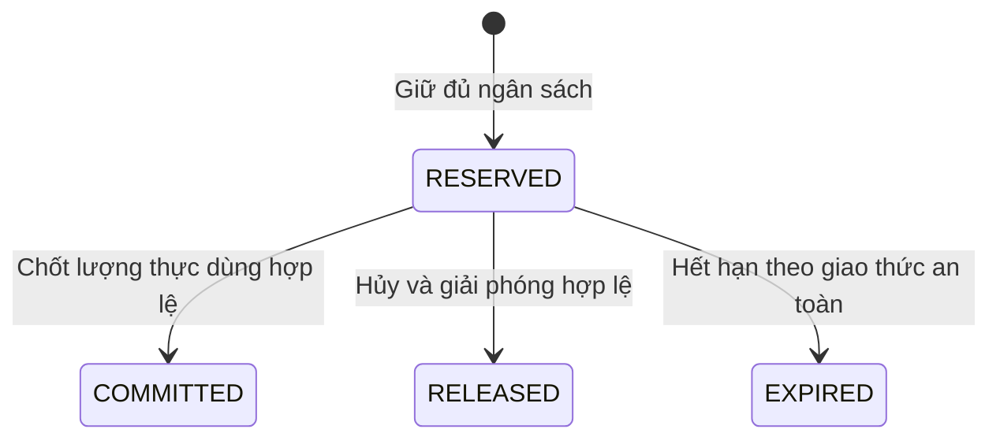

# Quota consumption: tiêu thụ hạn mức đúng và không bị lạm dụng

## 1. Quota là một ngân sách nghiệp vụ

Trong chương **Quota Management** của module **SECURITY_APPLICATION_SECURITY_BUSINESS_LOGIC_SECURITY**, bài học này tập trung vào cách tiêu thụ quota an toàn. Hệ thống phải giữ đúng ngân sách khi nhiều yêu cầu chạy đồng thời, khi client gửi lại sau timeout và khi công việc thực tế hoàn tất ở một thời điểm khác lúc tiếp nhận.

Quota giới hạn một lượng tài nguyên hoặc năng lực theo chủ thể và phạm vi cụ thể, chẳng hạn 1.000 lượt xuất báo cáo mỗi tháng, 100 GB dung lượng lưu trữ hoặc 20 tác vụ đang chạy. Đây là quy tắc nghiệp vụ cần được thực thi ở backend, không chỉ là con số hiển thị trên giao diện.

Quota và rate limit có thể cùng xuất hiện nhưng không thay thế nhau. Rate limit thường điều tiết tần suất yêu cầu trong một cửa sổ thời gian; quota có thể đại diện cho ngân sách dịch vụ theo kỳ hoặc tài nguyên đang chiếm dụng. Một người gửi rất ít request vẫn có thể vượt quota nếu mỗi request tạo ra công việc lớn.

Một lỗi thường gặp:

```text
Tenant còn 1 lượt xuất.
Request A đọc remaining = 1.
Request B đọc remaining = 1.
Cả hai cùng tạo báo cáo rồi mới tăng bộ đếm.
Kết quả: cung cấp 2 lượt dù chỉ còn ngân sách cho 1 lượt.
```

Kiểm tra đầu vào hợp lệ và xác thực đăng nhập không chặn được lỗi này. Điều cần bảo vệ là sự gắn kết giữa **chủ thể dùng quota, lượng tiêu thụ, thao tác nghiệp vụ và cập nhật ngân sách nguyên tử**.

## 2. Xác định đơn vị và invariants trước khi trừ quota

### 2.1. Phân biệt các loại quota

| Loại | Ví dụ | Khi nào tăng hoặc giảm? |
| --- | --- | --- |
| Tiêu thụ tích lũy theo kỳ | Lượt xuất báo cáo trong tháng | Tăng khi đạt điều kiện tính lượt; kỳ mới dùng bucket mới |
| Tài nguyên đang chiếm dụng | Dung lượng file hiện còn lưu | Tăng khi cấp phát, giảm khi tài nguyên thực sự được giải phóng |
| Đồng thời | Số job đang chạy | Giữ slot trước khi chạy, trả slot khi job kết thúc đúng quy trình |
| Credit theo lượng xử lý | Số trang hoặc đơn vị tính toán | Giữ trước lượng được phép, chốt theo lượng thực tế hợp lệ |

Không thể dùng cùng một quy tắc hoàn trả cho mọi loại. Xóa một báo cáo đã tạo không nhất thiết hoàn lại lượt xuất tích lũy; xóa một file chỉ nên giảm dung lượng khi hệ thống đã đáp ứng điều kiện giải phóng theo chính sách lưu trữ.

### 2.2. Mô hình ngân sách có giữ chỗ

Với quota cứng đơn giản:

```text
L = limit: tổng hạn mức
U = used: lượng đã chốt tiêu thụ
R = reserved: lượng đang giữ cho các lệnh chưa chốt

available = L - U - R

U >= 0
R >= 0
U + R <= L
```

Các invariants quan trọng:

- Chỉ chủ thể có quyền với tài nguyên và phạm vi quota mới được yêu cầu tiêu thụ.
- Lượng tính quota phải do server xác định theo quy tắc được phép.
- Một lệnh nghiệp vụ chỉ tạo một hiệu ứng tiêu thụ hợp lệ, kể cả khi có retry.
- Mọi lệnh chia sẻ một ngân sách phải cạnh tranh tại cùng nguồn ngân sách có thẩm quyền.
- Chốt, giải phóng hoặc hết hạn một reservation không được thực hiện lặp.
- Dữ liệu nghiệp vụ, ledger quota và audit phải nhất quán theo ranh giới transaction đã chọn.

Nếu sản phẩm cho phép vượt tạm hoặc giảm limit xuống dưới mức đang dùng, công thức `U + R <= L` không còn đúng vô điều kiện. Cần mô hình trạng thái vượt hạn mức và quy tắc chặn cấp thêm riêng; không vừa cho phép hành vi đó vừa tuyên bố đây là invariant tuyệt đối.

## 3. Chọn đúng chủ thể và nguồn ngân sách

Một bucket quota có thể được định danh bằng:

```text
(tenant_id, quota_owner_id, feature, unit, period_id)
```

Các thành phần cụ thể tùy sản phẩm, nhưng phải thống nhất ở mọi đường tiêu thụ. Nếu quota thuộc tổ chức, mỗi người dùng không được có một bản sao ngân sách riêng chỉ vì request đến từ các user khác nhau.

Server cần xác định:

1. Tài nguyên yêu cầu thực sự thuộc tenant nào.
2. Actor có được thao tác trên tài nguyên đó không.
3. Entitlement nào cho phép dùng feature.
4. Quota thuộc người dùng, project, tổ chức hay một pool dùng chung.
5. Kỳ và đơn vị nào áp dụng cho lệnh.

Không tin `tenantId`, `quotaOwnerId`, `bucketId` hoặc `remaining` do client gửi để xác lập quyền. Client có thể chọn một đối tượng cần thao tác, nhưng backend phải kiểm tra quan hệ sở hữu và ánh xạ ngân sách từ dữ liệu có thẩm quyền.

Một reservation cũng là đối tượng cần phân quyền. Người biết ID reservation của account khác không được tự chốt, hủy hoặc giải phóng nó. Worker được phép xử lý reservation phải có danh tính dịch vụ và phạm vi tương ứng, không dựa vào một header actor tùy ý.

## 4. Tính lượng tiêu thụ từ dữ liệu phía server

Một request như sau không phải bằng chứng về chi phí:

```json
{
  "reportId": "report-81",
  "quotaCost": 0,
  "isInternal": true,
  "remaining": 999999
}
```

Nếu mỗi lần xuất báo cáo tính một lượt, server đặt chi phí là một theo chính sách. Nếu tính theo số trang, dung lượng hoặc thời gian xử lý, cần xác định cách đo và mốc tính chi phí cụ thể.

| Trường hợp | Cách kiểm soát |
| --- | --- |
| Chi phí biết trước | Tính từ dữ liệu và quy tắc có thẩm quyền, kiểm tra rồi cập nhật nguyên tử |
| Có thể chặn trên hợp lý | Giữ trước mức tối đa, chốt phần thực dùng và giải phóng phần dư |
| Công việc có thể tăng dần | Chia thành các bước được kiểm soát và xin thêm trước khi vượt phần đã giữ |
| Không thể giới hạn chi phí trước khi tạo hiệu ứng | Cần đổi cách thực thi hoặc chấp nhận mô hình rủi ro được xác định rõ |

Không cho công việc chạy vô hạn rồi mới phát hiện nó đã dùng vượt quota. Với một công việc không thể dừng an toàn, mức giữ trước phải phù hợp với lượng có thể phát sinh hoặc có cơ chế giới hạn thực tế ở worker.

Lượng quota phải dùng đơn vị rõ ràng và kiểu số chính xác. Từ chối số âm, số không nếu thao tác yêu cầu lượng dương, giá trị vượt miền và phép chuyển đổi gây tràn. Không để `reserved += -10` trở thành cách tăng khả dụng.

Khi client khai báo dung lượng file, coi đó là dữ liệu để kiểm tra ban đầu. Dịch vụ lưu trữ vẫn phải giới hạn và đo số byte thực tế theo quy trình; không chỉ tin `Content-Length` hoặc metadata mà bên gửi có thể thao túng.

## 5. State machine cho reservation

Một mô hình đơn giản cho công việc bất đồng bộ:



`COMMITTED`, `RELEASED` và `EXPIRED` là trạng thái kết thúc của reservation trong mô hình này. Không được chuyển một reservation đã chốt sang released rồi hoàn lại ngân sách bằng đường hủy thông thường.

Ví dụ giữ `q` và chốt thực dùng `a`, với `0 <= a <= q`:

```text
Khi giữ:
    R' = R + q
    U' = U

Khi chốt:
    R' = R - q
    U' = U + a
    Phần q - a trở lại khả dụng.

Khi giải phóng toàn bộ reservation chưa dùng:
    R' = R - q
    U' = U
```

Nếu `a > q`, không được chốt bằng cách làm âm khả dụng. Worker phải xin bổ sung trước khi vượt mức đã giữ hoặc dừng theo hợp đồng. Cách xử lý phần công việc đã thực hiện cần được thiết kế riêng.

Đối với một thao tác cục bộ, chi phí cố định và hoàn tất trong cùng transaction, có thể chốt tiêu thụ trực tiếp mà không cần trạng thái giữ chỗ dài hạn. Reservation đặc biệt hữu ích khi thời điểm cấp phép khác thời điểm hoàn tất công việc.

### Hết hạn không chứng minh công việc đã dừng

Một worker có thể bị chậm, mất kết nối hoặc tiếp tục chạy sau thời hạn giữ chỗ. Nếu tác vụ quét trả quota cho người khác trong khi worker cũ vẫn tạo hiệu ứng, hệ thống có thể cấp vượt ngân sách.

Cần phối hợp quyền thực thi bằng lease, fencing token hoặc cơ chế tương đương được kiểm tra tại điểm tạo hiệu ứng. Worker hết quyền không được tiếp tục chốt hoặc ghi kết quả. Với dịch vụ bên ngoài không hỗ trợ cơ chế đó, không thể giả định một TTL cục bộ tự ngăn được hiệu ứng từ xa; có thể cần tra cứu, hủy có xác nhận hoặc trạng thái chờ đối soát trước khi giải phóng.

## 6. Giữ quota bằng thao tác nguyên tử

### 6.1. Tránh check-then-act không được bảo vệ

Mã giả sau có race condition:

```java
var bucket = quotaRepository.find(bucketId);
if (bucket.remaining() >= cost) {
    jobs.create(command);
    quotaRepository.increaseUsed(bucketId, cost);
}
```

Hai transaction có thể cùng đọc một số dư. Chỉ bọc các câu lệnh trong một transaction không tự giải quyết nếu mức cô lập và cơ chế cập nhật không bảo vệ invariant.

### 6.2. Cập nhật có điều kiện

Một lớp bảo vệ là câu SQL tương đương sau:

```sql
UPDATE quota_bucket
SET reserved = reserved + :quantity,
    version = version + 1
WHERE id = :bucket_id
  AND tenant_id = :tenant_id
  AND :quantity > 0
  AND limit_amount - used - reserved >= :quantity;
```

Phải yêu cầu số hàng cập nhật bằng **1**. Nếu bằng 0, không tạo job được phép chạy và không tiếp tục như thể đã giữ thành công.

ID bucket và quantity trong câu lệnh phải được backend xác định sau kiểm tra quyền. Câu SQL không thay thế kiểm tra entitlement, kỳ, trạng thái bucket hoặc tính duy nhất của lệnh. Cách xử lý khóa, mức cô lập và retry phải được xác minh theo cơ sở dữ liệu mục tiêu.

### 6.3. Ghi reservation và outbox cùng transaction

Đoạn dưới là **mã giả Java**, mô tả hợp đồng nghiệp vụ:

```java
ExportReceipt reserveExport(Actor actor, ExportCommand command) {
    return transactions.required(() -> {
        var context = authorization.lockAndResolveExportContext(actor, command);
        var key = idempotency.claimOrLock(
            context.tenantId(), actor.id(), "EXPORT_REPORT",
            command.idempotencyKey());
        key.requireSameFingerprint(fingerprint(command));
        if (key.isCompleted()) {
            return key.savedReceipt();
        }

        var cost = pricingPolicy.quotaCostForExport(context);
        var bucket = quotas.lockCurrentBucket(context);
        bucket.requireActiveForNewReservations();
        bucket.reserveOrThrow(cost);

        var operation = operations.createStableExportOperation(context, command);
        var reservation = reservations.insertUnique(
            operation.id(), bucket.id(), cost);
        audit.appendQuotaReserved(actor, operation, reservation);
        outbox.appendExportRequested(operation, reservation);

        return key.complete(ExportReceipt.accepted(operation.id()));
    });
}
```

Mọi ghi trong ví dụ phải dùng cùng transaction cục bộ. Nếu tạo reservation, audit hoặc outbox thất bại, cập nhật quota cũng rollback. Không đưa job lên một hàng đợi bên ngoài trước khi ngân sách đã được giữ bền vững.

`lockAndResolveExportContext` cần hợp đồng cụ thể về quyền, tenant, nguồn entitlement và dữ liệu phải giữ nhất quán. Nếu thu hồi quyền hoặc đổi nguồn quota có thể cạnh tranh, các đường đó phải phối hợp bằng khóa hoặc kiểm tra phiên bản nguyên tử tương ứng.

## 7. Chốt tiêu thụ và giải phóng đúng một lần

Chốt không chỉ là `used += actual`. Nó phải gắn với reservation đang hoạt động và đúng operation:

```text
BEGIN
    Xác minh danh tính và quyền của bên chốt.
    Khóa các bucket và reservation theo thứ tự chung đã quy định.
    Đọc lại reservation và kiểm tra đúng operation, bucket, kỳ, đơn vị.

    Nếu đã COMMITTED với cùng kết quả hợp lệ:
        Trả biên nhận cũ, không tăng used lần nữa.

    Nếu không còn RESERVED:
        Không chốt qua transition này.

    Kiểm tra actual trong phạm vi được giữ và quyền thực thi còn hợp lệ.
    Giảm reserved theo lượng đã giữ.
    Tăng used theo actual.
    Đổi reservation sang COMMITTED.
    Ghi kết quả nghiệp vụ, ledger và audit tương ứng.
COMMIT
```

Giải phóng cũng cần kiểm tra transition `RESERVED → RELEASED` hoặc `RESERVED → EXPIRED` theo giao thức. Nếu hai tác vụ cùng giải phóng, chỉ một bên được giảm `reserved`.

Các đường giữ, chốt, hủy và hết hạn phải thống nhất thứ tự khóa. Nếu đường chốt khóa reservation rồi bucket, trong khi đường hủy khóa bucket rồi reservation, có thể tạo deadlock. Khi cần đọc trước để xác định các bucket, vẫn phải kiểm tra lại liên kết sau khi đã khóa.

Nếu kết quả nghiệp vụ nằm trong cùng database, nên commit kết quả và chốt quota cùng nhau khi mô hình cho phép. Nếu hiệu ứng ở hệ thống khác, cần định danh operation ổn định, xử lý trùng ở bên nhận và quy trình phục hồi cho trạng thái chưa rõ kết quả.

Không coi rollback cục bộ là bằng chứng rằng một cuộc gọi bên ngoài chưa tạo hiệu ứng. Worker chết sau khi dịch vụ từ xa hoàn tất cần tra cứu theo operation hoặc giao thức của nguồn, thay vì giải phóng quota rồi chạy lại như một công việc mới.

## 8. Idempotency gắn với lệnh và hiệu ứng nghiệp vụ

Mất phản hồi sau commit là tình huống bình thường cần hỗ trợ:

```text
Lần đầu: giữ 1 lượt + tạo operation O + commit → phản hồi bị mất.
Lần gửi lại: nhận cùng biên nhận O → không giữ thêm lượt.
```

Khóa idempotency có thể được đặt trong phạm vi tenant, actor và loại lệnh. Fingerprint phải bao gồm các trường ảnh hưởng ý nghĩa như tài nguyên, loại xuất và tham số xử lý, được chuẩn hóa nhất quán.

| Tình huống | Hành vi cần có |
| --- | --- |
| Cùng khóa, cùng nội dung đã commit | Sau kiểm tra quyền hiện tại, trả lại biên nhận đã lưu |
| Cùng khóa, nội dung khác | Từ chối xung đột, không thực thi lệnh mới |
| Hai request cùng khóa đồng thời | Một chủ sở hữu lượt thực thi; request còn lại theo cơ chế chờ hoặc phản hồi đang xử lý |
| Worker nhận cùng operation nhiều lần | Cùng reservation và một kết quả tiêu thụ hợp lệ |
| Hai khóa client khác nhau cho cùng hiệu ứng nghiệp vụ đã định danh | Ràng buộc operation/reservation vẫn ngăn tạo hiệu ứng trái quy tắc |

Khóa phía client không thay thế định danh operation dùng xuyên suốt API, outbox và worker. Nếu worker khác retry, việc đổi actor dịch vụ không được tạo một reservation mới cho cùng operation.

Các ràng buộc hữu ích có thể gồm:

```text
QuotaBucket:
    UNIQUE(tenant_id, quota_owner_id, feature, unit, period_id)

Reservation:
    UNIQUE(operation_id, bucket_id)

IdempotencyRecord:
    UNIQUE(tenant_id, actor_id, operation_type, idempotency_key)
```

Chúng giả định các ID liên quan có phạm vi rõ ràng; cần bổ sung tenant vào khóa ngoại khi ID chỉ duy nhất trong tenant. Unique constraint chưa bảo vệ lượng ngân sách, nên vẫn cần cập nhật nguyên tử.

Biên nhận cũ cũng cần phân quyền khi đọc lại. Một người đã rời account không được dùng khóa cũ để tải báo cáo; từ chối trả dữ liệu không cho phép hệ thống thực hiện lại hiệu ứng.

## 9. Chọn kỳ quota và xử lý công việc qua ranh giới kỳ

Kỳ phải được xác định theo chính sách phía server, chẳng hạn tháng lịch trong múi giờ đã quy định hoặc chu kỳ dịch vụ. Không cho client chọn một `periodId` cũ hoặc tương lai để lấy thêm ngân sách.

Nên dùng bucket riêng cho từng kỳ thay vì đặt bộ đếm của cùng một hàng về 0 trong lúc các job cũ còn đang xử lý. Bucket mới không xóa nghĩa vụ của reservation ở bucket cũ.

Ví dụ:

```text
23:59:58: Operation O giữ quota của kỳ M.
00:00:05: O hoàn tất, lúc này kỳ M+1 đã bắt đầu.
```

Trong một chính sách tính theo thời điểm nhận lệnh, O tiếp tục chốt vào bucket M đã ghi trên reservation. Nếu sản phẩm tính theo thời điểm hoàn tất, cần giao thức khác để giữ và chuyển nghĩa vụ an toàn; không được tự thay kỳ khi retry mà quên phần đã giữ.

Kỳ mới cũng không làm cùng operation được chốt thêm một lần. Ràng buộc chống trùng của operation phải tồn tại đủ lâu và có phạm vi phù hợp qua ranh giới kỳ.

Cần phân biệt:

- Bucket còn cho tạo reservation mới hay đã đóng nhận lệnh.
- Reservation cũ còn được chốt theo điều kiện nào.
- Khi nào một bucket được coi là hoàn tất đối soát và có thể lưu trữ lịch sử.

Không dọn reservation cũ chỉ theo ngày mà không xét công việc đang dở và thời gian phục hồi được hỗ trợ.

## 10. Nhiều cấp quota và nhiều dịch vụ

### 10.1. Một hành động có thể chịu nhiều giới hạn

Một lượt xuất có thể đồng thời chịu quota người dùng, project và tổ chức. Nếu cả ba là giới hạn bắt buộc, phải kiểm tra và giữ trên cả ba; không dùng OR khiến chỉ cần một cấp còn ngân sách là được phép.

Trong một database, khóa các bucket theo thứ tự cố định, kiểm tra đủ rồi cập nhật trong cùng transaction. Nếu một cấp thất bại, rollback toàn bộ lần giữ. Hai project dùng chung quota tổ chức phải gặp nhau tại cùng bucket tổ chức.

### 10.2. Bộ đếm cache không tự là sổ quota có thẩm quyền

Một bộ đếm nguyên tử trong một kho dữ liệu có thể ngăn race tại kho đó. Nhưng vẫn phải xét việc ghi bền vững, khôi phục sau lỗi và liên kết với hiệu ứng nghiệp vụ ở nơi khác.

Nếu mỗi instance đọc bản sao hoặc cache rồi tự cho phép, tổng tiêu thụ có thể vượt quota dù từng instance không vượt con số mình biết. Cơ chế cuối cùng đồng bộ chỉ đủ cho mô hình cho phép sai lệch đã xác định; không tự tạo ra quota cứng toàn hệ thống.

Một cách khác là phân bổ trước ngân sách độc quyền cho từng vùng hoặc worker. Tổng ngân sách đã phân bổ phải nằm trong limit, việc chuyển ngân sách phải an toàn và không được nhân đôi khi phục hồi. Đây là giao thức quản lý ngân sách, không chỉ là cache `remaining`.

### 10.3. Khi dịch vụ quota không phản hồi

Với quota cứng, không được mặc định cho qua chỉ vì timeout. Có thể trả đang xử lý, từ chối tạm thời hoặc tra cứu theo operation ổn định. Nếu đã cấp ngân sách cục bộ độc quyền từ trước, chỉ được dùng trong phần ngân sách đó theo giao thức.

Thông điệp có thể được giao nhiều lần. Mục tiêu là một hiệu ứng nghiệp vụ hợp lệ qua idempotency và state machine, không phải giả định mạng chỉ giao đúng một lần.

## 11. Các cách lạm dụng logic thường gặp

| Cách thử lạm dụng | Lỗi bị khai thác | Kiểm soát cần có |
| --- | --- | --- |
| Gửi nhiều request khi chỉ còn ít quota | Check-then-act không nguyên tử | Khóa hoặc cập nhật có điều kiện trên bucket chung |
| Gửi lượng âm, số cực lớn hoặc sai đơn vị | Tin chi phí và phép tính từ client | Tính phía server, giới hạn miền và kiểm tra đơn vị |
| Đổi owner hoặc bucket ID | Thiếu quyền theo đối tượng | Ánh xạ tenant, owner và feature phía backend |
| Retry sau timeout để tạo thêm job | Không gắn lệnh với reservation | Idempotency và unique theo operation |
| Hủy cùng reservation nhiều lần | Transition không được bảo vệ | Chuyển trạng thái và giảm reserved nguyên tử |
| Chốt sau khi reservation đã giải phóng | Worker cũ vẫn có quyền thực thi | Kiểm soát lease/fencing và trạng thái tại điểm tạo hiệu ứng |
| Tạo nhiều project để nhân quota tổ chức | Sao chép ngân sách chung thành ngân sách riêng | Pool dùng chung và ràng buộc theo đúng phạm vi |
| Chọn kỳ khác hoặc retry qua tháng mới | Tin period từ client, chống trùng chỉ trong kỳ | Chọn kỳ phía server, giữ operation ổn định |
| Gọi endpoint nội bộ hoặc batch không trừ quota | Chỉ kiểm tra ở giao diện hoặc API chính | Dùng chung service nghiệp vụ tại mọi đường tạo hiệu ứng |
| Xóa kết quả để lấy lại lượt tích lũy | Nhầm giải phóng tài nguyên với hoàn credit | Quy tắc hoàn trả riêng theo loại quota |

Rate limit có thể giảm tốc độ khai thác và tiêu tốn tài nguyên, nhưng không thay thế việc giữ invariants. Một lỗi trừ âm hoặc hoàn trả hai lần có thể bị khai thác chỉ bằng vài request.

## 12. Kiểm thử tiêu thụ quota bằng hiệu ứng thực tế

### 12.1. Trường hợp biên và quyền

| Kịch bản | Điều cần xác nhận |
| --- | --- |
| Available vừa đủ quantity | Giữ thành công, không làm âm khả dụng |
| Available thiếu một đơn vị | Không tạo job được phép chạy hoặc reservation hiệu lực |
| Quantity âm, vượt miền, sai đơn vị | Không thay đổi ngân sách |
| Actor dùng bucket của tenant khác | Không có hiệu ứng và không lộ thông tin ngoài quyền |
| Chi phí client gửi thấp hơn chi phí server | Không dùng chi phí client để giảm lượng tính |
| Chốt actual nhỏ hơn lượng đã giữ | Chốt đúng actual và trả phần dư một lần |
| Chốt actual lớn hơn lượng đã giữ | Không tự vượt ngân sách; theo quy trình bổ sung hoặc từ chối |
| Giải phóng reservation đã COMMITTED | Không hoàn quota bằng transition hủy thông thường |
| Công việc qua ranh giới kỳ | Chốt đúng bucket theo hợp đồng đã chọn |

### 12.2. Race condition và retry

```text
Given:
    limit = 10, used = 9, reserved = 0
    Hai operation khác nhau đều cần 1 lượt

When:
    Hai transaction cạnh tranh tại bước giữ quota

Then:
    Chỉ một reservation mới được tạo
    used + reserved = 10
    Chỉ operation có reservation hợp lệ được cấp phép chạy
```

Dùng barrier hoặc điều phối transaction để hai yêu cầu thực sự cạnh tranh. Mock repository hoặc hai lời gọi tuần tự không chứng minh cơ chế khóa hoạt động. Kiểm thử với ngữ nghĩa cơ sở dữ liệu tương ứng môi trường triển khai.

Các ca bổ sung:

- Hai request cùng khóa, cùng nội dung: một operation và một lần giữ.
- Cùng khóa nhưng đổi tài nguyên hoặc tham số: xung đột, không tạo lệnh mới.
- Mất phản hồi sau commit rồi retry: trả cùng biên nhận.
- Hai worker chốt cùng reservation: used chỉ tăng một lần.
- Chốt cạnh tranh với hết hạn: chỉ một kết quả hợp lệ và worker không tiếp tục hiệu ứng trái quyền.
- Gây lỗi sau giữ quota nhưng trước outbox: rollback toàn bộ dữ liệu của lần nhận lệnh.
- Gây lỗi giữa các cấp quota: không rò rỉ lượng giữ ở cấp đã cập nhật trước.
- Worker cũ hoạt động sau thời hạn: điểm tạo hiệu ứng từ chối quyền thực thi cũ theo giao thức.
- Dịch vụ từ xa đã xử lý nhưng phản hồi mất: phục hồi qua operation, không vừa hoàn quota vừa thực hiện lại hiệu ứng.

### 12.3. Kiểm thử chuỗi thao tác

Có thể sinh chuỗi reserve, retry, commit, cancel, expire và chuyển kỳ rồi kiểm tra:

- Không có bộ đếm âm trong mô hình đã chọn.
- Tổng used và reserved không vượt limit của quota cứng.
- Một reservation chỉ có một kết quả kết thúc hợp lệ.
- Mọi job được phép chạy có căn cứ ngân sách tương ứng.
- Cùng operation không bị tiêu thụ lần hai qua retry hoặc chuyển kỳ.

Kiểm tra cả response lẫn bảng quota, reservation, operation, audit và outbox. Một response lỗi vẫn có thể đi kèm hiệu ứng đã ghi nếu ranh giới transaction sai.

## 13. Audit, ledger và đối soát

Một ledger quota nên liên kết operation, bucket, reservation, loại biến động, số lượng, đơn vị, kỳ, actor và lý do. Các loại biến động có thể gồm giữ chỗ, chốt, giải phóng và điều chỉnh được phê duyệt.

Audit thay đổi thành công phải cùng commit với cập nhật liên quan trong ranh giới cục bộ. Việc xuất audit ra kho phân tích có thể qua outbox. Không sửa lịch sử để che chênh lệch; điều chỉnh mới cần tham chiếu finding và bằng chứng cũ.

Với mô hình reservation đầy đủ, đối soát có thể kiểm tra:

```text
reserved của bucket
    = tổng lượng giữ còn hiệu lực của các reservation thuộc bucket

used của bucket
    = tổng lượng chốt và các điều chỉnh hợp lệ theo mô hình ledger
```

Cần đọc snapshot nhất quán hoặc chọn watermark phù hợp. So sánh dữ liệu nguồn vừa commit với một kho phân tích đang trễ có thể tạo cảnh báo giả.

Theo dõi các tín hiệu như lượng từ chối do cạn quota, xung đột idempotency, reservation treo, worker chốt sai kỳ, nhiều lần giải phóng cùng ID và độ trễ outbox. Nếu bộ đếm lệch, không tự đặt `reserved = 0` để xóa cảnh báo khi các job còn đang chạy.

## 14. Tự kiểm tra thiết kế

1. Quota đang đo lượt tích lũy, tài nguyên đang chiếm hay số tác vụ đồng thời?
2. Ai sở hữu ngân sách và những đường nào cùng tiêu thụ nó?
3. Lượng tính do server xác định, có giới hạn miền và đơn vị rõ ràng không?
4. Kiểm tra khả dụng và cập nhật có nguyên tử trên đúng nguồn dùng chung không?
5. Reservation, job, audit và outbox có cùng commit hoặc rollback không?
6. Retry và worker nhận trùng có giữ một hiệu ứng cho cùng operation không?
7. Chốt, hủy và hết hạn có loại trừ nhau đúng cách không?
8. Worker cũ có thể tạo hiệu ứng sau khi ngân sách đã được trả cho người khác không?
9. Kỳ quota có được chọn phía server và giữ ổn định cho công việc đang dở không?
10. Có thể đối soát ngân sách với các operation và reservation thực tế không?

Tiêu thụ quota an toàn cần một giao thức giữ ngân sách, thực hiện và chốt kết quả được xác định rõ. Khi ngân sách dùng chung được cập nhật nguyên tử và mỗi hiệu ứng gắn với operation ổn định, hệ thống có thể bảo vệ hạn mức trước yêu cầu đồng thời, retry và các thao tác cố tình sai trình tự.
