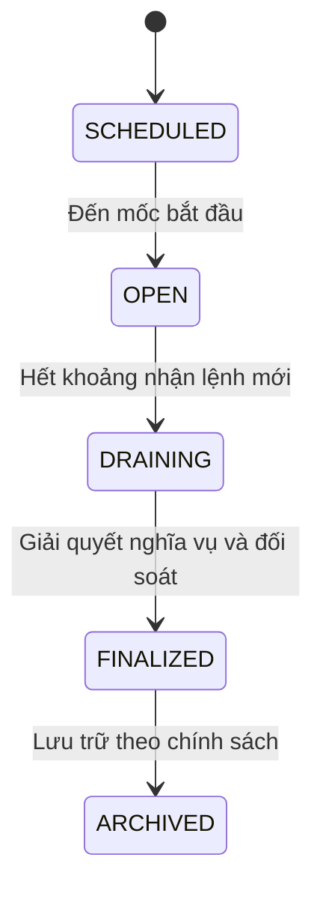

# Quota reset period: làm mới hạn mức theo kỳ mà không cấp trùng ngân sách

## 1. Reset kỳ là một chuyển đổi nghiệp vụ

Trong chương **Quota Management** của module **SECURITY_APPLICATION_SECURITY_BUSINESS_LOGIC_SECURITY**, bài học này tập trung vào thời điểm làm mới quota. Hệ thống cần cho phép dùng ngân sách của kỳ mới mà không xóa dấu vết kỳ cũ, không cấp hai lần do retry và không làm mất nghĩa vụ của các công việc còn đang xử lý.

Một thiết kế đơn giản thường lưu `used` và `lastResetAt`, rồi chạy tác vụ định kỳ đặt `used = 0`. Cách này có thể sai khi:

- Hai worker cùng reset một kỳ.
- Job của kỳ cũ hoàn tất sau thời điểm reset.
- Người dùng đổi múi giờ, gói hoặc ngày gia hạn để lấy thêm quota.
- Tác vụ chạy muộn và vô tình dời toàn bộ lịch kỳ tiếp theo.
- Một webhook gia hạn bị gửi lại làm bộ đếm bị xóa thêm lần nữa.

Ví dụ, tenant có 100 lượt mỗi tháng. Đầu tháng, tác vụ thứ nhất đặt `used = 0`; khách hàng dùng 20 lượt; tác vụ retry lại đặt `used = 0`. Hệ thống vừa cung cấp thêm 20 lượt ngoài ngân sách mà không có một căn cứ cấp thêm nào.

Với quota tích lũy theo kỳ, reset an toàn nên được hiểu là **mở một ngân sách có định danh cho kỳ mới và đóng nhận lệnh mới ở kỳ cũ theo quy tắc**, thay vì tùy ý sửa lại lịch sử đã dùng.

## 2. Chọn đúng kiểu kỳ trước khi thiết kế reset

| Mô hình | Cách xác định giới hạn | Ý nghĩa của reset |
| --- | --- | --- |
| Kỳ lịch cố định | Ngày, tuần hoặc tháng trong múi giờ đã chọn | Chuyển sang khoảng lịch kế tiếp |
| Chu kỳ dịch vụ | Theo mốc bắt đầu hoặc lịch hợp đồng | Mở chu kỳ dịch vụ kế tiếp |
| Khoảng thời gian cố định | Ví dụ từng khoảng N giây từ một mốc | Chuyển theo số thứ tự khoảng |
| Cửa sổ trượt | Tính lượng trong một khoảng nhìn lùi | Không có một lần xóa toàn bộ chung cho mọi request |
| Token bucket | Tích lũy token theo tốc độ và dung lượng tối đa | Token được bổ sung theo thời gian, không đồng nghĩa reset tháng |

Không áp tác vụ đặt lại theo tháng cho một quota tài nguyên đang chiếm dụng. Ví dụ, 100 GB file vẫn còn lưu không trở thành 0 GB chỉ vì sang tháng mới.

Tương tự, số job đang chạy không về 0 lúc nửa đêm. Quota đồng thời phụ thuộc vòng đời công việc, còn quota lượt xử lý theo kỳ có thể được cấp ngân sách mới. Một sản phẩm có thể dùng cả hai giới hạn cùng lúc.

Bài này chọn mô hình quota tích lũy theo các kỳ không chồng lấn. Các lựa chọn về mốc tính lượt, gia hạn, chuyển dư và thay gói dưới đây là ví dụ thiết kế, cần được thay bằng quy tắc sản phẩm thực tế.

## 3. Viết rõ các invariants về kỳ

| Mã | Điều kiện cần giữ |
| --- | --- |
| P1 | Mỗi quyết định tiếp nhận lệnh xác định một kỳ từ dữ liệu và thời gian có thẩm quyền |
| P2 | Trong một lịch quota đang có hiệu lực, các kỳ nhận lệnh không chồng lấn |
| P3 | Ngân sách cơ sở của một kỳ được cấp đúng một lần theo định danh nghiệp vụ |
| P4 | Mở kỳ mới không xóa lượng đã dùng hoặc reservation của kỳ cũ |
| P5 | Retry cùng operation không biến thành operation mới chỉ vì đã qua ranh giới kỳ |
| P6 | Job đang dở được chốt vào kỳ theo hợp đồng đã chọn và liên kết đã lưu |
| P7 | Thay múi giờ, gói, anchor hoặc chủ thể không tự tạo thêm một kỳ đầy đủ |
| P8 | Mọi cấp thêm, chuyển dư và điều chỉnh có nguồn, thẩm quyền và dấu vết riêng |

Với mỗi kỳ có quota cứng:

```text
available(period) = limit(period) - used(period) - reserved(period)

used(period) >= 0
reserved(period) >= 0
used(period) + reserved(period) <= limit(period)
```

Nếu có ngoại lệ vượt hạn mức, phải mô hình hóa riêng. Việc mở kỳ mới không phải cách che một kỳ cũ đang sai bộ đếm.

## 4. Xác định ranh giới thời gian không mơ hồ

### 4.1. Dùng khoảng nửa mở

Một kỳ được biểu diễn bằng `[start_at, end_at)`:

```text
start_at <= decision_time < end_at
```

Request đúng `end_at` thuộc kỳ kế tiếp theo lịch, không thuộc cả hai kỳ. Tránh lưu mốc kết thúc kiểu `23:59:59.999` vì độ chính xác của timestamp có thể khác giữa các thành phần.

Ví dụ một sản phẩm chọn tháng lịch trong múi giờ `Asia/Ho_Chi_Minh`. Mốc bắt đầu tháng 2 năm 2026 trong ví dụ tương ứng `2026-01-31T17:00:00Z`. Đây là mốc của chính sách ví dụ, không lấy từ múi giờ trình duyệt hoặc vị trí mạng của người gọi.

### 4.2. Tháng lịch không phải một số giây cố định

Tháng có độ dài khác nhau. Trong múi giờ có chuyển giờ, ngày địa phương cũng có thể không dài đúng 24 giờ. Vì vậy, không tính tháng kế tiếp bằng `start + 30 ngày` hoặc luôn tính ngày kế tiếp bằng `start + 86400 giây` khi chính sách dùng lịch địa phương.

Ví dụ Java dùng `java.time` để tính tháng lịch:

```java
import java.time.Instant;
import java.time.YearMonth;
import java.time.ZoneId;

record Window(Instant startInclusive, Instant endExclusive) {}

static Window calendarMonth(Instant decisionTime, ZoneId policyZone) {
    var month = YearMonth.from(decisionTime.atZone(policyZone));
    var start = month.atDay(1).atStartOfDay(policyZone).toInstant();
    var end = month.plusMonths(1).atDay(1)
        .atStartOfDay(policyZone).toInstant();
    return new Window(start, end);
}
```

`decisionTime` và `policyZone` trong ví dụ phải do server cung cấp. Đoạn mã chỉ tính khoảng; nó chưa xử lý cấp ngân sách, kiểm tra quyền, thay chính sách hoặc transaction.

Nếu sản phẩm dùng một giờ địa phương cụ thể thay vì đầu ngày, phải chọn quy tắc cho giờ không tồn tại hoặc bị lặp khi đổi giờ. Không để từng service tự diễn giải khác nhau.

### 4.3. Anchor vào ngày cuối tháng

Nếu chu kỳ neo vào ngày 31, cần quy tắc cho tháng không có ngày 31. Một lựa chọn là dùng ngày cuối tháng đó nhưng vẫn giữ anchor gốc là 31 cho các tháng sau.

Không tính mốc tháng sau chỉ từ ngày đã bị rút ngắn ở tháng trước, vì có thể tạo drift: ngày 31 bị rút thành 28 rồi mọi tháng sau đều thành 28. Lưu anchor và số thứ tự kỳ, tính mỗi mốc từ định nghĩa gốc.

### 4.4. Chọn một nguồn thời gian cho quyết định

Không tin thời gian do client gửi. Với request sát ranh giới, cần một tham chiếu thời gian và cơ chế tuần tự hóa phù hợp, chẳng hạn thời gian từ database trong transaction hoặc một nguồn quyết định thống nhất của dịch vụ quota.

Không trộn `now` của gateway để chọn kỳ với `now` của worker khác để tự đổi kỳ cho cùng operation. Theo dõi lệch đồng hồ; khi phát hiện thời gian bất thường, không tự mở lại một kỳ đã đóng nhận lệnh để cho qua request.

## 5. Mô hình dữ liệu giữ riêng từng kỳ

Một mô hình có thể gồm:

| Thành phần | Trách nhiệm |
| --- | --- |
| `QuotaSeries` | Chuỗi quota ổn định cho chủ thể, feature và đơn vị |
| `QuotaPolicyVersion` | Quy tắc lịch, anchor, cấp ngân sách và thời điểm có hiệu lực |
| `QuotaPeriod` | Định danh kỳ, khoảng thời gian, trạng thái, limit, used, reserved |
| `BaseAllocation` | Căn cứ cấp ngân sách cơ sở duy nhất cho kỳ |
| `Reservation` | Phần ngân sách giữ cho operation, gắn với period cụ thể |
| `QuotaLedger` | Các biến động giữ, chốt, giải phóng, cấp thêm và chuyển dư |
| `PeriodTransition` | Dấu vết mở, đóng nhận lệnh và hoàn tất đối soát |

`QuotaSeries` phải có ánh xạ duy nhất theo phạm vi sở hữu và loại quota được thiết kế. Không tạo một series mới mỗi lần retry, đổi thiết bị hoặc đổi tên gói để lấy ngân sách mới.

Một số ràng buộc hữu ích:

```text
QuotaPeriod:
    UNIQUE(series_id, period_key)

BaseAllocation:
    UNIQUE(period_id)

BusinessOperation:
    UNIQUE(tenant_id, business_operation_id)
```

`period_key` là định danh kỳ nghiệp vụ ổn định do server tạo, có thể là số thứ tự chu kỳ. `policy_version` là thuộc tính giải thích quy tắc áp dụng, không được tùy ý đưa vào một namespace mới rồi cấp hai ngân sách cho cùng kỳ sau khi đổi policy.

Unique theo key chưa tự ngăn hai khoảng thời gian chồng lấn mang key khác nhau. Đường sửa lịch cần kiểm tra toàn bộ chuyển tiếp liên quan dưới khóa hoặc giao thức phiên bản thích hợp. Các ranh giới kỳ đã được dùng phải được quản lý như dữ liệu lịch sử, không âm thầm sửa lại khiến operation cũ đổi ý nghĩa.

## 6. Mở kỳ mới theo cách idempotent

### 6.1. Tác vụ định kỳ chỉ là một cách kích hoạt

Có thể chuẩn bị kỳ bằng scheduler hoặc tạo khi request đầu tiên đến. Dù dùng cách nào, database và service nghiệp vụ phải giữ tính duy nhất; không dựa vào giả định chỉ một cron job chạy.

Định danh mở kỳ nên xuất phát từ `(series_id, period_key)`, không phải một UUID ngẫu nhiên mới cho mỗi lần worker thử lại.

### 6.2. Mã giả cho mở kỳ và cấp ngân sách

Đoạn dưới là **mã giả Java**, mô tả hợp đồng nghiệp vụ, không phải API thư viện cụ thể:

```java
QuotaPeriod ensurePeriodOpen(SeriesId seriesId, Instant decisionTime) {
    return transactions.required(() -> {
        var series = quotaSeries.lock(seriesId);
        var definition = schedules.resolveAuthoritativePeriod(series, decisionTime);
        definition.requireAllowedBySeriesHistory();

        var existing = periods.find(series.id(), definition.periodKey());
        if (existing != null) {
            existing.requireSameDefinition(definition);
            return existing;
        }

        definition.requireNoConflictingInterval(series);
        var budget = allocationPolicy.baseBudget(series, definition);
        var period = periods.insertOpen(series, definition, budget);
        baseAllocations.insertUnique(period.id(), budget);
        transitions.closePreviousAdmissionIfDue(series, definition);
        audit.appendPeriodOpened(series, period, budget);
        outbox.appendPeriodOpened(period);
        return period;
    });
}
```

Các điều kiện cần bổ sung khi triển khai:

- Caller là service hoặc actor có thẩm quyền; API công khai không được tùy ý gọi mở kỳ để cấp ngân sách.
- Khóa series và unique constraint bảo vệ các lần cạnh tranh trên cùng kỳ.
- Budget được lấy từ chính sách có hiệu lực, không từ body hoặc metadata không tin cậy.
- Tạo kỳ, cấp cơ sở, transition, audit và outbox cùng commit hoặc rollback.
- Nếu dùng cách tạo cạnh tranh bằng insert, phải xử lý xung đột và đọc lại bản ghi đã có mà không cấp thêm budget.
- Kỳ tạo trước để chuẩn bị chưa được nhận lệnh trước `start_at`; nên có trạng thái chuẩn bị riêng khi cần.

Việc tiếp nhận operation vẫn phải kiểm tra thời gian thuộc khoảng và trạng thái cho phép. Chỉ có một hàng period tồn tại không chứng minh nó đang dùng được.

### 6.3. Không lấy thời điểm worker chạy làm anchor mới

Nếu lịch quy định mở lúc 00:00 nhưng worker chạy 00:07, mốc bắt đầu vẫn là 00:00. Lấy `lastResetAt = now` rồi tính lần sau từ đó sẽ dời lịch theo độ trễ vận hành.

Khi worker bỏ lỡ nhiều kỳ, không cộng tất cả ngân sách đã bỏ lỡ vào kỳ hiện tại trừ khi chính sách cho phép tích lũy. Có thể tạo bản ghi lịch sử để đối soát, nhưng việc cấp quyền sử dụng phải theo từng kỳ và thời hạn tương ứng.

## 7. Vòng đời kỳ và các công việc đang dở

Một state machine minh họa:



Không nên để tác vụ đổi trạng thái là kiểm soát thời gian duy nhất. Nếu worker chậm mà hàng vẫn `OPEN`, điều kiện `decision_time < end_at` vẫn phải chặn lệnh mới vào kỳ cũ.

`DRAINING` có nghĩa kỳ không nhận reservation mới nhưng có thể xử lý operation đã được nhận đúng thời điểm. Nó không có nghĩa xóa `reserved` hoặc mặc định mọi job cũ đã kết thúc.

Điều kiện để `FINALIZED` cần được định nghĩa, chẳng hạn không còn reservation chưa xác định, các sự kiện cần thiết đã qua watermark đối soát và các điều chỉnh bắt buộc đã được xử lý. Một timeout cục bộ không đủ chứng minh hiệu ứng bên ngoài chưa xảy ra.

Khi hết hạn reservation, phải bảo đảm worker cũ không tiếp tục tiêu thụ sau khi ngân sách được giải phóng. Lease hoặc fencing chỉ có giá trị khi điểm tạo hiệu ứng thực sự kiểm tra nó. Nếu dịch vụ bên ngoài không hỗ trợ bảo đảm tương đương, cần quy trình xác nhận hoặc đối soát trước khi kết luận.

Kỳ mới có thể dùng ngân sách riêng trong khi kỳ cũ đang draining. Mức phơi nhiễm tổng thể của các công việc chạy cùng lúc vẫn phải được xét nếu sản phẩm còn có quota đồng thời hoặc giới hạn tài nguyên chung.

## 8. Operation qua ranh giới kỳ và retry

### 8.1. Chọn mốc tính lượt

Một lựa chọn đơn giản là tính theo thời điểm server tiếp nhận lệnh hợp lệ và giữ quota. Khi đó reservation lưu cố định `period_id`.

```text
23:59:58: Operation O được nhận và giữ quota ở kỳ M.
00:00:02: Kỳ M+1 mở nhận lệnh.
00:00:05: O hoàn tất và chốt vào reservation của kỳ M.
```

Worker không chọn lại kỳ bằng thời gian hoàn tất. Nếu sản phẩm tính theo thời điểm hoàn tất, cần thiết kế giao thức giữ và chuyển nghĩa vụ tương ứng; không thể chỉ đổi `period_id` lúc chốt rồi bỏ quên ngân sách đã giữ.

### 8.2. Retry không phải một yêu cầu mới

Giả sử lần đầu nhận O trước ranh giới và đã commit nhưng phản hồi mất. Retry sau ranh giới phải tìm lại O và biên nhận cũ, không giữ thêm quota ở M+1.

Thứ tự xử lý nên có dạng:

```text
Xác thực và kiểm tra quyền hiện tại
→ sở hữu/tra cứu khóa idempotency trong phạm vi ổn định
→ nếu đã có kết quả, trả biên nhận cũ được phép xem
→ nếu là operation mới, chọn kỳ theo thời gian quyết định
→ giữ quota và lưu operation, reservation, audit, outbox nguyên tử
```

Không đặt phạm vi idempotency chỉ trong kỳ nếu cùng operation có thể được gửi lại qua ranh giới. Cũng không cho payload khác tái dùng một khóa để thay đổi tài nguyên hoặc lượng tiêu thụ.

### 8.3. Sự kiện đến muộn không được tự mở lại kỳ

Kết quả của O nhận sau khi M đóng nhận lệnh vẫn tham chiếu M. Một sự kiện hoàn tất hợp lệ khác với một request mới giả thời gian cũ để lấy ngân sách còn dư của M.

Chỉ chấp nhận thời điểm sự kiện từ các nguồn có thẩm quyền theo giao thức đã xác định. Nếu có điều chỉnh sau khi kỳ finalized, dùng lệnh điều chỉnh có quyền, lý do và audit riêng; không sửa lịch sử một cách tùy ý.

## 9. Thay gói, múi giờ và anchor không được tạo reset ngầm

### 9.1. Thay gói trong kỳ

Một lựa chọn minh họa là nâng limit của kỳ hiện tại nhưng giữ nguyên used và reserved:

```text
Trước: limit = 100, used = 80, reserved = 10 → available = 10.
Sau:   limit = 200, used = 80, reserved = 10 → available = 110.
```

Đặt used về 0 khi nâng gói sẽ cấp thêm ngoài mức tăng limit. Nếu sản phẩm thực sự tặng credit khi nâng gói, ghi allocation riêng với nguồn sự kiện nâng gói và ràng buộc chống cấp lại.

Khi hạ limit xuống dưới nghĩa vụ hiện có, cần chọn rõ áp dụng kỳ sau, từ chối hoặc chuyển sang trạng thái vượt hạn mức có kiểm soát. Không giải quyết bằng cách xóa used hoặc reserved.

### 9.2. Thay múi giờ hoặc ngày gia hạn

Múi giờ hiển thị của người dùng không nên tự thay lịch quota. Nếu cho đổi múi giờ nghiệp vụ hoặc anchor, cần một migration có ngày hiệu lực, quy tắc cho kỳ chuyển tiếp và chống thực hiện lặp.

Một lựa chọn là giữ nguyên kỳ đang dùng, áp lịch mới từ ranh giới đã thỏa thuận và xác định rõ khoảng chuyển tiếp. Không tạo hai kỳ đang nhận lệnh cùng phủ một khoảng chỉ vì chúng dùng hai phiên bản policy.

Lệnh đổi lịch phải được phân quyền trên đúng quota owner và đồng bộ với đường mở kỳ. Hai thao tác đồng thời đổi lịch và cấp ngân sách không được mỗi bên tạo một ngân sách cơ sở khác nhau cho cùng nghĩa vụ dịch vụ.

### 9.3. Webhook thanh toán và gia hạn

Không mặc định mọi `payment_succeeded` đều là một kỳ quota mới. Một kỳ có thể có retry thanh toán, nhiều hóa đơn liên quan hoặc điều chỉnh. Sự kiện cần được ánh xạ tới đúng hợp đồng, chu kỳ và quyền cấp ngân sách.

Nếu chính sách chỉ cấp quota sau khi thanh toán, lưu căn cứ đó và khử trùng theo định danh nghiệp vụ thích hợp. Sự kiện trùng hoặc đến sai thứ tự không được cấp lại budget hoặc làm used về 0.

Thuê bao chưa có entitlement hợp lệ cũng không tự được dùng feature chỉ vì lịch quota đã đến kỳ mới. Quyền sử dụng và ngân sách là hai điều kiện cần được kiểm tra cùng nhau.

## 10. Chuyển dư cần ledger riêng và không chuyển cùng một lượng hai lần

Chuyển dư, hay carryover, là một quy tắc cấp ngân sách khác với mở quota cơ sở. Cần quy định:

- Nguồn nào được chuyển, có loại trừ credit khuyến mại hoặc dư đã chuyển từ trước không?
- Mức trần và thời hạn dùng số dư chuyển.
- Các reservation chưa hoàn tất ảnh hưởng thế nào.
- Số dư được dùng trước hay sau ngân sách cơ sở.
- Điều gì xảy ra nếu có kết quả hoặc điều chỉnh đến muộn.

Một chính sách dễ đối soát là chỉ chốt carryover sau khi các nghĩa vụ có thể ảnh hưởng đã được giải quyết. Với trường hợp nguồn chỉ có budget cơ sở và không còn reservation:

```text
unused = max(0, source_limit - source_used)
carryover = min(carryover_cap, unused)
```

Công thức này chưa áp dụng trực tiếp nếu source_limit trộn nhiều loại allocation có quy tắc hết hạn khác nhau. Khi đó cần theo dõi từng nguồn credit hoặc các thành phần ngân sách tương ứng.

Nếu phải cấp carryover sớm, không được coi phần đang reserved là dư chắc chắn. Cần quy tắc giữ lại hoặc điều chỉnh sau đó, với mỗi biến động có định danh và chống trùng. Không chạy lại phép tính rồi cộng toàn bộ kết quả vào kỳ đích mỗi lần đối soát.

Một bản ghi chuyển nên liên kết source period, target period, nguồn allocation, số lượng và rule. Ràng buộc nghiệp vụ phải bảo đảm một phần ngân sách không được chuyển hai lần qua hai lần retry hoặc hai tên policy khác nhau.

Việc ghi giảm quyền chuyển ở nguồn và cấp ở đích cần cùng transaction nếu cùng database. Nếu ở các dịch vụ khác nhau, cần giao thức chuyển ngân sách có trạng thái và phục hồi, tránh cấp ở đích trước khi biết nguồn đã bị khóa phần tương ứng.

Không sửa used của kỳ nguồn để biểu diễn carryover. Used phản ánh tiêu thụ đã xảy ra; chuyển dư là biến động quyền sử dụng chưa dùng, cần dấu vết riêng.

## 11. Các đường lạm dụng quanh reset kỳ

| Hành vi | Lỗi bị khai thác | Kiểm soát cần có |
| --- | --- | --- |
| Gọi hoặc replay lệnh reset nhiều lần | Đặt used về 0 mỗi lần nhận | Tạo kỳ và base allocation theo khóa nghiệp vụ duy nhất |
| Đổi múi giờ hoặc ngày bắt đầu liên tục | Lịch mới tạo lại quota đầy đủ | Migration lịch có quyền và quy tắc kỳ chuyển tiếp |
| Nâng/hạ gói để nhận ngân sách mới | Đồng nhất thay limit với xóa tiêu thụ | Giữ used/reserved và cấp thêm bằng allocation rõ nguồn |
| Gửi period ID cũ còn dư | Tin kỳ do client chọn | Resolver phía server và điều kiện nhận lệnh theo thời gian |
| Giả timestamp trước ranh giới | Dùng thời gian client để chọn kỳ | Nguồn thời gian có thẩm quyền |
| Retry operation sau đầu tháng | Idempotency chỉ có phạm vi trong tháng | Định danh operation ổn định qua kỳ |
| Webhook gia hạn trùng | Mỗi event được hiểu là cấp một budget | Ánh xạ chu kỳ và chống cấp lại theo nghiệp vụ |
| Worker cũ chốt vào bucket mới | Chọn lại kỳ theo now khi hoàn tất | Reservation giữ period cố định theo hợp đồng |
| Tác vụ carryover chạy lại | Cộng dư mỗi lần tính | Ledger chuyển và ràng buộc không chuyển hai lần |
| Worker reset chậm khiến kỳ cũ vẫn nhận lệnh | Chỉ dựa trạng thái OPEN | Kiểm tra cả khoảng thời gian có hiệu lực |

API quản trị cũng phải giữ những quy tắc này. Một nút “reset ngay” không có thẩm quyền, lý do và giới hạn có thể trở thành đường cấp dịch vụ không kiểm soát. Nếu cần hỗ trợ ngoại lệ, dùng lệnh điều chỉnh có phạm vi rõ thay vì xóa toàn bộ lịch sử.

## 12. Kiểm thử ranh giới, retry và cạnh tranh

### 12.1. Kiểm thử thời gian xác định

Dùng clock hoặc thời gian quyết định được tiêm từ môi trường kiểm thử, không chờ đến đầu tháng thật. Tạo các mốc trước, đúng và sau ranh giới theo độ chính xác hệ thống hỗ trợ.

| Kịch bản | Kết quả cần xác nhận |
| --- | --- |
| Ngay trước end_at | Operation mới thuộc kỳ cũ nếu các điều kiện khác hợp lệ |
| Đúng end_at | Không thuộc kỳ cũ; chỉ một kỳ mới được chọn |
| Tháng 28, 29, 30 và 31 ngày | Khoảng được tính theo lịch, không theo 30 ngày cố định |
| Anchor ngày 31 qua tháng ngắn | Theo quy tắc đã chọn và không drift ở tháng sau |
| Múi giờ có chuyển giờ | Khoảng tính đúng chính sách, không mặc định ngày luôn 24 giờ |
| Đổi múi giờ trình duyệt | Không làm đổi kỳ quota nghiệp vụ |
| Worker chạy muộn | Mốc lịch không bị dời theo thời điểm thực thi |
| Worker không chạy | Request vẫn không dùng được kỳ cũ sau end_at |
| Thời gian nguồn bất thường | Không tự mở lại lịch cũ hoặc cấp ngân sách tùy ý |

### 12.2. Mở kỳ đúng một lần

```text
Given:
    Chưa có kỳ P của quota series S
    Budget cơ sở của P là 100

When:
    Hai worker cùng ensurePeriodOpen(S, thời điểm thuộc P)

Then:
    Chỉ có một QuotaPeriod cho (S, P)
    Chỉ có một BaseAllocation
    Tổng budget cơ sở được cấp là 100, không phải 200
    Audit và outbox phản ánh một lần chuyển nghiệp vụ hợp lệ
```

Dùng barrier hoặc điều phối transaction để tạo cạnh tranh thật trên cơ sở dữ liệu có ngữ nghĩa tương ứng môi trường triển khai. Chỉ kiểm thử bằng mock không chứng minh unique constraint và khóa bảo vệ được trường hợp này.

### 12.3. Công việc cũ, thay chính sách và phục hồi

- Giữ quota ở M, hoàn tất ở M+1: chốt đúng reservation theo hợp đồng.
- Mất phản hồi trước ranh giới, retry sau ranh giới: một operation, không giữ quota kỳ mới lần hai.
- Kỳ cũ draining nhưng còn job: không bị xóa used hoặc reserved khi kỳ mới mở.
- Reset cạnh tranh với nhận lệnh sát biên: lệnh có một period xác định và bộ đếm nhất quán.
- Thay gói giữa kỳ: used và reserved không tự về 0.
- Đổi lịch cạnh tranh với mở kỳ: không tạo khoảng nhận lệnh chồng lấn hoặc cấp hai budget.
- Webhook gia hạn trùng và sai thứ tự: không cấp lại ngân sách.
- Carryover cạnh tranh hoặc retry: không chuyển cùng phần dư hai lần.
- Gây lỗi sau tạo kỳ nhưng trước cấp allocation/audit: transaction rollback toàn bộ lần mở.
- Kho nhận sự kiện bị lỗi sau commit: outbox còn đủ dữ liệu để gửi lại mà không cấp lại budget.

Kiểm tra cả dữ liệu kỳ, allocation, reservation, operation, ledger và audit. Một response thành công không đủ chứng minh kỳ chỉ được mở một lần; một response lỗi cũng chưa chứng minh không có phần ngân sách nào đã commit.

## 13. Quan sát, đối soát và khôi phục

Audit chuyển kỳ nên lưu series, period key, khoảng thời gian, múi giờ và policy/anchor áp dụng, nguồn budget, actor dịch vụ thực tế, lý do kích hoạt và command hoặc correlation ID.

Phân biệt thời điểm lịch có hiệu lực với thời điểm worker ghi nhận. Nếu worker mở kỳ muộn 7 phút, audit cần cho thấy độ trễ đó, không sửa mốc lịch thành lúc worker chạy để che lỗi.

Các đối soát hữu ích:

- Một kỳ có đúng allocation cơ sở được phép.
- Không có khoảng nhận lệnh chồng lấn trong lịch đang áp dụng.
- Mọi reservation thuộc một period hợp lệ và không bị mất khi chuyển kỳ.
- Used/reserved khớp ledger và các nghĩa vụ còn hiệu lực.
- Carryover ở nguồn và đích có quan hệ cân bằng theo quy tắc.
- Kỳ đã tới hạn không bị thiếu ngân sách do scheduler hoặc outbox treo.
- Không có operation chốt sang kỳ khác với liên kết được phê duyệt.

Đọc nguồn trong snapshot nhất quán hoặc dùng watermark; kho phân tích đang trễ có thể chưa thấy allocation vừa commit. Finding cần giữ phiên bản và mốc quan sát để phân biệt chênh lệch tạm thời với lỗi thực sự.

Khi khôi phục, dùng lệnh có định danh ổn định như mở kỳ còn thiếu, xử lý command đang treo hoặc cấp điều chỉnh được phê duyệt. Không chạy `UPDATE ... SET used = 0` trên toàn bộ owner để làm hết cảnh báo.

Mỗi điều chỉnh phải tạo lịch sử mới tham chiếu nguyên nhân. Giữ được bằng chứng của kỳ cũ là điều kiện để kiểm tra việc cấp quyền, sử dụng dịch vụ và xử lý tranh chấp vận hành sau này.

## 14. Tự kiểm tra thiết kế reset kỳ

1. Quota có thực sự theo kỳ hay đang đo tài nguyên hoặc công việc còn tồn tại?
2. Ranh giới kỳ, múi giờ và anchor do ai xác định, có ổn định trước dữ liệu client không?
3. Các khoảng có dùng dạng nửa mở và không chồng lấn không?
4. Mở kỳ và cấp ngân sách cơ sở có idempotent dưới hai worker đồng thời không?
5. Job và reservation của kỳ cũ có được giữ nguyên liên kết và đối soát không?
6. Retry qua ranh giới có trả operation cũ thay vì tiêu thụ ngân sách lần nữa không?
7. Thay gói hoặc lịch có quy tắc chuyển tiếp thay vì reset ngầm không?
8. Carryover có nguồn và ràng buộc chống chuyển trùng không?
9. Scheduler chạy muộn hoặc ngừng có làm lùi lịch hoặc cho dùng quá kỳ không?
10. Có thể khôi phục từng chuyển đổi bằng lệnh có audit thay vì xóa lịch sử không?

Reset quota theo kỳ an toàn dựa trên lịch có thẩm quyền, ngân sách được định danh và các chuyển đổi có thể gửi lại mà không lặp hiệu ứng. Khi kỳ cũ giữ nguyên nghĩa vụ còn dở và kỳ mới chỉ được cấp đúng ngân sách được phép, hệ thống tránh được việc biến ranh giới thời gian thành cơ hội lấy thêm quota.
