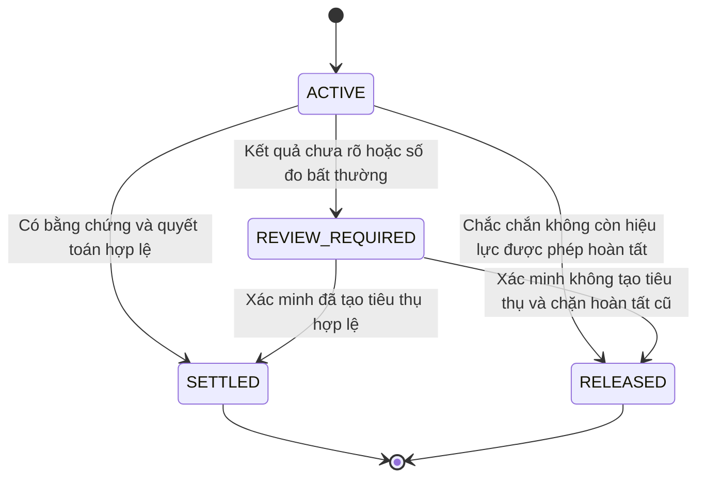

# Quota usage audit: kiểm toán việc sử dụng hạn mức

## 1. Audit quota phải giải thích được hạn mức đã đi đâu

Trong chương **Quota Management**, quota usage audit là việc lưu và đối chiếu bằng chứng về cách hạn mức được giữ chỗ, tiêu thụ, giải phóng hoặc điều chỉnh. Mục tiêu không chỉ là biết bộ đếm hiện tại bằng bao nhiêu, mà còn trả lời được: **hoạt động nào đã làm thay đổi số dư quota, dựa trên số đo nào, đúng một lần hay chưa và có nằm trong phạm vi được phép không**.

Ví dụ, hệ thống báo một tổ chức đã dùng 780 dòng xuất báo cáo trong kỳ. Một bộ đếm `used = 780` không giải thích được 780 dòng đến từ những operation nào, có tính trùng retry hay không, hoặc có khoản giữ chỗ nào đã bị giải phóng dù worker vẫn còn chạy.

Bài học thuộc module `SECURITY_APPLICATION_SECURITY_BUSINESS_LOGIC_SECURITY`, tập trung bảo vệ bất biến nghiệp vụ, quyền theo đối tượng, transaction, idempotency và kiểm thử tình huống lạm dụng. Các con số và quy tắc trong bài là mô hình sản phẩm minh họa, giúp thiết kế quota có thể giải thích và đối soát được.

Sau bài học, bạn cần:

- Phân biệt số đo tiêu thụ, quyết định cho phép, sổ biến động quota và bộ đếm tổng hợp.
- Theo dõi đúng vòng đời reservation và việc quyết toán sử dụng.
- Giữ được bằng chứng khi rollback, retry, sự kiện đến trễ hoặc chuyển kỳ quota.
- Phát hiện mất sự kiện, tính trùng, giải phóng sai và điều chỉnh ngoài quyền.
- Thiết kế kiểm thử chứng minh quan hệ giữa hiệu lực nghiệp vụ và quota đã ghi nhận.

## 2. Định nghĩa điều gì được tính là sử dụng

Trước khi thiết kế audit, phải xác định đơn vị và thời điểm một hoạt động trở thành tiêu thụ hợp lệ.

| Sản phẩm | Đơn vị có thể dùng | Câu hỏi cần chốt |
| --- | --- | --- |
| Xuất báo cáo | Dòng dữ liệu được công bố thành công | File tạo tạm rồi thất bại có bị tính không? |
| Lưu trữ | Byte đang chiếm dụng hoặc byte theo thời gian | Tính kích thước logic, kích thước vật lý hay cả bản sao? |
| Xử lý tác vụ | Lượt chạy, thời gian hoặc tài nguyên đã tiêu thụ | Lần chạy thất bại có dùng tài nguyên và có bị tính không? |
| Gửi thông báo | Thông điệp được chấp nhận hoặc giao thành công | Chấp nhận bởi nhà cung cấp đã đủ điều kiện tính chưa? |
| API theo gói | Yêu cầu được tiếp nhận hoặc hoàn tất | Các loại lỗi nào vẫn được tính? |

Không có một câu trả lời chung cho mọi sản phẩm. Nếu quota tính tài nguyên CPU thực tế, một lần chạy thất bại vẫn có thể tiêu thụ. Nếu quota tính số báo cáo đã công bố, một file tạm chưa công bố có thể chưa tạo tiêu thụ theo chính sách đó.

Bài này dùng mô hình **quota theo số dòng xuất được công bố**, với các giả định:

- Quota thuộc đúng tenant, tính năng, đơn vị và kỳ lịch đã xác định.
- Trước khi chạy, operation giữ một số dòng tối đa.
- Khi công bố thành công, hệ thống quyết toán số dòng thực tế, không vượt phần đã giữ.
- Nếu chắc chắn không công bố và quyền hoàn tất của worker đã bị chấm dứt, có thể giải phóng phần giữ.
- Một operation được quyết toán cuối đúng một lần trong mô hình đơn giản của bài.

Chi phí hạ tầng để tạo file có thể được đo riêng, nhưng không tự động được trộn vào quota số dòng công bố. Audit phải giữ rõ đơn vị và chính sách tính của từng ngân sách.

## 3. Phạm vi của một ngân sách quota

Một bộ đếm chỉ có ý nghĩa khi gắn với khóa nghiệp vụ đầy đủ. Ví dụ:

```text
BudgetKey = (
  tenant_id,
  entitlement_or_pool_id,
  feature,
  unit,
  quota_period_id
)
```

Nếu có quota cá nhân hoặc dự án, thêm chiều tương ứng theo chính sách. Các chiều này do máy chủ xác định từ dữ liệu được phép, không phải client tự chọn để tạo ngân sách mới.

Thông tin kỳ cần xác định được:

```text
period_start <= thời điểm theo chính sách < period_end
múi giờ hoặc quy tắc lịch đã dùng
phiên bản chính sách phân bổ hoạt động vào kỳ
```

Bài dùng kỳ cố định theo lịch. Quota cửa sổ trượt hoặc mô hình tích lũy khác cần thuật toán riêng và bằng chứng tương ứng; không thể chỉ đổi nhãn `period_id` rồi coi là cùng một cơ chế.

Những trường hợp không được cộng lẫn:

- Quota của hai tenant không có chính sách dùng chung.
- Số dòng và số byte.
- Ngân sách trial và ngân sách trả phí nếu chưa có quy tắc pooling.
- Hai kỳ lịch độc lập.
- Ngân sách cha và con như thể chúng là hai lượng tiêu thụ độc lập của cùng một hành động.

Nếu một lần xuất chịu cả quota cá nhân và quota toàn tenant, cùng một tiêu thụ có thể được phản ánh vào hai ngân sách để kiểm soát hai giới hạn. Đó là hai phân bổ của một tiêu thụ gốc; khi thống kê tổng số dòng toàn hệ thống, không cộng cả hai rồi tính thành gấp đôi.

## 4. Bốn lớp dữ liệu cần được liên kết

| Lớp | Nội dung | Nó chưa thay thế được điều gì? |
| --- | --- | --- |
| Số đo hoặc bằng chứng tiêu thụ | Kết quả đo số dòng, manifest file, xác nhận từ dịch vụ thực thi | Chưa tự chứng minh đúng tenant, đúng kỳ hoặc được phép tính vào ngân sách nào |
| Quyết định nghiệp vụ | Có cho phép nhận lệnh, giữ chỗ hoặc quyết toán không? | Chưa chứng minh hiệu lực đã hoàn tất |
| Sổ biến động quota | Các thay đổi đã chốt: giữ, tiêu thụ, giải phóng, điều chỉnh | Chưa tự chứng minh số đo đầu vào là thật nếu nguồn đo không đáng tin |
| Bộ đếm tổng hợp | `used`, `reserved`, phiên bản và trạng thái ngân sách | Không giải thích từng biến động nếu thiếu sổ và bằng chứng liên quan |

Một `usage_record_id` cần liên kết đến operation, số đo có thẩm quyền và các phân bổ vào budget. Bộ đếm dùng để kiểm soát nhanh; sổ biến động và các nguồn liên quan giúp tái dựng và đối soát.

Không gọi một dòng application log như `charged 180 rows` là nguồn sự thật duy nhất nếu nó được ghi trước commit hoặc không có ràng buộc chống trùng. Audit bền vững cần có ngữ nghĩa và ranh giới ghi rõ ràng.

## 5. Các bất biến và ví dụ số học

Gọi:

- `L`: hạn mức đang áp dụng cho việc nhận thêm công việc.
- `U`: lượng đã được ghi nhận sử dụng.
- `R`: lượng đang giữ chỗ cho công việc chưa quyết toán cuối.
- `A`: lượng còn có thể cấp thêm theo chính sách thông thường.

Trong trạng thái bình thường của mô hình không cho vượt quota:

```text
L >= 0
U >= 0
R >= 0
U + R <= L
A = L - U - R
```

Một yêu cầu giữ thêm `x` phải có `x > 0` và `x <= L - U - R`. Kiểm tra và giữ chỗ cần nguyên tử, không chỉ đọc số dư rồi cập nhật sau.

Các bất biến bổ sung:

1. Mỗi reservation thuộc đúng operation và đúng budget đã được chọn.
2. Mỗi biến động đã chốt có định danh ổn định và nguồn có thẩm quyền.
3. Quyết toán không vượt phần giữ theo mô hình bài; muốn tăng phải xin thêm ngân sách qua quy tắc riêng.
4. Một reservation chỉ kết thúc một lần: quyết toán hoặc giải phóng hợp lệ.
5. Retry vận chuyển không tạo thêm tiêu thụ hay giải phóng.
6. Số dư tổng hợp khớp với tổng biến động đã commit trong phạm vi và mốc đối soát tương ứng.
7. Hiệu lực được công bố khớp với tiêu thụ đã được quyết toán theo chính sách.

### 5.1. Một operation giữ 250 dòng và thực dùng 180 dòng

Giả sử ngân sách có hạn mức 1.000 dòng và đã dùng 600 dòng:

| Bước | Used U | Reserved R | Có thể cấp thêm A |
| --- | ---: | ---: | ---: |
| Ban đầu | 600 | 0 | 400 |
| Giữ 250 cho O91 | 600 | 250 | 150 |
| O91 công bố 180 dòng và quyết toán | 780 | 0 | 220 |
| Gửi lại cùng kết quả quyết toán | 780 | 0 | 220 |

Trong bước quyết toán, toàn bộ phần giữ 250 được đóng, 180 chuyển sang sử dụng và 70 được trả về khả năng cấp thêm. Có thể biểu diễn bằng một sự kiện nguyên tử:

```text
delta_used = +180
delta_reserved = -250
```

Nếu đã dùng biểu diễn này, không phát thêm một sự kiện độc lập giảm `reserved` thêm 70 để “trả phần dư”. Làm vậy sẽ giải phóng hai lần cùng một phần giữ.

### 5.2. Khi hạn mức bị giảm xuống dưới phần đã cam kết

Nếu quản trị viên hạ `L` từ 1.000 xuống 700 trong khi `U + R = 850`, hệ thống không thể giả vờ rằng bất biến nhận mới vẫn đang đúng bằng cách xóa sử dụng hoặc reservation cũ.

Cần chính sách riêng: từ chối giảm ngay, cho hiệu lực từ kỳ sau, hoặc ghi nhận trạng thái vượt cam kết và chặn cấp mới. Trong trường hợp cho giảm ngay, giữ nguyên bằng chứng sử dụng và trạng thái thiếu ngân sách; không trình bày `A` âm như một khoản quota mới có thể dùng.

Audit thay đổi hạn mức cần lưu giá trị trước, sau, thời điểm hiệu lực, thẩm quyền và phiên bản chính sách. `U + R <= L` là điều kiện phải được bảo vệ khi nhận thêm công việc trong mô hình bình thường, không phải lý do để sửa lịch sử khi chính sách thay đổi.

## 6. Sổ biến động quota và các loại sự kiện

Một sổ biến động có thể ghi các sự kiện sau:

| Loại sự kiện | Biến động điển hình | Điều kiện |
| --- | --- | --- |
| `QUOTA_RESERVED` | `delta_used = 0`, `delta_reserved = +x` | Đủ ngân sách và operation chưa giữ lần đó |
| `USAGE_SETTLED` | `delta_used = +actual`, `delta_reserved = -reserved` | Có reservation đang hoạt động và bằng chứng hợp lệ |
| `RESERVATION_RELEASED` | `delta_used = 0`, `delta_reserved = -reserved` | Không quyết toán trước đó, quyền hoàn tất đã bị chặn |
| `USAGE_ADJUSTED` | Tăng hoặc giảm used theo điều chỉnh được phép | Có căn cứ, tham chiếu nguồn và thẩm quyền riêng |
| `LIMIT_CHANGED` | Thay đổi cấu hình hạn mức, không tự đổi used | Có thời điểm hiệu lực và chính sách áp dụng |

Bài dùng một lần kết thúc reservation. Nếu sản phẩm cho quyết toán hoặc giải phóng từng phần, cần lưu số còn lại và định danh từng phần, đồng thời bảo vệ tổng phần kết thúc không vượt phần đã giữ. Không dùng mã chỉ hỗ trợ một lần kết thúc để mô phỏng nhiều lần bằng cách đặt lại trạng thái.

### 6.1. Trường tối thiểu của sự kiện

Một bản ghi biến động nên có:

```text
event_id, event_type, schema_version
usage_record_id nếu có tiêu thụ thực
operation_id, reservation_id
budget_key và policy_version
actor hoặc service đã thực hiện
measurement_reference và measurement_version nếu có
unit, delta_used, delta_reserved
budget_version_before, budget_version_after
effective_at, recorded_at
reason_code và liên kết sự kiện gốc nếu là điều chỉnh
```

Có thể ghi số dư trước và sau để hỗ trợ điều tra nếu chúng được tính trong cùng ranh giới cập nhật. Không để hai luồng tự đọc số dư ngoài transaction rồi ghi vào audit như thể đó là ảnh chụp chính xác của lần thay đổi.

### 6.2. Ví dụ sự kiện quyết toán

```json
{
  "schema_version": 1,
  "event_id": "evt_601",
  "event_type": "USAGE_SETTLED",
  "tenant_id": "tenant_A",
  "budget_id": "budget_12",
  "quota_period_id": "period_2026_12",
  "feature": "REPORT_EXPORT",
  "unit": "ROW",
  "operation_id": "op_91",
  "reservation_id": "reservation_44",
  "usage_record_id": "usage_81",
  "measurement_reference": "manifest_27",
  "measurement_version": 1,
  "reserved_units": 250,
  "actual_units": 180,
  "delta_used": 180,
  "delta_reserved": -250,
  "used_before": 600,
  "used_after": 780,
  "reserved_before": 250,
  "reserved_after": 0,
  "budget_version_before": 18,
  "budget_version_after": 19,
  "policy_version": 6,
  "execution_generation": 3,
  "effective_at": "2026-12-10T03:00:00Z",
  "recorded_at": "2026-12-10T03:00:01Z",
  "reason_code": "EXPORT_PUBLISHED"
}
```

Sự kiện này mô tả biến động của riêng operation trong bối cảnh ngân sách minh họa. Trong một ngân sách có reservation khác, `reserved_before` và `reserved_after` phải phản ánh tổng thực tế chứ không mặc định sau quyết toán luôn bằng 0.

Nếu cùng usage được phân bổ vào quota người dùng và quota tenant, cần giữ cùng định danh tiêu thụ gốc và có định danh phân bổ riêng. Hai sự kiện ngân sách không được bị hiểu thành hai lần xuất độc lập.

## 7. Bằng chứng số đo và nguồn ghi nhận có thẩm quyền

### 7.1. Không tính quota từ số lượng client tự khai

Client có thể yêu cầu xuất tối đa 200 dòng, nhưng không được tự báo `actualRows = 1` trong khi nhận file 200 dòng. Số thực tế phải được đo hoặc xác minh từ tiến trình có thẩm quyền.

Một manifest kết quả có thể lưu operation, tenant, bộ lọc đã chuẩn hóa, tài nguyên nguồn, số dòng, đơn vị, định danh file, phiên bản và thế hệ thực thi. Manifest cần được tạo từ đường xử lý đáng tin cậy và không cho người gọi sửa sau đó.

Một digest giúp đối chiếu nội dung manifest khi còn dữ liệu để kiểm tra. Nó không chứng minh tiến trình đã đếm đúng và không thay thế xác thực nguồn ghi.

### 7.2. Phân biệt bản ghi đo và lần vận chuyển

Một nguồn đo có thể gửi lại cùng bản ghi do mất xác nhận. Khóa chống trùng có thể là:

```text
(producer_id, meter_record_id)
```

Giữ nguyên định danh khi gửi lại cùng một số đo. Không tạo ID mới mỗi lần retry rồi coi đó là lượng sử dụng mới.

Ngược lại, hai lần chạy thực sự có thể đều tiêu thụ tài nguyên trong một sản phẩm tính theo CPU hoặc lần gọi nhà cung cấp. Không gộp chúng chỉ vì cùng operation nếu chính sách định nghĩa cả hai là tiêu thụ thật. Audit phải dựa trên đơn vị và điểm tính đã chốt, không áp dụng máy móc một quy tắc chống trùng cho mọi loại quota.

### 7.3. Số đo không đủ căn cứ phải được giữ trạng thái rõ ràng

Một số đo thiếu operation, sai unit, vượt phần giữ hoặc đến từ nguồn chưa xác minh không được âm thầm cộng vào bộ đếm bình thường. Cần ghi trạng thái chờ xác minh hoặc bất thường, lưu bằng chứng và xử lý theo quy trình.

Nếu phát hiện tiêu thụ thực ngoài phần đã giữ do một lỗi kiểm soát, không giấu nó bằng cách cắt số đo xuống bằng reservation. Ghi nhận sai lệch và xử lý theo chính sách điều chỉnh; đồng thời ngăn việc công bố thêm dữ liệu ngoài giới hạn ở đường thực thi.

## 8. Vòng đời reservation và giới hạn của việc hết hạn

Một reservation có thể đi theo máy trạng thái:



`REVIEW_REQUIRED` không có nghĩa phần giữ đã được trả về ngân sách. Nếu kết quả còn có thể thành công, việc giải phóng sớm có thể khiến cùng ngân sách bị dùng cho cả công việc cũ lẫn mới.

### 8.1. TTL không chứng minh worker đã dừng

Giả sử O91 giữ 250 dòng, worker bị chậm, reservation hết TTL và được giải phóng. Hệ thống cấp 250 dòng đó cho O92. Sau đó worker O91 tiếp tục công bố file: tổng hiệu lực có thể vượt quota dù bộ đếm chỉ còn thấy O92.

Muốn giải phóng an toàn, cần chặn quyền hoàn tất của thế hệ thực thi cũ. Có thể dùng phiên bản hoặc fencing token được kiểm tra tại điểm quyết toán và công bố. Sau khi một thế hệ bị vô hiệu hóa, nó không được dùng kết quả cũ để chuyển operation sang hoàn tất.

Kiểm tra token chỉ ở lúc worker bắt đầu chưa đủ. Điểm tạo hiệu lực cuối phải so sánh trạng thái và thế hệ hiện tại trong cùng ranh giới phù hợp với việc công bố.

### 8.2. Hủy, quyết toán và giải phóng cạnh tranh

Các luồng này phải cùng điều phối trên reservation hoặc một trạng thái nguồn chung:

```text
ACTIVE → SETTLED
hoặc
ACTIVE → RELEASED
```

Chỉ một kết thúc được commit. Nếu quyết toán đã thắng, một request hủy đến sau không được giảm `reserved` lần nữa hoặc giảm `used` như thể chưa xuất dữ liệu.

Nếu cần trả lại quota đã dùng do lỗi sản phẩm, đó là điều chỉnh có tham chiếu và thẩm quyền, không phải chạy lại hàm giải phóng reservation đã kết thúc.

### 8.3. Kết quả bên ngoài chưa rõ

Trong bài, file trung gian được giữ riêng tư nên có thể kiểm soát việc công bố tại hệ thống. Với sản phẩm dùng dịch vụ ngoài, một timeout có thể xảy ra sau khi dịch vụ đã tạo tiêu thụ.

Không giải phóng chỉ vì request HTTP bị timeout. Lưu trạng thái chưa rõ, truy vấn hoặc đối soát theo cùng định danh và áp dụng chính sách cho loại tiêu thụ đó. Nếu không thể tự động xác minh, đưa vào quy trình xử lý rõ ràng thay vì vừa trả quota vừa phát lại tác vụ mới.

## 9. Transaction quyết toán và audit

### 9.1. Những thay đổi cần cùng commit

Trong mô hình quota cục bộ của bài, quyết toán thành công cần gắn các thành phần sau:

1. Xác nhận operation, reservation, thế hệ worker và phạm vi còn hợp lệ.
2. Xác minh manifest và số đo thuộc đúng operation.
3. Cập nhật bộ đếm used và reserved của đúng budget.
4. Đóng reservation và ghi usage record cùng sổ biến động quota.
5. Đánh dấu kết quả được công bố qua đường truy cập có kiểm soát.
6. Lưu outbox để chuyển sự kiện và thông báo sau commit.

Nếu một bước bắt buộc lỗi, rollback toàn bộ thay đổi cục bộ. File vật lý có thể đã được tạo ở kho đối tượng, nhưng nó phải còn riêng tư nếu trạng thái công bố chưa commit.

Không thể đưa một kho đối tượng bên ngoài vào transaction cơ sở dữ liệu chỉ bằng annotation. Bảo đảm của mô hình nằm ở việc chỉ cho truy cập qua trạng thái công bố có thẩm quyền; một URL công khai được phát trước commit sẽ phá ranh giới đó.

### 9.2. Mã giả Java

Đây là mã giả cho một reservation có một lần quyết toán cuối. Các hàm kiểm tra, truy vấn và khóa phải được triển khai theo cùng ranh giới transaction và giao thức điều phối.

```java
@Transactional
public UsageReceipt settleExport(
        VerifiedWorker worker,
        UUID operationId,
        long executionGeneration,
        UUID manifestId) {

    authorizationGuard.lockTenant(worker.tenantId());

    var operation = operations.findForUpdate(
        worker.tenantId(), operationId
    ).orElseThrow(NotFound::new);
    workerAccess.requireCanFinalize(worker, operation);

    var existing = settlements.findByOperation(operation.id());
    if (existing.isPresent()) {
        existing.get().requireSameFinalization(manifestId);
        return UsageReceipt.from(existing.get());
    }

    operation.requireCurrentGeneration(executionGeneration);
    publicationPolicy.requireAllowedNow(operation);

    var reservation = reservations.findForUpdate(
        worker.tenantId(), operation.reservationId()
    ).orElseThrow(InconsistentState::new);
    reservation.requireActiveFor(operation, executionGeneration);

    var budget = budgets.findForUpdate(
        worker.tenantId(), reservation.budgetId()
    ).orElseThrow(InconsistentState::new);

    var manifest = manifests.findTrustedImmutable(
        operation.id(), manifestId
    ).orElseThrow(InvalidMeasurement::new);
    manifest.requireMatches(operation, executionGeneration);
    manifest.requirePrivateResultStored();

    long actual = manifest.rowCount();
    long held = reservation.reservedUnits();
    require(actual >= 0 && actual <= held, "INVALID_ACTUAL_USAGE");
    require(budget.reservedUnits() >= held, "COUNTER_INCONSISTENT");

    long usedBefore = budget.usedUnits();
    long reservedBefore = budget.reservedUnits();
    budget.setUsedUnits(Math.addExact(usedBefore, actual));
    budget.setReservedUnits(Math.subtractExact(reservedBefore, held));
    budget.incrementVersionExact();

    var usage = settlements.createForOperation(
        operation, reservation, manifest, actual
    ); // Unique finalization cho operation và reservation.

    reservation.markSettled(usage.id());
    operation.publishControlledResult(manifest.resultReference());

    quotaLedger.appendSettled(
        usage, budget, usedBefore, reservedBefore,
        actual, -held
    );
    outbox.appendUsageSettled(usage.id());

    return UsageReceipt.from(usage);
}
```

Những giả định quan trọng:

- Worker được xác thực và chỉ được xử lý operation trong phạm vi được cấp; tenant không lấy từ payload chưa kiểm chứng.
- Mọi luồng hủy, giải phóng, cấp lại worker và quyết toán dùng cùng cơ chế điều phối, với thứ tự khóa nhất quán.
- Manifest có nguồn đáng tin, không bị client sửa và khớp với tập dữ liệu cùng giới hạn đã chấp nhận.
- Hàm tạo settlement và sổ biến động có ràng buộc chống trùng tương ứng. Một thao tác `find` trước đó không thay thế unique constraint.
- `publishControlledResult` chỉ cập nhật trạng thái công bố cục bộ; nó không tự tạo một đường tải công khai ngoài transaction.
- Retry cùng một kết quả trả receipt cũ. Retry với manifest khác không âm thầm sửa kết quả đã quyết toán.
- Nếu budget bị hạ hạn mức sau khi reservation được chấp nhận, việc xử lý phần giữ đã cam kết tuân theo chính sách riêng. Không tự xóa sử dụng để ép số dư khớp hạn mức mới.
- Phép cộng, trừ và chuyển đổi đơn vị được kiểm tra miền giá trị và tràn số.

### 9.3. Nhánh bị từ chối và transaction rollback

Sổ biến động chỉ ghi những thay đổi quota đã commit. Một yêu cầu giữ 200 dòng bị từ chối do chỉ còn 150 không tạo biến động sử dụng, nhưng vẫn có thể cần audit quyết định từ chối riêng.

Nếu ghi sự kiện từ chối trong một transaction rồi ném ngoại lệ làm rollback, bằng chứng cũng mất. Có thể trả kết quả miền để commit sự kiện từ chối trước khi tầng HTTP trả lỗi, hoặc dùng đường ghi bền vững độc lập phù hợp.

Nếu phép tính hoặc kiểm tra đạt nhưng transaction sau đó rollback, không ghi rằng quota đã được dùng thành công. Khi cần theo dõi diễn biến, dùng sự kiện xử lý bị hủy hoặc thất bại với ngữ nghĩa rõ ràng, không đưa nó vào tổng sử dụng đã chốt.

## 10. Retry, nhiều attempt và thay đổi kỳ quota

### 10.1. Phân biệt các định danh

| Định danh | Ý nghĩa |
| --- | --- |
| `operation_id` | Một ý định nghiệp vụ bền vững |
| `attempt_id` hoặc thế hệ | Một lần thực thi của ý định đó |
| `reservation_id` | Một phần ngân sách đã giữ theo chính sách |
| `meter_record_id` | Một số đo từ nguồn cụ thể |
| `usage_record_id` | Một tiêu thụ nghiệp vụ đã được chốt |
| `allocation_id` | Phân bổ của tiêu thụ vào một ngân sách |
| `event_id` | Một sự kiện sổ hoặc audit |
| `delivery_attempt_id` | Một lần vận chuyển sự kiện, nếu cần theo dõi |

Một operation có thể có nhiều attempt, nhưng mô hình quota số dòng công bố của bài chỉ quyết toán cuối một lần. Trong một mô hình tính tài nguyên từng attempt, có thể có nhiều usage record thật; chính sách phải biểu diễn điều đó thay vì dùng chung một bộ khóa không phù hợp.

Cùng sự kiện được gửi lại giữ nguyên `event_id`. Một lần vận chuyển mới không phải một tiêu thụ mới. Một số đo được hiệu chỉnh là một thay đổi có phiên bản hoặc sự kiện điều chỉnh, không phải tự phát lại giá trị thay thế rồi hy vọng consumer đoán được.

### 10.2. Idempotency phải gắn với nội dung đã chuẩn hóa

Với cùng key và nội dung, trả về cùng operation hoặc kết quả mà không giữ thêm quota. Cùng key nhưng đổi tenant, tài nguyên, bộ lọc hoặc giới hạn dòng phải bị xử lý xung đột theo hợp đồng.

Đổi key có thể tạo một ý định mới nhưng vẫn trừ từ cùng ngân sách thực tế. Không dùng key của request làm quota bucket để mỗi lần đổi key lại có một hạn mức mới.

Khi trả dữ liệu hoặc receipt cũ, vẫn kiểm tra quyền truy cập hiện tại theo chính sách; biết một key không cho phép xem usage của người khác.

### 10.3. Sang kỳ mới không xóa lịch sử kỳ cũ

Một cách đơn giản là tạo budget cho kỳ mới và giữ budget cũ cùng các reservation chưa kết thúc. Không reset một hàng `used = 0` rồi làm mất quan hệ giữa các công việc cũ và kỳ đã nhận chúng.

Trong mô hình bài, reservation gắn với kỳ lúc nó được chấp nhận. Quyết toán muộn vẫn đóng reservation và ghi tiêu thụ vào kỳ đó, với thời điểm ghi nhận thực tế riêng. Chính sách này cần được công bố và áp dụng nhất quán.

Nếu sản phẩm muốn tính theo thời điểm hoàn tất, cần thiết kế việc chuyển hoặc xin ngân sách ở kỳ hoàn tất và xử lý phần giữ cũ nguyên tử theo mô hình phù hợp. Không chỉ lấy `current_period_id` lúc worker chạy để ghi vào kỳ mới, vì dễ vừa để reservation cũ treo vừa sử dụng ngân sách mới ngoài ý định.

### 10.4. Tách các loại thời gian

Audit có thể giữ:

```text
occurred_at: hoạt động hoặc số đo xảy ra khi nào
effective_at: tiêu thụ được phân bổ theo quy tắc nào
recorded_at: nguồn đã commit khi nào
ingested_at: kho audit tập trung nhận khi nào
quota_period_id: budget nào thực sự chịu phân bổ
```

Một sự kiện đến tháng sau không tự thuộc quota tháng sau. Một bản ghi có timestamp cũ do client tự khai cũng không đủ để chọn lại kỳ đã hết hạn.

Timestamp ở nhiều dịch vụ không tự tạo thứ tự tổng đáng tin cậy. Khi cần ghép chuỗi, dùng phiên bản nguồn, trình tự theo ngân sách hoặc operation và các quan hệ định danh đã lưu.

## 11. Đối soát bộ đếm với sổ biến động

### 11.1. Tái dựng tại cùng một mốc

Với một budget và một tập sự kiện đã chốt đầy đủ đến mốc V, có thể tính:

```text
U(V) = U_ban_đầu + tổng delta_used đến V
R(V) = R_ban_đầu + tổng delta_reserved đến V
```

Giá trị ban đầu phải có nguồn rõ ràng. Nếu nhập dữ liệu cũ, cần bản ghi mở đầu hoặc một checkpoint có thể kiểm chứng; không giả định mọi ngân sách luôn bắt đầu từ 0 khi thiếu lịch sử.

Kết quả chỉ được so sánh với projection hoặc counter ở cùng mốc. Nếu sổ đã nhận đến phiên bản 19 nhưng bộ đếm đang ở phiên bản 22, chênh lệch chưa tự chứng minh sai số.

### 11.2. Watermark phải nói rõ phạm vi đầy đủ

Một công việc đối soát cần biết đã nhận đủ dữ liệu đến đâu. Có thể dùng checkpoint theo nguồn, partition hoặc phiên bản ngân sách tùy kiến trúc.

Không coi “timestamp mới nhất đã nhận” là bằng chứng mọi sự kiện trước đó đã đến. Sự kiện cũ có thể còn nằm trong outbox hoặc bị chậm ở một nguồn khác.

Nếu có nhiều nguồn đo, cần theo dõi mốc của các nguồn liên quan. Một nguồn đã bắt kịp không chứng minh nguồn khác cũng đầy đủ. Ghi trạng thái đang chờ dữ liệu riêng với sai lệch đã xác nhận.

### 11.3. Đối soát nhiều chiều

Các quan hệ nên kiểm tra gồm:

```text
Reservation ACTIVE
  → có operation còn hợp lệ
  → phần giữ còn được phản ánh vào budget

Reservation SETTLED
  → có đúng một finalization trong mô hình bài
  → có usage record và số đo hợp lệ
  → phần giữ đã được đóng đúng lượng

Operation đã công bố
  → có quyết toán quota phù hợp
  → số dòng file khớp bằng chứng đã chốt

Usage record
  → có các allocation được chính sách yêu cầu
  → không bị cộng trùng giữa ngân sách cha và con khi tổng hợp toàn cục

Sự kiện nguồn
  → đã đến kho nhận hoặc có trạng thái chờ, lỗi vận chuyển rõ ràng
```

Cần kiểm tra hai chiều. Một usage record không có file có thể là công bố thất bại, trong khi một file có thể tải nhưng không có usage record là đường vòng kiểm soát quota. Hai tình huống có cách xử lý khác nhau.

### 11.4. Xử lý chênh lệch không được che lịch sử

Khi phát hiện counter khác sổ, cần giữ bằng chứng, xác định mốc dữ liệu và tìm nguyên nhân: mất sự kiện, sai projection, ghi trùng, đo sai, giải phóng sai hay một đường xử lý ngoài kiểm soát.

Nếu sổ có thẩm quyền đúng còn projection sai, có thể dựng lại projection bằng quy trình kiểm soát, lưu mốc và kết quả trước, sau. Nếu tiêu thụ đã chốt sai, dùng sự kiện điều chỉnh tham chiếu nguồn gốc; không sửa lén sự kiện cũ hoặc cập nhật `used` cho khớp rồi đóng sự cố.

Một khoản giảm used phải có giới hạn và quan hệ với tiêu thụ được phép điều chỉnh. Không cho lặp cùng một yêu cầu hoàn quota để tạo số sử dụng âm hoặc quota vô hạn.

## 12. Các đường lạm dụng cần chặn

| Đường lạm dụng | Vì sao chỉ nhìn bộ đếm là chưa đủ? | Cơ chế cần có |
| --- | --- | --- |
| Báo số dùng thấp | Counter có thể khớp chính số đo giả | Nguồn đo có thẩm quyền, manifest gắn với kết quả |
| Phát lại usage | Counter tăng dù không có hiệu lực mới | Định danh số đo, usage và event ổn định |
| Phát lại giải phóng | Counter reserved giảm nhiều lần | Một kết thúc reservation, cập nhật trạng thái nguyên tử |
| Ép reservation hết hạn rồi chạy tiếp | Counter tưởng đã trả quota nhưng công việc cũ vẫn hoàn tất | Thế hệ worker và kiểm tra tại điểm công bố |
| Đổi tenant hoặc pool | Tạo ngân sách rỗng để né giới hạn thật | Budget key lấy từ quan hệ có thẩm quyền |
| Đổi kỳ quota | Chuyển công việc cũ vào kỳ mới để có thêm ngân sách | Phân bổ kỳ theo chính sách và reservation đã lưu |
| Sửa quota qua endpoint hỗ trợ | Xóa dấu vết tiêu thụ hoặc tăng hạn mức ngoài quyền | Quyền điều chỉnh riêng, lý do và audit có tham chiếu |
| Cộng trùng quota phân cấp | Báo cáo tổng sai dù từng budget đúng | Usage gốc và allocation tách biệt |
| Bỏ một đường công bố | Có file tải được mà không có settlement | Kiểm soát trạng thái công bố và đối soát hiệu lực |

### 12.1. Quyền điều chỉnh là một nghiệp vụ riêng

Người được xem usage không tự có quyền sửa counter. Người có quyền giải phóng một reservation chưa dùng cũng không tự có quyền hoàn quota đã quyết toán.

Một yêu cầu điều chỉnh nên có loại, số lượng, đơn vị, budget, nguồn liên quan, lý do, người yêu cầu và phê duyệt nếu chính sách yêu cầu. Nội dung đã được phê duyệt không được đổi trước khi thực thi mà vẫn dùng phê duyệt cũ.

Nếu có thể điều chỉnh tăng used do tiêu thụ được phát hiện muộn, cần xử lý tình trạng vượt quota đúng chính sách. Không bỏ tiêu thụ thật chỉ vì nó làm số dư hiện tại khó hiển thị.

### 12.2. Lỗi hạ tầng không được biến thành quota miễn phí

Nếu đường ghi usage bắt buộc không hoạt động, một thao tác xuất được bảo vệ không được tiếp tục công bố mà không có bằng chứng rồi hy vọng sẽ sửa sau. Trong mô hình bài, settlement và trạng thái công bố cục bộ cùng transaction nên lỗi ghi khiến cả hai không commit.

Với hệ thống ngoài đã tạo tiêu thụ không thể rollback, cần giữ trạng thái chưa rõ hoặc chờ ghi nhận, đồng thời đối soát. Không tuyên bố không có sử dụng chỉ vì dịch vụ audit đang lỗi.

## 13. Bảo vệ dữ liệu audit quota

Dữ liệu usage có thể tiết lộ người dùng làm việc gì, dự án nào hoạt động nhiều hoặc thời điểm một tổ chức sử dụng dịch vụ. API xem lịch sử, chi tiết reservation, manifest và xuất audit đều cần kiểm tra quyền theo tenant và đối tượng phù hợp.

Không chỉ lọc trang danh sách rồi cho mở `usage_record_id` bất kỳ. Cũng không trả nguyên manifest chứa thông tin ngoài phạm vi chỉ vì người gọi được xem tổng số đã dùng.

Nên lưu dữ kiện cần thiết để chứng minh số đo, tránh ghi raw token, bí mật dịch vụ hoặc toàn bộ nội dung file vào sự kiện audit. Các trường do client cung cấp cần giới hạn độ dài và biểu diễn có cấu trúc để tránh giả mạo hình thức dòng log.

Sổ đã chốt nên có cơ chế hạn chế sửa, quyền ghi tách khỏi quyền điều chỉnh nghiệp vụ và khả năng kiểm chứng thay đổi phù hợp. Một bảng được gọi là append-only ở tầng ứng dụng không tự chống được người có toàn quyền quản trị cơ sở dữ liệu; mức bảo đảm cần khớp với kiến trúc bảo vệ thực tế.

Lưu event, manifest, phiên bản chính sách và checkpoint với vòng đời tương thích. Nếu bằng chứng số đo đã hết thời gian lưu, công cụ điều tra phải nêu giới hạn đó, không giả vờ vẫn tái dựng đầy đủ được tiêu thụ quá khứ.

Đường chuyển audit cần có outbox hoặc cơ chế bền vững tương đương, chống trùng ở kho nhận và giám sát độ trễ. Không âm thầm lấy mẫu các biến động bắt buộc rồi vẫn tuyên bố sổ đủ để tái dựng số dư.

## 14. Kiểm thử các tình huống sai lệch và tấn công logic

Sau mỗi test, cần kiểm tra operation, reservation, usage record, sổ biến động, counter và khả năng truy cập kết quả. Một mã HTTP đúng không chứng minh mọi hiệu lực và bằng chứng đã nhất quán.

| Tình huống | Cách tạo tình huống | Kết quả cần chứng minh |
| --- | --- | --- |
| Giữ và quyết toán bình thường | Giữ 250, thực dùng 180 | U tăng 180, R giảm 250, một finalization và audit khớp |
| Giải phóng phần dư hai lần | Gửi thêm lệnh trả 70 sau settlement đã đóng 250 | Không giảm R hoặc U thêm |
| Retry cùng settlement | Gửi lại cùng manifest và operation | Cùng receipt, không thêm usage hoặc delta |
| Đổi kết quả dưới cùng operation | Quyết toán lần hai bằng manifest khác | Xung đột, không sửa kết quả đã chốt |
| Số dùng do client giả | Gửi `actualRows` nhỏ hơn file thực | Không dùng số tự khai làm nguồn có thẩm quyền |
| Vượt phần giữ | Giữ 200 nhưng manifest ghi 250 | Không công bố như một quyết toán bình thường |
| Sai đơn vị | Đưa số byte vào budget số dòng | Bị chặn hoặc đưa vào xử lý bất thường, không cộng lẫn |
| Hai giữ chỗ cạnh tranh | Còn 300, hai lệnh mỗi lệnh 200 | Không cùng nhận tổng 400 |
| Hủy cạnh tranh settlement | Cùng lúc giải phóng và quyết toán một reservation | Chỉ một kết thúc commit, số dư không bị trừ hai lần |
| Worker cũ sau hết hạn | Giải phóng rồi cấp thế hệ mới, cho thế hệ cũ hoàn tất | Thế hệ cũ không công bố hoặc quyết toán |
| Timeout với bên ngoài | Hiệu lực có thể đã xảy ra nhưng chưa rõ | Không tự giải phóng và tạo tiêu thụ mới thiếu kiểm soát |
| Lỗi ghi sổ | Gây lỗi sau cập nhật counter nhưng trước commit | Counter, reservation, usage và công bố cùng rollback |
| Process chết sau commit | Chưa trả response hoặc chưa chuyển outbox | Retry tìm kết quả cũ, outbox tiếp tục gửi cùng event |
| Sự kiện đến trễ | Ghi nhận tháng sau cho reservation kỳ trước | Đóng đúng budget theo chính sách phân bổ đã lưu |
| Reset kỳ | Mở kỳ mới khi kỳ cũ còn reservation | Không xóa lịch sử hoặc chuyển phần giữ ngầm |
| Event phát lại | Consumer nhận cùng event nhiều lần | Không nhân bản projection hoặc usage |
| Thiếu một event | Bỏ một biến động trước mốc đối soát | Phát hiện khoảng thiếu hoặc trạng thái dữ liệu chưa đầy đủ |
| Quota cha và con | Cùng một usage phân bổ vào hai budget | Tổng toàn cục không bị tính gấp đôi |
| Giảm limit dưới cam kết | Hạ limit khi U + R đã lớn hơn mức mới | Giữ bằng chứng, áp dụng trạng thái và chính sách đã chọn |
| Hoàn quota lặp | Phát lại cùng yêu cầu điều chỉnh giảm used | Không giảm used lần nữa hoặc tạo số âm |
| Truy cập sai tenant | Xem usage, reservation hoặc manifest của tổ chức khác | Không lộ dữ liệu hoặc cho điều chỉnh ngoài quyền |

### 14.1. Kiểm thử đồng thời phải tạo tranh chấp thật

Dùng các transaction hoặc kết nối độc lập, có điểm đồng bộ để cùng cạnh tranh trên trạng thái ban đầu. Hai request nối tiếp không chứng minh được kiểm soát race condition.

Với ngân sách còn 300 và hai yêu cầu giữ 200, kiểm tra tổng `U + R` sau khi mọi transaction kết thúc. Với hủy và settlement, chạy cả hai thứ tự commit và kiểm tra rằng không có reservation vừa `RELEASED` vừa có một settlement được áp dụng.

Nếu có tự động retry sau deadlock hoặc xung đột phiên bản, lần thử lại phải đọc trạng thái mới và thực hiện lại kiểm tra. Không dùng quyết định đủ quota đã tính trước lần xung đột.

### 14.2. Kiểm thử phục hồi và đối soát

Ngắt tiến trình sau commit nhưng trước gửi outbox; sau consumer ghi nhưng trước xác nhận; và sau khi tạo file riêng tư nhưng trước công bố. Khi khôi phục, cùng ý định phải giữ định danh, không tạo thêm tiêu thụ và không để file chưa quyết toán trở thành đường tải công khai.

Kiểm thử đối soát tại một mốc xác định, bao gồm dữ liệu bị trễ và dữ liệu thiếu. Công cụ phải phân biệt projection chưa bắt kịp với sai lệch đã xác nhận, rồi chỉ ra operation hoặc event liên quan thay vì chỉ báo một con số tổng khác nhau.

### 14.3. Kiểm thử theo chuỗi

Các chuỗi hữu ích gồm:

```text
Giữ → chạy → timeout → gửi lại → quyết toán
Giữ → hết hạn → giải phóng → worker cũ công bố
Giữ ở kỳ cũ → sang kỳ mới → quyết toán muộn
Quyết toán → callback trùng → hoàn quota → phát lại hoàn quota
Giữ → hạ limit → quyết toán phần đã cam kết
Usage gốc → phân bổ người dùng và tenant → tổng hợp toàn cục
```

Sau mỗi bước đã commit, kiểm tra các bất biến phù hợp với trạng thái và chính sách. Không áp dụng một bất biến đơn giản ngoài ngữ cảnh, chẳng hạn ép mọi budget đã bị hạ limit phải có `U + R <= L` bằng cách xóa dữ liệu sử dụng.

## 15. Tự đánh giá thiết kế

1. Điều gì được tính là tiêu thụ, đơn vị là gì và bằng chứng số đo đến từ đâu?
2. Budget key có giữ đúng tenant, nguồn cấp, tính năng và kỳ không?
3. Có thể giải thích từng biến động từ operation đến reservation, usage và counter không?
4. Khi quyết toán phần dùng thực tế, phần giữ có bị đóng hoặc hoàn hai lần không?
5. Reservation hết hạn có thật sự chặn worker cũ hoàn tất hay chỉ làm counter trông còn quota?
6. Retry cùng sự kiện giữ nguyên định danh ở những lớp nào, và một attempt thật sự tiêu thụ khác được biểu diễn ra sao?
7. Sự kiện đến trễ được phân bổ vào kỳ nào, và công cụ đối soát đã nhận đủ dữ liệu đến mốc nào?
8. Khi có chênh lệch, hệ thống giữ được lịch sử và sửa đúng lớp dữ liệu hay chỉ cập nhật counter cho khớp?

Quota usage audit đáng tin cậy nối được hiệu lực thật với số đo, reservation và từng biến động đã commit. Sổ có phạm vi rõ ràng, quyết toán nguyên tử, định danh ổn định và đối soát đúng mốc giúp phát hiện lạm dụng cũng như khôi phục sau lỗi mà không làm mất hoặc nhân đôi hạn mức.
