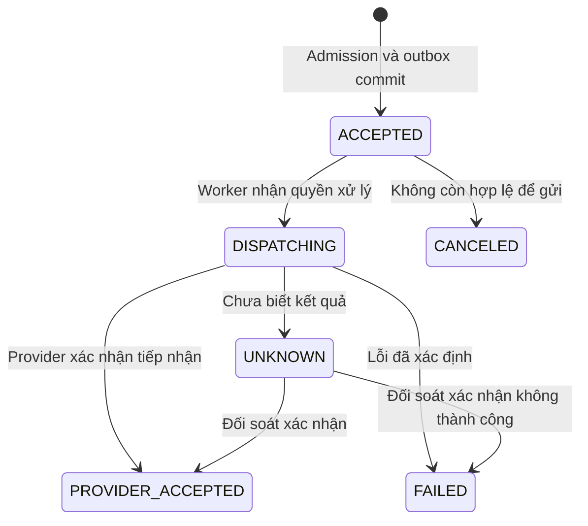

# Action frequency policy — Chính sách tần suất hành động nghiệp vụ

## 1. Mục tiêu và phạm vi

Trong chương **Rate Policies** của module bảo mật logic nghiệp vụ, **action frequency policy** là quy tắc giới hạn một hành động nghiệp vụ được phép xảy ra bao nhiêu lần, với tốc độ nào, trên chủ thể nào và trong khoảng thời gian nào.

Một hành động như gửi lời mời, gửi mã xác minh, nhận ưu đãi hoặc tạo yêu cầu hoàn tiền có thể hợp lệ ở từng lần riêng lẻ nhưng gây hại khi được lặp lại quá nhiều. Request được xác thực, payload đúng định dạng và actor có quyền thao tác vẫn chưa đủ để cho phép tự động hóa hành động đó không giới hạn.

Bài dùng luồng **gửi lại lời mời vào workspace** làm ví dụ. Backend tiếp nhận một yêu cầu gửi, ghi nhận một action có định danh ổn định, rồi worker gửi thông báo bất đồng bộ. Các con số là chính sách giả định để minh họa thiết kế, không phải ngưỡng khuyến nghị chung cho mọi hệ thống.

Sau bài học, bạn có thể:

- Phân biệt request HTTP, hành động nghiệp vụ và lần gọi nhà cung cấp.
- Xác định khóa giới hạn theo actor, người nhận và phạm vi tổ chức.
- Chọn thuật toán phù hợp với cooldown, cửa sổ trượt và burst được phép.
- Thực thi quyết định tần suất nguyên tử trước tác động nghiệp vụ.
- Kết hợp idempotency, state machine, outbox và kiểm thử cạnh tranh.

## 2. Giới hạn hành động khác giới hạn lưu lượng API

### 2.1. Một request không nhất thiết là một hành động

| Tình huống | Request HTTP | Hành động nghiệp vụ mới |
| --- | --- | --- |
| Gửi một lời mời lần đầu | Có | Có nếu backend chấp nhận |
| Retry cùng lệnh sau mất phản hồi | Có thêm request | Không nếu là cùng action đã được nhận |
| Batch gửi cho 100 người | Một request | Có thể là 100 hành động theo chính sách |
| Worker retry một tác vụ gửi | Không có request từ người dùng | Không phải action mới, nhưng có thể là thêm lần gọi nhà cung cấp |
| Gọi GraphQL, mobile hoặc job nội bộ | Có thể khác đường HTTP | Vẫn cùng loại hành động nếu tạo cùng hiệu ứng |

Nếu chỉ giới hạn 10 request mỗi phút trên một endpoint, người dùng có thể chuyển sang endpoint batch, GraphQL hoặc một luồng gọi nội bộ chưa áp cùng quy tắc. Chính sách cần đặt tên cho **họ hành động nghiệp vụ**, chẳng hạn `INVITATION_SEND_ADMISSION`, và thực thi tại điểm chung trước khi tạo hiệu ứng.

OWASP API6 mô tả nguy cơ tự động hóa quá mức các luồng nghiệp vụ nhạy cảm dù không nhất thiết có một lỗi kỹ thuật truyền thống trong mỗi request. Xác định luồng cần bảo vệ và tác động kinh doanh là bước đầu của chính sách tần suất. [Nguồn: OWASP API6 — Unrestricted Access to Sensitive Business Flows](https://api-security.owasp.org/editions/2023/en/0xa6-unrestricted-access-to-sensitive-business-flows/).

### 2.2. Các cơ chế bổ sung cho nhau

| Cơ chế | Điều kiện nó bảo vệ | Ví dụ |
| --- | --- | --- |
| Authorization | Ai được làm gì trên đối tượng nào? | Actor được gửi lại lời mời của workspace A |
| State machine | Hành động có hợp lệ ở trạng thái hiện tại không? | Lời mời chưa được chấp nhận, thu hồi hoặc hết hạn |
| Action frequency | Hành động được lặp nhanh và nhiều đến đâu? | Khoảng cách tối thiểu giữa các lần chấp nhận gửi |
| Quota | Tổng ngân sách quyền lợi hoặc tài nguyên còn bao nhiêu? | Số thông báo được cấp trong kỳ hợp đồng |
| Concurrency limit | Có bao nhiêu việc được chạy đồng thời? | Số worker đang xử lý cho một workspace |
| Ingress rate limit | Hạ tầng chịu được bao nhiêu request thử vào? | Chặn flood trước các truy vấn tốn kém |

Còn quota không có nghĩa được gửi dồn toàn bộ trong một giây. Có quyền quản trị không có nghĩa được bỏ qua chính sách chống spam. Một action bị chặn cũng vẫn có thể tạo request flood, nên limiter tại ingress vẫn cần thiết.

## 3. Viết chính sách dưới dạng hợp đồng có thể kiểm chứng

### 3.1. Ví dụ chính sách gửi lại lời mời

Giả sử chọn các quy tắc sau cho hành động **được backend chấp nhận để gửi**:

| Phạm vi | Quy tắc minh họa |
| --- | --- |
| Một người nhận trong một workspace | Hai lần chấp nhận cách nhau ít nhất 60 giây |
| Một người nhận trong một workspace | Tối đa 5 lần chấp nhận trong 24 giờ trượt |
| Một actor trong tenant | Tối đa 20 lần chấp nhận trong 10 phút trượt |
| Một workspace | Tối đa 100 lần chấp nhận trong 1 giờ trượt |

Tất cả điều kiện có quan hệ **AND**. Thay actor không làm mất giới hạn theo người nhận; thay người nhận không làm mất giới hạn actor hoặc workspace.

Mỗi lần được nhận tạo một action trọng số 1. Request chưa đủ quyền hoặc lời mời không còn hợp lệ không được tiêu lượt nghiệp vụ của người nhận trong ví dụ này. Chúng vẫn có thể bị đếm bởi cơ chế chống lạm dụng request riêng.

Phạm vi người nhận ở đây là **trong workspace**, nên chưa bảo vệ cùng người nhận trước việc bị gửi từ nhiều workspace khác nhau. Nếu sản phẩm cần giới hạn rộng hơn, phải thêm một lớp theo đích nhận ở cấp hệ thống hoặc dịch vụ gửi, với quyền đọc và bảo vệ dữ liệu phù hợp.

### 3.2. Các trường một policy cần định nghĩa

```text
policy_family       = họ hành động ổn định
policy_revision     = phiên bản điều kiện đang áp dụng
subject_dimensions  = actor, workspace, người nhận hoặc đối tượng khác
counted_event       = sự kiện nào được tính một lượt
window_semantics    = cửa sổ cố định, trượt hoặc ngân sách token
limit / cooldown    = ngưỡng và khoảng cách tối thiểu
cost_rule           = cách tính trọng số, nhất là với batch
failure_behavior    = khi từ chối, lỗi store hoặc lỗi provider
retry_behavior      = replay cùng action và retry sau throttling
exception_policy    = ngoại lệ có phạm vi, thời hạn, thẩm quyền
```

Không chỉ ghi “5 lần/ngày”. Câu đó chưa xác định ngày lịch hay 24 giờ trượt, đếm theo người gửi hay người nhận, tính lần thử hay lần gửi thành công, và đổi múi giờ có ảnh hưởng không.

### 3.3. Tính đúng sự kiện, không đợi đến khi có kết quả quá muộn

Nếu chỉ đếm sau khi provider báo gửi thành công, nhiều request đồng thời có thể được nhận trước khi bất kỳ kết quả nào quay về. Hệ thống đã tạo tác động vượt giới hạn trước khi bộ đếm tăng.

Trong ví dụ, lượt được ghi nhận **cùng transaction tiếp nhận action và ghi outbox**. Action gửi thất bại hoặc bị hủy sau đó vẫn giữ lịch sử lần đã được nhận. Không tự xóa lượt để người gọi có thể lặp lại vô hạn bằng cách gây lỗi hoặc hủy công việc.

Nếu sản phẩm yêu cầu chỉ tính gửi thành công, cần giữ chỗ cho các lần đang chờ và quy tắc quyết toán rõ. Không thể chỉ bỏ qua pending action mà vẫn bảo đảm giới hạn cứng khi có cạnh tranh.

## 4. Chọn khóa giới hạn không thể tùy ý thay đổi

### 4.1. Danh tính và phạm vi đến từ backend

Một tập khóa có thể là:

```text
recipient_guard = (
    trusted_tenant, INVITATION_SEND_ADMISSION,
    RECIPIENT_WORKSPACE, workspace_id + canonical_recipient_key
)

actor_guard = (
    trusted_tenant, INVITATION_SEND_ADMISSION,
    ACTOR_TENANT, authenticated_actor_id
)

workspace_guard = (
    trusted_tenant, INVITATION_SEND_ADMISSION,
    WORKSPACE, authorized_workspace_id
)
```

Các thành phần được mã hóa theo cấu trúc xác định; không nối chuỗi mơ hồ có thể va chạm do dấu phân cách. Client không được quyết định `policyName`, `rateKey`, `actorId` hay `cost=0`.

Nếu chỉ dùng `invitation_id`, người dùng có thể tạo nhiều bản ghi lời mời cho cùng đích để có nhiều bộ đếm. Nếu chính sách thật sự giới hạn người nhận, key phải đại diện người nhận trong phạm vi chính sách, lấy từ dữ liệu đã được server xác thực.

Đổi API key không nhất thiết là đổi actor nghiệp vụ. Nếu chính sách theo tài khoản hoặc tổ chức, các credential của cùng chủ thể phải cùng chịu giới hạn tương ứng. Service account nội bộ cũng cần phạm vi và ngân sách; “nội bộ” không có nghĩa miễn mọi policy.

### 4.2. Chuẩn hóa đích nhận và bảo vệ dữ liệu

Định danh người nhận cần quy tắc chuẩn hóa phù hợp loại dữ liệu. Với email, không tự xóa dấu chấm hoặc phần sau dấu cộng cho mọi nhà cung cấp; những phép biến đổi đó không đúng cho mọi hệ thống địa chỉ. Việc gộp hai giá trị thành cùng chủ thể phải dựa vào quy tắc sản phẩm và nguồn dữ liệu có thẩm quyền.

Nếu lưu key dưới dạng HMAC để tránh lộ trực tiếp địa chỉ trong store, cần quản lý khóa bí mật, phiên bản và quá trình chuyển key. HMAC che giá trị gốc tốt hơn hash công khai trong trường hợp không gian đoán nhỏ, nhưng dữ liệu vẫn cần được bảo vệ và không trở thành bằng chứng có quyền gửi.

Rotate HMAC key hoặc thay quy tắc chuẩn hóa có thể tạo không gian counter mới. Cần chuyển lịch sử hoặc thời gian chồng lấp phù hợp; không vô tình đặt lại giới hạn chỉ do thay kỹ thuật mã hóa.

### 4.3. IP là một tín hiệu, không phải toàn bộ danh tính

Chỉ dùng IP có thể làm người dùng cùng NAT ảnh hưởng nhau và không chặn được actor đổi mạng. Header chuyển tiếp chỉ đáng tin khi đi qua proxy được cấu hình và xác thực đúng; không tin `X-Forwarded-For` tùy ý từ Internet làm danh tính limiter.

IP, thiết bị và độ rủi ro có thể bổ sung lớp chống lạm dụng. Chúng không thay tenant, actor hoặc đích nhận mà chính sách nghiệp vụ đã chọn.

## 5. Bất biến và ranh giới thời gian

### 5.1. Công thức cửa sổ trượt

Gọi `A_k` là tập action được chấp nhận cho guard `k`. Với cửa sổ `W`, ngưỡng `L` và thời điểm quyết định `t`:

```text
count_k(t) = số event có thời gian a thỏa t - W < a <= t

chỉ nhận action trọng số 1 mới nếu count_k(t) < L

sau khi ghi action mới: count_k(t) <= L
```

Quy ước `(t-W, t]` nghĩa là event đúng tại `t-W` đã ra khỏi cửa sổ. Cooldown `C` dùng điều kiện:

```text
t >= last_admitted_at + C
```

Lượt vừa chạm mốc 60 giây được phép theo quy tắc minh họa, nếu các cửa sổ khác còn chỗ. Cần kiểm thử ngay trước, đúng tại và ngay sau các mốc này.

### 5.2. Quyết định phải nhất quán trên toàn tập guard

```text
admitted(action) => mọi guard bắt buộc đều đạt tại điểm quyết định

một action được nhận -> tối đa một event cho mỗi guard tương ứng

retry cùng action -> không tạo thêm event nghiệp vụ hoặc thông báo mới

thay transport hoặc endpoint -> không đổi họ policy cho cùng hành động
```

Nếu phải kiểm tra actor, workspace và người nhận, không được nhận action chỉ vì từng store riêng biệt đã từng trả ALLOW tại các thời điểm khác nhau mà không có giao thức tổng hợp phù hợp.

### 5.3. Đồng hồ là một phần của bảo đảm

Thời gian đến từ backend hoặc kho điều phối có thẩm quyền, không từ timestamp client. Nhiều instance dùng đồng hồ lệch nhau có thể giải phóng cửa sổ hoặc refill token khác nhau.

UTC giúp thống nhất biểu diễn nhưng không bảo đảm đồng hồ đơn điệu. Cần xử lý lùi giờ theo hướng không làm mở thêm lượt; bước nhảy tiến bất thường cũng cần phát hiện và chính sách vận hành phù hợp. Với hành động nhạy cảm, có thể chưa tiếp nhận mới khi không còn tin cậy thời gian quyết định.

Trong ví dụ PostgreSQL, chọn thời điểm quyết định sau khi đã lấy đủ khóa. Không dùng mặc định timestamp đầu transaction cho một transaction đã chờ khóa lâu rồi coi đó là thời gian hiện tại.

## 6. Thuật toán phải phù hợp với câu chữ chính sách

| Thuật toán | Đặc điểm | Điều cần hiểu trước khi dùng |
| --- | --- | --- |
| Fixed window counter | Đếm theo ô thời gian cố định | Có thể dồn lượt ở hai bên ranh giới ô |
| Sliding log | Lưu timestamp từng event trong cửa sổ | Có thể thực thi giới hạn trượt chính xác; cần quản lý lưu trữ và cạnh tranh |
| Sliding window counter | Ước lượng từ các ô gần nhau | Có sai số; không tự bảo đảm ngưỡng trượt tuyệt đối |
| Token bucket | Refill với tốc độ `r`, sức chứa `B` | Cho phép burst theo `B`; không đồng nghĩa khoảng cách tối thiểu giữa từng action |
| Hàng đợi điều tiết | Dời thời điểm thực thi theo lịch | Cần giới hạn hàng đợi, hạn sử dụng và chính sách công bằng |
| Cooldown theo chủ thể | Bảo đảm khoảng cách giữa các lần nhận | Chưa giới hạn tổng hành động từ nhiều chủ thể khác nhau |

Ví dụ, fixed window “10 lần/phút” có thể cho 10 lần ngay trước ranh giới phút và 10 lần ngay sau đó. Nó không đáp ứng câu “tối đa 10 lần trong mọi khoảng 60 giây” nếu sản phẩm yêu cầu nghĩa chặt đó.

Với token bucket:

```text
tokens_new = min(B, tokens_old + r * elapsed_time)

nếu tokens_new >= cost:
    tokens := tokens_new - cost
    nhận hành động
ngược lại:
    từ chối hoặc lập lịch chờ theo chính sách
```

Một bucket đầy có thể nhận ngay nhiều action đến mức burst cho phép. Tốc độ trung bình một token mỗi phút với sức chứa 5 không có nghĩa mọi cặp action cách nhau một phút. Không dùng nó đơn lẻ để hứa cooldown 60 giây theo người nhận.

Ví dụ triển khai dưới đây dùng **sliding log kết hợp cooldown** cho các ngưỡng đã nêu. Nó ưu tiên minh bạch ngữ nghĩa; không phải lựa chọn duy nhất cho mọi quy mô lưu lượng.

## 7. API và điểm thực thi chung

### 7.1. Tránh để client tự chọn policy

Endpoint dễ bị lạm dụng:

```http
POST /api/invitations/resend
Content-Type: application/json

{
  "invitationId": "INV-A",
  "actorId": "ACTOR-NEW",
  "rateKey": "unused-key",
  "lastSentAt": "2000-01-01T00:00:00Z",
  "skipRateLimit": true
}
```

Các field này không chứng minh danh tính hoặc lịch sử gửi. Chuyển chúng sang hidden input hay ký lại dữ liệu do client tự chọn cũng chưa tạo đúng quan hệ với actor và invitation thật.

Một hợp đồng hẹp hơn:

```http
POST /api/workspaces/WORKSPACE-A/invitations/INV-A/deliveries
Idempotency-Key: resend-inv-a-attempt-1
Content-Type: application/json

{
  "expectedInvitationVersion": 7
}
```

Backend lấy actor từ xác thực, tenant từ phạm vi đã xác minh, workspace/recipient từ invitation và policy từ cấu hình server. Nó kiểm tra quyền gửi lại và trạng thái invitation trước khi tiếp nhận action mới.

### 7.2. Không tạo công cụ khóa người nhận bằng request trái phép

Nếu bất kỳ request nào khai địa chỉ nạn nhân cũng cập nhật `last_admitted_at`, kẻ ngoài quyền có thể liên tục làm người nhận bị cooldown. Trong mô hình này, chỉ action mới đã qua quyền và điều kiện nghiệp vụ mới tạo event tần suất người nhận.

Request bị từ chối không kéo dài cooldown theo lần thử gần nhất. Lớp chống flood có thể đếm mọi lần thử theo actor hoặc nguồn truy cập, nhưng cần tách khỏi số lượt gửi nghiệp vụ của đích nhận.

Điều này không giải quyết mọi lạm dụng bởi người có quyền hợp lệ. Vì vậy, chính sách còn có giới hạn actor, workspace và nếu cần là lớp bảo vệ người nhận rộng hơn.

OWASP nhấn mạnh việc thực thi quy trình ở server và coi các đoạn đọc–quyết định–ghi là điểm dễ có race condition. Một điều kiện tần suất đúng về mặt toán học vẫn có thể bị vượt nếu tất cả đường tạo hành động không qua cùng điểm thực thi. [Nguồn: OWASP Business Logic Security](https://cheatsheetseries.owasp.org/cheatsheets/Business_Logic_Security_Cheat_Sheet.html).

## 8. Mô hình lưu trữ cho quyết định nguyên tử

### 8.1. Guard là dòng điều phối, event là lịch sử đếm

DDL rút gọn sau dùng PostgreSQL. Bảng invitation, workspace, danh tính, command, audit và outbox được giả định đã có; khi triển khai cần bổ sung khóa ngoại theo tenant và các ràng buộc nghiệp vụ liên quan.

```sql
CREATE TABLE frequency_guard (
    tenant_id        UUID NOT NULL,
    id               UUID NOT NULL,
    policy_family    TEXT NOT NULL,
    dimension_key    TEXT NOT NULL,
    subject_key      TEXT NOT NULL,
    last_admitted_at TIMESTAMPTZ,
    version          BIGINT NOT NULL DEFAULT 0 CHECK (version >= 0),
    PRIMARY KEY (tenant_id, id),
    UNIQUE (tenant_id, policy_family, dimension_key, subject_key)
);

CREATE TABLE action_admission (
    tenant_id       UUID NOT NULL,
    id              UUID NOT NULL,
    actor_id        UUID NOT NULL,
    workspace_id    UUID NOT NULL,
    invitation_id   UUID NOT NULL,
    recipient_key   TEXT NOT NULL,
    action_family   TEXT NOT NULL,
    policy_revision TEXT NOT NULL,
    admitted_at     TIMESTAMPTZ NOT NULL,
    state           TEXT NOT NULL CHECK (state IN (
                        'ACCEPTED', 'DISPATCHING', 'PROVIDER_ACCEPTED',
                        'FAILED', 'CANCELED', 'UNKNOWN')),
    PRIMARY KEY (tenant_id, id)
);

CREATE TABLE frequency_event (
    tenant_id       UUID NOT NULL,
    guard_id        UUID NOT NULL,
    action_id       UUID NOT NULL,
    occurred_at     TIMESTAMPTZ NOT NULL,
    PRIMARY KEY (tenant_id, guard_id, action_id),
    FOREIGN KEY (tenant_id, guard_id)
        REFERENCES frequency_guard (tenant_id, id),
    FOREIGN KEY (tenant_id, action_id)
        REFERENCES action_admission (tenant_id, id)
);

CREATE INDEX ix_frequency_event_window
ON frequency_event (tenant_id, guard_id, occurred_at);
```

Mỗi action được nhận có một event cho mỗi guard nó chịu. Primary key ngăn cùng action bị đếm hai lần trên một guard. Tính đúng của tập guard vẫn là trách nhiệm của điểm admission; schema không tự biết một action phải có đủ guard actor, workspace và recipient.

`policy_family` là định danh ổn định, không đổi theo mỗi revision cấu hình. Lưu revision ở admission để giải thích quyết định. Nếu đưa revision vào key guard, rollout policy có thể tạo bộ đếm rỗng và cho phép toàn bộ lượt được dùng lại.

### 8.2. Khóa dòng để bảo vệ trường hợp chưa có event

Hai request có thể cùng thấy không có event gần đây. Vì vậy, khóa các dòng event hiện hữu không đủ khi tập event đang rỗng.

Với mỗi guard bắt buộc, theo một thứ tự khóa toàn cục ổn định:

```sql
INSERT INTO frequency_guard (
    tenant_id, id, policy_family, dimension_key, subject_key
) VALUES (
    :tenant_id, :new_guard_id, :policy_family, :dimension_key, :subject_key
)
ON CONFLICT (tenant_id, policy_family, dimension_key, subject_key)
DO NOTHING;

SELECT id, last_admitted_at, version
FROM frequency_guard
WHERE tenant_id = :tenant_id
  AND policy_family = :policy_family
  AND dimension_key = :dimension_key
  AND subject_key = :subject_key
FOR UPDATE;
```

Thứ tự phải áp dụng cho cả tạo và khóa guard, không chỉ cho một câu `SELECT` cuối. Ví dụ, sắp xếp theo tuple bất biến `(tenant, family, dimension, subject)` rồi lần lượt tạo/khóa từng guard. Các luồng khác cần giao thức tương thích để tránh vòng chờ.

Sau khi đã có đủ khóa, lấy thời gian quyết định và đọc event bằng statement mới:

```sql
SELECT COUNT(*) AS admitted_count,
       MIN(occurred_at) AS oldest_in_window
FROM frequency_event
WHERE tenant_id = :tenant_id
  AND guard_id = :locked_guard_id
  AND occurred_at > :decision_time - INTERVAL '24 hours'
  AND occurred_at <= :decision_time;
```

Câu SQL minh họa cửa sổ người nhận; các guard khác dùng cửa sổ và ngưỡng tương ứng từ policy server. Không nối trực tiếp chuỗi interval do client gửi vào SQL.

### 8.3. Vì sao mức cô lập và thứ tự statement quan trọng?

Ở PostgreSQL `READ COMMITTED`, mỗi statement đọc dữ liệu đã commit theo snapshot của statement đó. Đọc lịch sử bằng statement sau khi nhận khóa giúp transaction đang chờ thấy event mà transaction trước vừa commit. [Nguồn: PostgreSQL 18 — Transaction Isolation](https://www.postgresql.org/docs/18/transaction-iso.html).

Khóa `FOR UPDATE` được giữ đến cuối transaction và làm các thao tác khóa/ghi xung đột chờ nhau. Khi mọi writer của cùng guard tuân thủ giao thức, thao tác đếm và ghi event của chúng được tuần tự hóa trên guard đó. [Nguồn: PostgreSQL 18 — Explicit Locking](https://www.postgresql.org/docs/18/explicit-locking.html).

Không suy ra rằng mọi câu `COUNT` trong transaction đều an toàn. Nếu đọc lịch sử trước khi khóa, dùng snapshot cũ ở mức cô lập khác mà không xử lý conflict, hoặc có writer bỏ qua guard, bảo đảm có thể mất. Với thiết kế dùng `SERIALIZABLE`, vẫn cần xử lý serialization failure và retry toàn transaction đúng cách.

Sau khi kiểm tra tất cả policy, cùng transaction tạo admission, insert event, cập nhật `last_admitted_at`, hoàn tất command, ghi audit và outbox. Bất kỳ lỗi kỹ thuật nào phải rollback phần admission; không ghi một nửa guard rồi vẫn gửi thông báo.

## 9. Idempotency và phác thảo service Java

### 9.1. Retry đã được nhận và thử lại sau throttling là hai trường hợp

Phạm vi command minh họa:

```text
command_scope = (tenant_id, actor_id, action, idempotency_key)

request_hash = hash(canonical_encode(
    tenant_id, workspace_id, invitation_id,
    expected_invitation_version, action
))
```

- Cùng key và fingerprint của một action đã được nhận: trả lại biên nhận cũ, không tăng event nghiệp vụ.
- Cùng key nhưng thay invitation hoặc phiên bản: báo xung đột.
- Key mới: là lần yêu cầu mới, vẫn chịu cùng guard actor/recipient/workspace.
- Worker nhận lại action cũ: xử lý theo action ID, không chạy admission lần nữa.

Đừng cache một phản hồi throttled dưới idempotency key mãi mãi rồi buộc mọi retry sau đó nhận 429 dù đã qua thời gian chờ. Ví dụ bài chọn **rollback command tạm khi admission bị giới hạn**, để cùng key có thể được đánh giá lại sau này. Chỉ biên nhận action đã được nhận mới được replay ổn định.

Idempotency không phải quyền bỏ qua chống flood. Request đọc lại receipt vẫn cần xác thực, kiểm tra quyền đọc và chịu lớp bảo vệ request phù hợp.

### 9.2. Luồng admission trong một transaction

Đoạn dưới là mã giả Java, không phải lớp chạy độc lập. Các helper biểu diễn hợp đồng cần được triển khai thật:

```java
DeliveryReceipt requestDelivery(TrustedContext ctx, UUID workspaceId,
                                UUID invitationId, String key, ResendRequest req) {
    // Toàn bộ hàm chạy trong một transaction cục bộ.
    validateRequestAndKey(req, key);
    InvitePermission permission = authorization.lockAllowedInvitationScope(
        ctx, workspaceId, invitationId);

    String hash = canonicalRequestHash(ctx.tenantId(), workspaceId,
        invitationId, req.expectedInvitationVersion(), "SEND_INVITATION");
    CommandClaim command = commands.claimOrLoad(ctx, key, hash);
    if (!command.isNew()) {
        requireSameRequestHash(command, hash);
        requireCanReadReceipt(ctx, permission, command);
        return command.storedReceipt();
    }

    Invitation invitation = invitations.lockScoped(
        ctx.tenantId(), workspaceId, invitationId);
    requireExpectedVersion(invitation, req.expectedInvitationVersion());
    requireInvitationCanBeDelivered(invitation);

    FrequencyPolicy policy = policies.serverSnapshotFor(ctx, invitation);
    List<GuardSpec> specs = policy.deriveGuardSpecs(ctx, invitation);
    List<LockedGuard> guards = frequency.createAndLockInStableOrder(specs);

    Instant decisionTime = clockPolicy.captureTrustedTimeAfterLocks(guards);
    FrequencyDecision decision = frequency.evaluateLocked(
        guards, policy, decisionTime);
    if (!decision.allowed()) {
        // Rollback cả command tạm. Tầng ngoài ánh xạ 429 sau rollback.
        throw new FrequencyDenied(decision.retryNotBefore());
    }

    ActionAdmission action = admissions.insertAccepted(
        ctx, invitation, policy.revision(), decisionTime);
    for (LockedGuard guard : guards) {
        frequency.insertEvent(guard, action.id(), decisionTime);
        frequency.updateLastAdmitted(guard, decisionTime);
    }

    outbox.enqueueInvitationDelivery(action, invitation.deliverySnapshot());
    DeliveryReceipt receipt = DeliveryReceipt.accepted(action.id());
    commands.complete(command, receipt);
    audit.recordAdmission(ctx, invitation, policy, guards, action);
    return receipt; // Commit trước khi HTTP trả biên nhận thành công.
}
```

`lockAllowedInvitationScope` kiểm tra quyền trên đối tượng nhưng không được đòi invitation còn ở trạng thái trước lần gửi cũ khi đọc receipt. Replay phải được xử lý trước những điều kiện chỉ áp dụng cho action mới, như expected version hiện hành hoặc cooldown.

`captureTrustedTimeAfterLocks` cần chính sách đồng hồ đáng tin cậy; tên helper không tự tạo bảo đảm đó. `evaluateLocked` đọc dữ liệu đủ mới sau khi đã giữ toàn bộ guard cần thiết.

`FrequencyDenied` phải đi ra ngoài ranh giới transaction làm rollback command và mọi thay đổi tạm. Tầng HTTP bắt lỗi sau rollback để trả kết quả. Nếu cấu hình framework không rollback loại exception đó, triển khai chưa đáp ứng hợp đồng của mã giả.

Lỗi limiter store hoặc thời gian không đáng tin cậy là tình trạng chưa thể quyết định, khác với có bằng chứng đã hết lượt. Không tự biến mọi lỗi thành ALLOW hoặc mọi lỗi hạ tầng thành 429; cần phản hồi và cơ chế thử lại phù hợp, ví dụ lỗi tạm thời 503.

## 10. Tần suất tiếp nhận khác tần suất gửi thực tế

### 10.1. Hàng đợi có thể gom các lần gửi lại gần nhau

Giả sử hai action được nhận lúc 10:00 và 10:01, đúng cooldown 60 giây. Worker ngừng hoạt động rồi xử lý cả hai lúc 10:05. Khoảng cách admission vẫn đúng nhưng người nhận có thể nhận hai thông báo sát nhau.

Nếu sản phẩm yêu cầu khoảng cách tối thiểu giữa **lần thực sự gửi**, cần thêm kiểm soát tại dispatch: lịch gửi theo người nhận, hạn sống action, giới hạn hàng đợi và thao tác nhận quyền dispatch có điều kiện. Không được dùng policy admission để hứa nhịp gửi thực tế mà chưa có lớp này.

Có thể gộp hoặc hủy thông báo cũ khi chỉ thông báo mới nhất còn ý nghĩa, nhưng phải định nghĩa rõ. Một lời mời đã được chấp nhận hoặc thu hồi trước khi worker chạy thường không nên tiếp tục được gửi chỉ vì action đã từng được nhận hợp lệ.

### 10.2. State machine không tự bảo đảm provider chỉ nhận một lần



`PROVIDER_ACCEPTED` nghĩa là nhà cung cấp đã tiếp nhận theo hợp đồng tích hợp; chưa mặc nhiên chứng minh người nhận đã đọc hoặc nhận được nội dung.

Worker retry phải dùng cùng action ID và khóa chống trùng của provider nếu provider hỗ trợ, trong cửa sổ bảo đảm của họ. Lease có thể hết trong khi worker cũ vẫn chạy; cần điều kiện trạng thái, fencing khi phù hợp và bảo đảm ở điểm tạo hiệu ứng ngoài.

Timeout có thể xảy ra sau khi provider đã tiếp nhận. Nếu provider không có cơ chế chống trùng hoặc tra cứu đủ tin cậy, không thể hứa gửi đúng một lần bằng transaction cục bộ. Cần đối soát và lựa chọn chính sách retry chấp nhận được, thay vì tự gửi lại vô hạn.

Giới hạn lần gọi provider là một policy vận hành riêng với admission nghiệp vụ. Một action có một event nghiệp vụ nhưng có thể gây nhiều lần gọi ngoài; cần giới hạn retry, backoff, độ dài hàng đợi và ngân sách của provider.

### 10.3. Không tự hoàn lượt khi thông báo thất bại

Trong ví dụ, event admission không bị xóa khi action chuyển `FAILED` hoặc `CANCELED`. Nếu tự hoàn mọi lần lỗi, người dùng có thể cố tạo lỗi, thay địa chỉ hoặc hủy để có vô hạn lần thử tốn chi phí.

Một ngoại lệ phục hồi do sự cố hệ thống cần có căn cứ và giới hạn. Không sửa `last_admitted_at` về quá khứ hoặc xóa toàn bộ event chỉ để cho phép một request hỗ trợ đi qua.

## 11. Phản hồi HTTP và thời điểm thử lại

### 11.1. 429 cần phản ánh một quyết định tần suất thật

Ví dụ phản hồi cho actor đã được phép biết trạng thái action:

```http
HTTP/1.1 429 Too Many Requests
Content-Type: application/json
Cache-Control: no-store
Retry-After: 42

{
  "code": "ACTION_FREQUENCY_LIMITED",
  "message": "Vui lòng chờ trước khi yêu cầu gửi lại."
}
```

RFC 6585 định nghĩa 429 cho trường hợp có quá nhiều request trong một khoảng thời gian; phản hồi có thể kèm `Retry-After`, và không được lưu bởi cache. [Nguồn: RFC 6585, mục 4](https://www.rfc-editor.org/rfc/rfc6585.html#section-4).

`Retry-After` có thể là HTTP-date hoặc số giây nguyên không âm. Nếu tính từ mốc thời gian, làm tròn lên phù hợp để client không thử lại sớm do mất phần lẻ. [Nguồn: RFC 9110, mục 10.2.3](https://www.rfc-editor.org/rfc/rfc9110.html#section-10.2.3).

Không tiết lộ địa chỉ, số lượt gửi hoặc trạng thái đối tượng mà actor không được phép biết. Các luồng công khai như khôi phục tài khoản còn cần chính sách phản hồi tránh lộ sự tồn tại của tài khoản; không áp nguyên xi payload quản trị workspace cho mọi luồng.

### 11.2. Tính thời điểm chờ theo tất cả policy đang chặn

Với cooldown:

```text
cooldown_ready_at = last_admitted_at + cooldown
```

Với cửa sổ trượt đã đầy ở ngưỡng hiện hành, phải chờ đủ event cũ ra khỏi cửa sổ. Nếu đúng `L` event đang được tính thì mốc sớm nhất là timestamp event cũ nhất cộng cửa sổ. Nếu policy vừa giảm ngưỡng làm số event lớn hơn `L`, cần chờ **đủ số event** hết hiệu lực, không chỉ một event cũ nhất.

Khi nhiều guard cùng chặn, thời điểm sớm nhất có thể thử lại theo snapshot thường là mốc muộn nhất trong các điều kiện cần chờ. Đây là hướng dẫn thử lại, không phải đặt trước năng lực: action của người khác hoặc thay đổi policy có thể khiến request sau đó vẫn bị từ chối.

Client nên tôn trọng thời gian chờ và dùng backoff/jitter phù hợp khi retry kỹ thuật. Client tuân thủ tốt không thay thế enforcement ở backend, vì người lạm dụng có thể bỏ qua toàn bộ hướng dẫn.

## 12. Triển khai phân tán và vòng đời policy

### 12.1. Một counter trên mỗi instance không tạo giới hạn toàn hệ thống

Nếu mỗi instance cho 5 action rồi autoscale lên 10 instance, tổng số action được nhận có thể tăng tương ứng. Sticky session không bảo đảm cố định actor hoặc người nhận khi failover và nhiều đường truy cập cùng tồn tại.

Cần store điều phối chung, phân vùng theo guard có thẩm quyền, hoặc mô hình phân bổ năng lực cục bộ có bảo đảm được thiết kế rõ. Nếu có nhiều region cùng nhận action cho một guard, phải công bố bảo đảm toàn cục hoặc mức sai số được phép; eventual consistency không tự tạo cooldown cứng xuyên region.

Nếu dùng Redis, script có thể gộp đọc–kiểm tra–ghi thành thao tác nguyên tử trên instance xử lý script. Điều đó không tự tạo transaction với outbox PostgreSQL, không tự bảo đảm độ bền sau failover và không tự phối hợp mọi key ở các shard khác nhau. [Nguồn: Redis — Scripting with Lua](https://redis.io/docs/latest/develop/programmability/eval-intro/).

Với nhiều store, cần nêu rõ hành vi khi đã tiêu permit ở một nơi nhưng chưa ghi action ở nơi khác. Có thể chấp nhận bảo thủ mất một lượt tạm thời hoặc thiết kế permit có định danh và phục hồi; không tự trả permit chỉ vì timeout khi hiệu ứng có thể đã được tạo.

### 12.2. Lỗi dịch vụ giới hạn cần chính sách cụ thể

Với gửi thông báo có khả năng gây spam hoặc tăng chi phí, ví dụ bài chọn chưa nhận action mới khi không xác định được policy một cách tin cậy. Receipt của action đã nhận vẫn có thể được phục vụ nếu quyền và dữ liệu cần thiết còn đáng tin cậy.

Nếu sản phẩm cần chế độ dự phòng, phải có ngưỡng bảo thủ và phạm vi rõ, chẳng hạn ngân sách đã phân bổ trước. Không có một giá trị mặc định “ALLOW khi lỗi” an toàn cho mọi hành động.

Giới hạn chờ khóa, kích thước key, số subject mới và dung lượng log cũng cần được bảo vệ. Kẻ lạm dụng có thể tạo rất nhiều đích nhận khác nhau để làm store phình ra dù mỗi key chưa đạt ngưỡng.

### 12.3. Rollout và dọn dữ liệu không được đặt lại lịch sử ngầm

Đổi policy revision không tự tạo guard mới. Khi giảm ngưỡng, dùng lịch sử còn liên quan theo quy tắc mới. Khi tăng cửa sổ từ một giờ lên một ngày, nếu dữ liệu cũ đã bị dọn thì không thể khẳng định đã kiểm tra đủ một ngày; cần kế hoạch chuyển tiếp rõ.

Retention của event phải đủ cho cửa sổ dài nhất được hỗ trợ, phục hồi và yêu cầu audit đã chọn. Xóa guard quá sớm có thể làm mất cooldown; giữ `last_admitted_at` và ngữ nghĩa hết hạn phù hợp khi compact dữ liệu.

Ngoại lệ phải có actor hoặc service được phép, phạm vi subject/action, thời hạn, ngưỡng và căn cứ. Cờ `skipRateLimit=true`, role admin chung hoặc việc đi qua job nội bộ không phải ngoại lệ được kiểm soát.

## 13. Tình huống kiểm thử tấn công logic

Chuẩn bị hai tenant, nhiều workspace và actor, các invitation cùng người nhận nhưng khác ID, cùng actor có nhiều API key, và một provider giả lập được timeout hoặc giao lại kết quả.

| Tình huống | Kết quả phải quan sát được |
| --- | --- |
| Gửi khi chưa đủ 60 giây | Không tạo admission/outbox mới |
| Gửi đúng tại mốc cooldown | Có thể được nhận nếu các cửa sổ khác đạt |
| Event đúng tại `t-W` | Không còn nằm trong cửa sổ theo quy ước của bài |
| Hai request đồng thời cho cùng người nhận còn một lượt | Tối đa một action mới được nhận |
| Đổi invitation ID nhưng cùng recipient/workspace | Vẫn chịu cùng guard người nhận |
| Đổi actor hoặc API key | Không làm mất giới hạn người nhận/workspace; key cùng actor không tạo ngân sách mới |
| Đổi recipient liên tục | Giới hạn actor và workspace vẫn được thực thi |
| Gọi REST, GraphQL, mobile hoặc batch | Cùng họ action và cách tính số hành động theo hợp đồng |
| Chèn `rateKey`, `cost=0`, timestamp cũ hoặc `skipRateLimit` | Không thay được quyết định server |
| Giả header IP chuyển tiếp | Không đổi danh tính tin cậy của ingress limiter |
| Gửi request ngoài quyền tới recipient của nạn nhân | Không cập nhật lượt admission/cooldown của đích trong mô hình này |
| Retry action đã nhận với cùng key | Cùng biên nhận, không thêm event hoặc outbox |
| Cùng key nhưng đổi đối tượng hoặc expected version | Xung đột; không thực hiện tham số mới |
| Key mới nhưng cùng hành động đích đang bị chặn | Vẫn bị frequency policy từ chối |
| Retry cùng key sau lần throttled và đã qua thời gian chờ | Được đánh giá lại; không kẹt vĩnh viễn ở receipt 429 cũ |
| Lỗi sau insert một phần event, trước ghi outbox | Rollback toàn admission trong mô hình nguyên tử |
| Hai action đạt guard actor nhưng cùng tranh chấp recipient | Không vượt giới hạn recipient do kiểm tra rời rạc |
| Transaction chờ khóa lâu | Dùng thời gian quyết định sau khóa và lịch sử đủ mới |
| Worker xử lý lại action hoặc timeout provider | Không admission thêm; retry tác động ngoài theo bảo đảm provider và đối soát |
| Hàng đợi tồn lâu rồi chạy dồn | Không hứa nhịp gửi thực tế nếu chỉ có admission; dispatch policy được kiểm thử riêng |
| Provider lỗi liên tục hoặc action bị hủy | Không tự hoàn lịch sử admission để tạo vòng lặp vô hạn |
| Restart, failover hoặc thêm instance | Không đặt lại counter ngầm hay nhân ngưỡng theo instance |
| Đổi policy revision hoặc HMAC key | Không tạo ngân sách rỗng ngoài chính sách chuyển tiếp |
| Limiter lỗi hoặc đồng hồ bất thường | Không tự ALLOW; lỗi hạ tầng được phân biệt với hết lượt |
| Tạo nhiều subject key ngẫu nhiên | Có bảo vệ cardinality, lưu trữ và chi phí xử lý |

Kiểm thử cạnh tranh cần hai transaction hoặc client thật với barrier tại điểm đọc/khóa. Hai lần gọi tuần tự không chứng minh cơ chế admission an toàn trước race condition.

Sau khi xử lý ổn định, đối chiếu trên snapshot nhất quán:

```text
mỗi action được nhận có đúng tập frequency_event bắt buộc

mỗi (guard, action) được ghi tối đa một lần

mọi cửa sổ và cooldown tuân thủ policy tại thời điểm admission

không có outbox gửi mới từ một admission đã rollback hoặc bị từ chối

replay receipt không tạo thêm action nghiệp vụ

kết quả dispatch được truy vết về action gốc, không làm mất lịch sử tần suất
```

## 14. Audit, quan sát và checklist thiết kế

Audit nên ghi tenant, actor/service, workspace, action family, policy revision, action ID, invitation ID, các guard liên quan, thời điểm quyết định, lý do từ chối và mốc thử lại. Với đích nhận, ưu tiên định danh nội bộ hoặc biểu diễn đã được bảo vệ phù hợp; không ghi toàn bộ địa chỉ hoặc nội dung nhạy cảm khi không cần.

Tách log admission, request attempt và provider attempt để không đọc nhầm số request thành số hành động. Một transaction đã rollback không được xuất hiện như một action đã được nhận trong sổ nghiệp vụ. Metric từ chối có thể ghi ở tầng ngoài sau rollback để vẫn quan sát được lạm dụng.

Các tín hiệu hữu ích gồm nhiều lần đổi key, nhiều invitation cùng đích, hành vi luân phiên actor/workspace, provider retry tăng mạnh, action tồn lâu trong hàng đợi hoặc số lượng key mới tăng bất thường. Theo dõi cả tỷ lệ chặn người dùng hợp lệ để nhận ra policy quá chặt hoặc khóa giới hạn chọn sai phạm vi.

Không chỉ tăng limit khi có phàn nàn. Kiểm tra nguồn gây cạnh tranh, retry sai, sự kiện đếm nhầm, scope không đúng và cơ chế hỗ trợ có đang bị dùng để bỏ policy hay không.

- [ ] Chính sách đặt tên hành động nghiệp vụ và sự kiện được tính rõ ràng.
- [ ] Request, action, worker retry và provider attempt được phân biệt.
- [ ] Actor, tenant, workspace và đích nhận đến từ nguồn server có thẩm quyền.
- [ ] Guard được chọn đúng phạm vi; đổi credential hoặc object ID không đặt lại giới hạn.
- [ ] Thuật toán đáp ứng đúng nghĩa cửa sổ, burst và cooldown đã công bố.
- [ ] Kiểm tra và ghi toàn bộ guard nguyên tử trước khi tạo hiệu ứng được nhận.
- [ ] Idempotency bảo vệ replay nhưng không thay action frequency hoặc chống flood.
- [ ] Lần throttled có quy tắc thử lại; không vô tình lưu từ chối mãi dưới cùng key.
- [ ] Admission, event, command và outbox commit/rollback nhất quán.
- [ ] Dispatch có chính sách riêng nếu cần bảo đảm nhịp gửi thực tế.
- [ ] Lỗi provider hoặc hủy tác vụ không tự hoàn lượt để lạm dụng vòng lặp.
- [ ] Lỗi store, failover, nhiều region và đồng hồ có hành vi được định nghĩa.
- [ ] Rollout policy, retention và đổi key định danh không đặt lại lịch sử ngầm.
- [ ] Kiểm thử gồm ranh giới thời gian, cạnh tranh, đổi scope, replay và lỗi từng phần.

Action frequency policy được bảo vệ khi hệ thống nhận diện **đúng hành động, đúng chủ thể, đúng đích và đúng thời điểm**, rồi thực thi quyết định trước tác động cần kiểm soát. Các giới hạn phải tiếp tục có ý nghĩa khi request được gửi lại, luồng chuyển sang endpoint khác hoặc công việc được xử lý bất đồng bộ.
