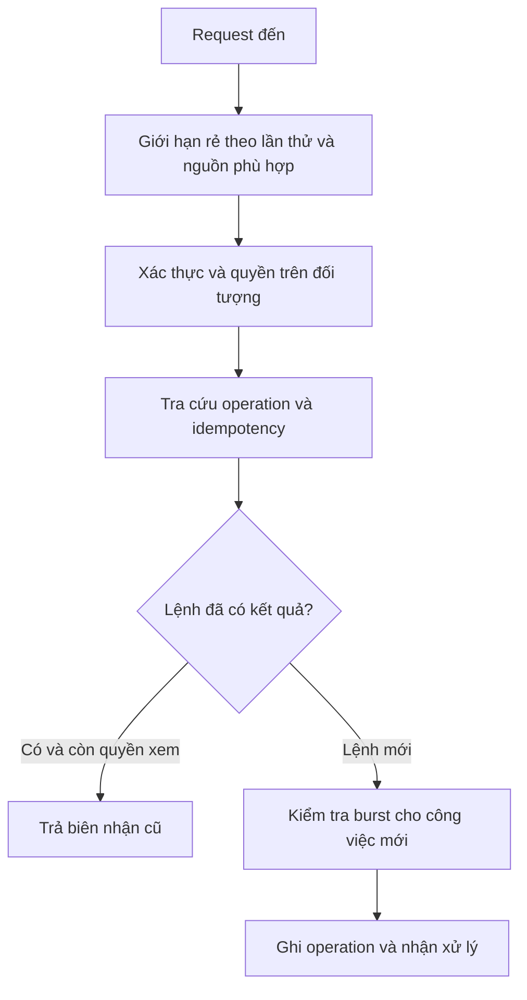

# Burst allowance: cho phép tăng tải ngắn mà không mở đường vượt chính sách

## 1. Burst allowance là ngân sách cho một đợt tăng tải

Trong chương **Rate Policies** của module **SECURITY_APPLICATION_SECURITY_BUSINESS_LOGIC_SECURITY**, bài học này xem xét cách cho phép các đợt tăng tải ngắn nhưng vẫn bảo vệ quy tắc nghiệp vụ. Trọng tâm là xác định đúng chủ thể, chi phí, thời gian và ranh giới nguyên tử khi quyết định chấp nhận một hành động.

Người dùng hợp lệ không luôn gửi yêu cầu đều nhau. Mở một dashboard có thể tạo nhiều request cùng lúc; một quy trình nhập dữ liệu có thể tạo một nhóm lệnh trong thời gian ngắn rồi nghỉ. Nếu chỉ cho phép đúng một request sau mỗi khoảng cố định, trải nghiệm có thể kém dù tải trung bình thấp.

**Burst allowance** là mức ngân sách tích lũy cho phép xử lý một lượng công việc dồn lại trong thời gian ngắn. Nó phải được giới hạn và được nạp lại theo quy tắc, không phải một ngoại lệ bỏ qua mọi kiểm tra khi hệ thống đang rảnh.

Ví dụ, chính sách cho phép tích lũy tối đa 20 token và nạp 5 token mỗi giây. Một hành động xuất báo cáo tốn 5 token có thể được chấp nhận bốn lần ngay khi bucket đầy, rồi cần chờ đủ token để tiếp tục.

Burst allowance không thay thế:

- Quyền trên đối tượng: đủ token không cho phép đọc dữ liệu tenant khác.
- Business invariants: đủ token không cho phép bỏ qua phê duyệt hoặc sửa giá.
- Quota tích lũy: đủ token không tạo thêm lượt dịch vụ của cả tháng.
- Giới hạn đồng thời: được nhận nhiều job không có nghĩa tất cả được chạy cùng lúc.

## 2. Mô hình token bucket và giới hạn được bảo đảm

Một token bucket có các tham số:

| Ký hiệu | Ý nghĩa |
| --- | --- |
| `B` | Dung lượng tối đa, biểu diễn mức burst có thể tích lũy |
| `r` | Tốc độ nạp token theo thời gian |
| `T` | Token hiện có |
| `t_last` | Mốc thời gian đã tính nạp gần nhất |
| `q` | Chi phí của một hành động do server xác định |

Tại thời điểm `now`:

```text
elapsed = max(0, now - t_last)
refilled = min(B, T + r × elapsed)

Nếu q <= refilled:
    chấp nhận theo rate policy
    T' = refilled - q
Ngược lại:
    từ chối hoặc chờ theo hợp đồng
    T' = refilled
```

Việc nạp và trừ phải nằm trong cùng quyết định nguyên tử. Các công thức là mô hình toán học; triển khai cần xử lý độ chính xác, tràn số và nguồn thời gian đáng tin.

### 2.1. Ví dụ có trọng số

Với `B = 20`, `r = 5 token/giây`, mỗi export tốn `q = 5`:

| Thời điểm | Hành động | Kết quả |
| --- | --- | --- |
| `t = 0`, bucket đầy | Bốn export lần lượt hoặc được tuần tự hóa đồng thời | Cả bốn được nhận, còn 0 token |
| Ngay sau đó | Export thứ năm | Chưa đủ token |
| `t = 0,2 giây` | Tính lại ngân sách | Có 1 token, vẫn chưa đủ cho export |
| `t = 1 giây`, nếu chưa có tiêu thụ khác | Export tiếp theo | Có 5 token, đủ nhận một export |

`B` là số token, không nhất thiết là số request. Nếu một request tốn 10 token, burst 20 token chỉ đủ cho hai request loại đó.

### 2.2. Burst không phải giới hạn cửa sổ trượt

Với bucket có dung lượng `B` và tốc độ `r`, tổng chi phí được nhận trong một khoảng dài `Δ` bị chặn trên bởi:

```text
accepted_cost(Δ) <= B + r × Δ
```

Đây là chặn trên theo mô hình token bucket và trạng thái ban đầu không vượt `B`. Nó không có nghĩa mọi cửa sổ một giây đều chỉ nhận tối đa `r` token: một bucket đầy có thể cung cấp burst cộng phần nạp trong khoảng đó.

Nếu sản phẩm yêu cầu không quá N hành động trong **mọi** cửa sổ trượt, cần thuật toán tương ứng hoặc thêm một giới hạn khác. Không gắn nhãn “N mỗi giây” lên token bucket rồi bỏ qua burst thực tế mà cấu hình cho phép.

## 3. Đặt invariants và khóa theo ý nghĩa nghiệp vụ

Các invariants cơ bản:

```text
0 <= tokens <= capacity
cost > 0 cho hành động có tính phí token
không chấp nhận nếu token khả dụng không đủ cost
mọi lệnh dùng chung ngân sách phải gặp cùng trạng thái có thẩm quyền
```

Ngoài ra, việc đổi token API, URL tương đương hoặc instance phục vụ không được tự tạo một burst mới nếu chính sách giới hạn cùng một chủ thể nghiệp vụ.

Ví dụ khóa bucket:

```text
(tenant_id, subject_scope, subject_id, action_group)
```

`action_group` có thể gom nhiều endpoint cùng tạo một loại hiệu ứng. Nếu cả API đồng bộ, API batch và worker đều khởi tạo export, chỉ dùng đường dẫn HTTP làm khóa có thể tạo ba ngân sách độc lập ngoài ý muốn.

### 3.1. Chọn đúng chiều giới hạn

| Chiều | Mục đích | Giới hạn khi dùng riêng |
| --- | --- | --- |
| IP hoặc mạng nguồn | Giảm tải và một số hành vi tự động | NAT dùng chung, proxy và phân tán nguồn có thể làm kết quả sai lệch |
| Người dùng | Giới hạn từng người | Nhiều người có thể cùng dùng ngân sách tenant |
| Tenant hoặc account | Giữ mức dùng chung của tổ chức | Có thể cần thêm giới hạn để một người không chiếm hết ngân sách |
| Đối tượng đích | Hạn chế lạm dụng một tài nguyên hoặc người nhận | Phải tránh để kẻ khác dễ gây khóa dịch vụ cho nạn nhân |
| Toàn dịch vụ | Bảo vệ năng lực tổng thể | Không thay thế kiểm soát công bằng giữa khách hàng |

Kết hợp các chiều theo nhu cầu, lấy ID từ ngữ cảnh xác thực và dữ liệu có thẩm quyền. Header IP chỉ đáng tin khi đi qua proxy được cấu hình và kiểm soát; client tự gửi một chuỗi `X-Forwarded-For` không được chọn bucket tùy ý.

Không tạo bucket mới chỉ vì actor có thêm API key. Nếu ngân sách thuộc account, các key của account đó vẫn phải chia sẻ ngân sách account, còn giới hạn riêng từng key là một lớp bổ sung.

## 4. Chi phí và quyền chọn policy phải do server quyết định

Một payload như sau không phải bằng chứng để hưởng burst lớn hơn:

```json
{
  "resourceId": "project-81",
  "cost": 0,
  "burstCapacity": 1000000,
  "isInternal": true,
  "plan": "ENTERPRISE"
}
```

Backend phải tự xác định tenant, quyền trên tài nguyên, nhóm hành động, chính sách gói và cost. Không lấy cờ `isInternal`, vai trò hoặc tên gói từ body làm căn cứ bỏ qua giới hạn.

Chi phí có thể là:

- Một đơn vị cho một thao tác nhẹ.
- Nhiều đơn vị cho hành động tốn tài nguyên hơn.
- Tổng chi phí các phần tử của batch theo quy tắc rõ ràng.
- Mức giữ trước hoặc chặn trên cho công việc có kích thước chưa biết hoàn toàn.

Một batch 100 hành động không nên mặc định tốn một token chỉ vì có một HTTP request. Nếu có giảm chi phí theo lô, đó phải là quy tắc sản phẩm được kiểm soát, không phải lỗ hổng do chỉ đếm lớp vận chuyển.

Kiểm tra số âm, số không, đơn vị, giới hạn miền và tràn số. Một phép tính `cost = count × unitCost` bị tràn có thể biến công việc lớn thành chi phí rất nhỏ hoặc âm.

Nếu `q > B` và cost không đổi, chờ cũng không làm request đủ điều kiện vì bucket không bao giờ vượt `B`. Cần trả kết quả có lý do phù hợp hoặc dùng một loại hành động được thiết kế khác; không đưa nó vào hàng đợi vô hạn.

## 5. Triển khai nạp token không mất độ chính xác

### 5.1. Giữ phần lẻ khi tính theo số nguyên

Dùng số nguyên theo đơn vị nhỏ giúp tránh sai số số thực, nhưng làm tròn sai có thể gây thiếu hoặc thừa token. Ví dụ, mỗi request chỉ cách nhau một khoảng rất nhỏ; nếu mỗi lần đều làm tròn refill về 0 rồi cập nhật mốc thời gian, bucket có thể không bao giờ nạp được token dù thời gian tổng đã đủ.

Một mô hình tính chính xác có thể lưu token theo đơn vị nhỏ và phần dư của phép nạp. Mã dưới là **mã giả**, với rate đo bằng đơn vị token nhỏ mỗi giây:

```text
elapsed_ns = max(0, trusted_now_ns - last_refill_ns)
numerator = elapsed_ns × refill_units_per_second + refill_remainder

added_units = floor(numerator / 1_000_000_000)
next_remainder = numerator mod 1_000_000_000
refilled_units = min(capacity_units, tokens_units + added_units)

Nếu refilled_units == capacity_units:
    next_remainder = 0  // Không tích lũy ngân sách vượt dung lượng.

Nếu cost_units <= refilled_units:
    next_tokens = refilled_units - cost_units
    decision = ALLOW
Ngược lại:
    next_tokens = refilled_units
    decision = DENY

Lưu next_tokens, next_remainder và max(last_refill_ns, trusted_now_ns)
trong cùng thao tác nguyên tử với quyết định.
```

Chọn tỷ lệ biểu diễn đủ chính xác cho rate được hỗ trợ. Phép nhân sau thời gian nghỉ rất dài phải tránh tràn: dùng kiểu đủ lớn, số học có kiểm tra hoặc rút gọn khi đã biết bucket chắc chắn bão hòa.

Khi đồng hồ lùi, không dùng elapsed âm và không lùi mốc đã ghi theo cách cho phép nạp hai lần. Việc chặn elapsed về 0 là một biện pháp phòng vệ; vẫn cần phát hiện và xử lý nguồn thời gian bất thường.

### 5.2. Quyết định phải nguyên tử

Không thực hiện ba bước đọc token, tính trên ứng dụng và ghi lại mà không có cơ chế đồng bộ. Hai request có thể cùng dùng token cuối cùng.

Có thể dùng transaction và khóa hàng, cập nhật có điều kiện với phiên bản hoặc một thao tác nguyên tử ở kho trạng thái có thẩm quyền. Phải kiểm chứng cả tính nguyên tử và khả năng ghi bền vững theo mức bảo đảm yêu cầu; một phép trừ nguyên tử chưa giải quyết việc trạng thái bị mất sau lỗi lưu trữ.

## 6. Gắn admission với idempotency và trạng thái nghiệp vụ

### 6.1. Tách ngân sách chống spam với ngân sách nhận công việc

Một hệ thống có thể dùng hai lớp:



Lớp theo lần thử vẫn có thể tính request gửi lại để bảo vệ hạ tầng. Lớp admission nghiệp vụ có thể chỉ tính khi nhận một operation mới. Nhờ đó retry hợp lệ không tạo thêm công việc, nhưng kẻ tấn công cũng không được gửi vô hạn một khóa idempotency để dùng miễn phí tài nguyên kiểm tra.

Cần nêu rõ policy đang tính request thử, công việc được nhận hay một loại hiệu ứng khác. Không yêu cầu mọi counter có cùng ngữ nghĩa.

### 6.2. Ví dụ transaction cục bộ

Đoạn sau là **mã giả Java** cho trường hợp bucket và operation có thể cùng tham gia một transaction:

```java
AdmissionReceipt admit(Actor actor, CreateExport command) {
    return transactions.required(() -> {
        var context = authorization.lockAndResolve(actor, command);
        var operation = operations.claimOrLock(
            context.tenantId(), command.businessOperationId());
        operation.requireSameFingerprint(fingerprint(command));
        if (operation.isAccepted()) {
            return operation.savedReceipt();
        }

        var policy = ratePolicies.resolveAuthoritative(context);
        var cost = policy.costFor(context);
        var buckets = rateBuckets.lockAllInStableOrder(
            policy.requiredBucketKeys(context));
        var now = decisionClock.trustedNow();
        var previews = buckets.refillAndPreview(policy, cost, now);

        if (!previews.allAllow()) {
            return operation.rateDenied(previews.retryAdvice());
        }

        buckets.applyAllDebits(previews);
        operation.markAccepted();
        audit.appendAdmissionAccepted(actor, operation, policy, cost);
        outbox.appendExportRequested(operation);
        return operation.completeReceipt();
    });
}
```

Các hợp đồng cần làm rõ:

- `claimOrLock` có ràng buộc duy nhất và xử lý các request cạnh tranh, không chỉ kiểm tra tồn tại rồi chèn.
- Tất cả bucket bắt buộc đều cho phép trước khi trừ admission token của chúng trong mô hình all-or-nothing này.
- Kết quả rate-denied là có thể thử lại; nó không được làm operation bị coi là đã được nhận hoặc bị khóa vĩnh viễn như một kết quả thành công.
- Nếu có lưu cập nhật refill khi từ chối, việc đó không được tự nhận operation hoặc tạo outbox công việc.
- Dữ liệu nghiệp vụ, debit, receipt, audit và outbox liên quan được commit hoặc rollback theo hợp đồng transaction.

Nếu policy tính lần thử ở một lớp, việc request bị chặn bởi lớp khác có thể vẫn tiêu thụ ngân sách lần thử. Đây là lựa chọn cần ghi rõ, khác với mô hình chỉ trừ khi nhận công việc mới trong ví dụ.

## 7. Phối hợp nhiều instance và nhiều bucket

### 7.1. Bucket cục bộ có thể nhân burst toàn hệ thống

Nếu mỗi instance tự tạo bucket đầy `B = 20` cho cùng tenant, năm instance có thể cho tenant burst tổng cộng 100 token. Sticky session chỉ che bớt vấn đề và không bảo đảm khi routing, scale hoặc failover thay đổi.

Các hướng thiết kế gồm:

- Dùng trạng thái có thẩm quyền được chia sẻ theo đúng khóa nghiệp vụ.
- Phân bổ độc quyền một phần ngân sách cho từng vùng hoặc instance bằng giao thức có kiểm soát.
- Chấp nhận giới hạn xấp xỉ nếu sản phẩm cho phép, đồng thời công bố mức sai lệch phù hợp.

Với ngân sách phân bổ trước, tổng capacity và tốc độ nạp được phân bổ phải nằm trong giới hạn tổng. Không được cấp lại phần ngân sách của instance cũ cho instance mới khi instance cũ vẫn có thể sử dụng nó.

### 7.2. Nhiều chiều cần quy tắc nhất quán

Một hành động có thể cần đồng thời đủ bucket người dùng, tenant và toàn dịch vụ. Chỉ khóa bucket người dùng không bảo vệ ngân sách tenant dùng chung.

Nếu yêu cầu tất cả cùng trừ hoặc không trừ, cần một ranh giới nguyên tử bao được các bucket đó. Không giả định hai thao tác nguyên tử ở hai shard tự trở thành một transaction chung.

Khi không thể bảo đảm nguyên tử xuyên các nguồn, phải chọn giao thức admission hoặc chấp nhận việc tiêu thụ bảo thủ theo thứ tự đã quy định. Không tự hoàn token vô điều kiện sau lỗi một bước, vì retry và các thao tác đồng thời có thể khiến hoàn trùng.

### 7.3. Cache policy khác cache ngân sách

Policy đọc nhiều có thể được cache với phiên bản và cách vô hiệu hóa phù hợp. Số token hiện có là trạng thái thay đổi theo từng admission; cache đọc cũ rồi cho phép độc lập có thể cấp quá mức.

Khởi động lại ứng dụng hoặc đổi instance không được reset trạng thái có thẩm quyền. Nếu trạng thái chỉ ở RAM, cần hiểu rõ giới hạn bảo đảm của mô hình đó thay vì tuyên bố burst được giữ cứng trên toàn dịch vụ.

## 8. TTL, khởi tạo và thay chính sách không được cấp burst miễn phí

### 8.1. Khởi tạo bucket là một quyết định có giới hạn

Một chính sách có thể cho bucket mới bắt đầu đầy. Khi đó phải ngăn việc xóa, đổi khóa hoặc tạo lại bucket liên tục để nhận nhiều lần capacity.

TTL chỉ nên xóa trạng thái khi việc tái tạo tương đương với trạng thái được phép theo thời gian đã trôi qua. Với bucket cố định, có nạp dương và không có trạng thái phụ khác, sau đủ thời gian rảnh để trở lại đầy, tái tạo đầy có thể phù hợp.

Không suy ra quy tắc đó cho bucket có nạp bằng 0, đang bị khóa, có khoản nợ hoặc policy đặc biệt. Cũng cần kiểm tra cơ chế eviction: mất trạng thái sớm vì áp lực bộ nhớ rồi mặc định đầy có thể mở burst ngoài chính sách.

Giới hạn việc tạo khóa tùy ý. Một request có thể gửi vô hạn tên tài nguyên hoặc danh tính chưa tồn tại để gây nổ số bucket nếu service tạo trạng thái trước khi xác thực hoặc chuẩn hóa phạm vi.

### 8.2. Đổi policy không phải đổi danh tính ngân sách

Nếu key chứa `policyVersion` và mỗi version luôn khởi tạo đầy, người dùng có thể nhận thêm burst mỗi lần đổi gói hoặc khi service cập nhật policy.

Giữ danh tính bucket theo chủ thể nghiệp vụ và có quy tắc migration. Ví dụ:

- Giảm capacity thì clamp lượng token theo capacity mới.
- Tăng capacity không tự tặng phần chênh lệch trừ khi policy cho phép.
- Đổi tốc độ nạp phải xác định thời điểm có hiệu lực.
- Không dùng tốc độ mới để tính lại toàn bộ quãng thời gian trước khi policy có hiệu lực nếu điều đó không đúng hợp đồng.

Có thể cần nạp theo policy cũ đến mốc chuyển rồi áp policy mới cho đoạn tiếp theo. Nếu cố ý tặng thêm token khi nâng gói, ghi một allocation hoặc thay đổi có nguồn và chống thực hiện lặp.

## 9. Burst, hàng đợi và giới hạn đồng thời

Burst lớn giúp nhận nhanh nhưng có thể đẩy tải sang hàng đợi hoặc tài nguyên downstream. Một hành động được admission không có nghĩa CPU, kết nối database hoặc dịch vụ bên ngoài đủ năng lực chạy ngay.

Nên phối hợp các giới hạn theo vai trò:

| Cơ chế | Điều cần kiểm soát |
| --- | --- |
| Burst/rate admission | Bao nhiêu chi phí công việc được nhận trong thời gian ngắn và dài hơn |
| Giới hạn đồng thời | Bao nhiêu công việc được thực thi cùng lúc |
| Hàng đợi có giới hạn | Bao nhiêu công việc chờ và chờ tối đa bao lâu |
| Quota dịch vụ | Tổng lượng được dùng theo kỳ hoặc ngân sách nghiệp vụ |

Chọn rõ token bị tính khi enqueue, khi bắt đầu chạy hay ở một mốc khác. Không trừ ở enqueue rồi worker tự trừ lần nữa cho cùng admission nếu policy chỉ tính một lần.

Không biến mọi request bị chặn thành một job chờ vô hạn. Cần giới hạn số lượng chờ, thời hạn, cơ chế hủy và chống enqueue trùng. Với `q > B`, chờ lâu hơn không giải quyết được nếu chính sách không thay đổi.

Burst đủ lớn cũng có thể làm một tenant chiếm toàn bộ hàng đợi dù giới hạn rate trung bình hợp lệ. Có thể cần phân bổ công bằng theo tenant và giới hạn backlog riêng, thay vì tăng capacity để che độ trễ.

## 10. Retry, phản hồi và lỗi của hệ thống giới hạn

### 10.1. Thời gian chờ chỉ là lời khuyên theo trạng thái hiện tại

Với `r > 0` và `q <= B`, thời gian tối thiểu để đủ token nếu không có tiêu thụ khác có thể tính theo:

```text
wait >= max(0, (q - refilled_tokens) / r)
```

Nếu phản hồi theo số giây nguyên, làm tròn lên phù hợp. Khi nhiều bucket cùng bắt buộc, cần xét bucket hạn chế nhất theo policy.

Đây không phải reservation cho client. Các request khác có thể dùng token trước lần retry. Client nên có backoff và jitter phù hợp, không coi mốc chờ là lời bảo đảm rằng một đợt retry đồng loạt sẽ đều thành công.

Với HTTP, có thể trả `429 Too Many Requests` cho trường hợp rate policy từ chối và cung cấp thông tin chờ thích hợp. Không trả thời gian hữu hạn giả khi cost luôn lớn hơn capacity hoặc policy không nạp lại.

Không tiết lộ chi tiết bucket của tenant khác hoặc nội bộ bảo mật trong thông báo. Đủ thông tin để client xử lý là mục tiêu, không cần xuất toàn bộ topology limiter.

### 10.2. Dịch vụ limiter timeout

Timeout có thể xảy ra sau khi token đã bị trừ. Nếu có receipt admission gắn operation ổn định ở nguồn có thẩm quyền, tra cứu hoặc retry theo cùng định danh để xác định kết quả.

Nếu limiter và database nghiệp vụ không chung transaction, có thể có token đã tiêu nhưng operation chưa được nhận. Mô hình tiêu thụ bảo thủ này cần được hiểu rõ; không tự tuyên bố đã nhận công việc khi chưa có bằng chứng nghiệp vụ.

Một permit dùng qua dịch vụ khác phải ràng buộc tenant, hành động, operation, cost, thời hạn và cơ chế chống dùng lại cho hiệu ứng mới. Permit không thay thế quyền hiện tại hoặc idempotency ở điểm tạo hiệu ứng.

### 10.3. Chính sách khi mất nguồn quyết định

Đối với thao tác dễ gây thiệt hại hoặc lạm dụng, có thể từ chối tạm hoặc đưa vào trạng thái chờ khi không chứng minh được admission. Với thao tác ít rủi ro, sản phẩm có thể chấp nhận cho qua có giới hạn trong một mô hình đã thiết kế.

Dù chọn cách nào, kiểm tra quyền, transaction, quota cứng và các invariant nghiệp vụ vẫn phải giữ. Mất limiter không phải lý do bỏ qua phê duyệt, cung cấp tài nguyên không giới hạn hoặc lấy ngẫu nhiên một cache allow cũ.

Không hoàn token tự động cho mọi lỗi client hoặc mọi job thất bại. Kẻ tấn công có thể cố ý làm công việc tốn tài nguyên rồi gây lỗi để được dùng miễn phí. Nếu có hoàn trả, cần lý do được phép, tham chiếu debit và thực hiện tối đa một lần theo policy.

## 11. Các cách lạm dụng burst thường gặp

| Cách thử lạm dụng | Lỗi thiết kế | Kiểm soát cần có |
| --- | --- | --- |
| Gửi đồng thời nhiều request với token cuối | Đọc rồi trừ không nguyên tử | Quyết định refill/debit nguyên tử |
| Đổi API key hoặc URL tương đương | Khóa theo token hoặc đường dẫn thay vì chủ thể/hành động | Bucket nghiệp vụ dùng chung |
| Chuyển instance hoặc vùng phục vụ | Mỗi nơi có bucket đầy riêng | Nguồn chung hoặc phân bổ ngân sách độc quyền |
| Giả IP qua header | Tin proxy header không kiểm soát | Biên proxy đáng tin và thêm chiều định danh phù hợp |
| Gửi batch lớn nhưng tính một token | Chỉ tính request HTTP | Chi phí theo công việc phía server |
| Gửi cost âm hoặc số gây tràn | Không kiểm tra miền và đơn vị | Số học có kiểm tra, cost có thẩm quyền |
| Đổi gói hoặc version để nhận bucket đầy | Mỗi policy tạo namespace mới | Migration trạng thái theo danh tính ổn định |
| Gây eviction rồi gửi lại | Mất state được coi là bucket mới đầy | TTL/eviction phù hợp và mô hình lỗi rõ ràng |
| Retry cùng operation để tạo thêm job | Admission không gắn idempotency | Operation ổn định và unique effect |
| Cố ý làm job lỗi để lấy lại token | Hoàn token vô điều kiện | Chính sách tính chi phí và hoàn trả chống trùng |
| Gửi nhiều request cực sát nhau làm refill bị mất phần lẻ | Làm tròn rồi cập nhật mốc sai | Giữ phần dư hoặc phép tính tương đương |

Chặn ở gateway nhưng để endpoint nội bộ hoặc công cụ batch tạo cùng hiệu ứng không qua policy vẫn tạo đường vòng. Điểm thực thi nghiệp vụ cần bảo đảm mọi đường được yêu cầu đều có admission hợp lệ theo cùng quy tắc.

## 12. Kiểm thử burst allowance

### 12.1. Kiểm thử toán học và thời gian

Dùng clock kiểm thử hoặc nguồn thời gian có thể điều khiển, không dựa vào `sleep` để chờ token nạp thật.

| Kịch bản | Điều cần xác nhận |
| --- | --- |
| Bucket đầy, tổng cost đúng B | Chấp nhận đúng ngân sách, token không âm |
| Request kế tiếp ngay sau cạn | Không được nhận nếu chưa đủ phần nạp |
| Đúng mốc đủ token | Đủ điều kiện admission nếu không có ràng buộc khác chặn |
| Cost lớn hơn capacity | Không đưa ra lời hứa chờ rồi chắc chắn được nhận |
| Nghỉ rất lâu | Token dừng ở capacity và không tràn số |
| Nhiều bước thời gian rất nhỏ | Tổng refill đúng, không mất phần lẻ sau mỗi lần |
| Đồng hồ lùi | Không tạo thêm token hoặc nạp hai lần cùng khoảng |
| Rate bằng 0 nếu được hỗ trợ | Không tự sinh refill hoặc tính thời gian chờ hữu hạn |
| Cost âm, sai đơn vị hoặc vượt miền | Không tăng ngân sách hoặc nhận công việc |

Có thể sinh chuỗi thời gian và cost rồi kiểm tra `0 <= tokens <= B` cùng chặn trên `accepted_cost(Δ) <= B + r × Δ` trong mô hình policy cố định. Không áp công thức đó nguyên trạng qua các lần tặng thêm token hoặc đổi policy mà không đưa các biến động đó vào mô hình.

### 12.2. Kiểm thử đồng thời

```text
Given:
    Bucket còn 5 token
    Hai operation mới khác nhau đều tốn 5 token
    Thời gian quyết định được giữ ở cùng mốc để không có refill bổ sung

When:
    Hai transaction hoặc thao tác nguyên tử cạnh tranh

Then:
    Chỉ một operation được admission
    Token còn 0
    Chỉ một outbox công việc mới được tạo theo mô hình transaction cục bộ
```

Dùng barrier hoặc điều phối vào điểm cạnh tranh. Kiểm tra trên kho trạng thái có ngữ nghĩa phù hợp môi trường triển khai; mock repository không chứng minh tính nguyên tử.

Các ca quan trọng khác:

- Cùng operation được retry đồng thời: một hiệu ứng nghiệp vụ và cách tính token đúng lớp policy đã chọn.
- Cùng khóa nhưng đổi payload: từ chối xung đột, không nhận lệnh khác.
- User bucket đủ nhưng tenant bucket thiếu: không nhận operation; debit các lớp tuân theo ngữ nghĩa đã quy định.
- Nhiều instance xử lý cùng tenant: không nhân capacity ngoài mô hình được cho phép.
- Gây lỗi sau debit nhưng trước outbox trong transaction chung: rollback cả debit và operation.
- Limiter đã debit nhưng mất phản hồi: phục hồi qua receipt hoặc hành vi bảo thủ đã thiết kế, không tạo trùng công việc.

### 12.3. Kiểm thử vòng đời và ranh giới quyền

- Đổi API key của cùng account không tạo thêm ngân sách account.
- Đổi route tương đương không né action group.
- Đổi policy không reset bucket đầy ngoài quy tắc migration.
- TTL hết hoặc eviction không cấp ngân sách sớm hơn policy cho phép.
- Người thuộc hai tenant không dùng token hay quyền của A để thao tác dữ liệu B.
- Người đã bị thu hồi quyền không dùng receipt admission cũ để tạo hiệu ứng mới hoặc tải dữ liệu ngoài quyền.
- Lỗi ở worker không tự hoàn token nhiều lần.
- Request đã được nhận không bị enqueue lặp khi outbox gửi lại.

Kiểm tra response cùng trạng thái bucket, operation, receipt, audit và hiệu ứng thực tế. Mã 429 không đủ chứng minh bị chặn nếu job đã được tạo trước đó.

## 13. Audit và theo dõi tác động của burst

Với admission nghiệp vụ quan trọng, audit có thể lưu tenant, subject, action group, operation, policy version, cost, kết quả và lý do. Các tham số capacity/rate hoặc snapshot phù hợp giúp giải thích quyết định theo chính sách lúc đó.

Không cần ghi mọi token bí mật, header xác thực hoặc payload dữ liệu vào log. Những lần thử lặp có thể dùng metrics và security events theo thiết kế; bằng chứng của thay đổi nghiệp vụ bắt buộc không nên bị bỏ ngẫu nhiên do lấy mẫu.

Theo dõi:

- Tỷ lệ được nhận và bị chặn theo tenant, action group và policy.
- Chi phí được nhận thay vì chỉ đếm request.
- Độ trễ và lỗi của nguồn limiter.
- Số lần khởi tạo lại bucket, eviction và migration policy.
- Backlog, thời gian chờ và số job đồng thời sau các đợt burst.
- Xung đột idempotency, permit sai phạm vi và hoàn token bất thường.

Một tenant thường xuyên dùng hết burst không tự chứng minh gian lận. Cần đối chiếu cost, quy trình hợp lệ và năng lực downstream. Ngược lại, rate trung bình thấp không chứng minh an toàn nếu một burst duy nhất đủ làm vượt giới hạn nghiệp vụ hoặc cạn tài nguyên đắt tiền.

Khi điều chỉnh policy, đánh giá cả capacity lẫn rate. Tăng B làm đợt dồn tải lớn hơn; tăng r làm mức tải bền vững cao hơn. Hai thay đổi có tác động khác nhau và đều cần được quan sát sau khi áp dụng.

## 14. Tự kiểm tra thiết kế

1. Burst đo request hay chi phí công việc, và B/r có cùng đơn vị không?
2. Khóa có bám đúng tenant, subject và hành động nghiệp vụ qua mọi endpoint không?
3. Refill và debit có nguyên tử, giữ phần lẻ và chống tràn số không?
4. Nhiều instance có đang vô tình nhận mỗi nơi một bucket đầy không?
5. Nhiều bucket bắt buộc được kết hợp theo ngữ nghĩa nào khi một bucket từ chối?
6. Retry có giữ một operation ổn định trong khi lớp chống spam vẫn bảo vệ từng lần thử không?
7. TTL, eviction, restart hoặc đổi policy có thể cấp burst miễn phí không?
8. Hàng đợi, giới hạn đồng thời và quota nghiệp vụ có được kiểm tra riêng không?
9. Khi timeout, có biết admission đã xảy ra chưa và có tránh tạo hiệu ứng trùng không?
10. Có kiểm thử được chặn trên ngân sách và các tình huống cạnh tranh trên nguồn trạng thái thực tế không?

Burst allowance an toàn tạo khoảng linh hoạt có giới hạn cho hành vi sử dụng hợp lệ. Khi danh tính ngân sách, chi phí, thời gian và quyết định admission được kiểm soát nhất quán, đợt tăng tải ngắn có thể được phục vụ mà không trở thành cách vượt quyền, nhân ngân sách hoặc tạo công việc trùng.
