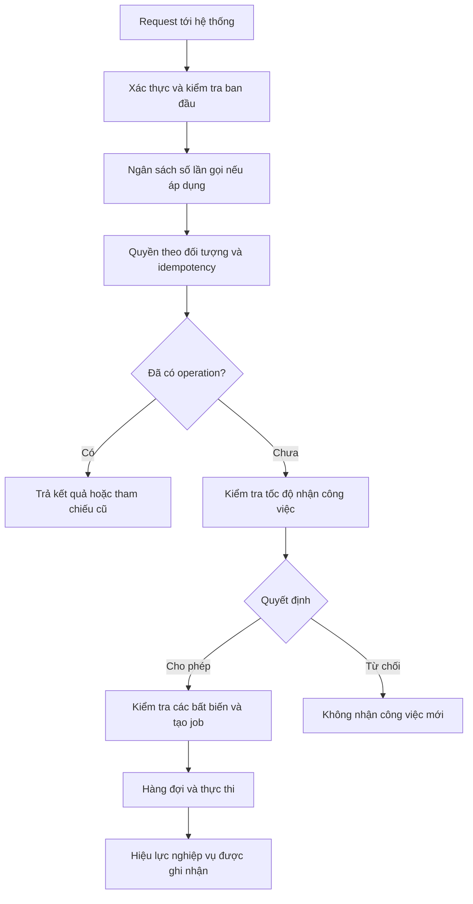

# Rate policy measurement — Đo lường và kiểm chứng chính sách tốc độ

## 1. Đo lường để chứng minh điều gì?

**Rate policy measurement** là quá trình thu thập, diễn giải và đối soát bằng chứng về cách chính sách tốc độ ra quyết định, được thực thi và ảnh hưởng đến nghiệp vụ.

Một dashboard có nhiều response `429` không tự chứng minh hệ thống được bảo vệ tốt. Những response đó có thể phản ánh lạm dụng bị chặn, client retry sai, account hợp lệ bị tính trùng, hoặc nhiều instance sử dụng trạng thái không nhất quán. Ngược lại, ít response `429` có thể là lưu lượng thấp, nhưng cũng có thể là một đường vào đã bỏ qua limiter.

Trong chương **Rate Policies** của module `SECURITY_APPLICATION_SECURITY_BUSINESS_LOGIC_SECURITY`, mục tiêu đo lường là kiểm chứng các bất biến nghiệp vụ: đúng chủ thể, đúng đơn vị công việc, đúng tốc độ, đúng số lần và đúng điểm thực thi. Việc đo phải hỗ trợ phát hiện bỏ qua kiểm tra quyền, vượt bước phê duyệt, xử lý trùng hoặc lách chính sách qua những đường vào khác nhau.

Rate limit không thay thế các bất biến khác. Một thao tác được chấp nhận trong ngân sách tốc độ vẫn phải đúng quyền theo đối tượng, trạng thái, giá và chính sách nghiệp vụ.

Sau bài học, bạn có thể:

- Xác định hợp đồng đo lường cho từng chính sách.
- Phân biệt request, quyết định rate limit, operation duy nhất và hiệu lực nghiệp vụ.
- Chọn counter, tổng chi phí, histogram và bằng chứng chi tiết phù hợp.
- Đánh giá đúng fixed window, sliding window và token bucket.
- Phát hiện cấp phép vượt, từ chối sai, đường bỏ qua và khoảng trống quan sát.
- Thiết kế kiểm thử và vòng cải tiến chính sách dựa trên bằng chứng.

## 2. Viết hợp đồng đo lường trước khi tạo dashboard

### 2.1. Mỗi chính sách phải có nghĩa rõ ràng

Một mô tả đo lường nên xác định:

| Thành phần | Câu hỏi cần trả lời | Ví dụ minh họa |
|---|---|---|
| Chủ thể | Ai chia sẻ ngân sách? | Account trong một tenant |
| Nhóm thao tác | Những đường vào nào cùng dùng giới hạn? | Tạo báo cáo từ API thường và API batch |
| Đơn vị | Đếm request hay đơn vị công việc? | Một trang được yêu cầu tạo |
| Mô hình | Giới hạn theo thuật toán nào? | Token bucket |
| Tham số | Burst, tốc độ hoặc cửa sổ là gì? | Capacity 10, refill 2 đơn vị/giây |
| Điểm kiểm tra | Kiểm soát tiếp nhận hay thực thi? | Trước khi nhận job mới |
| Điều kiện tính | Retry, lỗi và từ chối được tính thế nào? | Kết quả idempotency cũ không là job mới |
| Chế độ | Có thực thi chặn không? | `ENFORCE` hoặc `SHADOW` |
| Ngoại lệ | Ai được miễn và dựa trên căn cứ nào? | Ngoại lệ dịch vụ đã được cấp quyền |
| Phiên bản | Quy tắc nào áp dụng tại thời điểm quyết định? | Policy version 7 |

Không so sánh “50 lần/giây” giữa hai hệ thống nếu một bên đếm HTTP request còn bên kia đếm số phần tử trong batch. Cũng không gộp số liệu tiếp nhận và thực thi thành một tốc độ chung khi hàng đợi có thể làm lệch hai đại lượng.

### 2.2. Metric phải gắn với một câu hỏi kiểm chứng

Ví dụ, câu hỏi “đã chặn bao nhiêu request?” khác với:

- Một account có được cấp vượt ngân sách qua nhiều API key không?
- Một batch 100 phần tử có thực sự tốn 100 đơn vị theo chính sách không?
- Request bị từ chối có để lại job hoặc tác dụng phụ không?
- Retry có tạo operation hoặc khoản thu mới không?
- Chính sách mới có làm giảm công việc hợp lệ mà không giảm lạm dụng không?

Chọn metric từ câu hỏi cần trả lời. Một counter thuận tiện có sẵn không nên tự trở thành định nghĩa thành công của chính sách.

## 3. Phân biệt các giai đoạn và định danh

### 3.1. Một request có thể không tạo công việc mới



Sơ đồ là một luồng tham khảo, không quy định thứ tự duy nhất cho mọi sản phẩm. Điểm quan trọng là các phép đếm phải biết mình quan sát giai đoạn nào.

### 3.2. Các định danh phục vụ mục đích khác nhau

| Định danh | Ý nghĩa | Không nên nhầm với |
|---|---|---|
| `request_id` | Một lần gọi hoặc lần tiếp nhận cụ thể | Một lần mua hoặc một job duy nhất |
| `decision_id` | Một lần quyết định tại một rate gate | Toàn bộ chuỗi retry của nghiệp vụ |
| `operation_id` | Thao tác nghiệp vụ được nhận diện ổn định | Mọi request có payload giống nhau |
| `execution_attempt_id` | Một lần thử thực thi | Hiệu lực nghiệp vụ cuối cùng |
| `business_effect_id` | Hiệu lực được ghi nhận theo hợp đồng | Số lần worker đã gọi một hàm |
| `policy_id`, `policy_version` | Chính sách và phiên bản đã áp dụng | Danh tính account hoặc API key |

Một message bị giao hai lần có thể làm cùng `decision_id` xuất hiện hai lần trong kho quan sát. Khi tổng hợp journal sự kiện, cần cơ chế loại trùng phù hợp; không coi hai bản sao telemetry là hai admission.

Các mã này hữu ích để truy vết trong kho chi tiết, nhưng thường không phù hợp làm nhãn metric tổng hợp vì số lượng giá trị rất lớn.

### 3.3. Không mặc định các tổng phải bằng nhau

Số request có thể lớn hơn số operation vì retry. Số lần worker thử chạy có thể lớn hơn số hiệu lực vì phục hồi lỗi. Một admission được cho phép có thể không tạo job do điều kiện nghiệp vụ sau đó thất bại, tùy cách tổ chức đã chọn.

Vì vậy, phát hiện chênh lệch là điểm bắt đầu điều tra. Cần hợp đồng rõ để biết chênh lệch nào được phép, chênh lệch nào chứng minh sai lệch.

## 4. Từ vựng quyết định và các phép đếm nền tảng

### 4.1. Phân loại kết quả không chồng lấn

Ví dụ, mỗi lần đi vào một rate gate được phân vào đúng một kết quả:

```text
ALLOW:  chính sách cho phép tại gate này
DENY:   chính sách từ chối vì điều kiện tốc độ
ERROR:  không xác định được kết quả đáng tin hoặc có lỗi xử lý
EXEMPT: áp dụng ngoại lệ đã được cấp quyền và ghi nhận rõ
```

Trong cùng phạm vi, chế độ và khoảng quan sát:

```text
checks = allow + deny + error + exempt
```

Một request bị từ chối xác thực trước khi vào gate không nằm trong `checks` của gate đó. Một đường không áp dụng chính sách cũng không tự được tính là `EXEMPT`; ngoại lệ cần có căn cứ, còn việc không đi qua gate thuộc phép đo độ bao phủ.

`ERROR` không đồng nghĩa chắc chắn chưa tiêu token. Nếu nguồn trạng thái đã cập nhật nhưng response bị mất, kết quả có thể chưa rõ. Bằng chứng chi tiết nên phân biệt trạng thái như `APPLIED`, `NOT_APPLIED` hoặc `UNKNOWN` khi cần phục hồi.

### 4.2. Tách chế độ thực thi và chế độ quan sát

Ở chế độ `SHADOW`, limiter có thể tính rằng đáng lẽ phải từ chối nhưng không thực sự chặn. Ghi `would_deny` hoặc trường tương đương riêng theo chế độ; không cộng vào số request đã bị chặn thật.

Tương tự, một response `429` từ gateway khác không chứng minh rate gate đang xét đã trả `DENY`. Cần phân biệt nguồn quyết định và kết quả HTTP cuối cùng.

### 4.3. Đếm số lần và cộng chi phí

Các metric minh họa:

```text
rate_checks_total
rate_requested_cost_total
rate_admitted_cost_total
rate_denied_cost_total
rate_decision_duration_seconds
rate_state_error_total
rate_fallback_total
```

Đây là tên khái niệm, không phải yêu cầu dùng một thư viện hoặc nền tảng cụ thể. `requested_cost` chỉ cộng khi đã xác định được chi phí hợp lệ; request sai cấu trúc cần nhóm đo riêng, không bịa chi phí rồi đưa vào tổng.

Counter phải dùng cùng đơn vị chính sách. “10 request được nhận” có thể tương ứng 10 hoặc 1.000 đơn vị công việc, tùy batch và trọng số.

### 4.4. Đo độ bao phủ bằng nguồn đối chiếu phù hợp

Một định nghĩa có thể là:

```text
coverage = số thao tác tại ranh giới bắt buộc có quyết định hợp lệ
           / tổng thao tác tại ranh giới đó bắt buộc phải kiểm tra
```

Mẫu số cần dựa trên nguồn đủ độc lập và đáng tin, chẳng hạn tập operation được chấp nhận kèm quy tắc đường vào. Chỉ lấy tổng event limiter phát ra để chứng minh “mọi thao tác đều qua limiter” sẽ bỏ sót chính các thao tác không phát event.

Kết quả idempotency cũ có thể không cần quyết định admission mới. Không coi mọi retry thiếu quyết định tạo việc mới là lỗ hổng; phải xét đúng ranh giới được quy định.

## 5. Thu thập bằng chứng tại điểm quyết định

### 5.1. Sự kiện đo lường có cấu trúc

Một sự kiện minh họa cho token bucket:

```json
{
  "decisionId": "decision-812",
  "operationId": "operation-420",
  "accountRef": "account-ref-A",
  "policyId": "REPORT_CREATE",
  "policyVersion": 7,
  "mode": "ENFORCE",
  "stage": "WORK_ADMISSION",
  "decision": "ALLOW",
  "costUnit": "REPORT_UNIT",
  "cost": 4,
  "capacity": 10,
  "refillRatePerSecond": 2,
  "availableAfterRefill": 6,
  "availableAfterDecision": 2,
  "bucketVersionBefore": 37,
  "bucketVersionAfter": 38,
  "stateResult": "APPLIED"
}
```

Các số cho thấy request lấy 4 trong 6 token vừa được xác định khả dụng. Muốn kiểm chứng quá trình refill còn cần bằng chứng thời gian, trạng thái trước và semantics của nguồn có thẩm quyền.

Không phải mọi event đều cần lưu tất cả các trường trên. Mức chi tiết phụ thuộc yêu cầu kiểm toán và chi phí vận hành, nhưng các phép đo phải đủ để trả lời câu hỏi đã chọn.

### 5.2. Lấy số từ cùng quyết định nguyên tử

Nếu limiter cập nhật bucket rồi bộ đo đọc bucket một lần nữa, request khác có thể đã thay đổi trạng thái. Giá trị đọc sau đó không chắc là `availableAfterDecision` của request ban đầu.

Các giá trị trước/sau phục vụ kiểm chứng nên được trả hoặc ghi từ cùng điểm phân xử có thẩm quyền. Thứ tự log đến hệ thống quan sát không tự là thứ tự cập nhật bucket; phiên bản trạng thái hoặc cơ chế thứ tự đáng tin cậy sẽ hữu ích khi replay.

Thông tin account, cost và phiên bản chính sách phải đến từ dữ liệu đã xác minh. Header `cost`, nhãn tenant hoặc timestamp do client tự khai không được trở thành sự thật chỉ vì đã được ghi vào log.

### 5.3. Metric, log và audit journal có bảo đảm khác nhau

- Metric tổng hợp phù hợp để xem xu hướng, tỷ lệ và phân phối.
- Trace giúp nối các giai đoạn của một luồng, nhưng có thể bị sampling.
- Log có cấu trúc hỗ trợ điều tra chi tiết, nhưng có thể mất hoặc trùng.
- Journal được thiết kế bền vững có thể phục vụ đối soát đầy đủ hơn nếu có cơ chế ghi phù hợp.

Một tiến trình có thể cập nhật bucket rồi chết trước khi gửi telemetry. Không được coi việc không thấy metric là bằng chứng không có admission.

Nếu yêu cầu bằng chứng đầy đủ, phải thiết kế cơ chế ghi hoặc phát bền vững gắn với điểm quyết định, chẳng hạn journal hoặc outbox ở nơi lưu hỗ trợ. Không giả định log ra console tự có tính nguyên tử với transaction hay với một bộ đếm ở hệ thống khác.

Lỗi hệ thống quan sát cũng không được âm thầm vô hiệu hóa rate limit. Cần xử lý khoảng trống bằng chứng và hành vi vận hành theo thiết kế, thay vì tự cho phép mọi request khi metric lỗi.

## 6. Kiểm chứng đúng theo mô hình chính sách

### 6.1. Fixed window: kiểm tra đúng ranh giới cửa sổ

Với cửa sổ cố định cho tối đa 100 đơn vị mỗi phút lịch, cần cộng chi phí được nhận theo đúng khóa chủ thể và cửa sổ máy chủ xác định.

100 đơn vị sát cuối phút và 100 đơn vị đầu phút sau có thể hợp lệ với mô hình đó. Không dùng cửa sổ trượt 60 giây trên dashboard rồi kết luận fixed window đã sai, nếu chính sách thực tế không hứa giới hạn trong mọi khoảng 60 giây.

Tuy nhiên, nếu sản phẩm cần chặn burst qua ranh giới, phép đo có thể chứng minh mô hình đang chọn không đáp ứng mục tiêu. Khi đó vấn đề là chính sách hoặc thiết kế, không chỉ là lỗi counter.

### 6.2. Sliding window: chốt độ chính xác

Với sliding window chính xác, kiểm tra tổng chi phí của các admission trong khoảng áp dụng. Nếu thuật toán dùng xấp xỉ, phép đánh giá phải xét sai số mà hệ thống thực sự bảo đảm.

Dữ liệu trace đã sampling không đủ để chứng minh một giới hạn cứng chưa bao giờ bị vượt. Nó chỉ phản ánh phần lưu lượng được giữ lại theo cơ chế quan sát đó.

### 6.3. Token bucket: tính cả burst

Với capacity `B`, refill không đổi `r` và khoảng dài `dt`, một cận trên tổng quát cho lượng được nhận là:

```text
admitted_cost trong khoảng <= B + r × dt
```

Cận này giả định cùng bucket logic, trạng thái được bảo toàn và không có thay đổi chính sách hoặc cấp bổ sung ngoài mô hình. Nếu biết token đầu khoảng, có thể dùng cận phù hợp chặt hơn; để kiểm tra từng quyết định còn cần xét trạng thái refill và giới hạn capacity dọc lịch sử.

Ví dụ `B = 100`, `r = 10 đơn vị/giây`: một đợt 100 đơn vị gần như ngay lập tức có thể hợp lệ khi bucket đầy. Chỉ thấy tốc độ ngắn hạn lớn hơn 10 rồi báo vượt là sai ý nghĩa burst.

Ngược lại, trung bình theo giờ thấp không chứng minh mọi đợt ngắn đều đúng. Dashboard quá thô có thể che việc nhiều instance cùng cấp burst riêng cho một account.

### 6.4. Replay cần đủ bằng chứng

Để kiểm tra từng bước, cần trạng thái mở đầu hoặc checkpoint đã xác minh, chi phí, thứ tự quyết định, nguồn thời gian và phiên bản chính sách áp dụng. Khi cấu hình thay đổi giữa khoảng, phải áp dụng đúng mốc hiệu lực, không lấy tham số hiện tại gán ngược cho toàn bộ lịch sử.

Không dùng timestamp nhận log để refill nếu limiter dùng thời gian nguồn khác. Khi thiếu event, checkpoint hoặc thứ tự đáng tin, kết quả có thể là chưa đủ bằng chứng, thay vì khẳng định chắc chắn có hoặc không có vi phạm.

## 7. Tỷ lệ, phân phối và cách đọc số liệu

### 7.1. Tỷ lệ từ chối phải có mẫu số rõ

Trong chế độ thực thi, một tỷ lệ thường dùng là:

```text
denial_ratio = deny / (allow + deny)
```

Nó không bao gồm `ERROR` và `EXEMPT`, nên cần báo thêm hai nhóm đó. Nếu đưa lỗi vào deny, bạn có thể tưởng chính sách đang chặn lạm dụng trong khi nguồn trạng thái thực chất đang mất kết nối.

Tỷ lệ theo chi phí là một đại lượng khác:

```text
weighted_denial_ratio
  = denied_cost / (admitted_cost + denied_cost)
```

Chỉ dùng công thức khi hai tổng có cùng đơn vị và phạm vi. Mẫu số bằng 0 cần được thể hiện là không có dữ liệu phù hợp, không tự biến thành tỷ lệ thành công 100%.

### 7.2. Ví dụ số học

Một gate số lần gọi trong khoảng đo có:

```text
ALLOW  = 8.000
DENY   = 1.800
ERROR  =   100
EXEMPT =   100
Tổng checks = 10.000

Admitted cost = 24.000 đơn vị
Denied cost   = 12.000 đơn vị
```

Khi đó tỷ lệ từ chối trong các quyết định xác định allow/deny khoảng 18,37%; tỷ lệ lỗi trên mọi check là 1%; tỷ lệ ngoại lệ là 1%. Tỷ lệ từ chối theo chi phí khoảng 33,33%.

Nếu chỉ báo “18,37% request bị giới hạn”, người đọc có thể bỏ sót việc nhóm bị từ chối chiếm tỷ trọng công việc lớn hơn số lượng request. Vẫn chưa thể kết luận các quyết định đó đúng hay sai khi chưa kiểm chứng chính sách.

Trong 8.000 lần được gate số lần gọi cho qua, có thể 1.200 lần chỉ trả kết quả idempotency cũ, 600 lần bị từ chối ở điều kiện nghiệp vụ sau đó và 6.200 lần tạo job mới. Không bắt buộc số allow ở gate này bằng số job.

### 7.3. Độ trễ và ảnh hưởng tài nguyên

Đo phân phối thời gian quyết định, số lần gọi nguồn trạng thái, lỗi, timeout, hàng đợi và lượng tài nguyên phía sau. Một limiter bảo vệ đúng ngân sách nhưng thêm độ trễ lớn vẫn có thể làm giảm khả năng hoàn thành nghiệp vụ hợp lệ.

Histogram giúp tổng hợp phân phối khi cấu hình và đơn vị phù hợp. Không lấy trung bình các giá trị p95 của từng instance rồi gọi đó là p95 toàn hệ thống; các percentile không được gộp theo cách đó.

Counter tích lũy cần được diễn giải theo khoảng thời gian và xử lý việc tiến trình khởi động lại. So trực tiếp hai tổng không cùng thời gian sống có thể tạo ra kết luận sai về mức tăng hoặc giảm lưu lượng.
