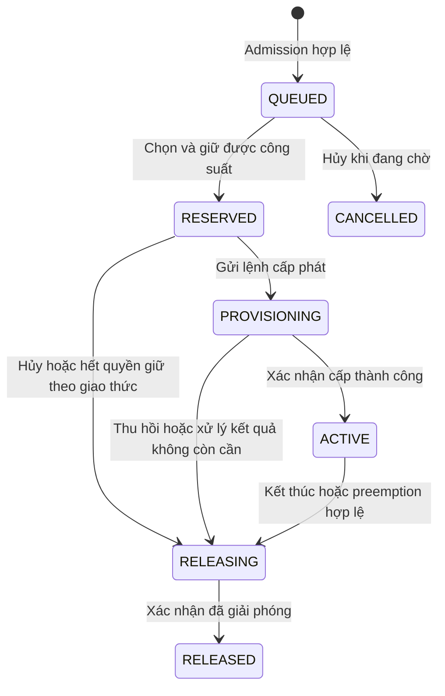

# Allocation priority: bảo vệ thứ tự ưu tiên khi cấp phát tài nguyên

## 1. Ưu tiên cấp phát cũng là một quy tắc bảo mật

Trong chương **Resource Allocation** của module **SECURITY_APPLICATION_SECURITY_BUSINESS_LOGIC_SECURITY**, bài học này xem xét cách quyết định yêu cầu nào được cấp tài nguyên trước khi công suất có giới hạn. Mục tiêu là ngăn giả mạo mức ưu tiên, chiếm phần tài nguyên của tenant khác, gây đói tài nguyên hoặc dùng đường ưu tiên để bỏ qua điều kiện nghiệp vụ.

Tài nguyên có thể là worker slot, máy ảo, kết nối, thiết bị dùng chung hoặc năng lực xử lý theo lô. Khi tất cả đều còn trống, thứ tự có vẻ không quan trọng. Khi nhiều yêu cầu cạnh tranh, một trường `priority` có thể quyết định ai được phục vụ và ai phải chờ.

Ví dụ, pool chỉ còn một slot. Tenant A có yêu cầu thông thường đang chờ; tenant B có tác vụ khôi phục đã được hệ thống xác nhận là khẩn cấp. Nếu người dùng A tự gửi `priority = 999`, backend không được coi con số đó là căn cứ vượt lên trước B.

Đây là lạm dụng logic nghiệp vụ dù JSON hợp lệ và người gọi có tài khoản thật. Lỗi nằm ở việc hệ thống cho một bên tự chọn thứ tự phục vụ hoặc tự nhận quyền mà họ không có.

Một thiết kế an toàn phải đồng thời giữ:

- **Điều kiện được cấp**: đúng quyền, entitlement, quota và loại tài nguyên.
- **Thứ tự phục vụ**: ưu tiên được tính từ nguồn đáng tin và chính sách rõ ràng.
- **Tính công bằng**: không dễ né bằng cách chia nhỏ yêu cầu hoặc đổi danh tính kỹ thuật.
- **Tính đúng đắn khi cạnh tranh**: một phần công suất không bị cấp cho nhiều yêu cầu trái quy tắc.

## 2. Tách các quyết định trong vòng đời cấp phát

| Giai đoạn | Câu hỏi cần trả lời | Ưu tiên có tác dụng gì? |
| --- | --- | --- |
| Admission | Yêu cầu có được vào hệ thống không? | Có thể ảnh hưởng chính sách nhận, nhưng không thay quyền truy cập |
| Scheduling | Yêu cầu hợp lệ nào được xem xét trước? | Đây là vai trò chính của thứ tự ưu tiên |
| Reservation | Có giữ được tài nguyên cho yêu cầu đã chọn không? | Không làm xuất hiện công suất còn thiếu |
| Provisioning | Việc cấp thực tế đã hoàn tất chưa? | Không thay thế xác nhận từ nguồn tài nguyên |
| Preemption | Có được thu hồi tài nguyên đang dùng để phục vụ việc khác không? | Cần chính sách và quyền riêng |
| Release | Khi nào tài nguyên thực sự trở lại khả dụng? | Không được trả sớm chỉ để phục vụ yêu cầu ưu tiên hơn |

Một trạng thái minh họa:



Sơ đồ chưa liệt kê mọi nhánh lỗi. Kết quả chưa xác định khi gọi hệ thống ngoài cần trạng thái phục hồi phù hợp; timeout không đủ để kết luận chưa cấp gì.

Ưu tiên cao không cho phép bỏ qua các bước `RESERVED`, xác nhận provisioning hay giải phóng an toàn. Một yêu cầu khẩn cấp vẫn có thể phải chờ nếu không có tài nguyên tương thích và không có quyền thu hồi tài nguyên đang dùng.

## 3. Mô hình dữ liệu và invariants

Một request cấp phát có thể chứa:

```text
request_id, business_operation_id
tenant_id, owner_id, requested_by
resource_kind, resource_requirements, target_pool_id
state, version
first_eligible_at, enqueue_sequence
derived_priority_class, priority_policy_version
priority_basis_ref, priority_valid_until
reservation_id, allocation_id
```

`requested_by` là dấu vết người khởi tạo; `tenant_id` và owner xác định phạm vi nghiệp vụ. Quyền thực thi lâu dài có thể thuộc tenant hoặc phụ thuộc người khởi tạo theo chính sách sản phẩm. Không tự suy ra rằng job luôn hợp lệ mãi hoặc luôn phải hủy ngay khi người tạo rời tổ chức.

Các invariants cần giữ:

| Mã | Điều kiện |
| --- | --- |
| R1 | Chỉ yêu cầu đủ điều kiện mới được tham gia lựa chọn cấp phát |
| R2 | Mức ưu tiên hiệu lực được xác định phía server, có căn cứ và thời hạn nếu cần |
| R3 | Ưu tiên không vượt quyền đối tượng, tenant, quota hoặc tính tương thích tài nguyên |
| R4 | Mọi yêu cầu cạnh tranh cùng công suất dùng chung một nguồn hạch toán có thẩm quyền |
| R5 | Chọn yêu cầu và giữ công suất không để hai scheduler cấp trùng cùng phần tài nguyên |
| R6 | Retry không tạo thêm request, reservation hoặc allocation ngoài quy tắc |
| R7 | Thay đổi ưu tiên, hủy và cấp phát cạnh tranh có kết quả theo state machine và phiên bản |
| R8 | Preemption chỉ làm công suất khả dụng lại khi việc thu hồi thực tế đã đáp ứng giao thức |
| R9 | Chính sách công bằng được tính theo chủ thể nghiệp vụ và chi phí phù hợp, không chỉ số request |

Với tài nguyên chia sẻ dạng cộng được, cho từng chiều tài nguyên `d`:

```text
reserved[d] >= 0
allocated[d] >= 0
reserved[d] + allocated[d] <= capacity[d]
```

Nếu cho phép overcommit, phải biểu diễn và kiểm soát nó bằng quy tắc riêng. Không dùng ưu tiên cao như một cờ ngầm bỏ qua invariant công suất.

## 4. Tính ưu tiên từ nguồn có thẩm quyền

### 4.1. Phân biệt mong muốn của người dùng với mức được cấp

Người dùng có thể gửi mức độ cần gấp hoặc deadline như một phần đề nghị. Backend phải xác minh và chuyển đề nghị đó thành mức hiệu lực theo chính sách.

Các dữ liệu sau không tự tạo quyền ưu tiên:

```json
{
  "poolId": "shared-pool",
  "priority": 999,
  "emergency": true,
  "plan": "PREMIUM",
  "skipQuota": true,
  "createdAt": "2000-01-01T00:00:00Z"
}
```

Nguồn hợp lệ có thể là hợp đồng hoặc entitlement đã được xác nhận, loại tác vụ phía server, sự cố được phê duyệt, hoặc quyền điều hành có phạm vi rõ ràng. Deadline tự khai không nên biến mọi yêu cầu thành khẩn cấp.

### 4.2. Ví dụ phân lớp

| Lớp | Căn cứ minh họa | Giới hạn cần có |
| --- | --- | --- |
| Khôi phục khẩn cấp | Sự cố hợp lệ và actor có quyền kích hoạt | Phạm vi, thời hạn, loại công việc và audit |
| Dịch vụ có cam kết ưu tiên | Entitlement hoặc hợp đồng hiện hành | Không vượt quota và quyền trên tài nguyên |
| Thông thường | Yêu cầu tiêu chuẩn đã admission | Hàng đợi, công bằng và giới hạn backlog |
| Xử lý nền | Công việc có thể trì hoãn theo sản phẩm | Quy tắc tiến triển hoặc lịch phục vụ rõ ràng |

Tên và số lớp là lựa chọn của sản phẩm. Cần tránh một cờ `isAdmin` tổng quát tự cho phép vừa sửa priority, vừa tăng capacity, vừa thu hồi tài nguyên của khách hàng.

Một ngoại lệ khẩn cấp nên có `priority_basis_ref`, người thực hiện thực tế, lý do và `valid_until`. Khi căn cứ hết hiệu lực, yêu cầu đang chờ phải được đánh giá lại, không giữ mãi mức ưu tiên đã được cấp tạm thời.

### 4.3. Quyền đổi ưu tiên cũng cần theo đối tượng

Người quản trị project A không tự được đổi ưu tiên cho request thuộc project B hoặc tenant khác. Một endpoint hỗ trợ nội bộ cũng phải xác định actor thực tế, quyền can thiệp và phạm vi được phép.

Không nhận toàn bộ entity request rồi ánh xạ hàng loạt. DTO đổi ưu tiên chỉ nên biểu diễn đề nghị được phép, còn trạng thái, owner, pool và căn cứ ưu tiên được kiểm soát bằng lệnh nghiệp vụ riêng.

## 5. Chọn thuật toán phù hợp với cam kết công bằng

### 5.1. Ưu tiên tuyệt đối có thể gây starvation

Nếu luôn chọn lớp cao nhất và tải lớp cao không ngừng, lớp thấp có thể chờ vô hạn. Đây là hệ quả của chính sách, không chỉ là lỗi triển khai.

Không thể vừa cam kết mọi yêu cầu ưu tiên cao luôn được phục vụ trước, vừa bảo đảm lớp thấp luôn tiến triển dưới tải cao không bị chặn trên, nếu chỉ có một lượng tài nguyên hữu hạn.

Cần chọn rõ sản phẩm chấp nhận ưu tiên tuyệt đối ở đâu và bảo vệ tiến triển ở đâu, chẳng hạn dành một phần công suất, dùng các vòng phục vụ có trọng số hoặc giới hạn ngân sách của lớp ưu tiên cao.

### 5.2. Aging cần đúng phạm vi

Aging tăng cơ hội được chọn theo thời gian chờ hợp lệ. Nhưng nếu thứ tự so sánh là:

```text
priority_class trước
→ waiting_score sau
→ enqueue_sequence để phá hòa
```

thì aging chỉ giúp trong cùng lớp; nó không tự ngăn starvation giữa các lớp. Muốn cho phép thăng lớp nhờ chờ lâu, phải quy định trần, điều kiện và các lớp không được vượt.

Thời gian chờ cần lấy từ mốc server ghi nhận như `first_eligible_at`, không phải thời gian client tự khai. Cũng cần quyết định thời gian tạm dừng vì thiếu điều kiện có được tính hay không.

### 5.3. Công bằng theo tenant thay vì theo số dòng request

Nếu mỗi request được một phần bằng nhau, tenant tạo 1.000 request có thể chiếm gần hết lượt so với tenant chỉ tạo 10 request. Tạo nhiều API key, user hoặc project không nên nhân phần dịch vụ của cùng tenant khi chính sách giới hạn theo tenant.

Một thiết kế có thể chọn tenant theo trọng số trước, rồi chọn request trong tenant theo lớp và thứ tự chờ. Khi công việc khác kích thước hoặc thời lượng, nên xét chi phí tài nguyên tương ứng thay vì chỉ đếm số request đã chọn.

Không có một đơn vị công bằng đúng cho mọi tài nguyên: slot đồng nhất, CPU-thời gian và thiết bị độc quyền có cách hạch toán khác nhau. Cần ghi rõ đơn vị để tránh “công bằng theo lượt” nhưng một bên nhận toàn công việc rất lớn.

## 6. Ví dụ chia phần và lựa chọn có giải thích

Giả sử pool có 10 slot đồng nhất. Sản phẩm dành riêng 2 slot cho khôi phục khẩn cấp và chia 8 slot còn lại theo cơ chế phục vụ có trọng số giữa các tenant.

Trong mô hình đơn giản này, slot khẩn cấp không cho công việc thường mượn. Nhờ vậy tránh lời hứa thu hồi tức thời một slot đã được cho một job không thể ngắt mượn trước đó.

Nếu cho phép mượn phần dự phòng, phải thêm điều kiện thu hồi, thời gian trễ và loại công việc được mượn. Không thể chỉ đánh dấu `borrowed = true` rồi coi tài nguyên đã có thể lấy lại ngay.

Với phần dùng chung, trọng số A:B bằng 3:1 thể hiện tỷ lệ phục vụ mục tiêu khi cả hai cùng có backlog hợp lệ và điều kiện tài nguyên tương đương. Nó không có nghĩa mọi thời điểm luôn đúng 6 slot cho A và 2 slot cho B, nhất là khi các job có thời lượng khác nhau.

Một quyết định nên giải thích được:

```text
Đã chọn request Q17:
    thuộc tenant B đang đến lượt theo trạng thái công bằng
    là request hợp lệ đứng đầu trong nhóm được xét của B
    lớp ưu tiên còn hiệu lực
    yêu cầu một slot tương thích
    quota của B còn đủ
    đã giữ được slot dưới giao thức cấp phát hiện tại
```

Đồng thời phải phân biệt “đứng trước nhưng chưa đủ điều kiện” với “bị chọn sau do chính sách”. Một request đòi 8 slot không thể được cấp chỉ vì ưu tiên cao khi pool chỉ còn 2 slot tương thích.

Cho công việc nhỏ chạy vượt qua công việc lớn đang chờ có thể tăng tận dụng nhưng cũng làm công việc lớn đói tài nguyên. Backfill cần quy tắc, chẳng hạn không phá cam kết giữ trước của công việc lớn hoặc có giới hạn vượt lượt; không để thuật toán tự bỏ qua vô hạn mà không quan sát.

## 7. Chọn và giữ tài nguyên trong ranh giới nhất quán

### 7.1. Hai scheduler có thể chọn cùng người thắng

Nếu scheduler đọc hàng đợi rồi gọi hệ thống cấp phát trước khi giữ công suất bền vững, hai instance có thể cùng chọn một request hoặc cùng dùng slot cuối.

Cần bảo vệ cả trạng thái request lẫn nguồn công suất chung. Khóa riêng request ngăn cấp trùng request đó nhưng chưa ngăn hai request khác nhau cùng tiêu thụ slot cuối.

### 7.2. Mã giả Java

Đoạn sau là **mã giả**, mô tả các hợp đồng cần có; các hàm không phải API thư viện cụ thể:

```java
AllocationResult allocateNext(PoolId poolId) {
    return transactions.required(() -> {
        // Phối hợp chọn thứ tự, đổi ưu tiên và trạng thái công bằng của pool.
        var scope = scheduling.lockDecisionScope(poolId);
        var snapshot = queue.loadEligibleSnapshot(scope);
        var candidate = scheduler.select(snapshot, scope.fairnessState());
        if (candidate == null) {
            return AllocationResult.noEligibleCandidate();
        }

        // Cùng thứ tự khóa với các đường cấp, hủy và giải phóng có giao nhau.
        var budgets = allocationBudgets.lockInStableOrder(candidate);
        var request = requests.lock(candidate.requestId());
        request.requireState(QUEUED);
        request.requireVersion(candidate.expectedVersion());

        var context = eligibility.revalidateCurrent(request, scope);
        priority.requireStillValid(request, context);
        var plan = placement.buildCompatiblePlan(request, budgets);
        budgets.reserveOrThrow(plan);

        var reservation = reservations.insertUnique(request, plan);
        request.markReservedAndIncrementVersion(reservation.id());
        fairness.recordReservation(scope, request, plan);
        audit.appendAllocationSelected(request, reservation, context);
        outbox.appendProvisioningRequested(request, reservation);
        return AllocationResult.reserved(reservation.id());
    });
}
```

Các điều kiện triển khai:

- Phạm vi khóa scheduling phải được định nghĩa. Nếu yêu cầu thứ tự nghiêm ngặt với thay đổi hàng đợi, các đường enqueue, đổi priority và hủy liên quan phải phối hợp cùng cơ chế đó.
- “Ưu tiên cao nhất” cần gắn với tập ứng viên và điểm quyết định cụ thể. Không hứa xét mọi request xuất hiện ở bất kỳ nơi nào trước lúc mạng nhận phản hồi.
- Các nguồn quota và capacity dùng chung phải được bảo vệ theo thứ tự khóa thống nhất. Một khóa pool không tự bảo vệ quota tenant được dùng ở nhiều pool khác nhau.
- `revalidateCurrent` kiểm tra quyền còn cần thiết theo hợp đồng, entitlement, tenant, quota và chặn nghiệp vụ. Quyền service của scheduler không thay quyền của yêu cầu được phục vụ.
- Reservation, request, hạch toán công bằng, audit và outbox cùng commit hoặc rollback trong ví dụ cục bộ.
- Không gọi provisioning mạng dài bên trong transaction; worker thực hiện sau commit.

Khóa theo pool là một cách minh họa dễ kiểm chứng nhưng có thể hạn chế thông lượng. Kiến trúc phân vùng hoặc chọn song song cần giao thức khác vẫn giữ được các invariants; không chỉ bỏ khóa để tăng tốc.

## 8. Thay đổi ưu tiên, retry và hủy không được nhân cơ hội

### 8.1. Thay priority theo version và trạng thái

Lệnh đổi ưu tiên cần ID request, phiên bản mong đợi và dữ liệu đề nghị được phép. Backend xác minh căn cứ, tính mức hiệu lực và ghi audit.

Một lựa chọn đơn giản là chỉ cho đổi thứ tự với request đang `QUEUED`. Khi đã `RESERVED` hoặc `ACTIVE`, thay đổi priority không tự tạo quyền lấy thêm tài nguyên hoặc thu hồi của người khác.

Nếu đổi priority cạnh tranh với cấp phát, cần một thứ tự quyết định rõ. Scheduler phải dùng đúng phiên bản đã kiểm tra; không dùng score cũ với căn cứ mới hoặc tiếp tục sau khi request đã hủy.

### 8.2. Idempotency giữ một yêu cầu nghiệp vụ ổn định

Mất phản hồi sau commit không có nghĩa enqueue thất bại. Retry cùng lệnh phải tìm lại request cũ, không tạo thêm nhiều bản để tăng xác suất được chọn.

Các ràng buộc có thể gồm:

```text
AllocationRequest:
    UNIQUE(tenant_id, business_operation_id)

Reservation:
    UNIQUE(request_id, allocation_generation)

IdempotencyRecord:
    UNIQUE(tenant_id, actor_id, action, idempotency_key)
```

Các khóa chỉ minh họa. Nếu một request chỉ được cấp một lần suốt vòng đời, có thể cần unique trực tiếp trên request. Nếu hỗ trợ thử cấp lại, generation phải do server kiểm soát và chỉ mở sau khi thế hệ cũ đã được xử lý an toàn.

Cùng khóa nhưng đổi lượng tài nguyên hoặc đối tượng phải bị từ chối xung đột. Worker nhận lại cùng thông điệp provisioning cũng phải dùng định danh allocation ổn định để tránh cấp hai lần.

### 8.3. Hủy và tạo lại không được rửa trạng thái công bằng

Nếu tenant bị tính nợ phục vụ theo tài nguyên đã dùng, hủy một request không được xóa toàn bộ lịch sử nợ của tenant. Ngược lại, retry kỹ thuật không nên làm request mất mốc chờ hợp lệ chỉ vì giao nhận bị lỗi.

Cần phân biệt retry cùng operation, sửa yêu cầu thực chất và một operation mới. Không tin timestamp cũ từ client để biến operation mới thành yêu cầu đã chờ lâu.

Khi hủy reservation, chỉ trả capacity theo transition hợp lệ và đúng một lần. Nếu provisioning đã bắt đầu, có thể phải đi qua `RELEASING` và xác nhận thu hồi thay vì giảm reserved ngay rồi để lệnh cũ tiếp tục cấp tài nguyên.

## 9. Ưu tiên không thay thế bài toán đặt tài nguyên

### 9.1. Kiểm tra mọi chiều và tính tương thích

Yêu cầu có thể cần CPU, RAM, thiết bị, vị trí, miền tin cậy và loại dữ liệu được phép xử lý. Không kiểm tra chỉ tổng số slot hoặc chỉ CPU rồi bỏ qua các điều kiện còn lại.

Ví dụ hai máy có tổng đủ CPU và RAM nhưng không máy nào đủ đồng thời cho một job đơn máy. Tổng cộng toàn pool không chứng minh có một placement hợp lệ.

Một plan phải chỉ rõ tài nguyên hoặc node được giữ, số lượng, tenant, request và các ràng buộc. Với tài nguyên độc quyền, phải có ràng buộc hoặc cơ chế đồng bộ ngăn hai reservation hiệu lực cùng nhận một đơn vị.

### 9.2. Quota và công suất là hai nguồn giới hạn

Pool còn 10 slot không có nghĩa tenant đang có quota 2 slot được nhận cả 10. Ngược lại, tenant còn quota không có nghĩa pool có thiết bị phù hợp.

Một request ưu tiên cao cần đồng thời thỏa các giới hạn bắt buộc. Nếu chính sách có quyền vượt quota khẩn cấp, phải mô hình hóa căn cứ, mức trần và hạch toán riêng; không để một con số priority tự làm việc đó.

### 9.3. Yêu cầu không khả thi cần kết quả rõ ràng

Request đòi tài nguyên lớn hơn mọi cấu hình được hỗ trợ không nên chặn đầu hàng đợi vô hạn. Cần trả lý do không khả thi hoặc chuyển qua quy trình khác có kiểm soát.

Nếu chỉ thiếu tạm, request có thể tiếp tục chờ theo policy. Các lý do như thiếu capacity, quota cạn, entitlement hết hạn và bị chặn nghiệp vụ cần được phân biệt để người vận hành không giải quyết nhầm bằng cách nâng priority.

## 10. Preemption cần quyền và giao thức thu hồi riêng

Ưu tiên có thể là đầu vào cho quyết định preemption nhưng không đủ làm căn cứ duy nhất. Cần kiểm tra:

- Loại tài nguyên và job nạn nhân có được phép thu hồi không.
- Actor hoặc service có quyền thực hiện trong đúng pool và tenant liên quan không.
- Trạng thái hiện tại có cho phép dừng, checkpoint hoặc hủy không.
- Có cam kết không ngắt, chi phí mất công việc hoặc nghĩa vụ khác phải tôn trọng không.
- Tài nguyên thu hồi có thực sự giúp tạo placement cho yêu cầu mới không.

Không chọn một allocation thuộc tenant khác chỉ vì dễ tìm được ID. Quyền xem request ưu tiên cao không tự cho phép thao tác tùy ý trên allocation nạn nhân.

Một quy trình minh họa:

```text
Xác nhận quyền và chính sách preemption
→ chọn nạn nhân hợp lệ và khóa trạng thái liên quan
→ đánh dấu RELEASING, ghi audit và lệnh thu hồi
→ gửi lệnh với định danh ổn định
→ xác minh tài nguyên thực sự đã được thu hồi theo giao thức
→ cập nhật capacity khả dụng
→ xét cấp cho request đang chờ
```

Nếu worker hoặc chủ tài nguyên cũ vẫn có thể tiếp tục sử dụng sau khi service đã trả slot, hệ thống có thể cấp trùng. Cần fencing token, kiểm soát quyền truy cập tại nơi thực thi hoặc xác nhận thu hồi đủ mạnh từ nguồn tài nguyên.

Lease hết hạn trong database không tự dừng một máy ảo hoặc job từ xa. Khi kết quả chưa rõ, giữ trạng thái phục hồi phù hợp thay vì giả định tài nguyên đã trống.

Một request ưu tiên cao xuất hiện không nhất thiết được cấp ngay sau khi bắt đầu preemption. Thời gian thu hồi và điều kiện xác nhận là một phần của cam kết thực tế, cần được phản ánh trong trạng thái và quan sát vận hành.

## 11. Các cách lạm dụng logic thường gặp

| Hành vi | Lỗi bị khai thác | Kiểm soát cần có |
| --- | --- | --- |
| Tự gửi priority rất lớn hoặc cờ khẩn cấp | Tin giá trị phân loại từ client | Tính priority phía server với căn cứ được xác minh |
| Giả deadline hoặc thời gian tạo rất cũ | Dùng timestamp client cho aging | Mốc chờ do server ghi và quy tắc deadline rõ ràng |
| Tạo hàng nghìn request nhỏ | Công bằng theo số request | Phân chia theo tenant và chi phí tài nguyên phù hợp |
| Đổi API key, user hoặc project để tăng phần chia | Khóa công bằng theo danh tính kỹ thuật dễ tạo | Chủ thể nghiệp vụ ổn định và giới hạn admission/backlog |
| Retry để tạo nhiều bản cùng operation | Thiếu unique request và idempotency | Operation ổn định xuyên API, outbox và worker |
| Đổi owner hoặc pool trong lệnh nâng priority | Mass assignment và thiếu quyền đối tượng | DTO theo lệnh, kiểm tra tenant và phạm vi |
| Hủy/tạo lại để xóa nợ phục vụ | Hạch toán chỉ nằm trên request | Trạng thái công bằng của tenant có vòng đời thích hợp |
| Hai scheduler cùng dùng slot cuối | Chọn và giữ không nguyên tử | Bảo vệ nguồn công suất và trạng thái request |
| Dùng ưu tiên cao để vượt quota | Gộp thứ tự với điều kiện được cấp | Kiểm tra quyền, quota và capacity độc lập |
| Giải phóng nạn nhân trước khi dừng thực tế | Coi trạng thái cục bộ là tài nguyên đã trống | Giao thức thu hồi, fencing và xác nhận nguồn |
| Gọi công cụ nội bộ bỏ qua scheduler | Chỉ bảo vệ endpoint công khai | Dùng chung service cấp phát và kiểm soát quyền nội bộ |

Các hành vi gây tải lớn cũng cần rate policy và giới hạn độ dài hàng đợi. Tuy nhiên, giảm tốc độ gọi không sửa được lỗi cho phép sửa priority của tenant khác hoặc cấp trùng một tài nguyên độc quyền.

## 12. Kiểm thử theo chính sách và hiệu ứng thực tế

### 12.1. Quyền, căn cứ và thứ tự

Tạo ít nhất hai tenant, nhiều lớp request, một pool hữu hạn và các actor có quyền khác nhau. Cần cả người thuộc nhiều tenant để phát hiện việc dùng vai trò ở A cho request của B.

| Kịch bản | Kết quả cần xác nhận |
| --- | --- |
| Client tự gửi priority hoặc emergency trái quyền | Không được hưởng mức chưa được phép |
| Actor sửa ưu tiên request của tenant khác | Không thay request, reservation hay thứ tự hiệu lực |
| Căn cứ ưu tiên hết hạn khi đang chờ | Đánh giá lại trước cấp theo policy |
| Request ưu tiên cao nhưng không có entitlement | Không được cấp chỉ vì đứng đầu |
| Request ưu tiên cao nhưng quota cạn | Không vượt quota qua đường ưu tiên thông thường |
| Hai request bằng điều kiện và score | Phá hòa xác định theo thứ tự server quy định |
| Retry cùng operation | Một request và một cơ hội cấp theo quy tắc |
| Hủy/tạo mới hàng loạt | Không xóa phần nợ phục vụ hoặc nhân share của tenant |

### 12.2. Cạnh tranh trên công suất

```text
Given:
    Pool có một slot khả dụng
    Request A và B đều hợp lệ và cần một slot
    Có hai scheduler đang hoạt động

When:
    Hai scheduler cạnh tranh ở bước chọn và giữ

Then:
    Chỉ một reservation chiếm slot
    Request được chọn phù hợp snapshot và policy đã xác định
    Tổng reserved + allocated không vượt một slot
    Không tạo hai lệnh provisioning hợp lệ cho cùng phần công suất
```

Dùng barrier hoặc điều phối transaction vào điểm tranh chấp, không chỉ gọi tuần tự hay dựa vào `sleep` ngẫu nhiên. Kiểm tra với kho dữ liệu có ngữ nghĩa transaction tương ứng môi trường triển khai.

Các ca cần bổ sung:

- Đổi priority cạnh tranh với allocation: version và thứ tự quyết định nhất quán.
- Hủy cạnh tranh với reserve hoặc provisioning: không vừa trả slot vừa tiếp tục tạo hiệu ứng cũ.
- Hai request ở hai pool cùng dùng quota tenant cuối: không vượt giới hạn dùng chung.
- Gây lỗi sau giữ capacity nhưng trước audit/outbox: rollback toàn bộ phần cục bộ.
- Mất phản hồi sau commit rồi retry: cùng request hoặc reservation, không cấp thêm.
- Outbox giao lặp: worker không tạo thêm allocation.
- Preemption timeout: không đánh dấu capacity trống khi chưa chứng minh được thu hồi.
- Worker cũ dùng token thế hệ trước: điểm thực thi chặn theo giao thức fencing nếu thiết kế dựa vào fencing.

### 12.3. Kiểm thử công bằng và starvation đúng giả thiết

Mô phỏng backlog từ nhiều tenant với kích thước và thời lượng khác nhau. Đo lượng tài nguyên đã nhận, thời gian chờ và số request bị vượt lượt theo chính sách.

Nếu dùng aging trong cùng lớp, chỉ kiểm tra cam kết trong phạm vi đó. Nếu dùng phần công suất dành riêng, kiểm tra nó không bị lớp khác chiếm trái quy tắc. Nếu dùng chia phần theo trọng số, kiểm tra trên khoảng quan sát và đơn vị chi phí mà thuật toán định nghĩa.

Không viết một assertion rằng lớp thấp luôn được chạy sau N bước nếu policy thực tế là ưu tiên tuyệt đối không giới hạn. Muốn cam kết đó, cần thay đổi chính sách và nêu các giả thiết như công việc hữu hạn, có tài nguyên tương thích và có phần năng lực được bảo vệ.

## 13. Audit và quan sát quyết định cấp phát

Một quyết định quan trọng nên ghi request, tenant, actor hoặc service thực tế, policy version, căn cứ priority, thời hạn, nguồn tài nguyên, reservation/allocation và version liên quan.

Để giải thích thứ tự, có thể lưu lớp hiệu lực, mốc chờ, tie-breaker, thông tin phần chia hoặc nợ phục vụ cần thiết và lý do request bị bỏ qua ở lượt đó. Không nhất thiết sao chép toàn bộ hàng đợi vào mỗi bản ghi.

Phân biệt các sự kiện:

```text
allocation.priority_changed
allocation.request_selected
allocation.capacity_reserved
allocation.provisioning_confirmed
allocation.preemption_requested
allocation.capacity_released
```

Tên sự kiện phải phản ánh điều đã xảy ra. Ghi `capacity_released` lúc mới gửi yêu cầu thu hồi có thể khiến vận hành hiểu sai và cấp quá công suất.

Audit thay đổi thành công nên cùng commit với thay đổi cục bộ; xuất dữ liệu hoặc gửi lệnh có thể qua outbox. Nỗ lực nâng priority trái quyền có thể cần security event riêng không mất theo rollback của transaction nghiệp vụ.

Theo dõi các chỉ số như:

- Thời gian chờ theo lớp, tenant và loại tài nguyên.
- Tỷ lệ phục vụ theo đơn vị chi phí đã chọn.
- Số request khẩn cấp, thời hạn và tần suất thay đổi căn cứ.
- Backlog, số lần vượt lượt và request không khả thi.
- Reservation treo, provisioning chưa rõ kết quả và độ trễ thu hồi.
- Chênh lệch capacity hạch toán với tài nguyên thực tế.

Nếu một lớp chờ tăng mãi, cần kiểm tra cả policy và tải đầu vào. Không tự tăng priority hàng loạt để che một thiết kế không có năng lực phục vụ hoặc không có cơ chế bảo vệ tiến triển.

Khi đối soát phát hiện capacity lệch, dùng lệnh điều chỉnh hoặc thu hồi có kiểm soát và audit. Không đặt lại bộ đếm về 0 trong khi tài nguyên vẫn còn được dùng ở bên ngoài.

## 14. Tự kiểm tra thiết kế

1. Priority thể hiện thứ tự hay đang bị dùng để bỏ qua điều kiện được cấp?
2. Căn cứ ưu tiên có đến từ dữ liệu có thẩm quyền, đúng phạm vi và còn hiệu lực không?
3. Quyền nâng ưu tiên có được kiểm tra trên đúng request và tenant không?
4. Chính sách có cam kết tiến triển cho lớp thấp hay chấp nhận ưu tiên tuyệt đối?
5. Aging và công bằng có hoạt động trên đúng chủ thể và đơn vị chi phí không?
6. Chọn request và giữ capacity có nguyên tử trên mọi nguồn dùng chung không?
7. Placement có kiểm tra đủ chiều tài nguyên, quota và ràng buộc tương thích không?
8. Retry, hủy và thay priority có giữ đúng một vòng đời request không?
9. Preemption có xác nhận thu hồi thực tế trước khi tái cấp không?
10. Có giải thích và kiểm thử được lý do một request được chọn hoặc phải chờ không?

Ưu tiên cấp phát an toàn cần một chính sách được xác định rõ và một cơ chế thực thi giữ nguyên các điều kiện nghiệp vụ. Khi thứ tự phục vụ, quyền thao tác, công bằng và công suất được kiểm soát đồng thời, hệ thống có thể phục vụ nhu cầu quan trọng mà không mở đường chiếm dụng hoặc cấp trùng tài nguyên.
