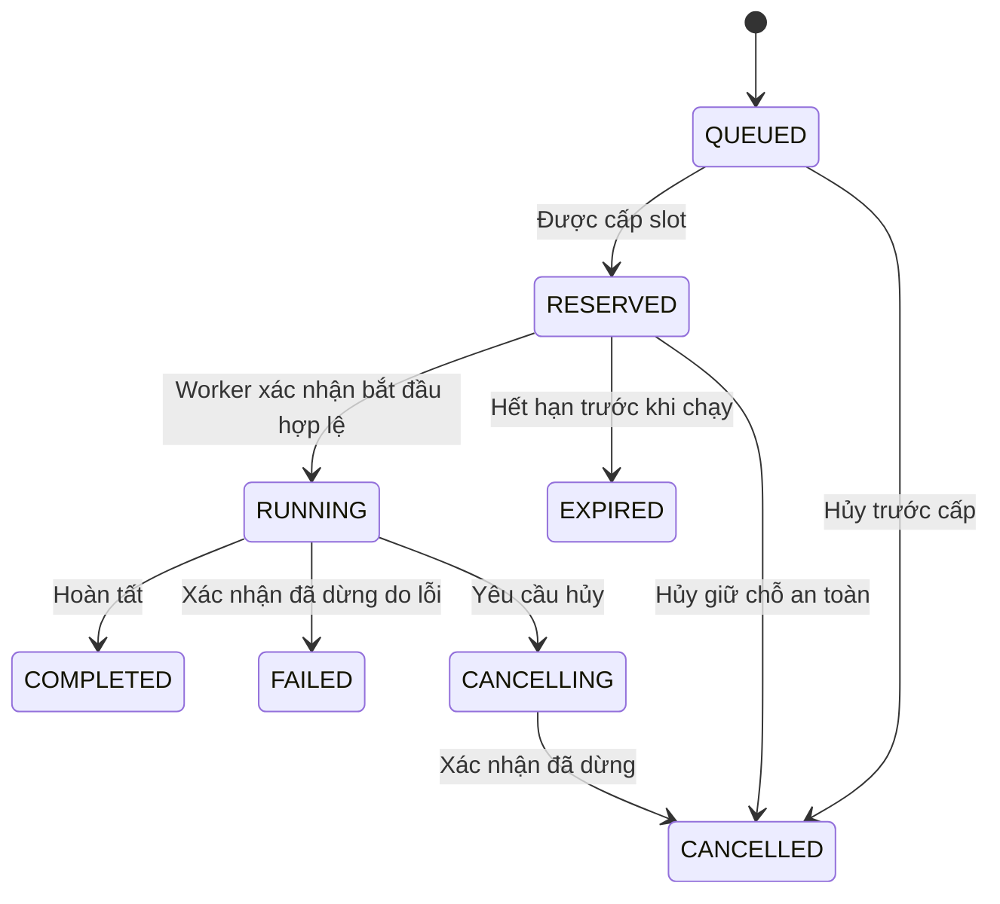

# Allocation fairness — Công bằng trong phân bổ tài nguyên

## 1. Vì sao công bằng phân bổ là một vấn đề bảo mật nghiệp vụ?

Một hệ thống có thể xác thực đúng người dùng, kiểm tra quyền trên từng yêu cầu và không cấp vượt tổng dung lượng, nhưng vẫn cho phép một khách hàng chiếm gần hết tài nguyên chung. Những khách hàng khác vẫn có quyền sử dụng dịch vụ nhưng hầu như không được phục vụ. Khi đó, hệ thống đã bảo vệ được giới hạn kỹ thuật mà chưa bảo vệ được cam kết nghiệp vụ.

**Allocation fairness** là việc xác định và thực thi chính sách phân chia tài nguyên giữa các chủ thể cạnh tranh. Tài nguyên có thể là lượt xử lý báo cáo, số tác vụ chạy đồng thời, hạn mức gửi thông báo, ngân sách khuyến mại, hàng tồn kho hoặc lịch sử dụng thiết bị. Công bằng luôn cần một chính sách cụ thể: công bằng giữa ai, dựa trên đơn vị nào, trong khoảng thời gian nào và có ngoại lệ gì.

Trong bảo mật logic nghiệp vụ, mục tiêu là ngăn một chủ thể giành lợi thế trái chính sách thông qua việc gửi dồn yêu cầu, tạo nhiều danh tính, giả mạo mức ưu tiên, giữ chỗ không sử dụng, gửi lại cùng một yêu cầu hoặc khai thác khoảng hở giữa kiểm tra và cập nhật dữ liệu.

Ví dụ xuyên suốt bài học: một nền tảng SaaS có **12 vị trí xử lý báo cáo** dùng chung cho nhiều tenant. Tenant là tổ chức khách hàng; mỗi tenant có nhiều người dùng và API key. Hệ thống cần phân bổ cơ hội xử lý giữa các tổ chức, đồng thời bảo đảm quyền trên báo cáo, hạn mức sử dụng, trạng thái tác vụ và tính đúng đắn khi nhiều worker cùng hoạt động.

> Công bằng là một thuộc tính của chính sách và cách thực thi toàn hệ thống. Một bộ đếm dung lượng, một hàng đợi FIFO hoặc một API có rate limit riêng lẻ chưa đủ để chứng minh công bằng.

## 2. Phải định nghĩa rõ điều gì được chia công bằng

### 2.1. Chủ thể nhận phần tài nguyên

Đơn vị phân bổ phải phù hợp với chủ thể mà nghiệp vụ muốn bảo vệ.

| Đơn vị phân bổ | Phù hợp khi | Kẽ hở nếu chọn sai |
| --- | --- | --- |
| Người dùng | Mỗi cá nhân được cấp quyền lợi độc lập và danh tính được kiểm soát | Một tổ chức tạo nhiều tài khoản để nhận nhiều phần |
| Tenant hoặc tổ chức | Hợp đồng và ngân sách gắn với tổ chức | Một tenant mở nhiều API key nếu hệ thống lại chia theo key |
| Dự án | Các dự án có ngân sách được cấp riêng | Tạo nhiều dự án có thể nhân tổng quyền lợi nếu thiếu giới hạn tổ chức |
| Tài khoản thanh toán | Quyền lợi gắn với chủ thể trả phí | Các tài khoản thanh toán liên quan có thể cần chính sách tổng hợp riêng |
| Đối tượng nghiệp vụ | Mỗi đơn hàng, chiến dịch hoặc hồ sơ chỉ được nhận một quyền lợi | Chia nhỏ hoặc sao chép đối tượng để xin cấp nhiều lần |

Trong ví dụ, tenant là ranh giới công bằng chính. Mỗi người dùng có thể có thêm giới hạn phụ để không làm nghẽn công việc của đồng nghiệp. Các API key của cùng một tenant cùng tiêu thụ một ngân sách và một phần phân bổ cấp tenant.

Tenant phải được suy ra từ danh tính đã xác thực và quan hệ thành viên hợp lệ. Trường `tenantId` do client gửi chỉ là đầu vào cần đối chiếu; nó không phải bằng chứng sở hữu. Với thao tác quản trị thay mặt tenant khác, quyền đó phải được kiểm tra riêng và ghi nhận trong audit log.

### 2.2. Đơn vị tài nguyên

Không nên mặc định một yêu cầu tương đương một đơn vị chi phí.

- Với tác vụ có thời gian xử lý gần bằng nhau, có thể phân bổ theo số lượt hoặc số slot.
- Với báo cáo chênh lệch lớn về độ nặng, có thể cần tính theo slot-millisecond, CPU time, số bản ghi quét hoặc một mô hình chi phí do server xác định.
- Với hàng tồn kho, đơn vị là số sản phẩm được giữ hoặc mua; thời gian giữ chỗ là một ràng buộc bổ sung.
- Với ngân sách khuyến mại, đơn vị là số tiền hoặc giá trị quyền lợi, không chỉ số lần gọi API.

Giới hạn đồng thời và hạn mức theo kỳ giải quyết hai vấn đề khác nhau. Một tenant được dùng tối đa ba slot đồng thời vẫn có thể tiêu thụ phần lớn thời gian xử lý nếu liên tục chạy tác vụ dài. Ngược lại, một tenant còn hạn mức tháng vẫn có thể làm nghẽn dịch vụ bằng cách khởi chạy quá nhiều tác vụ cùng lúc.

### 2.3. Phạm vi thời gian và điều kiện so sánh

Một phát biểu như “tenant A được 50% tài nguyên” cần nói rõ:

1. A có luôn có công việc hợp lệ đang chờ không?
2. Tỷ lệ tính trên số lần khởi chạy, thời gian thực thi hay chi phí thực tế?
3. Tỷ lệ được đánh giá trong một chu kỳ điều phối, một cửa sổ thời gian hay một kỳ hợp đồng?
4. Khi không có cạnh tranh, A có được mượn phần còn dư không?
5. Tác vụ đã chạy có bị thu hồi hay chỉ áp dụng chính sách ở lần cấp tiếp theo?

Không nên coi tỷ lệ công bằng dài hạn là cam kết độ trễ cho từng yêu cầu. Muốn bảo đảm thời gian chờ tối đa còn phải có điều kiện về tải nhận vào, thời lượng tác vụ, năng lực xử lý và các lớp ưu tiên.

## 3. Phân biệt công bằng với các cơ chế liên quan

| Cơ chế | Câu hỏi chính | Giới hạn khi dùng riêng lẻ |
| --- | --- | --- |
| Authentication | Ai đang gọi? | Người dùng hợp lệ vẫn có thể lạm dụng tài nguyên |
| Authorization | Chủ thể có được thao tác trên đối tượng này không? | Quyền thao tác không quyết định phần tài nguyên được hưởng |
| Quota | Trong một kỳ, chủ thể được tiêu thụ bao nhiêu? | Không tự quyết định thứ tự phục vụ giữa các chủ thể còn quota |
| Rate limit | Trong một khoảng thời gian, cho phép bao nhiêu yêu cầu hoặc đơn vị? | Mức trung bình hợp lệ vẫn có thể tạo tranh chấp bất lợi |
| Concurrency limit | Có bao nhiêu tác vụ được giữ hoặc chạy cùng lúc? | Không tự cân bằng thời lượng hoặc chi phí các tác vụ |
| Admission control | Có nhận thêm công việc vào hệ thống không? | Cần chính sách riêng để chọn ai được phục vụ tiếp |
| Fair scheduling | Trong các công việc đủ điều kiện, cấp tài nguyên cho ai tiếp theo? | Không thay thế kiểm tra quyền, quota hay giao dịch nguyên tử |
| Idempotency | Yêu cầu gửi lại có tạo thêm tác dụng nghiệp vụ không? | Không ngăn một chủ thể tạo nhiều yêu cầu mới hợp lệ nhưng vượt phần được hưởng |

Một thiết kế tốt kết hợp các cơ chế này. Kiểm tra quyền ngăn thao tác sai đối tượng; quota và admission control giới hạn lượng việc được nhận; scheduler bảo vệ phần phân bổ khi có cạnh tranh; transaction và idempotency bảo vệ tác dụng của mỗi lần cấp phát.

## 4. Chuyển chính sách thành các bất biến nghiệp vụ

### 4.1. Các bất biến an toàn

Gọi `C` là tổng số slot và `active(t)` là số slot của tenant `t` đang được giữ hoặc chạy. Những slot đang thu hồi nhưng chưa xác nhận dừng cũng phải tiếp tục được tính là đang chiếm dụng.

```text
sum(active(t)) <= C
0 <= active(t) <= hardLimit(t)

heldQuota(t, period) + consumedQuota(t, period) <= quotaLimit(t, period)

Một operation hợp lệ chỉ có tối đa một allocation còn hiệu lực.
Một allocation chỉ trả slot đúng một lần.
Mọi allocation phải thuộc đúng tenant và đối tượng mà chủ thể có quyền dùng.
Client không tự quyết định weight, priority, cost hoặc thời hạn giữ chỗ.
```

`heldQuota` là phần ngân sách đã được giữ cho công việc; `consumedQuota` là phần đã tiêu thụ. Khi công việc kết thúc, hệ thống chuyển phần sử dụng thực tế sang đã tiêu thụ và giải phóng phần giữ dư theo chính sách. Không được hoàn lại chi phí đã tiêu thụ chỉ vì client gọi hủy.

Nếu quota là giới hạn cứng mà chi phí cuối cùng chưa biết, chỉ giữ một ước lượng thấp rồi quyết toán sau chưa đủ bảo vệ bất biến. Cần giữ một cận trên có thể thực thi, hoặc buộc tác vụ xin thêm ngân sách nguyên tử trước khi dùng vượt phần đã giữ và dừng khi không được cấp. Việc đo bổ sung sau chạy chỉ phát hiện vượt mức, không ngăn được nó.

### 4.2. Các thuộc tính công bằng và tiến triển

Ngoài việc không cấp vượt, hệ thống còn cần những yêu cầu có điều kiện:

- Tenant có công việc hợp lệ chờ liên tục phải được xét cấp theo chính sách, dù tenant khác gửi nhiều yêu cầu hơn.
- Các danh tính con của cùng một tenant không được nhân phần phân bổ cấp tenant.
- Tenant không còn việc chờ không giữ quyền độc chiếm tài nguyên chưa dùng, nếu chính sách cho phép chia sẻ phần dư.
- Mức ưu tiên cao phải có ngân sách hoặc giới hạn để không làm lớp khác chờ vô hạn ngoài cam kết nghiệp vụ.
- Tác vụ lỗi, client mất kết nối hoặc worker chết không được giữ tài nguyên vô thời hạn.

Các bất biến an toàn có thể kiểm tra trên trạng thái dữ liệu. Công bằng và tiến triển còn phải kiểm tra trên lịch sử cấp phát, thời gian chờ và điều kiện tải. Một ảnh chụp cho thấy tổng số slot bằng 12 không cho biết tenant nào đã bị bỏ đói trong mười phút trước đó.

## 5. Chọn chính sách phân bổ phù hợp

### 5.1. FIFO toàn cục

FIFO toàn cục phục vụ theo thứ tự đến. Cách này dễ giải thích nhưng có thể cho phép một tenant gửi trước hàng chục nghìn tác vụ và đẩy tất cả tenant khác ra sau.

FIFO phù hợp hơn trong từng hàng đợi tenant hoặc trong một phạm vi đã có admission control chặt chẽ. “Đến trước được phục vụ trước” chỉ là một lựa chọn chính sách; nó không tự tạo công bằng giữa các tổ chức có khả năng gửi yêu cầu khác nhau.

### 5.2. Round robin giữa các tenant

Mỗi tenant có một hàng đợi. Scheduler lần lượt lấy công việc từ từng tenant đủ điều kiện thay vì lần lượt lấy từng yêu cầu trên một hàng đợi chung.

```text
Hàng đợi A: A1, A2, A3, A4, ...
Hàng đợi B: B1, B2, ...
Hàng đợi C: C1, C2, ...

Thứ tự cấp lượt minh họa: A1, B1, C1, A2, B2, C2, ...
```

A gửi thêm 10.000 yêu cầu không tạo thêm vị trí tenant trong vòng điều phối. Tuy nhiên, nếu tác vụ A dài hơn nhiều lần tác vụ B, công bằng số lần khởi chạy vẫn có thể lệch lớn về tài nguyên thực tế.

### 5.3. Phân bổ theo trọng số

Giả sử trọng số lấy từ chính sách hợp đồng:

```text
weight(A) = 2
weight(B) = 1
weight(C) = 1
```

Khi cả ba tenant liên tục có việc đủ điều kiện và các tác vụ có chi phí bằng nhau, một chu kỳ cấp lượt có thể là `A, A, B, C`. Trong 12 lượt cấp, tỷ lệ mục tiêu là `6 : 3 : 3`.

Nếu B không có việc và chính sách cho phép dùng phần dư, tỷ lệ giữa A và C có thể trở thành `8 : 4` trên 12 lượt cấp tương đương. Khi B có việc trở lại, scheduler điều chỉnh các lần cấp tiếp theo. Với tác vụ không thể ngắt, không thể mặc định lấy lại ngay những slot đang được A hoặc C sử dụng.

Các con số này minh họa **tỷ lệ lượt cấp cho công việc cùng chi phí**. Chúng không bảo đảm tại mọi thời điểm số tác vụ đang chạy cũng đúng tỷ lệ đó. Muốn có năng lực sẵn sàng ngay cho B phải cân nhắc giữ phần dự phòng, cho phép thu hồi an toàn hoặc giới hạn thời gian tác vụ.

### 5.4. Max-min fairness

Một cách diễn giải max-min fairness là tăng phần phân bổ cho các chủ thể chưa được đáp ứng một cách cân bằng, cho đến khi chủ thể nào đạt nhu cầu hoặc có ràng buộc dung lượng. Tài nguyên còn lại tiếp tục được chia cho những chủ thể vẫn cần thêm.

Ví dụ có 12 slot, nhu cầu hiện tại của A là 1, B là 8, C là 8; các slot có thể phân chia tương đương và không áp dụng trọng số. Nghiệm liên tục là `1, 5.5, 5.5`. Với slot nguyên, có thể cấp `1, 5, 6`, rồi xoay phần chênh lệch giữa B và C ở các lần cấp sau để xấp xỉ mục tiêu theo thời gian. Không cần giữ bốn slot cho A nếu A chỉ dùng một và chính sách cho phép dùng phần dư.

Chính sách này hữu ích khi nhu cầu khác nhau rõ rệt. Với slot không thể chia nhỏ, nhiều loại tài nguyên hoặc tác vụ đang chạy không thể thu hồi, cần quy định cách làm tròn và thời điểm áp dụng; không nên coi một phép chia số học là bộ điều phối hoàn chỉnh.

### 5.5. Deficit round robin cho chi phí khác nhau

Một hướng xử lý là cấp tín dụng điều phối cho từng tenant theo vòng:

```text
deficit[t] += quantum * weight[t]

Nếu chi phí do server ước lượng của công việc đầu hàng <= deficit[t]
và mọi điều kiện cấp phát đều hợp lệ:
    cấp công việc;
    deficit[t] -= chi phí ước lượng.
```

Đây là mô tả ý tưởng, chưa phải mã triển khai đầy đủ. Phải quy định cách giới hạn tín dụng tích lũy, xử lý tenant hết việc, công việc lớn hơn một quantum, thay đổi trọng số và cập nhật chi phí thực tế.

Không chỉ bỏ qua mãi công việc lớn vì nó chưa đủ tín dụng. Cần cho phép tích lũy có kiểm soát hoặc có cơ chế phục vụ tác vụ lớn với giới hạn rõ ràng. Cũng không nên cho tenant rời rồi vào lại hàng đợi để xóa khoản chênh lệch chi phí đang phải bù. Nếu quyết toán chi phí sau khi chạy, phải kết hợp giới hạn tác vụ đang bay để tenant không tranh thủ chạy hàng loạt trước khi phần chênh lệch được ghi nhận.

### 5.6. Công bằng theo nhiều cấp

Một cấu trúc thường phù hợp là:

```text
Năng lực toàn hệ thống
    -> nhóm dịch vụ hoặc nhóm hợp đồng
        -> tenant
            -> dự án
                -> người dùng
```

Phân bổ cấp con không được làm tăng tổng phần của cấp cha. Nếu tenant A có phần mục tiêu là sáu slot, tạo 100 dự án không biến phần đó thành 600 slot. Mỗi cấp có thể có hard limit, còn phần được mượn phải tuân thủ chính sách của cấp cha.

## 6. Các cách tấn công làm lệch phân bổ

| Hành vi | Vì sao gây mất công bằng | Biện pháp chính |
| --- | --- | --- |
| Gửi dồn rất nhiều yêu cầu | Chiếm hàng đợi hoặc nhiều lượt xét | Hàng đợi theo tenant, giới hạn backlog và admission control |
| Tạo nhiều API key hoặc tài khoản con | Nhận nhiều phần nếu chia sai đơn vị | Tổng hợp quyền lợi và hạn mức ở tenant hoặc chủ thể hợp đồng |
| Tạo nhiều tenant giả | Nhân phần nếu tạo tenant tự do và danh tính không được kiểm soát | Chính sách cấp quyền lợi, xác minh hoặc hạn mức ở chủ thể cấp cao hơn |
| Tự khai `priority=HIGH` | Chen lên trước công việc hợp lệ khác | Server suy ra ưu tiên; kiểm tra điều kiện và ngân sách ưu tiên |
| Khai thấp chi phí | Được cấp nhiều công việc nặng hơn phần được hưởng | Server ước lượng, đo thực tế và giới hạn đồng thời |
| Giữ chỗ rồi bỏ | Slot hoặc hàng hóa không đến tay người khác | Lease có hạn, giới hạn giữ chỗ, thu hồi an toàn |
| Gửi lại khi timeout | Cùng nghiệp vụ nhận nhiều allocation | Idempotency và ràng buộc duy nhất cấp nghiệp vụ |
| Chia một nghiệp vụ thành nhiều yêu cầu | Né giới hạn theo request | Tổng hợp theo đối tượng, chiến dịch hoặc operation thực |
| Hủy rồi đăng ký lại liên tục | Tìm cách nhận tín dụng mới hoặc chiếm chu kỳ điều phối | Chính sách vòng đời tín dụng, giới hạn churn và lịch sử theo tenant |
| Gia hạn giữ chỗ liên tục | Biến lease ngắn thành chiếm dụng vô hạn | Hạn tổng thời gian, giới hạn lần gia hạn và điều kiện gia hạn |

Việc các API key cùng thuộc một tenant chỉ giải quyết được phân mảnh trong tenant đó. Nó không tự giải quyết tấn công nhiều tenant giả. Nếu quyền lợi miễn phí cấp theo tổ chức nhưng tổ chức được tạo không giới hạn, chính sách danh tính và cấp quyền lợi phải được thiết kế cùng cơ chế phân bổ.

## 7. Luồng cấp phát: từ quyền đối tượng đến giao dịch

### 7.1. Nhận yêu cầu

API tiếp nhận yêu cầu tạo báo cáo cần làm tối thiểu:

1. Xác thực chủ thể và xác định tenant từ ngữ cảnh tin cậy.
2. Kiểm tra quyền tạo báo cáo trên tập dữ liệu hoặc dự án cụ thể.
3. Chuẩn hóa đầu vào; lấy lớp dịch vụ, trọng số và giới hạn từ chính sách server.
4. Xử lý idempotency trong đúng phạm vi tenant, loại thao tác và key.
5. Kiểm tra giới hạn lượng công việc đang chờ và quota tiếp nhận cần thiết.
6. Ghi operation cùng sự kiện đưa vào hàng đợi theo một cách có thể phục hồi.

Nếu dữ liệu nghiệp vụ nằm trong database nhưng hàng đợi ở hệ thống khác, có thể dùng transactional outbox: ghi operation và bản ghi outbox trong cùng giao dịch, rồi bộ chuyển tiếp gửi ra hàng đợi. Bộ chuyển tiếp có thể gửi lặp, vì vậy phía nhận vẫn phải chống xử lý trùng.

Giới hạn backlog phải được thực thi nguyên tử nếu nhiều yêu cầu đồng thời có thể cùng vượt qua phép kiểm tra. Không được chỉ đếm công việc đang chờ bằng một truy vấn rồi ghi thêm mà không có cơ chế bảo vệ cạnh tranh.

### 7.2. Chọn công việc được cấp

Scheduler xét hàng đợi của các tenant đủ điều kiện. Đủ điều kiện có thể bao gồm:

- Còn công việc `QUEUED` đã được tiếp nhận hợp lệ.
- Tenant còn hoạt động và vẫn được dùng dịch vụ.
- Quyền cần thiết trên đối tượng vẫn hợp lệ tại thời điểm thực thi theo chính sách.
- Còn quota và chưa vượt hard limit đồng thời.
- Đến lượt theo chính sách công bằng.

Khi quyền đối tượng thay đổi trong thời gian chờ, không nên mặc định quyền lúc gửi đủ để thực thi mãi mãi. Quy tắc tái kiểm tra hoặc quyền đã được chốt theo nghiệp vụ phải được nêu rõ. Đối với dữ liệu báo cáo nhạy cảm, cần kiểm tra cả quyền nhận kết quả.

### 7.3. Chốt allocation

Quyết định điều phối phải được chuyển thành cấp phát có tính nguyên tử. Các tác dụng liên quan thường gồm:

```text
xác nhận operation còn QUEUED
+ xác nhận lượt cấp theo chính sách
+ giữ một slot toàn cục
+ giữ một slot của tenant
+ giữ quota cần thiết
+ tạo allocation với lease và generation
+ chuyển operation sang RESERVED
+ ghi sự kiện cần gửi
```

Nếu bất kỳ điều kiện nào thất bại, không được để lại một phần cập nhật. Sau rollback, scheduler phải xem xét tenant đủ điều kiện khác thay vì chờ vô hạn vào tenant vừa hết quota.

Không gửi lệnh chạy ra bên ngoài rồi mới hy vọng commit database thành công. Có thể ghi sự kiện giao việc vào outbox trong cùng giao dịch; worker nhận lệnh chỉ được bắt đầu sau khi kiểm tra allocation vẫn hợp lệ.

## 8. Ví dụ giao dịch: bảo vệ bộ đếm chưa đủ bảo vệ công bằng

### 8.1. Mẫu dễ bị khai thác

```java
// Sai khi nhiều request hoặc scheduler chạy đồng thời.
if (globalActive() < capacity && tenantActive(tenantId) < tenantLimit) {
    createAllocation(operationId);
    incrementGlobalActive();
    incrementTenantActive(tenantId);
}
```

Hai giao dịch có thể cùng nhìn thấy một slot còn trống rồi cùng cấp. Một lỗi khác là tăng bộ đếm toàn cục thành công nhưng tăng bộ đếm tenant thất bại mà không rollback.

Ngay cả khi sửa được các bộ đếm bằng khóa, việc nhiều scheduler liên tục tranh slot cho cùng một tenant cũng có thể làm tenant đó thắng nhiều lần. **Tính nguyên tử bảo vệ giới hạn; trạng thái điều phối nhất quán mới bảo vệ chính sách chọn lượt.**

### 8.2. Phác thảo xử lý trong Java

Đoạn dưới là mã giả theo phong cách Java. Nó minh họa ranh giới giao dịch và yêu cầu phối hợp; không phải một scheduler hoàn chỉnh hay một thư viện cụ thể.

```java
Allocation allocateNext(String poolId) {
    return transaction.execute(() -> {
        // Mọi scheduler của pool cùng tuân thủ cơ chế phối hợp này.
        SchedulingState schedule = lockSchedulingState(poolId);
        Pool pool = lockPool(poolId);

        Candidate next = chooseEligibleTenant(schedule, pool);
        if (next == null) {
            return null;
        }

        TenantBudget budget = lockTenantBudget(poolId, next.tenantId());
        Operation operation = lockQueuedOperation(next.operationId());

        recheckEligibilityAndObjectPolicy(next.tenantId(), operation, budget);

        if (!pool.hasFreeSlot() || !budget.canReserve(operation.cost())) {
            return null; // Bên gọi điều phối lại với tập đủ điều kiện mới.
        }

        Allocation allocation = createReservation(operation, budget);
        pool.reserveOne();
        budget.reserve(operation.cost());
        operation.markReserved(allocation.id());
        schedule.recordCommittedGrant(next, operation.cost());
        appendDispatchOutbox(allocation);

        return allocation;
    });
}
```

Các hàm `lock...` phải dùng cơ chế đồng bộ có hiệu lực giữa các tiến trình, không chỉ `synchronized` trong một JVM. Trạng thái lịch cấp được cập nhật cùng allocation đã commit; rollback không được để lại một lượt cấp giả hoặc làm mất tín dụng một cách vô ý.

Mọi đường cập nhật phải có thứ tự khóa nhất quán, chẳng hạn trạng thái điều phối, pool, ngân sách tenant, operation rồi allocation. Luồng hoàn tất cần thực hiện cùng quy ước đối với các bản ghi mà nó sử dụng. Nếu điều kiện kiểm tra lại thất bại, vòng điều phối phải có cách loại tạm ứng viên đó; gọi lại mà luôn chọn cùng một ứng viên không đủ điều kiện có thể làm các tenant khác bị đói. Phác thảo trên chưa xử lý đầy đủ retry giao dịch, thu hồi lease, thay đổi chính sách và tối ưu thông lượng.

Một bản ghi điều phối chung có thể trở thành điểm nghẽn. Khi chia scheduler theo pool hoặc shard, phải xác định công bằng được bảo đảm trong từng pool hay trên toàn hệ thống. Chia nhỏ bộ đếm mà không chia rõ quyền cấp phát có thể cho phép các shard cùng tiêu cùng một phần ngân sách.

### 8.3. Ví dụ SQL cho một phần của bất biến

Ví dụ sau dùng cú pháp PostgreSQL để tăng bộ đếm có điều kiện:

```sql
BEGIN;

UPDATE resource_pool
SET active = active + 1
WHERE pool_id = :pool_id
  AND active < capacity
RETURNING pool_id;

-- Phải nhận đúng một dòng, nếu không thì ROLLBACK.

UPDATE tenant_pool_budget
SET active = active + 1
WHERE pool_id = :pool_id
  AND tenant_id = :tenant_id
  AND active < hard_limit
RETURNING tenant_id;

-- Phải nhận đúng một dòng, nếu không thì ROLLBACK.

-- Trong cùng giao dịch: giữ quota nếu có, kiểm tra/chuyển trạng thái
-- operation, tạo allocation, ghi lịch cấp và sự kiện outbox.
-- Chỉ COMMIT khi tất cả bước liên quan đều thành công.

COMMIT;
```

Các câu SQL này chỉ minh họa bảo vệ hai bộ đếm. Chúng chưa thực thi chọn tenant công bằng, chống trùng operation hay thu hồi tài nguyên. Điều kiện `RETURNING` phải được ứng dụng kiểm tra; không được bỏ qua kết quả cập nhật bằng không rồi vẫn tạo allocation.

Không dùng một phép đếm từ read replica làm nguồn quyết định cấp phát có tính ràng buộc, vì dữ liệu có thể trễ. Số liệu cache có thể hỗ trợ hiển thị hoặc gợi ý điều phối, còn quyết định cuối phải đi qua cơ chế đồng bộ và nguồn dữ liệu có thẩm quyền.

## 9. State machine, lease và thu hồi đúng cách

Một vòng đời tham khảo:



Đây là sơ đồ giản lược. Một triển khai có thể bổ sung trạng thái lỗi và phục hồi cho giai đoạn đang hủy; mọi trạng thái đó vẫn phải giữ đúng nguyên tắc chỉ trả slot khi tài nguyên đã được trả thật sự.

### 9.1. Lease không đồng nghĩa tiến trình đã dừng

Lease đặt ra thời hạn quyền sử dụng. Nhưng hết lease không tự làm tiến trình ở máy khác ngừng tiêu thụ CPU, kết nối hoặc tài nguyên bên ngoài.

Với tác vụ đang chạy, nếu hệ thống giảm bộ đếm ngay khi heartbeat mất mà worker cũ vẫn hoạt động, scheduler có thể cấp slot mới và làm số tác vụ thực tế vượt dung lượng. Cần có cơ chế dừng được xác nhận, cách ly execution hoặc một mô hình tài nguyên cho phép thu hồi quyền thực sự.

Fencing token hoặc generation giúp từ chối lệnh, ghi kết quả hay callback của chủ sở hữu cũ khi nơi nhận kiểm tra token. Nó không tự dừng CPU của worker cũ. Nếu tài nguyên được bảo vệ là CPU, cần thêm biện pháp kiểm soát tiến trình hoặc execution tương ứng.

Với reservation chưa chạy, thao tác bắt đầu và thao tác hết hạn phải tranh quyền chuyển trạng thái qua cùng nguồn có thẩm quyền. Nếu hết hạn đã thắng, worker đến trễ không được bắt đầu chỉ vì vẫn cầm thông báo cũ.

### 9.2. Trả tài nguyên đúng một lần

Hoàn tất, hủy và tác vụ thu hồi có thể đến cùng lúc. Cần chuyển trạng thái có điều kiện và chỉ bên thắng chuyển trạng thái mới thực hiện tác dụng giải phóng.

```text
BEGIN
    khóa các bản ghi cần thiết theo thứ tự quy định
    xác nhận tài nguyên đã được trả hoặc chưa từng bắt đầu
    chuyển allocation từ trạng thái hợp lệ sang trạng thái kết thúc
        với allocation_id, tenant_id và generation phù hợp

    nếu chuyển được đúng một allocation:
        giảm các bộ đếm slot tương ứng
        quyết toán quota theo chi phí thực tế
        ghi sự kiện kết thúc
    nếu không chuyển được:
        không trừ bộ đếm lần nữa
COMMIT
```

Không dùng `max(0, active - 1)` để che lỗi trả hai lần. Bộ đếm không âm là cần thiết nhưng che mất lỗi có thể khiến hệ thống cấp thừa mà không phát hiện. Nên giữ lịch sử allocation đủ để đối soát và phát hiện chênh lệch giữa ledger với execution thực tế.

## 10. Idempotency và quyền sở hữu allocation

Idempotency bảo đảm việc gửi lại một ý định không tạo thêm phần tài nguyên. Một mô hình bản ghi có thể gồm:

```text
tenant_id
operation_type
idempotency_key
canonical_request_hash
operation_id
processing_state
result_reference
expires_at
```

Đặt ràng buộc duy nhất cho `(tenant_id, operation_type, idempotency_key)`. Bản ghi này và việc tạo operation phải được phối hợp nguyên tử.

- Cùng key, cùng nội dung: trả về operation đã có hoặc trạng thái đang xử lý của nó.
- Cùng key, khác nội dung: báo xung đột theo hợp đồng API; không âm thầm tái sử dụng.
- Hai yêu cầu cùng key đến đồng thời: chỉ một operation được tạo, yêu cầu còn lại quan sát kết quả đã tồn tại.
- Consumer nhận sự kiện trùng: kiểm tra operation và trạng thái allocation trước khi cấp hoặc chạy.

Key không thay thế quyền đối tượng. Không được cho tenant B đọc hoặc nhận lại kết quả của tenant A chỉ vì biết key hay `operation_id`.

Thời hạn lưu idempotency phải phù hợp cửa sổ retry và vòng đời nghiệp vụ. Nếu bản ghi chống trùng bị xóa trong khi operation cũ vẫn có thể được thực thi hoặc phát lại, yêu cầu đến muộn có thể tạo cấp phát mới. Với nghiệp vụ có định danh tự nhiên như một lần phân bổ cho một đơn hàng, nên có thêm ràng buộc duy nhất theo định danh nghiệp vụ và quy tắc cho phép chạy lại.

Idempotency cũng không ngăn tenant gửi 1.000 key mới cho 1.000 công việc mới. Backlog limit, quota và scheduling vẫn cần được thực thi.

Các API như hủy, gia hạn hay xem allocation phải kiểm tra cả quan hệ đối tượng với tenant và quyền của người gọi. Một mã allocation khó đoán chỉ giúp giảm khả năng dò tìm; nó không phải cơ chế phân quyền.

## 11. Ưu tiên, mượn phần dư và thay đổi chính sách

### 11.1. Mức ưu tiên phải có căn cứ

Ưu tiên có thể dựa trên hợp đồng, thời hạn nghiệp vụ hoặc loại tác vụ đã được server xác minh. Không cho client tự nâng ưu tiên bằng một trường JSON hay một header tùy ý.

Nếu luôn phục vụ mọi tác vụ ưu tiên cao trước, lớp ưu tiên thấp có thể không bao giờ được chạy khi tải cao. Có thể dùng ngân sách riêng cho lớp ưu tiên, một phần năng lực tối thiểu cho lớp thường hoặc cơ chế tăng ưu tiên theo thời gian chờ với giới hạn rõ ràng.

Cơ chế tăng ưu tiên theo thời gian chờ cần xác định timestamp có thẩm quyền và cách xử lý hủy rồi gửi lại. Việc thao túng thời điểm hoặc sao chép công việc không được tạo quyền chen hàng ngoài chính sách.

### 11.2. Phần được bảo đảm, phần tối đa và phần mượn

Cần phân biệt ba khái niệm:

| Khái niệm | Ý nghĩa |
| --- | --- |
| Guaranteed share | Phần mục tiêu hoặc mức phục vụ được cam kết khi có cạnh tranh theo điều kiện đã nêu |
| Hard limit | Mức tối đa tenant không được vượt |
| Borrowed capacity | Phần tài nguyên dư được dùng tạm khi chủ thể khác chưa cần |

Một phần mục tiêu không nhất thiết là số slot luôn để trống cho tenant. Cho mượn giúp tăng mức sử dụng nhưng ảnh hưởng thời gian lấy lại năng lực. Với tác vụ dài không thể ngắt, cần nói rõ độ trễ phục hồi phần mục tiêu và giới hạn thời lượng tác vụ.

Không hứa thời gian chờ hữu hạn nếu vẫn nhận vào lượng công việc vượt năng lực dài hạn mà không có giới hạn backlog hay chính sách từ chối.

### 11.3. Hạ quota hoặc trọng số khi đang có tác vụ

Nếu hard limit mới là hai nhưng tenant đang chạy bốn tác vụ, chính sách phải chọn cách xử lý: dừng cấp mới cho đến khi số đang chạy giảm, hoặc thu hồi theo cơ chế được thiết kế trước. Không được sửa số đếm xuống hai trong khi bốn tác vụ vẫn còn dùng tài nguyên.

Bất biến `active(t) <= hardLimit(t)` ở phần trước giả định giới hạn đang có hiệu lực không bị hạ tức thời dưới lượng đã cấp. Khi cho phép chuyển tiếp, phải biểu diễn rõ giới hạn mới, phần cấp cũ được giữ tạm và quy tắc không cấp thêm; nếu cần giới hạn mới có hiệu lực ngay thì phải thu hồi an toàn trước khi công nhận đã đáp ứng giới hạn đó.

Ghi phiên bản chính sách áp dụng cho quyết định cấp giúp giải thích vì sao một tác vụ được nhận ở thời điểm trước. Đồng thời phải phân biệt thuộc tính được chốt lúc tạo với thuộc tính cần kiểm tra lại lúc chạy; việc giữ bản chụp chính sách không được vô tình duy trì một quyền truy cập đã bị thu hồi.

## 12. Công bằng trong hệ thống nhiều vùng hoặc nhiều scheduler

Giới hạn trong bộ nhớ của một instance chỉ bảo vệ instance đó. Nếu có bốn instance cùng cho tenant chạy tối đa ba tác vụ, tổng cộng tenant có thể chạy 12 tác vụ nếu không có điều phối chung.

Các hướng thiết kế có thể gồm:

- Một nguồn điều phối có thẩm quyền cho từng pool, cùng dữ liệu trạng thái được bảo vệ bằng giao dịch.
- Chia ngân sách toàn cục thành phần cấp trước cho từng vùng; tổng phần đã cấp không vượt ngân sách cha, việc chuyển phần được ghi nhận an toàn.
- Dùng lease và fencing cho quyền điều phối, đồng thời yêu cầu nơi cấp phát kiểm tra quyền và generation hợp lệ.

Khi mất liên lạc với nguồn ngân sách, không nên mặc định “cho chạy trước rồi đối soát sau” nếu điều đó có thể vi phạm cam kết dung lượng. Hệ thống có thể tiếp tục trong phần ngân sách đã cấp trước còn hợp lệ hoặc tạm ngừng cấp mới theo chính sách.

Công bằng xấp xỉ theo cửa sổ thời gian có thể là lựa chọn chấp nhận được, nhưng cần công bố biên sai lệch và cách đo. Không gọi một tập bộ đếm cục bộ độc lập là giới hạn toàn cục chỉ vì chúng sẽ được cộng lại trong báo cáo cuối ngày.

## 13. Kiểm thử tình huống tấn công logic

Nên dùng một pool nhỏ, tác vụ có thời lượng kiểm soát và lịch cấp có thể quan sát. Kiểm thử phải đo cả các bất biến không được vi phạm lẫn khả năng tenant khác tiếp tục được phục vụ.

| Tình huống | Cách dựng | Điều cần xác nhận |
| --- | --- | --- |
| Gửi dồn | A gửi 10.000 việc; B và C mỗi bên có việc chờ | A không chiếm toàn bộ lượt; backlog của A bị giới hạn theo chính sách |
| Nhiều API key | A gửi cùng tải qua một key rồi qua 100 key | Phần tổng của A không tăng do tăng số key |
| Trọng số | A:B:C = 2:1:1, công việc cùng chi phí, tất cả luôn có việc | Lịch cấp tiến gần tỷ lệ mục tiêu trong cửa sổ đo đã định |
| Công việc khác chi phí | A chạy báo cáo nặng, B chạy báo cáo nhẹ | Đánh giá theo đơn vị chi phí đã chọn, không chỉ đếm request |
| Slot cuối cùng | Dùng barrier cho nhiều scheduler cùng tranh một slot | Tổng allocation hiệu lực không vượt capacity |
| Retry đồng thời | Nhiều request cùng key và cùng nội dung | Chỉ có một operation và một allocation hiệu lực |
| Key khác nội dung | Cùng key, thay đổi tham số báo cáo | Bị báo xung đột, không nhận thêm tài nguyên |
| Tranh chấp kết thúc | Callback hoàn tất, hủy và thu hồi cùng đến | Chỉ một tác dụng trả slot; quota được quyết toán một lần |
| Reservation hết hạn | Worker nhận thông báo cũ sau khi reservation hết hiệu lực | Worker không được bắt đầu tác vụ bằng quyền cũ |
| Worker mất heartbeat | Worker cũ vẫn thực thi sau khi mất liên lạc | Không cấp đè dựa riêng vào timeout; cơ chế thu hồi hoạt động đúng |
| Tenant rảnh trở lại | B hết việc rồi có việc trong khi A đang mượn phần dư | B được xét ở các lượt cấp sau theo chính sách và giới hạn tác vụ |
| Giả ưu tiên | Client đổi trường priority hoặc tenantId | Server không nâng ưu tiên hoặc đổi chủ thể trái quyền |
| Thu hồi quyền đối tượng | Quyền trên dự án bị gỡ khi tác vụ đang chờ | Tác vụ được xử lý theo quy tắc tái kiểm tra quyền đã công bố |
| Đổi chính sách | Hạ hard limit dưới số tác vụ đang chạy | Không sửa giả số đếm; cấp mới và thu hồi theo chính sách |
| Nhiều instance | Chạy hai scheduler và nhiều worker | Các giới hạn cấp tenant và toàn pool vẫn đúng |

Với bài kiểm tra tỷ lệ, phải định nghĩa trước cửa sổ quan sát và sai số do làm tròn. Ví dụ, khi dùng chu kỳ `A, A, B, C`, công việc cùng chi phí và không có lỗi, một số nguyên chu kỳ cấp đầy đủ phải cho tỷ lệ đúng theo chu kỳ. Trong thử nghiệm thực tế có công việc đến hoặc đi, cần so sánh với tập tenant thực sự đủ điều kiện tại từng thời điểm.

Một kịch bản tự chứa có thể bắt đầu như sau:

```text
Given:
    pool có 12 slot
    A, B, C có trọng số 2, 1, 1
    mỗi tác vụ giữ đúng một slot trong cùng thời lượng
    cả ba tenant luôn có việc hợp lệ
    mọi hard limit và quota đủ lớn để không chặn tỷ lệ mục tiêu

When:
    chạy nhiều chu kỳ cấp và hoàn tất
    A đổi từ một API key sang nhiều API key
    phát lại một số request bằng cùng idempotency key

Then:
    active toàn pool không vượt 12 ở bất kỳ thời điểm nào
    lịch cấp vẫn theo trọng số cấp tenant
    số key không làm tăng phần của A
    request phát lại không tạo thêm allocation
```

Kiểm thử thứ tự sự kiện khác nhau cũng quan trọng như kiểm thử dữ liệu đầu vào. Hãy chủ động đổi thứ tự commit, callback, timeout và delivery trùng để làm lộ lỗi mà kiểm thử tuần tự không gặp.

## 14. Quan sát và giải thích quyết định phân bổ

Chỉ số tổng số request không đủ cho việc đánh giá công bằng. Nên quan sát:

- Công việc đang chờ, đang giữ chỗ và đang chạy theo pool, lớp dịch vụ và tenant phù hợp.
- Thời gian chờ và tuổi của công việc chờ lâu nhất theo lớp dịch vụ.
- Tài nguyên hoặc chi phí thực tế được cấp so với phần mục tiêu trong khoảng có cạnh tranh.
- Số lần từ chối hoặc trì hoãn vì hết quota, hard limit, backlog, quyền đối tượng hay chưa đến lượt.
- Reservation hết hạn, gia hạn bất thường, thu hồi chậm và callback đến với generation cũ.
- Chênh lệch giữa bộ đếm allocation và tài nguyên thực tế đang sử dụng.

Với trọng số `w(t)`, có thể so sánh đại lượng `service(t) / w(t)` giữa các tenant cùng đủ điều kiện và liên tục có việc trong cùng khoảng đo. Trong đó, `service(t)` phải là đơn vị phục vụ mà chính sách đã chọn, chẳng hạn chi phí thực tế. Đây là tín hiệu chẩn đoán; nó không thay thế việc xét tenant hết quota, không có việc, có hard limit hoặc thuộc lớp ưu tiên khác.

Audit log cho một quyết định cấp nên đủ để trả lời: tenant nào, operation nào, pool nào, phiên bản chính sách nào, mức ưu tiên có căn cứ gì, lượng tài nguyên được giữ bao nhiêu, generation nào và vì sao được cấp hoặc bị trì hoãn. Không đưa dữ liệu báo cáo nhạy cảm hay bí mật xác thực vào log.

Nếu số tenant lớn, cần tránh biến mọi tenant ID thành nhãn metric không giới hạn. Có thể kết hợp metric tổng hợp với log hoặc kho phân tích phục vụ điều tra theo tenant. Quyết định điều phối không nên phụ thuộc vào dashboard có độ trễ.

## 15. Những cách sửa dễ tạo cảm giác an toàn giả

### “Đã có rate limit ở gateway”

Gateway có thể giới hạn theo IP hoặc API key trong khi quyền lợi thực tế gắn với tenant. Ngoài ra, rate limit nhận request không quyết định thứ tự phân bổ cho công việc đã vào hàng đợi. Cần nối đúng chủ thể và bổ sung kiểm soát tại thời điểm cấp tài nguyên.

### “Mọi người đều có quota bằng nhau nên đã công bằng”

Quota theo tháng không bảo đảm cơ hội phục vụ trong giờ cao điểm. Hai tenant có cùng quota nhưng một bên chiếm toàn bộ slot trong nhiều giờ vẫn là một chính sách có thể không đáp ứng cam kết dịch vụ.

### “Có khóa trong Java nên không có race condition”

Khóa trong một JVM không phối hợp các instance khác, worker khác hay tác vụ thu hồi. Cơ chế đồng bộ phải bao phủ mọi bên có quyền thay đổi cùng tài nguyên và chính sách lịch cấp.

### “Hết lease thì giảm bộ đếm ngay”

Việc này chỉ đúng khi quyền cũ không còn có thể bắt đầu hoặc tiếp tục tiêu thụ tài nguyên theo mô hình đã thiết kế. Với tiến trình còn chạy, timeout là tín hiệu cần xử lý, chưa phải bằng chứng tài nguyên đã được trả.

### “Cứ thêm trọng số là đủ”

Trọng số do client tự khai, chi phí không được kiểm soát hoặc tenant được nhân bản tùy ý đều có thể làm sai phần phân bổ. Scheduler phải gắn với danh tính, nguồn chính sách và đơn vị đo đáng tin cậy.

## 16. Bài tập áp dụng

Thiết kế chính sách cho nền tảng 12 slot với các yêu cầu:

1. A, B, C có trọng số `2 : 1 : 1`; tenant rảnh được cho mượn phần dư.
2. Báo cáo có chi phí khác nhau; server có ước lượng trước và số đo sau chạy.
3. Mỗi tenant có nhiều người dùng và API key nhưng chỉ một phần quyền lợi cấp tenant.
4. API có thể timeout; sự kiện giao việc và callback có thể đến lặp.
5. Quyền trên dữ liệu có thể bị thu hồi khi tác vụ còn trong hàng đợi.

Hãy viết ra đơn vị công bằng, hard limit, quota, điều kiện đủ để vào vòng điều phối, quy tắc cập nhật chi phí, vòng đời reservation và cơ chế thu hồi tác vụ. Sau đó dựng ba lịch sự kiện đối kháng: nhiều scheduler tranh slot cuối, callback hoàn tất đua với hủy, và worker bắt đầu sau khi reservation hết hạn.

Một lời giải đạt yêu cầu phải giải thích được cả hai mặt: vì sao không cấp vượt hoặc cấp trùng, và vì sao một tenant hợp lệ không mất cơ hội được phục vụ chỉ do tenant khác gửi nhiều yêu cầu hơn. Nó cũng phải nêu điều kiện để đưa ra cam kết thời gian chờ, thay vì suy ra cam kết đó từ trọng số đơn thuần.

## 17. Ghi nhớ

Allocation fairness biến lời hứa phân chia tài nguyên thành quy tắc có thể thực thi và kiểm chứng. Điểm bắt đầu là xác định đúng chủ thể, đơn vị tài nguyên và điều kiện thời gian; tiếp theo là chọn chính sách điều phối phù hợp với cam kết nghiệp vụ.

Để chống lạm dụng logic, chính sách đó phải được nối với quyền theo đối tượng, hạn mức nhiều cấp, giao dịch nguyên tử, idempotency và state machine của allocation. Khi có cạnh tranh hoặc lỗi phân tán, hệ thống cần vừa giữ đúng số tài nguyên đã cấp, vừa chứng minh được vì sao các tenant đủ điều kiện tiếp tục có cơ hội nhận phần của mình.
