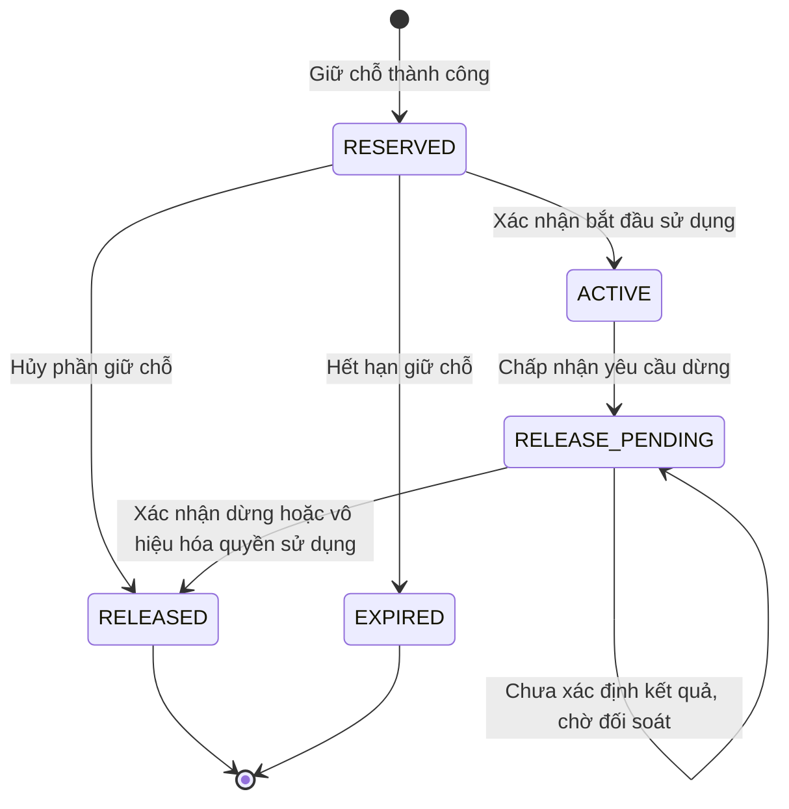
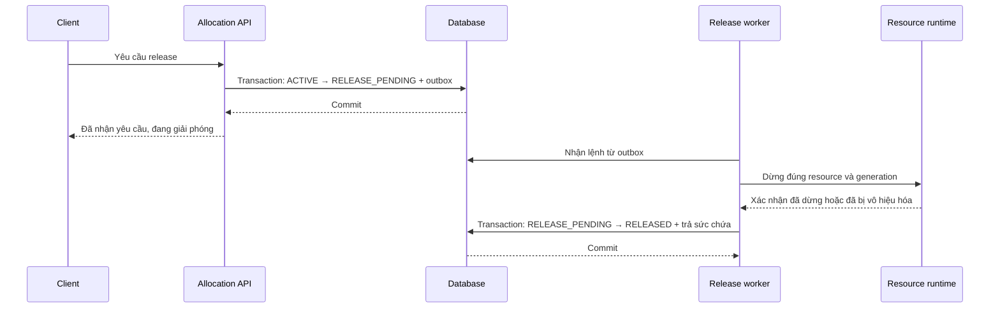

# Allocation release — Giải phóng tài nguyên an toàn

## 1. Bài toán: giải phóng cũng là một thao tác nhạy cảm

Trong chương **Resource Allocation**, allocation là bản ghi quyền chiếm dụng một lượng tài nguyên cho một chủ thể và một mục đích nghiệp vụ. Ví dụ: giữ hai ghế cho một đơn hàng, giữ một máy ảo cho một tác vụ, giữ dung lượng lưu trữ cho một tenant, hoặc giữ một suất xử lý trong hàng đợi có giới hạn.

**Allocation release** là quá trình chấm dứt quyền chiếm dụng đó và đưa tài nguyên về trạng thái có thể được cấp lại, khi các điều kiện nghiệp vụ cho phép. Đối tượng của bài này là quyền chiếm dụng tài nguyên trong hệ thống nghiệp vụ, không phải thao tác giải phóng bộ nhớ của ngôn ngữ lập trình.

Trong phạm vi bảo mật logic nghiệp vụ, release phải trả lời được những câu hỏi sau:

- Ai được phép giải phóng allocation cụ thể này?
- Allocation đang ở trạng thái nào và có được phép giải phóng ở thời điểm hiện tại không?
- Lượng tài nguyên nào thực sự được trả lại? Hệ thống lấy con số đó từ đâu?
- Nếu cùng yêu cầu được gửi hai lần, hoặc timeout rồi retry, tài nguyên có bị cộng lại hai lần không?
- Nếu tác vụ vẫn còn sử dụng tài nguyên, việc cấp lại có khiến hai tác vụ cùng sử dụng một đơn vị tài nguyên không?

Một endpoint có đăng nhập và chỉ nhận phương thức `POST` vẫn có thể sai hoàn toàn ở các câu hỏi trên. Lỗi thường nằm ở việc hệ thống tin dữ liệu từ client, bỏ qua trạng thái trung gian, hoặc tách cập nhật trạng thái khỏi cập nhật sức chứa.

### Ví dụ xuyên suốt

Một nền tảng cấp phát các slot chạy tác vụ. Mỗi pool thuộc một tenant, có sức chứa cố định. Tác vụ có thể giữ nhiều slot, sau đó sử dụng chúng để chạy. Khi hủy hoặc hoàn tất tác vụ, các slot được trả về pool.

Nếu người dùng gửi lại yêu cầu hủy để làm tăng số slot khả dụng, hoặc giải phóng allocation của tenant khác, họ có thể vượt hạn mức, làm gián đoạn tác vụ hoặc gây cấp phát trùng. Bài học này xây dựng các quy tắc để ngăn những tình huống đó.

## 2. Phân biệt các thao tác liên quan

Không nên gom mọi hành động kết thúc vào một thao tác `delete allocation`.

| Thao tác | Ý nghĩa | Điều kiện cần kiểm tra |
|---|---|---|
| Cancel reservation | Hủy phần giữ chỗ chưa đưa vào sử dụng | Người gọi có quyền hủy; chưa có tác vụ sử dụng phần giữ chỗ |
| Release allocation | Chấm dứt quyền chiếm dụng và trả tài nguyên | Trạng thái cho phép; lượng trả lại lấy từ dữ liệu tin cậy |
| Request release | Yêu cầu kết thúc việc sử dụng tài nguyên | Có thể mới bắt đầu quá trình dừng tác vụ; chưa chắc trả được sức chứa |
| Expire reservation | Hết thời gian giữ chỗ | Đã đến hạn theo đồng hồ có thẩm quyền; chưa được xác nhận sử dụng |
| Revoke allocation | Thu hồi cưỡng chế bởi hệ thống hoặc người quản trị | Quyền thu hồi; chính sách phê duyệt nếu có; cơ chế dừng hoặc vô hiệu hóa bên sử dụng |
| Refund | Hoàn tiền hoặc khôi phục một quyền lợi tài chính | Quy tắc thanh toán riêng; không suy ra trực tiếp từ việc trả slot |
| Delete record | Xóa dữ liệu allocation theo chính sách lưu trữ | Allocation đã kết thúc; không còn phụ thuộc kiểm toán, đối soát hoặc retry |

Ví dụ, hủy một tác vụ đang chạy có thể chỉ chuyển allocation sang `RELEASE_PENDING`. Hệ thống phải xác nhận tác vụ đã dừng hoặc không còn khả năng truy cập tài nguyên trước khi chuyển sang `RELEASED` và cấp lại slot.

Việc trả slot cũng không tự động xóa lịch sử sử dụng, hoàn tiền hay khôi phục giới hạn số lần yêu cầu trong ngày. Mỗi loại giới hạn và quyền lợi cần quy tắc riêng.

## 3. Xác định business invariants trước khi viết endpoint

Business invariant là điều kiện luôn phải đúng tại các ranh giới giao dịch đã commit. Để minh họa, giả sử hệ thống không overcommit và mỗi pool có sức chứa cố định `C`.

Gọi:

- `A` là số đơn vị có thể cấp phát ngay.
- `H` là số đơn vị đang được giữ chỗ.
- `U` là số đơn vị đang được sử dụng.
- `P` là số đơn vị đang chờ giải phóng, chưa được phép cấp lại.

Khi mọi đơn vị đều thuộc một trong bốn nhóm trên:

```text
C = A + H + U + P
A >= 0, H >= 0, U >= 0, P >= 0
```

Nếu hệ thống có tài nguyên hỏng, đang bảo trì, nhiều chiều quota hoặc cho phép overcommit, phải bổ sung biến và quy tắc tương ứng. Không áp dụng máy móc phương trình của mô hình đơn giản này.

Các invariant quan trọng cho release:

| Invariant | Hệ quả khi triển khai |
|---|---|
| Chỉ chủ thể có quyền trên allocation mới được release | Kiểm tra tenant, đối tượng, hành động và bối cảnh; không chỉ kiểm tra role chung |
| Lượng release không vượt lượng đang chiếm dụng | Đọc lượng từ allocation đã lưu; không cộng theo `quantity` do client gửi |
| Một phần tài nguyên chỉ được trả lại một lần | Chuyển trạng thái và cập nhật sức chứa phải gắn với cùng kết quả giao dịch |
| Allocation đã kết thúc không tự hồi sinh do retry | Yêu cầu cũ không được tạo lần sử dụng mới hoặc thay đổi allocation mới |
| Tài nguyên chỉ được cấp lại khi bên sử dụng cũ đã bị vô hiệu hóa hoặc đã dừng | Trạng thái chờ giải phóng vẫn phải giữ sức chứa |
| Cập nhật không được vượt sức chứa vật lý hoặc quota có thẩm quyền | Kiểm tra biên trong giao dịch; ràng buộc cơ sở dữ liệu hỗ trợ phát hiện vi phạm |
| Việc trả tài nguyên phải truy nguyên được | Ghi actor, lý do, trạng thái trước/sau, lượng và định danh giao dịch |

Với release một phần, cần thêm invariant:

```text
0 <= released_quantity <= allocated_quantity
remaining_quantity = allocated_quantity - released_quantity
```

Đây là lượng lũy kế cho cùng một allocation. Hai yêu cầu release một phần có cùng lượng chưa chắc là cùng một ý định; vì vậy chỉ so sánh số lượng không đủ để chống lặp.

## 4. Mô hình trạng thái phải thể hiện lúc nào tài nguyên thật sự rảnh

Một state machine đơn giản cho ví dụ pool slot:



`RELEASED` và `EXPIRED` là trạng thái kết thúc trong mô hình này. Muốn chạy lại tác vụ phải tạo allocation mới với định danh và thế hệ sử dụng mới.

| Trạng thái hiện tại | Tác nhân hoặc sự kiện | Kết quả cho phép | Tác động sức chứa |
|---|---|---|---|
| `RESERVED` | Chủ sở hữu hủy | `RELEASED` | Chuyển `H` sang `A` đúng một lần |
| `RESERVED` | Bộ xử lý hết hạn | `EXPIRED` | Chuyển `H` sang `A` đúng một lần |
| `RESERVED` | Xác nhận sử dụng | `ACTIVE` | Chuyển `H` sang `U`, không tăng `A` |
| `ACTIVE` | Yêu cầu release hợp lệ | `RELEASE_PENDING` | Chuyển `U` sang `P`, chưa tăng `A` |
| `RELEASE_PENDING` | Có bằng chứng bên sử dụng đã dừng hoặc bị vô hiệu hóa | `RELEASED` | Chuyển `P` sang `A` đúng một lần |
| `RELEASE_PENDING` | Retry yêu cầu dừng | Giữ nguyên | Không trả thêm tài nguyên |
| `RELEASED` | Retry release | Trả kết quả đã kết thúc | Không thay đổi sức chứa |
| `EXPIRED` | Yêu cầu xác nhận sử dụng đến muộn | Từ chối | Không khôi phục quyền sử dụng |

Không cho client tự gửi `status=RELEASED` để ghi trực tiếp vào entity. Client yêu cầu một hành động; server quyết định chuyển trạng thái nào hợp lệ.

### Các điều kiện nghiệp vụ ngoài trạng thái

Một số allocation chỉ được thu hồi khi có phê duyệt, hết thời gian khóa hoặc hoàn tất nghĩa vụ liên quan. Những điều kiện này thuộc guard của chuyển trạng thái, cần kiểm tra trên server trong phạm vi nhất quán phù hợp.

Ví dụ, nếu pool tài nguyên quan trọng yêu cầu người thứ hai duyệt việc thu hồi, endpoint release phải xác minh bản phê duyệt gắn đúng allocation, đúng hành động và đúng phiên bản còn hiệu lực. Có role quản trị không mặc nhiên cho phép bỏ qua quy trình phê duyệt đã được chính sách yêu cầu.

## 5. Quyền theo đối tượng và dữ liệu có thẩm quyền

Giả sử API nhận:

```http
POST /allocations/8d41.../release
Authorization: Bearer <token>
Idempotency-Key: <opaque-key>
Content-Type: application/json

{
  "reason": "USER_CANCELLED"
}
```

Với release toàn bộ, request không cần chứa `poolId`, `tenantId`, `ownerId`, `quantity`, `availableCapacity` hay trạng thái đích. Server lấy các dữ liệu đó từ allocation và ngữ cảnh xác thực đã được kiểm tra.

Thứ tự xử lý nên thể hiện rõ:

1. Xác thực danh tính và xác định tenant đang hoạt động từ ngữ cảnh có thẩm quyền.
2. Tìm allocation trong phạm vi tenant đó.
3. Kiểm tra quyền thực hiện hành động trên allocation, chẳng hạn chủ sở hữu được hủy phần giữ chỗ của mình, người vận hành được thu hồi theo chính sách.
4. Kiểm tra trạng thái và các guard nghiệp vụ trên dữ liệu hiện hành.
5. Thực hiện chuyển trạng thái và cập nhật liên quan theo cơ chế giao dịch đã thiết kế.

Nếu API có tenant trong URL hoặc header, giá trị đó chỉ là yêu cầu chọn phạm vi; server vẫn phải xác minh quyền thành viên và quyền hành động. Không coi việc biết một `allocationId` khó đoán là bằng chứng sở hữu.

Khi nhận callback từ worker hoặc nhà cung cấp, cần xác minh nguồn gửi và đối chiếu chính xác allocation, external resource ID, lần thực thi và thế hệ cấp phát. Một callback hợp lệ về mặt chữ ký vẫn có thể là thông báo cũ của lần chạy trước.

### Retry cũng phải đi qua kiểm tra quyền

Không trả bản phản hồi lưu trong kho idempotency trước khi kiểm tra danh tính và quyền truy cập hiện tại. Nếu quyền của người gọi đã bị thu hồi, idempotency key cũ không được trở thành cách đọc lại dữ liệu nhạy cảm hoặc tiếp tục thực hiện hành động.

## 6. Các lỗi logic điển hình

### 6.1. Cộng trả tài nguyên theo dữ liệu từ client

Mã giả sai:

```java
// Sai: dữ liệu request quyết định pool và lượng cộng trả.
poolRepository.incrementAvailable(request.poolId(), request.quantity());
allocationRepository.markReleased(request.allocationId());
```

Người gọi có thể đổi pool, gửi số lượng lớn hơn lượng đã giữ, gửi số âm hoặc gửi lại nhiều lần. Việc gọi `markReleased` sau đó không đảo ngược tác hại đã xảy ra.

Cách sửa là đọc pool và lượng từ allocation có thẩm quyền, kiểm tra quyền theo đối tượng, rồi chỉ cộng trả khi chính giao dịch đó giành được quyền chuyển allocation từ trạng thái được phép sang trạng thái kết thúc.

### 6.2. Kiểm tra rồi cập nhật ở hai thời điểm tách rời

```text
Request A: đọc allocation = RESERVED
Request B: đọc allocation = RESERVED
Request A: available += quantity
Request B: available += quantity
Request A: status = RELEASED
Request B: status = RELEASED
```

Trạng thái cuối trông đúng nhưng sức chứa đã tăng hai lần. Đây là lỗi cạnh tranh giữa thao tác kiểm tra và thao tác thay đổi dữ liệu. Kiểm tra bằng một câu `if` trong Java không tự tạo tính nguyên tử ở cơ sở dữ liệu.

### 6.3. Xóa bản ghi trước khi hoàn tất release

Nếu xóa allocation ngay sau khi nhận yêu cầu, worker có thể mất thông tin cần để dừng tác vụ, retry không còn căn cứ nhận diện thao tác cũ và đối soát không biết tài nguyên đã được trả hay chưa.

Giữ bản ghi kết thúc cùng lịch sử phù hợp với chính sách lưu trữ. Việc dọn dữ liệu là một quy trình riêng, có xét đến thời hạn retry và các quan hệ tham chiếu.

### 6.4. Trả quota ngay khi gửi lệnh dừng

Gửi thành công lệnh `stop` không chứng minh tác vụ đã dừng. Nếu hệ thống tăng số slot khả dụng ngay lúc đó, allocation mới có thể dùng cùng sức chứa trong khi tác vụ cũ vẫn chạy.

Dùng `RELEASE_PENDING` và chỉ trả sức chứa sau khi có bằng chứng đủ mạnh theo mô hình tài nguyên. Nếu kết quả không rõ do timeout, giữ trạng thái chờ và đối soát.

### 6.5. Dùng một cờ release để hoàn lại mọi loại hạn mức

Một tác vụ đã chạy mười phút rồi bị hủy có thể được trả số slot đang chiếm dụng, nhưng thời gian đã tiêu thụ vẫn được ghi nhận. Nếu release đồng thời xóa số lần tạo tác vụ hoặc khôi phục toàn bộ ngân sách sử dụng, người dùng có thể lặp vòng tạo–hủy để né giới hạn.

Phân biệt ít nhất ba đại lượng: mức sử dụng đồng thời, mức sử dụng đã tích lũy và tốc độ yêu cầu. Release chỉ điều chỉnh những đại lượng mà chính sách cho phép.

## 7. Release trong một cơ sở dữ liệu: transaction và điều kiện chuyển trạng thái

Ví dụ dưới đây dùng cú pháp PostgreSQL để minh họa **hủy toàn bộ một allocation đang `RESERVED`**, khi tài nguyên còn được quản lý hoàn toàn trong cùng cơ sở dữ liệu. Ví dụ không áp dụng trực tiếp cho tác vụ `ACTIVE` cần dừng ở hệ thống bên ngoài.

Các trường tối thiểu:

```text
resource_pool(
    id, tenant_id, capacity, available
)

allocation(
    id, tenant_id, owner_id, pool_id, quantity,
    status, version, expires_at, released_at, released_by
)
```

Các ràng buộc hỗ trợ:

```sql
CHECK (capacity >= 0)
CHECK (available >= 0 AND available <= capacity)
CHECK (quantity > 0)
```

Hai `CHECK` đầu thuộc bảng pool, `CHECK` cuối thuộc bảng allocation. Đồng thời cần khóa ngoại bảo đảm allocation tham chiếu đúng pool của cùng tenant, chẳng hạn qua cặp khóa `(tenant_id, pool_id)` tham chiếu `(tenant_id, id)`.

Các ràng buộc theo từng hàng không tự bảo đảm phương trình tổng giữa pool và tất cả allocation. Luồng cấp phát, xác nhận sử dụng, hết hạn và release đều phải tuân theo cùng cơ chế nhất quán.

### Giao dịch minh họa

```sql
BEGIN;

-- tenant_id lấy từ ngữ cảnh đã xác minh.
SELECT id, tenant_id, owner_id, pool_id, quantity, status, version
FROM allocation
WHERE tenant_id = :tenant_id AND id = :allocation_id
FOR UPDATE;

-- Ở đây ứng dụng phải kiểm tra quyền và trạng thái trên hàng vừa khóa.
-- Không có hàng: xử lý theo chính sách không tồn tại/không được truy cập.
-- RELEASED: trả kết quả đã release, không chạy bước cộng sức chứa.
-- Khác RESERVED hoặc không qua guard: từ chối, không thay đổi dữ liệu.

UPDATE allocation
SET status = 'RELEASED',
    released_at = CURRENT_TIMESTAMP,
    released_by = :actor_id,
    version = version + 1
WHERE tenant_id = :tenant_id
  AND id = :allocation_id
  AND status = 'RESERVED'
  AND version = :locked_version;

-- Ứng dụng bắt buộc kiểm tra affected_rows = 1 trước khi tiếp tục.
-- pool_id và quantity dưới đây lấy từ hàng allocation đã khóa.
UPDATE resource_pool
SET available = available + :locked_quantity
WHERE tenant_id = :tenant_id
  AND id = :locked_pool_id
  AND available <= capacity - :locked_quantity;

-- Ứng dụng bắt buộc kiểm tra affected_rows = 1.
-- Nếu không: phát sinh lỗi để ROLLBACK cả giao dịch và điều tra sai lệch.

-- Ghi audit và outbox, nếu có, trong cùng giao dịch.
COMMIT;
```

Đây là phác thảo giao dịch có các nhánh điều khiển do ứng dụng thực hiện, không phải script có thể chạy nguyên khối mà bỏ qua các kiểm tra trong chú thích. Bất kỳ lỗi nào trước `COMMIT` đều phải rollback cả chuyển trạng thái lẫn cập nhật sức chứa.

Điều kiện biên trên pool giúp từ chối kết quả vượt sức chứa. Tuy nhiên, nếu pool vẫn còn nhiều chỗ trống, một lần cộng thừa có thể chưa vượt `capacity`; vì vậy điều kiện biên không thay thế việc bảo vệ chuyển trạng thái.

### Vai trò của từng cơ chế

- `FOR UPDATE` tuần tự hóa các thao tác cạnh tranh trên cùng allocation trong mô hình khóa của cơ sở dữ liệu.
- Điều kiện `status` và `version` làm rõ phiên bản và chuyển trạng thái mà thao tác dự định thực hiện.
- Transaction ràng buộc trạng thái allocation, sức chứa, audit và outbox thành một kết quả commit hoặc rollback.
- Ràng buộc cơ sở dữ liệu phát hiện một số trạng thái không hợp lệ ngay cả khi ứng dụng có lỗi.

Có thể dùng cập nhật có điều kiện hoặc optimistic locking thay cho khóa bi quan, nhưng phải kiểm tra số hàng được cập nhật và bảo đảm chỉ giao dịch thắng mới trả sức chứa. Không cần kết hợp mọi loại khóa nếu một cơ chế đã đáp ứng đầy đủ mô hình cạnh tranh.

Mọi luồng cùng sửa dữ liệu phải dùng thứ tự khóa nhất quán. Nếu giao dịch chạm nhiều allocation hoặc nhiều pool, xác định thứ tự khóa ổn định để giảm deadlock. Khi phải retry giao dịch do deadlock hoặc xung đột tuần tự hóa, retry có giới hạn và giữ nguyên ý định nghiệp vụ.

### Khung service Java

Mã sau là phác thảo theo kiểu service có transaction; các repository và policy là giao diện minh họa, không phải mã Java độc lập có thể chạy ngay:

```java
@Transactional
public ReleaseResult releaseReservation(Actor actor, UUID allocationId) {
    Allocation allocation = allocations.lockInTenant(
        actor.tenantId(), allocationId
    ).orElseThrow(NotFoundException::new);

    // Kiểm tra quyền trước cả nhánh trả kết quả cho request lặp.
    policy.requireCanRelease(actor, allocation);

    if (allocation.status() == RELEASED) {
        return ReleaseResult.alreadyReleased(allocation.id());
    }
    if (allocation.status() != RESERVED) {
        throw new InvalidTransitionException();
    }
    policy.requireReleaseGuards(actor, allocation);

    int changed = allocations.markReleasedIfReserved(
        actor.tenantId(), allocation.id(), allocation.version(), actor.id()
    );
    if (changed != 1) {
        throw new ConcurrentAllocationChangeException();
    }

    int returned = pools.returnWithinCapacity(
        allocation.tenantId(), allocation.poolId(), allocation.quantity()
    );
    if (returned != 1) {
        throw new CapacityInvariantViolationException();
    }

    audit.recordRelease(actor, allocation);
    outbox.recordAllocationReleased(allocation);
    return ReleaseResult.released(allocation.id());
}
```

Trong triển khai thực tế, cấu hình transaction phải bảo đảm các ngoại lệ làm thất bại thao tác sẽ gây rollback. Audit hoặc outbox dùng trong ví dụ phải cùng tham gia transaction cơ sở dữ liệu; lời gọi mạng đến hệ thống khác không tự tham gia giao dịch đó.

## 8. Idempotency: nhận diện ý định lặp và bảo vệ hiệu ứng nghiệp vụ

Một thao tác release có tính idempotent khi thực hiện lại cùng ý định không trả thêm tài nguyên và không tạo thêm hiệu ứng nghiệp vụ. Phản hồi HTTP có thể khác nhau, chẳng hạn lần đầu báo đã release, lần sau báo allocation đã kết thúc, trong khi trạng thái cuối giữ nguyên.

Cần phân biệt hai lớp bảo vệ:

1. **Bảo vệ theo allocation:** chuyển trạng thái nguyên tử bảo đảm allocation chỉ được trả sức chứa một lần, kể cả khi người gọi cố tình dùng idempotency key khác nhau.
2. **Bảo vệ theo request:** kho idempotency nhận diện retry của cùng một ý định và có thể trả kết quả tương ứng khi client không biết lần trước đã thành công hay chưa.

Chỉ có `Idempotency-Key` mà không bảo vệ chuyển trạng thái là chưa đủ. Người tấn công có thể gửi hàng nghìn key khác nhau cho cùng allocation.

### Thiết kế kho idempotency

Một thiết kế có thể dùng phạm vi duy nhất:

```text
(tenant_id, actor_id, operation, idempotency_key)
```

Mỗi bản ghi lưu thêm `allocation_id`, dấu vân tay nội dung yêu cầu đã chuẩn hóa, trạng thái xử lý, kết quả và thời hạn lưu. `operation` cần đủ rõ, ví dụ `release-allocation:v1`.

| Tình huống | Cách xử lý |
|---|---|
| Key mới, request hợp lệ | Giành quyền xử lý bằng ghi có ràng buộc duy nhất |
| Cùng key, cùng ý định đã hoàn tất | Sau khi kiểm tra quyền hiện tại, trả kết quả tương ứng |
| Cùng key nhưng khác allocation hoặc khác lượng release một phần | Từ chối vì key bị tái sử dụng cho ý định khác |
| Cùng key đang được xử lý | Trả trạng thái đang xử lý hoặc chờ theo chính sách có giới hạn |
| Key khác nhưng allocation đã release | Không cộng trả; xử lý theo trạng thái kết thúc |
| Kho idempotency đã hết thời hạn lưu key cũ | Chuyển trạng thái allocation vẫn phải ngăn cộng trả lần hai |

Nếu allocation, kho idempotency và pool cùng một cơ sở dữ liệu, nên commit kết quả idempotency cùng thay đổi nghiệp vụ. Nếu tách kho, cần thiết kế rõ cách phục hồi khi trạng thái request và kết quả nghiệp vụ lệch nhau; không coi một cờ `processed=true` trong cache là bằng chứng duy nhất rằng release đã hoàn tất.

### Release một phần

Nếu allocation giữ mười slot và người dùng muốn trả ba slot, request phải xác định rõ thao tác release một phần. Server kiểm tra `0 < requested_quantity <= remaining_quantity` trên dữ liệu được bảo vệ bởi khóa hoặc điều kiện phiên bản.

Mỗi ý định release một phần nên có định danh thao tác duy nhất trong phạm vi allocation. Hai request cùng trả ba slot với hai định danh khác nhau có thể là hai ý định hợp lệ, tổng cộng sáu slot. Nếu là retry của một ý định, chúng phải dùng cùng định danh và chỉ trả ba slot một lần.

Trong một transaction, cần ghi nhận thao tác duy nhất, giảm lượng còn chiếm dụng và tăng lượng khả dụng tương ứng. Allocation chỉ chuyển sang trạng thái kết thúc khi lượng còn lại bằng không và các điều kiện giải phóng đã được đáp ứng.

## 9. Khi tài nguyên nằm ngoài transaction cơ sở dữ liệu

Máy ảo, container, thiết bị, khóa thuê và hệ thống bên thứ ba thường không thể được thay đổi nguyên tử cùng bảng allocation. Không giữ transaction cơ sở dữ liệu mở suốt thời gian gọi API dừng tài nguyên để giả lập tính nguyên tử.

Một quy trình phù hợp cho tác vụ đang chạy:

1. Trong transaction thứ nhất, kiểm tra quyền và guard, chuyển `ACTIVE` sang `RELEASE_PENDING`, giữ sức chứa bị chiếm dụng và ghi một lệnh dừng vào outbox.
2. Worker nhận lệnh từ outbox, gọi hệ thống tài nguyên bằng định danh thao tác ổn định nếu phía nhận hỗ trợ chống lặp.
3. Nếu lời gọi timeout, worker xác minh trạng thái bên ngoài theo định danh tài nguyên và lần thực thi. Không suy ra rằng timeout đồng nghĩa với thành công hay thất bại.
4. Khi có bằng chứng tài nguyên không còn bị bên cũ sử dụng, transaction thứ hai chuyển đúng allocation từ `RELEASE_PENDING` sang `RELEASED`, trả sức chứa và ghi sự kiện kết quả.
5. Thông báo hoặc yêu cầu lặp đi qua điều kiện chuyển trạng thái và không trả thêm tài nguyên.



Outbox giúp tránh mất lệnh khi transaction đã commit nhưng tiến trình chết trước khi gửi sự kiện. Outbox không tự làm API bên ngoài có tính idempotent và không bảo đảm chỉ giao một lần. Worker vẫn phải xử lý khả năng lệnh hoặc sự kiện được giao nhiều lần.

### Bên sử dụng cũ còn sống: lease và fencing

Lease có thời hạn giúp phát hiện quyền sử dụng đã quá hạn, nhưng một tiến trình bị treo rồi hoạt động trở lại có thể tiếp tục thao tác bằng thông tin cũ. Nếu tài nguyên hỗ trợ, sử dụng fencing token hoặc generation tăng đơn điệu cho mỗi lần cấp quyền sử dụng tài nguyên.

Ví dụ, lần cấp quyền mới có token `42`, còn tiến trình cũ giữ token `41`. Thành phần thực sự kiểm soát truy cập tài nguyên phải từ chối thao tác với token cũ. Chỉ ghi token vào bảng allocation mà nơi thực hiện thao tác không kiểm tra token thì chưa có tác dụng chặn bên cũ.

Thời điểm được trả sức chứa phụ thuộc cơ chế thực thi: xác nhận đã dừng, thu hồi thông tin truy cập có hiệu lực, fencing được áp dụng, hoặc một điều kiện nghiệp vụ tương đương đủ mạnh. Khi chưa chứng minh được, giữ `RELEASE_PENDING` và kích hoạt đối soát theo chính sách.

Nếu release thất bại nhưng bên sử dụng còn hoạt động, không được tự chuyển về `ACTIVE` như một thao tác hoàn tác chung. Cần xác minh trạng thái thực tế và chỉ cho phép chuyển tiếp theo state machine đã định nghĩa. Việc đảo trạng thái tùy tiện có thể khôi phục quyền đã bị thu hồi.

## 10. Những cuộc đua cần thiết kế trước

### Release và xác nhận sử dụng

Hai giao dịch cùng nhìn thấy `RESERVED`: một bên muốn hủy, bên kia muốn bắt đầu chạy. Chỉ một chuyển trạng thái được thắng. Nếu hủy thắng, xác nhận phải bị từ chối; nếu xác nhận thắng, yêu cầu release cần đi theo luồng `ACTIVE` → `RELEASE_PENDING` thay vì cộng trả như phần giữ chỗ chưa sử dụng.

### Hết hạn và xác nhận sử dụng

Job hết hạn và request xác nhận phải dùng cùng quy tắc thời hạn và cùng cơ chế bảo vệ chuyển trạng thái. Dùng thời gian server có thẩm quyền, thường là thời gian cơ sở dữ liệu cho điều kiện giao dịch. Quy định rõ ranh giới, ví dụ chỉ xác nhận khi thời gian có thẩm quyền nhỏ hơn `expires_at`.

Một reservation vẫn có thể đang mang trạng thái `RESERVED` sau hạn vì job dọn chưa chạy. Endpoint xác nhận phải tự kiểm tra hạn; không dựa vào giả định rằng job nền đã cập nhật trạng thái kịp thời. Với giao dịch dài, cần hiểu thời điểm mà hàm lấy thời gian của cơ sở dữ liệu đại diện để tránh chấp nhận dữ liệu đã quá hạn.

### Callback cũ và lần cấp phát mới

Tác vụ cũ đã kết thúc, resource vật lý được gán cho allocation mới, nhưng callback release cũ đến muộn. Callback chỉ được tác động đến allocation và generation mà nó tham chiếu; không được tìm tài nguyên đang dùng hiện tại chỉ bằng một tên có thể tái sử dụng rồi giải phóng tài nguyên đó.

### Release và điều chỉnh sức chứa pool

Nếu quản trị viên giảm capacity trong lúc vẫn còn allocation, hệ thống phải xác định chính sách riêng. Có thể từ chối giảm dưới lượng đang bị chiếm dụng, hoặc dùng mô hình ghi nhận phần vượt giới hạn tạm thời và chặn cấp phát mới. Không ép mọi thay đổi vào công thức `available = capacity - used` nếu mô hình đã có thêm nhóm tài nguyên hoặc điều kiện bảo trì.

### Release và hoàn tiền

Release thành công nhưng hoàn tiền thất bại không có nghĩa là phải cấp lại tài nguyên. Ghi nhận hai trạng thái riêng và dùng tiến trình phục hồi phù hợp. Nếu sự kiện release kích hoạt hoàn tiền, consumer tài chính phải chống xử lý lặp theo định danh nghiệp vụ; một allocation chỉ trả sức chứa một lần chưa đủ để bảo đảm tiền chỉ được hoàn một lần.

## 11. Đối soát, kiểm toán và phục hồi

Một hệ thống an toàn vẫn phải đối mặt với tiến trình chết, lỗi lập trình và dữ liệu lịch sử không nhất quán. Cần có đối soát để phát hiện sai lệch thay vì chỉ tin rằng endpoint đã trả HTTP thành công.

### Audit cần trả lời được điều gì?

Ghi nhận tối thiểu:

- Allocation, pool, tenant và lượng tài nguyên liên quan.
- Actor hoặc danh tính service thực hiện; người duyệt nếu quy trình yêu cầu.
- Hành động, lý do đã chuẩn hóa, trạng thái trước/sau và version hoặc generation.
- Operation ID hoặc request ID để liên kết retry, worker và sự kiện.
- Thời điểm chấp nhận, thời điểm hoàn tất và kết quả thực thi bên ngoài khi có.

Không ghi token xác thực hoặc thông tin bí mật vào audit. Một trường `reason` dạng văn bản do người dùng nhập không thay thế được quyết định phân quyền hoặc bản ghi phê duyệt.

### Chỉ số và truy vấn đối soát

Các tín hiệu hữu ích gồm số allocation ở `RELEASE_PENDING` quá lâu, lỗi cập nhật sức chứa, số lần chuyển trạng thái bị từ chối, mức retry, callback sai generation và chênh lệch giữa sức chứa với các allocation còn chiếm dụng.

Việc tính lại tổng phải dựa trên snapshot hoặc cơ chế đồng bộ đủ nhất quán. Nếu đọc pool rồi đọc allocation ở hai thời điểm khác nhau trong khi hệ thống vẫn đang thay đổi, có thể tạo cảnh báo sai hoặc ghi đè một giá trị đúng bằng tổng đã lỗi thời.

Khi phát hiện lệch, tiến trình sửa chữa phải có quyền riêng, kiểm tra phiên bản và lưu dấu vết. Tránh dùng một job định kỳ cộng trả mọi allocation có vẻ đã cũ mà không kiểm tra trạng thái thực tế ở hệ thống tài nguyên.

Một vòng phục hồi điển hình cho `RELEASE_PENDING`:

1. Giành quyền xử lý bản ghi theo lease hoặc cơ chế khóa được thiết kế cho worker.
2. Kiểm tra resource ID và generation; truy vấn nguồn có thẩm quyền.
3. Nếu đã dừng hoặc bị vô hiệu hóa, thử hoàn tất release bằng cập nhật có điều kiện.
4. Nếu vẫn chạy, retry lệnh dừng theo chính sách và giới hạn tần suất.
5. Nếu chưa xác định được, giữ sức chứa chưa khả dụng và đưa vào luồng xử lý vận hành sau ngưỡng thời gian đã đặt.

Retry cần backoff, giới hạn và quan sát được. Một endpoint release được phân quyền đúng vẫn có thể bị dùng để gây tải bằng các yêu cầu lặp liên tục, nên cần hạn chế tốc độ theo chính sách của hệ thống.

## 12. Kiểm thử tình huống tấn công logic

Kiểm thử phải xác minh cả trạng thái allocation, lượng tài nguyên và hiệu ứng bên ngoài. Chỉ kiểm tra HTTP `200` hoặc `409` sẽ bỏ sót lỗi đã cộng trả hai lần.

| Tình huống | Kết quả bắt buộc |
|---|---|
| Người dùng A release allocation của B | Bị từ chối theo chính sách; allocation và pool không thay đổi |
| Người dùng sửa tenant trong URL hoặc header | Không vượt phạm vi đã được xác minh |
| Client chèn `quantity`, `poolId` hoặc trạng thái đích | Dữ liệu không được dùng để quyết định lượng trả hoặc đối tượng bị tác động; có thể từ chối trường không hợp lệ |
| Cùng request được gửi lặp tuần tự | Tài nguyên chỉ được trả một lần |
| Nhiều request đồng thời với cùng allocation và các key khác nhau | Chỉ một chuyển trạng thái trả sức chứa thành công |
| Cùng key được dùng cho allocation khác hoặc nội dung khác | Bị từ chối vì không cùng ý định |
| Key bị xóa do hết hạn rồi request release cũ xuất hiện | Allocation kết thúc không bị cộng trả lần nữa |
| Quyền người gọi bị thu hồi sau request đầu | Retry vẫn phải qua kiểm tra quyền hiện tại |
| Release chạy đồng thời với xác nhận sử dụng | Một chuyển trạng thái thắng; không vừa cấp chạy vừa trả cùng tài nguyên |
| Job hết hạn chạy đồng thời với release | Chỉ một bên trả phần giữ chỗ về pool |
| Xác nhận đến sau `expires_at` nhưng job chưa chạy | Không được bắt đầu sử dụng phần giữ chỗ đã hết hạn |
| Allocation đang `ACTIVE` được yêu cầu release | Chưa tăng lượng khả dụng khi chưa đủ bằng chứng an toàn |
| Lệnh dừng timeout hoặc callback không đến | Giữ trạng thái chờ; phục hồi bằng retry hoặc đối soát |
| Worker xử lý lặp cùng thông báo hoàn tất | Không trả tài nguyên hoặc tạo hiệu ứng tài chính lặp |
| Callback hợp lệ nhưng thuộc generation cũ | Không tác động allocation mới |
| Lỗi sau khi cập nhật allocation nhưng trước cập nhật pool | Transaction rollback; hai dữ liệu không bị commit lệch nhau |
| Lỗi sau commit nhưng trước khi client nhận response | Retry nhận diện trạng thái đã thực hiện và không cộng trả thêm |
| Release một phần lặp với cùng operation ID | Chỉ giảm lượng còn chiếm dụng và trả pool một lần |
| Nhiều release một phần cạnh tranh vượt tổng lượng còn lại | Tổng lượng đã trả không vượt lượng được cấp |

### Kịch bản cạnh tranh có kết quả định lượng

Khởi tạo pool có `capacity = 10`, `available = 7` và đúng một reservation giữ ba slot. Gửi đồng thời nhiều yêu cầu hủy reservation đó, sử dụng nhiều idempotency key khác nhau.

Sau khi tất cả giao dịch hoàn tất:

```text
allocation.status = RELEASED
pool.available = 10
số hiệu ứng nghiệp vụ trả ba slot = 1
```

Có thể có nhiều audit ghi nhận các lần thử, nhưng chỉ một lần chuyển trạng thái thành công và một hiệu ứng trả tài nguyên. Nếu sức chứa thành `13`, kiểm thử phải thất bại ngay cả khi tất cả response đều trông hợp lệ.

Kiểm thử cạnh tranh cần nhiều kết nối hoặc transaction thực sự và điểm đồng bộ phù hợp để tạo giao thoa. Một vòng lặp gọi tuần tự hoặc mock repository trả sẵn kết quả không chứng minh được hành vi khi có cạnh tranh ở cơ sở dữ liệu.

### Kịch bản phục hồi sau lỗi

Với allocation đang chạy, cho tiến trình chết ở các thời điểm: sau commit `RELEASE_PENDING`, sau khi runtime đã dừng nhưng trước khi worker ghi kết quả, và sau commit `RELEASED` nhưng trước khi xác nhận đã xử lý thông báo.

Sau khi khởi động lại và xử lý lặp, allocation phải đi đến trạng thái phù hợp với tài nguyên thực tế; sức chứa chỉ được trả một lần. Nếu runtime chưa xác nhận trạng thái, hệ thống phải thể hiện đang chờ thay vì báo giải phóng thành công rồi cấp lại quá sớm.

## 13. Câu hỏi tự kiểm tra thiết kế

Trước khi triển khai allocation release, nhóm phát triển cần trả lời được:

1. Tài nguyên được tính theo đơn vị nào, nguồn nào là nguồn có thẩm quyền và có cho phép overcommit không?
2. Trạng thái nào được phép release trực tiếp; trạng thái nào phải chờ dừng hoặc phê duyệt?
3. Ai được release allocation của ai, trong tenant nào và với những điều kiện gì?
4. Transaction nào bảo đảm chỉ một bên chuyển trạng thái và trả sức chứa?
5. Retry cùng key, khác key, hết hạn key và retry sau khi mất quyền được xử lý ra sao?
6. Khi lời gọi bên ngoài không rõ kết quả, điều gì ngăn tài nguyên bị cấp lại sớm?
7. Callback cũ có thể nhầm vào tài nguyên hoặc allocation mới không?
8. Release có vô tình hoàn lại ngân sách sử dụng, lượt yêu cầu hoặc tiền trái chính sách không?
9. Sau lỗi hoặc tiến trình chết, hệ thống dùng dữ liệu nào để phục hồi và đối soát?
10. Kiểm thử nào chứng minh trạng thái đúng, sức chứa đúng và hiệu ứng bên ngoài không bị lặp?

Thiết kế release đạt yêu cầu khi quyền sử dụng cũ kết thúc theo đúng quy tắc, tài nguyên được trả về đúng lượng và đúng thời điểm, còn mọi lần retry chỉ lặp lại ý định đã được phép mà không tạo thêm quyền lợi.
