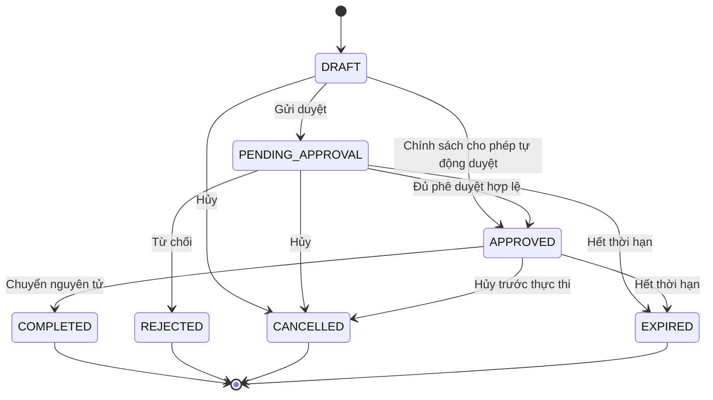

# Allocation transfer — Chuyển phân bổ tài nguyên an toàn

## 1. Mục tiêu và phạm vi

Trong chương **Resource Allocation**, allocation transfer là nghiệp vụ chuyển một phần hạn mức đã phân bổ từ một đối tượng sang đối tượng khác. Ví dụ: chuyển 8 đơn vị quota từ dự án A sang dự án B, điều chuyển số chỗ được cấp giữa hai nhóm, hoặc chuyển một phần ngân sách sử dụng tài nguyên giữa các bộ phận.

Trong phạm vi bảo mật logic nghiệp vụ, câu hỏi cần giải quyết là: **ai được chuyển, được chuyển bao nhiêu, từ đâu đến đâu, ở trạng thái nào, và làm thế nào để một ý định chuyển chỉ tạo ra một hiệu ứng?** Một yêu cầu hợp lệ về cú pháp vẫn có thể phá vỡ hệ thống nếu nó vượt quyền ở nguồn, làm âm phần khả dụng, bỏ qua phê duyệt hoặc được thực thi hai lần.

Sau bài học, người học có thể:

- Mô hình hóa các bất biến bảo toàn hạn mức và phần tài nguyên đang sử dụng.
- Kiểm tra quyền trên cả đối tượng nguồn và đối tượng đích.
- Thiết kế vòng đời đề nghị chuyển và ràng buộc phê duyệt với đúng nội dung.
- Thực thi cập nhật hai phía bằng transaction, xử lý tranh chấp và retry.
- Phân biệt idempotency của yêu cầu với tính duy nhất của hiệu ứng nghiệp vụ.
- Xây dựng các tình huống kiểm thử lạm dụng luồng chuyển phân bổ.

Ví dụ trong bài sử dụng hai allocation thuộc **cùng tenant, cùng pool tài nguyên, cùng loại tài nguyên và cùng đơn vị đo**. Trường hợp chuyển giữa các miền quản trị độc lập được phân tích riêng vì không thể mặc nhiên dùng cùng một transaction.

## 2. Chuyển phân bổ khác với chuyển tài nguyên đang chạy

Một allocation có thể được mô hình hóa bằng các đại lượng:

| Đại lượng | Ý nghĩa |
| --- | --- |
| `quota` | Tổng hạn mức đã cấp cho đối tượng |
| `used` | Phần đã được công việc đang chạy sử dụng |
| `reserved` | Phần đã dành cho công việc nhưng chưa chuyển thành sử dụng thực tế |
| `outboundHeld` | Phần tạm giữ cho các đề nghị chuyển đi chưa hoàn tất, nếu hệ thống hỗ trợ giữ trước |
| `free` | Phần còn có thể sử dụng hoặc điều chuyển |

Với các tập tài nguyên được đếm riêng, không chồng lấn:

```text
free = quota - used - reserved - outboundHeld
```

`reserved` ở đây là giữ chỗ cho công việc. `outboundHeld` là giữ cho một giao dịch điều chuyển. Nếu mô hình dữ liệu đã đưa giữ chuyển đi vào một trường reservation chung, không trừ cùng phần giữ lần thứ hai.

Chuyển phân bổ chỉ thay đổi `quota` của hai bên. Nó không tự động chuyển workload, dữ liệu, hóa đơn hay quyền sở hữu những tài nguyên đã được tạo. Muốn giảm quota xuống thấp hơn phần đang sử dụng cần một nghiệp vụ thu hồi hoặc di chuyển tài nguyên riêng với điều kiện an toàn tương ứng.

Ví dụ pool có tổng hạn mức 100 đơn vị:

| Đối tượng | Quota | Đang dùng | Giữ cho công việc | Giữ chuyển đi | Khả dụng |
| --- | ---: | ---: | ---: | ---: | ---: |
| Dự án A | 60 | 45 | 5 | 0 | 10 |
| Dự án B | 40 | 35 | 0 | 0 | 5 |

Chuyển 8 đơn vị từ A sang B tạo ra:

```text
quota(A): 60 → 52
quota(B): 40 → 48
free(A):  10 → 2
used(A):  45 → 45
tổng quota: 100 → 100
```

Chuyển 12 đơn vị phải bị từ chối dù A có quota 60, vì chỉ 10 đơn vị chưa bị ràng buộc. Kiểm tra `amount <= quota` là chưa đủ.

Các đại lượng phải dùng cùng đơn vị chuẩn. Có thể lưu dung lượng theo byte, thời lượng theo một đơn vị nguyên hoặc giá trị thập phân chính xác với scale được quy định. Không dùng số thực nhị phân cho các phép tính cần bảo toàn chính xác; đồng thời phải kiểm tra giới hạn để tránh tràn khi cộng quota phía nhận.

## 3. Các bất biến phải giữ sau mọi lần commit

### 3.1. Bảo toàn lượng phân bổ

Với lượng chuyển `q`:

```text
q > 0
sourceId != destinationId
source.quota'      = source.quota - q
destination.quota' = destination.quota + q
source.quota' + destination.quota'
    = source.quota + destination.quota
```

Nếu pool chỉ gồm các allocation đã cấp, tổng quota của chúng không đổi qua một lần chuyển. Nếu pool có phần chưa phân bổ, công thức đầy đủ là:

```text
pool.capacity = pool.unallocated + SUM(allocation.quota)
```

Chuyển giữa hai allocation không làm thay đổi `pool.unallocated`. Cấp thêm từ pool hoặc trả quota về pool là nghiệp vụ khác, cần ghi nhận riêng để tránh biến endpoint chuyển thành cách tự tăng tổng hạn mức.

### 3.2. Không lấy phần đang bị ràng buộc

Trong mô hình chưa giữ trước cho transfer:

```text
source.quota - q >= source.used + source.reserved
```

Nếu có giữ trước, mọi quota sau cập nhật vẫn phải bao phủ phần đang dùng, giữ cho công việc và các khoản giữ chuyển đi còn hiệu lực. Không chỉ kiểm tra `quota >= 0`; một quota dương nhưng thấp hơn số tài nguyên đang dùng vẫn sai.

### 3.3. Không vượt biên giới nghiệp vụ

Nguồn và đích phải khớp các ràng buộc được nghiệp vụ cho phép:

- Cùng tenant và cùng pool trong mô hình của bài.
- Cùng loại tài nguyên, đơn vị đo và điều kiện sử dụng.
- Còn hoạt động, cho phép điều chuyển, không bị khóa hoặc ngừng cấp phát.
- Không vượt trần nhận, mức tối thiểu phải giữ lại hoặc giới hạn chuyển theo kỳ, nếu các quy tắc này tồn tại.

Không cộng quota CPU với quota lưu trữ chỉ vì cả hai cùng có trường `quantity`. Tương tự, quota khuyến mại không mặc nhiên có thể chuyển thành quota trả phí với thời hạn dài hơn. Loại hạn mức, thời hạn và nguồn gốc có thể là một phần của danh tính tài nguyên cần bảo toàn.

### 3.4. Một đề nghị chỉ được thực thi một lần

Với một `transferId`:

```text
số lần tạo hiệu ứng chuyển đã commit <= 1
```

Bản ghi hoàn tất, hai thay đổi quota và dấu vết nghiệp vụ phải cùng phản ánh một kết quả. Không được có trạng thái `COMPLETED` khi phía nhận chưa được cộng, hoặc một lần cộng quota không truy ra được transfer tương ứng.

### 3.5. Quyền và phê duyệt phải còn hợp lệ khi thực thi

Quyền tạo đề nghị không đồng nghĩa với quyền thực hiện ngay. Nội dung đã được phê duyệt phải chính là nội dung được dùng khi cập nhật quota. Nếu số lượng, nguồn, đích hoặc thuộc tính ảnh hưởng đến chính sách thay đổi, không được tái sử dụng phê duyệt cũ.

## 4. Kiểm tra quyền trên cả nguồn lẫn đích

Một lỗi phổ biến là kiểm tra người gọi có quyền với đích rồi tin `sourceAllocationId` trong request. Kẻ tấn công có thể chọn nguồn là dự án của nhóm khác và chuyển quota về dự án mình quản lý. Chiều ngược lại cũng có rủi ro: quyền giảm quota ở nguồn chưa chắc cho phép cấp quota vào một dự án bị cấm nhận.

Backend cần lấy danh tính người gọi từ ngữ cảnh xác thực và tải đối tượng trong phạm vi tenant đã xác định. Không dùng `actorId`, `tenantId`, `role`, `approvedBy` hoặc `status` do client tự khai làm căn cứ cấp quyền.

Ví dụ phân tách quyền:

| Hành động | Điều kiện quyền mẫu |
| --- | --- |
| Tạo đề nghị | Được đề xuất chuyển từ nguồn và được đề xuất cấp vào đích |
| Phê duyệt | Có quyền phê duyệt cho phạm vi tài nguyên và mức chuyển tương ứng |
| Thực thi | Được thực thi transfer cụ thể; hai allocation vẫn đủ điều kiện tại thời điểm commit |
| Hủy | Có quyền hủy ở trạng thái hiện tại; không thể hủy transfer đã hoàn tất |
| Đọc kết quả | Có quyền xem transfer hoặc phạm vi quản trị liên quan |

Tên quyền chỉ có tính minh họa. Trong một tổ chức, người quản trị pool có thể được phép chuyển giữa các dự án mà không phải là thành viên từng dự án. Điều quan trọng là chính sách phải nêu rõ căn cứ cho cả hai phía, không suy diễn rằng một quyền chung trên endpoint đã bao phủ mọi đối tượng.

Khi trả kết quả của một yêu cầu đã chạy trước đó, vẫn phải kiểm tra quyền đọc hiện tại. Một idempotency key bị lộ không được trở thành vé truy cập kết quả của tenant hoặc người dùng khác.

Quyền lúc tạo đề nghị có thể khác quyền lúc thực thi. Nếu quyền được lưu cùng cơ sở dữ liệu, cần phối hợp kiểm tra với phiên bản chính sách hoặc khóa thích hợp. Nếu quyền đến từ dịch vụ khác, phải xác định rõ thời hạn quyết định quyền và cách vô hiệu hóa nó; transaction trên quota không tự giải quyết việc thu hồi quyền ở hệ thống bên ngoài.

## 5. Vòng đời đề nghị và phê duyệt

### 5.1. Trạng thái hợp lệ

Một vòng đời có thể gồm:



Nhánh tự động duyệt do backend quyết định bằng chính sách. Client không được truyền `requiresApproval=false` để chọn nhánh này.

Endpoint thực thi phải kiểm tra trạng thái `APPROVED` và điều kiện duyệt liên quan. Không coi việc UI đã ẩn nút là kiểm soát trạng thái. Gọi trực tiếp API, đổi thứ tự request hoặc sử dụng endpoint cũ đều phải gặp cùng quy tắc.

### 5.2. Ràng buộc phê duyệt với nội dung

Một đề nghị nên có dữ liệu như:

```text
transferId, tenantId, poolId
sourceAllocationId, destinationAllocationId
resourceType, unit, amount
revision, policyVersion, expiresAt
requestedBy, state
```

Phê duyệt phải gắn với `transferId` và `revision`, hoặc một biểu diễn nội dung chuẩn tương đương. Các trường ảnh hưởng đến quyết định duyệt phải được cố định khi gửi duyệt.

Ví dụ tấn công:

1. Gửi đề nghị chuyển 2 đơn vị từ A sang B.
2. Nhận phê duyệt cho revision 1.
3. Gọi API sửa thành 20 đơn vị hoặc đổi đích sang C.
4. Gọi API execute với approval của revision 1.

Backend phải từ chối bước 3 đối với đề nghị đã gửi, hoặc tạo revision mới và vô hiệu hóa phê duyệt trước. Không chỉ kiểm tra trường `approved=true`.

Nếu áp dụng nguyên tắc người tạo không được tự duyệt, kiểm tra danh tính thực tế trên server. Việc người tạo có thêm một vai trò khác không làm mất ràng buộc tách nhiệm vụ. Các ngưỡng phê duyệt theo tổng lượng chuyển trong ngày cũng cần tính trên phạm vi liên quan và được kiểm soát đồng thời; chỉ xét từng request sẽ cho phép chia nhỏ để vượt giới hạn tổng.

### 5.3. Được duyệt chưa chắc còn đủ quota

Giữa lúc duyệt và lúc execute, công việc mới có thể đã tiêu thụ phần khả dụng. Vì vậy, phê duyệt là sự cho phép về chính sách; nó không tự tạo ra một khoản giữ quota.

Trong mô hình không giữ trước, execute phải tính lại phần khả dụng dưới cơ chế đồng bộ. Nếu thiếu, không thay đổi quota và không đánh dấu `COMPLETED`. Có thể giữ đề nghị ở `APPROVED` cho lần thử tiếp theo nếu chính sách cho phép và chưa hết hạn. Quyết định có cho thử lại hay bắt buộc tạo đề nghị mới phải được quy định rõ.

Nếu một phê duyệt bị thu hồi cùng lúc execute, hai thao tác phải tranh chấp trên cùng trạng thái hoặc phiên bản đề nghị. Trường hợp execute thắng và commit trước khi hủy có hiệu lực, thao tác hủy phải phản hồi rằng transfer đã hoàn tất; không được trả thành công hủy cho cùng một hiệu ứng đã commit.

## 6. Cập nhật hai phía bằng một transaction

### 6.1. Những cách triển khai dễ bị khai thác

Ví dụ sau không an toàn nếu hai lần lưu là hai transaction độc lập:

```java
// Mã minh họa cách làm sai.
if (source.getFree() >= amount) {
    source.setQuota(source.getQuota() - amount);
    allocationRepository.save(source);       // Có thể đã commit.

    destination.setQuota(destination.getQuota() + amount);
    allocationRepository.save(destination);  // Có thể lỗi hoặc mất kết nối.
}
```

Nếu lần lưu thứ hai thất bại sau khi lần đầu đã commit, tổng quota giảm. Nếu đảo thứ tự và cấp cho đích trước, lỗi tiếp theo có thể làm tổng quota tăng. Nếu ORM trì hoãn ghi, hành vi cụ thể khác đi, nhưng việc thiếu ranh giới transaction rõ ràng vẫn không chứng minh được tính nguyên tử.

Ngay cả khi đặt toàn bộ đoạn mã vào một transaction, thao tác đọc rồi kiểm tra vẫn có thể tranh chấp nếu không khóa hoặc kiểm soát phiên bản. Hai transaction cùng đọc `free=10`, cùng cho phép chuyển 8, rồi cập nhật dựa trên dữ liệu cũ. Tùy cách ghi, hệ thống có thể làm âm phần khả dụng hoặc mất một lần trừ trong khi cả hai đích đã được cộng.

Một mutex trong một tiến trình Java cũng không đủ khi có nhiều instance, worker hoặc đường ghi dữ liệu khác.

### 6.2. Mô hình thực thi tối thiểu

Ví dụ dưới đây dùng mã giả gần Java, với các quy ước:

- Hai allocation và đề nghị chuyển nằm trong cùng cơ sở dữ liệu giao dịch.
- Các phương thức `lock...` lấy khóa ghi và giữ khóa đến hết transaction.
- Mọi thao tác tăng `used`, tăng `reserved`, thay đổi quota hoặc trạng thái đối tượng đều phối hợp bằng cùng cơ chế khóa hoặc kiểm soát xung đột tương đương.
- Luồng này **chưa dùng giữ trước cho transfer**; phần giữ trước được bổ sung ở mục 8.
- `execute` nhận định danh đề nghị và revision kỳ vọng; số lượng, nguồn và đích được đọc từ đề nghị đã duyệt.

```java
// Mã giả: các API transaction, authorization và repository cần được hiện thực.
ExecuteResult executeTransfer(ExecuteCommand command, Principal principal) {
    AuthContext auth = authenticateAndResolveTenant(principal);
    validateExecuteCommand(command);

    return transaction.required(() -> {
        RequestScope scope = new RequestScope(
            auth.tenantId(), auth.actorId(), "EXECUTE_ALLOCATION_TRANSFER"
        );
        String fingerprint = canonicalFingerprint(
            command.transferId(), command.expectedRevision()
        );

        RequestRecord request = requests.claimOrLock(
            scope, command.idempotencyKey(), fingerprint
        );
        request.requireSameFingerprint(fingerprint);

        if (request.isCompleted()) {
            authorization.requireCanReadResult(auth, request.transferId());
            return request.storedResult();
        }

        Transfer transfer = transfers.lockByTenantAndId(
            auth.tenantId(), command.transferId()
        );
        authorization.requireCanAccessTransfer(auth, transfer);

        // Một key khác vẫn không được làm cùng transfer chạy lần thứ hai.
        if (transfer.isCompleted()) {
            authorization.requireCanReadResult(auth, transfer.id());
            ExecuteResult result = transfer.originalResult();
            requests.complete(request, result);
            return result;
        }

        transfer.requireRevision(command.expectedRevision());
        transfer.requireApprovedAndNotExpired(transaction.currentTime());
        approvals.requireValidForCurrentRevision(transfer);

        // Tất cả transfer lấy khóa allocation theo cùng thứ tự ổn định.
        AllocationPair pair = allocations.lockPairInStableOrder(
            transfer.tenantId(), transfer.poolId(),
            transfer.sourceId(), transfer.destinationId()
        );
        Allocation source = pair.source();
        Allocation destination = pair.destination();

        authorization.requireCanExecute(auth, transfer, source, destination);
        policy.requireCompatibleAndActive(source, destination, transfer);
        policy.requireCurrentLimits(transfer, source, destination);

        Quantity amount = transfer.amount();
        requirePositive(amount);
        requireDifferentAllocations(source, destination);
        require(source.freeWithoutTransferHolds().isAtLeast(amount));

        Quantity sourceAfter = source.quota().subtractExact(amount);
        Quantity destinationAfter = destination.quota().addExact(amount);
        policy.requireAllowedQuotaAfterTransfer(
            source, sourceAfter, destination, destinationAfter
        );

        allocations.setQuota(source, sourceAfter);
        allocations.setQuota(destination, destinationAfter);

        // Một bản ghi hiệu ứng duy nhất cho mỗi transferId.
        movements.insertUniqueTransferEffect(transfer, amount);
        ExecuteResult result = transfer.completeWithResult(
            sourceAfter, destinationAfter, transaction.currentTime()
        );
        transfers.save(transfer);
        outbox.addUniqueTransferCompletedEvent(transfer, result);
        requests.complete(request, result);
        return result;
    });
}
```

Chỉ trả thành công sau khi transaction đã commit. Ngoại lệ trong phép cộng chính xác, kiểm tra chính sách, ghi movement hay cập nhật trạng thái phải làm rollback toàn bộ thay đổi của transaction này.

`claimOrLock` cần dựa trên ràng buộc duy nhất ở cơ sở dữ liệu và cơ chế chờ hoặc xử lý xung đột. Mẫu “SELECT không thấy key, rồi INSERT” mà không có ràng buộc duy nhất vẫn cho phép hai request cùng nhận mình là request đầu tiên.

Các hàm kiểm tra trong ví dụ không nên gọi mạng lâu trong lúc giữ khóa. Nếu cần quyết định từ bên ngoài, phải xác định cách chuẩn bị quyết định trước, ràng buộc nó với dữ liệu và xác minh hiệu lực khi thực thi. Một lời gọi dịch vụ rời rạc không tạo ra transaction chung.

### 6.3. Thứ tự khóa và các đường ghi liên quan

Khi A chuyển sang B và B chuyển sang A đồng thời, khóa theo thứ tự “nguồn rồi đích” có thể gây deadlock. Nên xác định thứ tự ổn định, chẳng hạn theo `(tenantId, poolId, allocationId)`, rồi lấy khóa theo thứ tự đó bất kể chiều chuyển.

Thứ tự này cần nằm trong một quy ước rộng hơn: thứ tự khóa request, transfer, allocation, bộ đếm chính sách hoặc pool phải nhất quán ở các luồng liên quan. Chỉ sắp xếp hai allocation chưa loại trừ deadlock với luồng khác lấy các loại khóa theo chiều ngược lại. Khi cơ sở dữ liệu báo deadlock hoặc xung đột cần retry, thực hiện lại **toàn bộ transaction** với cùng ý định và kiểm soát idempotency.

Đặc biệt, luồng tạo workload cũng phải tính lại khả dụng dưới cơ chế phối hợp. Khóa transfer không ngăn một endpoint cấp phát khác tăng `used` dựa trên snapshot cũ.

Ví dụ A còn 10 đơn vị, hai transfer T1 và T2 cùng muốn chuyển 8:

| Thời điểm | T1 | T2 |
| --- | --- | --- |
| 1 | Khóa A và đích của T1 | Chờ khóa A |
| 2 | Đọc khả dụng 10, chuyển 8, commit | Tiếp tục chờ |
| 3 | Hoàn tất | Đọc lại khả dụng 2 |
| 4 | — | Từ chối chuyển 8, không cộng vào đích |

Nếu áp dụng optimistic locking, mỗi cập nhật phải kiểm tra version; xung đột ở bất kỳ phía nào phải rollback cả hai phía rồi đọc và đánh giá lại. Không được chỉ retry câu lệnh cập nhật phía bị xung đột bằng giá trị đã tính trước.

Nếu chỉ thực hiện một phép trừ có điều kiện như `free >= amount` ở nguồn, vẫn cần transaction để gắn nó với phép cộng ở đích, ghi hiệu ứng và hoàn tất đề nghị.

### 6.4. Ràng buộc lưu trữ là lớp bảo vệ bổ sung

| Dữ liệu | Ràng buộc cần cân nhắc |
| --- | --- |
| Allocation | Đại lượng không âm; quota đủ bao phủ các phần bị ràng buộc trên cùng bản ghi |
| Transfer | Số lượng dương; nguồn khác đích; trạng thái thuộc tập cho phép |
| Quan hệ đối tượng | Khóa ngoại ghép hoặc kiểm tra tương đương để không tham chiếu allocation ngoài tenant và pool |
| Request idempotency | Unique trên phạm vi đã chọn và key |
| Movement | Unique trên định danh hiệu ứng của transfer |
| Outbox | Định danh sự kiện duy nhất cho lần hoàn tất tương ứng |

Không phải mọi quy tắc đều biểu diễn được bằng một `CHECK` trên một hàng. Bảo toàn tổng giữa nhiều allocation hoặc giới hạn chuyển theo ngày cần thiết kế transaction, bộ đếm hoặc cơ chế kiểm soát phù hợp. Ràng buộc cơ sở dữ liệu cũng không thay thế kiểm tra quyền theo đối tượng.

## 7. Idempotency: xử lý retry và timeout

### 7.1. Hai lớp định danh khác nhau

`Idempotency-Key` đại diện cho một lần gọi có thể được gửi lại. `transferId` đại diện cho một đề nghị nghiệp vụ cụ thể. Cần cả hai vì chúng giải quyết các tình huống khác nhau:

- Client gửi lại cùng lệnh tạo sau timeout: key giúp trả đúng đề nghị đã tạo, tránh sinh hai transfer.
- Client gọi execute hai lần với hai key khác nhau: trạng thái và hiệu ứng duy nhất của `transferId` vẫn phải ngăn chuyển hai lần.
- Client thực sự muốn tạo hai đề nghị khác nhau có cùng nội dung: hệ thống có thể cho phép nếu chính sách cho phép; không nên mặc nhiên gộp chỉ vì payload giống nhau.

Ở lệnh tạo, fingerprint cần bao phủ nội dung chuẩn hóa như nguồn, đích, số lượng, đơn vị và các thuộc tính ảnh hưởng nghiệp vụ. Ở lệnh execute trong ví dụ, fingerprint bao phủ `transferId` và revision kỳ vọng. Phạm vi key còn gắn tenant, người gọi và loại thao tác. Không băm nguyên văn JSON nếu hai cách biểu diễn tương đương có thể tạo ra ý nghĩa khác trong cơ chế so sánh.

### 7.2. Quy tắc phản hồi

| Tình huống | Cách xử lý mong đợi |
| --- | --- |
| Cùng key, cùng nội dung, lần trước đã commit | Kiểm tra quyền đọc rồi trả kết quả đã lưu |
| Cùng key, nội dung khác | Từ chối do xung đột key, không thực thi nội dung mới |
| Cùng key, request đầu đang chạy | Chờ có giới hạn hoặc trả trạng thái đang xử lý theo hợp đồng API |
| Hai key khác nhau cùng execute một transfer | Chỉ một hiệu ứng; lời gọi còn lại nhận kết quả gốc hoặc phản hồi đã hoàn tất |
| Kết nối mất sau commit | Lần gửi lại tìm thấy kết quả đã lưu, không chuyển tiếp lần nữa |
| Transaction rollback trước commit | Không có hiệu ứng; có thể chạy lại sau khi đọc lại điều kiện hiện tại |

Mã giả ở mục 6 lưu kết quả thành công cùng transaction nghiệp vụ. Nếu transaction thất bại thì bản ghi claim mới trong transaction đó cũng rollback. Đây là một hợp đồng đơn giản: lỗi chưa commit có thể được đánh giá lại ở lần gọi sau. Nếu cần ghi nhớ cả lỗi để luôn trả cùng kết quả, phải thiết kế vòng đời request và transaction lưu lỗi rõ ràng, không tự suy ra rằng mẫu trên đã làm điều đó.

Kết quả lưu nên có `transferId`, trạng thái và dữ liệu phản hồi của lần thực thi gốc. Quota hiện tại có thể đã thay đổi do các nghiệp vụ sau đó; không được đọc quota mới rồi trình bày nó như snapshot của lần chuyển trước.

Nếu lưu một trạng thái `PROCESSING` bằng transaction riêng để hỗ trợ tác vụ dài, cần cơ chế phục hồi worker chết, xác định chủ sở hữu và ngăn hai worker tiếp quản cùng lúc. Không xóa một bản ghi đang xử lý chỉ vì timeout rồi cho phép chạy lại mà chưa đối chiếu hiệu ứng thực tế.

Thời gian lưu key phải phù hợp cửa sổ retry. Khi key tạo đề nghị hết hạn, cùng payload có thể tạo đề nghị mới; nếu hợp đồng yêu cầu một tham chiếu ngoài chỉ được tạo một transfer trong suốt vòng đời nghiệp vụ, cần ràng buộc riêng trên tham chiếu đó. Idempotency có thời hạn không tự cung cấp tính duy nhất vĩnh viễn.

## 8. Khi cần giữ quota trước khi hoàn tất

Một số nghiệp vụ muốn bảo đảm nguồn còn đủ quota trong lúc chờ bước tiếp theo. Khi đó có thể tạo một hold gắn với transfer. Việc giữ phải thực hiện nguyên tử sau khi kiểm tra khả dụng, không chỉ thêm một cờ vào đề nghị.

Giả sử lượng chuyển là `q`, tổng hold chuyển đi hiện tại là `H`:

| Thao tác | Quota nguồn | Tổng hold nguồn | Quota đích |
| --- | --- | --- | --- |
| Tạo hold | Không đổi | `H + q` | Không đổi |
| Hoàn tất từ hold đó | Giảm `q` | Giảm `q` | Tăng `q` |
| Hủy hoặc hết hạn trước hoàn tất | Không đổi | Giảm `q` | Không đổi |

Khi hoàn tất, phải tiêu thụ **đúng hold thuộc transfer**, cùng việc trừ quota nguồn và cộng quota đích. Với một hold đã tồn tại, phần khả dụng sau chuyển là:

```text
free' = (quota - q) - used - reserved - (H - q)
      = quota - used - reserved - H
      = free
```

Điều này giải thích vì sao không kiểm tra `free >= q` lần thứ hai để tiêu thụ chính khoản đã giữ: `free` đã loại `q` ra rồi. Thay vào đó, phải xác minh hold còn hiệu lực, đúng nguồn, đúng số lượng, đúng revision, chưa được tiêu thụ hoặc giải phóng, và các bất biến còn lại vẫn đúng.

Ngược lại, khi tạo hold ban đầu, phải kiểm tra phần khả dụng chưa bị giữ có đủ `q`. Không được coi một hold bất kỳ cùng số lượng là bằng chứng cho transfer hiện tại.

Các ràng buộc cần có:

- Một hold đang hoạt động gắn với đúng transfer và phiên bản được phép thực thi.
- Tiêu thụ hold, giải phóng hold và thay đổi trạng thái được phối hợp trong transaction.
- Worker hết hạn và request execute tranh chấp trên cùng hold hoặc trạng thái transfer; chỉ một nhánh được commit.
- Sau hoàn tất, worker hết hạn không được giải phóng thêm quota khả dụng lần nữa.
- Hủy chỉ giải phóng hold, không cộng lại quota nguồn nếu quota chưa từng bị trừ.

Thời điểm hết hạn phải dựa trên đồng hồ phía server hoặc nguồn thời gian được quy định, không nhận `now` của client. Nếu hệ thống ghi tổng hold trên allocation, việc giải phóng khi hết hạn phải cập nhật tổng đó nhất quán. Chỉ xóa một bản ghi cache bằng TTL không chứng minh được quota đã được giải phóng đúng.

Hold cũng là tài nguyên có thể bị lạm dụng. Người dùng có thể tạo hàng nghìn đề nghị chưa hoàn tất để khóa toàn bộ phần còn trống. Cần thời hạn giữ, giới hạn số lượng và tổng lượng đang giữ theo phạm vi phù hợp, cùng quyền tạo hold. Có thể chọn chỉ giữ sau khi đủ phê duyệt nếu điều đó phù hợp trải nghiệm nghiệp vụ.

## 9. Sự kiện, hệ thống ngoài và chuyển ngược

### 9.1. Phát sự kiện sau chuyển

Sau khi hoàn tất, hệ thống có thể cần cập nhật báo cáo hoặc thông báo dịch vụ khác. Nếu commit quota rồi mới gửi sự kiện trực tiếp, tiến trình chết giữa hai bước có thể làm mất sự kiện. Nếu gửi trước commit, consumer có thể nhận một transfer sau đó bị rollback.

Một cách triển khai là ghi outbox trong cùng transaction với transfer. Worker đọc outbox và phát sự kiện sau commit. Vì việc gửi có thể lặp lại, consumer phải xử lý trùng dựa trên định danh sự kiện hoặc định danh hiệu ứng.

Trong mô hình ở mục 6, sự kiện hoàn tất chỉ thông báo kết quả: quota đích đã được cộng trong transaction gốc. Consumer không được cộng lại quota đích khi nhận sự kiện. Nếu thiết kế phân tán giao việc cộng quota cho consumer thì cần một mô hình ownership và trạng thái khác, không ghép hai cách một cách tùy tiện.

### 9.2. Hai cơ sở dữ liệu không tự có tính nguyên tử chung

Nếu nguồn và đích thuộc hai hệ thống không có transaction chung, không thể bọc hai lời gọi HTTP trong một annotation transaction rồi coi đó là chuyển nguyên tử.

Cần một giao thức nghiệp vụ, ví dụ giữ ở nguồn, ghi nhận lượng đang chuyển trong một tài khoản trung gian, cấp ở đích bằng lệnh có định danh duy nhất và xác nhận kết quả. Khi mô hình hóa lượng đang chuyển, bất biến có thể là:

```text
quota nguồn + lượng đang chuyển + quota đích = tổng được quản lý
```

Phải xác định nguồn dữ liệu có thẩm quyền cho từng lượng và quy tắc chuyển quyền sở hữu giữa các bước. Không cộng đồng thời một lượng vào cả quota đích và lượng đang chuyển khi tính tổng logic. Các bản sao dùng cho báo cáo có thể cập nhật chậm; chúng không nên được dùng như quyết định cấp phát có hiệu lực.

Các lệnh và xác nhận có thể bị gửi lại, vì vậy mỗi bước cần chống tạo hiệu ứng trùng. Khi nguồn timeout lúc gọi đích, kết quả là **chưa biết**, không mặc nhiên là thất bại. Nếu hoàn quota về nguồn trong khi đích thực tế đã cấp thành công, tổng quota sử dụng được sẽ tăng.

Một saga cần quy định trạng thái trung gian, cách tra cứu kết quả theo định danh, cách tiếp tục hoặc bù trừ, cùng đối soát các bước treo. Bù trừ cũng là thao tác nghiệp vụ có thể thất bại; nó không tương đương rollback của transaction cơ sở dữ liệu. Nếu bài toán chưa cần chuyển khác hệ thống, giới hạn chuyển trong cùng miền giao dịch thường giúp các bất biến rõ ràng hơn.

### 9.3. Chuyển ngược không phải sửa lịch sử

Sau khi transfer đã `COMPLETED`, không đổi nó về `CANCELLED` và sửa quota trực tiếp để che mất hiệu ứng. Nếu nghiệp vụ cho phép hoàn chuyển, tạo một transfer mới theo chiều ngược, tham chiếu transfer gốc và áp dụng quyền, phê duyệt, khả dụng hiện tại.

Ví dụ B đã dùng phần quota vừa nhận để chạy workload. Một lệnh hoàn chuyển cưỡng ép có thể làm quota của B thấp hơn phần đang dùng. Trường hợp này cần quy trình thu hồi hoặc xử lý ngoại lệ riêng, không thể luôn trừ lại đúng lượng ban đầu ngay lập tức.

## 10. Các tình huống lạm dụng cần kiểm thử

Kiểm thử phải quan sát trạng thái lưu trữ sau commit hoặc rollback, không chỉ mã HTTP. Với mô hình cùng cơ sở dữ liệu, kiểm tra cả quota hai phía, trạng thái transfer, movement và kết quả idempotency.

| Tình huống | Kết quả bắt buộc |
| --- | --- |
| Chuyển hợp lệ 8 đơn vị khi nguồn còn 10 | Nguồn giảm 8, đích tăng 8, tổng không đổi, một hiệu ứng |
| Số lượng bằng 0, âm, sai đơn vị hoặc vượt giới hạn kiểu số | Từ chối trước khi tạo hiệu ứng; không đổi quota |
| Nguồn trùng đích | Từ chối, không dùng nó để tiêu thụ phê duyệt hay làm sai thống kê chuyển |
| Chuyển 12 khi quota là 60 nhưng khả dụng chỉ 10 | Từ chối; phần đang dùng và giữ cho công việc vẫn được bảo toàn |
| Chọn nguồn thuộc tenant khác hoặc dự án không có quyền | Từ chối theo quyền và phạm vi đối tượng; không rò rỉ dữ liệu vượt quyền |
| Có quyền ở nguồn nhưng đích bị cấm nhận | Từ chối; không chỉ kiểm tra một phía |
| Gọi execute khi còn `DRAFT` hoặc `PENDING_APPROVAL` | Không tạo movement, không đổi quota |
| Duyệt revision 1 rồi sửa lượng hoặc đích | Không thực thi revision mới bằng phê duyệt cũ |
| Tự duyệt khi chính sách yêu cầu người khác | Từ chối dù người gọi có nhiều vai trò |
| Hai transfer đồng thời cùng chuyển 8 từ nguồn còn 10 | Tối đa một transfer hoàn tất; transfer còn lại không được cộng vào đích |
| Workload tăng phần sử dụng cùng lúc transfer giảm quota | Kết quả cuối vẫn bao phủ toàn bộ used, reserved và hold hợp lệ |
| Cùng key và cùng payload sau khi mất phản hồi | Trả kết quả gốc; không thêm hiệu ứng |
| Cùng key nhưng đổi transfer hoặc revision | Từ chối xung đột, không chạy lệnh mới |
| Hai key khác nhau cùng execute một transfer | Chỉ một movement và một lần cập nhật hai phía |
| Gây lỗi sau bước cập nhật nguồn, trước bước cập nhật đích | Rollback nguồn, đích, trạng thái, movement và request thành công chưa commit |
| Hủy hoặc hết hạn đồng thời với execute | Chỉ một kết cục hợp lệ; không vừa giải phóng hold vừa hoàn tất |
| Chạy worker hết hạn hai lần cho cùng hold | Chỉ giải phóng một lần |
| Phát hoặc nhận lại sự kiện hoàn tất | Không cộng quota thêm lần nữa |
| Chia nhỏ nhiều transfer để vượt tổng giới hạn theo kỳ | Giới hạn tổng vẫn được thực thi khi các request chạy đồng thời |

Với kiểm thử đồng thời, cần chủ động tạo điểm giao nhau để hai transaction cùng muốn sử dụng một nguồn. Chỉ gửi tuần tự hai request không chứng minh đã xử lý race condition. Mỗi lần kiểm thử nên sử dụng dữ liệu riêng và xác nhận bất biến cuối cùng, thay vì mặc định request nào phải thắng.

Khi mô phỏng lỗi, phân biệt hai vị trí:

- **Trước commit:** không tồn tại hiệu ứng hoàn tất; tất cả ghi trong transaction phải rollback.
- **Sau commit, trước khi client nhận phản hồi:** hiệu ứng đã tồn tại; retry phải lấy lại kết quả đó.

Nếu dùng hold hoặc quy trình nhiều hệ thống, bổ sung kiểm thử phục hồi sau khi worker chết tại từng ranh giới trạng thái. Việc hệ thống cuối cùng hội tụ cần được kiểm tra cùng điều kiện không cấp khả dụng vượt mức trong quá trình phục hồi.

## 11. Theo dõi và đối soát

Một transfer hoàn tất nên truy được ít nhất:

- Định danh transfer, revision và định danh hiệu ứng.
- Tenant, pool, loại tài nguyên, đơn vị, nguồn, đích và số lượng.
- Người yêu cầu, người duyệt, căn cứ chính sách và chủ thể thực thi nếu khác nhau.
- Thời điểm duyệt, thời điểm commit và snapshot hoặc tham chiếu movement cần thiết để giải thích thay đổi.
- Correlation ID cho request và sự kiện liên quan.

Không ghi access token hoặc bí mật xác thực vào audit log. Quyền xem log cũng phải phù hợp phạm vi tenant. Với request bị từ chối, ghi lý do đủ phục vụ điều tra nhưng không trả toàn bộ thông tin đối tượng ngoài quyền trong thông báo lỗi.

Các tín hiệu đáng theo dõi gồm: số lần từ chối do vượt khả dụng, thử nguồn hoặc đích ngoài quyền, xung đột key với payload khác, nhiều đề nghị sát ngưỡng duyệt, lượng hold kéo dài và transfer trung gian quá hạn.

Đối soát có thể kiểm tra:

```text
Mọi allocation đều đủ bao phủ used + reserved + outboundHeld.
Tổng quota và phần chưa phân bổ khớp mô hình pool.
Mỗi transfer COMPLETED có đúng một hiệu ứng tương ứng.
Mỗi hold đã tiêu thụ hoặc giải phóng khớp trạng thái cuối của nó.
Các sự kiện hoàn tất có thể truy về hiệu ứng đã commit.
```

Đối soát là cơ chế phát hiện và phục hồi bổ sung. Một cảnh báo sau vài phút không thay thế điều kiện chặn việc lấy quá phần khả dụng ngay khi commit. Khi phát hiện lệch, không tự sửa bằng cách cộng quota theo một snapshot có thể đã lỗi thời; cần xác định hiệu ứng đã xảy ra và thực hiện điều chỉnh có dấu vết.

## 12. Ví dụ xuyên suốt và câu hỏi tự kiểm tra

Với dữ liệu A và B ở mục 2, một lần chuyển an toàn có thể diễn ra như sau:

1. Người dùng được xác thực tạo đề nghị chuyển 8 đơn vị từ A sang B với key tạo `create-01`.
2. Backend xác định phạm vi tenant, kiểm tra quyền ở cả hai phía và lưu revision 1.
3. Người có thẩm quyền duyệt đúng revision 1; chưa có quota nào được dịch chuyển.
4. Lệnh execute khóa đề nghị và hai allocation, kiểm tra lại trạng thái, quyền và khả dụng.
5. Cùng transaction, quota A thành 52, quota B thành 48, transfer thành `COMPLETED`, movement và kết quả request được lưu.
6. Client mất phản hồi và gửi lại cùng key execute. Backend trả kết quả gốc sau kiểm tra quyền đọc; quota vẫn là 52 và 48 nếu chưa có nghiệp vụ khác.
7. Một transfer khác muốn tiếp tục chuyển 8 từ A bị từ chối vì A chỉ còn 2 đơn vị khả dụng.

Các câu hỏi cần trả lời được trước khi triển khai:

- Trường nào biểu diễn phần đang sử dụng, giữ cho công việc và giữ chuyển đi? Có bị tính hai lần không?
- Quyền nào cho phép lấy quota ở nguồn và quyền nào cho phép cấp vào đích?
- Phê duyệt gắn với phiên bản nào, và điều gì xảy ra khi quyền hoặc chính sách thay đổi?
- Tất cả đường tăng sử dụng hoặc giảm quota có cùng cơ chế kiểm soát xung đột không?
- Nếu tiến trình chết sau commit, request tiếp theo tìm được kết quả ở đâu?
- Khi hai key khác nhau cùng execute một transfer, điều gì chặn hiệu ứng thứ hai?
- Nếu có hold, nhánh execute và nhánh hết hạn được phân xử như thế nào?
- Nếu hai phía ở hai hệ thống, lượng đang chuyển thuộc về ai và ai có quyền quyết định cấp khả dụng?

Allocation transfer được bảo vệ khi các quy tắc về lượng, quyền, trạng thái và hiệu ứng được kiểm tra tại cùng ranh giới thực thi thích hợp. Tính đúng đắn cần được giữ cả khi người gọi cố đổi thứ tự bước, gửi đồng thời hoặc phát lại yêu cầu sau một kết quả chưa rõ.


