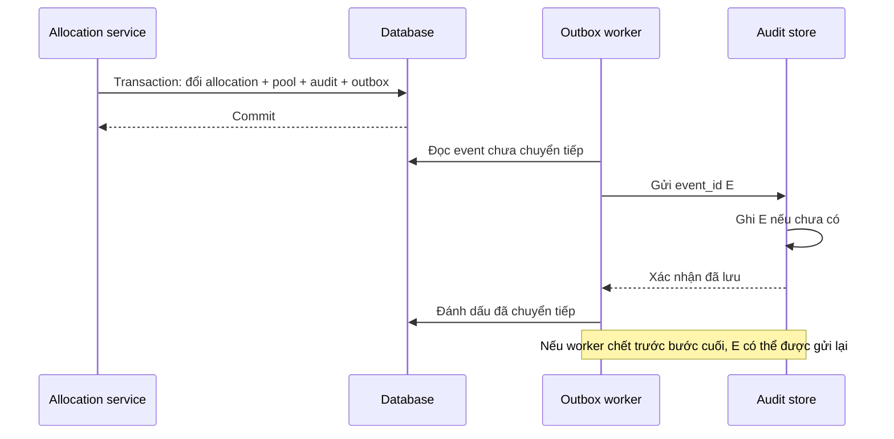

# Allocation audit — Kiểm toán cấp phát tài nguyên

## 1. Allocation audit giải quyết vấn đề gì?

Trong chương **Resource Allocation**, allocation biểu diễn quyền chiếm dụng một lượng tài nguyên cho một chủ thể và một mục đích nghiệp vụ: giữ ghế cho đơn hàng, cấp slot chạy tác vụ, giữ dung lượng cho tenant hoặc phân bổ ngân sách xử lý cho một dự án.

**Allocation audit** là việc ghi nhận, bảo vệ và kiểm tra lịch sử các quyết định cùng những thay đổi liên quan đến quyền chiếm dụng đó. Mục tiêu là trả lời được: ai đã yêu cầu hoặc thực hiện việc cấp phát, trên đối tượng nào, dựa vào quyền và điều kiện nào, trạng thái cùng lượng tài nguyên đã thay đổi ra sao, và kết quả nào thực sự được commit.

Trong bảo mật logic nghiệp vụ, một phép cấp phát sai có thể được thực hiện qua API hoàn toàn hợp lệ về mặt cú pháp. Người dùng có thể tìm cách bỏ qua phê duyệt, sửa tenant, lặp yêu cầu, trả tài nguyên nhiều lần hoặc lợi dụng cuộc đua để vượt quota. Lịch sử kiểm toán phải làm rõ được các chuỗi hành động này, thay vì chỉ lưu dòng chữ “request thành công”.

Ví dụ xuyên suốt: mỗi tenant có một pool gồm mười slot chạy tác vụ. Một allocation giữ ba slot, sau đó bắt đầu chạy và cuối cùng trả slot về pool. Hệ thống cần chứng minh rằng allocation được cấp đúng quyền, các chuyển trạng thái hợp lệ và ba slot chỉ được trả một lần.

Audit hỗ trợ phát hiện lạm dụng, điều tra sự cố và đối soát. Nó không thay thế kiểm tra quyền theo đối tượng, state machine, transaction hay cơ chế idempotency trong luồng xử lý chính. Một hệ thống có log rất đầy đủ vẫn có thể cho phép cấp phát sai nếu không chặn vi phạm ngay lúc ra quyết định.

## 2. Phân biệt audit, log vận hành, ledger và đối soát

| Thành phần | Câu hỏi chính | Đặc điểm |
|---|---|---|
| Audit nghiệp vụ | Ai đã làm gì, với đối tượng nào, dựa trên quyết định nào và kết quả gì? | Có cấu trúc, liên kết được actor, hành động, đối tượng, phiên bản và kết quả |
| Log vận hành | Tiến trình chạy như thế nào và lỗi kỹ thuật ở đâu? | Stack trace, độ trễ, retry, lỗi mạng; có thể được lấy mẫu hoặc xoay vòng |
| Ledger tài nguyên | Các biến động lượng tài nguyên cộng lại thành số dư nào? | Có quy tắc ghi nhận số lượng và đối soát; có thể là nguồn có thẩm quyền nếu được thiết kế như vậy |
| Trace | Một yêu cầu đi qua những service nào? | Tương quan lời gọi và thời gian; có thể không chứa đầy đủ quyết định nghiệp vụ |
| Đối soát | Các nguồn có đang nhất quán với nhau không? | So sánh allocation, số dư pool, audit hoặc trạng thái runtime tại mốc nhất quán |

Các thành phần có thể chia sẻ định danh tương quan, nhưng không tự thay thế nhau. Ví dụ, trace được lấy mẫu không đủ làm lịch sử kiểm toán bắt buộc. Ngược lại, một audit event đã release không cho biết nguyên nhân lỗi mạng nếu không có thông tin vận hành liên quan.

Nếu audit chỉ là bản sao phục vụ điều tra, phải chỉ rõ nguồn có thẩm quyền của trạng thái hiện tại. Nếu dùng event log làm nguồn để tái dựng trạng thái, đó là quyết định kiến trúc rộng hơn, đòi hỏi đầy đủ sự kiện, thứ tự, phiên bản schema và quy trình replay. Không mặc nhiên biến vài dòng audit thành hệ thống event sourcing.

## 3. Business invariants cho lịch sử kiểm toán

Giả sử pool không overcommit, sức chứa cố định và mọi slot thuộc một trong bốn nhóm:

```text
capacity = available + reserved + active + release_pending
```

`release_pending` vẫn chiếm sức chứa vì tác vụ cũ chưa được xác nhận dừng hoặc chưa bị vô hiệu hóa quyền sử dụng. Nếu có tài nguyên hỏng, bảo trì, sức chứa động hoặc quota nhiều chiều, mô hình phải bổ sung các đại lượng tương ứng.

Bên cạnh invariant tài nguyên, cần có invariant của audit:

| Invariant | Ý nghĩa triển khai |
|---|---|
| Mỗi chuyển trạng thái thuộc phạm vi kiểm toán có đúng một bản ghi kết quả tương ứng | Ràng buộc theo định danh allocation và phiên bản chuyển trạng thái; retry không tạo thêm kết quả thành công |
| Bản ghi thành công chỉ tồn tại nếu thay đổi nghiệp vụ đã commit | Ghi sự kiện bền vững cùng transaction với thay đổi, hoặc dùng cơ chế nguyên tử tương đương |
| Thay đổi đã commit không bị mất lịch sử chỉ vì bộ chuyển tiếp sự kiện chết | Có audit cục bộ bền vững và/hoặc outbox trước khi báo hoàn tất theo hợp đồng |
| Actor, tenant và lượng tài nguyên không do client tùy ý khai báo | Lấy từ ngữ cảnh xác thực và dữ liệu nghiệp vụ có thẩm quyền |
| Không sửa lịch sử để làm biến mất hành động đã xảy ra | Bản ghi sửa sai tham chiếu sự kiện cũ; quyền ghi, xóa và chính sách lưu trữ được tách rõ |
| Đọc audit không mở đường vượt quyền theo đối tượng | Kiểm tra quyền tenant, allocation và trường dữ liệu khi truy vấn, xuất hoặc tải lịch sử |
| Sự kiện đến lặp hoặc sai thứ tự không làm sai kết quả phân tích | Có event ID ổn định, phiên bản đối tượng và cơ chế xử lý khoảng trống |

Invariant “đúng một bản ghi” ở đây áp dụng cho **sự kiện chuyển trạng thái đã commit trong nguồn audit có thẩm quyền**. Hệ thống chuyển tiếp có thể giao cùng sự kiện nhiều lần; nhiều lần thử request cũng có thể tạo nhiều bản ghi attempt. Không gộp tất cả những thứ đó thành một khái niệm “một log”.

### Ví dụ lịch sử đúng

Để dễ theo dõi, giả sử không có allocation khác thay đổi pool trong chuỗi sau:

| Phiên bản allocation | Sự kiện | Trạng thái sau | Biến động available | Available sau |
|---|---|---|---:|---:|
| 1 | `ALLOCATION_RESERVED` | `RESERVED` | -3 | 7 |
| 2 | `ALLOCATION_ACTIVATED` | `ACTIVE` | 0 | 7 |
| 3 | `ALLOCATION_RELEASE_REQUESTED` | `RELEASE_PENDING` | 0 | 7 |
| 4 | `ALLOCATION_RELEASED` | `RELEASED` | +3 | 10 |

Request release gửi lại sau phiên bản 4 không tạo phiên bản 5 mang hiệu ứng cộng thêm ba slot. Nó có thể tạo bản ghi attempt cho biết đã nhận yêu cầu lặp và trả kết quả đã kết thúc.

Các trạng thái và tên sự kiện trên là mô hình minh họa. Hệ thống thực tế phải định nghĩa rõ trạng thái nào chiếm sức chứa, trạng thái nào được kết thúc và sự kiện nào được phép làm thay đổi số dư.

## 4. Ghi nhận lần thử, quyết định và kết quả đã commit

Ba loại thông tin sau có mục đích khác nhau:

1. **Attempt:** hệ thống nhận được một yêu cầu hoặc thông báo.
2. **Decision:** hệ thống cho phép, từ chối hoặc chưa thể quyết định dựa trên quyền, trạng thái và chính sách.
3. **Committed transition:** trạng thái nghiệp vụ thực sự đã thay đổi và transaction đã commit.

Một request hợp lệ về quyền vẫn có thể rollback do xung đột phiên bản hoặc lỗi cập nhật pool. Vì vậy không ghi `ALLOCATION_RELEASED` vào kho bên ngoài ngay sau khi kiểm tra quyền rồi coi đó là kết quả cuối cùng.

| Tình huống | Bản ghi phù hợp | Điều không được suy ra |
|---|---|---|
| Người dùng yêu cầu giữ ba slot | Attempt của hành động reserve | Chưa chứng minh đã cấp được ba slot |
| Quyền bị từ chối | Decision với mã như `OBJECT_ACCESS_DENIED` | Không được coi là allocation đã thay đổi |
| Guard yêu cầu phê duyệt không đạt | Decision với mã như `APPROVAL_REQUIRED` | Có role chung không đồng nghĩa được cấp phát |
| Transaction reserve commit | `ALLOCATION_RESERVED` gắn phiên bản mới | Không dựa riêng vào mã HTTP của một proxy |
| Yêu cầu dừng được chấp nhận | `ALLOCATION_RELEASE_REQUESTED` | Chưa chứng minh runtime đã ngừng sử dụng slot |
| Đã xác nhận dừng và trả slot thành công | `ALLOCATION_RELEASED` | Không tự suy ra đã hoàn tiền |
| Client retry sau khi mất response | Attempt mới liên kết operation cũ | Không phải một lần cấp phát hoặc release mới |

### Từ chối cũng cần bằng chứng, nhưng không ghi sai transaction

Nếu ghi audit từ chối trong cùng transaction rồi ném ngoại lệ khiến transaction rollback, bản ghi đó cũng có thể bị rollback. Luồng ghi nhận attempt hoặc decision cần được thiết kế độc lập với giao dịch bị từ chối, chẳng hạn qua một cơ chế ghi bền vững riêng có kiểm soát.

Không vì không ghi được log từ chối mà cho phép yêu cầu vốn không đủ quyền. Đồng thời cần theo dõi lỗi đường ghi audit, tránh tình trạng hệ thống vẫn từ chối đúng nhưng mất toàn bộ dấu vết về các cuộc thử lạm dụng.

Với thông tin nhạy cảm, phản hồi cho client có thể được chuẩn hóa để hạn chế tiết lộ sự tồn tại của đối tượng. Audit nội bộ có thể giữ mã lý do chi tiết hơn, dưới quyền truy cập phù hợp.

## 5. Thiết kế nội dung audit event

Một event tốt chứa đủ ngữ cảnh để giải thích thay đổi mà không sao chép toàn bộ request, token hoặc entity.

| Nhóm | Trường minh họa | Nguồn có thẩm quyền và mục đích |
|---|---|---|
| Định danh sự kiện | `event_id`, `event_type`, `schema_version` | Do hệ thống tạo; phân biệt sự kiện và giải mã payload |
| Phạm vi | `tenant_id`, `allocation_id`, `pool_id` | Từ allocation và ngữ cảnh đã xác minh |
| Người thực hiện | `actor_id`, `actor_type`, `initiated_by` | Phân biệt người dùng khởi xướng với service thực thi |
| Chủ thể hưởng hoặc mất quyền | `owner_id`, `workload_id` | Không mặc nhiên trùng actor |
| Tương quan | `operation_id`, `request_id`, `causation_id` | Liên kết retry, quyết định, job và sự kiện gây ra thay đổi |
| Chuyển trạng thái | `previous_state`, `new_state`, `allocation_revision` | Lấy từ dữ liệu được bảo vệ trong transaction |
| Lượng tài nguyên | `quantity`, `unit`, `available_delta` | Lượng thực tế được áp dụng; có quy ước dấu rõ ràng |
| Quyết định | `decision_code`, `policy_version`, `approval_id` | Dấu vết chính sách và phê duyệt nếu có |
| Thời gian | `occurred_at`, `recorded_at` | Phân biệt mốc nghiệp vụ với mốc tiếp nhận vào kho đích |
| Nguồn thực thi | `service_id`, `runtime_resource_id`, `generation` | Hữu ích với tác vụ bất đồng bộ và callback cũ |

Không phải sự kiện nào cũng có tất cả trường. Ví dụ, attempt cho một allocation không tồn tại chưa có `pool_id` có thẩm quyền. Cần biểu diễn thiếu dữ liệu một cách rõ ràng, thay vì điền thông tin do client cung cấp vào trường vốn được hiểu là đã xác minh.

### Ví dụ sự kiện hoàn tất release

```json
{
  "event_id": "evt-07f4",
  "event_type": "ALLOCATION_RELEASED",
  "schema_version": 1,
  "tenant_id": "tenant-a",
  "allocation_id": "alloc-815",
  "pool_id": "pool-cpu-a",
  "owner_id": "user-27",
  "actor": {
    "actor_id": "release-worker",
    "actor_type": "SERVICE",
    "initiated_by": "user-27"
  },
  "operation_id": "op-629",
  "request_id": "req-903",
  "causation_id": "evt-release-requested-815",
  "allocation_revision": 4,
  "previous_state": "RELEASE_PENDING",
  "new_state": "RELEASED",
  "quantity": 3,
  "unit": "execution_slot",
  "available_delta": 3,
  "decision_code": "RUNTIME_STOP_CONFIRMED",
  "policy_version": "allocation-policy-12",
  "runtime_resource_id": "workload-502",
  "generation": 18,
  "occurred_at": "2026-11-22T02:10:00Z"
}
```

Định danh trong ví dụ chỉ để minh họa. Trong hệ thống thực, event ID phải ổn định khi chuyển tiếp lại cùng một event. `recorded_at` có thể được kho audit đích bổ sung khi tiếp nhận; không dùng thời điểm nhận ở kho đích để giả lập thứ tự commit tại nguồn.

`initiated_by` cần được bảo toàn qua chuỗi công việc bằng dữ liệu tin cậy. Một header tùy ý như `X-Acting-User` không đủ làm bằng chứng service đang hành động thay cho người dùng nào.

### Lưu before/after như thế nào?

Với trạng thái allocation, before/after và revision là ngữ cảnh trực tiếp của chuyển trạng thái. Với `available_before` và `available_after` của pool, chỉ ghi chúng như số liệu đã xác minh khi lấy được từ chính thay đổi nguyên tử hoặc vùng khóa phù hợp.

Không đọc số dư pool trước giao dịch rồi tính `after = before + delta` trong bộ nhớ và ghi như sự thật đã commit. Allocation khác có thể đã thay đổi pool trong khoảng đó. Nếu không có số dư đáng tin cậy tại thời điểm thay đổi, ghi delta thực tế cùng phiên bản nguồn sẽ rõ ràng hơn một snapshot không chính xác.

### Lý do, quyền và phê duyệt

Phân biệt `user_reason` do người dùng nhập với `decision_code` do hệ thống quyết định. Câu “đã được quản lý duyệt” trong request không chứng minh có phê duyệt hợp lệ.

Nếu quy tắc yêu cầu phê duyệt, audit nên tham chiếu bản phê duyệt gắn đúng allocation, đúng hành động, đúng phạm vi và phiên bản còn hiệu lực. Lưu phiên bản policy cùng những dữ kiện quyết định cần thiết để giải thích kết quả; chỉ lưu tên role tại thời điểm điều tra có thể sai vì quyền đã thay đổi sau sự kiện.

## 6. Gắn audit thành công với transaction nghiệp vụ

Lỗi thường gặp là cập nhật allocation trước, rồi gửi audit trực tiếp qua mạng:

```text
1. Commit thay đổi allocation và pool.
2. Gửi event đến hệ thống audit.
3. Tiến trình chết hoặc mạng lỗi trước khi gửi thành công.
```

Kết quả là tài nguyên đã đổi chủ hoặc đã được trả nhưng không còn bằng chứng tương ứng trong kho đích. Đảo thứ tự cũng có lỗi: gửi event “đã release” trước, rồi transaction nghiệp vụ rollback.

Một thiết kế dùng chung cơ sở dữ liệu có thể thực hiện trong một transaction:

```text
BEGIN
  Khóa hoặc cập nhật có điều kiện allocation hiện hành.
  Kiểm tra quyền theo đối tượng và các guard trên dữ liệu có thẩm quyền.
  Chuyển trạng thái, cập nhật revision và lượng tài nguyên.
  Ghi audit transition với event_id ổn định.
  Ghi outbox tham chiếu cùng event_id nếu cần chuyển tiếp.
COMMIT
```

Nếu ghi audit hoặc outbox bắt buộc thất bại, transaction phải rollback theo chính sách đã chọn. Điều này làm cho thành công nghiệp vụ và bằng chứng bền vững cục bộ cùng tồn tại hoặc cùng không tồn tại.

### Ràng buộc chống ghi hai kết quả cho một chuyển trạng thái

Ví dụ cấu trúc tối thiểu theo cú pháp PostgreSQL, dành riêng cho sự kiện chuyển trạng thái đã commit:

```sql
CREATE TABLE allocation_transition_audit (
    event_id UUID PRIMARY KEY,
    tenant_id UUID NOT NULL,
    allocation_id UUID NOT NULL,
    allocation_revision BIGINT NOT NULL CHECK (allocation_revision > 0),
    event_type TEXT NOT NULL,
    previous_state TEXT,
    new_state TEXT NOT NULL,
    quantity BIGINT NOT NULL CHECK (quantity > 0),
    available_delta BIGINT NOT NULL,
    actor_id TEXT NOT NULL,
    operation_id UUID NOT NULL,
    occurred_at TIMESTAMPTZ NOT NULL,
    payload JSONB NOT NULL,
    UNIQUE (tenant_id, allocation_id, allocation_revision)
);
```

Ví dụ này giả định mỗi revision của allocation tương ứng đúng một transition event trong bảng. Nếu một thay đổi sinh nhiều loại sự kiện khác nhau, cần định nghĩa lại mô hình định danh, thay vì bỏ ràng buộc rồi hy vọng không trùng.

Bảng attempt nên có quy tắc riêng vì nhiều lần thử hợp lệ có thể cùng tham chiếu một allocation revision. Các trường `payload` vẫn cần schema và kiểm tra đầu vào; kiểu JSON không tự bảo đảm nội dung đúng.

Ràng buộc duy nhất chỉ ngăn hai hàng dùng cùng khóa. Nó không bảo đảm ứng dụng đã ghi đủ mọi sự kiện, không bảo đảm policy được áp dụng đúng và không tự bảo đảm delta khớp với cập nhật pool. Những thuộc tính đó đến từ luồng ghi được kiểm soát, transaction và các kiểm tra bổ sung.

### Phác thảo service Java

Mã sau minh họa việc hoàn tất release sau khi đã có bằng chứng runtime dừng. Đây là mã phác thảo với repository và policy trừu tượng, không phải chương trình độc lập:

```java
@Transactional
public ReleaseResult finalizeRelease(
        ServiceActor actor, StopEvidence evidence) {
    Allocation allocation = allocations.lockInTenant(
        actor.tenantId(), evidence.allocationId()
    ).orElseThrow(NotFoundException::new);

    policy.requireCanFinalizeRelease(actor, allocation);
    evidencePolicy.requireAuthenticAndMatching(evidence, allocation);

    if (allocation.status() == RELEASED) {
        return ReleaseResult.alreadyReleased(allocation.id());
    }
    if (allocation.status() != RELEASE_PENDING) {
        throw new InvalidTransitionException();
    }

    long nextRevision = allocation.revision() + 1;
    allocations.markReleased(allocation, nextRevision);
    pools.returnWithinCapacityOrThrow(
        allocation.tenantId(), allocation.poolId(), allocation.quantity()
    );

    AllocationEvent event = events.releaseCommitted(
        actor, allocation, evidence, nextRevision
    );
    transitionAudit.insert(event);
    outbox.insert(event.id(), event);
    return ReleaseResult.released(allocation.id());
}
```

Trong phác thảo, mọi lời ghi repository phải cùng tham gia transaction; thao tác đổi trạng thái và trả sức chứa phải phát hiện xung đột hoặc sai invariant và ném lỗi gây rollback. `releaseCommitted` tạo bản ghi mô tả kết quả sẽ chỉ trở thành sự thật bền vững khi transaction commit; không gửi thông báo thành công ra ngoài ngay lúc tạo đối tượng event.

Kiểm tra evidence phải xác minh đúng nguồn, allocation, resource ID và generation. Có chữ ký hợp lệ nhưng thuộc lần chạy cũ vẫn không được dùng để kết thúc allocation mới.

Nếu transaction retry sau deadlock hoặc xung đột, chỉ event của lần commit cuối cùng được tồn tại. Cấu hình rollback và retry phải phù hợp với framework đang dùng; không bắt ngoại lệ rồi tiếp tục commit một phần thay đổi.

## 7. Chuyển tiếp, idempotency và thứ tự sự kiện

Outbox giải quyết khoảng trống giữa transaction nghiệp vụ và bước phát sự kiện, nhưng không mặc nhiên bảo đảm mỗi sự kiện chỉ được giao một lần.

Một worker có thể gửi event thành công rồi chết trước khi đánh dấu đã gửi. Khi khởi động lại, nó gửi cùng event lần nữa. Kho audit đích cần nhận diện `event_id` trùng và không tạo thêm một transition nghiệp vụ.



### Chống trùng phải bảo vệ cả projection

Nếu consumer vừa lưu event vừa tăng bộ đếm thống kê, cần thực hiện việc nhận diện event mới và cập nhật projection trong cùng transaction phù hợp:

```text
BEGIN
  Thử ghi event_id vào inbox với ràng buộc duy nhất.
  Nếu đã có: kết thúc mà không áp dụng delta lần nữa.
  Nếu là event mới: cập nhật projection và lưu nội dung audit.
COMMIT
```

Không cập nhật bộ đếm trước rồi mới lưu dấu `processed`, vì tiến trình chết giữa hai bước sẽ khiến retry cộng delta thêm lần nữa. Tương tự, không ghi `processed` thành công trước khi chắc chắn projection đã được cập nhật bền vững.

Idempotency key của request và event ID có vai trò khác nhau. Request key nhận diện ý định ở API; event ID nhận diện một sự kiện đã được nguồn ghi nhận. Retry một request không nhất thiết sinh một transition mới; chuyển tiếp lại event phải giữ nguyên event ID.

Nếu cùng event ID xuất hiện với payload khác, không lặng lẽ coi đó là bản trùng bình thường. Đây có thể là lỗi định danh, lỗi chuyển đổi dữ liệu hoặc dấu hiệu sửa sự kiện; cần từ chối hoặc cách ly theo chính sách và phát cảnh báo.

### Thứ tự theo đối tượng, không theo đồng hồ toàn cục

Timestamp hỗ trợ điều tra nhưng không đủ quyết định thứ tự nhân quả giữa các service. Đồng hồ có thể lệch, event có thể được giao muộn và một batch có thể bị phát lại.

- Dùng `allocation_revision` để kiểm tra thứ tự thay đổi của một allocation trong mô hình đã định nghĩa.
- Dùng `causation_id` để liên kết sự kiện kết quả với yêu cầu hoặc sự kiện đã gây ra nó.
- Nếu cần giải thích chuỗi số dư của cả pool, thiết kế thêm cơ chế thứ tự của pool hoặc ledger có tính nhất quán tương ứng. Revision của một allocation không sắp thứ tự được mọi allocation khác trong pool.
- Với dữ liệu đến sai thứ tự, lưu bản gốc và đánh dấu đang thiếu tiền nhiệm, chờ hoặc tái dựng theo quy tắc. Không tự bịa transition còn thiếu.

Ví dụ, kho đích nhận revision 4 trước revision 3 không chứng minh hệ thống đã bỏ qua bước yêu cầu release. Trước tiên phải kiểm tra độ trễ, khoảng trống outbox và lịch sử tại nguồn. Ngược lại, nếu nguồn cũng thiếu revision 3 trong mô hình bắt buộc ghi đủ từng transition, đó là sai lệch cần điều tra.

Không nhầm revision bị rollback với lỗ hổng lịch sử. Định danh sinh từ sequence có thể có khoảng trống dù không mất dữ liệu. Chỉ dùng kiểm tra liên tục khi mô hình phiên bản của chính đối tượng thực sự cam kết điều đó.

## 8. Bảo vệ audit khỏi sửa đổi và truy cập sai quyền

Audit là dữ liệu nhạy cảm vì có thể tiết lộ cấu trúc tenant, quyền truy cập, tài nguyên đang được dùng, danh tính người duyệt và hoạt động nội bộ.

### Phân quyền ghi và đọc

Tài khoản ứng dụng nên chỉ có những quyền cần thiết cho việc ghi audit theo thiết kế. Tách quyền ghi sự kiện khỏi quyền sửa hoặc xóa lịch sử; kiểm soát riêng tài khoản quản trị và công cụ bảo trì.

Nếu dùng cơ chế append-only, phải xác định nó được cưỡng chế ở đâu: quyền cơ sở dữ liệu, API ghi chuyên biệt, vùng lưu trữ hoặc cơ chế lưu trữ chống sửa theo chính sách. Một quy ước trong code rằng “không gọi UPDATE” chưa đủ ngăn người có quyền cơ sở dữ liệu sửa dữ liệu.

Các endpoint như sau cũng cần quyền theo đối tượng:

```http
GET /allocations/{allocationId}/audit
GET /tenants/{tenantId}/allocation-audit
POST /allocation-audit/exports
```

Kiểm tra quyền khi tạo bản xuất, trong quá trình xử lý theo chính sách và khi tải kết quả. Đường dẫn tải khó đoán hoặc biết event ID không phải là cơ chế phân quyền. Phân trang, bộ lọc và tổng số kết quả cũng không được làm lộ dữ liệu ngoài phạm vi được phép.

Người dùng có thể được xem lịch sử allocation của mình nhưng không được xem toàn bộ mã kiểm soát nội bộ, danh tính người điều tra hoặc nội dung từ tenant khác. Việc che trường phải theo chính sách rõ ràng, không làm thay đổi bản gốc có thẩm quyền.

### Kiểm soát nội dung và dữ liệu nhạy cảm

Không lưu access token, cookie, khóa bí mật hoặc toàn bộ header xác thực. Với idempotency key do client tạo, cân nhắc lưu giá trị đại diện phù hợp thay vì đưa nguyên văn vào mọi kho phân tích; không coi key là danh tính hoặc bằng chứng quyền hạn.

Các trường văn bản như lý do hủy có thể chứa dữ liệu nhạy cảm, ký tự xuống dòng hoặc nội dung giống log giả. Dùng bản ghi có cấu trúc, giới hạn độ dài và mã hóa đúng khi hiển thị. Không ghép trực tiếp chuỗi người dùng vào dòng log hoặc giao diện HTML.

Giới hạn dữ liệu không đồng nghĩa xóa mọi ngữ cảnh. Cần giữ đủ định danh và dữ kiện quyết định để điều tra, đồng thời có chính sách lưu trữ, che thông tin và dọn dữ liệu phù hợp. Bài này không giả định một thời hạn pháp lý chung cho mọi loại hệ thống.

### Hash chain, chữ ký và giới hạn của bằng chứng

Một cơ chế phát hiện sửa nội dung có thể liên kết các bản ghi bằng hash:

```text
record_hash = H(domain_separator || canonical_event_bytes || previous_hash)
```

Phải quy định cách chuẩn hóa dữ liệu, thứ tự trường, biểu diễn thời gian, số và phiên bản schema trước khi tính hash. Nối chuỗi không có quy tắc phân định rõ có thể tạo cách diễn giải mơ hồ.

Hash chain giúp phát hiện thay đổi khi có mốc tin cậy để so sánh. Nếu kẻ tấn công có thể sửa toàn bộ kho rồi tính lại toàn bộ chuỗi, bản thân chuỗi không chứng minh được tính nguyên vẹn. Cần bảo vệ hoặc lưu checkpoint ở miền tin cậy độc lập nếu mô hình đe dọa yêu cầu.

HMAC hoặc chữ ký có thể giúp xác minh nguồn và nội dung trong phạm vi giả định về quản lý khóa. Chúng không chứng minh quyết định cấp phát đúng nghiệp vụ, không tự ngăn nguồn có quyền ký tạo nội dung sai và không tự phát hiện mọi sự kiện bị bỏ sót.

Tương tự, cơ chế append-only bảo vệ sau khi ghi không chứng minh ứng dụng đã ghi trung thực ngay từ đầu. Nếu tài khoản có thể sửa allocation ngoài luồng được kiểm soát, cần thêm giới hạn quyền ghi, đường chuyển trạng thái tập trung, giám sát thay đổi hoặc đối soát độc lập. Lựa chọn phải dựa trên tác nhân mà hệ thống cần chống lại.

## 9. Đối soát và phát hiện lạm dụng logic

Audit có giá trị khi có thể chuyển thành câu hỏi kiểm tra cụ thể. Ví dụ: tổng slot khả dụng có phù hợp với allocation còn chiếm dụng không; ai thu hồi allocation của người khác; có thao tác bỏ qua phê duyệt hay không; cùng allocation có bao nhiêu lần cộng trả thành công?

### Đối soát ba nguồn

Với một pool, có thể so sánh:

1. **Trạng thái nghiệp vụ:** các allocation và lượng còn chiếm dụng theo state machine.
2. **Số dư hoặc ledger:** sức chứa, lượng khả dụng và biến động đã ghi nhận.
3. **Tài nguyên thực tế:** runtime còn tác vụ nào đang dùng tài nguyên, với generation nào.

Audit cung cấp lịch sử giải thích chênh lệch giữa các nguồn. Ví dụ, cơ sở dữ liệu ghi `RELEASED` nhưng runtime vẫn chạy cùng generation là vấn đề khác với trường hợp runtime đã dừng nhưng event chưa đến kho phân tích.

Đối soát cần một mốc đọc nhất quán. Có thể dùng snapshot phù hợp hoặc mốc đã biết đầy đủ theo từng nguồn/partition, tùy kiến trúc. Không giả định một timestamp duy nhất đủ làm ranh giới nhất quán cho mọi service.

Nếu đối soát từ kho audit đích đang chậm, phải phân biệt “chưa nhận đủ dữ liệu” với “thiếu sự kiện tại nguồn”. Không tự động sửa số dư sản xuất bằng một projection còn đang thiếu event.

### Replay delta cần số dư đầu kỳ và phạm vi đầy đủ

Trong mô hình có ledger delta đầy đủ:

```text
available_at_end
  = available_at_start
  + tổng available_delta của các sự kiện hợp lệ trong kỳ
```

Công thức chỉ có ý nghĩa khi biết số dư đầu kỳ, không bỏ sót loại biến động nào, đã chống trùng và đã xác định đúng ranh giới kỳ. Nếu capacity thay đổi, có tài nguyên chuyển sang bảo trì hoặc có điều chỉnh thủ công, các biến động đó cũng phải được mô hình hóa.

Không cộng mọi trường `quantity` trong audit: sự kiện kích hoạt tác vụ có thể mang `quantity = 3` nhưng `available_delta = 0`; cộng quantity sẽ làm sai số dư. Đơn vị cũng phải khớp, chẳng hạn slot không được cộng trực tiếp với byte lưu trữ.

### Dấu hiệu cần điều tra

| Dấu hiệu | Khả năng cần kiểm tra | Ngữ cảnh để giảm kết luận sai |
|---|---|---|
| Nhiều lần từ chối trên allocation của người khác | Dò ID hoặc khai thác quyền theo đối tượng | Lỗi client, thay đổi quyền và phạm vi tenant |
| Nhiều vòng reserve rồi hủy rất nhanh | Giữ tài nguyên gây thiếu hụt hoặc né giới hạn | Tác vụ hợp lệ bị lỗi; thời gian giữ chỗ; tác động lên người dùng khác |
| Release thành công nhiều lần cho cùng allocation | Lỗi idempotency hoặc cập nhật cạnh tranh | Có release một phần hợp lệ không; định danh thao tác và lượng lũy kế |
| Thay đổi quan trọng thiếu `approval_id` hợp lệ | Bỏ qua phê duyệt | Policy áp dụng tại thời điểm đó có thật sự yêu cầu phê duyệt không |
| Callback thuộc generation cũ | Thông báo trễ hoặc replay | Lần chạy hiện tại và nguồn gửi đã xác minh |
| Chênh lệch giữa pool và tổng allocation | Mất cập nhật, sửa trực tiếp hoặc thiếu mô hình | Snapshot đọc, độ trễ đồng bộ và thay đổi capacity |
| Actor quản trị thu hồi hàng loạt | Lạm dụng quyền hoặc sự cố vận hành | Quy trình đã duyệt, phạm vi và lý do thay đổi |
| Event ID trùng nhưng payload khác | Sửa nội dung hoặc lỗi phát sự kiện | Schema, chuẩn hóa và bằng chứng tại nguồn |

Một tín hiệu thường là đầu mối điều tra, không phải kết luận chắc chắn về ý đồ người dùng. Cơ chế tự động chặn cần tiêu chí và quy trình riêng để tránh làm gián đoạn hàng loạt từ dữ liệu chưa đầy đủ.

### Sửa sai phải để lại lịch sử

Khi phát hiện sai lệch, không sửa event cũ thành nội dung “đúng” rồi xóa dấu vết. Ghi correction hoặc adjustment mới, tham chiếu bản ghi và lý do liên quan, kèm actor có quyền và phê duyệt nếu chính sách yêu cầu.

Việc điều chỉnh số dư phải đi qua một thao tác nghiệp vụ có kiểm soát và invariant riêng. Bản correction trong audit chỉ giải thích sự thật đã được kiểm chứng; nó không tự làm cho runtime dừng hoặc số dư cơ sở dữ liệu thay đổi đúng.

## 10. Ứng xử khi hệ thống audit gặp lỗi

Chính sách lỗi cần được xác định trước theo loại thao tác, thay vì dùng một quy tắc chung “audit lỗi thì vẫn chạy” hoặc “mọi kho log lỗi đều dừng hệ thống”.

| Lỗi | Hành vi phù hợp với mô hình transaction ở bài này |
|---|---|
| Không ghi được audit cục bộ bắt buộc của transition | Không commit thay đổi nghiệp vụ; trả lỗi phù hợp và cảnh báo |
| Không ghi được outbox bắt buộc trong cùng transaction | Rollback thay đổi để không mất sự kiện cần chuyển tiếp |
| Kho audit trung tâm tạm thời không nhận được | Nếu bằng chứng cục bộ và outbox đã bền vững, có thể tiếp tục theo chính sách; theo dõi backlog |
| Request thiếu quyền nhưng đường ghi decision bị lỗi | Vẫn từ chối request; kích hoạt đường cảnh báo hoặc ghi dự phòng đã thiết kế |
| Consumer nhận payload không hỗ trợ | Cách ly hoặc retry theo loại lỗi; giữ bản gốc và cảnh báo, không đánh dấu đã phân tích thành công |
| Hết dung lượng lưu trữ hoặc backlog vượt ngưỡng | Áp dụng chính sách giảm tải, dừng loại thao tác liên quan hoặc chuyển chế độ đã định nghĩa |

Với release khẩn cấp để dừng tác vụ gây hại, nếu cần một đường xử lý đặc biệt thì phải thiết kế trước quyền sử dụng, phạm vi, bằng chứng dự phòng và cách đồng bộ lại. Không thêm một nhánh `skipAudit=true` nhận từ client để “chữa cháy”.

Các chỉ số cần quan sát gồm độ trễ chuyển tiếp, tuổi event cũ nhất chưa gửi, dung lượng outbox, số event bị cách ly, số lỗi ghi audit cục bộ và số khoảng trống revision chưa được giải thích. Chỉ đếm tổng event mỗi phút có thể bỏ sót một partition hoặc tenant đã ngừng được ghi nhận.

## 11. Kiểm thử audit theo tình huống tấn công và lỗi

Kiểm thử cần xem đồng thời kết quả nghiệp vụ, nội dung audit, quyền đọc và hành vi khi retry. Chỉ kiểm tra rằng logger đã được gọi không chứng minh lịch sử đúng hoặc bền vững.

| Tình huống | Kết quả cần chứng minh |
|---|---|
| Client đổi `actor_id` hoặc `tenant_id` trong body | Audit vẫn lấy danh tính và phạm vi từ nguồn đã xác minh; không giả mạo được actor |
| Người A truy vấn audit allocation của B ngoài quyền được phép | Bị từ chối hoặc lọc đúng phạm vi; không lộ cả tổng số lẫn nội dung nhạy cảm |
| Có role chung nhưng thiếu phê duyệt bắt buộc | Thao tác không được commit; decision thể hiện guard không đạt |
| Ghi audit thành công nhưng bước cập nhật pool phát sinh lỗi trong cùng transaction | Không còn transition thành công đã commit hoặc thay đổi tài nguyên nửa chừng |
| Bước ghi audit bắt buộc thất bại sau cập nhật allocation | Toàn bộ transaction rollback |
| Commit xong nhưng client không nhận được response | Retry không tạo transition thành công thứ hai hoặc trả tài nguyên lần nữa |
| Nhiều request đồng thời với key khác nhau trên cùng allocation | Chỉ transition thắng có event kết quả; các attempt còn lại được phân loại đúng |
| Worker gửi lại cùng event nhiều lần | Kho đích chỉ có một bản transition và projection chỉ áp dụng delta một lần |
| Cùng event ID nhưng nội dung khác | Phát hiện xung đột, không âm thầm ghi đè hoặc bỏ qua như bản trùng hợp lệ |
| Event đến sai thứ tự | Không suy ra trạng thái sai từ timestamp; phát hiện khoảng trống và phục hồi theo revision |
| Runtime gửi callback cũ có xác thực hợp lệ | Không kết thúc generation mới; ghi nhận nguyên nhân không chấp nhận callback |
| Request bị từ chối rồi transaction chính rollback | Bằng chứng attempt/decision cần lưu vẫn tồn tại theo thiết kế riêng |
| Lý do do người dùng nhập chứa xuống dòng hoặc mã HTML | Không tạo log giả và không thực thi nội dung khi hiển thị |
| Người có quyền ứng dụng thử sửa hoặc xóa audit | Bị chặn theo mô hình quyền; quyền quản trị đặc biệt được giám sát riêng |
| Bản xuất được tạo rồi quyền người dùng thay đổi | Quyền tải và phạm vi dữ liệu được áp dụng đúng chính sách tại thời điểm sử dụng |
| Kho đích dừng hoạt động rồi phục hồi | Event đã commit không mất; backlog được xử lý và kết quả không bị nhân đôi |
| Replay lịch sử tại một mốc đối soát | Số dư đúng sau chống trùng, có số dư đầu kỳ và đủ loại biến động |
| Sửa sai sau sự cố | Có adjustment mới cùng tham chiếu; lịch sử gốc không bị thay thế âm thầm |

### Kiểm thử định lượng cho release lặp

Tạo pool sức chứa mười slot, có một allocation giữ ba slot nên `available = 7`. Cho allocation đi qua các trạng thái sử dụng và chờ release, sau đó gửi nhiều xác nhận hoàn tất cùng lúc và phát lại các thông báo đã xử lý.

Kết quả phải thỏa mãn:

```text
allocation.status = RELEASED
pool.available = 10
số transition ALLOCATION_RELEASED cho lần kết thúc đó = 1
tổng available_delta của transition kết thúc đó = +3
số lần projection áp dụng delta của event tương ứng = 1
```

Có thể có nhiều attempt hoặc bản giao thông báo, nhưng không được có nhiều hiệu ứng cộng trả. Kiểm thử cạnh tranh cần transaction và kết nối cơ sở dữ liệu thực sự; mock trả cùng một trạng thái không chứng minh được cơ chế khóa hoặc ràng buộc duy nhất hoạt động đúng.

### Chèn lỗi vào các ranh giới quan trọng

Cho tiến trình chết ở các thời điểm: trước commit, sau commit nhưng trước response, sau gửi event nhưng trước đánh dấu outbox, và sau cập nhật projection nhưng trước khi consumer xác nhận thông báo.

Sau phục hồi, phải xác định được transition nào đã commit, event nào cần chuyển tiếp lại và delta nào đã được áp dụng. Nếu một bước không có bằng chứng bền vững đủ để phân biệt các trường hợp, cần sửa thiết kế thay vì dựa vào suy đoán từ timestamp.

## 12. Câu hỏi tự kiểm tra thiết kế

Trước khi đưa allocation audit vào sử dụng, nhóm phát triển cần trả lời được:

1. Audit dùng để giải thích quyết định, đối soát số dư hay làm nguồn tái dựng trạng thái? Nguồn có thẩm quyền cho từng mục đích là gì?
2. Những hành động nào bắt buộc có transition event, attempt hoặc decision, kể cả khi bị từ chối?
3. Actor, tenant, lượng tài nguyên, phiên bản policy và phê duyệt được lấy từ đâu?
4. Cơ chế nào bảo đảm thay đổi đã commit luôn có bằng chứng tương ứng, còn thay đổi rollback không bị ghi như thành công?
5. Request retry và event giao lặp được nhận diện bằng định danh nào, trong phạm vi nào?
6. Kho đích xử lý event trùng nội dung, trùng ID khác nội dung và event sai thứ tự ra sao?
7. Ai có thể đọc, xuất, sửa hoặc xóa dữ liệu audit; các quyền đặc biệt được giám sát ở đâu?
8. Dữ liệu nào cần che hoặc không được ghi; thông tin nào bắt buộc giữ để giải thích quyết định tại thời điểm xảy ra?
9. Khi audit lỗi hoặc chậm, thao tác nào được tiếp tục và dựa trên bằng chứng bền vững nào?
10. Đối soát dùng snapshot hoặc mốc đầy đủ nào, và adjustment sau sai lệch được ghi nhận ra sao?

Allocation audit có giá trị khi lịch sử liên kết được quyền, quyết định và thay đổi tài nguyên đã xảy ra; đủ bền vững để phục hồi sau lỗi; đủ được bảo vệ để hỗ trợ điều tra; và đủ rõ để kiểm chứng các business invariants bằng dữ liệu cụ thể.
