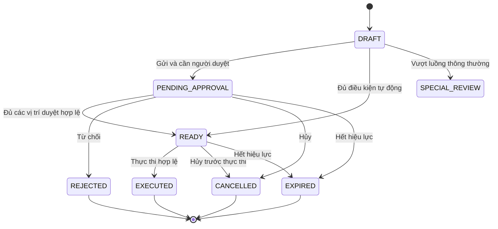

# Quantity approval threshold — Ngưỡng phê duyệt theo số lượng

## 1. Mục tiêu và phạm vi

Trong chương **Approval Limits**, quantity approval threshold là quy tắc xác định yêu cầu phải qua bước duyệt nào dựa trên số lượng nghiệp vụ. Ví dụ: cấp một số thiết bị cho dự án, xuất một lượng hàng khỏi kho, phân bổ số chỗ cho nhóm hoặc tạo hàng loạt tài nguyên.

Một yêu cầu có số lượng nhỏ có thể được xử lý tự động. Yêu cầu lớn hơn cần người có thẩm quyền phù hợp hoặc nhiều người duyệt độc lập. Lỗ hổng logic xuất hiện khi người dùng có thể làm cho lượng thực tế vượt quá lượng đã được đánh giá: khai số thùng thay cho số sản phẩm, chia yêu cầu thành nhiều dòng, đổi số lượng sau khi được duyệt hoặc gửi đồng thời nhiều lệnh dưới ngưỡng.

Bài học tập trung vào bảo vệ bất biến nghiệp vụ, quyền theo đối tượng, trạng thái phê duyệt, transaction, idempotency và kiểm thử tình huống tấn công logic. Các ngưỡng và vai trò trong bài là dữ liệu minh họa, không phải một chính sách chung cho mọi tổ chức.

Sau bài học, người học có thể:

- Xác định đại lượng thực sự phải đưa vào so sánh ngưỡng.
- Chuẩn hóa đơn vị và cộng gộp đúng phạm vi.
- Xây dựng chính sách ngưỡng rõ ràng ở các giá trị biên.
- Ràng buộc phê duyệt với đúng đối tượng, phiên bản, số lượng và chính sách.
- Chống chia nhỏ, thực thi trùng và thay đổi dữ liệu giữa kiểm tra với sử dụng.
- Thiết kế các tình huống kiểm thử ở cả mức chính sách và mức luồng nghiệp vụ.

## 2. Phân biệt ngưỡng duyệt, thẩm quyền và khả năng cấp phát

Ba khái niệm dưới đây có quan hệ nhưng không thay thế nhau:

| Khái niệm | Câu hỏi được trả lời |
| --- | --- |
| Ngưỡng định tuyến phê duyệt | Yêu cầu này cần tự động xử lý, một người duyệt hay nhiều người duyệt? |
| Giới hạn thẩm quyền của người duyệt | Người cụ thể này có được duyệt lượng đó trong phạm vi đối tượng này không? |
| Khả năng thực thi | Kho, quota hoặc ngân sách tài nguyên hiện tại có đủ để thực hiện không? |

Một quản lý có quyền duyệt 100 thiết bị không làm kho tự có 100 thiết bị. Ngược lại, kho còn đủ hàng không cho phép bỏ qua duyệt. Điều kiện thực thi phải kết hợp quyền, phê duyệt, trạng thái và khả năng cấp phát tại thời điểm có hiệu lực.

Giới hạn thẩm quyền cũng không mặc nhiên là một số dư tiêu hao. “Được duyệt tối đa 50 đơn vị mỗi yêu cầu” khác với “được duyệt tổng cộng 50 đơn vị mỗi ngày”. Trường hợp thứ hai cần cơ chế cộng gộp và kiểm soát đồng thời theo kỳ.

Không cộng quyền của hai người một cách tùy ý: hai người chỉ được duyệt tối đa 50 đơn vị không tự trở thành một người có quyền duyệt 100. Nếu chính sách cho phép chia trách nhiệm duyệt thành các phần, phải mô hình hóa rõ mỗi phần, người chịu trách nhiệm và tổng lượng được ủy quyền; đó là một cơ chế khác với phê duyệt toàn bộ yêu cầu.

## 3. Chọn đúng số lượng để so sánh

### 3.1. Số lượng client gửi chưa phải số lượng có thẩm quyền

Giả sử một thùng có 12 thiết bị. Yêu cầu nhận 7 thùng tương ứng 84 thiết bị. Nếu ngưỡng 50 được định nghĩa theo thiết bị mà backend so sánh trực tiếp `7 <= 50`, yêu cầu bị định tuyến xuống cấp duyệt thấp hơn.

```text
requestedQuantity = 7
requestedUnit     = CASE
trustedConversion = 12 DEVICE / CASE
normalizedQuantity = 7 × 12 = 84 DEVICE
```

Tỷ lệ chuyển đổi phải đến từ danh mục hoặc snapshot có thẩm quyền của backend. Client có thể chọn một đơn vị mà API cho phép, nhưng không được tự đặt `unitsPerCase=1`, đổi mã đơn vị nền hoặc khai báo hệ số quy đổi có lợi.

Mã SKU và biến thể cũng quan trọng. Hai loại bao gói có thể có số sản phẩm khác nhau. Khi đổi SKU hoặc đơn vị, phải tính lại lượng chuẩn và kế hoạch duyệt; không giữ kết quả cũ chỉ vì số nhập trên giao diện không đổi.

### 3.2. Cộng gộp đúng nhóm nghiệp vụ

Ví dụ, ba dòng của cùng nhóm thiết bị có lượng 20, 20 và 20 phải được đánh giá như tổng 60 nếu chính sách áp dụng cho tổng nhóm. Chỉ kiểm tra từng dòng sẽ cho cả ba đi qua ngưỡng 50.

```text
Q(group) = SUM(normalizedQuantity của mọi dòng thuộc group)
```

Khóa nhóm phải do nghiệp vụ xác định, có thể gồm tenant, loại thao tác, kho nguồn, nhóm sản phẩm hoặc dự án nhận. Không để client tự gắn `groupId` khác nhau để né cộng gộp.

Không cộng các đại lượng không tương thích. Ví dụ 30 thiết bị và 30 GB lưu trữ không tạo thành “60 đơn vị” có ý nghĩa nếu chính sách không định nghĩa một phép quy đổi chung. Một yêu cầu nhiều loại tài nguyên có thể cần một vector số lượng theo nhóm, rồi kết hợp các yêu cầu phê duyệt của từng nhóm.

Khi nhiều nhóm tạo ra các yêu cầu duyệt khác nhau, không chỉ chọn một chuỗi nhãn có vẻ “cao nhất”. Ví dụ một nhóm cần quản lý vận hành, nhóm khác cần kiểm soát an toàn. Kế hoạch cuối phải giữ đủ các điều kiện cần thiết; quyền cao ở một nhánh không tự bao phủ nhánh còn lại.

### 3.3. Dữ liệu phải có miền giá trị rõ ràng

- Với đối tượng không chia nhỏ được, chỉ nhận số nguyên dương.
- Với lượng đo được chia nhỏ, dùng đơn vị nền nguyên hoặc kiểu thập phân chính xác với scale đã quy định.
- Kiểm tra tràn ở cả phép nhân quy đổi và phép cộng nhiều dòng.
- Giới hạn số dòng, độ lớn đầu vào và các đơn vị được phép trên server.
- Không dùng số thực nhị phân cho phép so sánh cần chính xác ở biên.

Ví dụ với đơn vị nền nguyên trong Java:

```java
// clientQuantity đã được kiểm tra là số nguyên dương trong giới hạn API.
// unitsPerPack lấy từ danh mục có thẩm quyền, không lấy từ request.
long quantityInBaseUnit = Math.multiplyExact(clientQuantity, unitsPerPack);
long groupTotal = Math.addExact(previousGroupTotal, quantityInBaseUnit);
```

Nếu phát sinh lỗi tràn, từ chối yêu cầu trước khi tạo hiệu ứng nghiệp vụ. Không ép kiểu để số lớn quay thành số âm hoặc số nhỏ rồi tiếp tục so sánh ngưỡng.

Các dòng âm hoặc lượng trả lại không được tự bù trừ với lượng cấp mới để làm giảm mức duyệt. Ví dụ cấp 100 và khai trả 90 không mặc nhiên thành một yêu cầu cấp 10. Phải xác minh nghiệp vụ trả độc lập và quy định rõ dùng lượng gộp hay lượng ròng. Trong mô hình của bài, lượng cấp được tính dương theo tổng, không bù trừ bằng dòng trả.

## 4. Đặc tả ngưỡng và kế hoạch phê duyệt

### 4.1. Bảng ngưỡng minh họa

Sau khi chuẩn hóa một nhóm thiết bị, giả sử chính sách áp dụng như sau:

| Tổng số thiết bị `Q` | Kế hoạch duyệt |
| --- | --- |
| `1 <= Q <= 10` | Có thể tự động chấp thuận nếu đủ điều kiện tự động |
| `10 < Q <= 50` | Một trưởng nhóm có quyền phù hợp |
| `50 < Q <= 200` | Một quản lý vận hành và một người kiểm soát, là hai người khác nhau |
| `Q > 200` | Chuyển xử lý đặc biệt; luồng thông thường không được thực thi |

`Q = 10`, `Q = 50` và `Q = 200` phải có một cách hiểu duy nhất. Việc frontend dùng `<` còn backend dùng `<=` có thể gây sai khác hiển thị; backend luôn phải quyết định bằng chính sách có thẩm quyền.

Tự động chấp thuận vẫn là một quyết định có điều kiện: đúng loại đối tượng, đúng phạm vi, không có cờ rủi ro và không vượt các giới hạn cộng gộp khác. Giá trị nhỏ không có nghĩa được bỏ kiểm tra quyền hoặc khả năng cấp phát.

### 4.2. Kế hoạch duyệt không chỉ là một con số cấp bậc

Một kế hoạch nên thể hiện được:

```text
decision: AUTO | REQUIRE_APPROVAL | SPECIAL_REVIEW
normalizedQuantity, baseUnit, groupScope
policyId, policyVersion
requiredSlots: vai trò và phạm vi của từng vị trí cần duyệt
distinctApproverRule
requesterCannotApprove
approvalExpiryRule
```

Nhánh xử lý đặc biệt phải được biểu diễn riêng. Không dùng danh sách người duyệt rỗng để đồng thời mang nghĩa “được tự động xử lý” và “chưa tìm được cấp duyệt”. Thiếu chính sách hoặc không tìm được người có thẩm quyền phải đưa yêu cầu vào trạng thái chặn hoặc chuyển xử lý rõ ràng, không chuyển thành tự động chấp thuận.

Nếu một người có cả hai vai trò quản lý vận hành và kiểm soát, chính sách yêu cầu hai người khác nhau vẫn chỉ cho họ chiếm một vị trí duyệt trong kế hoạch đó. Cần nhận diện người thực tế theo hệ thống định danh; hai tài khoản phụ của cùng một nhân viên không nhất thiết tạo ra hai người độc lập.

### 4.3. Quyền theo đối tượng và giới hạn cá nhân

Đủ tên vai trò chưa chứng minh đủ quyền. Một người có thể duyệt cho kho A nhưng không được duyệt cho kho B, hoặc có giới hạn số lượng thấp hơn giới hạn chung của vai trò.

Với một vị trí duyệt, cần kiểm tra ít nhất:

```text
đúng tenant và phạm vi đối tượng
AND có vai trò hoặc quyền đáp ứng vị trí
AND giới hạn cá nhân bao phủ lượng đang được duyệt
AND quan hệ ủy quyền còn hợp lệ nếu dùng ủy quyền
AND không vi phạm tách nhiệm vụ
```

Ví dụ trưởng nhóm có quyền tối đa 50 không được duyệt yêu cầu 84 thiết bị. Trong bảng minh họa, lượng 84 đã được chuyển sang kế hoạch quản lý vận hành và kiểm soát; không cố ghép nhiều trưởng nhóm để thay thế kế hoạch đó.

Ủy quyền phải có phạm vi, thời hạn và trần lượng phù hợp; người được ủy quyền không được vượt thẩm quyền mà cơ chế ủy quyền cho phép. Không cho một chuỗi hoặc vòng ủy quyền tự khuếch đại giới hạn. Quyền thực thi của service account cũng không tự biến service account thành người phê duyệt độc lập.

## 5. Ví dụ biểu diễn chính sách trong Java

Ví dụ dùng cú pháp Java 17 và chỉ định tuyến theo số thiết bị chuẩn hóa của **một nhóm**. Nó chưa đánh giá quyền đối tượng, điều kiện tự động, giới hạn cộng gộp qua nhiều yêu cầu hoặc khả năng cấp phát.

```java
import java.util.List;

public final class DeviceQuantityPolicy {
    private static final String VERSION = "DEVICE_QUANTITY_V1";

    public enum Decision {
        AUTO, REQUIRE_APPROVAL, SPECIAL_REVIEW
    }

    public enum Role {
        TEAM_LEAD, OPERATIONS_MANAGER, CONTROL_REVIEWER
    }

    public record DeviceQuantity(long units) {
        public DeviceQuantity {
            if (units <= 0) {
                throw new IllegalArgumentException("Quantity must be positive");
            }
        }
    }

    public record Slot(String id, Role role) {}

    public record Plan(
        Decision decision,
        DeviceQuantity quantity,
        String policyVersion,
        List<Slot> requiredSlots,
        boolean distinctApprovers,
        boolean requesterCannotApprove
    ) {
        public Plan {
            requiredSlots = List.copyOf(requiredSlots);
        }
    }

    public static Plan evaluate(DeviceQuantity quantity) {
        long q = quantity.units();
        if (q <= 10) {
            return new Plan(
                Decision.AUTO, quantity, VERSION, List.of(), false, true
            );
        }
        if (q <= 50) {
            return new Plan(
                Decision.REQUIRE_APPROVAL, quantity, VERSION,
                List.of(new Slot("team-lead", Role.TEAM_LEAD)),
                false, true
            );
        }
        if (q <= 200) {
            return new Plan(
                Decision.REQUIRE_APPROVAL, quantity, VERSION,
                List.of(
                    new Slot("operations", Role.OPERATIONS_MANAGER),
                    new Slot("control", Role.CONTROL_REVIEWER)
                ),
                true, true
            );
        }
        return new Plan(
            Decision.SPECIAL_REVIEW, quantity, VERSION, List.of(), true, true
        );
    }
}
```

Kiểu `DeviceQuantity` giúp biểu thị ý nghĩa đơn vị trong mã, nhưng không chứng minh nguồn dữ liệu đáng tin. Backend vẫn phải tạo nó từ kết quả chuẩn hóa có thẩm quyền, không ánh xạ trực tiếp một trường client tự gọi là `normalizedQuantity`.

Khi sử dụng kết quả, phải phân nhánh theo `decision`. Riêng `SPECIAL_REVIEW` phải chặn thực thi ở luồng thông thường, dù `requiredSlots` rỗng. Chỉ với `AUTO`, sau khi các điều kiện tự động khác thỏa mãn, backend mới ghi quyết định tự động và cho yêu cầu tiến tới trạng thái sẵn sàng.

Đối với nhiều nhóm, một lớp phối hợp xây kế hoạch chung và giữ phạm vi của từng vị trí duyệt. Không dùng chính sách một nhóm này để cộng tất cả loại đơn vị vào một số duy nhất.

## 6. Gắn phê duyệt với nội dung và trạng thái

### 6.1. Dữ liệu quyết định phải có phiên bản

Một đề nghị nên lưu dữ liệu như:

```text
requestId, tenantId, requesterId, requesterPersonId
operationType, sourceId, destinationId
canonicalLines, catalogConversionVersion
normalizedQuantitiesByGroup
requestRevision, contentDigest
policyId, policyVersion, approvalPlanId
state, objectVersion
```

Một phê duyệt cần gắn với `requestId`, `requestRevision`, kế hoạch và vị trí duyệt cụ thể, danh tính người duyệt, phạm vi quyền, số lượng làm căn cứ, thời điểm cùng điều kiện hiệu lực. `contentDigest` có thể giúp phát hiện nội dung lệch, nhưng phải được tạo từ biểu diễn chuẩn của backend; client gửi một chuỗi hash không tạo ra bằng chứng phê duyệt.

Các thuộc tính ảnh hưởng đến quyền hoặc định tuyến đều có thể là nội dung cần cố định: số lượng, đơn vị, SKU, nhóm, kho nguồn, nơi nhận và loại thao tác. Duyệt 40 thiết bị từ kho A không đồng nghĩa duyệt 40 thiết bị từ kho B.

### 6.2. Vòng đời minh họa



`SPECIAL_REVIEW` là điểm chặn của luồng minh họa. Nếu sản phẩm hỗ trợ xử lý tiếp, cần một kế hoạch riêng được cấp có thẩm quyền thiết lập; không thêm một endpoint cho phép người dùng chuyển thẳng trạng thái sang `READY`.

Mọi endpoint phải kiểm tra chuyển trạng thái phía server. Không dùng các trường `approved=true`, `approvalLevel`, `requiredApproverCount` hoặc `state=READY` do client gửi làm quyết định nghiệp vụ.

### 6.3. Thay đổi số lượng sau duyệt

Giả sử một đề nghị 40 thiết bị ở revision 1 đã được trưởng nhóm duyệt. Người dùng sửa thành 84 thiết bị rồi gọi execute. Nếu backend chỉ kiểm tra “đã có một người duyệt”, ngưỡng 50 bị bỏ qua.

Trong mô hình chính của bài, nội dung sau khi gửi duyệt là bất biến. Nếu cần sửa thuộc tính ảnh hưởng đến phê duyệt, tạo revision mới, tính lại kế hoạch và vô hiệu hóa các phê duyệt không còn áp dụng. Không giữ phê duyệt chỉ vì lượng mới ít hơn lượng cũ; việc có được tái sử dụng khi giảm lượng phải là một chính sách riêng, kiểm tra cả những thuộc tính khác.

Đơn vị quy đổi cũng phải nhất quán. Nếu 7 thùng đã được duyệt như 84 thiết bị, không được đến lúc thực thi đọc hệ số mới 24 thiết bị/thùng rồi xuất 168 thiết bị. Thực thi theo lượng vật lý đã được chấp thuận và snapshot phù hợp, hoặc tạo revision mới nếu không còn đáp ứng được nội dung đó.

### 6.4. Thay đổi quyền và chính sách

Backend chọn phiên bản chính sách khi tiếp nhận; người dùng không được tự chọn một phiên bản cũ có ngưỡng dễ hơn. Cần quy định yêu cầu đang mở giữ chính sách đã chốt hay phải được tính lại khi có thay đổi quan trọng.

Trong mô hình của bài, phiên bản kế hoạch được giữ để truy nguyên, nhưng vẫn có thể bị vô hiệu hóa bằng một quyết định chính sách rõ ràng. Tại lúc execute, các phê duyệt phải còn hiệu lực theo quy tắc đã chọn, và quyền hiện tại của người duyệt phải tiếp tục đáp ứng nếu hệ thống áp dụng quy tắc thu hồi quyền làm mất hiệu lực duyệt.

Nếu quyền nằm trong cùng cơ sở dữ liệu, có thể phối hợp bằng khóa hoặc phiên bản quyền. Nếu quyền đến từ dịch vụ ngoài, phải xác định thời hạn và cơ chế thu hồi của quyết định quyền. Khóa hàng yêu cầu không tự ngăn được thay đổi quyền ở một dịch vụ khác.

## 7. Chống chia nhỏ yêu cầu và vượt ngưỡng cộng gộp

### 7.1. Phân biệt chia dòng với chia giao dịch

Chia dòng trong cùng một request được xử lý bằng chuẩn hóa và cộng nhóm. Chia thành nhiều request cần một chính sách cộng gộp có phạm vi rõ ràng; chỉ sửa phép cộng các dòng là chưa đủ.

Các phạm vi cộng gộp có thể gồm:

- Cùng người hưởng lợi hoặc cùng dự án nhận, không chỉ cùng tài khoản gọi.
- Cùng kho và cùng nhóm tài nguyên trong một kỳ.
- Các yêu cầu con của cùng kế hoạch cấp phát hoặc cùng đơn hàng gốc.
- Tổng lượng theo một cửa sổ thời gian đã được định nghĩa.

Nếu giới hạn áp dụng theo dự án, cộng theo `userId` sẽ cho phép nhiều tài khoản gửi thay nhau. Nếu giới hạn áp dụng cho cả một đơn hàng, đổi kho hoặc dùng nhiều endpoint không được tạo các bộ đếm độc lập ngoài ý muốn. Tuy nhiên, chỉ gộp theo những quan hệ nghiệp vụ có căn cứ; không suy ra rằng mọi yêu cầu giống nhau đều là một yêu cầu bị chia nhỏ.

### 7.2. Một mô hình tiếp nhận có giữ chỗ lượng cộng gộp

Giả sử chính sách mở rộng dùng lượng đã thực hiện cộng lượng đang giữ cho đề nghị trong cùng kỳ:

```text
U = lượng đã thực hiện được tính trong kỳ
H = lượng đang giữ cho các đề nghị chưa kết thúc
q = lượng của đề nghị mới

approvalBasisQuantity = U + H + q
```

Kế hoạch duyệt cho **đề nghị mới** được chọn theo `approvalBasisQuantity`. Đề nghị lưu cả lượng riêng `q` và lượng làm căn cứ duyệt, không trộn hai đại lượng. Nếu phạm vi này dùng bảng ngưỡng ở mục 4, quyền của người duyệt phải bao phủ lượng làm căn cứ theo chính sách, không chỉ lượng nhỏ trong payload.

Trong cùng transaction tiếp nhận:

1. Khóa bản ghi phạm vi cộng gộp hoặc dùng một cơ chế tương đương.
2. Đọc `U`, `H` và kiểm tra đề nghị chưa được tính trước đó.
3. Tính kế hoạch theo `U + H + q` bằng phép tính chính xác.
4. Lưu căn cứ duyệt, định danh kỳ, kế hoạch và một khoản giữ `q` gắn với đề nghị.
5. Tăng `H` và commit cùng trạng thái tiếp nhận.

Khi thực thi, chuyển đúng khoản `q` từ `H` sang `U` nguyên tử; tổng `U + H` không tăng lần nữa. Khi từ chối, hủy hoặc hết hạn trước thực thi, giải phóng đúng khoản giữ một lần. Một giới hạn cứng, nếu có, còn yêu cầu `U + H + q <= hardLimit`; việc đủ cấp duyệt không tự vượt được giới hạn cứng.

Đây là chính sách định tuyến tại điểm tiếp nhận: các đề nghị đã được tiếp nhận giữ căn cứ của chúng theo quy tắc hiệu lực đã chốt. Nó không mặc nhiên buộc mọi đề nghị cũ tăng cấp duyệt mỗi khi có một đề nghị mới. Nếu nghiệp vụ cần đánh giá lại toàn bộ tập đang mở, phải thiết kế riêng sự vô hiệu hóa và tính lại kế hoạch cho tập đó.

### 7.3. Ví dụ tranh chấp

Giả sử `U = 30`, `H = 0`, có hai đề nghị mới mỗi đề nghị 15 thiết bị. Nếu cả hai cùng đọc snapshot 30 rồi tự tính 45, cả hai có thể chọn kế hoạch trưởng nhóm, trong khi tổng cuối là 60.

Với tiếp nhận được tuần tự hóa trên cùng phạm vi:

| Lần tiếp nhận | Trạng thái trước | Lượng làm căn cứ | Kế hoạch theo ví dụ |
| --- | --- | ---: | --- |
| Đề nghị thứ nhất | `U=30, H=0` | 45 | Trưởng nhóm; giữ thêm 15 |
| Đề nghị thứ hai | `U=30, H=15` | 60 | Quản lý vận hành và kiểm soát; giữ thêm 15 |

Thứ tự hai request có thể đổi, nhưng không được để cả hai cùng nhận căn cứ 45. Ràng buộc duy nhất của khoản giữ theo đề nghị và idempotency tiếp nhận giúp retry không tăng `H` hai lần.

Một câu `SELECT SUM(...)` rồi so sánh ở mức cô lập không bảo vệ được tập cần cộng có thể gặp thêm bản ghi mới giữa kiểm tra và ghi. Có thể dùng một hàng bộ đếm cho mỗi phạm vi, mức cô lập phù hợp hoặc thiết kế kiểm soát xung đột khác; điều kiện là phép đánh giá và nhận thêm lượng phải có một điểm quyết định nhất quán.

### 7.4. Kỳ tính và giữ chỗ cũng cần chính sách

Phải xác định kỳ theo múi giờ nào, dùng thời điểm tiếp nhận hay thực thi, và các trạng thái nào được tính. Với mô hình giữ chỗ ở trên, cần quy định việc một đề nghị đi qua biên kỳ: tiếp tục hạch toán theo kỳ tiếp nhận hay chuyển sang kỳ thực thi bằng đánh giá và giữ chỗ mới. Không tự xóa `H` khi sang ngày mới trong khi đề nghị cũ vẫn có thể thực thi.

Khoản giữ có thể bị lạm dụng để khóa hạn mức hoặc đẩy yêu cầu của người khác lên cấp duyệt cao hơn. Cần thời hạn, quyền tạo, giới hạn số đề nghị và tổng lượng đang giữ phù hợp. Hết hạn phải giải phóng bằng một chuyển trạng thái an toàn, không chỉ xóa cache bằng TTL.

## 8. Thực thi nguyên tử và chống dùng lại phê duyệt

### 8.1. Các điều kiện phải cùng đúng ở điểm thực thi

Trong mô hình chính, một đề nghị chỉ được thực thi toàn bộ một lần. Backend phải xác minh:

```text
Người thực hiện có quyền trên đúng đối tượng.
Đề nghị ở trạng thái READY và đúng revision.
Nội dung chuẩn hóa khớp nội dung được kế hoạch bao phủ.
Nhánh AUTO còn đủ điều kiện, hoặc mọi vị trí duyệt đều hợp lệ.
Các phê duyệt đáp ứng phạm vi, số lượng, người độc lập và hiệu lực.
Khoản giữ cộng gộp còn hợp lệ nếu chính sách sử dụng nó.
Tài nguyên thực tế đủ và không vi phạm các giới hạn cứng.
Hiệu ứng của đề nghị chưa từng được commit.
```

`READY` là dữ liệu hỗ trợ vòng đời, không phải lý do bỏ qua kiểm tra tính hiệu lực của kế hoạch. Nếu quyền bị thu hồi, kế hoạch bị vô hiệu hóa hoặc khoản giữ đã hết hạn, yêu cầu không được thực thi chỉ vì trường trạng thái chưa được worker cập nhật.

### 8.2. Luồng transaction minh họa

Mã dưới đây là mã giả gần Java. Các repository và service đại diện cho thành phần cần hiện thực; ví dụ giả định dữ liệu yêu cầu, kiểm soát lượng cộng gộp và tài nguyên đều nằm trong cùng miền giao dịch.

```java
return transaction.required(() -> {
    RequestRecord call = idempotency.claimOrLock(
        authenticatedScope,
        command.idempotencyKey(),
        fingerprint(command.requestId(), command.expectedRevision())
    );
    call.requireSameFingerprint(
        fingerprint(command.requestId(), command.expectedRevision())
    );

    AllocationRequest request = requests.lockByTenantAndId(
        authenticatedTenantId, command.requestId()
    );
    authorization.requireCanAccess(currentActor, request);

    if (call.isCompleted()) {
        authorization.requireCanReadResult(currentActor, request);
        return call.storedResult();
    }

    request.requireRevision(command.expectedRevision());
    if (request.isExecuted()) {
        authorization.requireCanReadResult(currentActor, request);
        ExecutionResult original = request.originalResult();
        idempotency.complete(call, original);
        return original;
    }

    authorization.requireCanExecute(currentActor, request);
    request.requireState(READY);

    // Chỉ đọc lượng và nội dung đã được cố định trên server.
    CanonicalContent content = request.canonicalContent();
    request.requirePlanMatches(content);
    policy.requirePlanStillExecutable(request.approvalPlan());
    approvalValidation.requireSatisfiedAndEffective(request);

    Inventory stock = inventory.lockRelevantStock(content);
    stock.requireEnough(content.normalizedQuantities());

    // Nếu có admission reservation, khóa, xác minh và chuyển H sang U.
    // Không tăng tổng exposure thêm lần nữa; rollback cùng transaction nếu lỗi.
    quantityExposure.consumeAdmissionIfRequired(request);
    inventory.allocate(stock, content.normalizedQuantities());

    // Ràng buộc duy nhất theo đề nghị và loại hiệu ứng nghiệp vụ.
    effects.insertUniqueExecution(request.id(), content);
    ExecutionResult result = request.markExecutedAndStoreResult();
    requests.save(request);
    audit.appendExecution(request, result);
    outbox.addUniqueCompletedEvent(request, result);
    idempotency.complete(call, result);
    return result;
});
```

Chỉ trả thành công sau commit. Nếu cập nhật tồn kho, chuyển bộ đếm, ghi hiệu ứng hoặc lưu kết quả thất bại, rollback toàn bộ transaction. Không đánh dấu đề nghị đã thực thi trước rồi cập nhật tài nguyên trong một transaction khác mà không có giao thức phục hồi phù hợp.

Khi kế hoạch không còn đủ điều kiện, từ chối tạo hiệu ứng. Nếu cần đưa lại về chờ duyệt, thực hiện một chuyển trạng thái có kiểm soát và đúng revision; không giữ một cập nhật trạng thái trong transaction đã rollback rồi tưởng rằng nó đã được lưu.

### 8.3. Cơ chế đồng bộ phải bao phủ mọi đường ghi

Hai request execute khác key có thể cùng nhắm một đề nghị. Khóa trạng thái, kiểm tra phiên bản và ràng buộc duy nhất của hiệu ứng phải ngăn lần thực thi thứ hai. Một bộ nhớ cache hoặc cờ trong tiến trình không đủ khi có nhiều instance.

Các đường ghi liên quan phải dùng thứ tự khóa nhất quán cho request, kế hoạch, phạm vi cộng gộp và tài nguyên. Khi dùng optimistic locking, xung đột ở bất kỳ phần nào cần rollback và đánh giá lại toàn bộ điều kiện; không chỉ retry câu lệnh trừ tồn kho với một phê duyệt đã đọc từ snapshot cũ.

Luồng hủy, từ chối, hết hạn và execute phải cùng phối hợp trên trạng thái cùng khoản giữ. Chỉ một nhánh được tiêu thụ hoặc giải phóng khoản giữ. Khi một nhánh đã commit, nhánh còn lại phải thấy trạng thái mới và không tạo một hiệu ứng ngược không hợp lệ.

### 8.4. Idempotency bảo vệ retry, không thay thế quy tắc nghiệp vụ

| Tình huống | Xử lý mong đợi |
| --- | --- |
| Cùng key, cùng nội dung, đã commit | Kiểm tra quyền đọc và trả kết quả gốc |
| Cùng key, khác đề nghị hoặc revision | Từ chối xung đột, không thực thi nội dung mới |
| Cùng key khi request trước đang chạy | Chờ có giới hạn hoặc phản hồi đang xử lý theo hợp đồng API |
| Hai key khác nhau cùng execute một đề nghị | Tối đa một hiệu ứng, lời gọi còn lại nhận kết quả gốc hoặc phản hồi đã thực thi |
| Mất phản hồi sau commit | Retry không trừ tài nguyên hoặc tăng lượng thực hiện lần nữa |
| Lỗi trước commit | Không có hiệu ứng thành công; lần thử sau phải đọc và đánh giá lại điều kiện |

`claimOrLock` phải dựa vào ràng buộc duy nhất và xử lý tranh chấp, không chỉ “tìm không thấy rồi tạo”. Mẫu transaction trên lưu kết quả thành công cùng hiệu ứng; một claim mới trong transaction thất bại cũng rollback. Nếu cần lưu lỗi hoặc trạng thái xử lý lâu dài bằng transaction riêng, phải thiết kế vòng đời và phục hồi riêng.

Hai đề nghị khác nhau có cùng nội dung có thể là hai ý định hợp lệ. Không gộp mù quáng chỉ theo payload, nhưng cũng không cho việc đổi request ID né giới hạn theo đơn hàng, dự án hoặc kỳ. Quan hệ nghiệp vụ và bộ đếm cộng gộp mới quyết định phạm vi đó.

Khi có tác động sang hệ thống khác, một annotation transaction không làm hai cơ sở dữ liệu hoặc lời gọi HTTP trở nên nguyên tử. Cần định danh lệnh, trạng thái trung gian, chống trùng và cơ chế đối soát hoặc bù trừ. Sự kiện outbox có thể được phát lại; consumer không được tạo lại hiệu ứng đã thực hiện trong transaction gốc.

## 9. Biến thể cho phép thực hiện từng phần

Một số quy trình duyệt tổng 84 thiết bị nhưng xuất thành hai đợt 40 và 44. Đây là một mô hình khác với thực thi toàn bộ một lần ở mục 8, cần trạng thái và bộ đếm riêng.

```text
authorizedTotal = 84
executedTotal   = tổng lượng đã thực hiện thành công
reservedForExecution = lượng đang giữ cho các lần thực hiện chưa hoàn tất

executedTotal + reservedForExecution <= authorizedTotal
```

Mỗi lần thực hiện con có định danh hiệu ứng và idempotency riêng. Việc nhận thêm lượng thực hiện phải cập nhật bộ đếm nguyên tử; hai lần cùng muốn lấy phần còn lại không được đồng thời vượt tổng được phép.

Kế hoạch duyệt được chọn theo lượng tổng 84 và các căn cứ cộng gộp áp dụng, không định tuyến lại riêng 40 và 44 như hai yêu cầu nhỏ để hạ cấp duyệt. Nếu có giữ chỗ lượng cộng gộp, mỗi đợt chuyển đúng phần đã thực hiện từ `H` sang `U`; phần chưa thực hiện vẫn có vòng đời giữ chỗ rõ ràng.

Khi hủy phần còn lại, chỉ giải phóng phần chưa dùng. Không giảm bộ đếm lượng đã thực hiện chỉ vì người dùng hủy đề nghị sau khi một phần đã được xuất. Trả hàng hoặc thu hồi cần xác nhận thực tế và một nghiệp vụ riêng trước khi điều chỉnh số liệu được chính sách cho phép.

Nếu đã xuất 40 trong tổng 84 rồi muốn nâng tổng lên 120, phải giữ lịch sử 40 đã thực hiện, xây nội dung và kế hoạch mới cho mức được phép thay đổi. Không đặt lại `executedTotal=0`, không cấp thêm một quyền 120 độc lập mà quên lượng cũ, và không tái dùng phê duyệt của revision 84 cho revision 120.

## 10. Các tình huống lạm dụng cần kiểm thử

### 10.1. Chuẩn hóa và biên ngưỡng

| Đầu vào hoặc tình huống | Kết quả theo chính sách minh họa |
| --- | --- |
| 0 hoặc số lượng âm | Từ chối trước định tuyến hoặc cấp phát |
| Số lẻ cho thiết bị không chia nhỏ được | Từ chối, không tự làm tròn xuống |
| 1 và 10 thiết bị | Nhánh AUTO, vẫn cần đủ điều kiện tự động |
| 11 và 50 thiết bị | Một trưởng nhóm có thẩm quyền |
| 51 và 200 thiết bị | Quản lý vận hành cùng người kiểm soát độc lập |
| 201 thiết bị | SPECIAL_REVIEW, không thực thi bằng danh sách duyệt rỗng |
| 7 thùng, mỗi thùng 12 thiết bị | Đánh giá theo 84 thiết bị |
| Client đổi hệ số đóng gói thành 1 | Không dùng hệ số client; kết quả vẫn dựa trên danh mục có thẩm quyền |
| Ba dòng cùng nhóm, mỗi dòng 20 | Cộng thành 60 rồi chọn kế hoạch phù hợp |
| Đổi thứ tự hoặc tách dòng nhưng tổng vật lý không đổi | Không hạ mức duyệt |
| Đầu vào làm tràn phép nhân hoặc phép cộng | Từ chối; không biến thành số nhỏ hoặc âm |
| Cấp 100 kèm dòng trả -90 chưa được xác minh | Không tự tính thành lượng cấp 10 |
| Hai nhóm đơn vị không tương thích | Đánh giá theo từng nhóm và kết hợp đúng yêu cầu duyệt |

Với kiểu thập phân, bổ sung kiểm thử đúng scale, đơn vị nền và giá trị sát biên. Không chỉ kiểm tra số nguyên đẹp rồi kết luận phép so sánh không có lỗi làm tròn.

### 10.2. Quyền, nội dung và trạng thái

| Tình huống tấn công | Bất biến cần xác nhận |
| --- | --- |
| Người tạo gửi `approved=true` hoặc `state=READY` | Server không chấp nhận các trường này làm bằng chứng |
| Trưởng nhóm duyệt cho kho hoặc tenant ngoài phạm vi | Từ chối theo đối tượng |
| Người có giới hạn cá nhân thấp hơn lượng căn cứ | Không đáp ứng vị trí duyệt dù có đúng tên vai trò |
| Người tạo tự duyệt bằng vai trò khác | Không vượt ràng buộc tách nhiệm vụ |
| Một người có hai vai trò cố lấp hai vị trí độc lập | Chỉ được tính theo quy tắc người độc lập đã định |
| Gửi lại cùng phê duyệt nhiều lần | Không tăng số người hoặc số vị trí đã được đáp ứng |
| Duyệt 40 rồi sửa thành 84 | Phê duyệt cũ không thực thi revision mới |
| Giữ số lượng nhưng đổi kho, SKU hoặc nơi nhận | Đánh giá lại phạm vi và nội dung ảnh hưởng phê duyệt |
| Client chọn phiên bản chính sách cũ | Backend dùng phiên bản được phép áp dụng |
| Phê duyệt đã hết hạn hoặc bị vô hiệu hóa | Không thực thi chỉ vì trạng thái vẫn READY |
| Execute khi chưa đủ một vị trí trong kế hoạch | Không có hiệu ứng nghiệp vụ |
| Quyền ủy quyền hết hiệu lực hoặc vượt trần | Không tạo quyền duyệt ngoài phạm vi |

### 10.3. Cộng gộp, retry và xử lý đồng thời

| Tình huống | Kết quả bắt buộc |
| --- | --- |
| Hai request mới cùng kiểm tra một bộ đếm cộng gộp | Không cùng được tiếp nhận dựa trên tổng cũ nếu tổng mới đổi kế hoạch |
| Nhiều tài khoản gửi cho cùng dự án bị giới hạn | Đều đi qua cùng phạm vi nghiệp vụ tương ứng |
| Gửi lại lệnh tiếp nhận cùng key | Không tạo thêm đề nghị hoặc tăng khoản giữ lần nữa |
| Dùng hai key execute khác nhau cho một đề nghị | Chỉ một hiệu ứng, một lần trừ tồn kho và một lần chuyển H sang U |
| Lỗi sau trừ tồn kho nhưng trước lưu kết quả | Rollback toàn bộ các ghi thuộc transaction |
| Mất phản hồi sau commit rồi retry | Trả kết quả gốc, không thực thi thêm |
| Hủy hoặc hết hạn đồng thời với execute | Chỉ một kết cục hợp lệ; không vừa giải phóng vừa tiêu thụ khoản giữ |
| Worker giải phóng chạy hai lần | Giải phóng đúng một lần |
| Qua biên kỳ khi còn đề nghị đang giữ lượng | Không làm mất khoản giữ hoặc tự cấp một cửa sổ mới ngoài chính sách |
| Hai đợt thực hiện con cùng lấy phần còn lại | Tổng đã thực hiện và đang giữ không vượt lượng được phép |
| Phát lại sự kiện hoàn tất | Không cấp tài nguyên hoặc điều chỉnh bộ đếm thêm lần nữa |

Kiểm thử tranh chấp phải chủ động tạo điểm giao nhau giữa các transaction. Gửi hai request tuần tự không chứng minh được an toàn đồng thời. Xác nhận dữ liệu cuối: tồn kho hoặc quota, trạng thái, số hiệu ứng, tổng lượng đã thực hiện, các khoản giữ và kết quả idempotency; mã HTTP thành công hay thất bại chưa đủ.

## 11. Dấu vết và đối soát

Một quyết định duyệt hoặc thực thi nên truy được:

- Yêu cầu, tenant, người tạo, revision và nội dung chuẩn liên quan.
- Lượng nhập, đơn vị, tỷ lệ quy đổi có thẩm quyền và tổng lượng theo nhóm.
- Phiên bản chính sách, kế hoạch, căn cứ cộng gộp và định danh kỳ nếu có.
- Người duyệt, vị trí họ đáp ứng, phạm vi, giới hạn và căn cứ ủy quyền nếu dùng.
- Thời điểm cùng lý do từ chối, tự động chấp thuận, duyệt, hủy hoặc vô hiệu hóa.
- Hiệu ứng thực thi, lượng thực tế, các thay đổi khoản giữ và correlation ID.

Không ghi token truy cập hoặc bí mật xác thực vào log. Quyền đọc kế hoạch, phê duyệt và audit cũng phải theo tenant và đối tượng; một idempotency key không được trở thành cách đọc kết quả của người khác.

Các dấu hiệu đáng theo dõi gồm nhiều yêu cầu sát ngưỡng, cùng người hưởng lợi dùng nhiều tài khoản, tách dòng bất thường, sửa nội dung sau duyệt, nhiều lần lấp vị trí duyệt bằng cùng danh tính và lượng giữ tăng cao nhưng ít được thực thi.

Đối soát có thể kiểm tra mỗi đề nghị thực thi toàn bộ có đúng một hiệu ứng, mỗi vị trí duyệt hợp lệ có đúng bằng chứng cần thiết, tổng lượng thực hiện con không vượt ủy quyền, và các bộ đếm `U`, `H` khớp sổ ghi nhận. Khi phát hiện lệch, điều tra hiệu ứng thực tế trước khi điều chỉnh có dấu vết; không tự tăng hoặc giảm tài nguyên theo một snapshot chưa được xác minh.

## 12. Ví dụ xuyên suốt và câu hỏi tự kiểm tra

Xét một yêu cầu cấp 7 thùng thiết bị từ kho A cho dự án B. Mỗi thùng chứa 12 thiết bị, chính sách theo yêu cầu dùng bảng ngưỡng ở mục 4, và chưa áp dụng thêm ngưỡng cộng gộp khác:

1. Backend xác thực người gọi, kiểm tra quyền đề nghị cấp từ A sang B và lấy quy đổi từ danh mục có thẩm quyền.
2. Tổng chuẩn hóa là 84 thiết bị; backend lưu nội dung revision 1 và chọn kế hoạch quản lý vận hành cùng người kiểm soát độc lập.
3. Mỗi người duyệt được kiểm tra phạm vi, giới hạn cá nhân, danh tính và hiệu lực. Phê duyệt gắn với revision 1 cùng kế hoạch đã chốt.
4. Nếu người tạo đổi thành 8 thùng, backend phải chặn sửa hoặc tạo revision mới với lượng 96 và xử lý lại phê duyệt theo chính sách; không dùng nguyên quyết định cho 84.
5. Lệnh execute chỉ nhận định danh và revision kỳ vọng. Backend đọc 84 từ dữ liệu đã cố định, kiểm tra kế hoạch còn hợp lệ và kho còn đủ.
6. Cùng transaction, backend cấp 84, ghi hiệu ứng duy nhất, chuyển trạng thái sang `EXECUTED` và lưu kết quả idempotency.
7. Client mất phản hồi rồi gửi lại. Backend trả kết quả gốc sau kiểm tra quyền đọc; không cấp thêm 84.
8. Một yêu cầu mới của cùng đơn hàng hoặc dự án vẫn phải đi qua các quy tắc quan hệ và cộng gộp tương ứng nếu sản phẩm có áp dụng; đổi key không tạo quyền vượt các quy tắc đó.

Trước khi triển khai, cần trả lời được:

- Ngưỡng so sánh số dòng, số bao gói hay lượng vật lý chuẩn hóa?
- Ai có thẩm quyền cung cấp đơn vị, quy đổi và khóa nhóm cộng gộp?
- Các giá trị đúng ngưỡng được đưa vào nhánh nào?
- Mỗi vị trí duyệt có giới hạn và phạm vi nào; một người được lấp bao nhiêu vị trí?
- Những thay đổi nào buộc tạo revision hoặc kế hoạch mới?
- Chia nhỏ qua nhiều request, tài khoản hoặc endpoint có né được quy tắc tổng không?
- Tại điểm nào lượng được tính vào hạn mức, và khi nào được giải phóng?
- Điều gì ngăn cùng một phê duyệt tạo hai hiệu ứng khi có retry hoặc nhiều worker?

Ngưỡng phê duyệt theo số lượng được bảo vệ khi backend đánh giá đúng lượng nghiệp vụ, chọn đúng kế hoạch và gắn quyết định với nội dung có phiên bản. Quyền, trạng thái, bộ đếm và hiệu ứng phải được phối hợp tại ranh giới giao dịch phù hợp để cách chia yêu cầu, sửa payload hoặc gửi đồng thời không làm lượng thực hiện vượt qua điều kiện đã được chấp thuận.


