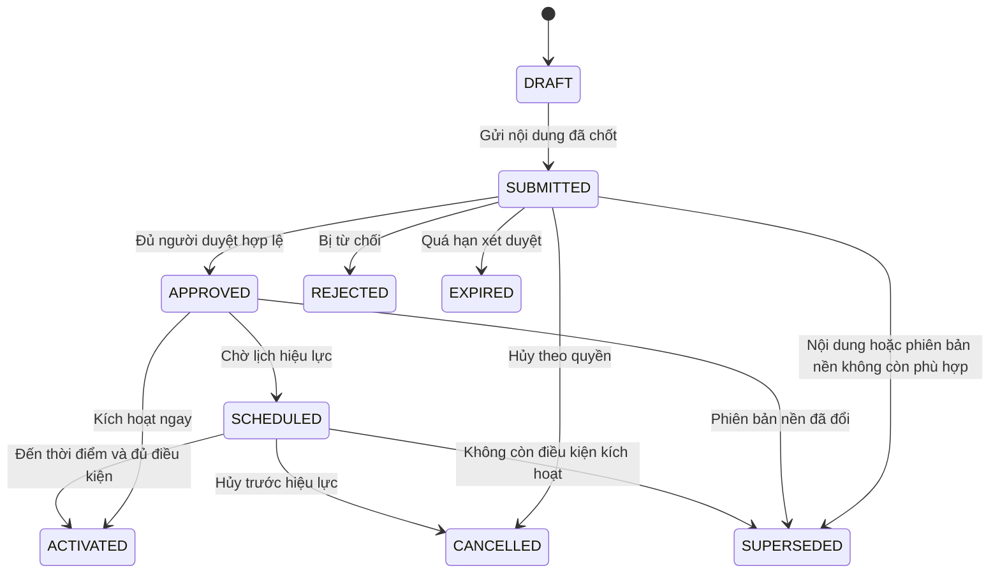

# Threshold change audit — Kiểm toán thay đổi ngưỡng phê duyệt

## 1. Đổi một con số có thể vô hiệu hóa cả quy trình

Một hệ thống quy định khoản chi không quá 50 triệu VND cần một người duyệt độc lập; khoản chi lớn hơn cần hai người duyệt độc lập. Một quản trị viên nâng ngưỡng lên 500 triệu, để một khoản chi 300 triệu chỉ cần một người duyệt, rồi khôi phục ngưỡng về 50 triệu. Khi kiểm tra cấu hình hiện tại, mọi thứ trông bình thường. Nếu lịch sử chỉ ghi “đã cập nhật cấu hình”, rất khó chứng minh quy tắc nào đã bị thay đổi và giao dịch nào đã hưởng lợi.

**Threshold change audit** là việc ghi nhận, bảo vệ và đối chiếu bằng chứng về thay đổi ngưỡng phê duyệt: ai đề xuất, ai chấp thuận, giá trị nào đã đổi, phạm vi nào bị ảnh hưởng, khi nào có hiệu lực và quyết định nghiệp vụ nào đã sử dụng phiên bản đó.

Trong bảo mật logic nghiệp vụ, ngưỡng phê duyệt thuộc chính sách kiểm soát quyền ra quyết định. Nó không chỉ là một tham số giao diện. Người có thể sửa ngưỡng có khả năng gián tiếp thay đổi số người cần duyệt, tuyến phê duyệt hoặc giới hạn thẩm quyền của người khác.

Bài học dùng ví dụ chính sách số người duyệt theo giá trị khoản chi. Những nguyên tắc tương tự áp dụng cho hạn mức hoàn tiền, mức giảm giá được tự duyệt, giới hạn cấp tín dụng nội bộ và các mốc cần chuyển cấp quản lý. Các giá trị tiền trong ví dụ chỉ minh họa quy tắc hệ thống.

> Audit ghi lại và hỗ trợ phát hiện thay đổi; nó không tự ngăn một thay đổi trái phép. Phải kết hợp audit với quyền theo đối tượng, phân tách nhiệm vụ, phiên bản chính sách, state machine và giao dịch nguyên tử.

## 2. Xác định đúng ý nghĩa của ngưỡng

### 2.1. Tên trường phải thể hiện quy tắc

Tên `limit` quá mơ hồ: đó là số tiền tối đa người duyệt được phép ký, hay mốc mà từ đó phải có thêm người duyệt? Trong ví dụ, dùng `singleApprovalLimit`:

```text
amount <= singleApprovalLimit:
    cần một người duyệt độc lập

amount > singleApprovalLimit:
    cần hai người duyệt độc lập

Người tạo khoản chi không được tính là người duyệt độc lập.
Hai tài khoản cùng một chủ thể không tự tạo thành hai người duyệt độc lập.
```

Với ngưỡng 50.000.000 VND:

| Giá trị khoản chi | Số người duyệt theo chính sách minh họa |
| --- | --- |
| 49.999.999 VND | Một |
| 50.000.000 VND | Một |
| 50.000.001 VND | Hai |

Quy ước bao gồm đầu mút là một phần của chính sách. Đổi `<=` thành `<`, đổi đồng tiền hoặc đổi đơn vị lưu trữ đều có thể làm thay đổi hành vi dù con số hiển thị giống nhau.

### 2.2. Audit cấu trúc chính sách, không chỉ một giá trị số

Một ngưỡng cần được hiểu cùng ngữ cảnh:

| Thuộc tính | Ví dụ | Vì sao cần trong audit? |
| --- | --- | --- |
| Tenant | Tổ chức A | Ngăn sửa hoặc đọc nhầm chính sách tổ chức khác |
| Đối tượng chính sách | Khoản chi nhà cung cấp | Phân biệt với hoàn tiền hay giảm giá |
| Phạm vi | Đơn vị kinh doanh cụ thể | Cùng ngưỡng có thể áp dụng ở các phạm vi khác nhau |
| Đồng tiền và đơn vị | VND, số nguyên theo đơn vị VND | Tránh hiểu 50 triệu thành 50 nghìn hoặc sai đồng tiền |
| Toán tử ranh giới | `amount <= limit` | Xác định hành vi tại đúng ngưỡng |
| Yêu cầu phê duyệt | Một hoặc hai người độc lập | Cho biết tác động kiểm soát thực sự |
| Hiệu lực và trạng thái | Phiên bản đã kích hoạt | Phân biệt bản nháp với quy tắc đang được sử dụng |
| Quy tắc kế thừa | Mặc định tenant hoặc ngoại lệ đơn vị | Một thay đổi có thể ảnh hưởng nhiều đối tượng con |

Không nên ghi số tiền bằng kiểu dấu phẩy động nhị phân rồi so sánh hoặc băm theo chuỗi hiển thị. Cần một biểu diễn chính xác: số nguyên với đơn vị được định nghĩa, hoặc kiểu thập phân có scale và quy tắc làm tròn rõ ràng. Với nhiều đồng tiền, việc quy đổi phải dùng nguồn và phiên bản tỷ giá do hệ thống kiểm soát nếu chính sách cần quy đổi; không tin số tiền đã quy đổi do client tự khai.

Một thay đổi phạm vi từ “phòng mua hàng” sang “toàn tenant” có thể rủi ro hơn tăng con số một chút. Vì vậy nội dung cần phê duyệt và audit phải bao phủ toàn bộ cấu hình ảnh hưởng quyết định.

## 3. Mô hình đe dọa cho thay đổi ngưỡng

| Hành vi | Kẽ hở bị khai thác | Dấu vết hoặc kiểm soát cần có |
| --- | --- | --- |
| Nâng ngưỡng, duyệt khoản chi, khôi phục | Chỉ xem cấu hình cuối cùng | Chuỗi phiên bản bất biến và liên kết quyết định với phiên bản |
| Người đề xuất tự duyệt thay đổi | Quyền quản trị gộp quá rộng | Phân tách nhiệm vụ và đối chiếu chủ thể độc lập |
| Đổi nội dung sau khi đã được duyệt | Chấp thuận chỉ gắn với mã yêu cầu | Chấp thuận gắn với revision và nội dung chuẩn hóa cụ thể |
| Hai admin cùng sửa từ một phiên bản cũ | Không kiểm tra phiên bản nền | Kiểm soát cạnh tranh và buộc xét lại khi nền đã thay đổi |
| Sửa trực tiếp database | Đi vòng qua API và audit ứng dụng | Giới hạn quyền DB, bằng chứng tầng DB và đối soát độc lập |
| Xóa hoặc sửa audit sau thay đổi | Audit dùng chung quyền sửa cấu hình | Phân quyền tách biệt, sao lưu và bản sao có bảo vệ |
| Dùng service account để che người khởi xướng | Log chỉ có tài khoản kỹ thuật | Ghi cả executor và initiator có nguồn chứng thực |
| Giả lý do hoặc chèn dòng log | Audit ghép chuỗi không cấu trúc | Sự kiện có schema, kiểm tra đầu vào và hiển thị an toàn |
| Thay lịch hiệu lực về quá khứ | Không tách thời gian ghi nhận và hiệu lực | Quyền lùi ngày riêng, phiên bản và audit đầy đủ |
| Phát lại lệnh kích hoạt | Consumer không chống trùng | Idempotency và ràng buộc chuyển trạng thái |

Không nên giả định chỉ kẻ ngoài hệ thống mới gây rủi ro. Người dùng có quyền sửa một phần cấu hình vẫn có thể vượt phạm vi, dùng quyền được ủy nhiệm sai mục đích hoặc phối hợp với một người duyệt khác.

Audit cũng không tự giải quyết việc chia nhỏ khoản chi để né ngưỡng. Muốn phát hiện hành vi đó phải liên kết các đối tượng có cùng mục đích hoặc chủ thể theo chính sách nghiệp vụ riêng. Tuy nhiên, lịch sử thay đổi ngưỡng giúp phân biệt việc chia nhỏ với việc cố ý thay tuyến phê duyệt.

## 4. Các bất biến phải bảo vệ

### 4.1. Bất biến về nội dung và quyền

```text
Chỉ chủ thể có quyền trên đúng tenant và phạm vi mới được đề xuất thay đổi.

Người duyệt cấu hình phải có thẩm quyền theo chính sách quản trị hiện hành,
không theo ngưỡng mới mà họ đang được yêu cầu chấp thuận.

Nếu chính sách yêu cầu độc lập:
    người đề xuất không được tính vào nhóm người duyệt thay đổi đó;
    các người duyệt phải là các chủ thể độc lập theo quy tắc đã định nghĩa.

Chấp thuận chỉ có hiệu lực cho đúng nội dung, revision và phiên bản nền.

Một phiên bản đã kích hoạt không bị sửa tại chỗ để thay đổi lịch sử.
```

Quyền duyệt khoản chi và quyền duyệt thay đổi ngưỡng là hai quyền khác nhau. Một người được ký khoản chi 500 triệu không mặc nhiên được sửa hệ thống để mọi khoản chi 500 triệu chỉ cần một chữ ký.

### 4.2. Bất biến về ghi nhận và tác dụng

```text
Mỗi lần kích hoạt thành công tạo được bằng chứng audit bền vững.

Phiên bản chính sách, con trỏ phiên bản hiện hành, trạng thái đề xuất
và audit kích hoạt được cập nhật nguyên tử tại nguồn có thẩm quyền.

before phải phản ánh phiên bản thực sự bị thay thế;
after phải khớp chính xác phiên bản mới đã lưu.

Một đề xuất không được kích hoạt nhiều lần do retry hoặc delivery lặp.

Mỗi quyết định nghiệp vụ quan trọng ghi được phiên bản chính sách đã dùng.
```

Nếu audit chỉ là log gửi bất đồng bộ sau commit, có thể xảy ra thay đổi thành công nhưng không có bằng chứng khi tiến trình chết trước khi gửi log. Thiết kế phải giải quyết khoảng hở đó, không chỉ thêm một lệnh `logger.info()`.

## 5. State machine của một yêu cầu đổi ngưỡng

Một vòng đời tham khảo:



Sơ đồ giản lược tập trung vào các chuyển trạng thái chính. Nếu cần hạn phê duyệt sau khi đã chấp thuận hoặc cơ chế thu hồi chấp thuận, phải bổ sung trạng thái và điều kiện rõ ràng; không sửa một cờ tùy ý ngoài state machine.

Trong lúc thu thập nhiều chấp thuận, đề xuất có thể vẫn ở `SUBMITTED`; từng quyết định được lưu riêng. Trạng thái `APPROVED` chỉ có khi toàn bộ điều kiện đã đủ, không phải ngay khi có người đầu tiên bấm đồng ý.

Sau khi gửi duyệt, nội dung cần được cố định. Nếu đổi số tiền, phạm vi, thời điểm hiệu lực hoặc quy tắc so sánh, phải tạo revision hoặc đề xuất mới và xét lại các chấp thuận liên quan. Không giữ nguyên dấu “đã duyệt” cho một nội dung đã thay đổi.

`ACTIVATED` là một sự kiện lịch sử. Muốn khôi phục ngưỡng cũ, tạo một thay đổi mới tham chiếu phiên bản cũ và đi qua quy trình tương ứng. Việc gọi thao tác là “rollback” không làm nó bớt là một thay đổi kiểm soát cần được ghi nhận.

### 5.1. Chính sách quản trị thay đổi phải độc lập với dữ liệu đang sửa

Giả sử đề xuất nâng `singleApprovalLimit` từ 50 triệu lên 500 triệu. Số người cần duyệt đề xuất không được tính bằng chính ngưỡng 500 triệu mới, vì như vậy nội dung chưa được chấp thuận đã tự quyết định điều kiện để được chấp thuận.

Cần một chính sách quản trị cấu hình đang có thẩm quyền: vai trò nào được đề xuất, cần bao nhiêu người duyệt độc lập, thay đổi nào cần chuyển cấp và khi nào cần rà soát bổ sung. Chính sách quản trị đó cũng phải được bảo vệ nếu có thể chỉnh sửa; không để một nhóm tùy ý hạ điều kiện kiểm soát cho chính mình.

## 6. Một bản ghi audit phải trả lời được những gì?

### 6.1. Ai, thay gì, ở đâu và dựa trên thẩm quyền nào?

| Nhóm dữ liệu | Trường minh họa | Yêu cầu |
| --- | --- | --- |
| Định danh sự kiện | `eventId`, `eventType`, `schemaVersion` | Do server tạo, có khả năng chống xử lý trùng |
| Phạm vi | `tenantId`, `policyKey`, scope chuẩn hóa | Lấy từ ngữ cảnh đã kiểm tra quyền |
| Liên kết vòng đời | `proposalId`, `proposalRevision`, `baseVersion`, `newVersion` | Theo được từ đề xuất đến kích hoạt |
| Người thực hiện | `actorPrincipalId`, vai trò liên quan | Không lấy người thực hiện từ một header tùy ý |
| Thực hiện thay mặt | `initiatorId`, `executorId`, thông tin ủy nhiệm | Phân biệt người khởi xướng và tiến trình thực thi |
| Nội dung | `before`, `after`, diff có kiểu | Phản ánh dữ liệu thực tế, không chỉ payload client |
| Thẩm quyền | Các approval ID và phiên bản chính sách quản trị | Chứng minh điều kiện kích hoạt đã được đáp ứng |
| Thời gian | `recordedAt`, `requestedEffectiveAt`, `activatedAt` | Phân biệt lúc ghi nhận, lịch dự kiến và lúc có tác dụng |
| Căn cứ | Mã yêu cầu thay đổi, lý do, tài liệu liên quan | Phục vụ rà soát; không thay thế kiểm tra quyền |
| Tương quan | `requestId`, `operationId`, trace tham chiếu | Nối các thành phần mà không làm lộ bí mật |

IP, tên thiết bị hoặc user agent có thể hỗ trợ điều tra nhưng không thay thế danh tính đã xác thực. Trong hệ thống có proxy, chỉ tin thông tin chuyển tiếp từ chuỗi proxy được cấu hình tin cậy.

Với một tác vụ kích hoạt theo lịch, `executorId` có thể là tài khoản scheduler. Cần giữ liên kết đến người đề xuất và các người duyệt đã được chứng thực. Không giả vờ rằng scheduler là người đã chấp thuận nghiệp vụ, cũng không tự ghi mọi hành động dưới một tài khoản “admin” chung.

### 6.2. Ví dụ sự kiện kích hoạt

Đây là schema minh họa rút gọn, chưa chứa mọi trường của hệ thống thực tế:

```json
{
  "schemaVersion": 1,
  "eventId": "evt-activation-108",
  "eventType": "APPROVAL_THRESHOLD_ACTIVATED",
  "tenantId": "tenant-a",
  "policyKey": "supplier-payment:business-unit-1",
  "proposalId": "change-108",
  "proposalRevision": 2,
  "baseVersion": "policy-v42",
  "newVersion": "policy-v43",
  "initiatorId": "user-102",
  "executorId": "service-policy-activator",
  "approvalIds": ["approval-201", "approval-202"],
  "before": {
    "currency": "VND",
    "amountUnit": "VND",
    "singleApprovalLimit": 50000000,
    "comparison": "LESS_THAN_OR_EQUAL",
    "requiredAboveLimit": 2
  },
  "after": {
    "currency": "VND",
    "amountUnit": "VND",
    "singleApprovalLimit": 500000000,
    "comparison": "LESS_THAN_OR_EQUAL",
    "requiredAboveLimit": 2
  },
  "recordedAt": "2026-12-02T02:00:00Z",
  "activatedAt": "2026-12-02T02:00:00Z",
  "changeRequestRef": "CR-108",
  "reasonCode": "APPROVED_OPERATING_MODEL_CHANGE"
}
```

Các approval ID phải trỏ đến bằng chứng của đúng revision, nội dung và phiên bản nền. Một danh sách ID đơn thuần không đủ nếu bản ghi approval có thể bị sửa hoặc thuộc một đề xuất khác.

Giá trị `before` được lấy từ phiên bản đang có thẩm quyền dưới cơ chế bảo vệ cạnh tranh; `after` được tạo từ cấu hình mới đã chuẩn hóa và lưu. Nếu client gửi `oldLimit=50000000`, trường đó không phải nguồn để chứng minh ngưỡng cũ là 50 triệu.

### 6.3. Ghi từng sự kiện với đúng ý nghĩa

Nên phân biệt các sự kiện như `CHANGE_SUBMITTED`, `CHANGE_APPROVED`, `CHANGE_REJECTED`, `CHANGE_CANCELLED`, `CHANGE_ACTIVATED` và `CHANGE_SUPERSEDED`. Đề xuất chưa có hiệu lực không được xuất hiện trong báo cáo như một thay đổi đã áp dụng.

Lần thử trái quyền, thất bại do phiên bản nền hoặc lỗi giao dịch cũng cần được quan sát, nhưng phải ghi đúng kết quả. Nếu transaction rollback, không để một sự kiện “ACTIVATED” độc lập bên ngoài tiếp tục khẳng định rằng cấu hình đã đổi thành công. Sự kiện về lần thử thất bại có thể được ghi bằng cơ chế riêng, với trạng thái thất bại rõ ràng.

### 6.4. Nội dung chuẩn hóa và dấu băm

Khi chấp thuận gắn với dấu băm của nội dung, cần định nghĩa biểu diễn chuẩn: tên trường, kiểu dữ liệu, đơn vị tiền, scale, null, thứ tự các tập hợp và mọi thuộc tính ảnh hưởng quyết định. Không băm JSON theo cách phụ thuộc ngẫu nhiên vào thứ tự key hoặc định dạng tiền hiển thị.

Dấu băm giúp phát hiện nội dung đang xét khác nội dung đã được chấp thuận. Nó không chứng minh người duyệt có quyền hay đã thực sự bấm đồng ý. Muốn gắn bằng chứng với danh tính phải có cơ chế xác thực và lưu quyết định đáng tin cậy; nếu dùng chữ ký, còn phải bảo vệ khóa và quy trình ký.

Lý do tự do cần giới hạn độ dài, được lưu như dữ liệu có cấu trúc và hiển thị an toàn. Không ghép trực tiếp thành dòng log có thể bị chèn xuống dòng hoặc giả trường. Tránh đưa token, mật khẩu hay dữ liệu cá nhân không cần thiết vào audit; ngưỡng nội bộ cũng có thể là dữ liệu cần giới hạn người được đọc.

## 7. Giao dịch kích hoạt: cấu hình và audit phải đi cùng nhau

### 7.1. Mẫu dễ làm mất bằng chứng

```java
// Không đủ an toàn: có khoảng hở giữa thay đổi và ghi bằng chứng.
policyRepository.updateThreshold(policyId, newLimit);
auditClient.send("threshold changed");
```

Nếu tiến trình dừng sau câu đầu, cấu hình đã đổi nhưng audit không tồn tại. Đổi thứ tự cũng không giải quyết được: audit có thể nói đã đổi trong khi cập nhật cấu hình thất bại.

Với cùng nguồn dữ liệu, nên lưu phiên bản mới và audit kích hoạt trong cùng transaction. Nếu cần chuyển audit đến hệ thống độc lập, ghi outbox trong transaction đó và chuyển tiếp sau commit.

### 7.2. Phác thảo xử lý trong Java

Mã sau là mã giả theo phong cách Java, tập trung vào ranh giới transaction. Các repository, hàm kiểm tra quyền và cơ chế khóa phải được triển khai theo hạ tầng thực tế.

```java
ActivationResult activate(TrustedContext ctx, String proposalId) {
    requirePolicyActivationPermission(ctx);

    return transactions.execute(() -> {
        // Mọi đường sửa cùng policyKey tuân thủ thứ tự phối hợp này.
        ProposalRef ref = proposals.findOwnedReference(ctx.tenantId(), proposalId);
        PolicyHead head = policies.lockHead(ctx.tenantId(), ref.policyKey());
        Proposal proposal = proposals.lockOwned(ctx.tenantId(), proposalId);
        requireObjectPermission(ctx, proposal);

        if (proposal.isActivated()) {
            return proposal.savedActivationResult(); // Không áp dụng lần nữa.
        }

        requireActivatableState(proposal);
        requireSameBaseVersion(head.currentVersion(), proposal.baseVersion());
        requireApprovedExactContent(proposal);
        recheckGovernanceConditions(proposal, ctx);
        requireEffectiveTimeReached(proposal);

        PolicyVersion before = policies.readImmutable(head.currentVersion());
        PolicyConfig normalized = validateAndNormalize(proposal.approvedConfig());
        PolicyVersion after = policies.appendVersion(before, normalized, proposal);

        head.moveTo(after.id());
        proposal.markActivated(after.id());

        AuditEvent event = auditEvents.activation(ctx, proposal, before, after);
        auditRepository.append(event);
        outbox.appendAuditDelivery(event.id());

        return proposal.saveActivationResult(after.id(), event.id());
    });
}
```

Tenant và danh tính trong `TrustedContext` phải có nguồn tin cậy. Tham chiếu ban đầu cần thuộc đúng tenant; liên kết giữa proposal và `policyKey` phải bất biến sau khi gửi duyệt để không bị đổi trong lúc chọn khóa. Những hàm `lock...` phải có hiệu lực giữa các tiến trình, không chỉ trong bộ nhớ một JVM.

Các bước kích hoạt, xuất bản khác, hủy lịch và chỉnh phiên bản phải tuân thủ cùng thứ tự khóa hoặc cơ chế kiểm soát cạnh tranh tương đương. Nếu dùng optimistic locking thay cho khóa, cập nhật con trỏ cần điều kiện phiên bản kỳ vọng và toàn bộ tác dụng liên quan phải rollback khi điều kiện thất bại.

Ví dụ cập nhật có điều kiện:

```sql
UPDATE approval_policy_head
SET current_version_id = :new_version_id,
    revision = revision + 1
WHERE tenant_id = :trusted_tenant_id
  AND policy_key = :policy_key
  AND revision = :expected_revision;
```

Ứng dụng phải nhận đúng một dòng được cập nhật. Nếu bằng không, không được tiếp tục commit audit kích hoạt và phiên bản mới như thể chúng đã trở thành chính sách hiện hành. Cách lưu phiên bản nháp hoặc phiên bản chưa kích hoạt phải được phân biệt rõ nếu hệ thống hỗ trợ.

### 7.3. Phiên bản nền đã đổi thì không tự chấp thuận lại thay người duyệt

Giả sử P1 và P2 cùng dựa trên V42. P1 kích hoạt thành V43. Khi P2 chạy, không được chỉ thay `baseVersion` thành V43 rồi tiếp tục vì “giá trị mới vẫn hợp lệ”. Người duyệt P2 có thể đã đánh giá một tác động khác khi so với V42.

Cần báo xung đột hoặc chuyển P2 sang trạng thái phải xét lại, tính diff từ nền mới và thu thập lại chấp thuận theo chính sách. Audit phải cho thấy P2 chưa được kích hoạt, không che việc nền đã thay đổi.

### 7.4. Idempotency bao phủ tác dụng kích hoạt

Lệnh gửi lại hoặc sự kiện delivery lặp phải trả về kết quả kích hoạt đã lưu nếu đúng đề xuất và revision, không tạo thêm một lần đổi ngưỡng. Cùng idempotency key nhưng khác nội dung phải bị xử lý như xung đột.

Nếu đề xuất đã kích hoạt V43 rồi hệ thống tiếp tục có V44, một retry của đề xuất cũ chỉ được trả thông tin lịch sử V43, không được đưa con trỏ hiện hành quay lại V43. Việc xác thực quyền xem kết quả vẫn được thực hiện trước khi trả dữ liệu.

## 8. Bảo vệ audit trước lỗi và sửa dấu vết

### 8.1. Append-only là quy tắc cần thực thi bằng quyền

Một bảng có tên `audit_log` chưa tự trở thành bất biến. Tài khoản runtime không nên có quyền cập nhật hoặc xóa các sự kiện đã ghi nếu chức năng của nó chỉ cần append. Quyền vận hành và quản trị lưu trữ cần được tách, giới hạn và giám sát.

Tuy vậy, người có toàn quyền database có thể đi vòng qua quyền ứng dụng. Vì thế cần xem xét bản sao audit độc lập, kiểm soát tài khoản đặc quyền, cơ chế lưu giữ chống sửa phù hợp và đối soát. Một trigger nằm trong cùng database có thể bổ sung dấu vết sửa trực tiếp nhưng không phải bằng chứng bất khả sửa trước chủ thể kiểm soát cả database và trigger.

### 8.2. Transactional outbox và chuyển tiếp có thể lặp

```text
Transaction nguồn:
    tạo phiên bản chính sách
    cập nhật con trỏ hiện hành
    chuyển đề xuất sang ACTIVATED
    append audit nguồn
    append outbox tham chiếu sự kiện
COMMIT

Sau commit:
    relay chuyển sự kiện sang kho audit độc lập
    phía nhận khử trùng theo eventId
    relay có thể gửi lại khi chưa xác nhận được kết quả
```

Không hứa “exactly once” chỉ vì relay đã retry. Cần giả định delivery có thể lặp và bảo vệ phía nhận bằng định danh sự kiện ổn định. Theo dõi backlog, tuổi sự kiện chưa chuyển, lỗi schema và chênh lệch số sự kiện đã nhận.

Nếu ghi audit nguồn thất bại, transaction kích hoạt phải thất bại theo bất biến đã chọn. Nếu kho độc lập tạm thời không sẵn sàng nhưng audit nguồn và outbox vẫn bền vững, có thể tiếp tục theo chính sách vận hành. Với yêu cầu kiểm soát chặt hơn, cần định nghĩa khi nào backlog hoặc sự cố làm hệ thống tạm ngừng thay đổi, thay vì âm thầm bỏ qua audit.

### 8.3. Phát hiện sửa khác với ngăn sửa

Có thể liên kết sự kiện bằng dấu băm, lưu checkpoint được bảo vệ hoặc ký các lô sự kiện để hỗ trợ phát hiện sửa. Nhưng nếu một người có thể viết lại toàn bộ chuỗi và cả điểm neo xác thực, chỉ có chuỗi băm trong cùng kho không chứng minh lịch sử chưa bị thay đổi.

Giá trị của cơ chế này phụ thuộc nơi lưu điểm neo, bảo vệ khóa, thứ tự sự kiện và khả năng kiểm tra độc lập. Trong hệ thống phân vùng, cần định nghĩa thứ tự theo aggregate hoặc phân vùng; không suy ra một thứ tự toàn cục chính xác chỉ từ timestamp của nhiều máy.

Chữ ký hoặc dấu băm chứng minh được một số thuộc tính về nội dung và nguồn tạo bằng chứng theo mô hình tin cậy. Chúng không tự chứng minh lý do thay đổi là chính đáng, người duyệt không thông đồng hoặc ứng dụng ghi đúng mọi sự kiện.

### 8.4. Bằng chứng phải còn đọc và nối được

Cần quản lý schema version, lưu giữ, sao lưu và thử phục hồi. Xóa bản ghi người dùng hoặc đổi tên vai trò không được làm lịch sử chỉ còn một ID không thể diễn giải. Có thể giữ định danh ổn định và snapshot ngữ cảnh cần thiết theo chính sách dữ liệu, đồng thời hạn chế thông tin nhạy cảm.

Quyền đọc audit cũng là quyền theo đối tượng: người quản trị tenant A không mặc nhiên được xem lịch thay ngưỡng và khoản chi của tenant B. Việc xuất dữ liệu audit nên được ghi nhận và giới hạn theo phạm vi cần thiết.

## 9. Nối thay đổi chính sách với quyết định phê duyệt

### 9.1. Audit cấu hình chưa đủ để xác định tác động

Một sự kiện cho biết ngưỡng từng tăng lên 500 triệu không chỉ ra những khoản chi nào đã dùng ngưỡng đó. Tại quyết định nghiệp vụ, nên lưu:

```text
businessObjectId và revision nội dung được duyệt
tenantId, policyKey
policyVersionId hoặc tập phiên bản thực sự tham gia quyết định
decisionAt
số tiền, đồng tiền và các thuộc tính quyết định tuyến duyệt
số người duyệt yêu cầu và bằng chứng người duyệt đã được tính
kết quả, lý do và operationId
```

Nếu quy tắc có kế thừa theo đơn vị, ngoại lệ theo loại khoản chi hoặc lớp chính sách quản trị rủi ro, chỉ lưu một “phiên bản tenant” chung có thể không đủ. Cần lưu các tham chiếu hoặc snapshot cần thiết để tái dựng đúng quy tắc đã đánh giá.

Không tính lại lịch sử bằng cấu hình hiện tại. Cũng không suy ra số người duyệt bằng cách đếm mọi dòng callback, vì một người hoặc một sự kiện có thể xuất hiện nhiều lần. Bằng chứng phải gắn với danh tính, vai trò, nội dung và quyết định cụ thể.

### 9.2. Hồ sơ đang chờ khi ngưỡng thay đổi

Cần quy định rõ phiên bản nào chi phối từng giai đoạn:

| Lựa chọn | Ý nghĩa | Điểm cần kiểm soát |
| --- | --- | --- |
| Chốt phiên bản khi nộp | Hồ sơ tiếp tục theo quy tắc được gắn lúc nộp | Không được cho tạo vỏ hồ sơ rồi thay nội dung để giữ tuyến duyệt cũ |
| Xét phiên bản hiện hành tại quyết định cuối | Quyết định cuối dùng chính sách đang có hiệu lực | Có thể phải bổ sung người duyệt hoặc định tuyến lại |
| Di chuyển có kiểm soát | Hồ sơ được chuyển theo một thay đổi được phê duyệt | Có audit riêng về phạm vi và các hồ sơ đã chuyển |

Không có một lựa chọn đúng cho mọi nghiệp vụ. Quan trọng là lựa chọn được công bố và thực thi, đặc biệt khi chính sách mới siết chặt kiểm soát hoặc thu hồi quyền.

Ví dụ hệ thống chọn xét chính sách hiện hành ở quyết định cuối. Khi ngưỡng giảm từ 500 triệu về 50 triệu, khoản chi 300 triệu mới có một người duyệt phải được yêu cầu bổ sung người duyệt nếu chưa hoàn tất theo quy tắc đó. Không được chỉ đổi nhãn phiên bản mà coi hồ sơ đã đạt điều kiện.

Ngược lại, khi ngưỡng tăng, không nên tự động biến mọi hồ sơ chờ thành được duyệt chỉ bằng cách giảm số người cần ký. Việc bỏ bớt yêu cầu hoặc di chuyển hồ sơ phải tuân thủ chính sách rõ ràng và có dấu vết, nhất là với hồ sơ đã có cảnh báo hoặc bị từ chối.

Nếu nội dung khoản chi đổi sau một lần duyệt, cần đánh giá lại hiệu lực của chấp thuận. Giữ nguyên `policyVersionId` không bảo vệ được việc số tiền tăng từ 40 triệu lên 300 triệu sau khi người duyệt đã ký.

### 9.3. Case: nâng ngưỡng rồi khôi phục

| Thời điểm minh họa | Phiên bản hoặc sự kiện |
| --- | --- |
| 09:00 | V42: ngưỡng 50 triệu VND |
| 09:05 | Đề xuất P108 kích hoạt V43: ngưỡng 500 triệu |
| 09:07 | Khoản chi X, 300 triệu, có quyết định dùng V43 và một người duyệt |
| 09:10 | Đề xuất P109 kích hoạt V44: ngưỡng trở lại 50 triệu |
| 09:12 | Cấu hình hiện tại là V44; X vẫn tham chiếu V43 |

Nếu V44 được ghi đè lên V42 hoặc audit chỉ lưu giá trị cuối, cửa sổ rủi ro bị che mất. Với chuỗi phiên bản, có thể xác định P108, P109, người khởi xướng, người duyệt và các đối tượng đã sử dụng V43.

Một truy vấn điều tra minh họa cho hệ thống chỉ xét VND:

```sql
SELECT business_object_id,
       object_revision,
       amount_vnd,
       required_approval_count,
       policy_version_id,
       decision_at
FROM approval_decision
WHERE tenant_id = :trusted_tenant_id
  AND policy_version_id = :suspect_policy_version_id
  AND decision_type = 'FINAL_APPROVAL';
```

Truy vấn theo phiên bản có giá trị hơn chỉ tìm theo timestamp, vì đồng hồ có độ lệch, sự kiện có thể được chuyển tiếp chậm và nhiều phạm vi chính sách có thể hoạt động cùng lúc. Timestamp vẫn cần để dựng diễn biến và kiểm tra bất thường.

Một thay đổi tăng ngưỡng rồi giảm lại chưa đủ chứng minh có gian lận; nó có thể là thay đổi hợp lệ hoặc xử lý sự cố. Cần đối chiếu thẩm quyền, lý do, nội dung đã được duyệt và đối tượng hưởng tác động. Audit hỗ trợ lập bằng chứng, không thay thế việc phân tích ngữ cảnh.

## 10. Phát hiện bất thường và khôi phục có kiểm soát

### 10.1. Các tín hiệu nên theo dõi

- Ngưỡng tăng mạnh so với mức trước, đặc biệt nếu làm giảm số người cần duyệt cho nhiều hồ sơ đang chờ.
- Một chuỗi tăng rồi hoàn nguyên trong thời gian ngắn.
- Người đề xuất, người duyệt cấu hình và người có lợi ích ở khoản chi có quan hệ đáng chú ý theo quy tắc kiểm soát.
- Thay đổi ngoài quy trình thông thường, không có tham chiếu được yêu cầu hoặc dùng quyền khẩn cấp.
- Nhiều lần đề xuất dựa trên phiên bản cũ, cố sửa nội dung đã duyệt hoặc thử kích hoạt trạng thái không hợp lệ.
- Con trỏ chính sách có phiên bản không tìm được audit tương ứng, hoặc audit kích hoạt không khớp cấu hình đã lưu.
- Kho audit độc lập có khoảng trống, sự kiện chuyển tiếp quá trễ hoặc checkpoint không còn kiểm tra được.

Khi đánh giá mức tăng, phải xét cùng đồng tiền, đơn vị và phạm vi. Không so tỷ lệ giữa hai con số có ý nghĩa khác nhau. Giá trị cũ bằng không hoặc ngưỡng đặc biệt cần quy tắc riêng, không đem chia để tạo chỉ số không xác định.

Cho phép thay đổi trong giờ bảo trì không có nghĩa được bỏ audit. Một lý do nằm trong danh sách cho phép cũng không tự làm thay đổi an toàn. Với loại thay đổi rủi ro cao, kiểm soát trước kích hoạt cần giữ vai trò chính; cảnh báo sau đó chỉ là lớp bổ sung.

### 10.2. Khi phát hiện thay đổi đáng ngờ

Một quy trình phản ứng có thể gồm:

1. Bảo toàn proposal, approval, phiên bản, audit và sự kiện liên quan.
2. Giới hạn khả năng tạo thêm thay đổi hoặc tác dụng nghiệp vụ theo quyền và quy trình ứng phó.
3. Xác định phiên bản đáng ngờ và các đối tượng đã sử dụng nó.
4. Tạo thay đổi sửa chữa mới có căn cứ, không xóa phiên bản cũ để che dấu vết.
5. Rà soát hồ sơ chờ và tác dụng đã xảy ra; thực hiện điều chỉnh theo state machine của từng nghiệp vụ.
6. Đối soát lại cấu hình, audit nguồn, outbox và kho độc lập.

Khôi phục con số không đảo ngược được khoản tiền đã chuyển hoặc quyền lợi đã cấp. Việc bù trừ, hủy hoặc yêu cầu phê duyệt bổ sung là các thao tác nghiệp vụ riêng, cần quyền, tính chống trùng và bằng chứng của chúng.

### 10.3. Quyền khẩn cấp không phải lối đi không dấu vết

Nếu hệ thống có cơ chế khẩn cấp, cần định nghĩa phạm vi, thời hạn, danh tính, lý do và điều kiện sử dụng trước. Việc bỏ qua một bước thông thường phải được biểu diễn rõ trong bằng chứng, không giả một approval không tồn tại.

Quyền khẩn cấp có thể đi kèm rà soát độc lập sau đó theo chính sách tổ chức. Nó không nên cho phép xóa audit, sửa lịch sử hoặc tùy ý biến mọi thay đổi thành hợp lệ. Thời hạn quyền hết không tự khôi phục chính sách đã sửa; nếu cần khôi phục, đó phải là một chuyển trạng thái hoặc thay đổi mới được thiết kế rõ.

## 11. Kiểm thử tình huống tấn công logic

Không chỉ kiểm tra endpoint trả mã thành công. Cần kiểm tra trạng thái chính sách, đề xuất, audit và tác dụng nghiệp vụ sau các thứ tự sự kiện khác nhau.

| Tình huống | Cách dựng | Điều cần xác nhận |
| --- | --- | --- |
| Sai tenant | Admin A gửi proposal ID của B | Không đổi hoặc lộ dữ liệu B; lần thử có kết quả đúng nghĩa |
| Tự duyệt | Maker dùng chính danh tính của mình để chấp thuận | Không được tính là người duyệt độc lập |
| Hai tài khoản cùng chủ thể | Một người dùng hai tài khoản để đủ số chữ ký | Không nhân số người độc lập nếu mô hình danh tính cho phép nhận diện quan hệ đó |
| Không đủ thẩm quyền cấu hình | Người có quyền duyệt khoản chi thử duyệt ngưỡng | Quyền nghiệp vụ không tự chuyển thành quyền quản trị chính sách |
| Đổi sau chấp thuận | Đổi tiền, phạm vi hoặc lịch của proposal đã duyệt | Chấp thuận cũ không áp dụng cho nội dung mới |
| Thay đổi đồng thời | P1 và P2 cùng dựa V42, cùng kích hoạt | Không có cập nhật bị mất; đề xuất nền cũ phải được xét lại |
| Retry kích hoạt | Gửi nhiều lệnh cho cùng proposal | Một lần kích hoạt và một kết quả lịch sử ổn định |
| Retry sau phiên bản mới | P108 đã tạo V43, hiện tại là V44 | Retry P108 không đưa head quay lại V43 |
| Audit nguồn lỗi | Ép append audit thất bại | Không commit thay đổi cấu hình thiếu bằng chứng |
| Kho độc lập lỗi | Ngắt đường relay sau commit | Audit nguồn và outbox còn đủ; cảnh báo backlog hoạt động |
| Delivery trùng | Gửi cùng event nhiều lần | Kho nhận khử trùng, không tạo nhiều thay đổi giả |
| Sửa trực tiếp DB | Thực hiện bằng quyền vận hành trong môi trường kiểm thử | Cơ chế giám sát và đối soát phát hiện đường đi ngoài ứng dụng |
| Nâng rồi hoàn nguyên | Tạo V43 cao hơn, duyệt X, tạo V44 khôi phục | X vẫn liên kết V43; tìm được chuỗi thay đổi |
| Đúng tại ngưỡng | X bằng ngưỡng và cao hơn một đơn vị | Số người duyệt theo đúng toán tử đã ghi |
| Hồ sơ đang chờ | Giảm ngưỡng khi X mới có một người duyệt | X được xử lý theo quy tắc phiên bản đã công bố |
| Thu hồi quyền | Người duyệt mất quyền trước kích hoạt | Xử lý theo chính sách kiểm tra lại, không mặc định chấp thuận còn hiệu lực vô hạn |
| Lùi ngày | Client gửi effective time về quá khứ | Yêu cầu quyền và quy trình riêng, không lùi ngày âm thầm |
| Khác đơn vị tiền | Payload đổi currency hoặc scale | Không xem là cùng cấu hình chỉ vì con số giống nhau |

Đối với danh tính độc lập, kiểm thử phải phản ánh khả năng thực tế của hệ thống. Nếu chỉ biết các account rời rạc mà không có mô hình chủ thể, không được tuyên bố đã chống được mọi trường hợp một người tạo nhiều tài khoản. Cần xác định ranh giới tin cậy và chính sách cấp tài khoản phù hợp.

### 11.1. Một kịch bản có thể kiểm chứng từ đầu đến cuối

```text
Given:
    V42 có ngưỡng 50 triệu VND
    thay đổi ngưỡng cần hai người duyệt cấu hình độc lập với maker
    P108 đề xuất ngưỡng 500 triệu trên nền V42

When:
    maker gửi P108 revision 1
    reviewer A chấp thuận revision 1
    maker cố sửa P108 thành 800 triệu
    reviewer B gửi chấp thuận cho nội dung revision 1
    hệ thống nhận nhiều lệnh kích hoạt, trong đó có lệnh lặp

Then:
    không thể kích hoạt ngưỡng 800 triệu bằng hai chấp thuận cho 500 triệu
    nếu tạo revision mới, các chấp thuận được xét lại theo chính sách
    audit phân biệt nội dung từng revision và kết quả từng thao tác
    retry không nhân lần kích hoạt hoặc làm sai con trỏ hiện hành
```

Dùng barrier hoặc cơ chế điều khiển thứ tự ở kiểm thử tích hợp để tái hiện hai kích hoạt cạnh tranh. Chỉ chạy tuần tự hai request không chứng minh được khả năng chống cập nhật mất hoặc audit lấy nhầm `before`.

### 11.2. Đối soát bằng các quan hệ phải luôn đúng

Có thể kiểm tra các quan hệ dữ liệu như:

```text
Mỗi phiên bản đã kích hoạt có proposal và audit kích hoạt tương ứng.
Audit.beforeVersion khớp phiên bản bị thay thế tại lần kích hoạt đó.
Audit.afterVersion khớp nội dung phiên bản mới.
Approval tham chiếu đúng proposalRevision và nội dung được duyệt.
Mỗi quyết định nghiệp vụ tham chiếu được chính sách đã tồn tại.
Con trỏ hiện hành không trỏ vào bản nháp hoặc phiên bản chưa kích hoạt.
```

Nếu có bản ghi nền khi khởi tạo hệ thống hoặc import lịch sử, cần loại sự kiện và quy trình đối soát riêng; không để ngoại lệ này trở thành cách hợp thức hóa mọi phiên bản không có nguồn gốc.

## 12. Những cách triển khai dễ gây hiểu nhầm

### “Có bảng before/after là đủ”

Bảng có thể bị sửa bằng cùng quyền sửa cấu hình, ghi sau commit hoặc chứa `before` do client cung cấp. Cần bảo vệ cả nguồn dữ liệu, tính nguyên tử, khả năng chống sửa và quan hệ với phiên bản đã dùng.

### “Đã có hai chữ ký”

Hai chữ ký phải thuộc các chủ thể đủ thẩm quyền, độc lập theo chính sách và cùng chấp thuận một nội dung cụ thể. Hai lần bấm của một người, hai tài khoản kỹ thuật chung chủ hoặc chấp thuận cho revision cũ không tự đáp ứng điều kiện đó.

### “Khôi phục ngưỡng là xong”

Cấu hình hiện tại chỉ thể hiện điều kiện cho quyết định tiếp theo. Những quyết định trong khoảng ngưỡng bị đổi vẫn tồn tại và cần rà soát. Hoàn nguyên phải giữ phiên bản lịch sử, không làm biến mất cửa sổ tác động.

### “Dấu băm làm audit không thể sửa”

Dấu băm hỗ trợ phát hiện thay đổi khi có giá trị đối chiếu đáng tin cậy. Nó không cấm người có quyền viết lại dữ liệu và dấu băm. Thiết kế cần chỉ rõ người nào kiểm soát kho, khóa và điểm neo.

### “Mọi thay đổi có cùng con số đều giống nhau”

Cùng 50 triệu nhưng đổi phạm vi từ một phòng sang toàn tổ chức, đổi đồng tiền, đổi điều kiện ranh giới hoặc thay số người cần duyệt có thể tạo chính sách khác. Diff phải theo ngữ nghĩa cấu hình đã chuẩn hóa.

Nếu nội dung mới thực sự không đổi sau chuẩn hóa, hệ thống có thể trả kết quả không thay đổi theo hợp đồng. Không nên tạo một sự kiện “đã kích hoạt thay đổi rủi ro” chỉ vì định dạng số khác; đồng thời lần thử và kết quả cần được phân biệt rõ nếu có yêu cầu theo dõi.

## 13. Bài tập áp dụng

Thiết kế cơ chế đổi ngưỡng cho hệ thống khoản chi nhiều tenant, với các yêu cầu:

1. Ngưỡng quyết định khi nào cần một hoặc hai người duyệt khoản chi.
2. Thay đổi ngưỡng cần người đề xuất và các người duyệt cấu hình độc lập.
3. Có kích hoạt ngay, kích hoạt theo lịch và retry khi response bị mất.
4. Có hồ sơ đang chờ và một kho audit độc lập có thể tạm mất kết nối.
5. Cần điều tra được trường hợp nâng ngưỡng, duyệt một khoản chi rồi hoàn nguyên.

Hãy đưa ra mô hình proposal và policy version, schema audit, cách chốt nội dung được duyệt, cơ chế chống kích hoạt đồng thời, quy tắc áp dụng phiên bản cho hồ sơ đang chờ và cách nối quyết định nghiệp vụ với lịch thay đổi.

Sau đó dựng lịch sự kiện: P1 và P2 cùng dựa trên một phiên bản; P1 kích hoạt trước; relay audit bị ngắt; P2 retry sau đó; một người dùng thử thay ngưỡng trong payload đã được chấp thuận. Chỉ ra thao tác nào được commit, thao tác nào phải xét lại, bằng chứng nào còn bền vững và điều kiện nào cho phép tìm đúng các khoản chi bị ảnh hưởng.

## 14. Ghi nhớ

Ngưỡng phê duyệt là một phần của cơ chế phân quyền nghiệp vụ. Thay đổi ngưỡng có thể làm giảm kiểm soát mà không sửa trực tiếp bất kỳ khoản chi nào, nên cần được quản trị như một thao tác nhạy cảm.

Một cơ chế audit hữu ích gắn đúng người, nội dung, phạm vi, phiên bản và thời điểm; lưu thay đổi cùng bằng chứng nguyên tử; bảo vệ dấu vết khỏi sửa; và nối được phiên bản chính sách với quyết định đã chịu tác động. Khi đó, việc nâng ngưỡng rồi khôi phục, retry lệnh hoặc sửa nội dung sau phê duyệt đều để lại quan hệ có thể kiểm chứng thay vì chỉ một dòng log khó giải thích.
