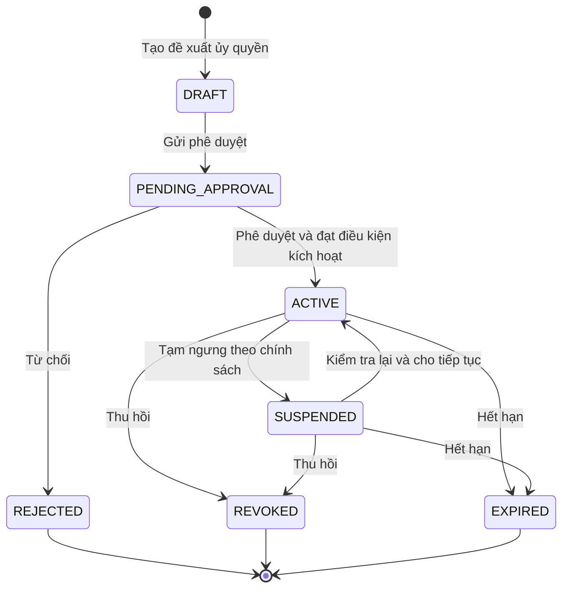

# Delegated authority — Thẩm quyền được ủy quyền

## 1. Ủy quyền là một quan hệ có điều kiện

Trong chương **Delegation**, delegated authority là thẩm quyền cho phép một chủ thể thực hiện một tập hành động thay mặt một chủ thể khác, trong phạm vi và điều kiện đã được xác định. Người nhận ủy quyền vẫn có danh tính riêng; hệ thống phải biết cả người trực tiếp thực hiện lẫn người giao quyền.

Ví dụ, trưởng bộ phận ủy quyền cho một đồng nghiệp duyệt một số đề nghị chi trong thời gian nghỉ phép. Đồng nghiệp đó không mặc nhiên trở thành trưởng bộ phận, không được duyệt mọi khoản chi và không được sử dụng tất cả chức năng của tài khoản trưởng bộ phận.

Trong bảo mật logic nghiệp vụ, rủi ro xuất hiện khi ứng dụng rút gọn ủy quyền thành một cờ `isDelegate`, một tên role hoặc một trường `onBehalfOf` do client gửi. Một giấy ủy quyền có thật vẫn có thể bị dùng sai đối tượng, sai hành động, sai hạn mức, sau khi bị thu hồi hoặc để lách quy trình phê duyệt.

Một thiết kế đúng cần trả lời đồng thời:

- Ai có quyền giao thẩm quyền này và được giao đến mức nào?
- Ai được nhận, trong tenant nào và với điều kiện tư cách nào?
- Hành động nào được thực hiện trên những đối tượng nào?
- Thẩm quyền có hiệu lực trong khoảng thời gian, trạng thái và hạn mức nào?
- Việc sử dụng có còn tuân thủ state machine, phân tách nhiệm vụ và kiểm tra yêu cầu lặp không?
- Khi quyền gốc thay đổi hoặc bị thu hồi, các thao tác đang chờ được xử lý ra sao?

Bài này xây dựng một mô hình nghiệp vụ cụ thể để trả lời các câu hỏi đó. Nó không giả định rằng mọi tổ chức có cùng chính sách ủy quyền.

### Phân biệt với impersonation

RFC 8693 phân biệt delegation, trong đó bên thực hiện giữ danh tính riêng và hành động đại diện cho bên khác, với impersonation, trong đó bên thực hiện được nhìn nhận như chủ thể bị đại diện trong một phạm vi quyền nhất định. [RFC 8693, mục 1.1](https://www.rfc-editor.org/rfc/rfc8693#section-1.1).

Trong mô hình của bài này, không thay danh tính actor bằng danh tính người giao quyền. Cũng không chia sẻ mật khẩu hoặc token cá nhân để thực hiện ủy quyền. Ứng dụng lưu quan hệ ủy quyền và kiểm tra quan hệ đó khi quyết định nghiệp vụ.

## 2. Ví dụ xuyên suốt và các chủ thể tham gia

Một nền tảng quản lý đề nghị chi có quy tắc sau:

- Lan là trưởng bộ phận Operations của tenant A, có thẩm quyền duyệt khoản chi đến hai mươi triệu VND trong bộ phận.
- Lan được phép giao một phần thẩm quyền duyệt cho người đủ điều kiện trong cùng tenant.
- Lan giao cho Minh quyền duyệt tối đa năm triệu VND mỗi đề nghị, với ngân sách sử dụng ủy quyền tổng cộng mười triệu VND trong kỳ hiệu lực của grant.
- Minh chỉ được duyệt đề nghị thuộc Operations, không được đổi số tiền, người thụ hưởng hoặc trạng thái ngoài bước duyệt.
- Chính sách cấm cả người trực tiếp duyệt lẫn chủ thể cung cấp thẩm quyền tự duyệt đề nghị do chính mình tạo.
- Không cho phép Minh giao tiếp quyền này cho người khác.

Hai hạn mức có nghĩa khác nhau: năm triệu là trần của một lần duyệt; mười triệu là trần tổng lượng đã cam kết qua grant. Một lần duyệt bị từ chối không tiêu ngân sách. Một lần đã duyệt chỉ được khôi phục ngân sách nếu có quy tắc hoàn trả riêng, không tự hoàn lại chỉ vì client gửi lại hoặc xóa lịch sử.

| Vai trò trong quan hệ | Ví dụ | Điều cần lưu ý |
|---|---|---|
| Grantor, người giao quyền | Lan | Phải có quyền tạo grant và có thẩm quyền được phép giao |
| Grantee, người nhận quyền | Minh | Là người được grant cho phép hành động, không phải người bất kỳ biết grant ID |
| Actor, người thực hiện | Minh khi gọi API duyệt | Lấy từ ngữ cảnh xác thực đã được kiểm tra |
| Authority owner, chủ thể của thẩm quyền gốc | Lan trong ví dụ này | Cần phân biệt với actor để kiểm tra giới hạn và xung đột lợi ích |
| Resource hoặc business object | Một đề nghị chi cụ thể | Có tenant, bộ phận, số tiền, phiên bản và trạng thái riêng |
| Beneficiary, người hưởng lợi | Người nhận khoản chi | Không mặc nhiên trùng actor, grantor hoặc người tạo đề nghị |
| Technical executor | Service duyệt hoặc worker chi trả | Có danh tính service riêng; không được tự mở rộng thẩm quyền nghiệp vụ |

Trong một số mô hình, thẩm quyền gốc thuộc tổ chức hoặc một chức danh thay vì cá nhân. Khi đó cần định nghĩa lại chủ thể sở hữu thẩm quyền và quy tắc kế nhiệm. Không nên suy ra toàn bộ mô hình chỉ từ tên hiển thị của người ký.

## 3. Tính quyền hiệu lực từ nhiều điều kiện

Một grant hợp lệ tại thời điểm tạo chưa đủ để mọi lần sử dụng sau đó đều hợp lệ. Mỗi quyết định cần đối chiếu grant với actor, đối tượng và chính sách hiện hành.

Trong mô hình **quyền phụ thuộc thẩm quyền gốc hiện tại** của bài này, có thể biểu diễn:

```text
allow(actor, action, object, grant, now) =
    actor đã được xác thực
    AND actor đúng là người nhận của grant
    AND actor còn đủ điều kiện nhận và sử dụng loại ủy quyền đó
    AND grant đang có hiệu lực, đúng phiên bản và chưa bị thu hồi
    AND action thuộc tập hành động đã giao
    AND object thuộc phạm vi đối tượng và tenant đã giao
    AND người giao còn thẩm quyền gốc được phép ủy quyền cho action/object
    AND thời gian và các hạn mức đều đạt
    AND state machine cho phép chuyển trạng thái
    AND các guard như phê duyệt và phân tách nhiệm vụ đều đạt
```

Không lấy hợp của quyền người giao và quyền người nhận để cho phép bất cứ điều gì một trong hai người làm được. Grant phải thu hẹp được thẩm quyền đang dùng cho thao tác cụ thể.

Ngược lại, cũng không bắt buộc người nhận vốn đã có quyền duyệt trực tiếp giống người giao, trừ khi chính sách yêu cầu. Minh có thể chưa có quyền duyệt độc lập nhưng vẫn đủ điều kiện nhận một grant có giới hạn. “Đủ điều kiện sử dụng ủy quyền” và “đã có cùng quyền trực tiếp” là hai điều kiện khác nhau.

### Quyền hiện tại và snapshot tại lúc cấp

Bài này chọn quy tắc: nếu Lan mất thẩm quyền duyệt Operations, grant của Lan không được tạo ra lần duyệt mới dựa trên thẩm quyền cũ. Trạng thái `ACTIVE` của grant không tự vượt qua kiểm tra này.

Một hệ thống có thể có mô hình khác, chẳng hạn thẩm quyền độc lập do tổ chức cấp, không tự chấm dứt khi người tạo grant đổi chức danh. Khi đó phải mô hình hóa quyền đó thành một loại thẩm quyền riêng, chỉ rõ người có quyền cấp và thu hồi. Không để một snapshot cũ vô tình biến thành quyền tồn tại vô thời hạn.

Việc quyền gốc tăng cũng không tự nới grant cũ. Nếu Lan được tăng trần lên năm mươi triệu, grant năm triệu của Minh vẫn là năm triệu cho đến khi có quyết định thay đổi hợp lệ.

### Tính hạn mức cho một quyết định

Với khoản chi dùng cùng loại tiền và cùng quy tắc tính số tiền, lượng có thể duyệt phải đáp ứng mọi trần đang áp dụng:

```text
request_amount <= grant_per_action_limit
request_amount <= grant_remaining_budget
request_amount <= current_delegable_limit_of_grantor
request_amount <= other_applicable_business_limits
```

Giả sử grant đã dùng sáu triệu trong tổng mười triệu. Đề nghị mới trị giá bốn triệu rưỡi thấp hơn trần mỗi lần năm triệu, nhưng vẫn phải bị từ chối vì chỉ còn bốn triệu ngân sách grant.

Không chuyển đổi tiền tệ bằng một phép so sánh số đơn thuần. Nếu hỗ trợ nhiều loại tiền, cần chính sách quy đổi, thời điểm tỷ giá, cách làm tròn và đồng tiền ghi nhận ngân sách. Ví dụ trong bài chỉ dùng VND với số nguyên theo đơn vị lưu trữ đã xác định.

## 4. Mô hình grant: đủ dữ liệu để kiểm tra, không chỉ để hiển thị

Một grant nghiệp vụ có thể gồm:

| Nhóm dữ liệu | Trường minh họa | Vai trò |
|---|---|---|
| Định danh | `grant_id`, `tenant_id`, `version` | Xác định bản ghi và phiên bản chính sách đã được cấp |
| Quan hệ chủ thể | `grantor_id`, `grantee_id`, `authority_ref` | Gắn người giao, người nhận và nguồn thẩm quyền |
| Hành động | `allowed_actions` | Tên hành động nghiệp vụ cụ thể, chẳng hạn `expense.approve` |
| Phạm vi | `resource_type`, `department_id`, tập object ID nếu cần | Giới hạn đối tượng áp dụng |
| Thời gian | `valid_from`, `valid_until` | Khoảng hiệu lực được kiểm tra bằng nguồn giờ có thẩm quyền |
| Hạn mức | `currency`, `per_action_limit`, `total_budget`, `used_budget` | Kiểm soát một lần và lượng tích lũy |
| Quy trình | `status`, `approval_ref`, `policy_version` | Gắn grant với điều kiện kích hoạt và chính sách |
| Chuyển tiếp | `allow_redelegation`, `parent_grant_id` nếu hỗ trợ | Kiểm soát việc giao tiếp và nguồn gốc |
| Thu hồi | `revoked_at`, `revoked_by`, `revocation_reason` | Xác định kết thúc quyền và truy nguyên |

Ví dụ biểu diễn nghiệp vụ, không phải một loại token chuẩn:

```json
{
  "grant_id": "grant-042",
  "tenant_id": "tenant-a",
  "version": 3,
  "grantor_id": "lan",
  "grantee_id": "minh",
  "authority_ref": "ops-approval-authority",
  "allowed_actions": ["expense.approve"],
  "resource_scope": {
    "resource_type": "expense_request",
    "department_id": "operations"
  },
  "valid_from": "2026-11-22T01:00:00Z",
  "valid_until": "2026-11-29T01:00:00Z",
  "currency": "VND",
  "per_action_limit": 5000000,
  "total_budget": 10000000,
  "used_budget": 0,
  "allow_redelegation": false,
  "status": "ACTIVE",
  "policy_version": "expense-delegation-7"
}
```

Grant ID là định danh để chọn một quan hệ ủy quyền, không phải bằng chứng rằng người gọi sở hữu quyền đó. Server vẫn phải đối chiếu grantee với actor từ ngữ cảnh xác thực.

### Dữ liệu nào được lấy từ đâu?

Client có thể gửi `delegationId`, đề nghị muốn duyệt và phiên bản đề nghị mà mình đang xem. Server phải tự đọc tenant, bộ phận, số tiền, người tạo, người thụ hưởng và trạng thái hiện tại từ nguồn có thẩm quyền.

Không dùng `amount` nhỏ do client gửi để kiểm tra hạn mức rồi duyệt một đề nghị có số tiền lớn hơn trong cơ sở dữ liệu. Không lấy `grantorId` từ body để thay cho người giao được lưu trong grant.

Các giá trị rỗng cũng cần ngữ nghĩa rõ. `department_id` bị thiếu không được tự hiểu là mọi bộ phận nếu chính sách không cho phép. `per_action_limit = null` không nên vô tình trở thành không giới hạn do một nhánh xử lý mặc định.

### Phạm vi động cần được đánh giá lại

Nếu grant áp dụng cho “đề nghị thuộc Operations”, một đề nghị chuyển sang bộ phận khác có thể không còn thuộc phạm vi. Nếu phạm vi dựa vào quan hệ sở hữu hoặc thành viên dự án, các quan hệ đó cũng có thể thay đổi.

Phải xác định phạm vi là tập đối tượng cố định tại lúc cấp hay một điều kiện động tại lúc sử dụng. Với điều kiện động, đánh giá trên dữ liệu hiện hành được bảo vệ đủ nhất quán với quyết định; không chỉ kiểm tra một danh sách đã tải ở giao diện.

## 5. Vòng đời grant và các business invariants

Một state machine minh họa cho grant cần phê duyệt trước khi sử dụng:



Không phải mọi loại grant đều cần người thứ hai duyệt. Nếu chính sách cho phép cấp trực tiếp, đường kích hoạt vẫn phải kiểm tra đầy đủ quyền cấp và giới hạn. Sơ đồ không tạo ra yêu cầu phê duyệt chung cho mọi tổ chức.

`ACTIVE` là điều kiện cần trong mô hình, chưa đủ để sử dụng: trước `valid_from` vẫn chưa được dùng; tại hoặc sau `valid_until` đã hết hạn, kể cả job cập nhật `EXPIRED` chưa chạy.

| Invariant | Lỗi cần ngăn |
|---|---|
| Người cấp có quyền tạo đúng loại grant và không giao vượt thẩm quyền cho phép | Tự cấp quyền cao hơn hoặc lạm dụng quyền quản trị kỹ thuật |
| Người sử dụng đúng grantee và đủ tư cách hiện tại | Chia sẻ grant ID hoặc dùng tài khoản đã bị đình chỉ |
| Phạm vi grant không rộng hơn phần được phép giao | Đổi tenant, bộ phận, hành động hoặc đối tượng |
| Tổng sử dụng không vượt ngân sách, một thao tác chỉ ghi nợ một lần | Lách hạn mức bằng cạnh tranh hoặc retry |
| Grant chưa kích hoạt, bị thu hồi hoặc hết hạn không tạo hiệu ứng mới | Bỏ qua phê duyệt hoặc dùng quyền cũ |
| Thay đổi đối tượng quan trọng làm mất hiệu lực phê duyệt cũ theo chính sách | Duyệt số tiền nhỏ rồi sửa giá hoặc người thụ hưởng |
| Actor và nguồn thẩm quyền luôn truy nguyên được | Ghi mọi hành động như người giao quyền trực tiếp thực hiện |
| Ủy quyền không bỏ qua guard của quy trình | Tự phê duyệt, dùng sai trạng thái hoặc bỏ bậc duyệt |

Tăng hạn mức, mở thêm hành động hoặc đổi người nhận phải là thay đổi có kiểm soát, có phiên bản và cần phê duyệt lại nếu chính sách yêu cầu. Không sửa nội dung một grant đã duyệt mà vẫn giữ nguyên bằng chứng phê duyệt cho phạm vi cũ.

Thu hồi không xóa lịch sử sử dụng. Trong mô hình này, một grant đã `REVOKED` không được tự trở lại `ACTIVE`; nếu cần giao quyền lại, tạo grant mới hoặc thực hiện quy trình cấp mới có dấu vết rõ.

## 6. Quyền theo đối tượng, phân tách nhiệm vụ và confused deputy

### Quyền trên grant và quyền trên đối tượng là hai kiểm tra

Minh có thể đọc và sử dụng grant của mình nhưng không mặc nhiên được duyệt mọi đề nghị. Mỗi thao tác cần kiểm tra đồng thời phạm vi của grant và thuộc tính hiện hành của đề nghị chi.

Ví dụ:

| Tình huống | Kết quả trong mô hình bài này |
|---|---|
| Đề nghị Operations, bốn triệu, trong hạn và đủ ngân sách | Có thể được phép nếu các guard khác đều đạt |
| Đề nghị Operations, tám triệu | Từ chối vì vượt trần mỗi lần |
| Đề nghị Sales, hai triệu | Từ chối vì ngoài bộ phận được giao |
| Đề nghị tenant B, hai triệu | Từ chối vì ngoài tenant |
| Đề nghị do Minh tạo | Từ chối theo quy tắc không tự duyệt của actor |
| Đề nghị do Lan tạo | Từ chối theo quy tắc không tự duyệt của chủ thể cung cấp thẩm quyền |
| Đề nghị đã bị hủy hoặc đã duyệt | Không được thực hiện một chuyển trạng thái duyệt mới |

Quy tắc đối với đề nghị do Lan tạo là chính sách cụ thể của ví dụ, không phải định nghĩa phổ quát của delegation. Điểm cần rút ra là kiểm tra xung đột lợi ích phải xét đúng các chủ thể mà chính sách quan tâm, không chỉ thay `approverId` bằng một người khác rồi coi đã độc lập.

### Không dùng ủy quyền để đếm hai người duyệt thành một nguồn thẩm quyền

Nếu quy trình yêu cầu hai cấp hoặc hai nguồn phê duyệt độc lập, việc Lan duyệt một lần rồi Minh dùng chính thẩm quyền của Lan duyệt lần hai có thể không đáp ứng tính độc lập. Cần lưu nguồn thẩm quyền và áp dụng quy tắc độc lập tại từng bước.

Hai tài khoản khác nhau cũng chưa chắc là hai người độc lập nếu hệ thống cho một người điều khiển cả hai. Mức độ liên kết danh tính cần phù hợp mô hình rủi ro của ứng dụng.

### Confused deputy: service dùng quyền mạnh thay cho yêu cầu yếu

Một service có tài khoản kỹ thuật được phép cập nhật nhiều đề nghị có thể bị biến thành công cụ vượt quyền nếu chỉ thấy header `On-Behalf-Of: lan` rồi dùng quyền của mình để duyệt.

Service phải xác định actor từ ngữ cảnh đã xác minh, tìm đúng grant, đối chiếu người nhận và kiểm tra toàn bộ điều kiện nghiệp vụ. Quyền kỹ thuật của service để ghi cơ sở dữ liệu không phải quyền nghiệp vụ của người gọi.

Nếu có chức năng hỗ trợ khách hàng hoặc quản trị viên hành động thay người dùng, mô hình hóa nó như một hành động đặc biệt với phạm vi và audit riêng. Không nhập chung vào ủy quyền thông thường rồi mặc định được bỏ qua giới hạn của grant.

## 7. Gắn quyết định, hạn mức và hiệu ứng vào cùng transaction

Kiểm tra grant bằng một câu `if` trước khi cập nhật đề nghị không tạo ra tính nguyên tử. Trong lúc request chờ, grant có thể bị thu hồi, đề nghị bị sửa hoặc request khác đã sử dụng phần ngân sách còn lại.

### Cuộc đua trên ngân sách tích lũy

Giả sử grant còn sáu triệu. Hai request đồng thời muốn duyệt hai đề nghị, mỗi đề nghị bốn triệu:

```text
Request A: đọc ngân sách còn lại = 6 triệu → đạt.
Request B: đọc ngân sách còn lại = 6 triệu → đạt.
Request A: duyệt 4 triệu.
Request B: duyệt 4 triệu.
```

Cả hai lần kiểm tra riêng đều đúng nhưng tổng sử dụng tám triệu đã vượt ngân sách. Phải bảo vệ việc kiểm tra cùng ghi nợ bằng khóa hoặc cập nhật có điều kiện trong transaction phù hợp.

### Phạm vi giao dịch minh họa

Với grant, đề nghị, ngân sách và nguồn thẩm quyền trong cùng cơ sở dữ liệu, một quyết định có thể gồm:

1. Xác thực actor và xác định tenant có thẩm quyền.
2. Nhận diện operation theo key chống lặp và dấu vân tay nội dung yêu cầu.
3. Giành quyền xử lý các bản ghi liên quan theo thứ tự khóa nhất quán.
4. Kiểm tra actor, nguồn thẩm quyền hiện tại, grant, đối tượng, phê duyệt và thời gian trên dữ liệu hiện hành.
5. Kiểm tra số tiền có thẩm quyền, ghi nợ ngân sách và chuyển trạng thái đúng một lần.
6. Ghi provenance của phê duyệt, kết quả idempotency, audit và outbox nếu có.
7. Commit toàn bộ hoặc rollback toàn bộ khi thất bại.

Nếu dữ liệu quyền hiện tại nằm ở một hệ thống bên ngoài, transaction cục bộ không tự khóa được dữ liệu đó. Cần chính sách về độ mới, phiên bản quyền, epoch thu hồi hoặc một cơ chế kiểm tra nhất quán tương ứng. Một lời gọi kiểm tra quyền trước transaction không chứng minh quyền không đổi trong thời gian còn lại.

### Khung service Java

Mã dưới đây là phác thảo với các giao diện nghiệp vụ, không phải chương trình có thể chạy độc lập:

```java
@Transactional
public ApprovalResult approveWithDelegation(
        Actor actor, UUID grantId, UUID requestId,
        long expectedRequestVersion, String idempotencyKey) {

    Operation operation = operations.claimOrLoad(
        actor.tenantId(), actor.id(), "expense.approve", idempotencyKey,
        fingerprint(grantId, requestId, expectedRequestVersion)
    );

    if (operation.isCompleted()) {
        access.requireCanReadApprovalResult(actor, operation);
        return operation.savedResult();
    }

    // Khóa grant, ngân sách, đề nghị và nguồn quyền liên quan
    // theo thứ tự thống nhất với mọi luồng sửa hoặc thu hồi.
    LockedApprovalContext ctx = repository.lockApprovalContext(
        actor.tenantId(), grantId, requestId
    );
    Instant decisionAt = trustedClock.instant();

    policy.requireActorIsEligibleGrantee(actor, ctx.grant());
    policy.requireActiveGrant(ctx.grant(), decisionAt);
    policy.requireCurrentDelegableAuthority(ctx.authority(), ctx);
    policy.requireActionAndObjectInScope("expense.approve", ctx);
    policy.requireIndependentApprover(actor, ctx);
    policy.requireValidWorkflowAndVersion(ctx, expectedRequestVersion);

    Money amount = ctx.expenseRequest().authoritativeAmount();
    policy.requireWithinAllLimits(ctx, amount);

    budgets.consumeOrThrow(ctx.grant(), amount);
    approvals.approveOrThrow(
        ctx.expenseRequest(), actor.id(), ctx.grant(), decisionAt
    );

    ApprovalResult result = ApprovalResult.from(ctx, actor, decisionAt);
    audit.recordDelegatedApproval(ctx, actor, amount, decisionAt);
    outbox.recordApproval(ctx, result);
    operations.complete(operation, result);
    return result;
}
```

`claimOrLoad` phải xử lý key trùng, key đang xử lý và cùng key nhưng khác dấu vân tay. Bản ghi operation, trạng thái đề nghị, ngân sách, audit và outbox trong ví dụ phải cùng tham gia transaction. Các bước ghi phải phát hiện số hàng cập nhật sai hoặc xung đột và gây rollback phù hợp; không chỉ gọi repository rồi bỏ qua kết quả.

`lockApprovalContext` là yêu cầu thiết kế cần triển khai, không phải tên hàm có thể tự bảo đảm tính nhất quán. Mọi luồng sửa số tiền, đổi bộ phận, đổi quyền hoặc thu hồi grant liên quan phải tham gia cùng cơ chế khóa/phiên bản. Nếu có nhiều bản ghi, xác định thứ tự khóa ổn định và cách retry xung đột để tránh ghi một phần hoặc deadlock không được xử lý.

Nhánh operation đã hoàn tất không tạo hiệu ứng mới. Nó kiểm tra quyền đọc kết quả hiện tại thay vì mặc nhiên cho phép đọc chỉ vì biết key. Grant bị thu hồi sau lần duyệt thành công không làm phát sinh một lần duyệt mới khi client retry; chính sách có thể cho hoặc không cho người đó đọc lại kết quả lịch sử.

### Ràng buộc dữ liệu hỗ trợ

Các cơ chế sau có thể hỗ trợ invariant, tùy schema:

```text
UNIQUE (tenant_id, actor_id, action, idempotency_key)
UNIQUE (tenant_id, request_id, approval_step)
CHECK (used_budget >= 0 AND used_budget <= total_budget)
```

Ràng buộc bước duyệt giả định mỗi bước chỉ có một approval có thẩm quyền; nếu quy trình cho duyệt lại, cần định danh vòng duyệt hoặc phiên bản tương ứng. Với tiền nhiều loại, kiểm tra thêm sự phù hợp về currency và đơn vị lưu trữ.

Một cập nhật ngân sách có thể đặt điều kiện `used_budget <= total_budget - amount` rồi kiểm tra số hàng bị tác động. Tuy nhiên cập nhật đó vẫn phải gắn với chuyển trạng thái đề nghị trong cùng transaction, nếu không có thể ghi nợ mà chưa duyệt hoặc duyệt mà chưa ghi nợ.

### Phê duyệt phải gắn với nội dung đã được duyệt

Lưu request version, số tiền, currency, người thụ hưởng và dữ kiện quan trọng theo chính sách tại thời điểm duyệt. Nếu số tiền hoặc người thụ hưởng thay đổi sau đó, bước chi trả không được sử dụng phê duyệt cũ như thể nội dung chưa đổi.

Có thể chuyển đề nghị về trạng thái cần duyệt lại hoặc từ chối sử dụng approval không khớp phiên bản. Không chỉ kiểm tra một cờ `approved = true` bất kể lịch sử thay đổi.

## 8. Thu hồi và thay đổi quyền trong lúc đang xử lý

Thu hồi cần có ngữ nghĩa quan sát được. Trong mô hình dùng khóa cùng cơ sở dữ liệu, luồng thu hồi và luồng sử dụng grant phải được tuần tự hóa tại một điểm quyết định rõ ràng.

| Thứ tự thắng tại điểm đồng bộ | Kết quả |
|---|---|
| Thu hồi commit trước khi thao tác giành quyền sử dụng grant | Thao tác mới bị từ chối |
| Thao tác sử dụng grant hợp lệ hoàn tất transaction trước | Kết quả đã commit được giữ trong lịch sử; thu hồi chặn lần sử dụng tiếp theo |
| Thao tác mới đang chờ khóa khi grant bị thu hồi | Sau khi lấy khóa phải đọc và kiểm tra trạng thái hiện hành, không dùng bản đã đọc trước |

Thời điểm người quản trị bấm nút không tự tạo hiệu lực đồng thời trên mọi service. Nếu giao diện báo “đã thu hồi”, cần biết thao tác nào đã được tuần tự hóa trước đó, thao tác nào đang chờ và hệ thống cam kết đến ranh giới nào.

### Cache và token còn hạn

Một grant đã thu hồi có thể vẫn xuất hiện trong cache hoặc token chưa hết hạn. Nếu yêu cầu là chặn lần sử dụng mới ngay sau điểm thu hồi có thẩm quyền, nguồn quyết định không được chỉ dựa vào một bản sao còn hiệu lực theo TTL mà không có cơ chế bảo đảm tương ứng.

Có thể dùng tra cứu hiện hành, epoch/phiên bản quyền, kiểm tra thu hồi hoặc thiết kế đồng bộ khác phù hợp. Nếu chấp nhận độ trễ thu hồi có giới hạn, phải mô tả và kiểm soát độ trễ đó như một phần chính sách. Hạn token ngắn giúp giới hạn một số cửa sổ nhưng không tự tạo thu hồi tức thời.

### Khi có worker và hiệu ứng bên ngoài

Phê duyệt đề nghị và chuyển tiền là hai ranh giới nghiệp vụ khác nhau. Cần chọn rõ một trong các quy tắc hoặc một mô hình tương đương:

- Phê duyệt đã commit là một cam kết có hiệu lực; thu hồi grant không tự xóa cam kết đó. Bước chi trả dùng approval còn hợp lệ cùng các guard chi trả riêng.
- Quy trình yêu cầu quyền đại diện vẫn còn hiệu lực đến bước chi trả; worker phải kiểm tra lại trước khi thực hiện hiệu ứng mới.

Không mặc định một quy tắc cho mọi hệ thống. Thu hồi quyền không tự đảo ngược tiền đã chuyển; muốn hủy hoặc bù trừ cần quy trình riêng.

Nếu worker kiểm tra grant rồi gọi hệ thống ngoài, vẫn có khoảng cách giữa kiểm tra và thực thi. Muốn cam kết chặn thu hồi tại ranh giới thực thi cần cơ chế được bên thực thi hỗ trợ, hoặc một thiết kế điều phối và điểm chấp nhận cam kết rõ. Một trường `grant_version` trong message không có tác dụng cưỡng chế nếu bên thực thi không đối chiếu nó.

Outbox giúp chuyển tiếp quyết định đã commit mà không mất thông báo do tiến trình chết; nó không tự làm lời gọi bên ngoài chỉ chạy một lần. Dùng operation ID ổn định và cơ chế chống lặp tại nơi áp dụng hiệu ứng.

## 9. Giao quyền tiếp và giới hạn của chuỗi ủy quyền

Ví dụ xuyên suốt không cho phép giao tiếp. Nếu hệ thống hỗ trợ Lan → Minh → Hoa, mỗi bước phải được cho phép rõ ràng, không suy ra rằng quyền được dùng cũng là quyền được chuyển cho người khác.

Một grant con không được mở rộng so với phần quyền mà grant cha cho phép giao tiếp. Tùy chính sách, cần bảo đảm:

- Hành động của grant con là tập con của phần được phép chuyển tiếp.
- Phạm vi đối tượng và tenant không mở rộng.
- Khoảng hiệu lực không vượt thời hạn phụ thuộc của grant cha.
- Hạn mức mỗi lần không vượt giới hạn được giao tiếp.
- Ngân sách tổng được phân bổ hoặc được ghi nợ qua chuỗi theo cơ chế không nhân đôi quyền lợi.
- Độ sâu chuỗi có giới hạn và không có chu trình không hợp lệ.
- Khi quyền gốc hoặc grant cha bị thu hồi, grant con có hành vi phụ thuộc được xác định rõ.

Ví dụ, Minh còn bốn triệu ngân sách không được tạo hai grant con mỗi grant bốn triệu rồi để cả hai dùng độc lập thành tám triệu. Có thể dành trước ngân sách cho từng grant con hoặc ghi nợ ngân sách cha khi con sử dụng; mỗi lựa chọn cần invariant và transaction phù hợp.

Chỉ kiểm tra không có chu trình là chưa đủ. Một chuỗi thẳng vẫn có thể mở rộng scope, nhân ngân sách hoặc làm mất dấu nguồn thẩm quyền.

Trong mô hình phụ thuộc hiện tại, việc sử dụng grant con cần kiểm chứng các quan hệ phụ thuộc tại nguồn nghiệp vụ có thẩm quyền. Không tin một danh sách cha-con do người gọi gửi. Với chuỗi dài hoặc nhiều hệ thống, phải cân nhắc chi phí kiểm tra, cách truyền phiên bản và ngữ nghĩa thu hồi trước khi hỗ trợ.

## 10. Truyền ngữ cảnh ủy quyền qua API và service

Một request có thể chỉ cần chọn grant và phiên bản đối tượng:

```http
POST /expense-requests/expense-731/approve
Authorization: Bearer <actor-credential>
Idempotency-Key: <opaque-operation-key>
Content-Type: application/json

{
  "delegationId": "grant-042",
  "expectedRequestVersion": 7
}
```

Thông tin này là đầu vào chọn quan hệ và đối tượng. Server vẫn lấy actor từ xác thực, tìm grant trong tenant đã xác minh và đọc nội dung đề nghị từ nguồn có thẩm quyền.

Không thêm các trường như `effectiveRole: ADMIN`, `skipApproval: true` hoặc `onBehalfOf: lan` rồi dùng chúng làm quyết định cấp quyền. Nếu có trường đại diện, nó chỉ có ý nghĩa sau khi được đối chiếu với một quan hệ được phép.

### Danh tính người dùng và danh tính service

Một service gọi service khác có thể cần biểu diễn cả chủ thể được đại diện lẫn service đang thực hiện. Ngữ cảnh phải được tạo, chuyển tiếp và xác minh qua cơ chế có thẩm quyền; không dùng header tùy ý từ internet làm bằng chứng.

RFC 8693 mô tả cơ chế token exchange và claim `act` để nhận diện actor trong một số biểu diễn JWT. Đây là cơ chế biểu diễn ngữ cảnh delegation, không thay cho các điều kiện nghiệp vụ của grant. [RFC 8693, mục 4.1](https://www.rfc-editor.org/rfc/rfc8693#section-4.1).

Nếu áp dụng RFC đó, các actor cũ lồng trong `act` là thông tin lịch sử; không lấy chúng như nguồn cấp thêm quyền tại consumer. Việc kiểm tra chuỗi grant nghiệp vụ ở mục trước dựa trên mô hình và dữ liệu grant riêng, không phải phép suy ra quyền từ các actor lịch sử trong token. [RFC 8693, mục 4.1](https://www.rfc-editor.org/rfc/rfc8693#section-4.1).

Với giao thức cụ thể, phải xác minh issuer, audience, chữ ký hoặc cơ chế bảo vệ tương ứng, thời hạn và các yêu cầu khác của loại credential đang dùng. Một token hợp lệ về mặt xác thực vẫn có thể bị từ chối vì grant hết ngân sách, đề nghị sai bộ phận hoặc người nhận không còn tư cách.

Ngữ cảnh truyền sang service sau nên giữ được operation ID và nguồn thẩm quyền cần thiết để kiểm tra, audit và chống lặp. Không truyền toàn bộ credential cá nhân sang mọi service chỉ để làm cho trường tên người dùng trông đúng.

## 11. Audit: ai thực hiện, dùng thẩm quyền nào, trên nội dung gì?

Audit một hành động ủy quyền cần giải thích được ít nhất bốn lớp:

1. **Danh tính:** actor thực tế, grantee và service thực thi nếu có.
2. **Nguồn quyền:** grant ID/version, grantor hoặc authority owner, nguồn thẩm quyền và policy version.
3. **Đối tượng:** tenant, đề nghị, bước duyệt, phiên bản, số tiền và currency có thẩm quyền.
4. **Kết quả:** cho phép hay từ chối, chuyển trạng thái đã commit, ngân sách đã dùng và operation ID.

Phân biệt người gửi đề nghị tạo grant, người thực sự có quyền cấp và người phê duyệt grant nếu họ là các chủ thể khác nhau. Giao diện có thể hiển thị “Minh duyệt theo ủy quyền của Lan”, trong khi dữ liệu gốc vẫn giữ các định danh riêng để truy vấn.

Các sự kiện đáng ghi gồm tạo đề xuất, duyệt hoặc từ chối grant, kích hoạt, đổi phạm vi, tạm ngưng, thu hồi, hết hạn và các lần sử dụng quan trọng. Một quyết định bị từ chối do vượt hạn mức hoặc sai đối tượng cũng có ích cho phát hiện lạm dụng.

Audit kết quả thành công phải gắn bền vững với transaction thay đổi nghiệp vụ. Bản ghi attempt hoặc quyết định bị từ chối có thể cần đường ghi riêng để không mất theo transaction rollback. Không ghi mọi request nhận được thành “đã duyệt”.

Không thay actor bằng grantor trong lịch sử. Không sửa event cũ khi thu hồi grant. Không ghi mật khẩu, token hoặc thông tin bí mật để chứng minh người dùng đã đăng nhập.

### Tín hiệu cần kiểm tra

- Một actor thử dùng nhiều grant không thuộc mình hoặc thử nhiều tenant.
- Nhiều khoản chi sát trần mỗi lần, cùng mục đích hoặc người thụ hưởng, có dấu hiệu chia nhỏ để né hạn mức.
- Grant được mở rộng rồi sử dụng ngay trước khi thu hồi hoặc trước khi hết hạn.
- Hai bước duyệt tưởng độc lập nhưng đều dựa vào cùng nguồn thẩm quyền.
- Có sử dụng thành công sau điểm thu hồi có thẩm quyền, không thuộc cam kết đã được chấp nhận trước đó.
- Ngân sách đã dùng không khớp các quyết định duyệt đã commit.

Những tín hiệu này cần ngữ cảnh để điều tra, không tự chứng minh ý đồ xấu. Ví dụ chia nhỏ khoản chi còn có thể cần một quy tắc tổng hợp theo nghiệp vụ ngoài hạn mức của từng grant.

Quyền đọc, tìm kiếm và xuất audit cũng phải theo tenant và phạm vi được phép. Lịch sử ủy quyền có thể tiết lộ quan hệ nhân sự, tài chính và quy trình nội bộ.

## 12. Kiểm thử tình huống tấn công logic

Kiểm thử cần xác minh cả quyết định, trạng thái đề nghị, ngân sách grant và audit. Chỉ kiểm tra response `403` hoặc `200` không đủ để phát hiện ghi nợ hai lần hoặc dùng sai nguồn thẩm quyền.

| Tình huống | Kết quả cần chứng minh |
|---|---|
| Người gọi biết grant ID nhưng không phải grantee | Không sử dụng được; biết định danh không tạo quyền |
| Minh sửa `grantorId`, `tenantId` hoặc danh tính actor trong request | Không thay đổi nguồn danh tính và quan hệ đã xác minh |
| Grant đúng người nhận nhưng đề nghị thuộc tenant hoặc bộ phận khác | Bị từ chối, không thay đổi dữ liệu |
| Client gửi số tiền thấp hơn số tiền thật | Kiểm tra và ghi nhận dựa trên dữ liệu đề nghị có thẩm quyền |
| Grant đang chờ phê duyệt nhưng client đặt trạng thái `ACTIVE` | Không kích hoạt được ngoài chuyển trạng thái được phép |
| Người giao có quyền duyệt nhưng không có quyền giao loại thẩm quyền đó | Không tạo hoặc kích hoạt grant được yêu cầu |
| Người nhận chưa có quyền duyệt trực tiếp nhưng đủ điều kiện nhận grant | Không bị từ chối chỉ vì thiếu quyền trực tiếp, nếu mô hình cho phép |
| Actor hoặc authority owner là người tạo đề nghị | Áp dụng đúng hai guard không tự duyệt của ví dụ |
| Hai bước duyệt dùng cùng một nguồn thẩm quyền | Không được tính là độc lập nếu policy yêu cầu khác nguồn |
| Hai request đồng thời vượt tổng ngân sách còn lại | Chỉ các thao tác giữ invariant được commit |
| Cùng operation được gửi lại với cùng key | Một hiệu ứng duyệt, một lần ghi nợ ngân sách |
| Cùng key nhưng khác đề nghị hoặc grant | Từ chối xung đột ý định |
| Key khác nhưng cùng đề nghị đã duyệt | Không tạo lần duyệt hoặc ghi nợ mới cho cùng bước |
| Grant hết hạn nhưng job cập nhật trạng thái chưa chạy | Không được dùng cho hiệu ứng mới |
| Thu hồi cạnh tranh với một lần sử dụng grant | Kết quả phù hợp điểm tuần tự hóa và hợp đồng thu hồi |
| Người giao mất quyền gốc nhưng grant vẫn mang `ACTIVE` | Lần sử dụng mới bị chặn theo mô hình phụ thuộc hiện tại |
| Người giao được tăng quyền gốc | Grant cũ không tự tăng trần hoặc mở scope |
| Sửa số tiền, bộ phận hoặc người thụ hưởng sau phê duyệt | Không dùng approval cũ ngoài phiên bản và điều kiện được phép |
| Giao tiếp khi grant cấm redelegation | Không tạo được grant con có hiệu lực |
| Hai grant con nhân đôi ngân sách cha | Bị chặn theo quy tắc phân bổ hoặc ghi nợ đã chọn |
| Token còn hạn nhưng grant đã thu hồi | Không bỏ qua chính sách thu hồi chỉ vì token hợp lệ |
| Lỗi sau cập nhật ngân sách nhưng trước ghi approval | Rollback cả hai, không ghi nợ nửa chừng |
| Lỗi sau commit nhưng trước trả response | Retry không tạo hiệu ứng mới, quyền đọc kết quả vẫn được kiểm tra |
| Worker nhận lặp lệnh đã được chấp nhận | Không thực hiện chi trả hoặc hiệu ứng bên ngoài thêm lần nữa |

### Kịch bản định lượng về cạnh tranh

Tạo grant có tổng ngân sách mười triệu, đã dùng bốn triệu. Hai đề nghị khác nhau đều trị giá bốn triệu và đều đáp ứng các điều kiện còn lại. Gửi hai lệnh duyệt đồng thời bằng cùng grant.

Trong mô hình không chờ ngân sách được nạp thêm, kết quả phải là:

```text
Một đề nghị được duyệt, một đề nghị bị từ chối do không đủ ngân sách.
used_budget cuối cùng = 8 triệu.
Số hiệu ứng duyệt thành công = 1.
Tổng ghi nợ mới = 4 triệu.
```

Không chấp nhận kết quả cả hai cùng thành công với ngân sách đã dùng mười hai triệu. Cần kiểm thử bằng transaction và kết nối thực để tạo cạnh tranh; mock trả cùng một bản grant không chứng minh được cơ chế khóa hoặc cập nhật có điều kiện.

### Kịch bản thay đổi nội dung sau phê duyệt

Duyệt đề nghị bốn triệu bằng grant năm triệu. Sau đó thử đổi đề nghị thành tám triệu hoặc thay người thụ hưởng rồi chạy bước chi trả.

Hệ thống phải phát hiện phiên bản hoặc dữ kiện quan trọng không còn khớp approval và xử lý theo chính sách duyệt lại. Chỉ thấy `approved = true` rồi chi trả sẽ biến quyền được giao có giới hạn thành quyền phê duyệt một nội dung chưa từng được xem xét.

### Kịch bản thu hồi

Dùng điểm đồng bộ trong test để giữ một request ngay trước khi giành quyền xử lý grant. Cho transaction thu hồi commit trước, sau đó cho request tiếp tục. Request phải thấy trạng thái đã thu hồi và không có hiệu ứng mới.

Kiểm tra cả thứ tự ngược lại và các công việc đã được chấp nhận vào hàng đợi. Kết quả mong đợi phải dựa trên hợp đồng thu hồi đã định nghĩa, không dựa vào thời điểm log từ hai tiến trình tình cờ được in ra.

## 13. Câu hỏi tự kiểm tra thiết kế

Trước khi triển khai delegated authority, nhóm phát triển cần trả lời được:

1. Ai là actor thực tế, ai nhận ủy quyền và nguồn thẩm quyền thuộc về chủ thể nào?
2. Quyền tạo grant có được kiểm tra riêng với quyền thực hiện hành động không?
3. Grant giới hạn hành động, đối tượng, tenant, thời gian và hạn mức như thế nào?
4. Những điều kiện nào dựa trên quyền hiện tại, những điều kiện nào là cam kết đã được cấp độc lập?
5. Người nhận cần tư cách gì; việc thiếu quyền trực tiếp có thật sự là lý do từ chối trong mô hình đã chọn không?
6. State machine, phân tách nhiệm vụ và tính độc lập của các bước duyệt có còn được giữ khi dùng ủy quyền không?
7. Cơ chế nào ngăn ngân sách bị dùng vượt do cạnh tranh hoặc bị ghi nợ lặp do retry?
8. Approval có gắn với phiên bản và nội dung quan trọng của đối tượng không?
9. Thu hồi có hiệu lực tại ranh giới nào, kể cả cache, token, hàng đợi và hệ thống bên ngoài?
10. Nếu hỗ trợ giao quyền tiếp, điều gì ngăn mở scope, kéo dài thời hạn hoặc nhân đôi ngân sách?
11. Audit có thể chứng minh ai thực hiện, dùng grant nào và dựa vào nguồn thẩm quyền nào không?
12. Kiểm thử nào chứng minh các giới hạn đó vẫn đúng khi request bị sửa, gửi lặp, chạy đồng thời hoặc gặp lỗi giữa chừng?

Thẩm quyền được ủy quyền chỉ nên tạo ra những hành động mà quan hệ giao quyền và quy tắc nghiệp vụ cùng cho phép. Khi hệ thống giữ riêng danh tính actor, nguồn thẩm quyền, phạm vi grant và hiệu ứng đã commit, việc đại diện mới có thể được kiểm soát, thu hồi và truy nguyên một cách rõ ràng.
