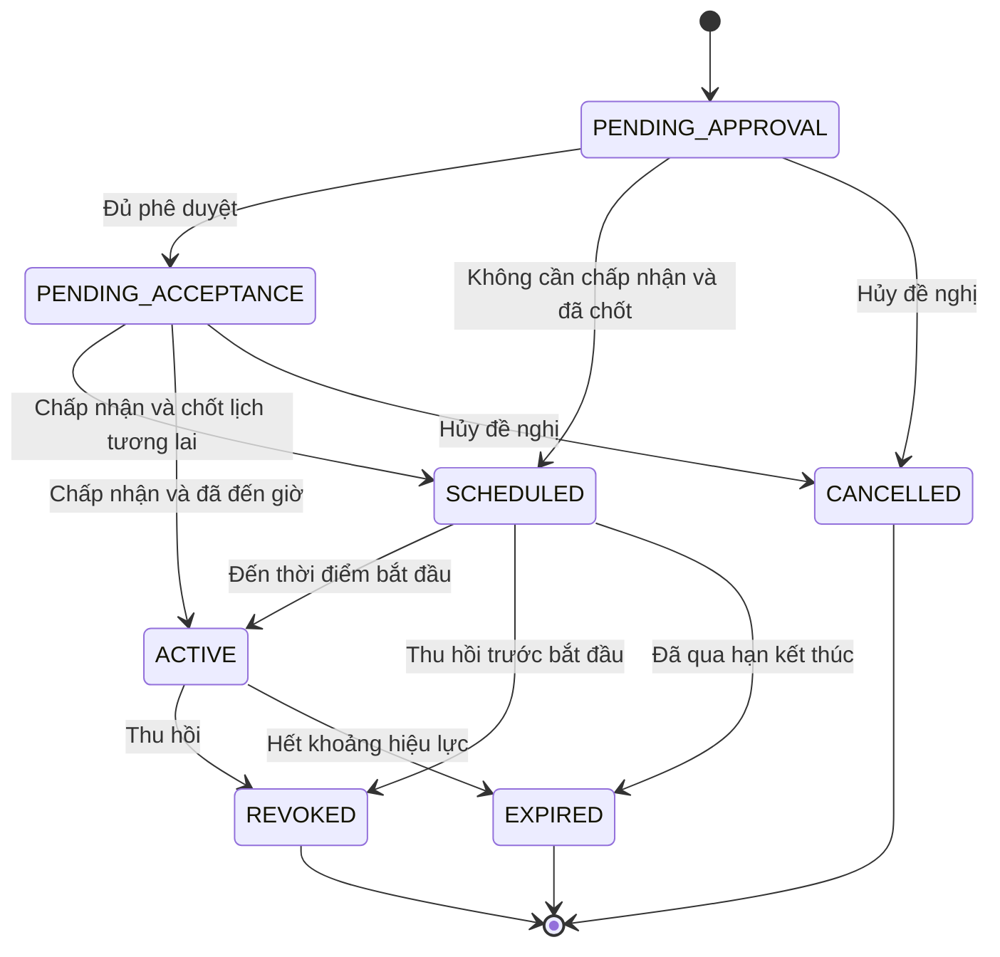

# Delegation start time — Thời điểm bắt đầu hiệu lực của ủy quyền

## 1. Mục tiêu và phạm vi

Trong chương **Delegation**, thời điểm bắt đầu hiệu lực xác định từ khi nào một người được dùng quyền do người khác giao để thao tác trên đối tượng nghiệp vụ. Ví dụ, quản lý A giao cho B quyền phê duyệt yêu cầu của kho X từ 09:00 ngày 01/12/2026. Trước thời điểm đó, việc B đã thấy bản ghi ủy quyền, nhận thông báo hoặc có một token hợp lệ chưa đủ để B thực hiện quyền được giao.

Đây là một ranh giới bảo mật logic nghiệp vụ. Nếu backend chỉ kiểm tra “có bản ghi delegation” hoặc “trạng thái ACTIVE”, người nhận có thể thực hiện sớm, bỏ qua bước phê duyệt, tự sửa ngày bắt đầu hoặc phát lại một quyết định quyền đã cũ. Ngược lại, nếu quyền phụ thuộc hoàn toàn vào worker kích hoạt, một worker chạy trễ có thể làm hệ thống từ chối sai những thao tác vốn đã đến hạn được phép.

Bài học tập trung vào thời điểm bắt đầu trong mối quan hệ với bất biến nghiệp vụ, trạng thái, quyền theo đối tượng, transaction và idempotency. Thời điểm kết thúc được nhắc đến để xác định một khoảng hiệu lực hợp lệ; các ví dụ là chính sách minh họa, không phải quy định bắt buộc cho mọi tổ chức.

Sau bài học, người học có thể:

- Phân biệt ngày bắt đầu do người tạo đề xuất với thời điểm quyền thực sự được phép sử dụng.
- Thiết kế điều kiện hiệu lực không phụ thuộc vào giao diện hay lịch chạy worker.
- Xử lý phê duyệt, chấp nhận muộn và thay đổi ngày bắt đầu có kiểm soát.
- Kiểm tra quyền ủy quyền tại điểm quyết định cùng trạng thái đối tượng.
- Bảo vệ token, cache, tác vụ nền và chuỗi ủy quyền khỏi việc kích hoạt sớm.
- Kiểm thử các biên thời gian, race condition và replay liên quan.

## 2. Mô hình thời gian và các bất biến

### 2.1. Không đồng nhất các timestamp

| Trường | Ý nghĩa |
| --- | --- |
| `createdAt` | Lúc hệ thống ghi nhận đề nghị ủy quyền |
| `requestedStartsAt` | Thời điểm bắt đầu được người có quyền đề xuất |
| `authorizedAt` | Thời điểm server ghi nhận đã đủ phê duyệt cho đúng nội dung |
| `acceptedAt` | Thời điểm người nhận chấp nhận đúng nội dung, nếu chính sách yêu cầu |
| `readyAt` | Thời điểm server chốt rằng các điều kiện chuẩn bị đã hoàn tất |
| `effectiveFrom` | Mốc bắt đầu có hiệu lực được backend chốt theo chính sách |
| `expiresAt` | Mốc kết thúc, không bao gồm chính thời điểm này |
| `decisionAt` | Thời điểm có thẩm quyền dùng để quyết định một thao tác nghiệp vụ cụ thể |

Người tạo có thể được phép chọn một lịch bắt đầu trong tương lai. Điều đó khác với việc cho client tự khẳng định ủy quyền đã có hiệu lực. Backend phải kiểm tra người đề xuất, phạm vi, thời hạn cho phép và các điều kiện phê duyệt rồi mới chốt `effectiveFrom`.

`createdAt` không chứng minh quyền đã sẵn sàng. `authorizedAt` cũng không tự thay cho `acceptedAt` nếu người nhận bắt buộc phải chấp nhận. Những thời điểm này phải đến từ các sự kiện được server xác minh, không phải các trường tự khai trong request.

### 2.2. Khoảng hiệu lực nửa mở

Với chính sách minh họa của bài:

```text
effectiveFrom <= decisionAt < expiresAt
```

Ngay tại `effectiveFrom`, điều kiện thời gian bắt đầu được thỏa mãn. Ngay tại `expiresAt`, điều kiện thời gian không còn thỏa mãn. Khoảng phải không rỗng:

```text
effectiveFrom < expiresAt
```

Điều kiện thời gian chỉ là một phần của quyết định:

```text
đã có bản ghi sẵn sàng được commit
AND không bị thu hồi, hủy hoặc vô hiệu hóa
AND effectiveFrom <= decisionAt < expiresAt
AND người gọi đúng là người được nhận quyền
AND đúng tenant, hành động và đối tượng được giao
AND quyền nguồn cùng các điều kiện nghiệp vụ vẫn đáp ứng chính sách
```

Không diễn giải biểu thức thời gian thành “đã cho phép mọi hành động của người giao”. Quyền còn bị giới hạn bởi phạm vi đối tượng, loại thao tác, trần số lượng hoặc giá trị và các ràng buộc tách nhiệm vụ.

### 2.3. Các bất biến quan trọng

- Không tạo hiệu ứng sử dụng quyền ủy quyền trước `effectiveFrom`.
- Không có hiệu lực trước khi các điều kiện phê duyệt và chấp nhận bắt buộc đã hoàn tất.
- Một sửa đổi ngày bắt đầu không được âm thầm tái sử dụng bằng chứng của nội dung cũ.
- Retry không tự lấy một thời điểm mới làm ngày bắt đầu hoặc tạo thêm ủy quyền.
- Token, cache và worker không được mở rộng khoảng quyền đã được backend chốt.
- Không biến việc lùi ngày trên dữ liệu thành bằng chứng rằng một hành động trước đây đã được phép.
- Khi có chuỗi ủy quyền, quyền con không được bắt đầu sớm hơn quyền nguồn cho phép.

## 3. Chọn chính sách bắt đầu rõ ràng

### 3.1. Bắt đầu theo lịch nhưng không hồi tố quyền

Giả sử chính sách yêu cầu đủ phê duyệt và người nhận phải chấp nhận. Một cách chốt thời điểm là:

```text
effectiveFrom = MAX(
    requestedStartsAt,
    authorizedAt,
    acceptedAt,
    readyAt
)
```

Nếu không cần chấp nhận thì bỏ điều kiện `acceptedAt`, không thay nó bằng thời gian client truyền. `readyAt` được lấy khi backend chốt lần đầu rằng các điều kiện đã sẵn sàng. Bản ghi sau chốt chỉ được dùng sau khi transaction của nó commit.

Công thức này ngăn việc phê duyệt muộn làm quyền trở nên hợp lệ trong quá khứ. Nó không phải một cách tái dựng thời điểm commit chính xác: mọi thao tác nghiệp vụ vẫn phải đọc được bản ghi đã commit và lấy `decisionAt` của chính thao tác đó. Không dùng timestamp do một transaction chưa commit tạo ra để cấp quyền ở nơi khác.

Hệ thống có thể chọn một chính sách nghiêm ngặt hơn: nếu quá giờ đề xuất mà chưa đủ điều kiện thì phải xin lịch mới. Cần chọn và triển khai nhất quán; không để mỗi endpoint xử lý phê duyệt muộn theo một cách.

### 3.2. Ví dụ phê duyệt và chấp nhận muộn

Các thời điểm trong bảng dưới cùng thuộc ngày 01/12/2026 theo múi giờ nghiệp vụ; thời điểm kết thúc dự kiến là 17:00:

| Lịch đề xuất | Đủ phê duyệt | Chấp nhận | Chốt sẵn sàng | Bắt đầu thực tế theo ví dụ |
| --- | --- | --- | --- | --- |
| 09:00 | 08:30 | 08:40 | 08:41 | 09:00 |
| 09:00 | 09:07 | 09:10 | 09:11 | 09:11 |
| 09:00 | 08:30 | 10:00 | 10:01 | 10:01 |
| 09:00 | 17:05 | 17:06 | 17:07 | Không có khoảng hợp lệ trước 17:00; không kích hoạt |

Không tự đẩy `expiresAt` ra xa chỉ vì các bước chuẩn bị kết thúc muộn. Gia hạn là thay đổi cần có quyền và có thể cần phê duyệt lại. Tương tự, không ghi `effectiveFrom=09:00` sau khi 09:11 mới đủ điều kiện rồi dùng nó để hợp thức hóa một lần duyệt lúc 09:05.

### 3.3. Múi giờ và cách nhập lịch

Thời điểm có hiệu lực nên được so sánh trên cùng trục thời gian, chẳng hạn `Instant` trong Java. Nếu giao diện nhận ngày và giờ địa phương, backend phải dùng múi giờ nghiệp vụ đã xác định, không dùng mặc định của máy chủ hoặc trình duyệt.

Ví dụ 09:00 tại `Asia/Ho_Chi_Minh` và 09:00 ở một múi giờ khác không đại diện cho cùng thời điểm. Client được đổi múi giờ hiển thị không có nghĩa được đổi ý nghĩa của lịch đã duyệt.

Với vùng có đổi giờ địa phương, một giờ có thể không tồn tại hoặc xuất hiện hai lần. Chính sách phải từ chối giờ không xác định duy nhất hoặc quy định rõ cách chọn offset; không để một phép chuyển đổi mặc định âm thầm đẩy quyền bắt đầu sớm hơn dự kiến. Lưu thời điểm đã chốt cùng thông tin múi giờ và dữ liệu cần truy nguyên lịch.

### 3.4. Có được dùng cho đối tượng được tạo trước ngày bắt đầu?

Thời điểm đối tượng được tạo và thời điểm sử dụng quyền là hai điều kiện khác nhau. Nếu A giao B quyền phê duyệt từ 09:00, B có thể được phép xử lý các hồ sơ tồn từ hôm trước **sau 09:00**, nếu phạm vi ủy quyền cho phép.

Nếu nghiệp vụ chỉ cho B xử lý hồ sơ phát sinh từ ngày bắt đầu, cần thêm điều kiện riêng trên đối tượng, chẳng hạn `object.createdAt >= delegation.objectEligibilityFrom`. Không suy điều kiện này chỉ từ `effectiveFrom`, và không cho client sửa thời điểm tạo hồ sơ để đáp ứng phạm vi.

## 4. Trạng thái và thay đổi ngày bắt đầu

### 4.1. Vòng đời minh họa



Đây là mô hình có thể bỏ bước chấp nhận theo chính sách. Trường hợp không cần chấp nhận và chốt khi đã đến giờ cũng có thể chuyển trực tiếp sang `ACTIVE` sau khi đủ điều kiện. Những nhánh đó do backend chọn; client không được đặt `acceptanceRequired=false` để tự bỏ bước.

Nhãn `ACTIVE` không thay thế kiểm tra thời gian. Một bản ghi bị cập nhật nhãn sớm vẫn phải bị chặn trước `effectiveFrom`. Ngược lại, bản ghi `SCHEDULED` đã đủ điều kiện có thể được đánh giá và chuyển sang `ACTIVE` ngay trong transaction của một thao tác hợp lệ khi đã đến giờ, dù worker chưa chạy.

### 4.2. Phê duyệt và chấp nhận phải gắn với nội dung

Một revision cần cố định ít nhất:

```text
tenantId, grantorId, delegateId
allowedActions, objectScope, quantityOrValueLimits
requestedStartsAt, expiresAt, businessZone
acceptanceRequired, redelegationAllowed
delegationRevision, policyVersion, contentDigest
```

Một lần chấp nhận chỉ xác nhận đúng nội dung được trình bày. Nếu đã chấp nhận nhận quyền đọc từ 09:00 rồi đề nghị bị sửa thành quyền phê duyệt từ 08:00, không được dùng sự chấp nhận cũ cho nội dung mới.

Thay đổi lịch, người nhận, người giao, đối tượng hoặc quyền phải qua quy tắc sửa đổi và kiểm tra lại tương ứng. Trong mô hình của bài, sửa trường ảnh hưởng đến quyền tạo revision mới và vô hiệu hóa bằng chứng không còn áp dụng. Phê duyệt và chấp nhận tham chiếu đúng revision hoặc biểu diễn nội dung chuẩn của backend.

### 4.3. Dời sớm và dời muộn đều có tác động bảo mật

Dời sớm trực tiếp mở quyền trước lịch đã được duyệt. Dời muộn tưởng chỉ là thu hẹp quyền nhưng cũng có thể làm task, token và cache cũ tiếp tục cấp quyền theo mốc trước. Cả hai cần kiểm soát phiên bản và cơ chế vô hiệu hóa dữ liệu quyết định cũ.

Không cung cấp endpoint “activate now” chỉ đổi `state=ACTIVE` mà bỏ qua `effectiveFrom` và điều kiện chuẩn bị. Nếu nghiệp vụ cho phép kích hoạt ngay, endpoint đó phải tạo hoặc áp dụng một thay đổi lịch được cấp quyền, có phê duyệt khi cần và không hồi tố hành động trước đó.

## 5. Ví dụ chính sách thời gian trong Java

Ví dụ dùng cú pháp Java 17, chỉ xử lý việc chốt cửa sổ và đánh giá điều kiện thời gian. Nó không xác minh tính hợp lệ của phê duyệt, danh tính, phạm vi hay trạng thái đối tượng nghiệp vụ. Các timestamp đầu vào cho điều kiện đã hoàn tất phải được tầng nghiệp vụ lấy từ bằng chứng có thẩm quyền.

```java
import java.time.Instant;
import java.util.Objects;
import java.util.Optional;

public final class DelegationStartPolicy {
    public enum State {
        PENDING_APPROVAL, PENDING_ACCEPTANCE,
        SCHEDULED, ACTIVE, REVOKED, CANCELLED, EXPIRED
    }

    public enum TimeDecision {
        WINDOW_OPEN, NOT_STARTED, EXPIRED, NOT_READY
    }

    public record Window(Instant effectiveFrom, Instant expiresAt) {
        public Window {
            Objects.requireNonNull(effectiveFrom, "effectiveFrom");
            Objects.requireNonNull(expiresAt, "expiresAt");
            if (!effectiveFrom.isBefore(expiresAt)) {
                throw new IllegalArgumentException("Empty delegation window");
            }
        }
    }

    public static Window prepare(
        Instant requestedStartsAt,
        Instant authorizedAt,
        boolean acceptanceRequired,
        Optional<Instant> acceptedAt,
        Instant readyAt,
        Instant expiresAt
    ) {
        Objects.requireNonNull(requestedStartsAt, "requestedStartsAt");
        Objects.requireNonNull(authorizedAt, "authorizedAt");
        Objects.requireNonNull(acceptedAt, "acceptedAt");
        Objects.requireNonNull(readyAt, "readyAt");
        Objects.requireNonNull(expiresAt, "expiresAt");
        if (authorizedAt.isAfter(readyAt)) {
            throw new IllegalArgumentException("Authorization is not ready");
        }

        Instant effectiveFrom = later(requestedStartsAt, authorizedAt);
        if (acceptanceRequired) {
            Instant accepted = acceptedAt.orElseThrow(
                () -> new IllegalStateException("Acceptance is required")
            );
            if (accepted.isAfter(readyAt)) {
                throw new IllegalArgumentException("Acceptance is not ready");
            }
            effectiveFrom = later(effectiveFrom, accepted);
        }
        effectiveFrom = later(effectiveFrom, readyAt);
        return new Window(effectiveFrom, expiresAt);
    }

    public static TimeDecision evaluate(
        State state, Window window, Instant decisionAt
    ) {
        Objects.requireNonNull(state, "state");
        Objects.requireNonNull(window, "window");
        Objects.requireNonNull(decisionAt, "decisionAt");
        if (state != State.SCHEDULED && state != State.ACTIVE) {
            return TimeDecision.NOT_READY;
        }
        if (decisionAt.isBefore(window.effectiveFrom())) {
            return TimeDecision.NOT_STARTED;
        }
        if (!decisionAt.isBefore(window.expiresAt())) {
            return TimeDecision.EXPIRED;
        }
        return TimeDecision.WINDOW_OPEN;
    }

    private static Instant later(Instant first, Instant second) {
        return first.isAfter(second) ? first : second;
    }
}
```

`WINDOW_OPEN` chỉ có nghĩa điều kiện trạng thái sẵn sàng và thời gian trong bộ tính được đáp ứng. Không đổi tên kết quả đó thành một quyết định cho phép toàn bộ hành động nếu còn các điều kiện quyền chưa được kiểm tra.

`prepare` được dùng để chốt cho một revision đã đủ điều kiện và lưu kết quả. Không gọi lại với `readyAt=now` cho mỗi thao tác: cách đó sẽ liên tục dời mốc hoặc làm kết quả thay đổi theo retry. Đề nghị cũng cần được kiểm tra riêng về lịch tối đa cho phép, thời điểm kết thúc và quyền đề xuất ngay từ lúc tạo.

Trong ví dụ, chấp nhận chỉ ảnh hưởng mốc nếu chính sách bắt buộc. Nếu sản phẩm muốn một sự chấp nhận tự nguyện cũng là điều kiện kích hoạt, cần biểu diễn lựa chọn đó rõ ràng trong chính sách của revision.

## 6. Chốt ủy quyền và sử dụng quyền trong transaction

### 6.1. Chốt mốc cho một revision đúng một lần

Luồng chốt lịch cần thực hiện các bước trong một ranh giới nhất quán:

1. Xác thực chủ thể và tải đề nghị trong đúng tenant.
2. Khóa hoặc kiểm soát phiên bản đề nghị; kiểm tra nó còn ở trạng thái được phép chốt.
3. Xác minh phê duyệt và chấp nhận tham chiếu đúng revision, nội dung và người nhận.
4. Kiểm tra người giao còn quyền giao các hành động trong phạm vi đề xuất.
5. Lấy `readyAt` từ nguồn thời gian server, tính `effectiveFrom` và xác nhận khoảng không rỗng.
6. Lưu cửa sổ, bằng chứng, revision và trạng thái tương ứng cùng transaction.
7. Chỉ công bố kết quả có hiệu lực sau khi commit.

Với cùng idempotency key và cùng nội dung, retry trả kết quả đã chốt thay vì lấy `readyAt` mới. Cùng key nhưng nội dung khác phải bị từ chối. Hai key khác nhau cùng chốt một revision vẫn không được tạo hai cửa sổ độc lập; trạng thái cùng ràng buộc duy nhất theo đề nghị và revision phải bảo vệ điều đó.

Nếu chốt lịch thất bại trước commit, không tồn tại một quyền mới có hiệu lực. Không gửi token hoặc sự kiện cấp quyền như thể transaction đã thành công. Có thể ghi outbox cùng transaction rồi phát thông báo sau commit; việc nhận thông báo vẫn không thay thế kiểm tra quyền ở mỗi hành động.

### 6.2. Quyết định sử dụng quyền tại một điểm rõ ràng

Chính sách minh họa lấy `decisionAt` sau khi đã tải và khóa các dữ liệu quyết định cần thiết, ngay trước khi thực hiện chuyển trạng thái nghiệp vụ. Quy tắc này dùng thời điểm quyết định phía server, không dùng lúc client bấm nút hay timestamp trong body.

Vì vậy, request đến trước mốc nhưng được quyết định sau mốc có thể được phép nếu mọi điều kiện khác thỏa mãn. Nếu sản phẩm cấm cả tiếp nhận trước mốc, cần một điều kiện tiếp nhận riêng với timestamp có thẩm quyền; khi worker thực hiện vẫn phải kiểm tra lại quyền hiện tại.

Một thao tác được quyết định hợp lệ có thể commit hoặc trả phản hồi sau đó. Không mô tả mô hình này thành bảo đảm tuyệt đối rằng mốc hiệu lực được so với thời điểm commit chính xác. Quan trọng là chọn điểm quyết định nhất quán, lưu nó và phối hợp mọi đường cập nhật liên quan.

### 6.3. Mã giả thực thi dưới quyền ủy quyền

Ví dụ dưới đây giả định bản ghi ủy quyền, quyền nguồn cần kiểm soát và đối tượng nghiệp vụ nằm trong cùng miền giao dịch. Các hàm là giao diện minh họa, không phải API có sẵn của Java.

```java
return transaction.required(() -> {
    RequestRecord call = idempotency.claimOrLock(
        authenticatedScope,
        command.idempotencyKey(),
        canonicalFingerprint(command)
    );
    call.requireSameFingerprint(canonicalFingerprint(command));

    Delegation grant = delegations.lockByTenantAndId(
        authenticatedTenantId, command.delegationId()
    );
    BusinessObject object = objects.lockByTenantAndId(
        authenticatedTenantId, command.objectId()
    );

    authorization.requireCanAccessDelegation(currentActor, grant);
    if (call.isCompleted()) {
        authorization.requireCurrentReadAccess(currentActor, object, grant);
        return call.storedResult();
    }

    grant.requireContentRevision(command.expectedDelegationRevision());
    grant.requireDelegate(currentActor.id());
    grant.requireReadyEvidenceForCurrentRevision();

    AuthorityContext authority = authorityRepository.lockCurrentBasis(grant);
    Instant decisionAt = trustedClock.instant();
    TimeDecision time = DelegationStartPolicy.evaluate(
        grant.state(), grant.window(), decisionAt
    );
    require(time == TimeDecision.WINDOW_OPEN);

    authorization.requireDelegatedAction(
        currentActor, grant, authority, command.action(), object, decisionAt
    );
    object.requireExpectedVersion(command.expectedObjectVersion());
    object.requireActionAllowedByBusinessState(command.action());
    separationOfDuties.requireSatisfied(currentActor, grant, object);
    approvalLimits.requireSatisfied(grant, object, command.action());

    // Chuyển nhãn khi cần; việc đến giờ đã được kiểm tra ở trên.
    grant.promoteToActiveIfScheduled();
    BusinessResult result = object.apply(command.action());
    effects.insertUniqueBusinessEffect(command.businessOperationId(), object);
    objects.save(object);
    delegations.save(grant);
    audit.appendDelegatedAction(currentActor, grant, object, decisionAt);
    idempotency.complete(call, result);
    return result;
});
```

Các giá trị trong `command` chỉ biểu đạt ý định và phiên bản kỳ vọng. Danh tính hiện tại đến từ ngữ cảnh xác thực; `delegationId` là tham chiếu cần kiểm tra, không phải một bí mật mà ai biết cũng được sử dụng.

`requireCurrentReadAccess` cũng phải đánh giá quyền đọc hiện tại theo chính sách. Nếu quyền đọc chỉ đến từ một ủy quyền chưa bắt đầu hoặc đã bị thu hồi thì không được trả dữ liệu nhạy cảm chỉ vì người gọi còn giữ key cũ. Khi replay kết quả hợp lệ, không tạo thêm hiệu ứng hoặc đổi mốc bắt đầu.

### 6.4. Idempotency của hành động khác idempotency của ủy quyền

Một ủy quyền có thể được dùng cho nhiều hành động khác nhau trong phạm vi cho phép. Không đặt ràng buộc “mỗi delegation chỉ có một hiệu ứng” trừ khi nghiệp vụ thực sự là ủy quyền dùng một lần.

Ngược lại, cùng một ý định nghiệp vụ được gửi lại không được tạo hiệu ứng hai lần. Cần idempotency và ràng buộc duy nhất theo hành động hoặc thao tác nghiệp vụ cụ thể, kết hợp chuyển trạng thái đối tượng. Dùng key mới không được giúp duyệt cùng một hồ sơ đã được duyệt nếu vòng đời hồ sơ không cho phép.

Nếu transaction rollback rồi retry, lấy lại `decisionAt` và toàn bộ điều kiện hiện tại; không dùng một quyết định thời gian cũ làm giấy phép cho lần mới. Nếu transaction đã commit nhưng phản hồi bị mất, trả kết quả gốc khi còn quyền đọc, thay vì thực thi lại.

### 6.5. Đồng bộ với sửa lịch và thu hồi

Thao tác sử dụng quyền, sửa ngày bắt đầu và thu hồi phải phối hợp qua khóa hoặc kiểm soát phiên bản tương đương. Nếu thu hồi được commit trước điểm quyết định của hành động, hành động phải bị chặn. Nếu hành động đã được quyết định và commit trước theo thứ tự giao dịch, thu hồi không xóa lịch sử hợp lệ đó.

Phân biệt **revision nội dung quyền** với **version hàng dùng cho đồng thời**. Worker chuyển nhãn `SCHEDULED` sang `ACTIVE` có thể tăng version hàng mà không đổi nội dung đã duyệt. Ngược lại, dời giờ bắt đầu hoặc đổi người nhận phải tạo thay đổi nội dung có thể làm token và bằng chứng cũ mất hiệu lực.

Quy ước thứ tự khóa phải nhất quán giữa grant, quyền nguồn, chuỗi cha và đối tượng nghiệp vụ để hạn chế deadlock. Với optimistic locking, xung đột phải dẫn đến rollback và đánh giá lại. Một mutex trong một instance không bảo vệ được các instance hoặc worker khác.

## 7. Token, cache và tác vụ nền không được kích hoạt sớm

### 7.1. Token hợp lệ chưa đủ cho hành động nghiệp vụ

Token có chữ ký đúng có thể giúp xác thực người gọi hoặc mang tham chiếu đến một ủy quyền. Nó không chứng minh rằng tại thời điểm hiện tại, ủy quyền đã bắt đầu và còn đáp ứng toàn bộ điều kiện.

Nếu có token dành cho sử dụng quyền được giao, cần ràng buộc nó với đúng người nhận, tenant, delegation, revision, đối tượng hoặc phạm vi, hành động và hệ thống nhận phù hợp. Một token được phát trước giờ để chuẩn bị không được cấp quyền sử dụng sớm chỉ vì đã xác minh được chữ ký.

Một trường kiểu “not before” trong token có thể hỗ trợ chặn sớm, nhưng backend vẫn cần thực thi ranh giới nghiệp vụ của grant. Dung sai đồng hồ của tầng xác thực không mặc nhiên là dung sai để bắt đầu quyền sớm. Nếu token biểu diễn thời gian theo giây còn grant giữ độ chính xác cao hơn, làm tròn cũng không được mở ra một khoảng quyền sớm hơn mốc đã chốt.

Token cũ còn hạn không được giữ quyền theo lịch cũ sau một thay đổi có hiệu lực. Cần kiểm tra phiên bản hoặc trạng thái hiện tại theo hợp đồng thu hồi; chỉ đặt thời gian hết hạn ngắn không tạo ra bảo đảm vô hiệu hóa ngay lập tức.

### 7.2. Cache phải giữ ranh giới thời gian và phiên bản

Các lỗi thường gặp:

- Tính trước kết quả “được phép từ 09:00” rồi cache dưới dạng `allowed=true` từ 08:00.
- Dùng cache theo `delegateId` mà thiếu tenant, delegation, hành động hoặc đối tượng.
- Giữ một kết quả cho phép sau khi lịch bị dời muộn hoặc quyền nguồn bị thu hồi.
- Giữ kết quả từ chối trước giờ quá lâu sau khi đã đến mốc bắt đầu.

Nếu cache metadata của grant, tầng quyết định vẫn phải so sánh `decisionAt` với cửa sổ và xác minh độ mới theo chính sách. Nếu cache một quyết định có thời hạn, phải biểu diễn rõ khoảng mà quyết định được dùng, phiên bản và các điều kiện liên quan; không coi TTL đơn thuần là điều kiện đủ.

Trong mô hình cần thu hồi và sửa lịch có hiệu lực ngay theo thứ tự giao dịch, đường cấp quyền phải dựa vào dữ liệu có thẩm quyền hoặc một giao thức đảm bảo độ mới tương đương. Cache cập nhật theo sự kiện trễ không tự đáp ứng yêu cầu đó. Khi không xác minh được điều kiện bắt buộc, không tự cho phép bằng một kết quả cũ chưa rõ còn hiệu lực.

### 7.3. Worker kích hoạt là cơ chế vận hành

Worker có thể đánh thức công việc hoặc cập nhật nhãn khi đến giờ, nhưng phải đọc lại grant và revision hiện tại trước khi thực hiện. Một message mang `delegationId` cùng thời điểm dự kiến không phải giấy phép kích hoạt phiên bản mới hơn.

```text
Chỉ cập nhật nhãn kích hoạt khi:
    revision hiện tại khớp revision của task
    AND trạng thái đủ điều kiện
    AND mọi bằng chứng chuẩn bị còn hợp lệ
    AND effectiveFrom <= authoritativeNow < expiresAt
```

Nếu worker chạy sớm, không kích hoạt quyền; có thể lên lịch lại theo quy tắc của hệ thống. Nếu chạy muộn, API không cần chờ worker để cho phép một hành động đã đến mốc và đủ điều kiện: API tự đánh giá cửa sổ dưới kiểm soát giao dịch. Nếu đã qua hết khoảng hiệu lực, worker không chuyển sang `ACTIVE` chỉ vì task được đặt tên là “activate”.

### 7.4. Lập lịch hành động khác với có quyền thực hiện ngay

Sản phẩm có thể cho B chuẩn bị một lệnh chạy lúc 09:00 từ 08:00. Quyền tạo lịch là một hành động riêng phải được cho phép. Nó không đồng nghĩa B được dùng ủy quyền tương lai để phê duyệt, giữ tài nguyên hoặc tạo tác động nghiệp vụ từ 08:00.

Khi lệnh đến lượt chạy, worker phải lấy thời gian thực hiện có thẩm quyền và kiểm tra lại người nhận, grant, revision, quyền nguồn, trạng thái đối tượng và các giới hạn. Không dùng `scheduledFor` hoặc thời điểm gửi ban đầu làm bằng chứng quyền hiện tại.

Hàng đợi cần giữ nguồn gốc chủ thể và ý định đã được xác thực, thay vì để worker sử dụng toàn bộ quyền của service account để làm thay một hành động đã mất căn cứ. Các dữ liệu như `onBehalfOf` trong message cũng phải được đối chiếu với grant có thẩm quyền.

## 8. Phạm vi, danh tính và chuỗi ủy quyền

### 8.1. Ghi nhận cả người hành động và người giao quyền

Nếu B dùng quyền do A giao, hành động thực tế vẫn do B thực hiện. Không thay toàn bộ danh tính B bằng A trong ngữ cảnh xử lý rồi làm mất nguồn gốc.

Tối thiểu cần phân biệt:

```text
actorId       Người hoặc tiến trình thực sự gọi và thực hiện
grantorId     Người giao quyền theo grant
delegateId    Người được nhận quyền
delegationId  Căn cứ ủy quyền được sử dụng
```

Các ràng buộc tách nhiệm vụ phải xét những danh tính mà chính sách yêu cầu. Ví dụ, B không được dùng tên A để duyệt hồ sơ do chính B tạo nếu quy tắc cấm người tạo tự duyệt. Nếu A là người tạo và chính sách cũng cấm duyệt thay A cho hồ sơ của A, việc B thao tác không được tự làm mất điều kiện đó.

Một người duyệt trực tiếp và một người duyệt đại diện cho cùng nguồn quyền cũng không mặc nhiên tạo thành hai bên độc lập. Cách tính độc lập phải được mô hình hóa theo luồng phê duyệt, không chỉ đếm hai chuỗi user ID khác nhau.

### 8.2. Quyền độc lập của người nhận là một căn cứ khác

Trước ngày bắt đầu ủy quyền, B vẫn có thể có quyền riêng hợp lệ trên một số đối tượng. Chặn quyền ủy quyền chưa bắt đầu không đồng nghĩa chặn mọi hành động của B.

Nếu B thực hiện bằng quyền riêng, backend phải đánh giá đúng căn cứ đó và audit đúng nguồn quyền. Không ghi rằng hành động dựa vào delegation tương lai, cũng không tự cộng quyền riêng với một phần quyền ủy quyền chưa có hiệu lực để tạo ra một quyền tổng hợp không được phép.

### 8.3. Người giao mất quyền trước ngày bắt đầu

Một rủi ro là A tạo lịch hôm nay, nhưng trước ngày bắt đầu A đã rời nhóm hoặc mất quyền phê duyệt. Trong mô hình không khuếch đại quyền hiện tại của bài, delegation không được tiếp tục cung cấp quyền mà nguồn không còn cho phép.

Vì vậy, kiểm tra quyền nguồn phải được thực hiện theo chính sách tại điểm dùng hoặc qua cơ chế vô hiệu hóa có bảo đảm phù hợp. Chỉ kiểm tra A có quyền lúc tạo là chưa đủ cho mô hình này. Nếu sản phẩm cho phép một loại chuyển giao độc lập tiếp tục tồn tại sau khi A mất quyền, cần biểu diễn đó như một cơ chế cấp quyền riêng được phê chuẩn, không mặc nhiên coi mọi delegation đều như vậy.

### 8.4. Ủy quyền tiếp phải nằm trong giao khoảng của chuỗi

Nếu cho phép A ủy quyền cho B rồi B ủy quyền tiếp cho C, mỗi cạnh phải cho phép ủy quyền tiếp và mọi điều kiện phải được đáp ứng. Với chuỗi hợp lệ, ranh giới thời gian không thể rộng hơn:

```text
chainEffectiveFrom = MAX(effectiveFrom của mọi grant trong chuỗi)
chainExpiresAt     = MIN(expiresAt của mọi grant trong chuỗi)
```

Nếu `chainEffectiveFrom >= chainExpiresAt`, không có cửa sổ sử dụng hợp lệ. Phạm vi và giới hạn cũng phải nằm trong phần quyền mà toàn bộ chuỗi cho phép, không lấy vai trò rộng nhất của một mắt xích.

Ví dụ A giao B từ 10:00; một grant con không được cho C sử dụng quyền nguồn đó từ 09:00. Công thức giao khoảng chỉ là giới hạn cần giữ, không cấp cho B quyền phát hành grant con trước khi B được phép làm việc đó. Mặc định chặn nếu không có quyền ủy quyền tiếp hiện tại; nếu hỗ trợ chuẩn bị grant con cho tương lai, phải có luồng chuẩn bị và phê chuẩn riêng, vẫn không tạo quyền dùng sớm.

Chặn chu trình và giới hạn chiều sâu theo chính sách để tránh đường đánh giá không kết thúc hoặc tạo vòng tự chứng minh quyền. Khi grant cha bị dời lịch, thu hồi hoặc đổi revision, grant con không được tiếp tục sử dụng dữ liệu cha cũ mà chưa được kiểm tra hiệu lực.

## 9. Đồng hồ, độ chính xác và khả năng phục hồi

### 9.1. Chọn một nguồn thời gian có thẩm quyền

Không dùng giờ client hoặc múi giờ của trình duyệt làm `decisionAt`. Các instance phải dùng nguồn thời gian được vận hành nhất quán để tránh nơi này mở quyền sớm hơn nơi khác.

Nếu dùng thời gian cơ sở dữ liệu, cần biết giá trị được lấy tại lúc bắt đầu transaction hay tại điểm câu lệnh cụ thể. Nếu transaction bắt đầu trước mốc rồi chờ khóa lâu, một timestamp được cố định từ đầu transaction không cùng ý nghĩa với điểm quyết định đã chọn trong bài.

Theo dõi sai lệch và bước nhảy bất thường của đồng hồ. Đồng hồ chạy nhanh có thể làm quyền được xem là đến hạn sớm so với nguồn thời gian chuẩn; đồng hồ lùi có thể làm một quyền đang dùng bị xem là chưa bắt đầu. Không chữa vấn đề bằng cách tin timestamp người dùng hoặc thêm tùy tiện khoảng cho phép sớm.

Đồng hồ đơn điệu hữu ích để đo thời gian đã trôi qua trong một tiến trình. Nó không thay thế một thời điểm bền vững dùng so sánh sau khởi động lại hoặc giữa nhiều hệ thống.

### 9.2. Thống nhất độ chính xác và xử lý biên

Lưu, chuyển đổi và so sánh `effectiveFrom` cùng `decisionAt` theo độ chính xác đã quy định. Không để một nơi cắt đến giây còn nơi khác giữ mili giây và vô tình mở quyền sớm hơn.

Với `tick` là đơn vị chính xác được hệ thống dùng:

```text
decisionAt = effectiveFrom - tick  → chưa được dùng quyền này
decisionAt = effectiveFrom         → thỏa điều kiện bắt đầu
decisionAt = effectiveFrom + tick  → thỏa điều kiện bắt đầu
```

Hai kết quả sau vẫn cần thỏa thời điểm kết thúc, quyền và trạng thái. Nếu nghiệp vụ có một khoảng chuẩn bị trước giờ, cần định nghĩa những hành động nào được phép trong khoảng đó bằng quyền riêng; không mở toàn bộ quyền ủy quyền trước mốc dưới tên gọi “dung sai”.

### 9.3. Không hồi tố qua phục hồi hoặc import

Sau lỗi, đối chiếu bản ghi đã commit và hiệu ứng đã xảy ra trước khi tiếp tục. Không tạo lại một grant với ngày bắt đầu cũ rồi suy rằng một tác vụ chạy sớm trước đó vốn hợp lệ.

Các luồng import lịch sử hoặc quản trị sửa dữ liệu phải tách ghi nhận lịch sử với việc cấp quyền dùng cho hành động mới. Lưu provenance và quyền của người chỉnh; không sửa audit của một quyết định đã xảy ra để nó trông như được thực hiện sau mốc hợp lệ.

## 10. Các tình huống kiểm thử tấn công logic

### 10.1. Chốt lịch và điều kiện chuẩn bị

| Tình huống | Kết quả mong đợi |
| --- | --- |
| Đủ phê duyệt và chấp nhận trước lịch 09:00 | Chốt `effectiveFrom=09:00` nếu các điều kiện khác thỏa mãn |
| Phê duyệt hoặc chấp nhận muộn | Mốc không sớm hơn thời điểm hoàn tất và chốt sẵn sàng |
| Đã quá `expiresAt` mới đủ điều kiện | Không tạo cửa sổ rỗng hoặc tự gia hạn |
| Chưa chấp nhận nhưng chính sách bắt buộc | Không chuyển sang sẵn sàng |
| Client tự gửi `authorizedAt`, `acceptedAt` hoặc `readyAt` | Không dùng chúng thay cho bằng chứng server |
| Duyệt lịch 09:00 rồi sửa xuống 08:00 | Không dùng phê duyệt của revision cũ |
| Người nhận chấp nhận quyền đọc rồi nội dung đổi sang quyền duyệt | Yêu cầu bằng chứng đúng nội dung mới |
| Retry chốt cùng key và nội dung | Cùng revision, cùng cửa sổ đã lưu; không lấy `readyAt` mới |
| Hai key khác nhau cùng chốt một revision | Chỉ một kết quả chốt có thẩm quyền |
| Đổi múi giờ hiển thị của client | Không đổi thời điểm thực đã duyệt |
| Nhập giờ địa phương không tồn tại hoặc có hai offset | Xử lý theo chính sách rõ ràng, không âm thầm kích hoạt sớm |

### 10.2. Sử dụng quyền, token và phạm vi

| Tình huống | Bất biến cần xác nhận |
| --- | --- |
| Chỉ có quyền từ delegation, quyết định trước mốc một tick | Không có hiệu ứng nghiệp vụ |
| Quyết định đúng mốc | Được xét tiếp các điều kiện quyền và trạng thái |
| Trạng thái bị đặt ACTIVE nhưng chưa đến giờ | Vẫn bị chặn theo `effectiveFrom` |
| Đã đến giờ nhưng worker chưa đổi SCHEDULED | Có thể thực hiện nếu toàn bộ điều kiện hợp lệ |
| Token ký đúng được phát trước giờ | Không bỏ qua mốc bắt đầu nghiệp vụ |
| Token cũ sau khi lịch bị dời muộn | Không tiếp tục dùng lịch cũ ngoài hợp đồng hiệu lực |
| Người khác biết delegation ID | Không sử dụng được nếu không phải người nhận hoặc không có căn cứ quyền phù hợp |
| Chọn đối tượng ngoài tenant hoặc ngoài phạm vi kho được giao | Từ chối theo đối tượng |
| Đã đến giờ nhưng người giao mất quyền nguồn | Từ chối theo mô hình quyền nguồn hiện tại của bài |
| B dùng quyền độc lập hợp lệ trước giờ ủy quyền | Có thể được phép bằng quyền riêng và phải audit đúng căn cứ |
| B dùng danh nghĩa A để duyệt hồ sơ do B tạo | Không vượt quy tắc tách nhiệm vụ |
| Grant con đề xuất bắt đầu trước grant cha | Không tạo quyền sử dụng sớm hơn toàn bộ chuỗi cho phép |
| Task được gửi sớm, worker chạy lúc chưa đến giờ | Không tạo hiệu ứng; không tin `scheduledFor` do client khai |

### 10.3. Transaction, replay và lỗi vận hành

| Tình huống | Kết quả bắt buộc |
| --- | --- |
| Thu hồi cạnh tranh với sử dụng quyền | Chỉ cho kết cục phù hợp thứ tự giao dịch, không dùng snapshot đã bị vô hiệu hóa |
| Dời mốc muộn đồng thời với thao tác | Thao tác phải dựa trên revision và cửa sổ có hiệu lực tại điểm quyết định |
| Worker cũ chạy sau khi lịch đổi | Không kích hoạt theo revision cũ |
| Hai lần dùng cùng ý định nghiệp vụ | Không tạo hiệu ứng trùng, dù dùng hai idempotency key |
| Mất phản hồi sau commit | Retry trả kết quả đã lưu nếu có quyền đọc, không thực hiện lại |
| Lỗi sau cập nhật đối tượng, trước lưu kết quả | Rollback toàn bộ phần ghi trong transaction |
| Transaction xung đột rồi retry | Đọc lại grant, quyền, trạng thái và lấy thời điểm quyết định mới |
| Restart trong lúc chờ bắt đầu | Quyết định dựa trên dữ liệu bền vững, không dựa vào timer trong bộ nhớ |
| Cache chứa quyền cho phép theo lịch cũ | Không bỏ qua kiểm tra độ mới và mốc hiện tại |
| Đường xử lý quyền hoặc dữ liệu cần thiết không truy cập được | Không tự cho phép bằng giả định rằng grant sắp hoặc đã đến giờ |

Kiểm thử thời gian nên dùng đồng hồ được tiêm vào và dữ liệu cố định, không ngủ để chờ mốc thực. Với race condition, tạo điểm giao nhau có chủ đích ở khóa hoặc cập nhật phiên bản rồi kiểm tra trạng thái lưu trữ, số hiệu ứng, revision và audit cuối cùng. Chỉ kiểm tra HTTP status hoặc nhãn ACTIVE là chưa đủ.

## 11. Audit và tín hiệu cần quan sát

Một quyết định sử dụng quyền nên truy được:

- Người thực sự hành động, người giao, người nhận, tenant và delegation ID.
- Revision nội dung, phiên bản chính sách và căn cứ phê duyệt hoặc chấp nhận.
- Lịch đề xuất, `authorizedAt`, `acceptedAt` khi cần, `readyAt` và `effectiveFrom` đã chốt.
- `decisionAt`, thời điểm kết thúc và lý do cho phép hoặc từ chối.
- Hành động, đối tượng, revision đối tượng và định danh hiệu ứng nghiệp vụ.
- Chuỗi quyền nguồn được dùng, nếu có ủy quyền tiếp.

Nếu một người có nhiều căn cứ quyền, ghi căn cứ thực tế đã cho phép hành động. Không gắn một delegation tương lai vào audit chỉ vì nó tồn tại trên cùng tài khoản.

Theo dõi số lần cố sử dụng trước giờ, yêu cầu sửa mốc về sớm, dùng token hoặc task cũ sau thay đổi, nhiều lần tự bỏ bước chấp nhận, khác biệt thời gian giữa instance và các grant đã sẵn sàng nhưng nhãn kích hoạt cập nhật trễ.

Không ghi token hoặc bí mật xác thực vào log. Quyền đọc metadata ủy quyền và audit cũng cần được giới hạn đúng phạm vi; việc người nhận được xem thông tin lịch không tự cho họ quyền xem dữ liệu nghiệp vụ trước khi quyền đọc tương ứng bắt đầu.

Đối soát có thể phát hiện hành động có `decisionAt < effectiveFrom`, bằng chứng sai revision hoặc grant con vượt cửa sổ cha. Kết quả đó phục vụ điều tra và điều chỉnh có dấu vết, không tự sửa timestamp để che một hành động không hợp lệ.

## 12. Ví dụ xuyên suốt và câu hỏi tự kiểm tra

Giả sử A giao B quyền duyệt một nhóm yêu cầu của kho X từ 09:00 đến 17:00 ngày 01/12/2026 theo `Asia/Ho_Chi_Minh`:

1. Backend xác minh A được giao quyền đó, lưu lịch đề xuất cùng phạm vi, giới hạn và revision 1.
2. Phê duyệt hoàn tất lúc 08:30, B chấp nhận đúng revision 1 lúc 08:40, server chốt sẵn sàng lúc 08:41.
3. `effectiveFrom` được chốt là 09:00, tương ứng `2026-12-01T02:00:00Z`; bản ghi được commit ở trạng thái SCHEDULED.
4. Lúc 08:59:59, B gọi API duyệt bằng delegation này. Backend chặn vì chưa đến mốc, dù B đã có token và thấy thông báo nhận quyền.
5. Lúc 09:00, worker chưa cập nhật nhãn. API vẫn có thể khóa grant cùng hồ sơ, đánh giá cửa sổ, kiểm tra quyền nguồn, giới hạn và tách nhiệm vụ rồi thực hiện hợp lệ.
6. Nếu hồ sơ do B tạo và quy tắc cấm tự duyệt, yêu cầu vẫn bị từ chối. Đến giờ không loại bỏ ràng buộc đó.
7. Sau một lần duyệt hợp lệ đã commit, client mất phản hồi. Retry lấy kết quả gốc nếu còn quyền đọc, không tạo lần duyệt thứ hai và không đổi mốc bắt đầu.
8. Nếu A đổi lịch sang 10:00 trước một hành động tiếp theo, thay đổi phải qua luồng có quyền và kiểm soát revision; token cùng task theo lịch cũ không được cấp quyền theo mốc 09:00 nữa sau khi thay đổi có hiệu lực.

Trước khi triển khai, cần trả lời được:

- Ngày bắt đầu do ai đề xuất, và backend chốt mốc theo những điều kiện nào?
- Nếu duyệt hoặc chấp nhận muộn thì mốc thực tế là gì? Có được thay đổi thời điểm kết thúc không?
- Điều kiện đúng tại `effectiveFrom` và ngay trước nó khác nhau thế nào?
- Timestamp nào được dùng làm điểm quyết định, và ai có thẩm quyền tạo nó?
- Thay đổi lịch làm bằng chứng, token, cache và task cũ mất hiệu lực bằng cách nào?
- Người nhận có đang dùng quyền độc lập hay quyền đại diện, và audit ghi căn cứ nào?
- Worker chạy sớm, chạy trễ hoặc hệ thống khởi động lại có làm thay đổi ranh giới quyền không?
- Nếu có chuỗi ủy quyền, điều gì ngăn quyền con bắt đầu sớm hơn nguồn?

Thời điểm bắt đầu ủy quyền được bảo vệ khi backend chốt một mốc có căn cứ, giữ đúng phiên bản và đánh giá nó cùng danh tính, phạm vi, quyền nguồn và trạng thái nghiệp vụ tại điểm thực thi. Việc có lịch, token hay nhãn kích hoạt chỉ cung cấp dữ liệu cho quyết định; chúng không thay thế những điều kiện cần để tạo một hiệu ứng được phép.


